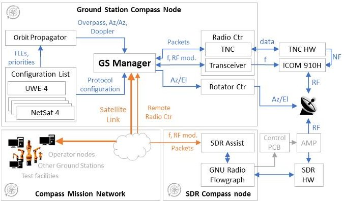
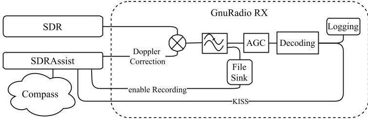
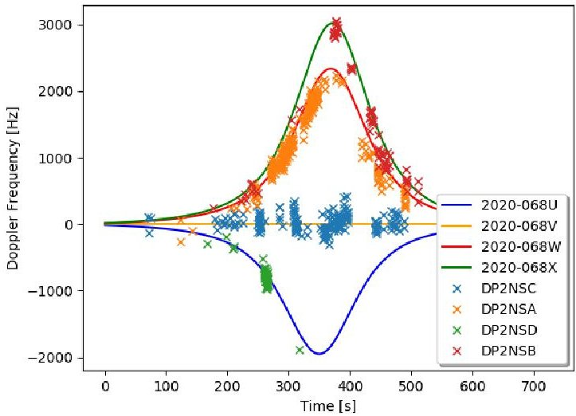
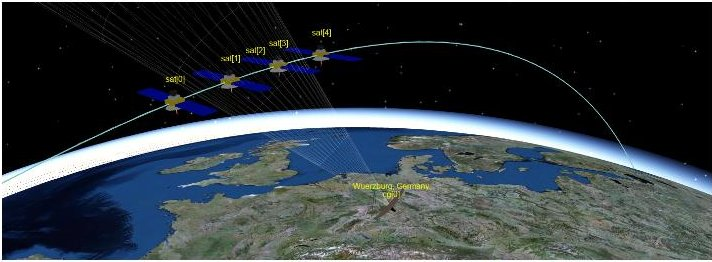
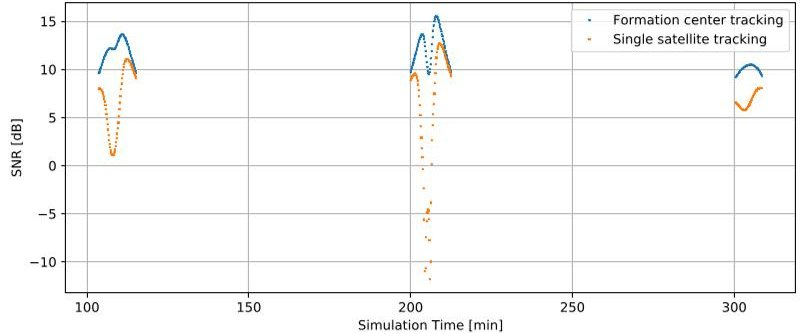

<!-- PDF_PAGE: 1 -->

# Extended Ground Station Concept and its Impact on the In-Orbit Communication with the Four-Nano-Satellite Formation NetSat

Alexander Kleinschrodt $ ^{\dagger} $ , Tim Horst $ ^{*} $ , Eric Jager $ ^{\dagger} $ , Andreas Freimann $ ^{*} $ Slavi Dombrovski $ ^{\dagger} $ , Roland Haber $ ^{\dagger} $ , Klaus Schilling $ ^{*\dagger} $

$ ^{\dagger} $ Zentrum für Telematik (ZfT), Würzburg, Germany

{firstname.lastname} @telematik-zentrum.de

$ ^{*} $Julius-Maximilians-Universität Würzburg (JMUW), Würzburg, Germany {firstname.lastname}@uni-wuerzburg.de

Abstract—NetSat is a mission consisting of four 3Unit+ nano satellites developed at Zentrum fur Telematik e.V. (ZfT). It aims to demonstrate formation flight concepts for small satellites. It was successfully launched in September 2020. This paper gives a coarse outline of the mission. The updated ground station concept for this mission is motivated and outlined. Following, the concept of the hardware and software design of the ground station as well as the operational principle are described. The nowadays often used concept of using Software Defined Radio (SDR) for small satellite ground stations is applied here and its benefits for a formation flying mission are analysed. Our concept of taking advantage of the SDR is further outlined. First tests of the implemented parts are performed during Launch and Early Orbit Phase (LEOP) and show benefits during this critical phase. In addition, an outline of future steps in developing and implementing the concept is given.

Index Terms—Satellite ground stations, Software radio, Orbit

## I. INTRODUCTION

The Networked Pico-Satellite Distributed System Control (NetSat) mission currently conducted at the ZfT aims to demonstrate the autonomous control of a formation of four small satellites in orbit. [1] The formation flight of satellites in three-dimensional configuration could enable potential innovative future applications in Earth observation, such as TIM/TOM [2] and CloudCT [3], currently in preparation at ZfT. In these upcoming missions self-organisation as well as formation flight is planned to be demonstrated [4]. Such missions include several satellites to command and operate that fly in close proximity. Thereby introducing a higher demand on ground station capabilities, such as increased diagnostic capabilities and ease of reconfiguration to support different mission needs. For all such missions reliable communication to ground as well as means of analysing the communication channel are crucial aspects. A formation poses additional requirements to the ground station. Since more than one satellite is in reach simultaneously and sending and receiving at the same frequency different problems and challenges arise. In this paper we describe our work regarding the extension of our ground station concept. The nowadays often used concept

of using SDR for small satellite ground stations is applied and its benefits for a formation flying mission investigated. The sections are structured as follows: After this introduction, section II outlines the background and related work in the field of small satellite based ground stations and the application of SDR. Section III introduces the NetSat mission. Section IV outlines the SDR-based ground station concept, its integration into the Compass network, and the advanced SDR capabilities. Finally an outlook on future implementation steps is given in section V and the lessons learned during NetSat LEOP are shown.

## II. BACKGROUND & RELATED WORK

SDR-based ground stations have been implemented by some universities and radio amateurs earlier, e.g. described in [5], [6], [7], [8] as well as [9]. This opens up new opportunities and applications as outlined amongst others in [10] & [11]. Also the world-wide ground station network SatNogs [12] is based on SDR ground stations operated by universities and radio amateurs. While here usually cheap SDRs such as the well known RTL-SDR are used, some ground stations also used professional SDRs that also allow the transmission of signals, such as the USRP N210 [8]. This proves the usability of SDRs for application scenarios as the one considered here. During LEOP finding and mapping the satellites to the corresponding objects identified by North American Aerospace Defense Command (NORAD) is always a challenging task. Concepts to improve or obtain the orbit information have been shown already in several publications, e.g. [13]-[16].

## III. NETSAT MISSION

The NetSat mission consists of four identical 3U+ plus CubeSats and a mass of $ \approx $ 4 kg each. NetSat follows on the steps of the successful precursor UWE pico-satellite missions developed and operated by the University of Wurzburg [17] - [20]. For power generation, solar cells are mounted on each long side of the satellites. Communication between the satellites is done via Inter Satellite Link (ISL) [21]. The ISL

<!-- PDF_PAGE: 2 -->

operates on the same frequency as is used for TT&C (435.6 MHz on all four satellites). For redundancy, each satellite has two transceivers, which are connected to separate copperberyllium dipole antennas. The four satellites orbit Earth in an altitude of $ \sim $ 560km. The link budget calculations show a maximum free space path-loss (FSPL) of $ \sim $ 150 dB. Signals are transmitted with 30 dBm transmit power.

## IV. GROUND STATION CONCEPT

The small satellite ground station concept depicted here, in contrast to the classical definition, is a standalone system comprising all components to communicate with the satellite, i.e. antenna, transceiver, tracking hardware, data distribution system, etc. There is no clear distinction anymore between mission control and ground stations. For NetSat two ground stations are planned to be used simultaneously, one located at the University of Wurzburg and one at the Zft, which at the time of writing is still being integrated. Both ground stations used in NetSat feature a very simple hardware architecture, mainly composed of Component of the shelf (COTS) components and standard personal computers, being connected by ground segment portion of the Compass Network [22] (cp. section IV-A). For the precursor UWE missions an existing ground station has already been set up at the University of Wurzburg. With UWE-1 being launched in 2005, this ground station uses a standard Terminal Node Controller (TNC) and typical UHF transceiver, commonly found in the ham radio environment. [23], [24] In order to fulfil future demands of the formation mission as well as to provide more signal analysis capabilities the additional integration of a SDR for signal reception and transmission is an ongoing process (cp. section IV-B). The station at JMUW is equipped with cross Yagi-Uda type antennas, producing a gain of 18.9 dBic.

## A. Compass-Based Ground Segment

The satellite selection is performed on two independent UHF ground stations, both being equipped with Compassbased GS server software, which among other things controls all physically connected hardware components (antenna rotor, transceiver, FSK modem, etc.), performs satellite orbit propagation, configures the current RF protocol stack depending on the currently desired satellite and eventually makes overpassing satellites accessible in the Compass mission network.In addition to physically connected hardware components, the ground station offers an interface for remote Compass-enabled transceiver nodes. The SDR software is implemented as a separate Compass node and is accessible by the ground station as an additional RF transceiver, thus allowing the SDR to automatically receive all desired frequency and modulation parameters of the currently tracked satellite (cp. section IV-B). The ground station holds a configuration list for all desired satellites (UWE-3, UWE-4 and NetSat) consisting of name, NORAD ID, callsign, radio protocol configuration and priority. During the active communication it encodes all uplink packets down to Layer 2 (Data layer) to meet the protocol configuration of the receiver and passes the resulting byte arrays

to all locally and remotely connected transceivers. Initially the tracking is selected based on the satellite priorities - if multiple satellites with same priority are currently passing over (which is the case with all four NetSat satellites), then all satellites appear in the mission network but only the first ascended one is preliminarily selected for antenna tracking. During the overpass the ground station scans the Compass traffic between the ground nodes and the satellites and detects whether other than the currently tracked satellite is desired for communication.

## B. SDR Integration Concept

Fig. 1. Simplified overview of the ground station architecture

For the ground station at the University of Wurzburg, a dual configuration is implemented, with the SDR as a mean of communication in addition to the conventional communication pathway that has proven its reliability for past missions. The SDR and its required power amplifier are connected to an additional 70 cm antenna on the same radio mast as the existing solution. To prevent damage in case of dual operation the communication paths can be isolated from each other via coaxial relays. In contrast to this dual configuration, the ground station at the ZfT is meant to be operated by a single SDR. This integration concept of the SDR into the ground station is depicted in figure 1. Similarly to e.g. [7] the open-source software GnuRadio is used for signal processing (cp. figure 2). The concept includes custom blocks to inject required meta and control information to the flowgraph, e.g. the Doppler shift on the centre frequency. The extraction of such information from the flowgraph is also planned for the future. The GnuRadio flowgraph itself is also responsible for recording IQ data, that is sampled by the SDR's Analog-to-digital Converter (ADC). This recording is most useful for post overpass analysis. The software SDRAssist also serves as the gateway to the Compass network which empowers the distributed operations. Packets received are injected into the Compass network and are thereby made easily accessible to the operators. For debugging and post analysis purposes the SDRAssist software is also capable of replaying older passes in terms of commanded Doppler offset by using older TLE sets which are automatically stored on a daily basis. This can be done independent of the compass network, which simplifies analysis of recordings.

<!-- PDF_PAGE: 3 -->

Fig. 2. Simplified processing chain

## C. TLE Mapping

Fig. 3. Expected Doppler Frequencies from TLEs (lines) and estimated Doppler Frequencies from packets (crosses)

During the first days of Netsat LEOP it became apparent that the on-board GNSS could not be commissioned in a timely manner to determine the orbital elements of the satellites. The most likely TLEs from Celestrak for the four Netsat satellites were already identified but it proofed to be difficult to determine which satellite had which TLE. To resolve this issue a method to assign the TLE to the right satellite similar to [14] -[16] was applied. It receives the sampled IQ data from one pass as well as the successfully demodulated packets with their respective timestamp and the satellites' callsign, also contained within the packet. With the packet's timestamp, the corresponding samples in the IQ-File can be determined. Afterwards an Fast Fourier Transformation (FFT) is computed to derive the received packet's middle frequency. As the ground station actively corrected the Doppler shift of incoming signals for the tracked satellite (e.g. here satellite 2020-068V) the deviation of the middle frequency to centre frequency depended on the relative Doppler shift between 2020-068V and the satellite transmitting the packet. With this the difference in Doppler shift of the satellites relative to 2020-068V at different points in time is known. This information can be plotted agains the expected Doppler shift computed from the TLEs published by Celestrak. An example for this can be seen in Figure 3. Solid lines represent the expected Doppler shifts computed from the TLEs.Dots represent packets with their relative Doppler shift. The different colours encode the

names of the satellites extracted from the packets (DP2NSA-DP2NSD) as well as the preliminary names from the TLEs given by Celestrak (2020-068U-2020-068X). With this graph a visual mapping can be made between the satellite names and TLE names, e.g. the satellite with the call-sign DP2NSB corresponds to the TLE 2020-068X. This method proofed very useful in the early phase of Netsat LEOP and showed that this could reliably done with several satellites using just the data of one pass, as long as they are close enough to each other to be received simultaneously with one ground station.

## D. Tracking modes

Since the satellites form a formation, they need to fly in comparably short distances to each other, so that ISL communication can take place. This brings the difficulty for the operator, that all 4 satellites are in view simultaneously, respectively fly over the ground station in short succession. Therefore in order to communicate with all 4 satellites in one fly-by the tracked satellite is dynamically changed (cp. section IV-A).

Fig. 4. 3D simulation of a NetSat ground station pass

Figure 4 shows a 3D visualisation of a simulation to compare ground station antenna tracking modes. It was performed with the simulator ESTNeT [25] based on the system parameters of the NetSat mission. The satellite antennas are assumed to have an omnidirectional radiation pattern and the ground station antenna is simulated with a cross-Yagi antenna pattern with a beamwidth of $ 3 0^{\circ} $ . The transmit power of the satellite transceivers equals 1W. The distance of the first and the last satellite of the inline formation is about 1000km. Figure 5

Fig. 5. Simulated comparison of satellite tracking and formation tracking performances

shows how the downlink performance can be improved by tracking the centre of the formation instead of a single satellite. The markers show the SNRs of packets received at the ground station during three passes. As can be seen the SNR severely

<!-- PDF_PAGE: 4 -->

degrades if the first satellite transmits beacons but the last satellite is tracked by the ground station antenna, represented by the orange squares. If the formation tracking mode is used this degradation can be prevented. This proposed formation tracking mode is planned to be applied in ongoing stages of the operations.

## V. CONCLUSION & OUTLOOK

Adding a second receiving chain turned out to be really useful during NetSat's LEOP: First and foremost, this allowed for cross verification between results which could rule out either errors from tracking or errors in the ground-chain itself. Additionally, the SDR solution provides data in raw IQ-samples, which permits on the one hand more analysis capabilities during the fly-by and enhanced post processing capabilities in the aftermath. In contrast, the standard TNC based approach provides only insight in successfully received packets, which were correctly delivered to the operation software, and hence gives only limited analysis capabilities. Furthermore, since the SDR has a much larger receiving bandwidth due to its high sampling rate, than traditional TNC/Radio solutions a lot more observations of the state of the communication channel were possible. Even if a packet could not be decoded successfully, it could be observed by analysis methods naturally accompanying digital sampling (e.g on the waterfall diagram). Additionally disturbing sources could more easily be identified. Last but not least, mapping satellites to actual TLEs was made possible. The major improvement in LEOP proved to be the TLE Mapping, which speed up the satellite identification process a lot. The major next step is setting up the SDR-transmission path to get a full redundant sending station.

## ACKNOWLEDGMENT

The authors would like to express their gratitude to the European Research Council (ERC) Advanced Grant "NetSat under the Grant Agreement No. 320377 as well as the forte project funded by the Bavarian State Ministry for Economic Affairs for financing the work displayed here. The authors thank also all the collaborators for their contributions in the frame of the Telematics Earth Observation Mission (TOM) grant agreement No. LABAY96A project supported by the Bavarian Ministry of Economics, as well as the ERC Synergy Grant "CloudCT" under the grant agreement No. 810370 and the project "KommSat" funded by Deutsche Forschungsgemeinschaft (DFG) under grant number SCHI 327/29-1.

## REFERENCES

[1] K. Schilling et al. Netsat: a four pico/nano-satellite mission for demonstration of autonomous formation flying. In 66th International Astronautical Congress, 2015.

[2] Kleinschrodt et al. Tim: An international formation for earth observation with cubesats. In Proceedings 12th IAA symposium on Small Satellites for Earth Observation, 2019.

[3] K. Schilling, Y. Schechner, and I. Koren. Cloudct-computed tomography of clouds by a small satellite formation. In Proceedings of the 12th IAA symposium on Small Satellites for Earth Observation, 2019.

[4] K. Schilling. Perspectives for miniaturized, distributed, networked cooperating systems for space exploration. Robotics and Autonomous Systems, 90:118-124, 2017. Special Issue on New Research Frontiers for Intelligent Autonomous Systems.

[5] A. Løfaldli and R. Birkeland. Implementation of a software defined radio prototype ground station for cubesats. 06 2016.

[6] M. A. Boettcher, B. M. Butt, and S. Klinkner. Low-cost approach for a software-defined radio based ground station receiver for ccsds standard compliant s-band satellite communications. MS&E, 152(1):012033, 2016.

[7] T. Choi, T. Stevenson, and E. G. Lightsey. Reference ground station design for university satellite missions with varying communication requirements. In 55th AIAA Aerospace Sciences Meeting, page 1334, 2017.

[8] M. Bosco, P. Tortora, and D. Cinarelli. Alma mater ground station transceiver: A software defined radio for satellite communications. In 2014 IEEE Metrology for Aerospace (MetroAeroSpace), pages 549-554, 2014.

[9] V. Dascal, P. Dolea, O. Cristea, and T. Palade. Low-cost sdr-based ground receiving station for leo satellite operations. In 2013 11th International Conference on Telecommunications in Modern Satellite, Cable and Broadcasting Services (TELSIKS), volume 2, pages 627-630. IEEE, 2013.

[10] A. Kleinschrodt, A. Freimann, S. Christall, M. Lankl, and K. Schilling. Advances in modulation and communication protocols for small satellite ground stations. In 68th International Astronautical Congress, Adelaide, Australia, 2017.

[11] E. Peters and C. Benson. A doppler correcting software defined radio receiver design for satellite communications. IEEE Aerospace and Electronic Systems Magazine, 35(2):38-48, 2020.

[12] D. J. White, I. Giannelos, A. Zissimatos, E. Kosmas, D. Papadeas, P. Papadeas, M. Papamathaiou, N. Roussos, V. Tsiligiannis, and I. Charitopoulos. Satnogs: Satellite networked open ground station. In Engineering Faculty Publications l& Patents. 40, 2015.

[13] Y. Sakamoto. Study of low-cost orbit determination system for tethered satellites. In the Ninth International Space Conference of Pacific-basin Societies (9th ISCOPS), 2001.

[14] N. V. Vighnesam, A. Sonney, and P. K. Soni. Hamsat-1 precise orbit determination system and performance. Journal of Spacecraft and Rockets, 44(3):727-731, 2007.

[15] H. Chunyih, K. Dayung, R. Omair, and B. Tim. Low-Cost Rapid TLE Updating Method For Nano-Satellites Using Doppler Signature.

[16] N. A. Dallmann, M. C. Proicou, D. N. Seitz, and A. Warniment. On-orbit ephemeris determination with radio doppler validation. 2016.

[17] M. Schmidt, F. Zeiger, and K. Schilling. Design and implementation of in-orbit experiments on the pico-satellite uwe-1. In Proceedings 57th International Astronautical Congress, IAC-06-E2, volume 1, 2006.

[18] M. Schmidt, K. Ravandoor, O. Kurz, S. Busch, and K. Schilling. Attitude determination for the pico-satellite uwe-2. Space Technology-Abingdon, 28(2):67, 2008.

[19] S. Busch and K. Schilling. UWE-3: A modular system design for the next generation of very small satellites. In Proceedings of Small Satellites Systems and Services - The 4S Symposium, Portoroz (Slovenia), 06 2012.

[20] A. Kramer, P. Bangert, and K. Schilling. Uwe-4: First electric propulsion on a lu cubesat—in-orbit experiments and characterization. Aerospace 7, no. 7: 98., 2020.

[21] R. Haber, J. Scharnagl, and K. Schilling. Netsat - a formation of four 3usatellites using electric propulsion. In 71st International Astronautical Congress, 2020.

[22] V. Dombrovski and K. Schilling. Control of multi-picosatellite systems: Tiny scripting language and multi-layer compass protocol. In 2018 SpaceOps Conference, page 2355, 2018.

[23] K. Schilling and M. Schmidt. Communication in distributed satellite systems. In Distributed Space Missions for Earth System Monitoring, pages 345-354. Springer, 2013.

[24] M. Schmidt and K. Schilling. Ground station networks for distributed satellite systems. In Distributed Space Missions for Earth System Monitoring, pages 355-371. Springer, 2013.

[25] A. Freimann, M. Dierkes, T. Petermann, C. Liman, F. Kempf, and K. Schilling. Estnet: a discrete event simulator for space-terrestrial networks. CEAS Space Journal, 2020.