<!-- PDF_PAGE: 1 -->

# Eye-Sat: A 3U student CubeSat from CNES packed with technology

Fabien Apper, Antoine Ressouche, Nicolas Humeau, Matthieu Vuillemin

ISAE (Institut Supérieur de l'Aéronautique et de l'Espace)

10 avenue Edouard Belin, 31400 Toulouse; +337 88 03 77 68

Fabien.apper@isae.fr

Alain Gaboriaud, Frédérick Viaud

CNES (Centre National d'Etudes Spatiales)

18 avenue Edouard Belin, 31400 Toulouse; +336 82 65 68 15

Alain.gaboriaud@cnes.fr

Mathilda Couture

IRAP (Institut de Recherche en Astrophysique et Planétologie)

9 avenue du colonel Roche, 31400 Toulouse; +33

mcouture@irap.omp.eu

## ABSTRACT

Eye-Sat will observe the Zodiacal light, the Sun light scattered by interplanetary dust. It is a diffuse and faint white glow. Equipped with its small home-made telescope, this 3U CubeSat will measure the zodiacal light's intensity and linear polarization ratio. The payload's optics has a focal length of 50 mm and a diameter of 25 mm for a field of view of +/- 6.5 $ ^{\circ} $ . Two rotating wheels bear spectral and polarizing filters. For one year Eye-Sat will produce more than 500 GB of data which will be downloaded to the ground thanks to a high data rate X-band link. Moreover, scientific objectives impose severe requirements on the attitude determination and control system such as a $ 0.25^{\circ} $ 3-axis pointing accuracy. To fulfil these requirements, Eye-Sat comprises a star tracker and four reaction wheels.

Eye-sat will also welcome new technologies on board to demonstrate their applicability in space environment and to test their in-orbit performances:

- C&DH module will combine a dual-core ARM9 microprocessor (CPU frequency up to 1GHz) and a FPGA

- Flight software will be based on Time and Space Partitioning technology

- S-band TTC transceiver

- X-band transmitter for scientific data

- Solar panels will be deployed by self-blocking and self-deployable composite hinges

- Hold-on and Release Mechanisms based on the thermal knife concept

- 3DPlus camera with a CMOS detector from CMOSIS

- Innovative black coating from Cilas

Eye-Sat is a Student CubeSat which belongs to JANUS, a CNES' program that supports French Universities in developing their CubeSat projects. The specificity of Eye-Sat is that it has been developed within the French Space Agency since 2012, with more than 200 students involved.

After passing a successful qualification review before a board of CNES agents in October 2018, the project team is now in the Assembling, Integration and Validation phase with the flight model. Launch is due on October/November 2019, on a Soyouz rocket from French Guyana, with COSMOS Sky-Med from the Italian Space Agency and Cheops from the European Space Agency.

<!-- PDF_PAGE: 2 -->

## INTRODUCTION

Since 2012 CNES has developed the JANUS project ('Jeunes en Apprentissage pour la réalisation de Nanosatellites au sein des Universités et des écoles de l'enseignement Supérieur'). This project helps students to build their own CubeSat. JANUS brings financial and technical support to French universities. JANUS has two main objectives:

- To educate students to the space domain.

- To demonstrate new technologies in orbit.

The Eye-Sat mission has been developed in this context. It is a pilot project done in the French space agency with students from various universities. It has allowed the agency to address the ways to work on such a satellite.

A thorough presentation of JANUS is available in [1].

## MISSION

Eye-Sat is a 3U CubeSat project carried out at CNES with students. This project started in 2012 and is due to be launched in October 2019 by a Soyuz rocket from French Guyana. This project has 4 main objectives:

- An educational objective: to create a 3U CubeSat space system with students for training purposes in space engineering

- A scientific objective: to map both intensity and polarization of the zodiacal light in the visible and near-infrared domains

- An outreach objective: to make a global colored image of the Milky Way

- A technological demonstration objective: to demonstrate in flight R&D developments funded by CNES

The project is being carried out in partnership with aerospace engineering schools such as ISAE-SUPAERO (system engineering and control center) and ENAC (X-band ground station) and with space laboratories such as LATMOS and IRAP. A team of engineers from CNES and ISAE-SUPAERO has supervised more than 250 students to achieve a launchready system. The students have worked on each of the project's subsystems: satellite (avionics, radiofrequency, thermal control, mechanical architecture, GNC, flight software), payload, ground segment (command/control center, mission center, ground stations), satellite simulator.

The Zodiacal light is a faint light that corresponds to the scattering of sunlight on interplanetary dust. Eye-Sat will provide more accurate measurements in intensity and polarization than the existing ones and greatly improve the spatial resolution of existing maps.

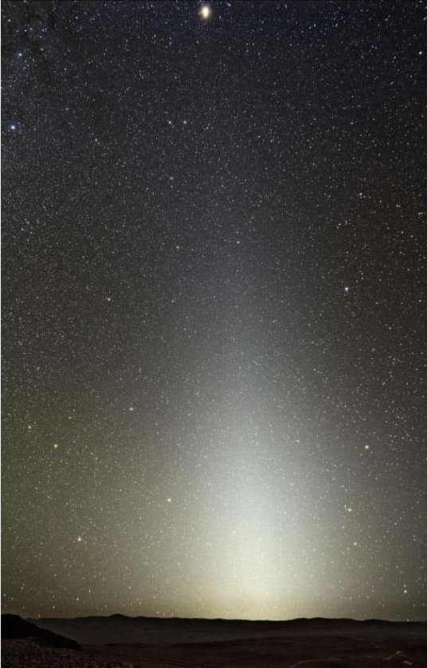

Figure 1: Zodiacal light seen from Paranal, Chile (ESO/Y.Beletsky).

Through the measurements, LATMOS and IRAP scientists will be able to trace the local properties of interplanetary dust. In addition, accurate maps of this light will be used to correct large telescopes (ground based or space based) for the light bias induced by the zodiacal light.

The outreach mission is to motivate students to come and work on the project. For this purpose, a 360° image of the Milky Way will be produced and provided to all students who worked on the project.

The technology demonstration mission aims to embed some CNES R&D developments in the field of small satellites. These R&D are: S-band RF transceiver, X-band RF transmitter, S band antenna, X band antenna on-board computer based on a Zynq from Xilinx, flight software based on Time & Space Partitioning technology, CMOS colored sensor, deployment hinges chemical black treatment for baffles.

Reference [2] focuses on Eye-Sat's scientific mission.

<!-- PDF_PAGE: 3 -->

## CUBESAT

## Overview

Figure 2 shows the interior of the CubeSat. Almost all the components have a "CubeSat-PC104" form factor and are stacked together. The rest of the components are linked to this stack through an interface board through dedicated connectors. The following sections will describe each component, beginning with the payload and then the bus.

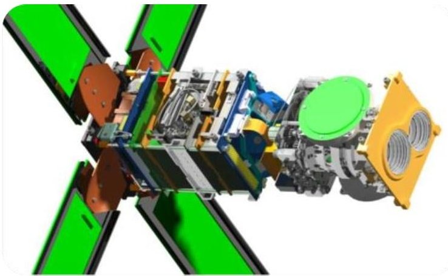

Figure 2: Global view of Eye-Sat

Satellite's modes

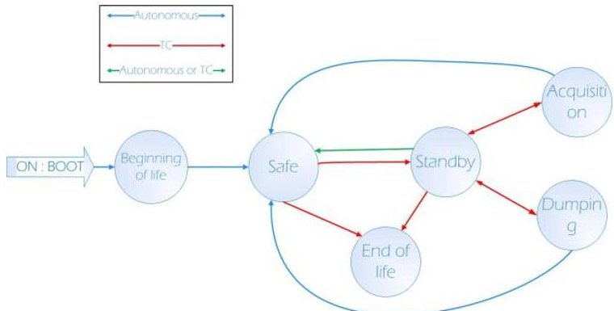

Figure 3: Satellite's modes

Eye-Sat's modes are:

- The beginning of life mode which ensures a timeout of 30 minutes before solar panel deployment and a timeout of 45 min before any radiofrequency emission.

- The safe mode which points the solar panels towards the sun with a minimum quantity of components ON.

- The acquisition mode in which the payload is switched on and takes images.

- The standby mode which is the by-default mode in which the CubeSat points its solar panels towards the Sun and waits for telecommands (direct or time-tagged).

- The dumping mode which corresponds to communication sessions with the ground station.

- The end of life mode in which the satellite passivation is performed: solar panels are disconnected and batteries are emptied.

## Payload

Scientific objectives define extensive observation regions for both the zodical light and the Milky Way. These regions will be divided into small meshes of $ 1 3^{\circ} \times1 3^{\circ} $ (payload's field of view) and reconstructed on ground thanks to a recovering mosaic.

The Eye-Sat payload is a $ 1 3^{\circ} \times1 3^{\circ} $ field of view imager composed of the following subsystems:

- A 3D camera made by 3D+ including a CMOS CMV4000 detector from CMOSIS (2048x2048 pixels of 5.5 microns side). It is a Bayer matrix. The camera features proximity electronics for sensor configuration, temporary image storage and SpaceWire interface management with the bus.

- A COTS LEICA APO-SUMMICRON optics with a focal length of 50 mm for an aperture of F/# = 2. This optics was customized for Eye-Sat by the Belgian company Lambda-X

- A system of two filter wheels driven in opposite directions by a single step motor. A first filter wheel has a visible filter, a near-infrared filter and a black cover for the sensor's dark current calibration. The second wheel has 3 polarizers and a neutral glass. This system allows all configurations (polarization and spectral band) to be placed in front of the sensor.

- A custom baffle in order to avoid stray light

<!-- PDF_PAGE: 4 -->

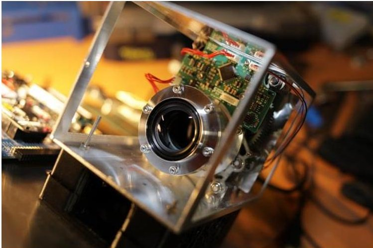

Figure 4: Eye-Sat payload

The radiometric budget leads to the following requirements for Eye-Sat:

## A 15 seconds integration time

- The on-ground pixels' binning matching the 0.5-2° spatial resolution scientific requirement

- A summation of 10 images to increase signal to noise ratio

Finally, the total amount of pictures needed to image a $ 1 3 \times1 3^{\circ} $ portion of the observation region for each spectral bands and each polarization defined a mesh. Two dark calibrating images are added. Therefore, a mesh contains $ 2^{*}3^{*}1 0+2=6 2 $ (2 spectral filters, 3 polarization filters, 10 images per configuration and 2 dark calibrating images). A mesh weighs 496 Mo.

## Bus

This section depicts the rest of the CubeSat: the bus.

## Power subsystem

The power subsystem is entirely home-made, battery cells excluded. It is composed of:

- 4 deployable solar panels. Each panel comprises 6 solar cells 3G30A from AzurSpace, distributed in a 2S3P configuration. The total generated power is 24 W after 1 year. All panels also contain a shunt dissipation circuit which can absorb up to 1.5W.

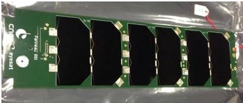

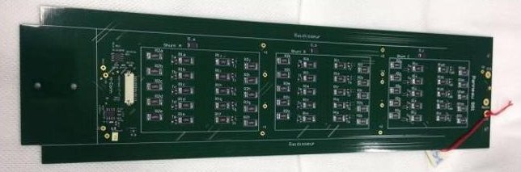

Figure 5: Eye-Sat's solar panels

A power board which receives the incoming power from the solar panels and distributes it along three buses: 3.3V, 5V and the battery bus (6/8V). The board also manages the energy storing into the batteries. Finally the board can supply the thermal knives with power in order to release the solar panels after injection into orbit.

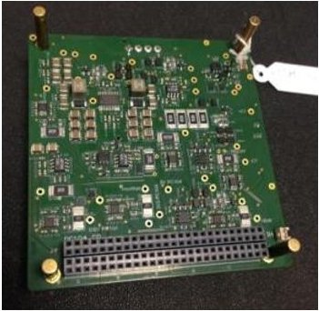

Figure 6: Eye-Sat's power board

- A pack of 4 battery cells Lithium-Ion ICR-18650 NQ-J128 from Samsung, arranged in a 2S2P configuration. The total capacity is 38 Wh.

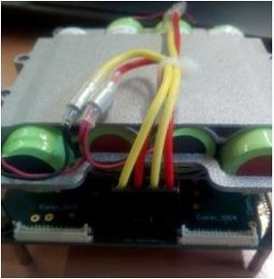

Figure 7: Eye-Sat's battery pack

Several ON/OFF switches on the interface board to toggle the power state of the following components: the reaction wheels, the star tracker, the heaters and the payload.

## Communication subsystem

Eye-Sat's telecommand and telemetry is done in the S band. The S-band transceiver is the EWC31 from the private company Syrlinks. The S-band transceiver is connected to two full duplex S-band patch antennas through a 3 dB coupler and a diplexer embedded on the transceiver. The uplink data rate (TC) is 8 kbits/s and the downlink data rate (HKTM) reaches 85 kbits/s.

<!-- PDF_PAGE: 5 -->

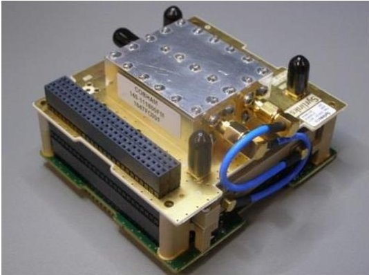

Figure 8: EWC31 (Syrlinks)

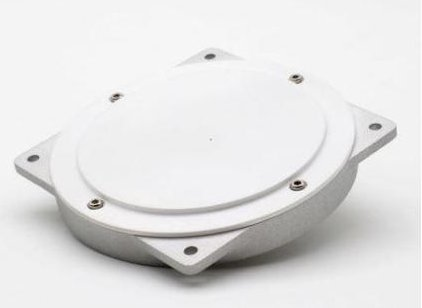

Figure 9: S-band full duplex antenna (Anywaves)

The payload's data is downloaded in the X band. The X-band transmitter is the EWC27 from Syrlinks as well.

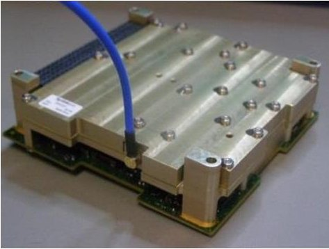

Figure 10: EWC27 (Syrlinks)

In order to optimize the budget link and to download the daily payload data volume (more than 12 Gbits per day), Eye-Sat points toward the X-band ground station (TETX) during a visibility pass with a directive X-band antenna with a gain better than 12 dBi. As a result, the data rate rises up to 15 Mbits/s with the TETX ground station. The X-band antenna is provided by Anywaves.

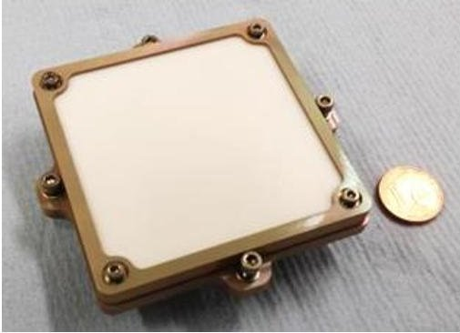

Figure 11: X-band antenna from Syrlinks More details are given in [1].

All those RF components, antennas and boards emerged from CNES' R&D programs.

## On-board computer

The On Board Computer (OBC) is called Ninano and is provided by the private company Steel Electronique.

Figure 12: Ninano board (Steel Electronique)

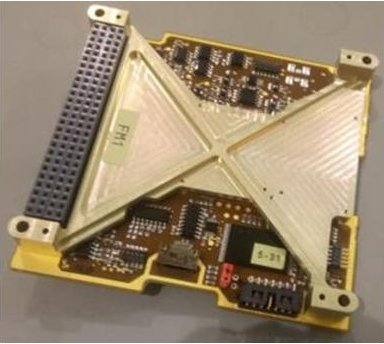

NINANO has a volatile DDR3 memory of 1GB and a non-volatile NAND Flash memory of 16GB.

Ninano embeds the Zynq 7030 developed by Xilinx, which comprises a dual-core 1 GHz processor ARM $ ^{\circledR} $ CortexTM-A9 and a programmable logic (FPGA).

The electrical interfaces implemented on Eye-Sat are: $ \mathrm{I}^{2} \mathrm{C} $ , 1-Wire, RS-422, SpaceWire and 2 specific LVDS lines for the radiofrequency boards.

Ninano is also the result of CNES' R&D programs.

## Attitude and Determination Control System (ADCS)

The ADCS architecture is composed of two different modes and is presented on Figure 13.

<!-- PDF_PAGE: 6 -->

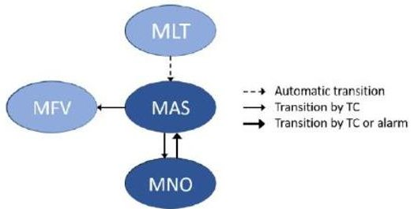

Figure 13: ADCS modes

The first mode, called MAS (Acquisition and Survival Mode) is used to cover the needs of the satellite's Safe Mode. It is based on few components and a simple design to minimize the risk of failure. Its purpose is to secure electrical supply by pointing the solar arrays towards the Sun. Estimation and actuation are respectively performed with magnetometers and magnetorquers. Since magnetic estimation and actuation only provide a 2-axis attitude control, the satellite body is spun, which provides a gyroscopic stiffness. The components that are used in this mode are:

- The iMTQ from ISIS which accommodates 3 magnetorquers and a 3-axis magnetometer on a CubeSat form factor board.

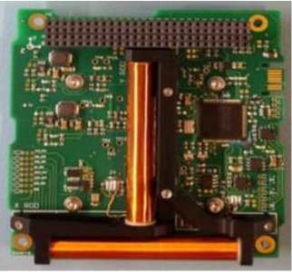

Figure 14: ISIS iMTQ

The 3-axis magnetometer HMC5883L manufactured by Honeywell, located on Ninano.

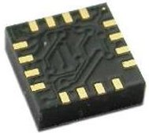

Figure 15: Magnetometer HMC5883L (Honeywell)

The second mode, called MNO (Nominal Mode) is used during all other satellite's modes. More precisely, this is the operative mode, in which the satellite is able to take pictures, to download them to the ground and to recharge its batteries. Launch mode (MLT) and EndOf-Life mode (MFV) are non-operative modes. In addition to the iMTQ and the Ninano's magnetometer, the components that are used in this mode are:

4 reaction wheels RW200 from Hyperion technologies.

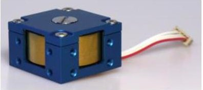

Figure 16: RW200 (Hyperion technologies)

A star tracker ST200 from Berlin Space Technologies.

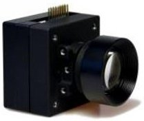

Figure 17: star tracker ST200 (Berlin Space Technologies)

A detailed description of Eye-Sat's ADCS has been done in [4].

## Mechanical architecture

EyeSat's structure is divided in two main parts:

- An aluminium profile of 10x10x34cm. Laser cuts are performed to give open spots to the optics, accommodation zones for the antennas and the hinges, and access windows for the assembly.

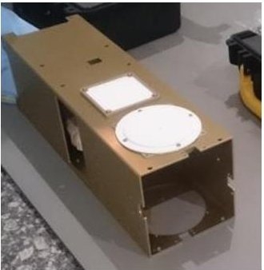

Figure 18: Eye-Sat's aluminium profile

- Two machined aluminium top and bottom covers that are screwed at each end of the profile.

<!-- PDF_PAGE: 7 -->

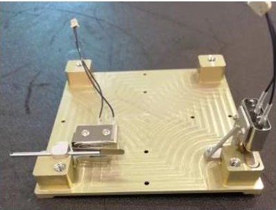

Figure 19: Eye-Sat's bottom cover

This structure is cheap and very easy to assemble.

The surfaces are coated with alodine.

## Mechanisms

There are two mechanisms in Eye-Sat and they work by pair in order to deploy each of the four solar panels.

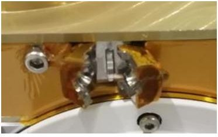

Figure 20: Eye-Sat's HDRM

The first one is a "Hold Down and Release Mechanism" (HDRM) which keeps the solar panels stowed in the dispenser and for 30 minutes after injection. Its jaws are fixed on the structure and are closed on a sphere fixed on the solar panel. An adhesive tape closes the jaws and is cut by a nichrome thermal knife. These HDRMs are built by the private company Clix.

The second mechanism is a shape memory hinge made of composite materials also provided by the private company Clix. They are in folded state when the solar panels are stowed. Once released, they return to their natural form and, thus, deploy the solar panels.

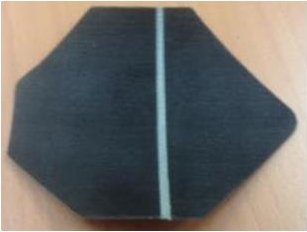

Figure 21: Eye-Sat's hinge (Clix)

Thermal architecture

Eye-Sat has a global need to dissipate power for two reasons:

- The electronics stack tends to heat, especially when the transmitters emit data.

- The payload has a better signal to noise ratio when cold.

Therefore, Second Surface Mirrors (SSM) cover 3 of its big faces.

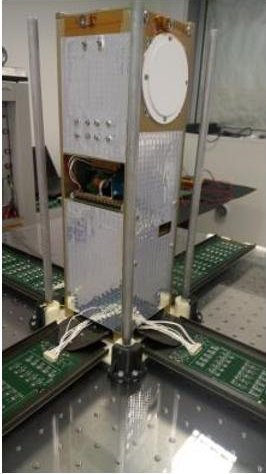

Figure 22: View of Eye-Sat's SSM

Then, two faces will be often exposed to the sun:

- The solar panel side.

- One of the aluminium profile's faces which will be oriented towards the Sun during certain acquisitions.

In order to prevent the CubeSat from heating, two MLIs are placed on those sides.

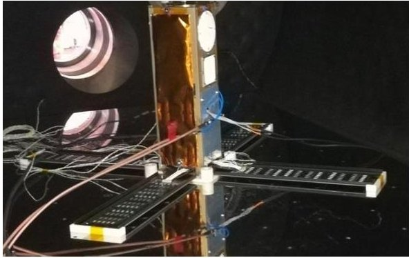

Figure 23: view of one MLI surface

Finally, to survive the cold cases, 3 heaters are located on the batteries, the star tracker and the payload's camera.

A numerical model, realized with System/Thermica, has been used to predict Eye-Sat's temperature once in orbit. Data from thermal Vacuum tests carried out on the qualification and flight models have been exploited to refine this numerical model.

## Flight software

Eye-Sat's flight software implements a Time and Space Partitioning (TSP) architecture. It is broken down into

<!-- PDF_PAGE: 8 -->

several partitions, comparable to virtual machines. Each partition has dedicated hardware resources, such as inputs, outputs, memory, and dedicated execution time slots. Within each partition can run a different operating system. The hypervisor in charge of managing the TSP on Eye-Sat is Xtratum, developed by the private company FentISS.

Eye-Sat's flight software leverages LVCUGEN which comprises generic software modules developed by CNES in this TSP context:

- The MM&DL partition which ensures the good initialization of the system, manages the other partitions' states and has an access to the memories.

- The I/O Server partition which gathers the drivers and manages the data flow between the other partitions and the drivers.

- The HSEM partition in charge of managing software events and monitoring.

- The LIBPUS library which implements the PUS protocol (cf. [6]) which is the protocol used on Eye-Sat for telecommands and telemetry.

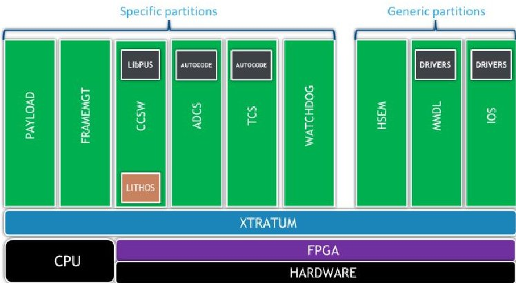

Figure 24: Eye-Sat's flight software architecture

Figure 24 shows the global architecture of the flight software. In addition to the LVCUGEN's generic partitions, other mission specific partitions run:

- TCS which executes the thermal control algorithms, auto-coded from Matlab/Simulink.

- PAYLOAD which handles the communication with the payload and any specific processing of payload's data.

- CCSW which uses the LIBPUS library to perform the command & control on board.

- FRAMEMGT which takes care of formatting the PUS packets into CCSDS frames.

- ADCS which executes the ADCS algorithms, autocoded from Matlab/Simulink.

- WATCHDOG which regularly pings the hardware watch-dog.

## GROUND SEGMENT

The ground segment is made of:

- An X band ground station (TETX) located at ENAC (Toulouse). This ground station includes a 3.4m diameter antenna and was used for DEMETER (CNES). Students updated the station in order to fulfill Eye-Sat's requirements. An in-flight testing was done in March 2016 with GOMX3 and validated the pointing software as well as the baseband processing.

- An S-band ground station, located in Aussaguel near Toulouse. This ground station is part of CNES' ground station network.

- A mission center, located at ISAE (Toulouse). This center is in charge of the scheduling of the mission, including payload work plans but also the guidance of the X-band ground station in order to download the scientific data. The mission center also processes payload data to generate scientific products of higher value.

- A control center, located at ISAE (Toulouse). This center is in charge of the TC generation and upload to the spacecraft, the monitoring of the bus and the flight dynamics.

A new control center software, named SCC (Simple Control Center), based on modern technologies, has been developed. Everything is built around Dropwizard4 framework which provides light and production proven web server with Jetty, easy central configuration management system, Restful API with Jersey to communicate with the front-end and to export data, powerful logging system, and some other java features: Google Guava framework, Joda Time library with powerful time converters, Java Database Interface (JDBI) for easy database SQL access. Dropwizard is not just an assembly of existing java libraries. Dropwizard ensures the integration of this toolkit so that applications remain permanently production-ready and stable.

<!-- PDF_PAGE: 9 -->

Figure 25: Simple Control Center

The Simple Control Center is detailed in [5].

## DEVELOPMENT PLAN

A complete satellite Qualification Model (QM) was integrated and qualified in 2018. This model allows the teams to:

- Identify hardware anomalies

- Develop AIV procedures

- Formally qualify the satellite

- Mechanical tests: quasi static loads, sinus, random.

The environmental tests, carried out on the QM, covered:

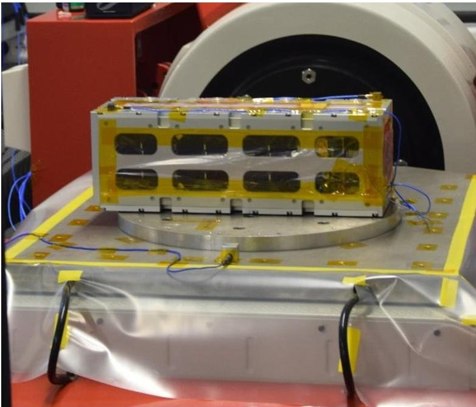

Figure 26: QM mechanical tests

- Thermal vacuum tests: bake-out, switch ON at low and high temperatures, thermal balance and thermal cycling.

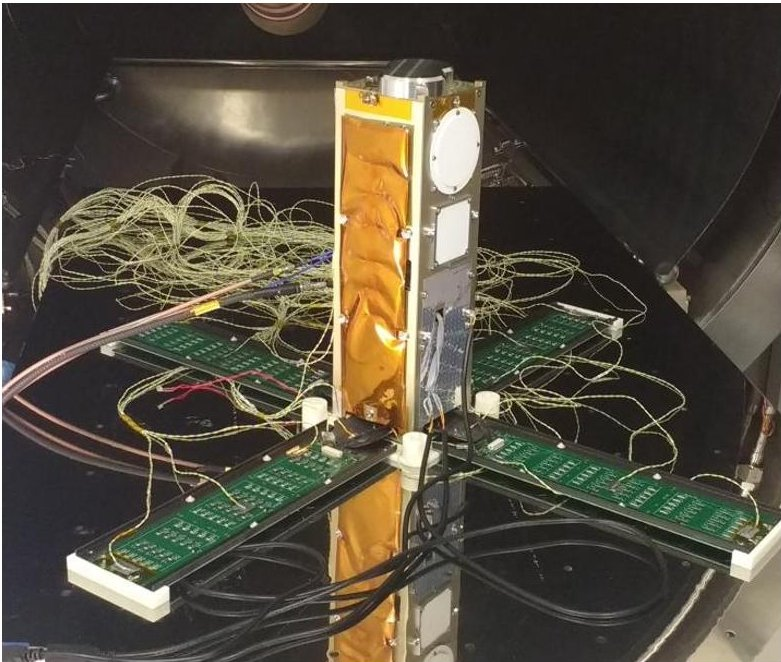

Figure 27: QM TVAC tests

- Magnetic tests: residual magnetic torque measurement and demagnetization

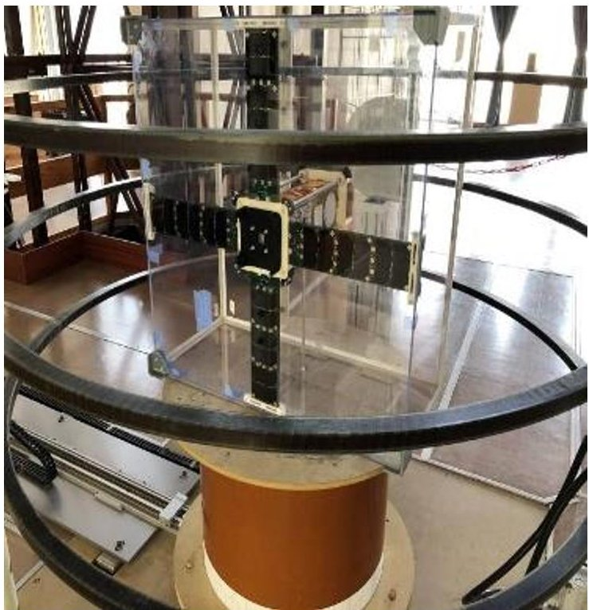

Figure 28: QM magnetic tests

Once the qualification is completed, the QM serves as a development target for the flight software.

In addition, a radio model was developed to measure the RF diagram of the two coupled S-band antennas in the presence of solar panel masking. A measurement of the X-band antenna radiation pattern was also performed.

<!-- PDF_PAGE: 10 -->

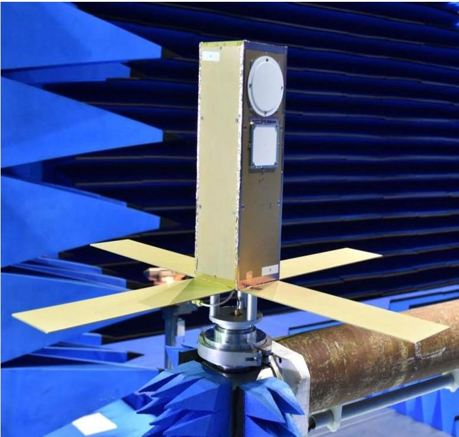

Figure 29: Radio model

Moreover, a system bench has been developed to allow the validation of GNC algorithms in closed loop. This bench includes an on-board computer, flight software, interface electronics and a numerical simulation infrastructure. The flight software interfaces with the simulator as if it was communicating with the actual components.

Finally, the flight model was integrated in 2019 and passed all environmental tests in May and June 2019.

## LAUNCH

Eye-Sat will be launched on the Soyuz VS23 flight from French Guyana. The launch window is scheduled between October 15 and November 15, 2019. The two main passengers are Cosmo-Skymed (ASI) and CHEOPS (ESA).

The flight dispenser is an ISIPOD from ISIS.

## REFERENCES

1. Gaboriaud A., JANUS a CNES (French Space Agency) Program for Developing Cubesats by Students, Small satellite Conference, Logan, Utah, USA, 2017.

2. Levasseur-Regourd A.C. & al., Eye-Sat, a triple Cubesat to monitor the zodiacal light intensity and polarization, European Planetary Science Congress, Cascais, Portugal, 2014.

3. Issler J.L & al, "CCSDS Communication products in S and X band for CubeSats", AIAA Small Satellites Conference, Utah State University, USA, 2014.

4. Viaud F. & al., "Flight dynamics for the astronomy mission eyesat", 4S Symposium 2018

5. Humeau N. and Gateau T., A Lightweight and Efficient Control Center Based on Modern technologies, SpaceOps 2018

6. ECSS-E-ST-70-41C15 Telemetry and telecommand packet utilization, ECSS