<!-- PDF_PAGE: 1 -->

<div align="center">

# F Prime: An Open-Source Framework for Small-Scale Flight Software Systems

</div>

Robert L. Bocchino Jr., Timothy K. Canham, Garth J. Watney, Leonard J. Reder, Jeffrey W. Levison Jet Propulsion Laboratory, California Institute of Technology 4800 Oak Grove Drive, Pasadena, CA 91109-8099; (818) 354-8175 Robert.L.Bocchino@jpl.nasa.gov

## ABSTRACT

Developing flight software for small-scale missions such as CubeSats and SmallSats is challenging. These missions typically have ambitious goals, modest budgets, and tight schedules. To meet these challenges, a good flight software framework is essential. Frameworks can provide an architecture, infrastructure, tools, and reusable software components, all of which can help developers deliver their code on time and on budget.

In this paper we present F Prime, a free, open-source flight software framework developed at JPL and tailored to small-scale systems such as CubeSats, SmallSats, and instruments. F Prime comprises several elements: (1) an architecture that decomposes flight software into discrete components with well-defined interfaces; (2) a C++ framework that provides core capabilities such as message queues and threads; (3) tools for specifying components and connections and automatically generating code; (4) a growing collection of ready-to-use components; and (5) tools for testing flight software at the unit and integration levels.

We describe the F Prime framework and tools and present our experience using them. We describe several enhancements to the framework currently underway in the areas of software design, software verification, and ground data systems for testing.

## 1. INTRODUCTION

Developing spacecraft flight software (FSW) is challenging under any circumstances. It is especially challenging for a small, cost-constrained mission with ambitious goals. Many small satellites (e.g., CubeSats and SmallSats) fit into this category. In these projects, all stages of the development cycle, especially test, tend to be compressed. FSW developers may face problems such as insufficient staff, inadequate access to flight-like hardware, poorly specified interfaces, and under-specified and rapidly changing requirements. While these problems exist to some degree in all flight projects, they are more pronounced in the context of a cost-constrained, rapid deployment.

So how to develop FSW for such a project? In general, there are three possible approaches:

1. Develop the FSW from scratch, using patterns and practices from previous missions.

2. Adapt and reuse FSW developed specifically for a previous mission.

3. Use a FSW framework that is designed to support reuse over multiple missions.

We contend that (3) is the only viable option for highly cost-constrained, highly reliable software. Option (1)

usually is prohibitively expensive and/or leads to poor quality software. It is also inefficient. Option (2) can work, but it is not ideal. Unless software is designed for reuse, it is difficult to reuse, because the reusable and non-reusable parts tend to be intertwined. Developers have to spend a lot of effort excising the reusable parts and reshaping the interfaces to fit their needs.

In this paper, we present F Prime, $ ^{1} $ a free, open-source flight software framework developed at JPL and tailored to small-scale flight systems such as CubeSats, SmallSats, and instruments. F Prime comprises the following elements: (1) an architecture that decomposes flight software into discrete components with structured communication based on ports; (2) a C++ framework that provides core capabilities such as message queues and threads; (3) tools for specifying components and connections and automatically generating code; (4) a growing collection of ready-to-use components; and (5) tools for testing flight software at the unit and integration levels.

## F Prime has the following key features:

1. F Prime's component-based architecture enables a high degree of modularity and software reuse. The typed port connections provide strong compile-time guarantees of correctness.

<!-- PDF_PAGE: 2 -->

2. F Prime is tailored to the level of complexity required for small missions. This makes it accessible and easy to use, while still supporting a wide variety of missions.

3. F Prime provides a complete FSW development ecosystem, including modeling tools, testing tools, and a ground data system.

4. F Prime runs on a wide range of processors, from microcontrollers to multicore computers, and on several operating systems. Porting F Prime to new operating systems is straightforward.

We hope that by making F Prime widely available, we can enable more developers of small-scale systems to use option (3) instead of options (1) or (2) when developing their FSW.

The rest of this paper proceeds as follows. Section 2 describes the F Prime framework and tool chain. Section 3 describes our experiences using F Prime in several flight projects, in a research project, and for educational purposes. Section 4 describes several enhancements to F Prime that are currently in process. Section 5 discusses related work. Section 6 concludes.

## 2. F PRIME

In this section, we describe the F Prime framework and tool chain. We divide the discussion into the following subsections:

- The F Prime architecture ( $ \S 2.1 $ ).

- The C++ framework that implements the architecture ( $ \S 2.2 $ ).

- Tools for modeling and code generation ( $ \S 2.3 $ ).

- The generic, reusable components included in the F Prime distribution ( $ \S 2.4 $ ).

- Tools for unit and integration testing, including the F Prime Ground Support Equipment (GSE) software ( $ \§2.5 $ ).

## 2.1 The F Prime Architecture

F Prime comes with a software architecture called the F Prime architecture. All F Prime FSW applications conform to this architecture. A key benefit of F Prime is that you get a proven FSW architecture just by using the framework.

The F Prime architecture is based on the following concepts: components, ports, and topologies. We define each concept in turn.

## 2.1.1 Components

Every F Prime application is constructed from components. A component is like a class in an object-oriented language: it defines a collection of data and operations on the data. Components are useful because they organize FSW into reusable pieces with well-defined interfaces.

When an F Prime application starts up, it constructs instances of the components used in the application. This action is similar to creating class instances in a C++ program. Like a class instance, a component instance shares its operations with other instances of the same component, but it maintains its own data. The component instances perform local computations and communicate with each other to run the FSW. The communication occurs via invocations from one component instance to another. An invocation is a function call that either immediately does some work or puts a message on a queue for later dispatch.

The F Prime architecture defines three kinds of components, summarized in Table 1 and described below.

<div align="center">

Table 1: Kinds of Components

</div>

<table border="1"><tr><td>Component Kind</td><td>Execution Thread?</td><td>Input Queue?</td></tr><tr><td>Active</td><td>Yes</td><td>Yes</td></tr><tr><td>Passive</td><td>No</td><td>No</td></tr><tr><td>Queued</td><td>No</td><td>Yes</td></tr></table>

Active Components: Each instance A of an active component has an associated thread. A may receive synchronous or asynchronous invocations from other component instances. A synchronous invocation runs a handler function immediately on the thread of the sender. An asynchronous invocation runs a function on the sender's thread that places a message on a queue. A dispatch loop running on the thread of A later removes the message from the queue and dispatches it by running a handler function. A may also send synchronous and asynchronous invocations to other components.

Common uses of active components include the following:

- Performing background tasks (usually at low priority) that have no deadline.

- Driving the behavior of queued components, discussed below.

Passive Components: A passive component P is like an ordinary C++ class (in fact its implementation in the F Prime framework is just a C++ class; see § 2.2).

<!-- PDF_PAGE: 3 -->

Invocations sent to an instance of P must be synchronous.

Common uses of passive components include the following:

- Filtering or transforming data on the way from one component to another.

- Providing ports that other components can query, e.g., to get the current time.

Queued Components: A queued component Q has an input queue, so an instance of Q can receive both synchronous and asynchronous invocations. However, the instance has no thread of its own.

A typical use of queued components is to implement periodic FSW behavior. In this pattern, an active component A sends invocations to a queued component Q at regular intervals, called real time intervals, or RTIs. On each RTI, Q runs a handler on the thread of A that performs the scheduled work of Q for that RTI. This work can include dispatching messages from the queue of Q.

Often, we group several queued components running at the same rate r into a rate group. F Prime includes special components for implementing rate groups; see § 2.4.

## 2.1.2 Ports

In the F Prime architecture, communication between components is extremely structured. Component instances do not directly access each other's data or methods; instead they send and receive invocations ( $ \S 2.1.1 $ ). The invocations occur over ports. When you define a component, you specify its ports. Every user-specified port has a type and a kind.

Port Types: A port type is like a function signature: it specifies (1) what type of data may be sent on a port; (2) whether sending the data produces a return value; and (3) if there is a return value, the type of the value. The F Prime framework ( $ \§ 2.2 $ ) includes several built-in port types. You can also define new port types and use them in components that you create.

Port Kinds: There are two basic kinds of ports: output ports and input ports. Output ports send invocations to input ports; input ports receive invocations from output ports. Sending an invocation on an output port is also called invoking the port. Input ports are further divided into the following kinds, summarized in Table 2:

<div align="center">

Table 2: Kinds of Input Ports

</div>

<table border="1"><tr><td>Port Kind</td><td>When Handler Runs</td><td>Execution Thread</td></tr><tr><td>Synchronous</td><td>Immediately</td><td>External</td></tr><tr><td>Asynchronous</td><td>Later</td><td>Internal</td></tr><tr><td>Guarded</td><td>After acquiring a mutex lock</td><td>External</td></tr></table>

- Synchronous input ports: A synchronous input port receives synchronous invocations (i.e., direct function calls). Active, passive, and queued components may have synchronous input ports.

- Guarded input ports: A guarded input port takes a mutex lock, receives a synchronous invocation, and releases the lock. Guarded ports are useful for guarding concurrent access to mutable data stored inside a component. Active, passive, and queued components may have guarded input ports.

- Asynchronous input ports: An asynchronous input port receives asynchronous invocations (i.e., function calls that put messages on a queue) via the input queue of its component. No mutex is taken because the input queue provides concurrency safety. Active and queued components may have asynchronous input ports.

When using synchronous input ports that access shared mutable data, you have to ensure that the port handler is concurrency safe.

Return Values: In F Prime, synchronous and guarded input ports can return values. This feature lets a component instance invoke an output port to get a value and then use it. For example, a component instance C can request the current time from a Time component and then store the time into a time stamp. In this case, C has an output port whose type has no arguments and a return value (the time). The Time component has an input port of the same type.

If the F Prime architecture enforced strict message-passing concurrency, then the time value would arrive in a separate reply message. In this case, C would have to (1) block and wait for the reply or (2) perform the rest of the computation (the part that stores the time stamp) in a reply handler. The first option is undesirable because it blocks a thread. The second option is good for concurrency, but inconvenient to write.

One consequence of this design is that output ports don't always send output data, and input ports don't always receive input data. In the example above, C

<!-- PDF_PAGE: 4 -->

invokes an output port to obtain input data (the time), and Time runs an input handler to provide output data. For this reason, it's best to think of output ports as sending output invocations and input ports as receiving input invocations.

Serialize Ports: Sending data between typed ports provides a strong compile-time guarantee, namely that the data provided by the sender has the type expected by the receiver. However, sometimes we have to relax this guarantee. For example, we may need to send several unrelated types on the same port when communicating over a network.

In F Prime, components can have untyped ports, also called serialize ports. The following rules apply to serialize ports:

1. You can connect a typed output port to a serialize input port. When you send data on the output port, it is serialized into bytes before being sent. The bytes encode the type of the data.

2. You can connect a serialize output port to a serialize input port. In this case, sending data on the output port causes the bytes to be passed through unchanged to the input port.

3. You can connect a serialize output port to a typed input port. When the data reaches the input port, it is automatically deserialized to the type stored in the bytes.

In rule 3, you have to ensure that all data reaching the input port is of the type expected by the input port (the F Prime tools can't check this for you). If the type is wrong, then a runtime error (FSW assertion failure) occurs.

We use this pattern to pass data between logical compute nodes such as physical processors, operating system processes, and real-time partitions.

Modularity and Reuse: A key feature of the F Prime architecture is that components never depend on compile-time or link-time symbols defined in other components. Components import the definitions of the port types that they use, and the connections between the ports occur at runtime, during the initialization phase of FSW. As a result, each component may be specified, implemented, and even compiled to object code knowing only the types of the ports it will be connected to. This fact makes F Prime components highly modular and reusable: they can be connected and reconnected into different combinations with no modification to the component code.


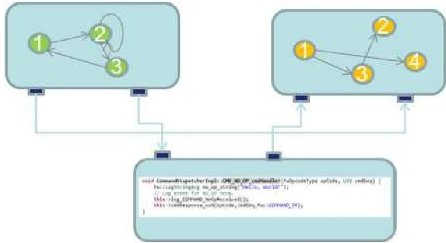


<div align="center">

Figure 1: An Example F Prime Topology

</div>

## 2.1.3 Topologies and Deployments

A set of component instances and their connections forms a directed graph called a topology. Figure 1 shows an example topology with three components. In this example, the two components on the top encapsulate state machines, shown as nodes and arrows. The bottom component receives commands; some C++ command handler code is shown.

A topology together with supporting code such as binary libraries specifies a FSW executable program, also called a deployment. From a single set of component instances, you can create several different deployments. For example, you can have deployments that correspond to different configurations of flight hardware, or that swap out hardware components for software simulators, or that test different parts of the system. This flexibility is very useful during development and testing of FSW.

## 2.2 C++ Framework

F Prime comes with a C++ framework that you can use to construct FSW applications. The framework adheres to the F Prime architecture ( $ \§ 2.1 $ ).

Components: The F Prime framework includes a C++ base class for each kind of F Prime component (active, passive, and queued; see § 2.1.1). Each component in an F Prime application is derived from one of these classes.

When you define an F Prime component C, you specify its kind and its ports, and you define its ground interface. The ground interface includes commands, events, and telemetry. Section 2.3 describes how this is done. From the specification, the F Prime tools generate the following C++ classes:

<!-- PDF_PAGE: 5 -->

- An abstract class CComponentBase derived from the appropriate framework base class.

- A concrete class CComponentImpl derived from CComponentBase.

CComponentBase is the base class for the C component implementation. It contains generated code for receiving commands and for sending and receiving invocations on ports.


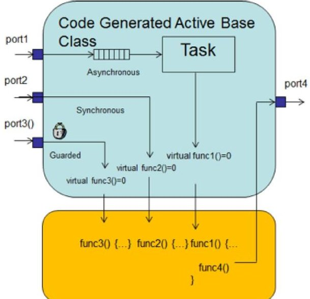


<div align="center">

Developer Written Implementation Class

</div>

<div align="center">

Figure 2: Component Classes

</div>

CComponentImpl is a skeleton for the user-defined implementation of C. It contains stubbed-out handlers for the input ports, each of which overrides a pure virtual function defined in CComponentBase. To complete the definition of CComponentImpl, you add member variables and helper functions as necessary, and you fill in the handler implementations. The framework and the auto-generated base class take care of all the details of invocation handling. This makes it easy to define new components. When writing the handlers, you can send data on output ports by calling member functions defined in CComponentBase.

Figure 2 illustrates the ComponentBase and ComponentImpl classes for a sample component with three input ports and one output port. Each of the input ports has a pure virtual handler in the base class that is implemented in the implementation class. The handler implementation for port 3 sends data out on port 4.

Ports: The F Prime framework includes C++ base classes for input and output ports. Each port in F Prime is derived from one of these classes.


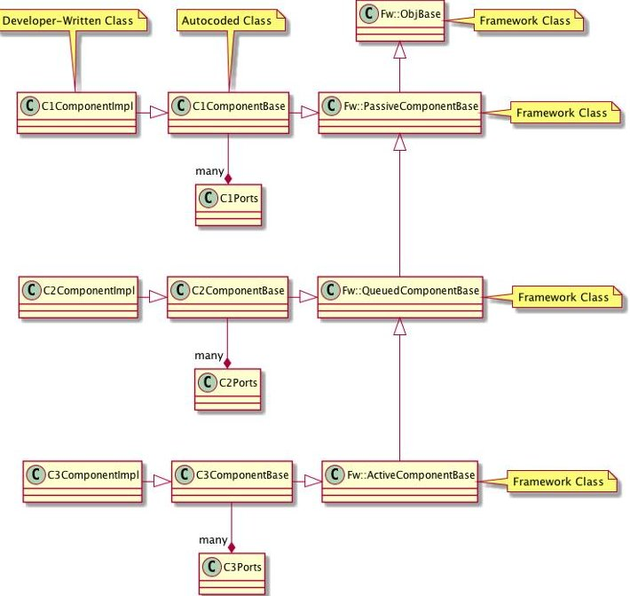


<div align="center">

Figure 3: Example Component Class Diagram

</div>

When you define an F Prime port P, you specify its arguments and its return type (if any). Section 2.3 describes how this is done. From the specification, the F Prime tools generate the following C++ classes:

- InputPPort: A class derived from the framework base class for input ports, representing P used as an input port.

- OutputPPort: A class derived from the framework base class for output ports, representing P used as an output port.

When you specify a component C and define its ports, the F Prime tools add appropriate instances of InputP- Port and OutputPPort to CComponentBase as member variables. Figure 3 shows an example class diagram for an F Prime application with several components and ports.

Serializable Types: The F Prime framework requires that each type appearing in a port argument or return value is serializable, that is, convertible to a byte stream. Serializability provides a uniform way for the framework to pass data through message queues and serialize ports (see $ \§ 2.1.2 ).

Basic types (integral types, the Boolean type, and floating-point types) are automatically serializable. Class types are serializable if they are derived from an abstract class Serializable provided by the framework. You can specify serializable structure types in the FSW application model ( $ \S 2.3 $ ) and auto-generate the corresponding derived classes of Serializable. Alternatively, you can write your own serializable class in C++. To do this,

<!-- PDF_PAGE: 6 -->

you derive your class from Serializable and implement its virtual methods.

OS Abstraction Layer: The F Prime framework includes C++ classes that provide abstractions of common operating system (OS) features. These features include threads, mutual exclusion locks, message queues, files, timers, and clocks. The open-source framework provides implementations of the OS layer for Linux and Mac OS. The Linux implementation works in Windows, on top of Cygwin. Internally to JPL we have developed an implementation for VxWorks. To port F Prime to a new operating system S, you must write implementations of these classes for S.

Optional Features: The F Prime framework has a number of optional features. If any of these features is not needed, you can disable it by editing a configuration file. Disabling unnecessary features saves memory and/or CPU cycles during FSW execution. The optional features include the following:

- Sending data on serialize ports ( $ \S 2.1.2 $ ).

- Storing diagnostic information about component instances, such as the names of the instances, at runtime for debugging.

## 2.3 Modeling and Code Generation

- Converting events emitted by FSW to human-readable text so they can be printed on the console or stored in a file.

XML Specifications: F Prime defines an Extensible Markup Language (XML) schema. Using the schema, you can specify a model of a FSW application. The model describes the application at a high level in terms of the components, ports, and topologies of the F Prime architecture ( $ \§ 2.1 $ ). The F Prime autocoder translates the model into the C++ classes described in $ \§ 2.2 $ .

Figures 4 and 5 show example XML files for specifying F Prime ports and components. These examples are adapted from the CmdDispatcher component in the F Prime distribution (see $ \§2.4 $ ).

Figure 6 shows an example XML file for specifying a topology. This example is adapted from the Ref application, a FSW application included with the F Prime distribution for tutorial purposes.

Ground Dictionaries: As part of an XML component specification, you can define the following:

- Commands. You can specify commands that the ground can send to instances of the component, including the command name, the arguments to the command, and the types of the arguments.

```xml

<interface name="Cmd" namespace="Fw">

  <include_header>

    Fw/Cmd/CmdArgBuffer.hpp

  </include_header>

  <comment>Command port</comment>

  <args>

    <arg name="opCode" type="FwOpcodeType">

      <comment>Command Opcode</comment>

    </arg>

    <arg name="cmdSeq" type="U32">

      <comment>Command Sequence</comment>

    </arg>

    <arg name="args"

        type="CmdArgBuffer"

        pass_by="reference">

      <comment>

        Buffer containing arguments

      </comment>

    </arg>

  </args>

</interface>

```

<div align="center">

Figure 4: XML Port Specification

</div>

```xml

<component name="CmdDispatcher"

    kind="active"

    namespace="Svc">

  <import_port_type>

  Fw/Cmd/CmdPortAi.xml

  </import_port_type>

  ...

  <comment>

  A component for dispatching commands

  </comment>

  <ports>

    <port name="compCmdSend"

      data_type="Fw::Cmd"

      kind="output"

      max_number="$CmdDispatcherCommandPorts">

      <comment>Command dispatch port</comment>

    </port>

    ...

  </ports>

  ...

</component>

```

<div align="center">

Figure 5: XML Component Specification

</div>

- Telemetry Channels. You can specify the telemetry channels emitted by the component. A telemetry channel has a unique ID and a value type. A telemetry channel defines a set of telemetry points, where a point is a channel ID and a value.

- Events. An event is a report of FSW behavior, for example a notification or a warning. Events have arguments. For example, a FILE_UPLINKED event might have a single argument of string type representing the file name.

- Parameters. A parameter is a constant value that may be updated by command from the ground. For example, control algorithms often have parameters that need to be tuned or adjusted in

<!-- PDF_PAGE: 7 -->


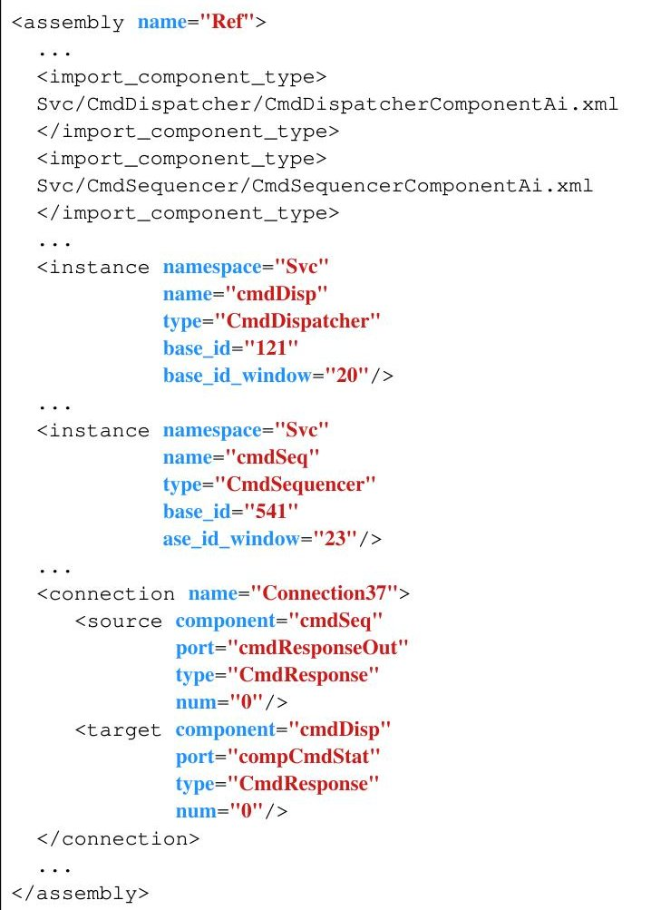


<div align="center">

Figure 6: XML Topology Specification

</div>

flight.

The collection of these definitions for a single component C forms the ground dictionary for C. The collection of definitions over all the component instances in a system forms the ground dictionary of a system.

From the XML ground dictionaries, the F Prime tools automatically generate Python code in a form that the F Prime GSE ( $ \S 2.5.2 $ ) can read. You can extend the F Prime autocoders to translate the XML dictionaries to the format used by the ground tools in your mission.

Graphical Modeling: As an alternative to writing XML models, you can create and edit a formal model in the System Modeling Language (SysML). $ ^{2} $ SysML provides a feature called a profile that lets you specialize it to an application domain. In F Prime, a profile called the F Prime Profile uses the concepts of generic components and ports that are already embedded in SysML. It specializes these concepts to define the F Prime components and ports described in $ \§ 2.1 $ . See Figures 7 and 8.

To create a SysML model of an F Prime application, you use the F Prime Profile inside a graphical modeling tool called MagicDraw. $ ^{3} $ An F Prime-specific MagicDraw plugin translates models expressed in the F Prime


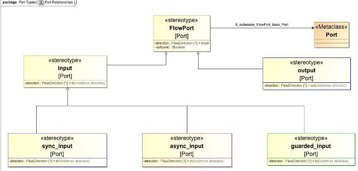


<div align="center">

Figure 7: The F Prime Profile for Port Types

</div>


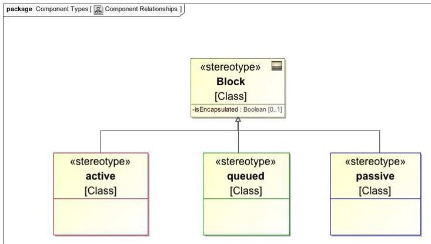


<div align="center">

Figure 8: The F Prime Profile for Component Types

</div>

Profile into the XML representation described above. The resulting XML files are fully compatible with handwritten XML, and they pass through the C++ and ground dictionary autocoders in exactly the same way. See Figure 9.


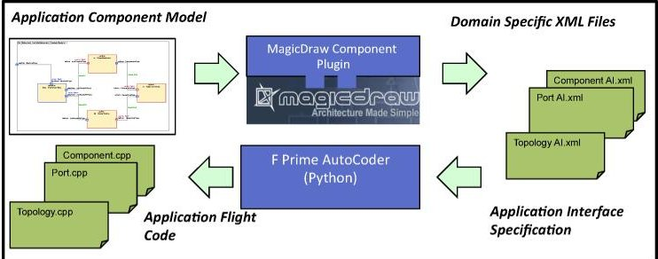


<div align="center">

Figure 9: F Prime Modeling and Code Generation

</div>

Expressing an F Prime application as a formal model has several advantages:

1. It captures the high-level design of the system in a form that is easy to visualize.

2. It separates the high-level design from the implementation details.

3. It allows automated checking for violations of architectural constraints. This checking can occur before implementation begins, potentially saving developer time.

<!-- PDF_PAGE: 8 -->

With regard to point 3, the MagicDraw plugin checks the following architectural rules:

- Each port must have a valid type specification.

- Each connection must go from an output port to an input port.

- Each connection must have matching port types at its ends.

- Each output port may have at most one connection or, if the port is an array, one connection per index.

- No passive component may have an asynchronous port.

- Each active component must have at least one asynchronous port.

The plugin also warns the user about unconnected ports although sometimes unconnected ports are desired (a component may provide a port or ports that are not used in a FSW application).

## 2.4. Reusable Components

The F Prime distribution includes a number of generic reusable components. These components cover many of the basic functions of flight systems. In some cases, you may have to supplement the generic components with system-specific components or classes to adapt them to your system. We will continue to add to the list of available components as we develop the framework.

Each component includes design documentation and unit tests. Because of the F Prime architecture ( $ \S 2.1 $ ) these components are self-contained and are easy to integrate into any flight software project that uses F Prime.

Rate Groups: As discussed in $ \mathrm{S} $ 2.1.1, a rate group is a set of component instances that run periodically at the same rate. F Prime provides two components for constructing rate groups: RateGroupDriver and ActiveRateGroup.

In a typical FSW application, an instance d of Rate- GroupDriver receives a periodic timing signal from hardware or software and sends invocations to instances $ a_{i} $ of ActiveRateGroup, one for each rate group, at the required rates. Each $ a_{i} $ provides the thread for its rate group. It converts the invocations received from d into invocations that drive the behavior of the components in group i.

Commands: CmdDispatcher receives data buffers containing serialized commands. For each buffer received, CmdDispatcher deserializes the command and

dispatches it to a single index in an array of output ports. To dispatch a command, CmdDispatcher looks up the opcode in a registration table created during FSW initialization. The table matches each command opcode with the array index to use for the dispatch.

CmdDispatcher stores each dispatched command in a response table. When it receives a status reply for that command, it looks in the response table to find the sender of the command (e.g., CmdSequencer, described below), and it forwards the response to the sender.

CmdSequencer loads binary command sequence files in an F Prime-specific format and runs them. It supports both absolute-time and relative-time commands. F Prime includes a tool called tinyseqgen for generating binary sequence files from a human-readable text input format.

Events and Telemetry: ActiveLogger accepts incoming events and applies filters to them based on event severity. For each event that passes through the filters, ActiveLogger stores the event in a circular buffer (the log) and emits the event on an output port for use by downstream components. If the event has fatal severity, then ActiveLogger emits the event on a special port that is typically connected to a FatalHandler (see below).

PassiveTextLogger accepts events, converts them into human-readable text, and writes the text to the console. This is useful for development and testing on the ground.

TlmChan (for "channelized telemetry") receives channelized telemetry points and stores them in a map. "Channelized" means that each telemetry point consists of a channel ID and a serialized value. You can use each instance of TlmChan in one of two modes:

1. On request, provide the latest telemetry value associated with a given ID.

2. Periodically send all telemetry points whose values have changed since the last period.

ComLogger receives data buffers called com buffers and writes them to the file system. As an example, you can connect the event output of an ActiveLogger instance to an event serializer and then to the input of a ComLogger. This provides continuous logging of events to the file system.

Ground Interface: BuffGndSockIf provides a socketbased interface between FSW and the F Prime ground data system ( $ \§2.5.2 $ ). It supports uplink of commands and files and downlink of events, telemetry, and files. It is useful for testing FSW on the ground.

<!-- PDF_PAGE: 9 -->

File System: FileUplink and FileDownlink provide file uplink and downlink capabilities. They use an F Primespecific format for file packets; the format is a strippeddown version of the CCSDS File Delivery Protocol (CFDP) format. $ ^{4} $ By connecting these components to an instance of BuffGndSockIf (see above), you get file uplink and downlink capability for ground testing. You can also create on-board adapter components that convert the F Prime file packets to and from your mission-specific packet format.

FileManager provides a ground interface to the onboard file system. It includes commands for listing directories and for moving and renaming files and directories.

Memory Management: BufferManager manages memory buffers from a statically allocated store. When constructing a BufferManager instance, you provide the size of the store and the maximum number of outstanding buffers. The BufferManager interface has guarded ports for allocating and deallocating buffers.

Generic Data Storage: PolyDb provides a map from numeric identifiers to values. The values can be any of the basic C++ types. Each entry in the map stores the type and the value (represented as a union). PolyDb is useful for storing any collection of values, for example sensor readings received from hardware.

Parameters: PrmDb stores the current values of the FSW parameters ( $ \S 2.3 $ ). At FSW initialization, PrmDb reads a parameter table out of a file. Each component instance that has parameters (1) reads its parameter values out of PrmDb, (2) has ground commands for updating the parameters locally, and (3) has auto-generated ground commands for updating the parameter values in PrmDb. PrmDb has commands for saving the parameter table to the file system.

Time: The Time component has a guarded port that other components can invoke to request the current spacecraft time. F Prime includes a Linux implementation of Time that uses clock_gettime.

Health: The Health component monitors FSW health to ensure that no threads are spinning or stuck. It sends an invocation to every active component in the system. If it receives a response within a timeout interval, then all is well. Otherwise it sends a warning event and eventually a fatal event.

FSW.

Assertions and Fatal Events: AssertFatalAdapter converts FSW assertion failures into fatal events. FatalHandler receives and handles fatal events. The implementation of FatalHandler is mission-dependent; typically, it saves diagnostic information and halts the execution of

## 2.5 Testing

Testing is a critical part of FSW development. Often, the effort spent on testing a flight system is comparable with the effort spent on designing and implementing it. In this section, we discuss the features of F Prime that support testing of FSW components and topologies.

## 2.5.1 Unit Testing

F Prime includes robust support for unit testing at the component level.

Auto-Generated Test Classes: F Prime automatically generates the following classes from the XML specification of a component:

- TesterBase

- GTestBase

- Tester

TesterBase is the base class for testing a component C. It provides a harness for unit tests that includes the following features:

- For each output port in C, an input port called a from port. For example, if C has an output port dataOut of type Data, then TesterBase has an input port from_dataOut, also of type Data.

- For each input port in C, an output port called a to port. For example, if C has an input port dataIn of type Data, then TesterBase has an output port to_dataIn, also of type Data.

- For each from port, a history of the data received on that port. The history resides in a fixed-size array with a configurable size. Events and telemetry have a different history for each event and telemetry channel.

- For each from port, a default handler that stores its arguments into the history for that port. The event and telemetry ports have a different handler for each event and telemetry channel.

- Utility methods for sending commands to the component under test, for sending invocations on to ports, for getting and setting the parameters of the component under test, and for getting and setting the time.

GTestBase is a derived class of TesterBase. It includes the headers for the Google Test framework, so you can use Google Test assertions for example, ASSERT_EQ to check that two values are equal when writing your tests. GTestBase also provides F

<!-- PDF_PAGE: 10 -->

Prime-specific assertion macros for checking properties of the from port histories. In particular, you can check the following:

- That the history of a from port has the specified size. For example, to check that the history for the telemetry channel PKTS_RECEIVED contains one element, you can write

## ASSERT_TLM_PKTS_RECEIVED_SIZE(1).

- That the history of a from port has the specified data at the specified index. For example, to check that the telemetry channel PKTS_RECEIVED has value 1 at index 0, you can write

## ASSERT_TLM_PKTS_RECEIVED(0,1).

The F Prime-specific macros invoke the Google Test macros.

GTestBase is a separate class so that its use is optional: on systems that don't support it (e.g., because the C++ compiler won't compile Google Test), you can omit it.

Tester is a derived class of GTestBase. It contains the component under test as a member. You write unit tests in this class or in a derived class of this class.

Writing Unit Tests: To write unit tests against an F Prime component, you typically use the following procedure:

1. Generate the test harness classes described above.

2. Either add tests directly to Tester or create a derived class of Tester and add tests to it. Make each test a public method of the class.

3. Write a file main. cpp containing (a) several tests defined with the Google Test TEST macro and (b) a main function that runs all the tests.

Each test defined in main typically (1) creates a fresh instance of Tester or one of its derived classes and (2) calls one of the test methods. That way, each unit test starts with freshly initialized component state.

Running Unit Tests: The F Prime build system provides targets for building and running component unit tests. The system compiles unit tests with code coverage analysis enabled via gcov. $ ^{6} $ Running the unit tests automatically generates the code coverage results and stores them to files in a form that you can examine.

## 2.5.2 Ground Data System

F Prime comes with a ready-to-use ground data system called the Ground Support Equipment (GSE) software.

The GSE is useful for development and testing of FSW. In particular, the GSE is designed to work with the generic FSW components discussed in § 2.4. By putting the two together, you can quickly get up and running with an end-to-end system that supports uplink and downlink of commands, telemetry, events, and files.

The F Prime GSE is implemented in Python and depends on a few Python packages. It requires little effort to install.

Figure 10 shows the elements of the F Prime GSE architecture. We discuss these elements below.


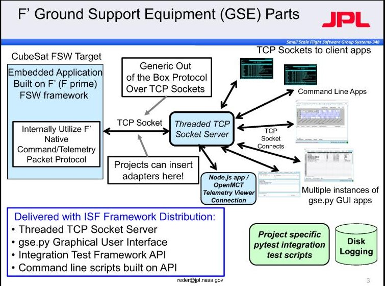


<div align="center">

Figure 10: F Prime GSE Architecture

</div>

TCP Socket Server: At the core of the GSE is a threaded Transmission Control Protocol (TCP) socket server. The server allows several clients to connect to a single target. The target is the FSW application under test. Clients can be instances of the GSE graphical user interface (GUI), client scripts, or integration test scripts. Everything is connected via TCP sockets using a simple packet protocol developed for F Prime.

GSE GUI (gse.py): The GSE GUI runs on top of the Python package TkInter. It connects to the server over a dedicated TCP socket. The user interface consists of a single window with the following tabbed panels:

- A command panel for sending commands to the spacecraft.

- A telemetry panel for viewing telemetry points received from the FSW in real time. The telemetry is organized and displayed by channel.

- An event panel for viewing event messages received from the FSW in real time.

<!-- PDF_PAGE: 11 -->

- A graphical panel built on Matplotlib $ ^{7} $ for producing strip charts, histograms, and spectral plots of telemetry data.

The user may create as many instances of this window as desired. See Figure 11.


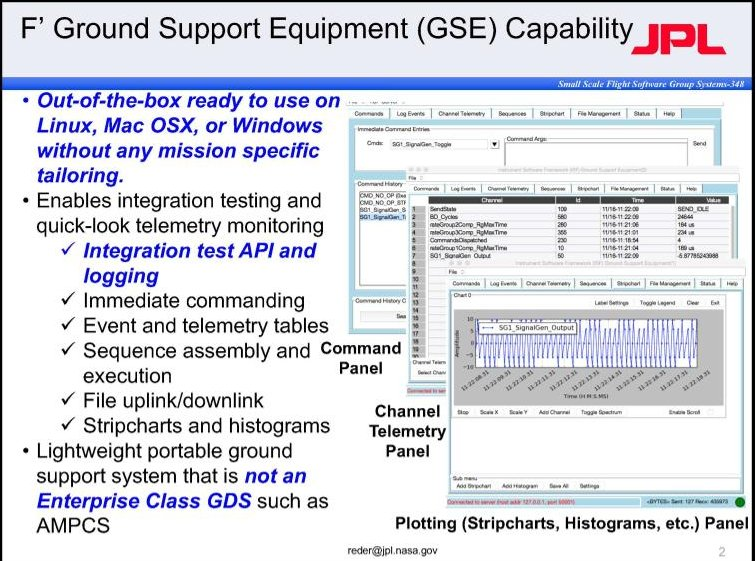


<div align="center">

Figure 11: F Prime GSE GUI

</div>

Python API: The GSE includes a simple application programming interface (API) for command and telemetry called gse_api.py. Its implementation is a Python object that provides methods for sending commands to FSW and receiving events and telemetry. The GSE API is the basis for the automated integration testing features discussed in $ \§ 2. 5. 3. $

Python Code Generation: As discussed in § 2.3, the F Prime tools generate Python modules from the F Prime XML model. The modules contain the definitions of the ground dictionaries that the GSE needs to format the display, to send commands, and to receive events and telemetry. The only configuration required is to set an environment variable telling the GSE where to find the generated Python dictionaries for the target application.

## 2.5.3 Automated Integration Testing

F Prime includes a Python test API for writing automated integration tests. The test API extends the GSE API ( $ \§2.5.2 $ ). Using the test API, you can write Python programs that send commands to the spacecraft and check the resulting behavior, e.g., by asserting properties of event and telemetry histories. This kind of automation is essential for tests that must be run many times, e.g., regression tests.

Sending Commands: To send a command to the spacecraft, you call the GSE API method send, passing in the name of the command and an optional list of arguments.

Here is an example:

$$
\mathrm {a p i . s e n d} \left(" C M D _ {N O} O P"\right)
$$

This call sends a NO_OP command. The argument list is empty, so it is omitted. As the name suggests, NO_OP does nothing but emit events and telemetry indicating that the command was received and dispatched. It is defined in the CmdDispatcher component (see $ \§ 2.4 $ ), and it is useful for basic testing of uplink and downlink.

Collecting Events and Telemetry: When the F Prime GSE receives events and telemetry points from the spacecraft, it stores them in input queues. The test API adds Python classes for storing test histories of events and telemetry. The histories provide methods for asserting properties, e.g., that the event history contains an event with a specified value.

By default, incoming events and telemetry points accumulate in the GSE input queues, and the test histories remain empty. The test API provides a method update that, when called, moves the available items from the event and telemetry queues into the event and telemetry histories. However, you rarely call update when writing tests; instead, you usually write wait_assert methods, as described below. These methods update the test histories when they run.

Checking Event History Size: The test API method wait_assert_evr_size_eq has one required argument, which is the expected size size of the event history. When called with one argument, this method does the following:

- If the event history has size size, then return.

- Otherwise, move events from the input queue to the event history until either (a) the history has size size or (b) the default timeout period of five seconds has elapsed. In case (b), cause the test to fail.

wait_assert_evr_size_eq has the following optional arguments:

- evr_name: An event name. If evr_name is present, then wait_assert_evr_size_eq counts only events with this name.

- filterFunc: A function that takes a list of arguments and returns a Boolean value. If filterFunc is present, then wait_assert_evr_size_eq counts only events E for which this function returns true when applied to the arguments of E.

<!-- PDF_PAGE: 12 -->

- timeout: A timeout in seconds. If timeout is present, then wait_assert_evr_size_eq waits for timeout seconds before failing.

In addition to eq, the test API provides similar functions for the other standard comparisons ne,gt,lt,ge,and le.

Checking Events: The method wait_assert_evr_eq has one required argument, which is a list L of values. When called with one argument, this method does the following:

- If the history contains an event whose argument list matches L, then return.

- Otherwise, move events from the input queue to the event history until either (a) the history contains an event whose argument list matches L or (b) the default timeout period of five seconds has elapsed. In case (b), cause the test to fail.

Any argument in the list can be an object NEAR constructed with a center and a radius, e.g.,

$$
N E A R (0, e p s i l o n = 0. 1).
$$

In this case, the argument in the event history matches if it is inside the circle with the given center and radius.

wait_assert_evr_eq has the following optional arguments:

- evr_name: An event name. If evr_name is present, then wait_assert_evr_eq checks only events with this name.

- index: The index to check in the event history for the matching arguments. You can write a number (where, as in Python, negative numbers are offsets from the end of the list), ANY, or ALL. The default is ALL.

- timeout: As described above.

Again, the API provides similar functions for ne, gt, lt, ge, and le.

Checking Telemetry: The test API provides functions wait_assert_tlm_size_eq, wait_assert_tlm_eq, and the corresponding functions for the other comparisons. These operate similarly to their counterparts for events, except that they check the telemetry history instead of the event history.

## 3. EXPERIENCE WITH F PRIME

In this section, we discuss our experience using F Prime. We describe several JPL flight projects that have used or are using F Prime to develop the FSW. Then we discuss a JPL research and technology development (R&TD) effort that is using F Prime to develop a framework for

autonomous flight systems. Finally, we discuss our experience using F Prime as an educational tool in the context of university student projects.

## 3.1 ISS RapidScat

ISS RapidScat was a scatterometer, i.e., a radar-based instrument for measuring near-surface wind speed and direction over the ocean. It operated from the exterior of the International Space Station (ISS) from November 2014 to August 2016.

The RapidScat FSW ran on a GE CR12 single-board computer on top of VxWorks 6.8. It ran within the Digital Interface Bridge (DIB), a collection of internally-developed and externally-procured electronics boards for managing communication between the ISS and the instrument. To communicate with the DIB, the ISS used a MIL-STD-1553 data bus (the "1553 bus") $ ^{8} $ for command and telemetry and an Ethernet link for science data. The DIB communicated with the instrument via serial and discrete signals. Key requirements of the software included processing DIB commands and passing radar commands to the instrument, packaging engineering telemetry and science data from the radar according to ISS specifications, buffering science data, and providing time services to the instrument.

The RapidScat FSW represents the first use of an F Prime deployment in space. All components of the FSW were newly developed for the mission. Component autocoding as discussed in § 2.3 was not yet available, so the developers hand-wrote the base classes for the components. While this early use of F Prime did not enable direct component reuse, it flight-validated the framework. It also demonstrated the capability to use the same components without modification in different test configurations. Switching from a software-simulated 1553 bus to a hardware bus required only a simple change to the system topology.

## 3.2 ASTERIA

ASTERIA (Arcsecond Space Telescope Enabling Research in Astrophysics) $ ^{9} $ is a 6U CubeSat operating in low Earth orbit. The ASTERIA mission is a collaboration between JPL and the Massachusetts Institute of Technology, with Morehead State University providing the ground station.

ASTERIA is a space telescope. Its primary goal is to demonstrate the following capabilities, which are firsts for a CubeSat:

<!-- PDF_PAGE: 13 -->

- Precise pointing of the telescope imager (to within five arcseconds, i.e., 5/3600 of a degree) over several back-to-back 20-minute observations.

- Stable thermal control (to within plus or minus 1/100 of a Kelvin) of the imager focal plane.

These capabilities are critical for photometry, i.e., measuring the light emitted by stars as a function of time. An important application of photometry is the detection of exoplanets (planets orbiting stars outside our solar system) via the transit method, (detecting the changes in star light that occur when a planet passes in front of a star). A secondary goal of ASTERIA is to detect exoplanets.


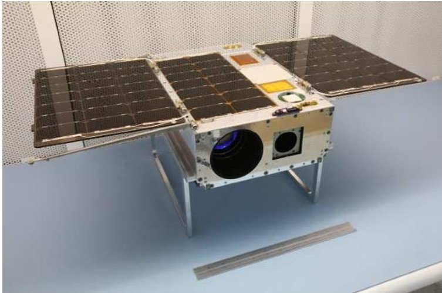


<div align="center">

Figure 12: The ASTERIA Spacecraft

</div>

Spacecraft: The ASTERIA CubeSat has a payload comprising a lens and baffle assembly, a CMOS imager, and a two-axis piezoelectric stage for fine positioning of the imager. A Blue Canyon Technologies (BCT) XACT $ ^{10} $ provides attitude control, including coarse-grain pointing during observations. Fine-grain pointing occurs via a software control loop that moves the piezo stage in response to the motion of star centroids. $ ^{11} $ Thermal control of the imager occurs via passive cooling and heaters driven by a software control loop.

Figure 12 shows the ASTERIA spacecraft with its solar panels in the deployed position. The large aperture in front is the telescope lens, and the smaller aperture is the star tracker.

Mission Timeline: JPL delivered the ASTERIA spacecraft to the NanoRacks CubeSat deployer $ ^{12} $ in June 2017. Launch and delivery to the International Space Station (ISS) occurred in August 2017. Deployment from the ISS occurred in November 2017. ASTERIA successfully completed its 90-day primary mission in February 2018. As of this writing, it is in an extended mission through at least August 2018.

Flight Software: The ASTERIA FSW is based on F Prime. It contains 54 components and 93 component instances. 17 components were inherited from F Prime and used unmodified or with minor modifications. 22 were developed for ASTERIA but reusable in future missions. 16 were developed for ASTERIA and are mission-specific.

Experience with F Prime: ASTERIA FSW development was challenging. The ASTERIA FSW is complex, and the schedule and budget were extremely constrained. The FSW requirements, particularly the fault protection requirements, did not stabilize until very late in the development cycle (on the order of weeks before delivery).

The F Prime framework was a key factor in the successful delivery of FSW under these constraints. Of particular benefit were the architectural patterns, the modeling and code generation, the direct component reuse, and the GSE.

Because ASTERIA was an early F Prime deployment, the ASTERIA FSW team developed parts of F Prime itself. Some of the components and framework enhancements developed for ASTERIA (e.g., FileUplink and FileDownlink, described in $ \§ 2.4 $ ; automated integration testing, described in $ \§ 2.5.3 $ ) are now part of mainline F Prime. Other framework enhancements (e.g., a simplified way to model components and topologies) are the basis for proposed new features of F Prime. We discuss these further in $ \§ 4 $ , below.

## 3.3 Lunar Flashlight and NEA Scout

Lunar Flashlight and Near Earth Asteroid (NEA) Scout are two deep-space 6U CubeSats in concurrent development at JPL. Selected by NASA's Advanced Exploration Systems (AES), they are planned for launch as secondary payloads of the NASA Space Launch System's inaugural Exploration Mission-1.

Lunar Flashlight will map the lunar south pole for volatiles, including water from ice deposits. It will shine a near-infrared laser into regions of shadow while a spectrometer measures surface reflection and composition. NEA Scout, developed jointly with NASA's Marshall Space Flight Center, will navigate to a near-earth asteroid that is yet to be selected. Its propulsion will include a solar sail. Once at the target asteroid, NEA Scout will use a multi-spectral camera to take images and transmit them back to Earth.

The two CubeSats share a common avionics platform, developed at JPL. It features a Cobham Gaisler GR712RC dual-core Leon3 processor. The CubeSats

<!-- PDF_PAGE: 14 -->

also have several common hardware components, including the command and data handling (C&DH) subsystem, radio, electrical power subsystem, power switch control, sensor electronics, and solar panels. The flight systems diverge with respect to guidance and control, propulsion, and instruments.

Both CubeSats use F Prime deployments for their FSW. Each deployment runs on a single core on top of VxWorks 6.7. The two deployments share 53 components. 16 are service components inherited from F Prime ( $ \S 2.4 $ ). The team made enhancements to Cmd- Sequencer and ComLogger; these are expected to be contributed back to mainline F Prime. Of the other common components, most are either drivers associated with the common hardware or data-formatting adapters associated with the common ground data system. The Lunar Flashlight FSW currently calls for five additional project-specific components, while the NEA Scout FSW calls for ten. Both FSW systems adapt generic F Prime components for spacecraft fault protection.

A single FSW team is responsible for delivering both FSW systems. The reuse of components from F Prime and the sharing of components between the systems have yielded significant cost savings versus developing two separate CubeSats. Additionally, the common C&DH subsystem developed for the two missions represents a validated avionics platform that future CubeSat missions can use.

## 3.4 Mars Helicopter

The Mars Helicopter mission $ ^{13} $ aims to demonstrate the use of an autonomous helicopter to explore the Martian surface. The helicopter will ride to Mars on board the Mars 2020 rover and be deployed after the rover lands. During deployment, a specially designed mechanical system will gradually unload the helicopter. After the rover moves away, the helicopter will execute a set of increasingly challenging flights, sending back images and performance data that can inform the design of future hardware and software for Martian flight.

Mission Timeline: In 2016 and 2017, test campaigns on prototype vehicles validated the hardware design and guidance algorithms. Figure 13 shows one of the prototype vehicles used. The flight vehicle was under construction at the time of this writing. The Mars Helicopter will perform its mission in 2021, after the operations personnel have selected a safe site for carrying out the experiment.

Flight System: The flight environment of this mission is very challenging. The low atmospheric density (about 1% of Earth atmospheric density) means that the


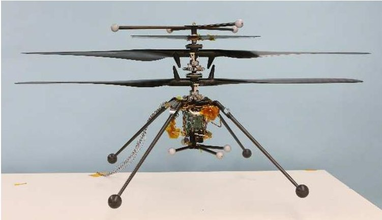


<div align="center">

Figure 13: Mars Helicopter Prototype

</div>

helicopter blades must be long, spin rapidly, and be very light. The flight dynamics require novel techniques for guidance and control. On top of all that, the helicopter must be small enough to fit under the belly of the rover The coaxial rotor design makes this possible.

The helicopter avionics system consists of two processors: (1) an automotive-grade microcontroller from Texas Instruments for controlling the rotor system and (2) a cellphone-grade processor from Qualcomm for guidance and control, commanding, and telemetry. There are two cameras: a downward-facing navigation camera and a forward-facing camera that takes high-resolution color pictures. A solar panel on top of the rotor system recharges the helicopter battery.

In addition to the helicopter itself, the flight system includes a base station mounted on the rover for managing communication with the helicopter. The base station and the helicopter use the same Qualcomm processor, allowing them to share a common avionics and software design. The helicopter carries a commercial ZigBee radio for communicating with the base station.

Flight Software: The FSW team used F Prime throughout the development of the prototype vehicles and the flight vehicle. The modularity of the F Prime architecture enabled significant code sharing (1) through all generations of the helicopter and (2) between the helicopter and the base station. The F Prime deployment on the Qualcomm processor runs on Linux. The other deployment runs directly on the microcontroller, with no operating system. The two deployments use serialize ports ( $ \S 2.1 $ ) to communicate over a UART interface. It is easy to add a communication path between two F Prime component instances, one on each processor: just connect ports on either side of the interface. This requires no update to the UART protocol.

<!-- PDF_PAGE: 15 -->

The FSW team developed many components, including device drivers, navigation sensors, communication components, and imaging components. The F Prime tools made it easy to integrate all these components into the command and telemetry subsystems. In developing the FSW, the team reused components developed for the other projects discussed in this section. This reuse allowed the FSW team to meet a very challenging schedule.

Ground System: The Mars Helicopter project made extensive use of the GSE to develop hardware testing scripts, to perform software validation, and to perform flight testing. Sequences generated by the GSE tools orchestrated the many flight plans required during validation of the vehicle.

## 3.5 Autonomy

The Autonomy Initiative is an internal research and technology development (R&TD) task at JPL. It seeks to make spacecraft more capable by increasing the level of autonomous behavior within FSW. Currently, spacecraft commands for most activities are issued either from the ground or via on-board sequences, which are tightly-scripted lists of commands. Autonomous decision-making is reserved for handling faults and unexpected events during special time-critical activities.

The autonomy project is investigating the use of task networks to allow spacecraft to adapt their behavior to real-time inputs without ground intervention and to respond more robustly to faults. A task network is a set of tasks, each of which has a command (what to do when running the task), a set of conditions (the conditions on system state that are expected to hold when running the task), and a set of impacts (the expected effects on system state of running the task).

An on-board subsystem called the planner attempts to fit the tasks into a valid schedule, i.e., one that will obey all the constraints assuming that the declared impacts occur when the tasks are run. During scheduling, the planner may introduce new tasks, for example to resolve higher-level tasks into lower-level ones or to repair conflicts in the schedule. When the planner has a valid schedule, it sends it to another subsystem called the controller. The controller runs the tasks at their scheduled times and checks that the conditions of the tasks are satisfied. If the conditions are not satisfied, say because a command failed during execution of a task, then the controller can run a contingency task, or it can halt the execution of the task network and force the planner to generate a new schedule (a "re-plan").

Some planning can be done on the ground. On-board planning is needed in the following cases:

- Information needed to construct the plan is available only in flight, when the ground is not in the loop. For example, when calculating how long to run an observation, the ground may need to use conservative estimates about available power. An on-board planner could take account of power measurements closer to the time of the observation.

- Something unexpected occurs, such as a hardware fault. Today, the response to such a condition is usually conservative, e.g., put the spacecraft in safe mode and wait for ground intervention. An autonomous system could diagnose the problem and attempt to rectify it or work around it.

The concept of planning has a long history in computer science. The novel parts of the Autonomy Initiative include the following:

- Demonstrating the viability of on-board planning using task networks for space flight.

- Demonstrating a dynamic system in which tasks are created or updated on board in response to changing real-time conditions.

- Demonstrating a general framework for autonomous FSW that can be adapted to many missions.

- Demonstrating the integration of on-board planning and execution with on-board fault diagnosis.

The Autonomy Initiative is implementing demonstration FSW that illustrates the proposed capabilities. The demonstration FSW uses F Prime. Each of the planner and the controller is an F Prime component. There are other components specific to the autonomy project, e.g., a component for managing system state, a component for auto-navigation, and a component for fault diagnosis.

Using F Prime provides the following benefits for this project:

- The architecture, tool chain, and basic FSW functions (e.g., command and data handling) are already in place, because they are inherited from F Prime. The project can assume these fundamental aspects of FSW and focus its effort on the new technology.

- It is easy to integrate external software (e.g., the planner and controller software; software for auto-navigation; software for fault diagnosis) by wrapping the software in F Prime components and then connecting the components to the rest of

<!-- PDF_PAGE: 16 -->

the system over ports.

- The F Prime tool chain makes it easy to develop new components and to write unit and integration tests in support of the demonstration FSW.

## 3.6 Educational Outreach

F Prime is a lightweight, open-source framework, and it runs on a wide range of platforms. Therefore it is ideally suited for student projects. Students can use it for embedded software development knowing that they are working with parts of the same software that runs on deployed flight systems.

We are exploring the potential of F Prime as an educational and research tool targeting computer science, computer engineering, and software engineering undergraduate and graduate students. To date we have sponsored two technology enhancement projects with the Master of Software Engineering program at Carnegie Mellon University (CMU). These are discussed further in $ \§4.1. $ In March 2018, we co-sponsored a hackathon at CMU focused on development for the Raspberry Pi. We created a demonstration component for the occasion, and we added it to the F Prime open-source distribution. We also incorporated F Prime into FSW workshops that we conducted at the University of Colorado, Boulder, in April 2017 and at Cornell University in June 2018. Both schools have established CubeSat development programs.

## 4. ENHANCEMENTS IN PROGRESS

In this section, we discuss enhancements to F Prime that are currently in progress. We discuss three broad areas of work: (1) modeling and code generation, (2) testing, and (3) the GSE.

## 4.1 Modeling and Code Generation

As described in § 2.3, F Prime developers currently use MagicDraw and SysML to specify models. This situation is not ideal, for the following reasons:

- F Prime modeling is very simple; SysML and MagicDraw are not. They are cumbersome to use, with a steep learning curve.

- MagicDraw requires a commercial license.

- The MagicDraw plugin has no support for creating command, telemetry, event, or parameter dictionaries. Developers must write these directly in XML.

Working with faculty and students at Carnegie Mellon University (CMU), we are developing a new, domainspecific modeling language and tool chain for F Prime

called FPP (for "F Prime Prime"). We intend that FPP will be freely available and easy to use, and it will support the full range of F Prime features in a natural way.

Modeling Language and Translation: To date we have developed the following:

1. A domain-specific source language for specifying F Prime models. Specifications in the source language are similar to the XML shown in Figures 4 through 6, but with a syntax that is much less verbose and more readable.

2. An optional graphical user interface (GUI) editing environment, implemented as an Eclipse integrated development environment (IDE) plugin.

3. A tool called fpp-compile that translates models specified in the FPP source language to an XML format called the FPP representation language. This format is suitable for further processing, e.g., generating C++ code and ground dictionaries.

4. A tool called fpp-legacy-xml that translates FPP representation language files into the XML format currently used by the F Prime autocoders.

fpp-compile uses the Acme Studio framework from $ \mathrm{CMU}^{1 4} $ to check the model for compliance with the architectural rules that we discussed in $ \§ 2. 3. $ Acme Studio provides a simple, declarative, and extensible way to specify the rules.

Visualization: We are working with CMU to develop a graphical tool (the FPP visualizer) for visualizing components and connections. We have identified the following requirements for the FPP visualizer:

1. The tool must provide different views of the connection graph (i.e., particular ways of rendering particular subgraphs of the graph).

2. The tool must automatically lay out the graph elements in a visually intuitive way.

3. The tool must allow manual editing of the layout and attributes (e.g, fonts, sizes, and colors) of the elements in a way that persists when the graph is re-generated from the textual source.

4. The tool must provide convenient version control for F Prime models extended with graphical representations.

Some views can be inferred from the structure of the underlying model. For example, the modeling language lets you express a topology as a collection of subtopologies, and each sub-topology will be a view. Other views can be specified by specifying a collection of model elements in the model viewer. Each view will

<!-- PDF_PAGE: 17 -->

have an associated layout, i.e., a set of instructions for how the view is to be rendered. We aim to provide automatic layout that is good enough for visualizing the model in day-to-day development without user intervention. Manual adjustments will be allowed, e.g., for fine-tuning a layout to prepare a presentation or report.

When you first load a model M, the FPP visualizer will create a default layout for each view in M and save it in a layout file. You can update the layout file either by editing the graphical view and saving it to the file or by directly editing the file. When you update the source model, e.g., by adding or removing elements, the tool will detect the change and will update the layout file appropriately. Both the model and the layout file will be stored as plain text, so they can be version-controlled by standard configuration management tools such as git.

## 4.2 Testing

Graphical Editing: In its initial version, the FPP visualizer will support graphical editing of views. We would like to extend the tool support graphical editing of models, e.g., by adding component instances to a canvas and dragging connections between them.

We are working on several enhancements to F Prime in the area of testing. Currently we are applying these ideas to unit testing of F Prime components. We believe that, with some modification, we can apply the same ideas to integration testing of F Prime deployments.

Rules: We have found that it is useful to factor tests into sequences of rules. A rule consists of a precondition and an action. The precondition is a Boolean function on the system state that says whether the rule may be applied. The action commands the system to do something and checks for the expected behavior.

For example, consider a unit test for the BufferManager component described in $ \§2.4. $ Two of the rules for testing this component might look like this:

R1. If there is a buffer available and s is a legal buffer size, then requesting a buffer of size s should succeed and should produce a valid buffer of size s.

R2. If no buffer is available and s is a legal buffer size, then requesting a buffer of size s should fail with a warning event NO_BUFFERS_AVAILABLE and should produce an invalid buffer.

In fact, a small set of rules like this can fully describe the behavior of the component. Further, once we have written the rules, it is easy to use them to create tests. For example, a test for successful allocation might create a fresh BufferManager component and apply R1; whereas a test for failed allocation might keep applying

R1 until all the buffers are allocated and then apply R2. Applying R1 when there are no buffers available or R2 when there are buffers available would cause a test failure, because the preconditions of the rules are not met.

Writing tests as sequences of rules has several advantages:

- It factors each test into small reusable pieces.

- It separates the problem of describing system behavior (writing rules) from the problem of constructing tests (writing sequences of rules).

- As discussed below, it allows automatic construction of tests using scenarios.

We are adding support for rule-based testing to the F Prime unit test framework. The support consists of (1) an abstract C++ base class Rule and (2) extensions to the test autocoders for writing assertions in user-defined subclasses of Rule.

Scenarios: We are exploring the use of scenarios to write tests in F Prime. A scenario is a recipe for generating tests expressed as sequences of rules. For example, consider the following scenarios S1, S2, and S3:

S1. Apply rules $ r_{1},\dots,r_{n} $ in order.

S2. Randomly construct a sequence $ \{r_{i}\} $ of at most n rules, where for each i we have the following: (1) $ r_{i} $ is a member of a specified set S of rules, and (2) the precondition of $ r_{i} $ is true in the current state just before $ r_{i} $ is applied.

S3. Randomly interleave scenarios S1 and S2. At each step, randomly choose i = 1 or 2. If i = 1 and the precondition for the next rule of S1 is met, then apply it. Otherwise generate a random rule according to S2 and apply it.

We are developing a C++ framework that lets you combine rules into scenarios and scenarios into more complex scenarios, using operations such as nondeterministic choice, repetition (loops), interleaving, and conditional execution.

Scenarios are useful because we can automatically generate many tests (potentially millions) from a single, compact scenario specification. For example, each sequence generated by S2 above represents a different test. Further, the set of tests described by S2 is in general much larger than the largest set of tests that it would be possible to write by hand.

Picking Test Inputs: Tests require input values. For example, the size s is an input to rule R1 above. Therefore, any test that applies R1 n times has at least n inputs $ s_{1},\dots,s_{n}. $

<!-- PDF_PAGE: 18 -->

Traditional approaches to picking test inputs include the following:

- Pick a concrete value or a set of concrete values.

- Pick a random value.

These approaches will certainly work. However, we would like to do better: we would like to pick inputs that will force the test to fail, if such inputs exist.

We are exploring the use of a tool called kontest for picking the inputs to F Prime tests. kontest is an experimental testing tool being developed at JPL. It uses dynamic symbolic testing (also called concolic testing a portmanteau of "concrete" and "symbolic") $ ^{15} $ to search for inputs that cause test failures.

Spin Model Checking: We are exploring the use of the Spin model checker $ ^{1 6} $ in F Prime unit testing. Spin is an explicit-state model checker: it remembers and systematically explores all the states of a system.

Currently we are exploring the following ideas:

1. Auto-generating Spin models that select and apply rules written in C++.

2. Hand-writing Spin models and using them to generate tests.

3. Using Spin's support for checking linear temporal logic (LTL) properties to drive an auto-generated or hand-written model to specified goal states.

Idea (1) potentially improves on random testing because it is guaranteed to explore all states reachable by legal sequences of rules, whereas random sequences may miss some states. However, (1) will generally not be computationally tractable for the full state space of an F Prime component. To make this idea work, we will have to define an abstracted version of the state space for example, by collapsing the $ 2^{32} $ values of a 32-bit unsigned integer variable into a few representative values.

Spin has features that make this kind of abstraction possible. $ ^{17} $ In general, it is hard to ensure that such abstractions are sound, i.e., that if an execution passes a test in the reduced state space, then the corresponding execution is correct in the full state space. However, even with potentially unsound abstractions, we should be able to generate large numbers of useful tests.

## 4.3 Ground Data System

We plan to enhance the F Prime GSE ( $ \S 2.5.2 $ ) as discussed below.

XTCE Ground Dictionaries: We plan to move to the XML Telemetric & Command Exchange (XTCE) format $ ^{18} $ for generating F Prime command and telemetry dictionaries. XTCE is a standard published by the Object Management Group (OMG), and many ground tools support it. By using XTCE, we can avoid maintaining dictionary generators for all the formats that we support.

Mobile User Interface: The current GSE GUI cannot run on mobile devices (tablets and smartphones). We are adding this capability. Initially, we are focusing on telemetry collection and display. We are using an open-source framework developed by the NASA Ames research center called OpenMCT. $ ^{19} $

We have developed a Node.js application that converts F Prime binary packets over TCP sockets into OpenMCTcompatible JSON messages over web sockets. This application lets us use OpenMCT to view F Prime telemetry channels and to create strip charts from the telemetry data. We plan to add the following features:

- A history of telemetry points in a lightweight database (e.g.,sqlite3) that can support search, playback, and analysis.

- Commanding of F Prime FSW applications. To date we have prototyped an immediate command widget for OpenMCT.

- Additional capabilities for analysis and visualization such as histograms, 3D plots, and channel-tochannel relational plots.

Improved Server: We are developing a new GSE server. Whereas the existing server connects multiple clients to a single target, the new server can connect multiple targets to multiple clients simultaneously.

The new server uses a distributed-communication messaging library called ZeroMQ. $ ^{20} $ We selected ZeroMQ because it has bindings for many languages, it has a relatively small implementation, and it can gracefully reconnect interrupted connections.

We have developed an F Prime component called ZMQ-Radio. We have demonstrated that an F Prime application incorporating this component is well-behaved when its connection to the new server is interrupted and restored.

The new server supports the use of different command and telemetry formats via plugins. Thus, it can easily be adapted to mission-specific command and telemetry protocols. This capability will make F Prime even more adaptable to a wide variety of mission applications.

<!-- PDF_PAGE: 19 -->

## 5. RELATED WORK

The concepts of components and ports come from software architecture. For example, they are embedded in SysML, discussed in $ \§ 2. 3 $ . F Prime specializes these concepts to modeling FSW. The F Prime architecture was influenced by the Mission Data System (MDS), $ ^{21} $ a general framework for control system applications developed at JPL.

Another freely available framework for spacecraft flight software is the core Flight System (cFS) from NASA's Goddard Space Flight Center. $ ^{22} $ Like F Prime, cFS provides a software framework together with generic reusable components that can be combined into new applications. Here are the key differences between F Prime and cFS:

1. F Prime is specifically designed for small-scale flight systems.

2. F Prime provides a complete FSW development ecosystem, including modeling, code generation, testing, and a ground system.

3. The F Prime architecture uses static topologies with typed connections, whereas cFS uses publish-subscribe over a software bus.

With regard to point 3, the two architectures lead to different tradeoffs. cFS allows reconfiguration of the topology at runtime (e.g., by adding or removing components), whereas F Prime does not. However, F Prime's static topologies provide stronger compile-time correctness guarantees. In F Prime, you can use the publish-subscribe communication pattern (the Autonomy project discussed in $ \§ 3.5 $ uses it to manage spacecraft state), but you have to build it on top of a static connection topology.

## 6. CONCLUSION

We have presented F Prime, a free, open-source flight software framework developed at JPL and tailored to small-scale systems such as CubeSats, SmallSats, and instruments. We have discussed our experiences using F Prime at JPL to date and the future directions that we envision for F Prime. We believe that using a framework like F Prime to develop FSW can reduce cost and lead to more capable software systems.

## Acknowledgments

This research occurred at the Jet Propulsion Laboratory, California Institute of Technology, under a contract with the National Aeronautics and Space Administration. The authors acknowledge Kevin Barltrop, Len Day, Rajeev Joshi, Aadil Rizvi, and Matt Smith for their

assistance in preparing this paper.

## References

1. https://github.com/nasa/fprime.

2. http://www.omgsysml.org.

3. https://www.nomagic.com/products/magicdraw.

4. https://public.ccsds.org/pubs/727x0b4.pdf.

5. https://github.com/google/googletest.

6. https://gcc.gnu.org/onlinedocs/gcc/Gcov.html.

7. https://matplotlib.org.

8. https://www.milstd1553.com.

9. Smith, M.W. et al., "On-Orbit Results and Lessons Learned from the ASTERIA Space Telescope Mission," Proceedings of the AIAA/USU Conference on Small Satellites, The Year in Review, SSC18-I-08. http://digitalcommons.usu.edu/smallsat/2018/all2018/08/.

10. http://bluecanyontech.com/xact.

11. Pong, C.M., "On-Orbit Performance & Operation of the Attitude & Pointing Control Subsystems on ASTERIA," Proceedings of the AIAA/USU Conference on Small Satellites, Poster Session 1, SSC18-PI-34. http://digitalcommons.usu.edu smallsat/2018/all2018/34/.

12. http://nanoracks.com.

13. https://www.nasa.gov/press-release/mars-helicopter-to-fly-on-nasa-s-next-red-planet-rover-mission.

14. http://acme.able.cs.cmu.edu/AcmeStudio.

15. https://en.wikipedia.org/wiki/Concolic_testing.

16. http://spinroot.com/spin/whatispin.html.

17. Holzmann, G.J. and R. Joshi, "Model-Driven Software Verification," in S. Graf, L. Mounier (eds.) Model Checking Software. LNCS, vol. 2989, pp. 76-91. Springer-Verlag, Berlin Heidelberg, 2004.

18. http://www.omg.org/space/xtce.

19. https://nasa.github.io/openmct.

20. http://zeromq.org.

21. https://mds.jpl.nasa.gov/public/index.shtml.

22. https://cfs.gsfc.nasa.gov.