<!-- PDF_PAGE: 1 -->

# Functional Analysis in Systems Engineering: Methodology and Applications

Nicole Viola, Sabrina Corpino, Marco Fioriti and Fabrizio Stesina Politecnico di Torino Italy

Italy

## 1. Introduction

Functional Analysis is a fundamental tool of the design process to explore new concepts and define their architectures. When systems engineers design new products, they perform Functional Analysis to refine the new product's functional requirements, to map its functions to physical components, to guarantee that all necessary components are listed and that no unnecessary components are requested and to understand the relationships between the new product's components. The chapter begins with the definition of the role of Functional Analysis in conceptual design (section 2) and then proceeds with the description of a proposed methodology (section 3 and sub-sections 3.1, 3.2 and 3.3) and with the presentation of its applications (section 4 and sub-sections 4.1, 4.2 and 4.3) at subsystem, system and system of systems levels. Eventually some conclusions are drawn.

The design process, in particular the design process of complex systems, can be split into three phases (Raymer, 1999):

1. Conceptual design.

2. Preliminary design.

3. Detail design.

Even though Functional Analysis applies to every phase of the design process, it turns out to be particularly useful during conceptual design, when there is still a wide range of potentially feasible solutions for the future product. The precious role of Functional Analysis consists in individuating as many available options as possible, without forgetting any ideas that may offer significant advantages. In the remainder of the chapter we refer specifically to the application of Functional Analysis during the conceptual design phase to explore complex systems.

## 2. Functional analysis in conceptual design

The conceptual design process is schematically illustrated in Figure 1, where the role of Functional Analysis is highlighted, as well as its interactions with all other building blocks of the conceptual design methodology. Starting from the mission statement, the mission objectives can be derived. Once the broad goals of the system, represented by the mission objectives, have been established, the system requirements can be defined. On the basis of

<!-- PDF_PAGE: 2 -->

the system requirements, the conceptual design process evolves through the system architecture and the mission definition. The system architecture definition consists of the two main tasks: Functional Analysis and System Sizing.

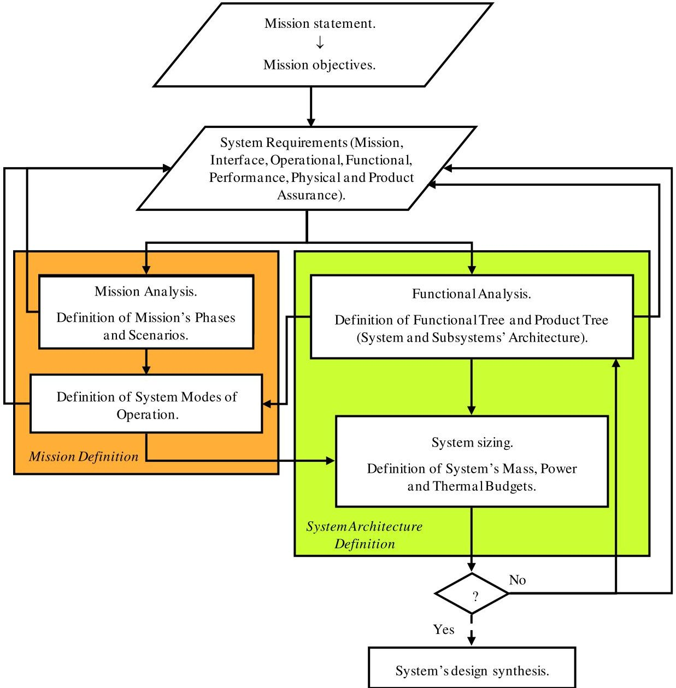

Fig. 1. Conceptual design process flow-chart

Primary results of Functional Analysis are the functional tree and the product tree: the former identifies the basic functions, which the system has to be able to perform, while the latter individuates all system physical components, which are able to carry out the basic functions. In other words, these components may be the equipments or the subsystems, which constitute the whole system. Once the components of the product tree have been identified, it is possible to investigate how they are connected to form the system. It is thus possible to develop both the functional block diagram (secondary or additional result of

<!-- PDF_PAGE: 3 -->

Functional Analysis) and the physical block diagram of each subsystem and of the whole system. In order to complete the system architecture, the definition of the system budgets (mass, electric power, thermal power budgets, etc.) has to be carried out. However this task can be fulfilled only after the system modes of operation have been established. The modes of operation are part of the mission definition and can in their turn been set up only after the subsystems and their equipments have been identified. Once both the mission and the system architecture have been preliminary defined, before proceeding any further with the system design synthesis, it is important to verify whether or not all system requirements have been satisfied. Being the design activity typically a process of successive refinements, several iterations may be necessary before achieving the system design synthesis, thus freezing the system design.

Iterations may occur at every stage of the conceptual design process, thus resulting in a continuous trade or refinement of system requirements. In particular, as far as functional requirements (which are part of system requirements) are concerned, their refinement is mainly due to the feedback of Functional Analysis outputs and specifically of functional tree outputs. The basic functions, i.e. the bottom level functions of the tree, are in fact used to completely define or just refine the functional requirements. Unlike system requirements, which are detailed descriptions or quantitative expressions of the system itself, taking into account what we would like to achieve and what the budget allows us to achieve, mission objectives are the broad goals that the system shall achieve to be productive. Thus, whereas system requirements are traded throughout the design process, mission objectives may be slightly or not at all modified during conceptual design. For these reasons the top level function of the functional tree, i.e. the very first step of the Functional Analysis, can either be one mission objective or one top level functional requirement.

Functional Analysis as a fundamental tool of the design process is discussed by a number of references. Wertz and Larson (Wertz & Larson, 2005) present the Functional Analysis to decompose the functional requirements and focus only on one single task of Functional Analysis, i.e. the functional tree. NASA (NASA, 2007) and ESA (ESA, 2009) consider Functional Analysis as the systematic process of identifying, describing, and relating the functions a system has to be able to perform, in order to be successful, but does not consider it as a design tool to address how functions will be performed, i.e. to map functions to physical components. Particular emphasis is given to the possibility of capturing the technical requirements by performing Functional Analysis (ESA, 2009). In contrast we present Functional Analysis both to define the system functional architecture, through the development first of the product tree and then of the functional block diagram, and to define or refine the functional requirements, through the accomplishment of the functional tree. The following section describes into the details the tasks of the proposed Functional Analysis methodology.

## 3. Functional Analysis: Methodology

Starting from the mission objectives/top level system requirements or directly from the mission statement, the Functional Analysis allows identifying the physical components, the so-called building blocks, which constitute the future product, and how they are interrelated to build up the functional architecture of the future product. Moreover through Functional Analysis the functional requirements can be defined or anyway refined.

<!-- PDF_PAGE: 4 -->

In conceptual design Functional Analysis can be applied at different levels: subsystem level (like the avionic subsystem of an aircraft, consisting of various pieces of equipment; see subsection 3.1), system (like a satellite consisting of various subsystems; see sub-section 3.2) and system of systems level (like a Moon base, consisting of various systems; see sub-section 3.3). According to the considered level, the physical components or building blocks, which make up the future product, are therefore equipments, subsystems or systems.

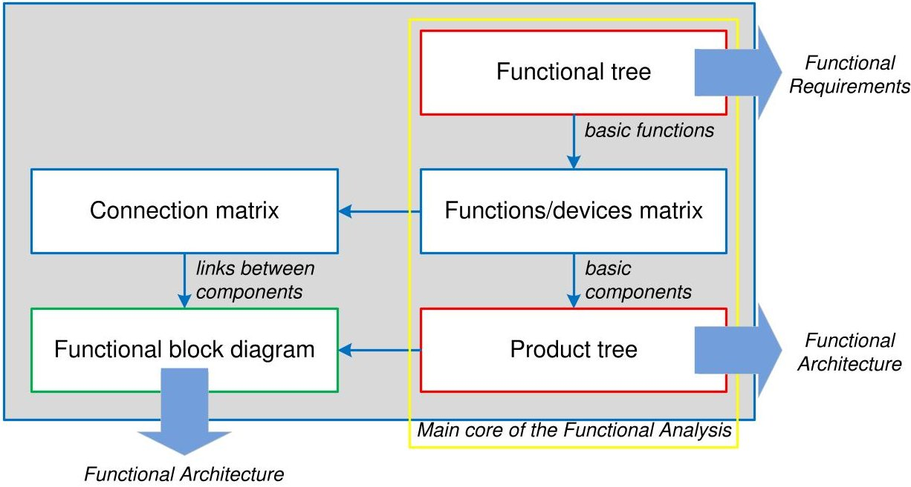

Fig. 2. The Functional Analysis

Figure 2 shows the flow-chart of the proposed Functional Analysis methodology, illustrating all its tasks, how the various tasks are related one another and the inputs/outputs of each task.

The tasks, which have to be accomplished in order to carry out Functional Analysis, are listed hereafter:

- functional tree;

- functions/components (or functions/devices) matrix;

- product (or physical) tree;

- connection matrix;

- functional block diagram.

On the basis of the mission objectives/top level system requirements the functional tree has to be developed as first step of Functional Analysis. Once the basic functions have been identified and the functional tree has therefore been completed, the functions/components matrix can be built and the basic components of the product tree can be individuated. Once the basic components have been determined, both the product tree and the connection matrix can be completed. Eventually, knowing all components (thanks to the product tree) and their relationships (thanks to the connection matrix), the functional block diagram can be fulfilled.

<!-- PDF_PAGE: 5 -->

As highlighted in Figure 2, the main core of Functional Analysis is made up of the functional tree, the functions/devices matrix and the product tree. In fact through the functional tree and particularly through the identification of the basic functions, the functional requirements of the future product can be defined or refined, and through the product tree the building blocks of the future product can be determined, thus laying the major groundwork for the definition of the functional architecture of the future product. The functional architecture can then be completed once the relationships between the various components are clearly identified, i.e. after developing the connection matrix and the functional block diagram.

Primary outputs or objectives of Functional Analysis are therefore (see red boxes in Figure 2):

- functional tree;

- product tree.

- Secondary output or objective of the Functional Analysis is (see green boxes in Figure 2):

- functional block diagram.

In the next sub-sections all tasks of Functional Analysis are considered separately and described into the details. In particular the most important rules, that have to be known to fulfil each task, are given and the procedure, that has to be followed, to move from one task to the next one, is explained.

## 3.1 Functional tree

The functional tree gives the possibility of representing a product by means of the functional view, which is alternative to the more common physical view. The functional and physical views are complementary not opposite views. In fact through the functional view we look at a new product asking ourselves "what does it do?", while through the physical view we look at a new product asking ourselves "what is it?", which is without any doubts the most immediate question that arises in our mind, when looking at something that is unknown. Both views are valid as they are fundamental approaches to analyze complex systems by subdividing them into parts, characterized by a poor or high level of details, depending on the need of thoroughness and/or on the level of the analysis itself.

The functional tree allows splitting the higher level functions, which stem from the mission objectives/top level system requirements, into lower level functions and eventually it allows identifying the basic functions that have to be performed by the future product. Higher level functions are complex functions that have to be decomposed into simpler functions, i.e. lower level functions, in order to accomplish the analysis. Therefore, starting from the so-called top level function, the functional tree generates various branches, which move from the most complex function to the basic functions, i.e. those functions at the bottom of the tree that cannot be split any further. Main output of the functional tree is therefore the identification of the basic functions through the decomposition of the higher level functions. The basic functions help defining or refining the functional requirements of the future product, as each basic function can be rewritten as a functional requirement. As an example, the basic function of Figure 3 "To detect infra-red (IR) threads" can be rewritten as "The system shall be able to detect infra-red (IR) threads". Figure 3 shows an example of functional tree. The top level function is "To perform defence", particularly the defence of a

<!-- PDF_PAGE: 6 -->

military aircraft. The blue box represents the top level function, while the red boxes represent the basic functions. Starting from the top level function and getting down to the basic functions, two successive levels of functions decomposition can be noted: the first (green boxes in Figure 3) and the second level functions (yellow boxes in Figure 3).

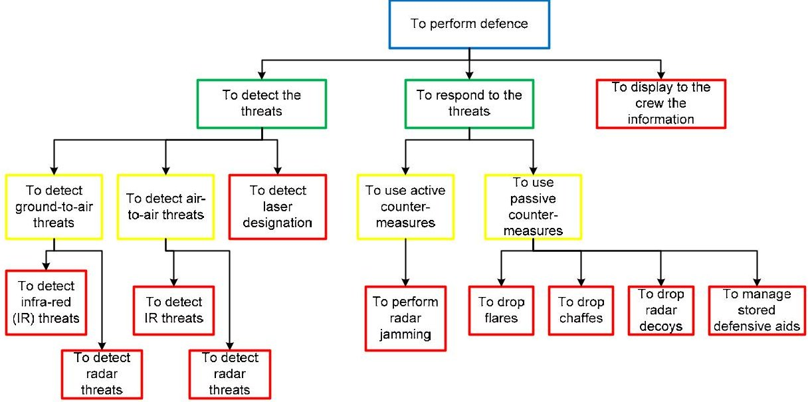

Fig. 3. Example of functional tree

In order to carry out the functional tree, the next rules have to be followed:

1. each function shall be expressed by means of verb and noun.

2. The definition of each function shall be as general as possible. Pursuing maximum generality, when describing functions, allows fostering the search of alternative solutions, in order not to forget any valuable options. This fundamental rule can be satisfactorily applied at the highest levels of the functional tree. However the lower are the levels of the tree, the less general are the functions' definitions. It is true in fact that the more you go down the three branches, the simpler become the functions and the more you get into the details of your analysis, thus making choices between available solutions. For example, if we look at the functional tree depicted in Figure 3, we note that the definitions of the first level functions are still very general, as they represent the logical decomposition of the top level function into the following sequence: "to get information" ("to detect the threats" in Figure 3), "to process information" (this function is included into "to respond to the threats" in Figure 3), "to provide something with that information" ("to respond to the threats" in Figure 3) and/or "to provide somebody with that information" ("to display to the crew the information" in Figure 3). Then dropping to lower levels of the tree, we see that the basic functions refer to specific threats or counter-measures.

3. Lower level functions shall be either part of higher level functions or additional functions.

4. Lower level functions shall derive from higher level functions by asking "how" that higher level function can be performed. Therefore we move from the top to the bottom of the tree, through its various branches, asking ourselves "how". Viceversa we move

<!-- PDF_PAGE: 7 -->

from the bottom to the top of the tree by asking ourselves "why". Looking again at the example reported in Figure 3, we may decompose the top level function "to perform defence" by asking ourselves: "how can the defence (of a military aircraft) be performed?". The answer to this question, that will thus represent the first subdivision of the top level function, may be (as shown in Figure 3): "to detect the threats" (i.e. "to get information"),"to respond to the threats" (i.e. "to process information" and "to provide something with that information") and "to display to the crew the information" (i.e. "to provide somebody with that information").

5. In case functions cannot be decomposed any further, they shall be reported at the bottom of the tree as basic functions. As an example, in Figure 3 the three functions, that are located in the row immediately beneath the top level function, represent the first decomposition of the top level function itself. Two out of these three functions are first level functions and are further subdivided, while the remaining function ("to display to the crew the information" in Figure 3) is already a basic function, as it cannot be split into other sub-functions. It is worth noting that the choice of carrying on decomposing a certain function or of stopping decomposing it depends on the level of details of the whole analysis (see next rule).

6. The individuation of basic functions shall depend on the level of details of the whole analysis. This implies that, if the target of Functional Analysis is, for instance, the definition of the functional architecture of a system at main equipments level, the basic functions of the functional tree shall be those functions related to specific equipments, like the example shown in Figure 3.

7. If we conceive different (physical) solutions at a certain level of the functional tree, the tree shall change from that point downwards but not upwards. This implies that, starting from the same mission objective, different functional trees can be generated not only because different people are working at it but because at a certain level of the tree (typically at lower levels) you may be obliged to make choices between alternative solutions. In this case, depending on the number of available options, a few functional trees shall be developed: they will be exactly the same from the top level function up to a certain level and will be different from that level to the bottom.

Eventually, getting back to the comparison between the function and physical views, the main advantages/criticalities of the functional view (i.e. typical approach of the functional tree) are reported hereafter.

The most significant advantages can be summarised as follows:

- the development of the functional tree, starting from mission objectives/top level system requirements, implies a thorough analysis of the mission objectives/top level system requirements themselves. This guarantees that the product, defined on the basis of the functional tree, meets all customer's needs and this is particularly important, if we remember that the functional tree is a design tool, useful to develop a new product. It is worth remembering here that, when we carry out the functional tree, we know very little about the new product. We just know the mission objectives and typically we have a preliminary draft of the system requirements but we ignore all elements that will constitute the new product. Thanks to the functions/devices matrix and then to the product tree, we will be able to say what elements will constitute the new product.

<!-- PDF_PAGE: 8 -->

- The abstract view, typical of the functional tree, fosters the search of alternative solutions, thus avoiding biased choices.

- The functional view is absolutely coherent with the systems engineering view, which looks at the system as the integration of various elements.

- The most significant criticalities can be summarised as follows:

- starting from the same mission objective/top level system requirement, different functional trees can be developed, depending on the people working at it and on the envisaged solutions. It is clear therefore that carrying out a functional tree is a typical design activity, which requires the widespread knowledge of the systems engineering designer, whose mind is not confined to any specific discipline but can embrace the whole multi-disciplinary system as integration of various parts.

- As typically the available options may be many,the main risk resides in the possibility of forgetting some concepts that may offer significant advantages for the future product.

## 3.2 Functions/devices matrix and product tree

Once the basic functions have been identified, it is possible to choose the components that will perform those functions by means of the functions/components (or functions/devices) matrix. The functions components matrix is therefore used to map functions to physical components.

The functions/components matrix can be built simply by matching the bottom of the functional tree, consisting of all basic functions, with one column of components able to perform those functions. Starting from the column containing the first basic function under consideration, the component able to perform that function can be defined by simply answering the question: "which component is able to perform this function?". This component can then be written down in the first row of the column of devices. The same process applies to all basic functions. Starting from the analysis of the first basic function, new components progressively fill in the column of devices. Eventually all basic components are determined. Table 1 shows a possible solution for the functions/devices matrix related to the functional tree illustrated in Figure 3. Following the procedure reported above, we take into account the first basic function on the left hand side of the functions/devices matrix, "to detect infra-red (IR) threats". If we ask ourselves which component or better which equipment is able to perform this function, we may answer that both the missile warning receiver and the infra-red (IR) warning receiver are able to fulfil the task. Then we write down both equipments in two separate rows of the functions/devices matrix and tick the intersections between these rows and the column of the basic function under consideration. Applying the same procedure, we gradually complete the functions/devices matrix, thus identifying all basic equipments.

Looking at Table 1 and remembering the logical decomposition of the top level function reported in Figure 3 ("to get information": "to detect the threats", "to process information": "to respond to the threats", "to provide something with that information": "to respond to the threats" and "to provide somebody with that information": "to display to the crew the information") , we note that:

<!-- PDF_PAGE: 9 -->

- sensors are equipments that detect threats (sensors are highlighted in red colour in Table 1);

- processors are equipments that process information (processors are highlighted in orange colour in Table 1);

- passive or active counter-measures are equipments that respond to threats (passive and active counter-measures are highlighted in blue colour in Table 1);

- displays are equipments that display to the crew the information (displays are highlighted in green colour in Table 1).

<table border="1"><tr><td rowspan="2" colspan="2"></td><td colspan="8">Basic functions</td></tr><tr><td>To detect infra-red(IR) threats</td><td>To detect radar threats</td><td>To detect laser aiming</td><td>To perform radar jamming</td><td>To drop flares</td><td>To drop chaff</td><td>To drop radar decoys</td><td>To manage stored defensive aids</td><td>To display to the crew the information</td></tr><tr><td rowspan="10">Basic devices</td><td>Missile warning receiver</td><td>X</td><td></td><td></td><td></td><td></td><td></td><td></td><td></td><td></td></tr><tr><td>Infra-red(IR) warning system</td><td>X</td><td></td><td></td><td></td><td></td><td></td><td></td><td></td><td></td></tr><tr><td>Radar warning receiver</td><td></td><td>X</td><td></td><td></td><td></td><td></td><td></td><td></td><td></td></tr><tr><td>Laser warning system</td><td></td><td></td><td>X</td><td></td><td></td><td></td><td></td><td></td><td></td></tr><tr><td>Jammer decoy dispenser</td><td></td><td></td><td></td><td>X</td><td></td><td></td><td>X</td><td>X</td><td></td></tr><tr><td>Jamming system</td><td></td><td></td><td></td><td>X</td><td></td><td></td><td></td><td></td><td></td></tr><tr><td>Chaff/flares dispenser</td><td></td><td></td><td></td><td></td><td>X</td><td>X</td><td></td><td>X</td><td></td></tr><tr><td>Store management system</td><td></td><td></td><td></td><td></td><td></td><td></td><td></td><td>X</td><td></td></tr><tr><td>Multi Function Display(MFD)</td><td></td><td></td><td></td><td></td><td></td><td></td><td></td><td></td><td>X</td></tr></table>

Table 1. Example of functions/devices matrix

<!-- PDF_PAGE: 10 -->

Thanks to the functions/devices matrix we now know the basic components or building blocks, which constitute the future product. By simply grouping together the basic components, the product or physical tree of the new product can be generated. Unlike the functional tree, which has a typical top-down approach, the development of the product tree follows a straightforward bottom-up process. As we do know, according to the considered level, i.e. subsystem, system or system of systems level, the building blocks are respectively equipments, subsystems or systems. In case, for instance, the building blocks are equipments, they may be grouped into subsystems to form the whole system or, better, the product tree of the whole system, like illustrated in Figure 4.

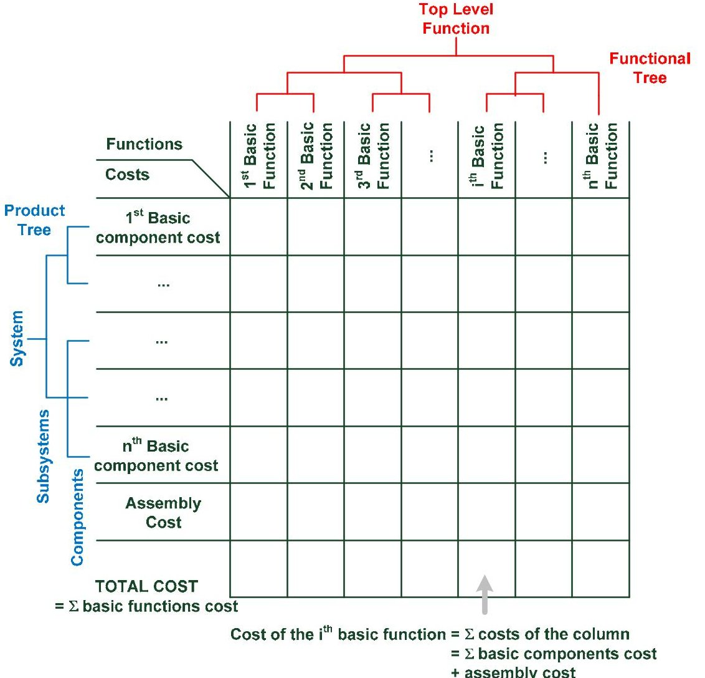

Fig. 4. Product tree and costs/functions matrix

In particular Figure 4 also shows the so-called functions/costs matrix, which is exactly the same as the functions/devices matrix except for the fact that here there is a column of costs instead of a column of devices. Quite obviously the functions/costs matrix can be built only after the functions/devices matrix, i.e. once the basic components have been identified. Main difference of the functions/costs matrix with respect to the functions/devices matrix

<!-- PDF_PAGE: 11 -->

lies in the consideration of the assembly cost. In fact, apart from the cost of each single basic component, the cost due to the assembly has to be taken into account, in order to estimate the cost of each single function and consequently the cost of the whole product.

## 3.3 Connection matrix and functional block diagram

Once the basic components have been identified, the links between the various components within the system can be determined. This goal is achieved by means of the connection matrix, which, as the name implies, highlights the connections between all building blocks.

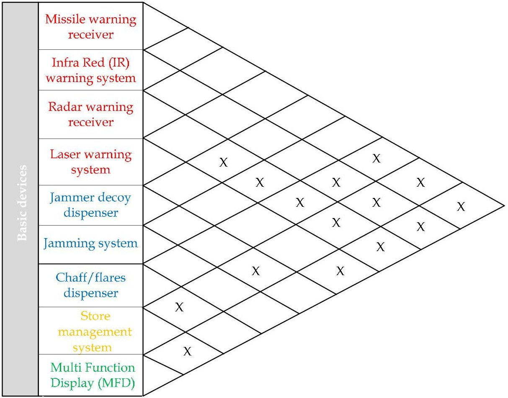

Fig. 5. Example of connection matrix

The connection matrix can either be a triangular (see Figure 5) or a square matrix, where both rows and columns have the same basic components. Starting from the first row and then proceeding down the column of basic devices, all components have to be analyzed, in order to understand whether or not there are connections between them. In case two components have a connection because, for instance, they are requested to exchange information, then the box where the two components intersects has to be ticked. As we can see, for example, all boxes where sensors (highlighted in red colour in Figure 5) and displays (highlighted in green colour in Figure 5) intersect have been ticked to show that sensors and displays exchange information.

<!-- PDF_PAGE: 12 -->

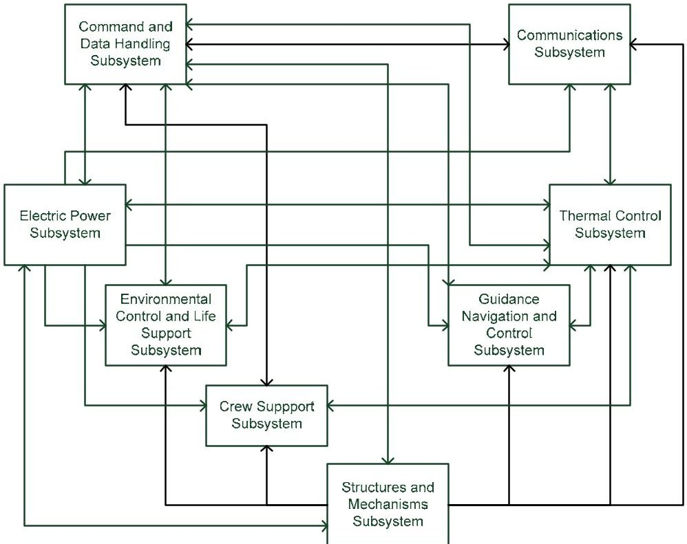

Fig. 6. The functional block diagram

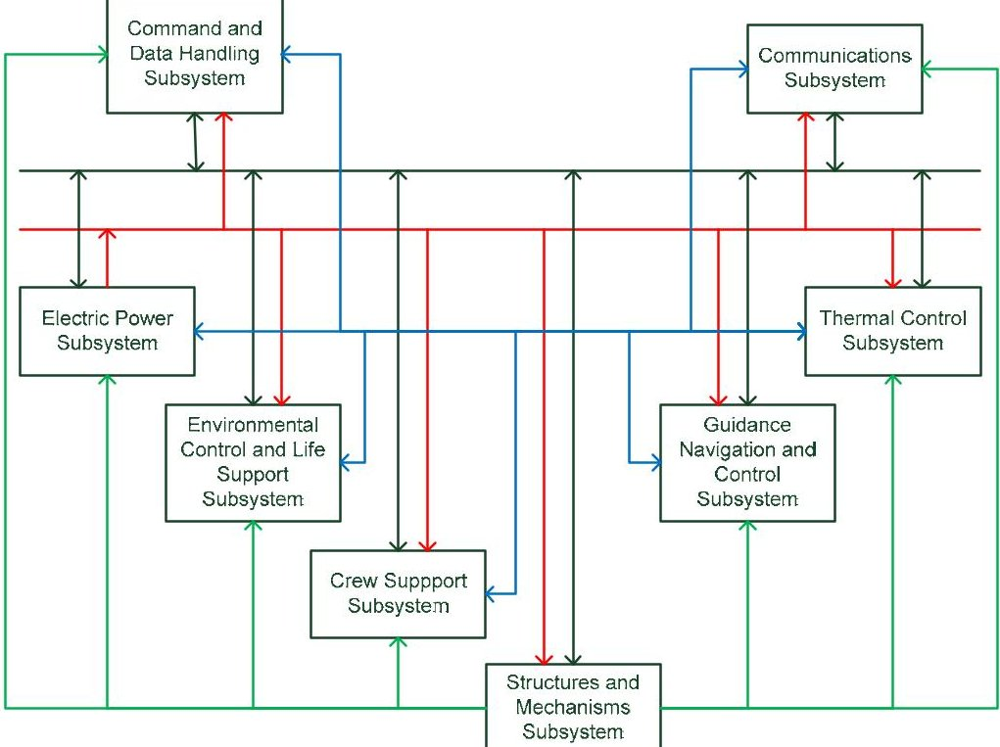

Fig. 7. The physical block diagram

<!-- PDF_PAGE: 13 -->

It is worth underlying that nothing is said explicitly about the nature of the connections. For instance, in Figure 5, which shows a possible solution for the connection matrix related to the functional tree of Figure 3 and to the functions/devices matrix of Table 1, the type of connection between all equipments is a pure signal of information between sensors, processors, passive or active counter-measures and displays.

A different representation of the same concept, expressed by the connection matrix, is obtained through the functional block diagram, where building blocks, that need to be connected, are linked through point-to-point connections. In case these connections are arrows and not just simple lines, the functional block diagram provides the reader with additional information, if compared to the connection matrix, as it highlights not merely connections but where these connections are pointing to, i.e. if they are half duplex or full duplex connections. Just by looking at a functional block diagram, it is therefore possible to understand that, for instance, sensors are transmitting information to displays and not viceversa. Like in the connection matrix, also in the functional block diagram nothing is said about the nature of the connections, which may be, for instance, power, signal or fluid lines. This information is instead provided by the physical block diagram, which may be considered as complementary to the functional block diagram.

Figure 6 shows an example of functional block diagram for a complex system, consisting of various subsystems. This system, named Permanent Habitable Module (PHM) (Viola et al., 2007) is the first module of a permanent future human settlement on the Moon, designed to sustain the presence of three astronauts on the lunar surface. All main subsystems are highlighted in different boxes and the connections between them are shown. For sake of clarity, Figure 7 illustrates the physical block diagram of the same system presented in Figure 6. Four different types of connections between the building blocks have been envisaged: structures (green lines in Figure 7), power (red lines in Figure 7), signal (black lines in Figure 7) and fluid lines (blue lines in Figure 7).

Structures guarantee, specifically by means of secondary and tertiary structures, the anchorage of all subsystems and particularly of all their equipments to the primary structure. A power line supplies the various building blocks with the necessary power. As far as the signal lines are concerned, it is worth noting that, unlike the functional block diagram where there are point-to-point connections, in the physical block diagram there is a main bus to transmit commands and receive feedbacks to/from the various subsystems. Eventually the building blocks that need an active cooling interface to dissipate heat are connected by a ducting fluid line with the Thermal Control Subsystem.

In the next section three different applications of the Functional Analysis methodology are presented and discussed.

## 4. Functional Analysis: Applications

As the Functional Analysis can be applied at different levels, three different examples of applications of the methodology are presented in the following sub-sections:

- Functional Analysis at subsystem level to define the avionic subsystem of an aircraft;

- Functional Analysis at system level to define a satellite in Low Earth Orbit (LEO);

- Functional Analysis at system of systems level to define a permanent human Moon base.

<!-- PDF_PAGE: 14 -->

## 4.1 Functional Analysis at subsystem level: The avionic system of a Very Light Business Jet aircraft

This sub-section deals with the application of the proposed Functional Analysis methodology at subsystem level to define the avionic system of a Very Light Business Jet (VLBJ). The VLBJ segment is constituted by civil transport jet-powered aircraft with maximum takeoff weight ranging from 2 to 4,2 tons, cruise speed of about 600-700 Km/h and payload capability varying from 4 to 8 passengers. The VLBJ avionics has been chosen as useful example because of its new functionalities and characteristics, which are not implemented in the avionic system of other civil aircraft. In fact VLBJs are designed to be certified as single pilot operations. This is made possible by advanced avionics automation, functional integration and easy-to-use capability.

Considering the aircraft mission profile, the environment where the aircraft will have to operate (air traffic control, landing and takeoff aids, navigation aids) and passengers and pilot requirements, the following macro-functions can be identified:

- to allow navigation.

- To perform flight controls.

- To allow communications.

For sake of simplicity only the macro-function "to allow navigation" will be dealt with here, in terms of functional tree and functions/devices matrix.

The complete functions decomposition of the top level function "to allow navigation" is reported hereafter.

## 1. To allow navigation

1. 1 To acquire data

1. 1.1 To identify weather situation

1. 1.2 To detect magnetic field

1. 1.3 To acquire surrounding terrain altitude

1. 1.4 To acquire airplane data

1. 1.5 To acquire airport data

1. 1.6 To acquire flight plan data

1. 1.6.1.1 To acquire data about navigation aids (VOR-DME) ground station

1. 1.6.1.1.1 To memorize waypoints (VOR-DME stations)

1. 1.6.1.1.2 To acquire radial and distance

1. 1.6.1.1.3 To calculate flight coordinates

1. 1.6.1.2 To acquire data for autonomous navigation

1. 1.6.1.2.1 To memorize waypoints coordinates

1. 1.6.1.2.2 To calculate flight coordinates

1. 1.6.2 To acquire climb, descent and approach trajectory

1. 1.6.3 To acquire landing path

1. 1.6.4 To acquire different approach trajectory

1. 1.6.5 To acquire missed approach procedure

1. 1.6.6 To acquire holding procedure

<!-- PDF_PAGE: 15 -->

1. 1.7 To acquire waypoints altitude

1. 1.8 To memorize flight plan

## 1.2 Data processing

1. 2.1 To calculate optimal trajectory for all flight segment (climb, cruise, descent)

1. 2.2 To calculate trajectory in case of critical failure

1. 2.3 To calculate flight speed for each segment of mission profile

1. 2.4 To calculate heading, attitude, distance and time to reach each waypoints when they are VOR-DME station

1. 2.5 To calculate heading, attitude, distance and time to reach each waypoints when they are not VOR-DME station

1. 2.6 To determine lateral and vertical deviation of actual trajectory in comparison to the proper one for climb, cruise and descent segments

1. 2.7 To determine lateral and vertical deviation of actual trajectory in comparison to the proper one for approach and landing segments

1. 2.8 To provide surrounding terrain altitude

## 1.3 Data management

1. 3.1 To manage waypoints database

1. 3.2 To manage airports database

1. 3.3 To store and update navigation data

1. 3.4 To store and update weather data

1. 3.5 To verify acquired and calculated data accuracy

## 1.4 To display information

1. 4.1 To display flight route and waypoints

1. 4.2 To provide visual and acoustic warning in case of traffic collision

1. 4.3 To display heading

1. 4.4 To display true heading

1. 4.5 To display environment data

1. 4.6 To provide visual and acoustic warning in case of potential ground collision

1. 4.7 To display surrounding terrain altitude

1. 4.8 To display weather situation

1. 4.9 To display approach and landing correct trajectory

1. 4.10 To display trajectory in case of missed approach

On the basis of the basic functions listed above, the functions/devices matrix can be created, as shown in Table 2, which, for sake of simplicity, illustrates only part of the complete functions/devices matrix related to the top level function "to allow navigation". It is worth remembering that, as in this case the Functional Analysis is applied at subsystem level, the basic components are the main subsystem equipments. The functions/devices matrix has thus been called functions/equipments matrix.

Eventually Figure 8 illustrates the functional block diagram of the complete avionic system, where both half duplex and full duplex connections between equipments are highlighted.

<!-- PDF_PAGE: 16 -->

<table border="1"><tr><td rowspan="2" colspan="2"></td><td colspan="7">Basic functions</td></tr><tr><td>To identify weather situation</td><td>To detect magnetic field</td><td>To acquire surrounding terrain altitude</td><td>To acquire airplane data</td><td>To acquire airport data</td><td>To memorize waypoints(VOR-DME stations)</td><td>To acquire radial and distance</td><td>To calculate flight coordinates</td></tr><tr><td rowspan="9">Basic equipment</td><td>Weather Radar System(WX)</td><td>X</td><td></td><td></td><td></td><td></td><td></td><td></td><td></td></tr><tr><td>ADAHRS(ADS+AHRS+Magnetometer)</td><td></td><td>X</td><td></td><td></td><td></td><td></td><td></td><td></td></tr><tr><td>Syntetic Vision System</td><td></td><td></td><td>X</td><td></td><td></td><td></td><td></td><td></td></tr><tr><td>Flight Management System(FMS)</td><td></td><td></td><td>X</td><td>X</td><td>X</td><td>X</td><td></td><td>X</td></tr><tr><td>Flight Computer</td><td></td><td></td><td>X</td><td></td><td></td><td></td><td></td><td></td></tr><tr><td>Navigation Computer</td><td></td><td></td><td>X</td><td></td><td></td><td></td><td></td><td>X</td></tr><tr><td>Automatic Direction Finder(ADF)</td><td></td><td></td><td></td><td></td><td></td><td></td><td>X</td><td></td></tr><tr><td>VHF Omni Range(VOR)</td><td></td><td></td><td></td><td></td><td></td><td></td><td>X</td><td></td></tr><tr><td>Distance Measurement Equipment(DME)</td><td></td><td></td><td></td><td></td><td></td><td></td><td>X</td><td></td></tr></table>

Table 2. Part of the complete functions/equipments matrix

## 4.2 Functional Analysis at system level: The cubesat e-st@r

In this sub-section an example of the methodology is given by the application of the Functional Analysis to a Cubesat project. The e-st@r (Educational SaTellite @ politecnico di toRino) program is taken as case-study. The project is an educational initiative carried out by students and researchers of Politecnico di Torino within an ESA program aiming at the launch and orbit operations of nine cubesats, developed by as many European Universities, to promote space activities among young generations. E-st@r program guidelines are illustrated in Figure 9.

The mission statement sounds as follows: "Educate aerospace-engineering students on complex systems design and management, team work, and standards implementation. Achieve insight in the development of enabling technologies for low-cost access to space".

<!-- PDF_PAGE: 17 -->

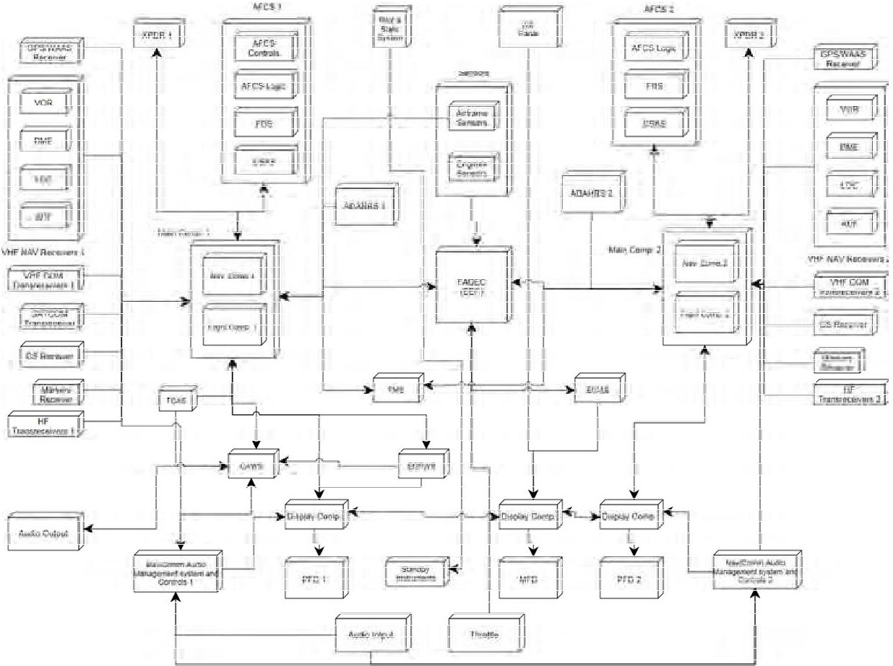

Fig. 8. VLBJ avionics functional block diagram

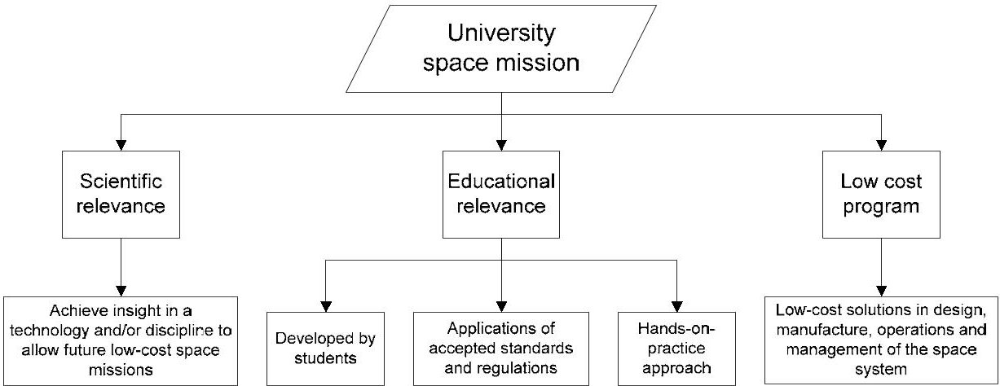

Fig. 9. e-st@r program guidelines

<!-- PDF_PAGE: 18 -->

The following assumptions can be derived from the mission statement:

- the program shall be carried out by students. They shall design, manufacture, verify and test, and operate a space system.

- The program shall be carried out in compliance with current regulations and applicable standards.

- The program shall have educational relevance, which means that students must learn by practice.

- An experiment shall be included in the space system. The experiment shall be simple and cheap, but at the same time it must permit to achieve insight in a discipline and/or technology to be used in the future to allow low-cost space mission.

- The program driver shall be the research for low-cost solutions in design, manufacture, operations and management of space systems.

Notwithstanding the necessity of keeping cost down and taking into account the educational spirit of the e-st@r program, which implies the will of enhancing the interests and competences of the students, e-st@r has also scientific objectives, which reflect real interests of the scientific and industrial communities. Taking into account all high-level requirements and constraints, as a result of a trade-off analysis it has been decided that the system would accomplish a mission aimed at testing an active Attitude Determination and Control System (ADCS).

In conclusion, the mission scenario can be summed up as follows: a cubesat shall be inserted into a LEO by the end of 2012. The cubesat shall be piggybacked by the Vega LV during its Maiden Flight. Mission duration for this kind of project shall be in the range of 3-12 months. The cubesat shall be operated from ground in a simply and cheap way. High grade of operations autonomy is desirable. Students shall be designers, developers, manufacturers, operators and managers of the entire mission. The mission shall demonstrate some kind of non-space technologies and try to space-qualify them. The primary payload shall be a simple active ADCS. As secondary payload, the test of commercial items is considered. The mission data shall be available to the cubesat community and to radio-amateurs union. No commercial purposes shall be pursued.

Functional Analysis methodology has been used to derive the requirements for the system and to determine which subsystems are needed to carry out the mission. The second iteration of the Functional Analysis allows deriving next level requirements for equipments and components. A part of the complete functional tree for the e-st@r mission is shown in Figure 10. The mission segments are identified by the first level functions (i.e. "To connect ground and space segments", "To do on ground operations", "To reach the orbit", "To do in orbit operations" and "To comply with space debris mitigation regulations") and they reflect the mission architecture's elements.

The elements of the e-st@r mission architecture are reported hereafter:

- Space segment: Cubesat = payload and bus.

- Ground segment: one main ground control station + one backup ground control station (mobile and transportable). Radio amateur network. Cubesat laboratory at Polito.

- Launch segment: Vega LV and CSG (French Guyana)

- Subject: data measurement.

<!-- PDF_PAGE: 19 -->

- Orbit: direct injection into LEO (approx 300x1450km, $ 70^{\circ} $).

- Operations: students at main and backup GCSs. Data processing at Cubesat lab for deeper investigation, or in case of emergency

- Communications.

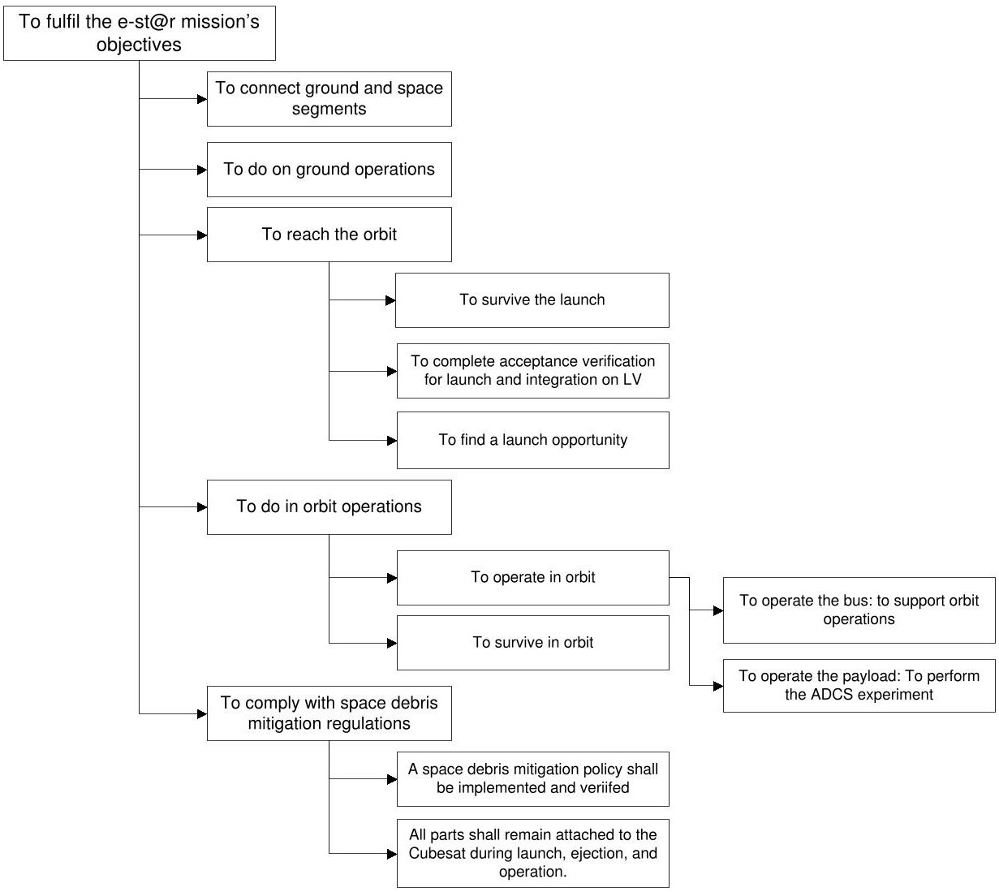

Fig. 10. Part of the complete functional tree for e-st@r mission

As an example, the product tree of two elements of the e-st@r mission architecture, the space (i.e. the cubesat, made up of payload and bus) and the ground segment, is shown in Figure 11. It is worth noting that, while the space segment can be directly linked through a functions/devices matrix to the first level function "To do in orbit operations" (see Figure 10), the ground segment can be directly linked to the first level function "To do ground operation"(see Figure 10). Eventually Figure 12 illustrates the physical block diagram of the cubesat. The block diagram shows all subsystems (apart from structures) and their connections. The design and sizing of the subsystems in phase A have been carried out using common available methods (Wertz & Larson, 2005), (Fortescue et al., 2003).

<!-- PDF_PAGE: 20 -->

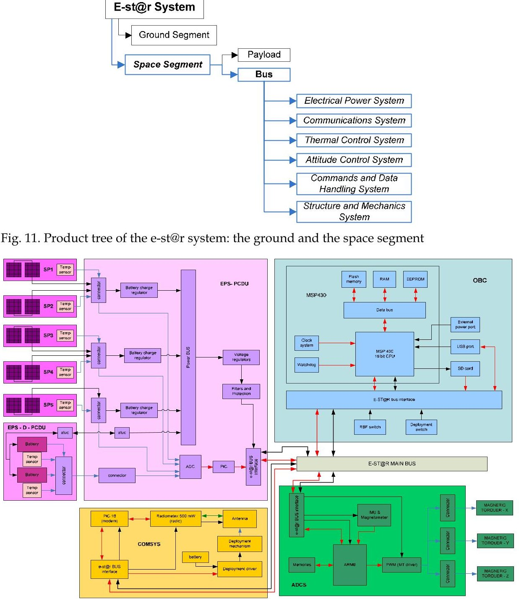

Fig. 12. Physical block diagram of the e-st@r cubesat

## 4.3 Functional Analysis at system of systems level: the permanent human Moon base PHOEBE

The system of systems here considered is a permanent human Moon base. The Functional Analysis methodology has been applied, in order to accomplish the primary objectives, i.e. in order to develop the functional tree and the product tree of the Moon base.

<!-- PDF_PAGE: 21 -->

The Moon base has been given the name PHOEBE, which stays for: Permanent Human mOon Exploration BasE (Viola et al., 2008).

The mission statement is reported hereafter: "To establish a permanent lunar base for a nominal crew of 18 astronauts (maximum 24 during crew rotation) with a turnover time of 6 months, to support scientific research, In-Situ Resources Utilization (ISRU) development, surface exploration and commercial exploitation; its evolution will provide an outpost for further space exploration".

After the definition of the mission statement, nine mission objectives have been determined. The main top level system requirements are schematically represented in Figure 13, where they can be traced back to their correspondent mission objectives.

Once the top level system requirements, which stem from the mission statement and mission objectives, have been defined, the design process has proceeded with the accomplishment of the Functional Analysis, in order to determine all building blocks, i.e. the systems or modules, of the Permanent Human Moon Base that satisfy the top level system requirements. Main results of the Functional Analysis are presented hereafter. In particular Figure 14 illustrates the so-called "first level" functional tree, where the top level function "To carry out a Permanent Human Moon Base" has been split into 10 first level functions. Each first level function has then been divided into lower level functions to identify the basic level functions, i.e. those functions that can immediately be connected to one building block of the Moon base.

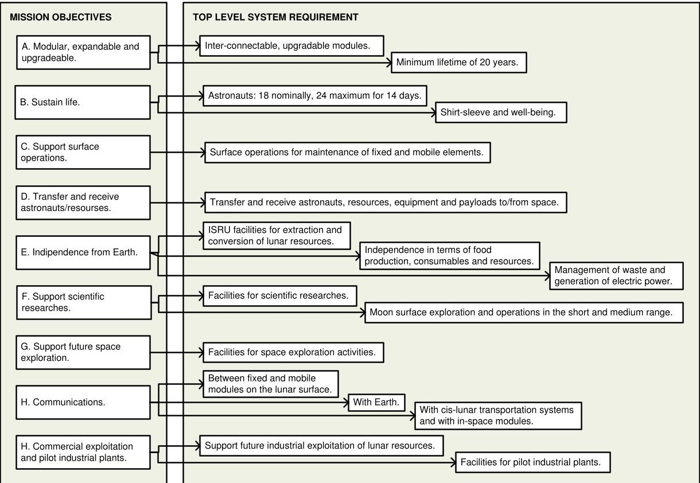

Fig. 13. Mission objectives and top level system requirements

<!-- PDF_PAGE: 22 -->

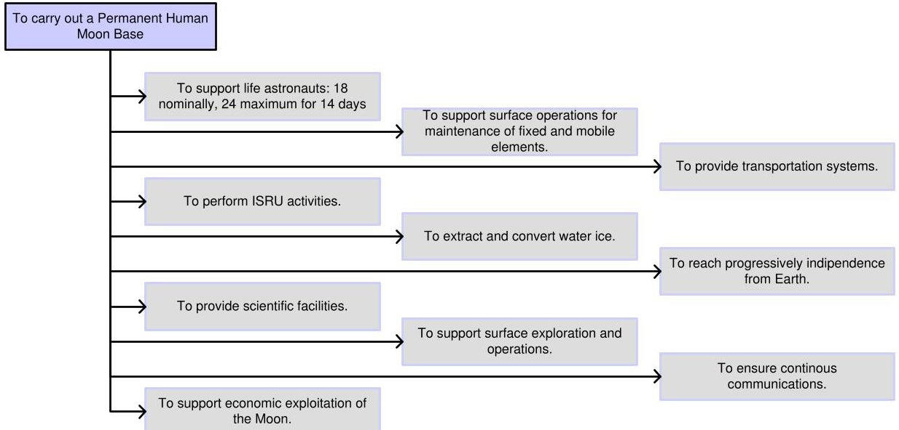

Fig. 14. PHOEBE First level functional tree

For sake of clarity, Figure 15 shows how the first level function "To reach progressively independence from Earth" has been decomposed into its basic functions:

- to provide plants growth facilities.

- To store the food produced.

- To extract resources from the waste.

- To retrieve TBD (To Be Defined) consumables.

- To store the retrieved consumable.

- To provide the electrical power.

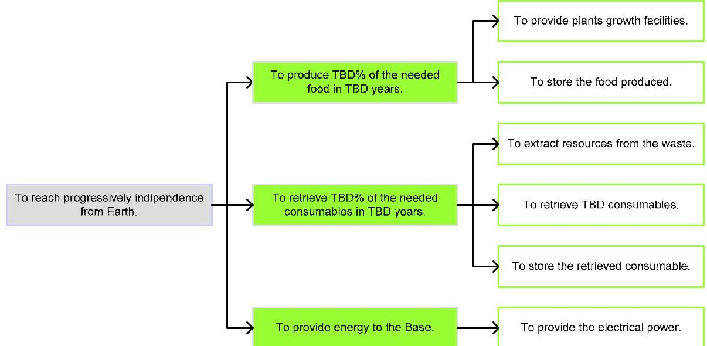

Fig. 15. Functional tree of the first level function: "To reach progressively independence from Earth"

<!-- PDF_PAGE: 23 -->

Once the basic functions have been identified, it is possible to choose the building blocks of the Moon base that will perform those functions. Considering for instance the basic functions presented in Figure 15, the corresponding building blocks can be obtained through the functions/building blocks (or functions/devices) matrix (see Table 5).

<table border="1"><tr><td rowspan="2" colspan="2"></td><td colspan="6">Functions</td></tr><tr><td>To provide plants growth facilities</td><td>To store the food produced</td><td>To extract resources from the waste</td><td>To retrieve TBD consumables</td><td>To store the retrieved consumable</td><td>To provide the electrical power</td></tr><tr><td rowspan="6">Building blocks</td><td>Green House</td><td>X</td><td></td><td>X</td><td>X</td><td></td><td></td></tr><tr><td>Stowage Module</td><td></td><td>X</td><td></td><td></td><td></td><td></td></tr><tr><td>Storage Module</td><td></td><td></td><td></td><td></td><td>X</td><td></td></tr><tr><td>Processing Plant</td><td></td><td></td><td></td><td>X</td><td></td><td></td></tr><tr><td>Material Science Laboratory</td><td></td><td></td><td></td><td>X</td><td></td><td></td></tr><tr><td>Power Plant</td><td></td><td></td><td></td><td></td><td></td><td>X</td></tr></table>

Table 3. PHOEBE: example of functions/building blocks matrix

As addressed in Table 3, six building blocks have been identified:

- the Green House, which is a source of food and consumables (oxygen recycling, inert gases) and produces TBD% of what is needed in the Moon base. It is made up by all the facilities necessary for plants growing, waste recycling and for retrieving TDB consumables;

- the Stowage Module, where the food can be stored;

- the Storage Module, where the consumables can be stored;

- the Processing Plant, which, apart from fulfilling the functions of processing resources and water ice, has also the capability of retrieving the consumables as well as the Green House;

- the Material Science Laboratory, which, apart from fulfilling the functions of processing resources and water ice and providing materials experiments and test facilities for space exploration technology, has also the capability of retrieving the consumables as well as the Green House;

- the Power Plant, which provides the Moon Base with electric power.

<!-- PDF_PAGE: 24 -->

Applying the same methodology to all the other first level functions listed in Figure 14, the complete product tree of the Moon base, i.e. all PHOEBE systems, can be obtained, as Figure 16 illustrates, where the various building blocks have been grouped into four different categories or segment: transportation, in-space, mobile and fixed segment.

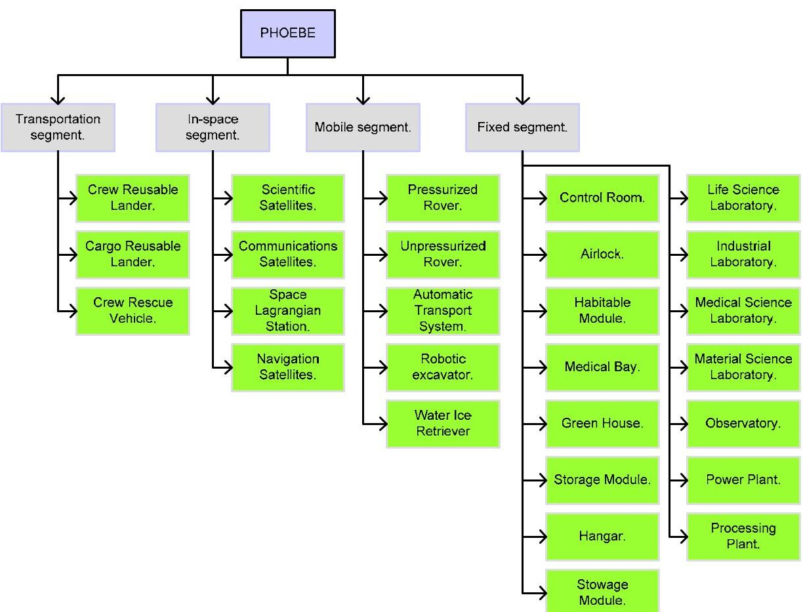

Fig. 16. PHOEBE product tree

<!-- PDF_PAGE: 25 -->

The identification of all systems of the Moon base and the understanding of their related functions are the final results of the presented Functional Analysis at system of systems level.

## 5. Conclusion

The Functional Analysis is without any doubts one of the most fundamental tool of systems engineering design to develop a new product, as it guarantees a thorough analysis of the requirements, it fosters the search of alternative solutions, thus avoiding or at least limiting the risk of forgetting valuable options, and eventually it allows identifying the physical components of the future product and their relationships. It is therefore of paramount importance for every systems engineer to learn how to apply Functional Analysis to explore new concepts and then satisfactorily come out with innovative architectures.

After a brief introduction to underline the precious role of Functional Analysis within the conceptual design process, the chapter describes into the details all steps that have to be taken and all rules that have to be followed to accomplish Functional Analysis. Eventually the chapter presents three different applications of the methodology at subsystem, system and system of systems level.

## 6. Acknowledgment

The authors wish to thank all students that have worked at the e-st@r program and all students that have attended the SEEDS (SpacE Exploration and Development Systems) Master.

## 7. References

ESA-ESTEC (Requirements & Standards Division), (2009). Space Engineering Technical Requirements Specification. ESA Requirements & Standards Division Technical Report ECSS-E-ST-10-06C, European Space Agency for the members of ECSS, Noordwijk, The Netherlands.

Fortescue, P., Stark, J. & Swinerd, G. (2003). Spacecraft Systems Engineering (Third Edition), John Wiley & Sons Ltd, ISBN 0-471-61951-5, Chichester, West Sussex, England.

Larson, W. J., Wertz, J. R. (2005). Space Mission Analysis and Design (third edition), Microcosm Press and Kluwer Academic Publishers, ISBN 1-881883-10-8, E1 Segundo, California and Dordrecht/Boston/London.

NASA, (2007). Systems Engineering Handbook. NASA Technical Report NASA/SP-2007-6105 Rev1, ISBN 978-0-16-079747-7, Washington, DC, USA.

Raymer, D. P. (1999). Aircraft Design: A Conceptual Approach (Third Edition), AIAA (American Institute of Aeronautics and Astronautics) Education Series, ISBN 1-56347-281-0, Reston, Virginia, USA.

<!-- PDF_PAGE: 26 -->

Viola, N., Messidoro, P. & Vallerani, E. (2007). Overview of the first year activities of the SEEDS Project Work, Proceedings of 58th International Astronautical Congress, Hyderabad, India, 24-28 September 2007

Viola, N., Vallerani, E., Messidoro, P. & Ferro, C. (2008). Main results of a permanent human Moon base Project Work activity 2006-2007, Proceedings of 59th International Astronautical Congress, Glasgow, Scotland, 29 September - 3 October, 2008

<!-- PDF_PAGE: 27 -->

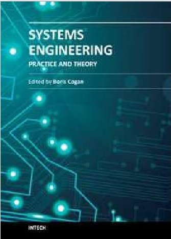

Systems Engineering - Practice and Theory Edited by Prof. Boris Cogan

ISBN 978-953-51-0322-6

Hard cover, 354 pages

Publisher InTech

Published online 16, March, 2012

Published in print edition March, 2012

The book "Systems Engineering: Practice and Theory" is a collection of articles written by developers and researches from all around the globe. Mostly they present methodologies for separate Systems Engineering processes; others consider issues of adjacent knowledge areas and sub-areas that significantly contribute to systems development, operation, and maintenance. Case studies include aircraft, spacecrafts, and space systems development, post-analysis of data collected during operation of large systems etc. Important issues related to "bottlenecks" of Systems Engineering, such as complexity, reliability, and safety of different kinds of systems, creation, operation and maintenance of services, system-human communication, and management tasks done during system projects are addressed in the collection. This book is for people who are interested in the modern state of the Systems Engineering knowledge area and for systems engineers involved in different activities of the area. Some articles may be a valuable source for university lecturers and students; most of case studies can be directly used in Systems Engineering courses as illustrative materials.

## How to reference

In order to correctly reference this scholarly work, feel free to copy and paste the following:

Nicole Viola, Sabrina Corpino, Marco Fioriti and Fabrizio Stesina (2012). Functional Analysis in Systems Engineering: Methodology and Applications, Systems Engineering - Practice and Theory, Prof. Boris Cogan (Ed.), ISBN: 978-953-51-0322-6, InTech, Available from: http://www.intechopen.com/books/systemsengineering-practice-and-theory/functional-analysis-in-systems-engineering-methodology-and-applications

## INTECH open science | open minds

InTech Europe

University Campus STeP Ri

Slavka Krautzeka 83/A

51000 Rijeka, Croatia

Phone: +385 (51) 770 447

Fax: +385 (51) 686 166

www.intechopen.com

InTech China

Unit 405, Office Block, Hotel Equatorial Shanghai

No.65, Yan An Road (West), Shanghai, 200040, China

中国上海市延安西路65号上海国际贵都大饭店办公楼405单元

Phone: +86-21-62489820

Fax: +86-21-62489821

<!-- PDF_PAGE: 28 -->

© 2012 The Author(s). Licensee IntechOpen. This is an open access article distributed under the terms of the Creative Commons Attribution 3.0 License, which permits unrestricted use, distribution, and reproduction in any medium, provided the original work is properly cited.