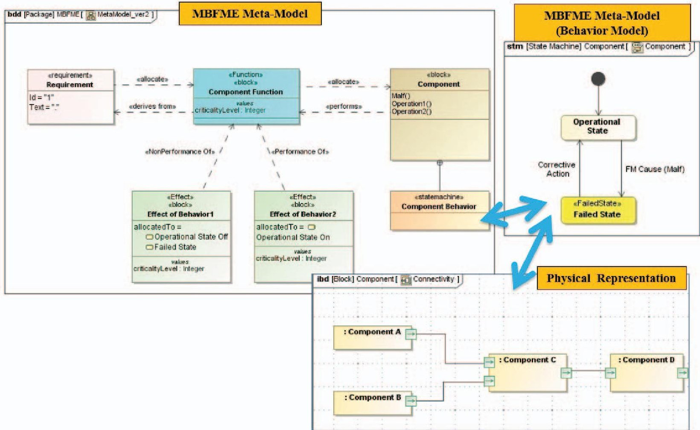
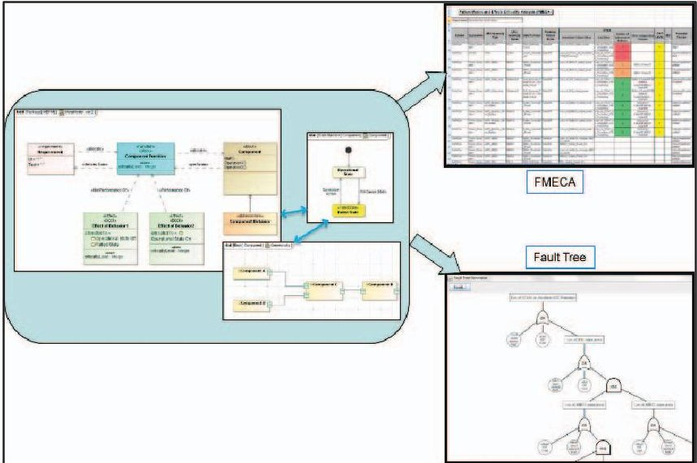
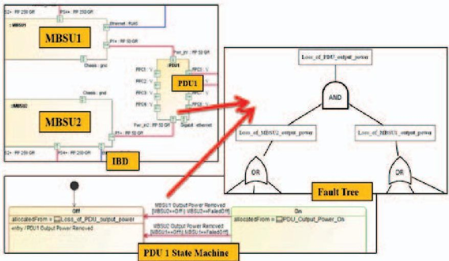
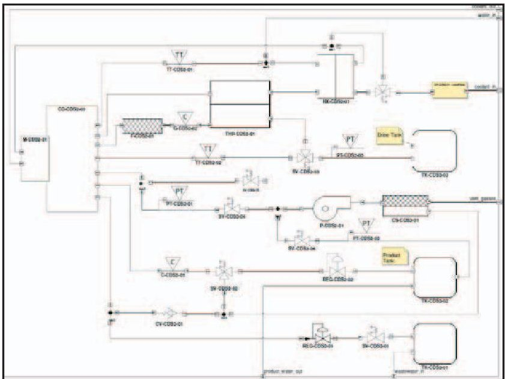
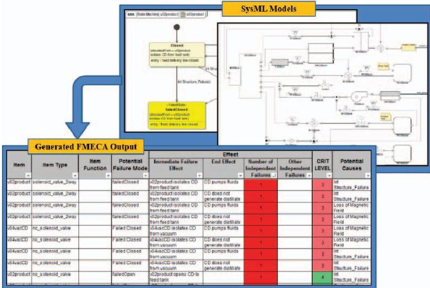
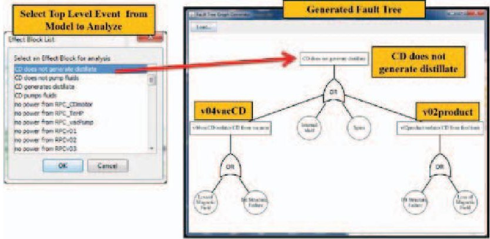

<!-- PDF_PAGE: 1 -->

# Facilitating R&M in Spaceflight Systems with MBSE

Michel Izygon, PhD, Tietronix Software Inc.

Howard Wagner, PhD, Tietronix Software Inc.

Shira Okon, Tietronix Software Inc.

Lui Wang, NASA/JSC

Miriam Sargusingh, NASA/JSC

John Evans, PhD, NASA HQ

Key Words: Fault Management, FM Analysis Tools, FMEA, FMECA, FTA, Model Based Systems Engineering, PRA, Spaceflight, Systems Engineering

## SUMMARY & CONCLUSIONS

An innovative modeling technique was developed to merge Reliability & Maintenance (R&M) activities with Model Based System Engineering processes. Associated tools were developed to automatically extract R&M products (FMECA and Fault Trees) from the model. The modeling technique and tools were successfully applied to a NASA/JSC project. The method enables the R&M perspective to be taken into account as key design decisions are being made during the design process.

## 1 INTRODUCTION

In order to improve the Reliability and Maintainability (R&M) of future spacecraft systems, NASA has been exploring ways to merge R&M activities within the overall Model Based System Engineering (MBSE) process. Over the past few years, MBSE has become more broadly adopted within the NASA community. MBSE has enabled an enhancement in the design process of complex spacecraft, such as Orion, by organizing the process activities through a set of formal system model representations. R&M activities have mostly been left aside during the design process, generally performed late in the lifecycle in a retrospective manner. MBSE is becoming a de facto standard for capturing the design of complex spacecraft systems. Our effort has focused on developing modeling techniques and toolsets to ease the integration of R&M early in the design process.

In this paper we describe the modeling techniques we developed on a simple case study, and then show how this is being applied to the Cascade Distiller System (CDS). The CDS is an advanced Water Recovery System (WRS) being developed at NASA Johnson Space Center. The CDS is part of the Environmental Control and Life Support System (ECLSS) architecture that enables long-duration human exploration missions beyond low-Earth orbit (LEO) [1].

## 2 OVERVIEW OF MBSE AND R&M ACTIVITIES AT NASA

## 2.1 SysML and MBSE

The objective of a Model-Based System Engineering approach is to improve product cycle time, product quality and product maintainability through a formal understanding of the features and structures of a product. The latest advances in Model Based Systems Engineering are relying on the Systems Modeling Language (SysML). SysML is a general purpose graphical modeling language for analyzing, designing and verifying complex systems that may include hardware, software, information, personnel, procedures and facilities [2]. SysML is an OMG led industry standard which specifies a common modeling language that incorporates the community consensus on core modeling concepts. SysML was designed to incorporate current best practices in modeling techniques and systems engineering. It is explicitly designed to be implemented by computer assisted software engineering tools. SysML models include different diagram types, capturing structural, behavioral and architectural information. It provides cross functional design teams with a shared understanding through visual notation, methodology independence, well-defined semantics, and expressiveness across various levels of abstraction. The SysML approach integrates hardware and software disciplines, is scalable, is adaptable to different domains, and is supported by multiple commercial tools [2,3].

## 2.2 R&M Activities at NASA

NASA's Reliability and Maintainability Standard states the R&M activities spaceflight programs and projects should perform. The top-level objective of R&M activities is to ensure that systems perform as required over their lifecycles to satisfy mission objectives including safety, dependability criteria. Programs and projects, as part of their planning activities, are expected to identify how they intend to address the R&M objectives [4]. Engineers can achieve satisfactory

<!-- PDF_PAGE: 2 -->

levels of reliability and maintainability of their systems by including an R&M perspective in design decisions throughout the lifecycle. Integrating R&M activities within model based system engineering processes can help engineers to achieve this goal.

## 3 METHODOLOGY AND TOOLS

NASA's Reliability and Maintainability Standard suggests the type of methodologies that may be used to satisfy R&M objectives. Example methodologies include Fault Tree Analysis (FTA), Failure Mode and Effects Criticality Analysis (FMECA), Failure Mode and Effect Analysis (FMEA/CIL), Hazard Reports, and Probability Risk Assessment (PRA) [4].

## 3.1 FM Meta-Model

Fault Management (FM) is a key feature of NASA space missions. As space missions increase in scope and capabilities, the FM systems required to support them are significantly increasing in complexity. We developed a meta-model that supports the integration of R&M activities into the System Engineering process. The meta-model describes the relationships between nominal and off-nominal system elements. This meta-model expressed in the SysML modeling language, includes the structural and behavioral elements of a system using the block definition diagrams (BDD), internal block diagrams (IBD), and Finite State Machines. This Model

is summarized in Figure 1. The key elements of the metamodel include Requirements, Functions, Components Component Behavior, Effects, Operational State, Failed State attributes of these elements and their interrelationships.

The behavior of the components which is captured in state machine diagrams; it includes operational states and failed states. State changes are accomplished via state transitions which consist of a trigger and a guard. The meta-model captures behavioral relationships between components via their state machines interactions. These interactions are specified using signals broadcasted from one component state which triggers a transition in another component state machine.

Information about the structural aspects of the physical architecture is captured in the SysML BDD, IBD models. The IBDs describe the details of how components are connected to each other, i.e., which component is upstream and downstream as well as the data, power, or fluid flowing between them.

External events are modeled explicitly as triggers to the component state machines. The meta-model allows for the propagation of failure effects through the model. Examples: radiation can cause erratic output from a computer; a Micrometeoroid and Orbital Debris (MMOD) impact can cause a leak in a pressure vessel. The propagation of the failure effects can result in additional failures in downstream components.

Figure 1 - Model-Based Fault Management Engineering (MBFME) Meta-Model

<!-- PDF_PAGE: 3 -->

## 3.2 Methodology

A methodology was developed to guide the systems engineers in modeling the system of interest using the FM meta-model. The methodology defines the concepts and rules to be used to properly model the system. Using the methodology, the engineers can ensure that the models used to describe the structural and behavioral aspects of their systems are created accurately.

Some of the main modeling guidelines are summarized as follows:

Based on the Meta-Model previously described, the modeler needs to first allocate "Function" to "Component". These functions are derived from the requirements. As part of the design process, the functions are allocated to system components. This process continues with the functional decomposition. The physical decomposition parallels the functional decomposition until each function is allocated to a unique component. Functions are analyzed to identify the effect of the non-performance of the functions. For each component, the modeler needs to identify the operational states and potential failed states, and their immediate effects (negation or degradation of the function). Operational states perform the intended functions; while failed states correspond to the loss or non-performance of the function. The non-performance of the function dictates the failure effect and associated criticality. The modeler needs to identify the transitions between the operational and potential failed states, as these correspond to failure causes.

## 3.3 FM Data Exchange Tools

We developed a set of tools within the selected SysML modeling tool (MagicDraw) to extract the information captured within the models and generate the different analysis tools supporting the R&M activities. The tools automatically extract FMECA and Fault Tree Analysis products.

To generate these products from the SysML models, modelers need to follow the modeling guidelines described in the methodology.

Figure 2: FMECA and FTA Automated Generation

The tools process the behavior models, using the interactions between the state machine models to traverse fault paths. For the FTA, the tool traverses the interactions to extract the fault event paths. The logic gates in the FTA are created by analyzing the trigger and guard combinations along the event paths. The IBD in Figure 3 shows an example of a redundant power path provided to the power distribution unit (PDU1) from the Main Bus Switching Units (MBSU1 or MBSU2). The interactions between these components are captured in the transition's signal and guard of the PDU1 state machine. Loss of both MBSU1 and MBSU2 are required to cause a loss of power to PDU1. The guards can be complex; the method can capture multiple complex failure scenarios using the guards.

Figure 3: FTA Generation by Analyzing State Transitions

For the FMECA, the tool traverses the interactions to derive system level effects and number of failures along the path for analysis. In addition the FMECA tool extracts item details from the set of structural models, BDD and IBD.

## 4 CURRENT IMPLEMENTATION OF MBSE METHODS AND TOOLS IN THE CDS PROJECT

## 4.1 Background

The modeling techniques and toolset have been applied to the Cascade Distillation System (CDS) 2.0 system. The CDS is a NASA/JSC project aimed at developing the next generation water recovery system to support future human exploration missions beyond low earth orbit. The CDS employs a thin-film vacuum rotary distillation to recover water from wastewater.

## 4.2 CDS System Model with FM Data

The CDS 2.0 system model was created using SysML. The design utilized the FM meta-model and methodology to incorporate FM elements into the architecture. Figure 4 shows the CDS 2.0 fluid schematic Internal Block Diagram (IBD). The IBD depicts how the components in the design are connected. Each element in the IBD diagram represents a unique hardware component. The behavior of each component was captured in state machine models using the methodology.

<!-- PDF_PAGE: 4 -->

The FMECA and Fault Tree tools were then utilized to perform an R&M assessment.

Figure 4 - CDS 2.0 Customized SysML model (IBD)

## 4.3 Assessment of CDS with FM Data Exchange Tools

The FMECA tool was utilized to extract the FMECA from the CDS 2.0 system model. The tool traversed the system model to derive the end effects, criticality levels, and the level of fault tolerance. A FMECA spreadsheet was generated for analysis (Figure 5).

Figure 5 - SysML-FMECA Extraction Tool

Using the FMECA, failure modes and effects were ranked by fault tolerance and criticality levels of the end effects. The ranking was used as a basis for identifying whether the failure mode should be mitigated and to what extent.

Using the same modeling methodology, the Fault Tree Analysis (FTA) tool was used for FTA analysis of the CDS 2.0 system. In Figure 6 the event "CD does not generate distillate" is analyzed via the fault tree. The events that can result in the CD not generating distillate includes: Isolation of valves v04vacCD and v02product. These 2 valves are directly involved in the CD operation. Valve v02product opens the product line from the CD to the product tank; if this line isn't

open, the CD will not have anywhere to displace the generated distillate and it will cease to function. Valve v04vacCD isolates the CD from the vacuum line; it is required for adequate pressure management.

Figure 6 - SysML-FTA Extraction Tool

Figure 7 shows a portion of the preliminary FMECA output for the CDS highlighting the same 2 valves, v02product and v04vacCD.

In the generated FMECA output, the first 2 columns list the item being analyzed and the item type. The potential failure modes from each component's failed states are captured in the third column. The immediate effects allocated to each of the failed states in the finite state machine model are reported as the immediate effect. Each effect is assigned a criticality level. The criticality levels are recorded in column 7. The FMECA tool traverses the models to derive the end effect, which for these failure modes results in the CD not generating distillate, a level 3 failure. The end effect and its criticality level are recorded in columns 5 and 7 respectively. The number of independent failures are counted along the event path and reported in column 6. The CDS 2.0 preliminary design is based on minimum functionality which results in a large number of single point failures. One failure can result in additional failures downstream of a failed component. This is captured in the CD model where a failure of the CD motor causes the CD to stop spinning. The CD not spinning results in the loss of fluid flow thru the heat pump. This causes the heat pump to overheat and fail.

<table border="1"><tr><td rowspan="2">Item</td><td rowspan="2">Item Type</td><td rowspan="2">Potential Failure Mode</td><td colspan="3">Effect</td><td rowspan="2">CRIT LEVEL</td><td rowspan="2">Potential Causes</td></tr><tr><td>Immediate Failure Effect</td><td>End Effect</td><td>Number of Independent Failures</td></tr><tr><td>v02product</td><td>solenoid_valve_2way</td><td>failedClosed</td><td>v02product isolates CD from feed tank</td><td>CD does not generate distillate</td><td>1</td><td>3</td><td>Int Structure_Failure</td></tr><tr><td>v02product</td><td>solenoid_valve_2way</td><td>failedClosed</td><td>v02product isolates CD from feed tank</td><td>CD does not generate distillate</td><td>1</td><td>3</td><td>Loss of Magnetic Field</td></tr><tr><td>v04vacCD</td><td>nc_solenoid_v alve</td><td>FailedClosed</td><td>v04vacCD isolates CD from vacuum</td><td>CD does not generate distillate</td><td>1</td><td>3</td><td>Loss of Magnetic Field</td></tr><tr><td>v04vacCD</td><td>nc_solenoid_v alve</td><td>FailedClosed</td><td>v04vacCD isolates CD from vacuum</td><td>CD does not generate distillate</td><td>1</td><td>3</td><td>Int Structure_Failure</td></tr><tr><td>v02product</td><td>nc_solenoid_v alve</td><td>failedOpen</td><td>v02product opens CD to feed tank</td><td></td><td>1</td><td>4</td><td>Int Structure_Failure</td></tr><tr><td>v02product</td><td>nc_solenoid_v alve</td><td>failedOpen</td><td>v02product opens CD to feed tank</td><td></td><td>1</td><td>4</td><td>Contamination</td></tr><tr><td>v04vacCD</td><td>nc_solenoid_v alve</td><td>FailedOpen</td><td>v04vacCD opens CD to vacuum</td><td></td><td>1</td><td>4</td><td>Int Structure_Failure</td></tr><tr><td>v04vacCD</td><td>nc_solenoid_v alve</td><td>FailedOpen</td><td>v04vacCD opens CD to vacuum</td><td></td><td>1</td><td>4</td><td>SpringFailure</td></tr><tr><td>v04vacCD</td><td>nc_solenoid_v alve</td><td>FailedOpen</td><td>v04vacCD opens CD to vacuum</td><td></td><td>1</td><td>4</td><td>Contamination</td></tr></table>

Figure 7 - DRAFT CDS model FMECA output

5 FORWARD WORK

We have demonstrated the ability to extract FMECAs and

<!-- PDF_PAGE: 5 -->

fault trees from finite state machine models. The next step would be to extend the meta-models and toolsets to perform additional R&M assessments.

Using the fault tree analysis product we can derive the Probabilistic Risk Assessment (PRA). Simple additions to perform a PRA include assigning a likelihood to each failure cause. PRA calculations are conducted by tracing the likelihood of failures and determining the percent contribution from the basic events to the top level event of the fault tree. This helps to identify which cause has the largest impact on failure probability.

As part of the ongoing work, we are assessing the scalability of our method and tools. A review of a number of published papers show an approach that requires execution of the state machine models in order to extract the failure information from the model. Multiple runs are required to cover all possible combinations of inputs to the state machines. This often results in a scalability issue since the possible combinations of inputs increases rapidly as the number of state machines increases. The approach employed in our methodology allows for the extraction of failure modes and failure propagation without requiring execution of the state machines. Moreover, our approach has the advantage to process the state machine interactions only for the components directly connected to each other. Thus, we are able to extract all possible combinations of failures in a single run of the tool. We have tested the methodology on models employing a few hundred state machines with multiple inputs for each state machine without encountering a scalability issue. We are aware of this potential issue caused by the state explosion problem, but we have not encountered it on any models to date.

The logic that creates the fault tree can also be extended to create a success tree. The methodology described for the PRA also applies to the success tree. The main difference is instead of using failure likelihoods we use the probability of success for each component.

Another example of FM meta-model additions to support R&M analysis includes Mean Time between Failure (MTBF) and Mean Time to Repair (MTTR).

A future research topic is to determine how to export data from the SysML model to third party tools. NASA JSC uses a Reliability and Maintainability Analysis Tool (RMAT) to perform a stochastic computer-aided simulation to determine the operational availability; exchanging data between the model and RMAT for a more detailed analysis.

## REFERENCES

1. Sargusingh, M. J., and Nelson, J. R., "Environmental Control and Life Support System Reliability for Long-Duration Missions Beyond Lower Earth Orbit", International Conference on Environmental Systems; 13- 17 Jul. 2014, ICES-2014-180, Texas Tech University, Department of Civil, Environmental, and Construction Engineering, Lubbock, TX [online collection] URL: http://repositories.tdl.org/ttu-ir/handle/2346/58495 [cited 24 February 2015].

2. Object Management Group (OMG), "System Modeling Language (SysML), Version 1.3," Object Management Group (OMG), formal/2012-06-01, June 2012. http://www.omg.org/spec/SysML/1.3

3. S. Friedenthal, A. Moore, and R. Steiner, A Practical Guide to SysML, 2nd ed., Elsevier, Inc., 2012.

4. "Reliability and Maintainability Standard [Draft]", NASA Policy, May 2015.

5. M. Malone, "Hazard Analysis for the Cascade Distillation Sub-system (CDS) 2.0 Design to Advanced Water Recovery System Development Facility (AWRSDF)”， NASA Johnson Space Center, Crew and Thermal Systems Division, Draft revision, September 2014 (unpublished).

6. NASA FM Handbook (NASA Fault Management Handbook, Lorraine Fesq, editor, April 2012, Version 2(Draft)

7. Day, John C.; Donahue Kenneth; Ingham, Michel; Kadesch, Alex; Kennedy, Andrew K.; Post, Ethan Day, "Modeling Off-Nominal Behavior in SysML," AIAA Infotech Conference, Garden Grove, CA, June 2012, AIAA paper 2012-2576

8. Wang, Lui and Okon, Shira, "Modeling Failure Modes with SysML," 2012 NASA Spacecraft Fault Management Workshop, New Orleans, LA, 2012

## ACKNOWLEDGEMENT

This work was funded by NASA/JPL through the SBIR contract number NNX14CP23P and the NASA/HQ Office of Safety and Mission Assurance Flight Opportunities Program. The authors want to acknowledge the Advanced Life Support System project under the NASA Advanced Exploration System program for providing the CDS system as a test case for the application of the Model Based Fault Management Engineering concepts.

## BIOGRAPHIES

Michel Izygon, Ph.D. Tietronix Software Inc. 1331 Gemini St. Suite #3000 Houston, Texas 77058 USA

## e-mail: Michel.Izygon@tietronix.com

Dr. Izygon is the CTO of Tietronix Software, a company specializing in advanced software technologies applied to Aerospace, Medical Devices and renewable energy power plants. Dr. Izygon has over 25 years of experience in software engineering including all phases of Software Development Lifecycle. He has extensive experience in UML, which he taught at the University of Houston - Clear Lake for ten years as well as in SysML. He is the Principal Investigator on a NASA SBIR focused on developing the Model Based Fault Management Engineering methodology and associated toolset.

1331 Gemini St. Suite #3000

<!-- PDF_PAGE: 6 -->

## e-mail: Shira.Okon@tietronix.com

Shira Okon is an Aeronautical and Astronautical Engineer from Purdue University with an emphasis on Aerospace System Design. Ms.Okon has years of FM expertise. She has training in ISO, CMMI, and has obtained a Six Sigma Black Belt. She has used these skills to lead teams in identifying faults, analyzing root cause, and posing solutions for improvement. She has held numerous positions where she spent time analyzing system designs and operations. She is currently a SysML expert; working on NASA SysML projects and using her NASA space system experience to create model based systems design.

Howard Wagner, Ph.D.

Tietronix Software Inc.

11331 Gemini St. Suite #3000

Houston, Texas 77058 USA

## e-mail: Howard.Wagner@tietronix.com

Dr. Wagner has over 30 years of experience in Systems Engineering. His experience includes all phases of systems engineering and design from requirements analysis to architecture, detailed design, implementation, testing, reliability assessment, and maintenance. He has been the System Engineering and Integration lead (Chief and Deputy) for a number of major NASA projects. Dr. Wagner completed NASA's Space Systems Engineering Development Program at JSC. He has extensive experience in SysML, risk identification and management (ex: FMEA Critical Items List (CIL) generation), system lifecycle design and engineering, and system testing and analysis.

Lui Wang

NASA/JSC

Houston, Texas 77058 USA

## e-mail: lui.wang-1@nasa.gov

Lui Wang is a project lead for advanced software technologies in the Software Robotics Simulation Division of NASA Johnson Space Center, pioneer in avionics design of electronic procedure system to support human spaceflight. He has led the research and infused numerous automation and intelligent software technologies projects in the human spaceflight programs. He holds 2 US Software Patents on Intelligent

Computer Aided Training and Dynamics Pattern Matching using Incomplete Data. Lui is leading the development Augmented Reality Electronic Procedure System to support future operation of human, robotics space exploration. Lui earned his undergraduate from Texas A&M University and Master of Science in Robotics from Rice University.

Miriam Sargusingh

NASA/JSC

Houston, Texas 77058 USA

e-mail: m.sargusingh@nasa.gov

Miriam Sargusingh supports the NASA Advanced Exploration Systems (AES) Life Support Systems (LSS) Project as a colead of the Systems Engineering and Architecture Team (SEAT). She has accumulated more than 15 years of experience working a diverse set of aerospace systems including spacesuit, EVA, life support, and jet fuel control systems. Miriam received a BS in Chemical Engineering from Yale University, an MS in Mechanical Engineering from National Technological University, and a Masters Certificate in Space Systems Engineering from Stephens Institute of Technology.

John Evans, Ph.D.

NASA/HQ

Washington D.C. USA

## e-mail: john.w.evans@nasa.gov

Dr. John W. Evans is currently the Program Manager for Reliability and Maintainability at NASA HQ, Office of Safety and Mission Assurance in Washington, D.C. Dr. Evans has over 30 years of experience and has held positions in industry and academia, in addition to positions at NASA. As a senior NASA Engineer, he has worked on the development of the James Webb Space Telescope and many other NASA projects and research efforts. Dr. Evans has been a consultant in reliability engineering to major companies worldwide, having worked throughout Asia and Europe. Dr. Evans holds the Ph.D. in Materials Science and Engineering from Johns Hopkins University and has authored or co-authored 51 technical publications and 3 books. He is also serving as an Adjunct Professor in the Department of Industrial and Systems Engineering at the Morgan State University in Baltimore, MD