<!-- PDF_PAGE: 1 -->

Spring 5-2022

# Failure Mode, Effects and Criticality Analysis of a Very Low Earth Orbit CubeSat Mission

Robb Christopher Borowicz Old Dominion University, rboro001@odu.edu

Follow this and additional works at: https://digitalcommons.odu.edu/mae_etds

Part of the Aerospace Engineering Commons, Electrical and Computer Engineering Commons, and the Mechanical Engineering Commons

<!-- PDF_PAGE: 2 -->

# FAILURE MODE, EFFECTS AND CRITICALITY ANALYSIS OF A VERY LOW EARTH ORBIT CUBESAT MISSION

by

Robb Christopher Borowicz B.S. May 2020, Old Dominion University

A Thesis Submitted to the Faculty of Old Dominion University in Partial Fulfilment of the Requirements for the Degree of

MASTER OF SCIENCE

ENGINEERING-AEROSPACE

OLD DOMINION UNIVERSITY May 2022

Approved by:

Sharan Asundi (Director)

Drew Landman (Member)

Resit Unal (Member)

<!-- PDF_PAGE: 3 -->

# ABSTRACT

# FAILURE MODE, EFFECTS AND CRITICALITY ANALYSIS OF A VERY LOW EARTH ORBIT CUBESAT MISSION

Robb Christopher Borowicz Old Dominion University, 2022 Director: Dr. Sharan Asundi

When space programs launch vehicles into orbit, multiple failures could arise throughout the mission and corrective actions are often not an option. Applying reliability engineering approaches during the design phase focuses on analyzing risk by anticipating potential failures and mitigating uncertainties in the design. Old Dominion University, in partnership with the U.S. Coast Guard Academy, and the U.S. Air Force Institute of Technology designed and developed a 3U CubeSat mission to validate on-orbit, three space technology payloads. Mission SeaLion will fly as a secondary payload on stage two of Northrop Grumman's Antares rocket and will be deployed in a very low Earth orbit the spring of 2023.

Mission SeaLion will have multiple custom-built components on-board that have no space flight history that includes the Interface Board, Electrical Power System, and deployable composite structure payload. Custom-built components are a much higher risk to mission SeaLion when compared to space proven commercial off-the-shelf components. Engineering students at universities rarely have hands-on engineering experience in the field. Experts at NASA Langley Research Center provided guidance with identifying potential failure modes for the custom-built components. The potential risks of failures were evaluated using the Failure Mode, Effects and Criticality Analysis in efforts to increase the reliability of mission SeaLion. Mitigation strategies for each potential failure mode will include either a redesign or functionality, vibration, and vacuum chamber testing. Applying redesigns to the printable circuit board, battery pack, electrical connectors, and implementing rigorous inspection criteria significantly increased the reliability of the electrical systems. Execution of test plans using a thermal vacuum chamber will simulate space condition, which will verify deployment of the payload and ensure that electrical components function as designed.

<!-- PDF_PAGE: 4 -->

<!-- PDF_PAGE: 5 -->

## ACKNOWLEDGEMENTS

First, and most importantly, I would like to thank my family for their continuous support throughout my academic career. I would like to give special acknowledgement to my parents and my Uncle Skip for providing extraordinary support in my dreams and for telling me to never give up on what I have started.

I would like to thank my advisor and chair, Dr. Sharan Asundi, for giving me the opportunity of conducting CubeSat research with him. Dr. Sharan Asundi pushed me to my full potential and supported my efforts. To my committee members, Dr. Drew Landman, and Dr. Resit Unal, I would like to express my gratitude for all the knowledge that you both shared with me during my graduate school studies.

To Dr. Robert Ash, I would like to sincerely thank you for sparking my interest in aerospace engineering while I was an undergraduate student. You have single handedly changed the trajectory of my career, and for that I am forever grateful. I want to thank the entire ODU CubeSat team, in particular Joseph Siciliano and Jimesh Bhagatji.

I have a great amount of gratitude to the following individuals for their expert knowledge in helping me with my research: Adam Williams, Michael McVey, Josh Beverly, Przemyslaw Coleman, Cole Beekman, and Salvatore Tomaselli. These gentlemen and scholars went out of their way each time to answer any questions I had, so to them, thank you very much for the significant roll you all played into this thesis.

<!-- PDF_PAGE: 6 -->

## LIST OF ABBREVIATIONS

4S2P 4 Series 2 Parallel

ADS Attitude Determination System

AFIT Air Force Institute of Technologies

BMS Battery Management System

CA Criticality Analysis

CAD Computer-Aided Design

CDH Command and Data Handling

CDS CubeSat Design Specification

CN Critical Number

COTS Commercial Off-the-Shelf

CSD Canisterized Satellite Dispenser

CVCM Collected Volatile Condensable Material

DeCS Deployable Composite Structure

EPS Electrical Power System

FBD Functional Block Diagram

FEA Finite Element Analysis

FMECA Failure Mode, Effects and Criticality Analysis

FTA Fault Tree Analysis

I2C Inter-Integrated Circuit

IC Integrated Circuit

IMU Inertial Measuring Unit

IP Impedance Probe

ISS International Space Station

LaRC Langley Research Center

LL Level of Likelihood

LS Level of Severity

LV Launch vehicle

MIUL Materials Identification Usage List

MOSFET Metal-Oxide-Semiconductor Field-Effect Transistor

Ms-S Multi-Spectral Sensor

MTTF Mean Time to Failure

MVI Manual Visual Inspection

NASA National Aeronautics and Space Administration

OBC On-Board Computer

ODU Old Dominion University

PCB Printable Circuit Board

PSC Planetary System Corporation

<!-- PDF_PAGE: 7 -->

RBF Remove Before Flight

SPDT Single Pull Double Throw

TLE Two-Line Element

TML Total Mass Loss

TQCM Thermally controlled Quartz Crystal Microbalance

TVAC Thermal Vacuum Chamber

TVCT Thermal Vacuum Chamber Testing

UHF Utrahigh Frequency

USCGA Coast Guard Academy

VLEO Very Low Earth Orbit

WFF Wallops Flight Facility

<!-- PDF_PAGE: 8 -->

## TABLE OF CONTENTS

LIST OF TABLES ... ix

LIST OF FIGURES ... xi

Chapter

1. INTRODUCTION ... 1

   1.1 Background to CubeSats ... 1

   1.2 Introduction to Mission SeaLion ... 2

   1.3 Mission SeaLion Objectives ... 4

   1.4 Motivation ... 5

2. RELIABILITY, FAILURE MODE EFFECTS & CRITICALITY ANALYSIS, AND FAULT TREE ANALYSIS ... 7

   2.1 Reliability Analysis ... 7

   2.2 Introduction to Failure Mode, Effects & Criticality Analysis ... 8

   2.3 Introduction to Fault Tree Analysis ... 10

3. MISSION SEALION FAILURE MODE, EFFECTS & CRITICALITY ANALYSIS ... 12

   3.1 Mission SeaLion Failure Mode, Effects & Criticality Analysis Framework ... 12

   3.2 Electrical Power System ... 18

      3.2.1 Non-Rechargeable Battery System ... 18

      3.2.2 Electrical Power System Board ... 24

   3.3 Interface Board ... 41

   3.4 Deployable Composite Structure Payload ... 45

   3.5 Structure ... 55

   3.6 Mission SeaLion Deployment and Start-Up ... 58

   3.7 Outgassing ... 63

   3.8 Thermal Vacuum Chamber Set-Up ... 65

4. RESULTS ... 67

   4.1 Design Changes Implemented ... 67

<!-- PDF_PAGE: 9 -->

4.2 Thermal Vacuum Chamber Test Plan ... 73

4.3 Deployable Composite Structure Payload Test Plan ... 74

4.4 Software Test Plan ... 75

5. CONCLUSION ... 77

5.1 Lessons Learned ... 77

5.2 Conclusion ... 77

5.3 Future Work ... 78

REFERENCES ... 80

APPENDICES

A. EPS ELECTRICAL SCHEMATIC ... 87

B. EPS COMPONENT LIST ... 88

C. SOLDERED JOINT AND PCB INSPECTION ... 89

D. DECS PAYLOAD COMPONENT AND ASSEMBLY ... 90

E. MISSION SEALION ASSEMBLY ... 92

F. MISSION SEALION STRUCTURE ... 93

G. POWER BUDGET AND BALANCE ... 94

H. MISSION SEALION COMPONENT LIST ... 95

VITA ... 96

<!-- PDF_PAGE: 10 -->

## LIST OF TABLES

Table Page

1. FMECA Outline...13

2. Level of Severity (LS) of Failure...15

3. Level of Likelihood (LL) of Occurrence...16

4. Battery FMECA...23

5. Voltage Regulator FMECA...26

6. Voltage Regulator Sub-System Components FMECA...30

7. Battery Monitor and MOSFET FMECA...31

8. Integrated Circuit FMECA...32

9. Inter-Integrated Circuit FMECA...34

10. Electrical Connectors FMECA...35

11. EPS Board Soldered Joints FMECA...37

12. EPS Board FMECA...41

13. ADS FMECA...43

14. Interface Board Electrical Connectors & Soldered Joints FMECA...44

15. DeCS Deployment FMECA...50

16. DeCS Strain Gauge FMECA...55

17. Structure FMECA...58

18. Deployment and Start-Up Operations FMECA...63

19. Mitigated-Battery FMECA...68

20. Mitigated-Electrical Connectors FMECA...68

21. Mitigated-EPS Board Soldered Joints FMECA...70

<!-- PDF_PAGE: 11 -->

22. Mitigated-Interface Board Soldered Joints FMECA ... 71

23. Mitigated-EPS Board FMECA ... 72

24. Mitigated-DeCS Deployment FMECA... 73

<!-- PDF_PAGE: 12 -->

## LIST OF FIGURES

Figure Page

1. 1U CubeSat (left) & 3U CubeSat (right) ... 2

2. 3U Canisterized Satellite Dispenser ... 3

3. IP Payload (left) & Ms-S Payload (right) ... 4

4. Risk Matrix ... 9

5. FTA Symbols ... 10

6. Block Diagram Symbols ... 14

7. 4 Series 2 Parallel (4S2P) Battery Configuration ... 19

8. 1U Battery Pack CAD Generation ... 19

9. KiCAD Generated EPS Board ... 24

10. Poor Inductor Current Waveform ... 27

11. Proper Inductor Current Waveform ... 27

12. The Bathtub Curve ... 38

13. Heat Transfer Paths from the IC to the PCB ... 40

14. Via Pattern with Thermal Pad Package PCB Footprint ... 40

15. DeCS Deployment FBD ... 45

16. DeCS Deployment FTA ... 46

17. Composite Boom After Manufacturing ... 48

18. DeCS Spool Piece with Locking Mechanism ... 49

19. Symmetric Signal Detection ... 52

20. Non-Symmetric Signal Detection ... 52

21. Strain Gauge Signal for Lead Termination ... 53

<!-- PDF_PAGE: 13 -->

22. 2U Structure (left) & 1U Structure (right) ... 56

23. SeaLion Deployment and Start-Up FBD ... 59

24. Deployment and Start-Up FTA ... 60

25. Redesign of Battery Configuration with Diodes ... 67

26. Sn-Pb Phase Diagram ... 69

27. Composite Boom Bending Test ... 72

28. Composite Boom Origami Thermal Shielding ... 73

29. TVAC Test Plan ... 74

30. DeCS Payload Test Plan ... 75

<!-- PDF_PAGE: 14 -->

## 1. INTRODUCTION

## 1.1 Background to CubeSats

Recently, small satellites have become extremely popular at universities around the world [1]. Satellites that weigh less than 300 kg (1,100 lb.) are classified generally as being small satellites [2]. Small satellites give a great opportunity for educational projects to be executed at a fraction of the price when compared to traditional satellites [1,3]. Historically, small satellites built by universities typically have had a tight budget, limited resources, and a time restrictive schedule for executing a mission [3]. Due to these factors, verification and validation testing processes are not always feasible, which contribute to small satellites having historically high failure rates [3].

In 1999, CubeSats originated as a collective collaborative effort between Jordi Puig-Suari at California Polytechnic State University, and Bob Twiggs, at Stanford University's Space Systems Development Laboratory [2]. The goal of their effort was to develop affordable access for space exploration, which was successfully accomplished [2]. For a small satellite to be classified as a CubeSat, they must conform to specific criteria regarding weight, size, and shape [2,4]. Standardizing the criteria for the CubeSats allows companies to mass-produce components, which reduces the cost for the consumer and allow companies to offer commercial off-the-shelf (COTS) components [2].

CubeSats acquired their name from being cubical and their size is based on a designated standard CubeSat unit referred to as the letter "U" [5]. A 1U CubeSat is a 10 cm cube, but there are several larger sizes for CubeSats, such as 2U, 3U, and 6U [2]. The CubeSat design requirements are shown in the CubeSat Design Specification (CDS) and must be followed, along with requirements from the launch provider [4]. Figure 1 below shows examples of a 1U and 3U CubeSat, along with their dimensions.

<!-- PDF_PAGE: 15 -->

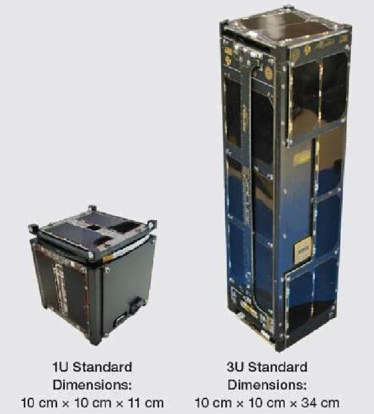

Figure 1: 1U CubeSat (left) & 3U CubeSat (right) [2]

CubeSats are loaded into the dispenser that is attached to the launch vehicle (LV), which protects the CubeSats during launch and releases it into space [2]. A dispenser is used as the interface between the CubeSat and the LV [2]. The payload is released when the LV sends an electrical signal to the dispenser, which opens the door to allow the CubeSats into orbit [2]. The launch provider normally chooses the dispenser for the CubeSats [2].

## 1.2 Introduction to Mission SeaLion

Mission SeaLion is a collaboration effort between Old Dominion University (ODU), the United States Coast Guard Academy (USCGA), and the Air Force Institute of Technology (AFIT) in which a 3U CubeSat was designed and developed. Mission SeaLion has three separate technology payloads to validate on-orbit. The USCGA and AFIT will provide two payloads and ODU will provide one payload. Mission SeaLion will fly as a secondary payload on stage two of Northrop Grumman Antares rocket, scheduled to be launched from Wallops Flight Facility (WFF) in March 2023 [6]. The standard dimensions for the 3U CubeSat are 10 cm x 10 cm x 34.05 cm $ \pm $ 0.03 cm and shall have a maximum mass of 4.00 kg [4].

Mission SeaLion will be deployed in a very low Earth orbit (VLEO) at roughly 180 km [6]. A low Earth orbit is an Earth-centered orbit that has an altitude of 2,000 km or less and is also where the International Space Station (ISS) is currently positioned. The mission life of mission SeaLion is projected to be roughly 10 days before burning up in the Earth's atmosphere

<!-- PDF_PAGE: 16 -->

from re-entry [6]. Mission SeaLion will be deployed into space by the Canisterized Satellite Dispenser (CSD) provided by Planetary System Corporation (PSC) and will be electrically connected with CSD through PSC 2001025 separation connector [7]. The payload is released when the LV sends an electrical signal to the CSD, which opens the door to allow the CubeSats into orbit [8]. The 3U CSD model is shown in Figure 2.

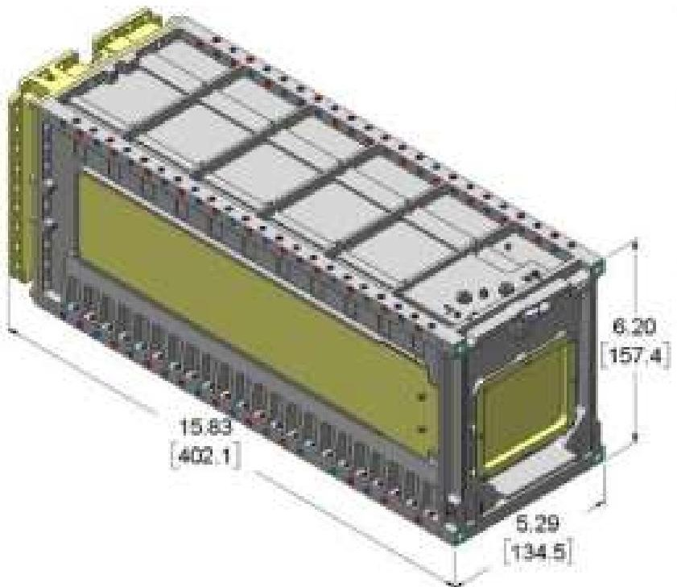

Figure 2: 3U Canisterized Satellite Dispenser [8]

The following mission payloads will be integrated into the mission SeaLion CubeSat: impedance probe (IP) designed and developed by the USCGA/ AFIT, a COTS multi-spectral sensor (Ms-S), and deployable composite structure (DeCS) designed and developed by ODU. The main intent for mission SeaLion is to advance the Technology Readiness Level of the three payloads [6].

The primary objective of the IP payload is to measure density and temperature of plasma on-orbit by using a surface mounted dipole radio frequency antenna. The antenna will collect sheath-plasma and plasma resonance information. The surface mounted antenna will have wire leads configured to the Interface Board, where data can then be transferred to the on-board computer and downlinked to the ground station [6].

<!-- PDF_PAGE: 17 -->

The Ms-S payload is a COTS sensor that is manufactured by Salvo Technologies. Spectral data will be captured by the Ms-S and utilized as a baseline for future missions. The Ms-S uses an on-chip filtering to compress a maximum of eight wavelength-selective photodiodes into a compact array [9]. The IP and Ms-S payloads are shown in Figure 3.

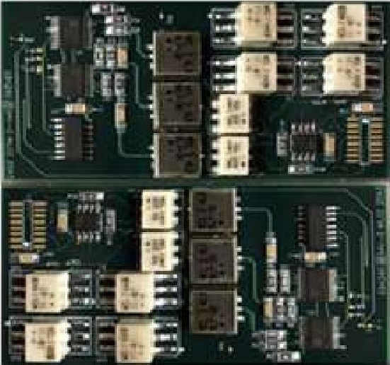

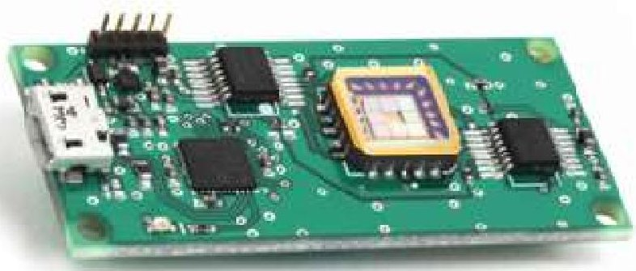

Figure 3: IP Payload (left) & Ms-S Payload (right)

The DeCS payload is a proof-of-concept deployable mechanism with four composite booms and will consume 1U volume on-board mission SeaLion [10]. The mechanism is designed to potentially host multiple applications, such as a drag sail, solar sail, solar panel, magnetometer boom, etc. The primary intent of the DeCS payload is to qualify the mechanics on-orbit, validate the booms dynamics during and after deployed on-orbit [6,10].

## 1.3 Mission SeaLion Objectives

The primary objective of mission SeaLion is to first, establish an ultrahigh frequency (UHF) communication link with Virginia ground station and establish an S-band communication link with the MC-3 network of ground station. Mission SeaLion will aim to verify and validate the IP as a primary payload by successfully transmitting "mission data" to the ground station on the Earth. The secondary mission objectives are to validate operations of the Ms-S and to validate, on-orbit, the DeCS experiment as secondary payloads. Verification will occur when payload data is successfully transmitted via mission mode 1, mission mode 2, mission mode 3,

<!-- PDF_PAGE: 18 -->

and safe hold mode downlink packets. Data captured in downlink packets can then be validated after review [6].

If the satellite health data includes expected data for on-board operations, then on-orbit validation can be awarded to the satellite bus for VLEO CubeSat missions. Validation would also include the non-rechargeable batteries as the only power source. Validation of the DeCS experiment involves comparing the strain gauge signature that was captured on-orbit to the laboratory strain gauge signature. Additional mission objectives and requirements can be reviewed in the "Critical Design Review: SeaLion Mission" document [6].

## 1.4 Motivation

ODU's first CubeSat mission was a 1U CubeSat, which was launched from WFF in 2019. After months of attempting, ODU failed to establish communication with their satellite. Once the communication efforts were concluded, limited information was passed on to the mission SeaLion CubeSat team to help understand what may have caused mission failure. The engineering teams at the university level and in the private sector often overlook evaluating potential failure modes. Surprisingly, CubeSat missions have a relatively high failure rate. Statistical studies were reviewed to better understand common failures among spacecrafts.

In 2013 a statistical study on the first 100 launched CubeSats from the years 2000 to 2012 was analyzed at a high level [11]. The study showed that roughly 40% of the CubeSat-class satellites failed to meet their basic mission objectives, with majority of failed CubeSat missions being contributed by university-lead projects (27 of 34 failures) [11]. Evaluating the failure reports more closely, it was determined that nearly half of all failures had a common trend. The failure reports showed that 27% of failures were attributed to the configuration or interface between communication hardware, 14% were attributed to the Electrical Power System (EPS), and 6% were attributed to the flight processor [11].

In 2005, a study of on-orbit spacecraft failures evaluated 129 satellites of all classes from 1980 to 2005 [12]. Spacecraft failure types were examined, and the following was discovered: the electrical and electronics were responsible for 45%; mechanical/ thermal 32%; software 6%; and 17% was determined to be unknown [12]. Another study focused on student-run small satellite programs evaluated 95 spacecrafts launched through 2007 [13]. The study found a

<!-- PDF_PAGE: 19 -->

significant trend in which 80% of the satellites' experiences partial failure due to power subsystem failures [13].

Reviewing the statistical studies, the main contributors to mission failures were power and communications. Using this information as a starting point, a Failure Mode, Effects and Criticality Analysis (FMECA) was conducted for the current ODU CubeSat - mission SeaLion. A Fault Tree Analysis (FTA) was also used to assist with identifying potential failure modes, which contributed to the FMECA. By executing an FMECA, potential failure modes will be identified, and mitigation strategies will be implemented to increase the probability of executing a successful mission.

<!-- PDF_PAGE: 20 -->

## 2. RELIABILITY, FAILURE MODE EFFECTS & CRITICALITY ANALYSIS, AND FAULT TREE ANALYSIS

## 2.1 Reliability Analysis

Reliability is defined as the probability that a component within a system will perform its intended designed function for a specified period under a set of normal operating conditions [14]. The focus of reliability is to minimize the probability of failure occurring and to aim towards producing repeatable measurements [14]. Reliability in a broader sense is associated with dependability, a successful operation, and an absence of breakdown or failure [14]. The goal of reliability engineering is to analyze the reliability of a process or system and identify potential areas of improvements that would minimize the probability of failure. Realistically, all potential failures may not be eliminated from a design but identifying the high-risk failures and mitigating the effects from those failures is the goal of conducting a reliability analysis [14].

Reliability engineering should be initiated at the conceptual design phase and continue throughout all phases of a production lifecycle [15]. The focus is to identify potential reliability issues as early as possible during the conceptual design phase, so that time and money is not spent evaluating an issue after an item is manufactured or purchased. The changes to a design early in the design phase are orders of magnitude less expensive vs. implementing design changes after an item is manufactured and in service [15]. Through expert knowledge and system research, one can identify common issues that will hinder the reliability of a system [15].

When a component or system ceases to fulfil its intended function, it is said to fail [14]. In many cases, the function of a component is the reason why it was designed or purchased [14]. An individual subsystem failure may not impact performance, but if multiple subsystem failures occur, the overall system may experience failure [14]. A single point failure is the failure of a component, which would cause a failure to the subsystem or system and is not compensated by redundancy [16]. An event in which it is likely to cause a component to a failed state is defined as a failure mode [17].

<!-- PDF_PAGE: 21 -->

## 2.2 Introduction to Failure Mode, Effects & Criticality Analysis

In the early 1960s, FMECA was developed by the National Aeronautics and Space Administration (NASA) to analyze hardware that contributed to the unreliability of systems and crew safety problems during the Apollo program [18]. Since then, a series of Military Standards have been published to describe the methods and techniques associated with the FMECA, with MIL-STD-1629A being the most prominent [16, 19]. The FMECA should be initiated as soon as information becomes readily available from the design engineers, which is typically when the preliminary design is complete. The analyst that is conducting the FMECA should not be involved with the design to avoid subjected opinions during the analysis.

FMECA is a combination of the traditional Failure Mode Effects Analysis and criticality analysis (CA) [20]. Conducting a FMECA identifies potential failure modes at a component, subsystem, and system level [21]. Failure modes can be a function, interface, and/or hardware [21]. The effects caused by the failure modes are evaluated, along with its associated detection methods [19, 20]. Severity and likelihood of occurrence for each failure mode are analyzed and assigned a ranking value.

A risk matrix is used for as a visual representation for comparing failure modes [22, 23]. The risk matrix identifies severity on the horizontal axis and likelihood of occurrence on the vertical axis, which is shown in Figure 4 [24]. Facilitating risk discussions can be used from the risk matrix, but it is not an assessment tool [25]. The definitions of each risk are widely used by NASA and are documented in NASA Systems Engineering Handbook as follows [25]:

Low (Green) Risk: Has little or no potential for increase in cost, disruption of schedule, or degradation of performance. Actions within the scope of the planned program and normal management attention should result in controlling acceptable risk. Criticality number is less than or equal to 5 except when the severity is 5 and likelihood is 1. Insignificant to minimum impact.

Moderate (Yellow) Risk: May cause some increase in cost, disruption of schedule, or degradation of performance. Special action and management attention may be required to handle risk. Criticality number is greater than or equal to 5 and less than 15, except when severity is 1 and likelihood is 5. Some impact.

<!-- PDF_PAGE: 22 -->

High (Red) Risk: Likely to cause significant increase in cost, disruption of schedule, or degradation of performance. Significant additional action and high-priority management attention will be required to handle risk. Criticality greater than or equal to 15. Significant impact.

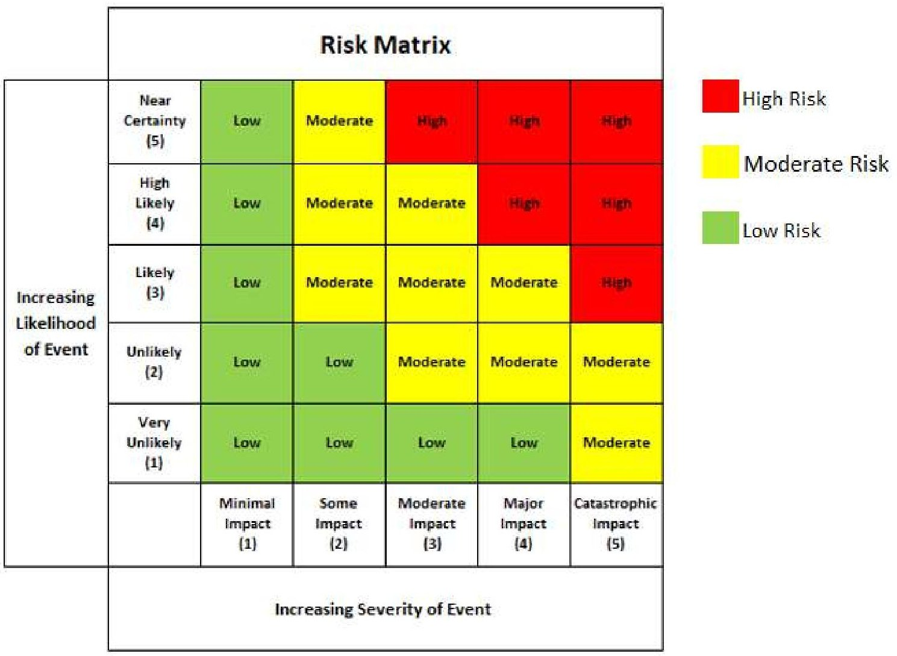

Figure 4: Risk Matrix

The criticality number (CN) for each failure mode can be calculated using the severity and the likelihood of occurrence ranking values. The CA uses the CN to provide a relative measure of significance of the effects from a failure mode occurring. In essence, CA ranks the significance of each potential failure mode for each component within the system's design from highest to lowest priority based off the CN values. The ranking process of the CA can be executed using a quantitative approach where historical failure data for each component is known or by a qualitative approach where a system matter expert conducts a subjective ranking

<!-- PDF_PAGE: 23 -->

procedure [20]. Once the criticality for each failure mode is identified and ranked, the high priority failure modes should be addressed first to mitigate potential failure modes in efforts to increase the probability of executing a successful mission. A mitigation plan can then be developed to reduce the probability of a failure occurring. [23].

## 2.3 Introduction to Fault Tree Analysis

For complex systems, an FTA can be used to assist with identifying failure modes for a particular system which compliments the FMECA. FTA was developed by H. Watson and A. Mearns in the year 1962 and has been utilized by aerospace, chemical, nuclear, and other industries for evaluating potential risk [26]. A fault tree involves converting the physical system into a logic diagram. The logic diagram use shapes as logic symbols, which are broken up in to two categories: Event symbols and Gate symbols [26]. Figure 5 shows the FTA symbols that were used in the mission SeaLion analysis, but there are more that were not utilized.

Event symbols that are primarily used are shown as a rectangular box, circle, or diamond. A fault event is shown as a rectangle box, which is normally the result from a logical combination [14]. An independent primary fault event is shown as a circle and a triangle is used to display a continuation of sub-tree [14]. The two primarily used Gate symbols are AND-gate and OR-gate [14]. The output (top) event occurs if and only if all the inputs (bottom) occur is indicated by an AND-gate [14]. The output (top) event occurs if at least one or more inputs (bottom) occur is indicated by a OR-gate [26].

Figure 5: FTA Symbols [26]

Defining the primary failure is identified as the undesired top event on the fault tree [26]. Once the primary failure is identified, the analyst asks the question: How did this failure occur? Asking this question leads into the first level of contributing factors. The factors are listed below the top event that led to the failure, which are linked using logical gates [26]. Identifications of

<!-- PDF_PAGE: 24 -->

the second level contributors are listed below the first level and are again linked together using logical gates [26]. Repeating this process is required until the primary failure causes are identified, which completes the FTA [26]. For mission SeaLion, the FTA was used as a secondary tool to further analyze high level failures that were identified in the FMECA.

<!-- PDF_PAGE: 25 -->

## 3. MISSION SEALION FAILURE MODE, EFFECTS & CRITICALITY ANALYSIS

## 3.1 Mission SeaLion Failure Mode, Effects & Criticality Analysis Framework

For mission Sealion, there was limited information available due to an absence of successful flight heritage and limited information obtained from ODU's previous launch. Therefore, conducting a subjective analysis was a difficult task, but this analysis can now be used as a foundation for future efforts. When no reliability data is available, it is essential that system matter experts conduct the analysis. Extensive efforts were executed to gain knowledge from experts by communicating to multiple engineers at NASA Langley Research Center (LaRC) in Hampton, V.A. The engineers that provided guidance have extensive experience with building circuit boards, designing electrical systems, and conducting thermal vacuum chamber (TVAC) testing. They contributed to identifying potential failure modes and assisted with initial set-up of ODU's new TVAC.

Mission SeaLion is ODU's second CubeSat mission, which is being jointly developed by ODU, USCGA, and AFIT. This mission is also the first joint CubeSat mission that ODU has conducted with another university, which added additional challenges regarding implementation of the IP and Ms-S payloads to the SeaLion CubeSat. The custom-built components are a higher risk to mission SeaLion when compared to space proven COTS components. The potential risk of failures for the custom-built components were evaluated using the FMECA, with the intent to increase the reliability of mission SeaLion. These custom-built components include the EPS, Interface Board, and the DeCS. The FMECA framework that is described below was conducted using Microsoft Excel worksheet. The FMECA worksheet includes the following columns, and an outline is shown in Table 1 [16, 17]:

- Component

- Failure Mode

- Failure Cause

- Failure Effects

- Severity (1-5)

<!-- PDF_PAGE: 26 -->

- Likelihood (1-5)

- Critical Number

- Detection method

- Mitigation Strategies

Table 1: FMECA Outline

<table border="1"><tr><td>Component</td><td>Failure Mode</td><td>Failure Cause</td><td>Failure Effects</td><td>Severity(1-5)</td><td>Likelihood(1-5)</td><td>Criticality Number</td><td>Detection Method</td><td>Mitigation Strategies</td></tr><tr><td></td><td></td><td></td><td></td><td></td><td></td><td></td><td></td><td></td></tr></table>

The following steps describe the framework that was used for executing the FMECA for mission SeaLion:

## Step 1: Construct a Functional Block Diagram

A functional block diagram (FBD) is utilized to show the operations and interrelationships between systems and operating modes [20]. The FBDs are used to provide a graphical representation showing how functions and relationships between different components are integrated within a system [20]. Identifying a component's primary function will help with developing the functional block diagram and will assist in determining failure modes for the system [17]. Constructing a FBD is necessary for understanding the system's architecture, which helps identify: the functions of each component, what downstream functions are affected when a component fails, how backups and redundancies may be designed into the system to increase reliability in the event of failures occurring [20, 27].

Microsoft Visio was chosen for creating the FBDs for mission SeaLion, but other options are available for use. The symbols that were used for creating FBD composed of rectangles and arrow connectors. The rectangles were used for representing a mechanical and electrical event. Solid arrow connectors represented how events were connected and an electrical signal, which was mainly used to show power supply and data flow. Lastly, the dashed arrow connector

<!-- PDF_PAGE: 27 -->

represented feedback, which was used to point the viewer back to an event symbol. The FBD symbols that were used are shown in Figure 6.

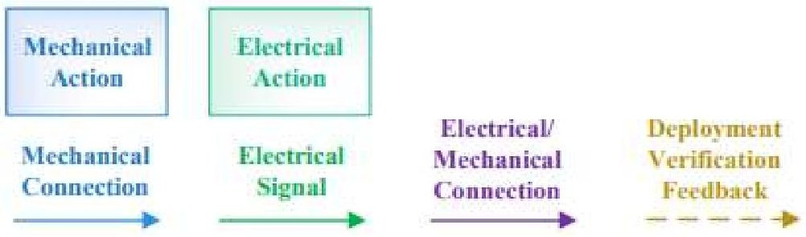

Figure 6: Block Diagram Symbols

## Step 2: Identify the Failure Modes

Failure mode is an event which could cause a failed state in a function, subsystem, or component [17]. There are several modes that can cause a component or system to fail [20]. Failure modes regarding satellites depend heavily on the environment and component flight data if historical data is available [20]. A noun and verb should be used when describing a failure mode [17]. All failure modes should be identified and then evaluated if they are realistic enough to be analyzed or not. As previously mentioned, an FTA can be utilized to assist in breaking down a high-level failure mode.

## Step 3: Identify the Failure Cause

To understand failure modes, the 'root cause' shall be identified. Root cause is the basis, or the source from which a failure derives from [17]. It implies that if one drills down far enough, the origin of the failure arrives at a final and absolute level of causation [17]. Referring to the FBD and FTA, an analyst could maximize both for assisting with identifying the cause of failures.

## Step 4: Identify the Failure Effects

Failure effects describe the repercussions of when a particular failure mode occurs. A failure effect answers the question "what happens downstream if a component stops fulfilling its

<!-- PDF_PAGE: 28 -->

function?" and it is used to evaluate the severity of impact it has to the system. When describing the effects of failure, the following should be recorded [17]:

- What evidence (if any) that the failure has occurred

- In what ways (if any) it affects operations

- What damage (if any) is caused by the failure

## Step 5: Assign Severity Ranking

Ranking the severity for each failure mode will evaluate the impact the failure has on the system and the mission [28]. The Level of Severity (LS) of failure will be ranked based on established criteria and an assigned numbering scale from 1 to 5 will be used. Assigning a lower ranking for a failure mode indicates a failure effect that is less severe. A high ranking for a failure mode indicates a more severe failure effect [20, 28, 29]. Each failure mode will be analyzed and assigned to a level of severity in accordance with Table 2.

Table 2: Level of Severity (LS) of Failure [20, 28, 29]

<table border="1"><tr><td>Level</td><td>Severity of the failure</td></tr><tr><td>1</td><td>Minimal or no impact: Does not affect mission and subsystem can still accomplish function.</td></tr><tr><td>2</td><td>Some impact: One or more component(s) are affected by failure, but system can still accomplish function through redundancies or other subsystems.</td></tr><tr><td>3</td><td>Moderate impact: One subsystem is completely ineffective, but mission can still continue by means of other subsystems.</td></tr><tr><td>4</td><td>Major impact: One or more component(s) are affected by failure and mission is partially compromised, with operations being limited.</td></tr><tr><td>5</td><td>Catastrophic impact: Mission is completely compromised.</td></tr></table>

## Step 6: Assign Likelihood of Occurrence Ranking

For the CA to be executed, the likelihood of occurrence for each failure mode will need an assigned ranking value. Likelihood of occurrence can be performed using either a quantitative or a qualitative approach. For a quantitative analysis to occur, reliability data will be needed or

<!-- PDF_PAGE: 29 -->

determined by conducting testing [20]. Reliability data, such as failure effects probability, failure rates, Mean Time to Failure (MTTF), etc. could be used for the quantitative approach [14].

If no reliability data is obtained, a qualitative analysis can be performed. A qualitative analysis involves the analyst's ability to subjectively rank each failure mode based on established criteria. The criteria for the failure modes are related to the probability of failure [20]. Since the ODU CubeSat program is still relatively new, no historical data regarding failure rates were referenced and the manufactures of the COTS components would not provide any reliability data to calculate failure rates. Instead, a qualitative analysis was conducted for evaluating likelihood of occurrence. Failure mode probability, failure mode ratio, and MTTF are not used in this analysis.

The ranking criteria was established based on whether the components were COTS or custom developed. The Level of Likelihood (LL) of occurrence for each failure mode was ranked using a 1 to 5 numbering scale [29]. Assigning a lowering ranking for a failure mode indicates a lower likelihood of occurring. A high ranking for a failure mode indicates a higher likelihood of occurring [1,20]. Each failure mode will be analyzed and assigned to a likelihood of occurrence in accordance with Table 3.

Table 3: Level of Likelihood (LL) of Occurrence [1, 20]

Level Likelihood of Occurrence

<table border="1"><tr><td>Level</td><td>Likelihood of Occurrence</td></tr><tr><td>1</td><td>Very unlikely:COTS that has been space flight proven or has not experienced failure in similar missions.</td></tr><tr><td>2</td><td>Unlikely:COTS and component(s) that has space flight history or has not experienced failure in similar missions.</td></tr><tr><td>3</td><td>Likely:COTS and built in-house component(s) with some space flight history.</td></tr><tr><td>4</td><td>High likely:Built in-house component(s) with very little or no space flight history.</td></tr><tr><td>5</td><td>Near certainty:Built in-house component(s) with no space flight history.</td></tr></table>

## Step 7: Perform the Criticality Analysis

Once the severity and likelihood of occurrence has been scored using the ranking scale, the CA can be executed. The CA involves calculating the CN for each failure mode using the

<!-- PDF_PAGE: 30 -->

qualitative approach. The CA provides a relative measure of ranking the significance of the effects of each failure mode, which will result in prioritizing and minimizing the effects early in the design process [20]. The CN aims at prioritizing the importance of mitigating or redesigning the component that is being evaluated as a worst-case scenario [28]. The CN is the product of the severity (S) and likelihood of occurrence (O), which can be calculated using Equation 1 [29]:

$$
E q u a t i o n 1: C N = S \times O
$$

## Step 8: Rank the Failure Modes

The CN that was calculated using Equation 1 will be used to rank one failure mode to one another. Ranking the failure modes is part of risk analysis and is the base for allocating mitigation plans. A high CN value means that the failure mode poses the greatest amount of risk to the system. A low CN value will be evaluated as having a risk that is considered negligible and may not be mitigated due to schedule and cost [29].

## Step 9: Detection Method

Detection Method is used to identify premature failure modes from the ground station [1]. If there are signs that a component is failing or has already failed, the ground station operator may have some means of isolating power to the component on-board the satellite to conserve the power budget and/or to prevent downstream failures from cascading. Identifying detection methods may also assist in hypothesizing how a failure occurred if failure takes place during the mission.

## Step 10: Identify Mitigation Strategies

After the CN for each failure mode has been ranked accordingly, efforts for mitigating or eliminating the potential risks for each failure mode will be executed [28]. The highest priority failure modes will be executed first due to the failures having the most critical consequences [30]. ODU's new TVAC will be utilized, along with vibration and software testing. Thermal vacuum cycling test (TVCT) and vibration testing will be essential for qualifying the custombuild components for mission SeaLion. The testing effort will be in addition to qualifying the satellite for flight, which is required by the launch provider. If testing identifies a failure or redesign is required, the FMECA will be re-executed once the design change is implemented.

<!-- PDF_PAGE: 31 -->

For the SeaLion CubeSat mission, the FMECA was conducted for the following main systems and operation:

- EPS

- Interface Board

- DeCS payload

- Structure

- Mission SeaLion Deployment and Start-Up

## 3.2 Electrical Power System

The EPS was designed and developed by ODU to support the operating modes, all three payloads and on-board operations of the mission SeaLion. The EPS consists of a battery pack of non-rechargeable batteries and a printed circuit board (PCB). Since the mission life of SeaLion CubeSat is projected to be roughly 10 days, a decision was made to use non-rechargeable batteries for the SeaLion CubeSat power source, which eliminated the use of solar cells for power regeneration [6]. An extensive evaluation was conducted with ODU's electrical design on the EPS and mitigation strategies were implemented to ensure that the system is robust and reliable. The EPS electrical schematic is shown in Appendix A and the EPS component list is shown in Appendix B [31].

## 3.2.1 Non-Rechargeable Battery System

The primary function of the battery pack is to supply power to mission SeaLion's components and operating modes for the projected on-orbit duration. The battery pack power supply for mission SeaLion is composed of 8 non-rechargeable batteries that consume 1U volume on-board. The battery model being used is the UltraLife UHR-XR34610 Li- $ \mathrm{C F_{x}} / \mathrm{M n O_{2}} $ D form battery cells [32]. Due to the 1U volume constraint, the selected chemistry provided a high specific energy density that was sufficient to meet the estimated power budget. The batteries are configured in a 4 Series 2 Parallel (4S2P) configuration to meet the power requirements of mission SeaLion and is shown in Figure 7 [6]. The configuration supports a nominal output voltage of 12VDC with 32Ah of each 2P arrangement allowing for 384Wh for mission SeaLion. The computer-aided design (CAD) generation of the eight battery cells arranged in the 1U volume constraint is shown in Figure 8 [6].

<!-- PDF_PAGE: 32 -->

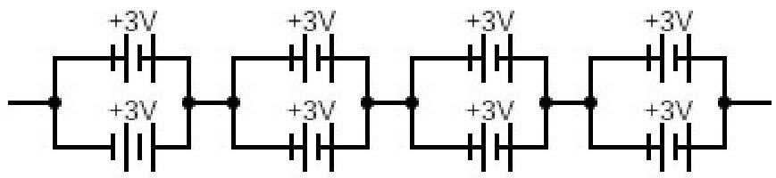

Figure 7: 4 Series 2 Parallel (4S2P) Battery Configuration

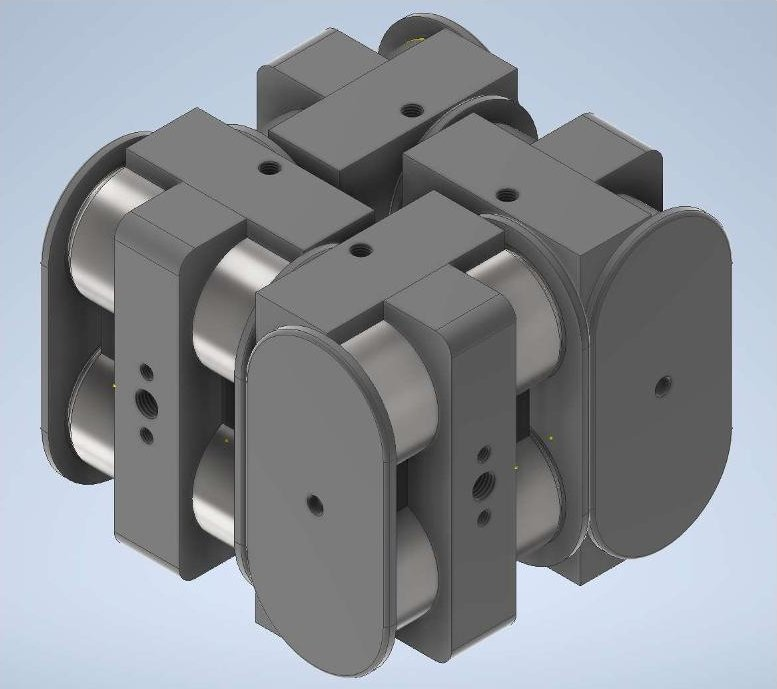

Figure 8: 1U Battery Pack CAD Generation

The studies on the exact chemistry of the batteries being used on mission SeaLion were not found, but information regarding lithium-ion battery failures were found through research. High energy density lithium-ion batteries are desired for spacecraft applications due to the run time being significantly longer when compared to other battery chemistries [33]. The main failure concerns for lithium-ion batteries are external short circuit, internal short circuit, high temperatures, structural integrity, and outgassing [34]. The operating temperature at which a battery discharge has a significant effect on the capacity and voltage characteristics [34]. This occurs due to the reduction in the chemical activity and the increase in internal resistance of the battery at lower temperatures [34]. Lithium-ion battery failures commonly occur when power demand is high causing the internal temperature to rise where the electrolyte is gasified, causing it to release and possibly explode [35]. High vacuum environments can also cause the batteries to

<!-- PDF_PAGE: 33 -->

outgas excessively which will be discussed in Section 3.7 Outgassing. The likelihood of the batteries experiencing high levels of outgassing was listed as highly likely (LL4).

## Thermal Runaway

Dr. Christopher Iannello, who is a NASA Technical Fellow for Electrical Power, explains potential failures regarding lithium-ion batteries. He explains in an article that at high temperatures, the lithium-ion cell becomes thermally unstable [33]. Exothermic reactions occur and release heat faster than the cell can dissipate the generated heat, which creates a state known as thermal runaway [33]. The main concern is that during a single-cell thermal runaway, the heat generated from one failing cell can propagate to the adjacent cell, resulting in a chain reaction of thermal runaways [33].

If mission SeaLion's battery power supply were to experience a thermal runaway, the result would lead to catastrophic failure to the mission. The severity of the batteries exploding due to temperatures exceeding the upper battery operating temperature limit was listed as catastrophic impact (LS5) for level of severity. Due to the power supply being the most important component on-board mission SeaLion, all the following failure modes regarding the batteries, battery wire and battery connector were listed as catastrophic impact (LS5) for severity of failure. The likelihood of failure for the batteries exploding was listed as highly likely (LL4). Mitigation strategies include monitoring the batteries' operating temperature and output voltage while under load to ensure power meets the minimum threshold to operate systems during the TVCT.

Implementing a battery management system (BMS) is commonly used to monitor the battery pack to mitigate and prevent thermal runaway [36]. The BMS has safety features that aim to prevent overvoltage, over-discharge, high temperatures, and other problems from occurring. This ensures that the batteries are operating at safe levels [36]. A battery monitor was integrated into the EPS, which will capture current and voltage data that will be downlinked in the mission SeaLion satellite health packet, but no additional actions were implemented to turn off power supply to mission SeaLion if the upper temperature limit was being approached. System protection could have been implemented into the on-board flight software through which an electrical signal could be sent to a switch to turn off power supply when mission SeaLion temperatures increase to the upper limit.

<!-- PDF_PAGE: 34 -->

## Battery Short Circuit

Short circuit failures can occur both external and internal to a battery cell or battery pack [34]. Faulty connections between the positive and negative terminals and broken or loose battery connections can cause an external short circuit on the battery pack [34]. External short circuits of lithium-ion cells can cause the internal cell pressure to increase from the high current spikes, which could result with potential battery explosion [34]. Implementing the battery connections was conducted in-house, so the likelihood of an external short circuit was listed as likely (LL3). Mitigation of external short circuit involves conducting a manual visual inspection (MVI) on the battery terminals and connections, along with conducting an electrical continuity using a voltohmmeter and functionality test on the battery pack.

Internal short circuits can be caused by deformations of the battery cells, along with high vibration levels from launch [34]. Deformations of the battery cells can cause membrane leakage and could lead to thermal runaway [34]. Vibrations from the launch can cause internal shorts, misalignment, or other means of direct contact issues between positive and negative materials inside the battery cell [34]. The effects could lead to venting of the electrolyte, possible explosion, and thermal runaway [34]. Since the selected Ultralife batteries were not initially designed for space use, the likelihood of failure regarding internal short circuit were listed as likely (LL3). Mitigation strategies include monitoring for signs of potential electrolyte leakage, swelling and deformations of the batteries during the TVCT, and conducting vibration testing on the battery pack.

## Battery Wire Short Circuits

The battery pack will have a wire that is configured to the battery supply electrical connector on the EPS Board. At excessive high temperatures, the insulation could breakdown on the battery power supply wire, causing a short circuit. This could potentially lead to an explosion or reach the state of thermal runaway [34]. All wiring on mission SeaLion is space grade and is rated for high temperature, so the likelihood is listed as unlikely (LL2). For additional external thermal protection, a recommendation was made to wrap all wires on-board mission SeaLion with a high temperature polyimide tape.

<!-- PDF_PAGE: 35 -->

## Voltage Reversal

As previously mentioned, eight batteries were configured in a 4S2P configuration [6]. The capacity for each battery will not have the exact same discharge capacity, due to a slight variability in manufacturing. This means that the capacity of the weakest cell will deplete before the other cells, when discharged in a series configuration. The battery cell with the weakest capacity will eventually reach 0-VDC during a continuous discharge and the voltage path will reverse. The battery cell could begin to vent electrolytes or potentially explode due to the increase in heat generation and internal pressure built-up [37].

The likelihood of failure was listed as highly likely (LL4) due to the battery pack power supply being designed built in-house. "Some battery designers, particularly for multicell lithium primary batteries, add diodes in parallel to each cell to limit voltage reversal. As the cell voltage drops below zero volts and into reversal, the diode becomes conducting and diverts most of the current from flowing through the cell. This limits the extent of the voltage reversal to that of the characteristic of the diode [37]." Adding diodes in parallel to each cell in the battery pack configuration will help limit potential voltage reversal.

## Battery Structure

Thermal stresses from the harsh space environment conditions can reduce the integrity and casing of the batteries [34]. The effects can lead to the battery casings being fractured and material degradation to the battery mounts, causing a short circuit and excessive movement due to the batteries being unconstrained [34]. Again, since the Ultralife batteries were not initially designed for space use, along with the mounting and configuration being conducted in-house, the likelihood of failure was listed as highly likely (LL4). Additional observations during the TVCT include monitoring for signs of degradation to the batteries mounts and casings, along with any signs of thermal expansion that may occur [34].

## Depleted Batteries

Although mission SeaLion will have a relatively short mission, there is a chance that power is consumed faster than anticipated from on-board operations. The batteries could also not perform at the desired level due to the extreme temperatures and pressure that will be experienced on-orbit. The batteries could discharge faster than expected, resulting in depleted

<!-- PDF_PAGE: 36 -->

batteries. Depleted batteries would end the mission and could occur at any time, but indications would be given in the mission SeaLion satellite health packet from the data that will be recorded by the battery monitor. A conservative power budget was calculated in-house by ODU, so the likelihood was listed as highly likely (LL4). For mitigation, operating loads can be simulated during the TVCT and a discharge voltage curve can be generated and compared to the Ultralife performance graphs shown on the technical datasheet [32]. Mission SeaLion's power budget and balance is shown in Appendix G [6, 31]. The FMECA for the batteries is shown in Table 4 below.

Table 4: Battery FMECA

<table border="1"><tr><td>Component</td><td>Failure Mode</td><td>Failure Cause</td><td>Failure Effects</td><td>Severity(1-5)</td><td>Likelihood(1-5)</td><td>CriticalityNumber</td><td>Detection Method</td><td>Mitigation Strategies</td></tr><tr><td>Batteries</td><td>Thermal runaway</td><td>Temperatures exceed the upper battery operating temperature limit</td><td>Batteries could ignite or potentially explode</td><td>5</td><td>4</td><td>20</td><td rowspan="7">No communication is ever established, sudden loss of communications, or a large increase in battery temperature and current is present in SeaLion satellite health downlink packet</td><td>Conduct a TVCT and implement a battery management system</td></tr><tr><td>Batteries</td><td>High levels of battery outgassing</td><td>Batteries experience outgassing from high vacuum soace environment</td><td>Outgassed matter could condensate on other components on-board</td><td>5</td><td>4</td><td>20</td><td>Monitor outgassing levels and total mass loss when conducting the TVCT</td></tr><tr><td>Batteries</td><td>External battery short circuits</td><td>Faulty connections between terminals and broken or loose battery connections</td><td>Batteries could potentially explode</td><td>5</td><td>3</td><td>15</td><td>Conduct a MVI and functionality testing</td></tr><tr><td>Batteries</td><td>Internal battery short circuit</td><td>Deformations of the battery cells can cause membrane leakage</td><td>Could lead to thermal runaway</td><td>5</td><td>3</td><td>15</td><td>Monitor for potential electrolyte leakage and swelling of batteries when conducting the TVCT</td></tr><tr><td>Battery wire</td><td>Battery wire short circuits</td><td>High temperatures could cause the insulation to breakdown and short circuit</td><td rowspan="2">Could cause an explosion or thermal runaway</td><td>5</td><td>2</td><td>10</td><td>Implement thermal shielding on wires</td></tr><tr><td>Batteries</td><td>Voltage Reversal</td><td>Battery cell reaches 0-VDC and the voltage reverses</td><td>5</td><td>4</td><td>20</td><td>Add diodes in parallel to each cell</td></tr><tr><td>Batteries</td><td>Battery structure failure</td><td>Thermal stresses on the batteries</td><td>Damage to battery casings and mounts</td><td>5</td><td>4</td><td>20</td><td>Monitor the batteries structural integrity and thermal expansion when conducting the TVCT</td></tr><tr><td>Batteries</td><td>Depleted batteries</td><td>Batteries have complete discharged</td><td>Unable to supply power to components and operating modes</td><td>5</td><td>4</td><td>20</td><td>Current and voltage decline faster than anticipated in SeaLion satellite health downlink packet and communication with SeaLion is lost</td><td>Simulate operating loads during the TVCT</td></tr><tr><td>Batteries</td><td>Internal battery short circuit</td><td>Vibration from launch can cause internal shorts</td><td>Could lead to venting of the electrolyte, explosion, and thermal runaway</td><td>5</td><td>3</td><td>15</td><td rowspan="2">No communication is established with SeaLion</td><td rowspan="2">Conduct vibration and functionality testing on battery pack</td></tr><tr><td>Batteries</td><td>Internal battery short circuit</td><td>Vibration from launch can cause misalignment</td><td>Could lead to potential explosion and thermal runaway</td><td>5</td><td>3</td><td>15</td></tr></table>

<!-- PDF_PAGE: 37 -->

## 3.2.2 Electrical Power System Board

The EPS Board was designed with a 3.3-VDC and 5-VDC voltage bus to support components on-board. Each bus has a switching voltage regulator LM2576 to step down voltage from the non-rechargeable battery power supply to each required bus level [38]. A battery fuel gauge LTC2944 was used to monitor the battery bus voltage and current, which is communicated to the on-board computer (OBC) via inter-integrated circuit (I2C) [39]. The battery bus data will be a part of the SeaLion health packet that is downlinked during mission SeaLion [31].

Voltage capacity is monitored on each bus by using a voltage and current monitor LTC2990 [40]. Each voltage bus has its own integrated circuit (IC) LTC4361-2 which provides overcurrent, overvoltage, and undervoltage protection for the load components [41]. The EPS Board communicates and interfaces with the Interface Board and NanoDock DMC-3 dock through the PC/104 form factor. Figure 9 is the CAD generated model of the EPS Board [31].

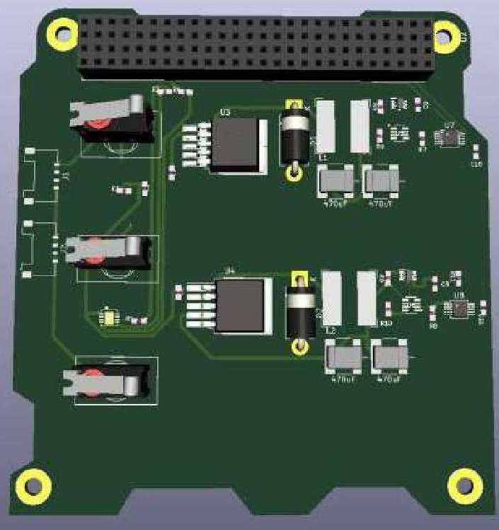

Figure 9: KiCAD Generated EPS Board

There are several factors that could result in the electrical components or systems failing during launch and while on-orbit. Excessive vibration, high temperatures, radiation, and power supply components issues are of mission SeaLion's greatest concerns.

<!-- PDF_PAGE: 38 -->

## Voltage Regulator

Voltage regulators are used in electrical circuits to regulate voltage supply within a range that is compatible with other electrical components [42]. The primary function of a voltage regulator is to provide a constant output voltage, even if the input voltage or load conditions are varying [42]. A step-down converter, also commonly known as a buck converter, will step down the high unregulated input voltage to a lower regulated output voltage signal [42].

The EPS Board was designed with a step-down switching regulator for both the 3.3-VDC and 5-VDC voltage supplies. Failure modes for both 3.3-VDC and 5-VDC voltage regulator will be evaluated at the system component level, while the capacitor, inductor, and diode will be evaluated at the sub-system level since these components support isolation and feedback for each of the switching voltage regulators. The voltage regulators could fail due to high voltage surges or from excessive voltage fluctuations [43, 42]. The failure effects for both failure modes are that the voltage in the circuit will not be unregulated and downstream components could potentially be damaged from receiving a high voltage surge or receiving a low voltage supply. Since both voltage regulators supply different components, additional explanations will be given for failure effects.

The main components that the 3.3-VDC voltage regulator powers are the sun sensors, GPS receiver, UHF radio and the OBC. Loosing or having insufficient power to the OBC is of greatest concern among the three components. The OBC will execute telecommunications with the ground station and store all data that is captured on-board. Thus, the severity of the OBC failing was listed as catastrophic impact (LS5).

The main components that the 5-VDC voltage regulator powers are the S-band radio, inertial measuring unit (IMU) and the accelerometer. In the event where the IMU and accelerometer data is not received in the mission SeaLion downlink packet, then ground station personnel will not have any means for determining the spacecrafts attitude. The severity of failure was listed as a major impact (LS4). The likelihood for both voltage regulators was listed as unlikely (LL2) since a robust component was selected and the manufacturer provided extensive test data for multiple scenarios [38]. Mitigation strategies involve monitoring voltage output while conducting a functionality test and selecting supporting electrical components in-

<!-- PDF_PAGE: 39 -->

line with the voltage regulator that are capable of handling voltage surges and fluctuations. The FMECA for the voltage regulators is shown in Table 5.

Table 5: Voltage Regulator FMECA

<table border="1"><tr><td>Component</td><td>Failure Mode</td><td>Failure Cause</td><td>Failure Effects</td><td>Severity(1-5)</td><td>Likelihood(1-5)</td><td>Criticality Number</td><td>Detection Method</td><td>Mitigation Strategies</td></tr><tr><td>3.3-VDC Voltage Regulator</td><td>Voltage regulator fails</td><td>Regulator experiences a high voltage surge</td><td rowspan="2">Unregulated voltage supply could damage downstream components or supply insufficient voltage</td><td>5</td><td>2</td><td>10</td><td rowspan="2">A large, unexpected changes in 3.3-VDC bus voltage data is present in SeaLion satellite health downlink packet or sudden loss of communication with SeaLion</td><td rowspan="2">Conduct functionality testing and monitor voltage during thermal testing of EPS Board</td></tr><tr><td>3.3-VDC Voltage Regulator</td><td>Voltage regulator fails</td><td>Regulator experiences high voltage fluctuations</td><td>5</td><td>2</td><td>10</td></tr><tr><td>5-VDC Voltage Regulator</td><td>Voltage regulator fails</td><td>Regulator experiences a high voltage surge</td><td rowspan="2">Unregulated voltage supply could damage downstream components or supply insufficient voltage</td><td>4</td><td>2</td><td>8</td><td rowspan="2">A large, unexpected changes in 5-VDC bus voltage data is present in SeaLion satellite health downlink packet or sudden loss of communication with SeaLion</td><td rowspan="2">Conduct functionality testing and monitor voltage during thermal testing of EPS Board</td></tr><tr><td>5-VDC Voltage Regulator</td><td>Voltage regulator fails</td><td>Regulator experiences high voltage fluctuations</td><td>4</td><td>2</td><td>8</td></tr></table>

## Inductor

The voltage regulator sub-system components are described and evaluated next. The primary function of an inductor is to store current and provide a supply to the circuit when the current levels decrease, which will help maintain a constant current supply in the circuit [43]. Inductors have a large impact on the transient response, control loop stability, and will ultimately impact efficiency [44]. Proper inductor selection is an extremely crucial aspect to a converter design [44]. Improper inductor selection can cause the inductor's magnetic core to saturate, which should be avoided [44]. Inductor saturation can cause damage to the converter, which could limit the output current from the converter. [44]. When conducting thermal testing on the PCB assembly, plot the inductors current waveform to ensure that current saturation is not occurring in circuit [44].

When the inductance value selected is too low, large peak-to-peak inductor current ripple can be experienced, which will exert addition stress on the capacitor and voltage regulator, ultimately impacting the efficiency of the inductor [43, 44]. Inductors can reach high temperatures when there is a large amount of core loss caused by the high current ripples [44]. The increase in the inductor's thermal generation could affect the performance of other

<!-- PDF_PAGE: 40 -->

components in the circuit. Figure 10 shows an example of a waveform when the inductance rating of a component is too low, and saturation occurs [44].

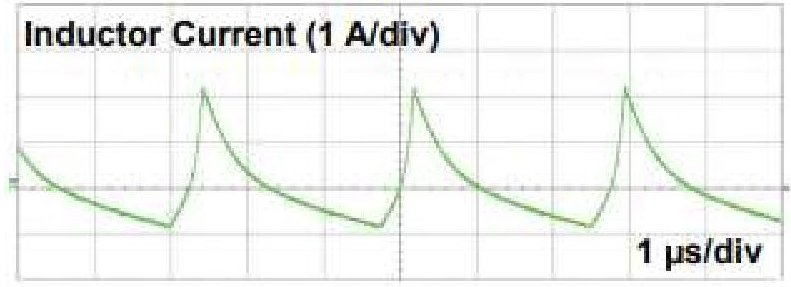

Figure 10: Poor Inductor Current Waveform [44]

A constant slope for the inductor current should be displayed during the switch intervals when proper inductors are selected. Figure 11 shows an example of a waveform when the correct inductor is selected for application, when no signs of saturating current being displayed [44].

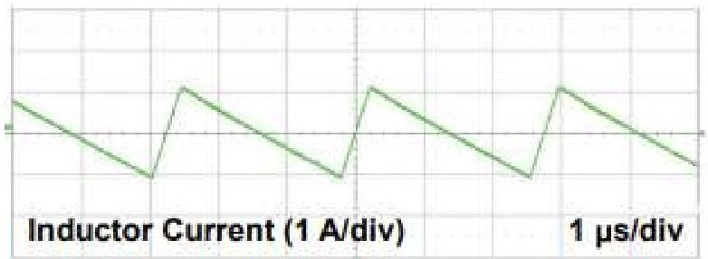

Figure 11: Proper Inductor Current Waveform [44]

Texas Instruments Incorporation recommends selecting the inductance value that will keep the current ripple to roughly 30% of the full load current [44]. The three inductor failure modes that were previously described were evaluated to having a severity of major impact (LS4) to the circuit due to the inductor's contribution to the converters design. The likelihood of the failure occurring was listed as unlikely (LL2).

<!-- PDF_PAGE: 41 -->

## Diode

A diode is a semiconductor device that has a primary function of only allowing current to flow in one direction and restricts current from flowing in the reverse direction [45]. A diode essentially acts as a one-way switch for current and assists the voltage regulator within the circuit [43]. Diode failures can occur when excessive current is flowing in one direction and a large surge of voltage flows in the reverse direction [46]. When excessive forward current is experienced, the diode will fail open which may result in unregulated voltage cascade [46]. Downstream components could be damaged from voltage surging, or the voltage supply is insufficient for operations [43].

When a large reverse voltage is experienced in the circuit, the diode will short circuit [46]. The performance of the voltage regulator could be impacted or cause failure due to a high voltage ripple reversing back through the excited field (dI/dt) [47]. Mitigation strategies involve monitoring voltage during thermal testing and TVCT. The severity of the diode failing was listed as having a moderate impact (LS3) to the circuit and the likelihood was listed as very unlikely (LL1).

## Capacitor

The primary function of a capacitor is to store electrical energy from a source and release the electricity when activated in a circuit (dV/dt) [48]. Inside the capacitor are terminals that connect two metal plates that are separated by a non-conductive substance or dielectric [48]. When activated, the capacitor will release electricity very quickly [48]. A very common failure mode for capacitors is dielectric breakdown. When a device is continuously being operated at its upper threshold rating, the dielectric materials will degrade until reaching failure. There are several reasons why this occurs, but the most common is due to excessive high temperatures which can result in a short circuit [49].

Environmental breakdown of capacitors can cause failures due to the following scenarios [49]. Capacitance will vary with temperature depending upon the dielectric, which is caused by a change in the dielectric constant [49]. This occurs due to thermal expansion and contraction of the dielectric material/electrodes [49]. The changing of temperature may vary the dissipation factor of the capacitor [49]. As temperature increase, the dielectric strength decreases [49]. The

<!-- PDF_PAGE: 42 -->

decrease in dielectric strength is caused by the chemical activity of the material, resulting in the electrical or physical properties of the capacitor to change [49].

The following three thermal system protection mitigation strategies could be implemented for all electrical failure mode involving high temperature:

1. Integrating thermal safety measures into the on-board flight software could be designed to shut off the battery pack power supply to allow system temperatures to decrease.

2. Implementing thermal control heat shielding to mission SeaLion's outer surface would help control temperature internal.

3. Implementing a hardware fail-safe could also be configured onto mission SeaLion. As temperature increases, resistance increases so hardware could be used to shut down the power supply when resistance reaches a pre-defined threshold limit to prevent components from potentially short circuiting or reaching thermal runaway.

Radiation can cause electrical degradation in the form of dielectric embrittlement, which can cause the capacitors to short circuit or cause an open circuit [49]. Implementing radiation protection externally on mission SeaLion could mitigate the effects that radiation could impose on components and the same strategy found could be implemented on all failure modes involving radiation [49]. Capacitors can fail from the number of cycles during the duration of its lifetime. Selecting a component with the proper rating regarding number of cycles will prevent the capacitor from failing [43].

The failure effects, severity, and likelihood are all the same for the capacitor failure modes that were described above. If failure occurred, then the capacitor would not assist with maintaining constant voltage in the circuit, which could possibly disrupt operations of the supplied current and damage downstream components [50]. The severity of the capacitors failing was listed as some impact (LS2) but will not create a major impact on the circuit. The likelihood of the capacitors failing was listed as unlikely (LL2) and very unlikely (LL1) for failure due to number of cycles since mission SeaLion is estimated to be relatively short on-orbit duration. The voltage regulator sub-components FMECA are shown in Table 6.

<!-- PDF_PAGE: 43 -->

Table 6: Voltage Regulator Sub-System Components FMECA

<table border="1"><tr><td>Voltage Regulator Sub-System Components</td><td>Failure Mode</td><td>Failure Cause</td><td>Failure Effects</td><td>Severity(1-5)</td><td>Likelihood(1-3)</td><td>CriticalityNumber</td><td>Detection Method</td><td>Mitigation Strategies</td></tr><tr><td>Inductor</td><td>Improper inductance selection</td><td>Inductance value of a component is too low</td><td>Insufficient current output</td><td>4</td><td>2</td><td>8</td><td rowspan="3">Fluctuating voltage and current data is present in SeaLion satellite health downlink packet</td><td>Plot the inductors current waveform during thermal testing of EPS Board</td></tr><tr><td>Inductor</td><td>Improper inductance selection</td><td>Inductance value of a component is too low</td><td>Addition stress exerted on the capacitor and voltage regulator</td><td>4</td><td>2</td><td>8</td><td>Select a component that has an inductance value that will keep the current ripple to roughly 30% of the full load current level</td></tr><tr><td>Inductor</td><td>Improper inductance selection</td><td>Core loss caused by the high current ripples</td><td>Performance of components in the circuit could be impacted</td><td>4</td><td>2</td><td>8</td><td></td></tr><tr><td>Diode</td><td>Diode fails open</td><td>Excessive forward current in the circuit</td><td>The voltage regulator may fail to step the voltage down properly, which could potential damage downstream components</td><td>3</td><td>1</td><td>3</td><td>A large, unexpected change in voltage or current is present in SeaLion satellite health downlink packet</td><td>Conduct functionality testing and monitor voltage during thermal testing of EPS Board</td></tr><tr><td>Diode</td><td>Diode short circuits</td><td>Large reverse voltage in the circuit</td><td>The voltage regulator may fail due to high voltage ripple reversing back through the excited field</td><td>3</td><td>1</td><td>3</td><td></td><td></td></tr><tr><td>Capacitor</td><td>Dielectric breakdown of capacitor</td><td>Excessive high temperatures</td><td>Capacitor short circuits and could damage downstream components</td><td>2</td><td>2</td><td>4</td><td rowspan="6">Unexpected changes in voltage is present in SeaLion satellite health downlink packet or sudden loss of communication with SeaLion</td><td rowspan="4">Integrate thermal safety measures, thermal heat shielding, and hardware fail-safe</td></tr><tr><td>Capacitor</td><td>Environmental breakdown of capacitor</td><td>Capacitance varies due to changing in temperature</td><td rowspan="5">Disruption of performance or damage to downstream components</td><td>2</td><td>2</td><td>4</td></tr><tr><td>Capacitor</td><td>Environmental breakdown of capacitor</td><td>Dissipation factor varies due to temperature change</td><td>2</td><td>2</td><td>4</td></tr><tr><td>Capacitor</td><td>Environmental breakdown of capacitor</td><td>Dielectric strength level decreases due to the increasing of temperature</td><td>2</td><td>2</td><td>4</td></tr><tr><td>Capacitor</td><td>Environmental breakdown of capacitor</td><td>Radiation can cause electrical degradation in the form of dielectric embrittlement</td><td>2</td><td>2</td><td>4</td><td>Implement radiation protection on SeaLion</td></tr><tr><td>Capacitor</td><td>Capacitor failure</td><td>Capacitor fails due to number of cycles</td><td>2</td><td>1</td><td>2</td><td>Select component that is designed with a high number of cycles</td></tr></table>

## Battery Monitor

The primary function of the battery monitor is to record the raw voltage and current data from the battery pack power supply. The data will then be converted to I2C data and sent to the OBC, where the data will be downlinked in the SeaLion satellite health packet [31]. The battery pack power supply data is important because it allows the ground station personnel to know the current state and remaining battery life for conducting operations. If the battery monitor fails, the mission would be greatly affected but operations could continue. The ground station personnel would not know the current state of the battery pack power supply, which may create additional operational decision challenges. The severity of the battery pack failing was listed as major impact (LS4). Failure could occur when temperatures exceed the upper battery monitor operating temperature limit, but the likelihood of failure occurring was listed as unlikely (LL2) due to the wide operating range specified on the component's datasheet [39].

<!-- PDF_PAGE: 44 -->

## Metal-Oxide-Semiconductor Field-Effect Transistor

A metal-oxide-semiconductor field-effect transistor (MOSFET) is a device that is used for switching states and for amplifying electronic signals in a device, essentially acting as a switch [51]. The primary function of the MOSFET transistor is to control the voltage and current flow between the source and drain terminals [51]. A common failure mode for a MOSFET is when high voltage is experienced, the result may cause a short circuit between the source and drain [52]. The short circuit will cause the MOSFETs component failure, eventually opening the circuit [52]. If the failure results in an open circuit, then downstream components will not receive power [43]. The severity was listed as catastrophic impact (LS5) if the 3.3-VDC MOSFET failed due to the OBC being downstream of the device and major impact (LS4) was listed for the 5- VDC MOSFET because other mission objectives could still be achieved.

A high voltage transient spike (dV/dt), positive or negative could cause the MOSFET to fail. The initial voltage spike will damage the gate-body insulation, causing the gate and body to connect. Once that occurs, the MOSFET will explode causing catastrophic failure to mission SeaLion for both the 3.3-VDC and 5-VDC device, so the severity was listed as catastrophic impact (LS5) [53]. The likelihood was listed as unlikely (LL2) for all failure modes described for the MOSFET. Failures would occur primarily if the upstream voltage regulator failed. The FMECA for the battery monitor and MOSFET is shown in Table 7.

Table 7: Battery Monitor and MOSFET FMECA

<table border="1"><tr><td>Component</td><td>Failure Mode</td><td>Failure Cause</td><td>Failure Effects</td><td>Severity(1-5)</td><td>Likelihood(1-5)</td><td>CriticalityNumber</td><td>Detection Method</td><td>Mitigation Strategies</td></tr><tr><td>Battery Monitor</td><td>Battery monitor fails</td><td>Temperatures exceed the upper battery monitor operating temperature limit</td><td>Unable to measure the batteries voltage and current output</td><td>4</td><td>2</td><td>8</td><td>No raw battery voltage or current data in the SeaLion satellite health downlink packet</td><td>Integrate thermal safety measures, thermal heat shielding, and hardware fail-safe</td></tr><tr><td>3.3-VDC MOSFET</td><td>MOSFET short circuits</td><td rowspan="2">High voltage will cause a short circuit between the gate and source</td><td rowspan="2">Downstream components will not receive power</td><td>5</td><td>2</td><td>10</td><td>A large, unexpected changes in 3.3-VDC bus voltage data is present in SeaLion satellite health downlink packet</td><td rowspan="2">Conduct functionality testing and monitor voltage during thermal testing of EPS Board</td></tr><tr><td>5-VDC MOSFET</td><td>MOSFET short circuits</td><td>4</td><td>2</td><td>8</td><td>S-band communication is lost and no IMU, Ms-S payload, and 5-VDC bus monitoring data is present in SeaLion downlinks</td></tr><tr><td>3.3-VDC MOSFET</td><td>MOSFET explodes</td><td rowspan="2">High voltage spike will initially damage the gate-body insulation</td><td rowspan="2">MOSFET could explodes in the circuit</td><td>5</td><td>2</td><td>10</td><td rowspan="2">Communication with SeaLion is lost</td><td rowspan="2">Conduct functionality testing and monitor voltage during thermal testing of EPS Board</td></tr><tr><td>5-VDC MOSFET</td><td>MOSFET explodes</td><td>5</td><td>2</td><td>10</td></tr></table>

<!-- PDF_PAGE: 45 -->

## Integrated Circuit

Each voltage bus has an IC for system protection. The primary function of the IC is to provide overcurrent, overvoltage, and undervoltage protection for the load components on the EPS Board [31]. Excessive voltage and current levels beyond the devices design limits can cause an electrical overstress due to improper regulated power supplies from the upstream voltage regulator failing [54]. The result would lead potential current leak through or physical damage of the IC device [54]. In the event of electrical overstressing occurring, downstream components could be potentially damaged. The likelihood of failure was evaluated as very unlikely (LL1) due to the selected voltage regulator being very robust, hence the IC should see expected loads [38]. Mitigation strategies involve monitoring the current traveling through the IC and temperature of the IC during thermal testing of the EPS Board.

Radiation can damage the IC, causing random bit-flips of the state change to the flip-flop and could change parameters on the device [55, 56]. If random IC bit-flipping occurs or parameters are changed, the device will not respond to the circuit correctly and component performance could be impacted. The severity for both 3.3-VDC and 5-VDC IC failing was evaluated to having a major impact (LS4) since one or more components could be affected from failure. The likelihood of radiation causing failure to the IC was evaluated as likely (LL3). The FMECA for the IC is shown in Table 8.

Table 8: Integrated Circuit FMECA

<table border="1"><tr><td>Component</td><td>Failure Mode</td><td>Failure Cause</td><td>Failure Effects</td><td>Severity(1-5)</td><td>Likelihood(1-5)</td><td>Criticality Number</td><td>Detection Method</td><td>Mitigation Strategies</td></tr><tr><td>IC</td><td>IC electrical overstress</td><td rowspan="2">Excessive voltage and current levels beyond the devices design limits</td><td>Current will leak through the device and not protect the downstream components</td><td>4</td><td>1</td><td>4</td><td rowspan="4">Unexpected change in voltage and current is present in SeaLion satellite health downlink packet</td><td rowspan="4">Monitor the current traveling through the IC and temperature of the IC during thermal testing of the EPS Board</td></tr><tr><td>IC</td><td>IC electrical overstress</td><td>IC melts and downstream components get damaged</td><td>4</td><td>1</td><td>4</td></tr><tr><td>IC</td><td>IC failure</td><td rowspan="2">Radiation damage</td><td>Random bit-flipping</td><td>4</td><td>3</td><td>12</td></tr><tr><td>IC</td><td>IC failure</td><td>Parameters get changed</td><td>4</td><td>3</td><td>12</td></tr></table>

<!-- PDF_PAGE: 46 -->

## Inter-Integrated Circuit

Communications between the battery bus monitor and OBC are executed using an I2C. Data is sent through the PC/104 multi-pin interface stacks on the EPS Board and Interface Board. The battery bus data is communicated to the OBC for telecommunications to the ground station [31]. Bus lockups appear to be a major issue for the I2C data bus and has been proven to result in a catastrophic failure in some scenarios [57]. I2C signal malfunction is another failure which could prevent communication from the EPS Board to the Interface Board [1].

A bus lockup or signal malfunction would prevent the 3.3-VDC or 5-VDC bus voltage and current data from being transferred to the OBC, which would prevent data from being present in the mission SeaLion satellite health downlink packet. The severity was listed as have a major impact (LS4) and a likelihood of unlikely (LL2) for both failure modes. Mitigation strategies involve implementing a hardware reset to clear software lockups on the EPS Board. Another effort could be implemented by adding a load switch onto the EPS Board to reset the power of all its slave devices [55]. Conducting functionality and software testing to ensure the algorithm is converting battery bus data correctly will ensure data transfer is working as intended [1].

Radiation could damage the I2C and cause random bit-flips throughout the memory address. The effect would result in an incorrect 3.3-VDC or 5-VDC bus data being present in the mission SeaLion satellite health packet, which could cause confusion to the ground station personnel [55, 56]. The severity for both 3.3-VDC and 5-VDC I2C failing from radiation was evaluated to having a major impact (LS4) and a likelihood of unlikely (LL2). The FMECA for the I2C is shown in Table 9.

<!-- PDF_PAGE: 47 -->

Table 9: Inter-Integrated Circuit FMECA

<table border="1"><tr><td>Component</td><td>Failure Mode</td><td>Failure Cause</td><td>Failure Effects</td><td>Severity(1-5)</td><td>Likelihood(1-5)</td><td>CriticalityNumber</td><td>Detection Method</td><td>Mitigation Strategies</td></tr><tr><td>I2C</td><td>Comms failure</td><td>I2C bus lockups</td><td rowspan="2">Voltage and current monitoring data for3.3VDC&amp;5VDCwill not be transferred fromtheEPS to the Interfaceboard</td><td>4</td><td>2</td><td>8</td><td rowspan="2">Voltage and current datawill not be present inSeaLion satellite healthdownlink packet</td><td>Implement a hardware reset toclear software lockups on theEPSor add a load switch to reset thepower on the slave devices</td></tr><tr><td>I2C</td><td>Comms failure</td><td>I2C signal malfunction</td><td>4</td><td>2</td><td>8</td><td>Conduct functionality andsoftware testing</td></tr><tr><td>I2C</td><td>I2c failure</td><td>Radiation damage</td><td>Incorrect3.3VDCand5-VDC bus data</td><td>4</td><td>3</td><td>12</td><td>Unrealistic or randomvalues for voltage bus datais present inSeaLion satellite health downlink packet</td><td>Implement radiation protection onSeaLion</td></tr></table>

## Electrical Connectors

The following text will describe failure modes regarding PCBs, which include both the EPS Board and Interface Board. Both PCBs were manufactured by a private company and extensive inspection and testing will be conducted. The failure modes already mentioned describe mitigation strategies that involve conducting a MVI and functionality of the individual components on the EPS Board assembly. Next, further descriptions of failure modes regarding the PCB assembly will be described.

Every electrical connector and soldered joint on the PCBs will have a risk of failing due to the excessive vibrations. High vibration levels from the launch could cause a poor electrical pin connection within the electrical connector housing. If the electrical battery connection loses electrical continuity during mission SeaLion, the effects would result in the EPS Board not receiving power from the battery pack, which would prevent the distribution of power to the onboard components and operating modes. If the separation switch connection loses electrical continuity at any time prior to the mission SeaLion deployment from the CSD, then start-up of EPS will not occur.

PC/104 form factor interfaces the EPS Board to Interface Board by a multi-pin stack through connector [31]. If continuity is lost, power will not reach the OBC and telecommunication with the ground station would be compromised. A loss of continuity for the three failure modes described could occur from launch vibrations or micromotions of thermal expansion and contraction from on-orbit thermal cycling. The electrical connector FMECA are shown in Table 10. The severity for the three failure modes were listed as catastrophic failure

<!-- PDF_PAGE: 48 -->

(LS5). The likelihood was listed as likely (LL3) due to electrical pin connectors traditionally being sensitive to temperature gradients.

Mitigation strategies include adding double the number of pins in both the electrical housing and PC/104 stack-through connections for redundancy [43]. If it is possible, crimp and solder pins internally to electrical connector housing together once continuity is verified using a volt-ohmmeter [43]. Adding electrical pin redundancy will increase the reliability, since the electrical connectors are single point failures. Additional mitigation efforts involved conducting a MVI for sufficient interface connection and applying epoxy to the electrical connector housing to ensure the interface connection does not separate during mission SeaLion [43].

Table 10: Electrical Connectors FMECA

<table border="1"><tr><td>Component</td><td>Failure Mode</td><td>Failure Cause</td><td>Failure Effects</td><td>Severity(1-5)</td><td>Likelihood(1-5)</td><td>Criticality Number</td><td>Detection Method</td><td>Mitigation Strategies</td></tr><tr><td>Battery connector</td><td>Battery connection fails</td><td rowspan="3">Vibrations from launch can cause a poor electrical pin connection</td><td>Unable to power components and operating modes</td><td>5</td><td>3</td><td>15</td><td>Unexpected changes in voltage is present in SeaLion satellite health downlink packet or sudden loss of communication with SeaLion</td><td>Conduct a MVI to ensure sufficient interface connection
Add additional redundancy pins
Epoxy the electrical connector housing together</td></tr><tr><td>Separation switch connector</td><td>Battery kill switch connection fails</td><td>Start-up of EPS&amp;CDH will not occur</td><td>5</td><td>3</td><td>15</td><td rowspan="2">No communication is established with SeaLion</td></tr><tr><td>EPS PC/104</td><td>PC/104 multi-pin connection fails</td><td>Power and communication with the Interface Board will not be achieved</td><td>5</td><td>3</td><td>15</td><td>Add additional redundancy pins</td></tr></table>

## Soldered Joints

The PCB was manufactured by a private manufacturing company and was custom designed for mission SeaLion, meaning the use of robotics during the manufacture phase was not conducted. Thus, components were soldered to the PCB manually. High vibration levels experienced during the launch can cause mechanical overstress and fatigue to the soldered joints, resulting in electrical components detaching from the EPS Board [58]. Electrical components could also detach from the EPS Board due to improper soldering techniques, which can cause deficiencies in the soldered joint [59]. The failure effects, severity, and likelihood for the failure modes involving the battery connector and separation switch connector were evaluated the same for the solder joint failure modes.

<!-- PDF_PAGE: 49 -->

The remaining EPS Board components could all experience failures regarding the solder joint as well. The failure effects, severity, and likelihood all differ from each other, but have already been discussed previously in this sub-section regarding each component failure mode. Failure cause and mitigation strategies are the same for each solder joint failure mode. Mitigation strategies for all failure mode regarding soldered joint failure will include the use of 63/37 Sn-Pb (tin-lead) solder during manufacture which will greatly reduce the risk of thermal damage to the PCB and is further explained in Section 4.1 Design Changes Implemented.

Executing a MVI using the inspection instructions provided in Appendix C will ensure that the quality of the soldered joints is satisfactory. Conducting vibration testing will simulate flight time during launch by using a vibration shaker platform. Testing the PCBs on the vibration shaker platform will verify that all soldered components hold its structural integrity. If the soldered joints' integrity is lost at any point, testing will pause until corrective actions are taken to avoid any additional damage. Inspecting the solder joints after vibration testing will mitigate any potential risks involving soldered joint failure. The FMECA for soldered joints on the EPS Board are shown in Table 11.

<!-- PDF_PAGE: 50 -->

Table 11: EPS Board Soldered Joints FMECA

<table border="1"><tr><td>Component</td><td>Failure Mode</td><td>Failure Cause</td><td>Failure Effects</td><td>Severity(1-5)</td><td>Likelihood(1-5)</td><td>CriticalityNumber</td><td>DetectionMethod</td><td>Mitigation Strategies</td></tr><tr><td>Battery connector</td><td>Power supply connector detaches</td><td rowspan="14">Vibrations from the launch can cause fatigue to the soldered joints or defects to the solder joints can result with the electrical component detaching from the EPS Board</td><td>Unable to power components and operating modes</td><td>5</td><td>3</td><td>15</td><td>Unexpected changes in voltage is present in SeaLion satellite health downlink packet or sudden loss of communication with SeaLion</td><td rowspan="14">Conduct a MVI on the soldered joints and execute vibration testing on PCB assembly</td></tr><tr><td>Separation switch connector</td><td>Separation switch connector detaches</td><td>Start-up of EPS&amp;CDH will not occur</td><td>5</td><td>3</td><td>15</td><td>No communication is established with SeaLion</td></tr><tr><td>Battery monitor</td><td>Battery monitor connector detaches</td><td>Unable to measure the batteries voltage and current output</td><td>4</td><td>3</td><td>12</td><td>No raw battery voltage or current data in the SeaLion satellite health downlink packet</td></tr><tr><td>3.3-VDC Voltage regulator</td><td>Voltage regulator connection fails</td><td rowspan="2">Unregulated voltage supply could damage downstream components or supply insufficient voltage</td><td>5</td><td>3</td><td>15</td><td rowspan="2">A large, unexpected changes in voltage is present in SeaLion satellite health downlink packet or sudden loss of communication with SeaLion</td></tr><tr><td>5-VDC Voltage regulator</td><td>Voltage regulator connection fails</td><td>4</td><td>3</td><td>12</td></tr><tr><td>Inductor</td><td>Inductor connection fails</td><td>Performance of components in the circuit could be impacted</td><td>2</td><td>3</td><td>6</td><td>Fluctuating voltage and current data is present in SeaLion satellite health downlink packet</td></tr><tr><td>Diode</td><td>Diode connection fails</td><td>The voltage regulator may fail to step the voltage down properly, which could potential damage downstream components</td><td>4</td><td>3</td><td>12</td><td rowspan="2">A large, unexpected change in voltage or current is present in SeaLion satellite health downlink packet</td></tr><tr><td>Capacitor</td><td>Capacitor connection fails</td><td>Disruption of performance or damage to downstream components</td><td>2</td><td>3</td><td>6</td></tr><tr><td>MOSFET</td><td>MOSFET connection fails</td><td>Downstream components will not receive power</td><td>4</td><td>3</td><td>12</td><td>Communication with SeaLion is lost</td></tr><tr><td>3.3-VDC IC</td><td>IC connection fails</td><td rowspan="2">Downstream system protection is compromised</td><td>5</td><td>3</td><td>15</td><td rowspan="2">A large, unexpected change in voltage or current is present in SeaLion satellite health downlink packet</td></tr><tr><td>5-VDC IC</td><td>IC connection fails</td><td>4</td><td>3</td><td>12</td></tr><tr><td>I2C</td><td>I2C connection fails</td><td>Voltage and current monitoring data for 3.3V&amp;5V will not be transferred from the EPS to the Interface board</td><td>4</td><td>3</td><td>12</td><td>Voltage and current data will not be present in SeaLion satellite health downlink packet</td></tr><tr><td>EPS PC/104</td><td>PC/104 multi-pin connection fails</td><td>Power and communication with the Interface Board will not be achieved</td><td>5</td><td>3</td><td>15</td><td>No communication is established with SeaLion</td></tr></table>

## Manufacturing of Printed Circuit Board

The bathtub curve is a graphical representation of the lifetime of a population of components and is shown in Figure 12 [60]. The bathtub curve is composed of three periods: an infant mortality period that has a decreasing failure rate, a normal operating life period that has a low constant failure rate, and a wear-out period that has an increasing failure rate [60].

<!-- PDF_PAGE: 51 -->

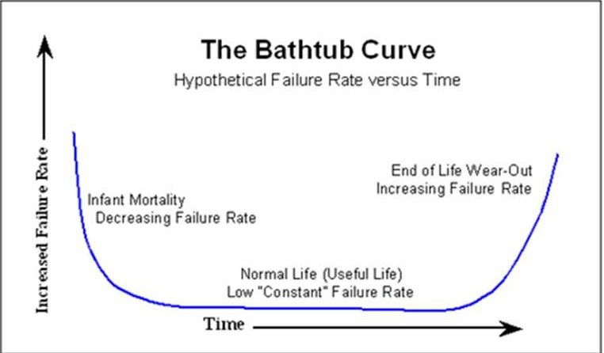

Figure 12: The Bathtub Curve

The infant mortality period occurs during initial start-up where the failure rate is decreasing but is critical due to a significant number of failures could potentially occur in a short time duration making them undesired [60]. The failures in this period are commonly caused by defects in the design or from insufficient assembly [60]. The flat area of the bathtub curve is where the normal life of a component operates at, and failures are random [60]. The end-of-life wear-out period will have an increasing failure rate and failures are commonly due to fatigue or depletion of materials [14, 60].

To avoid failures in the infant mortality period, there are two commonly used stress tests that are used for mitigation [60]. One of the stress tests is called highly accelerated stress audit, which is used to identify defects in the material or imperfections caused by assembly that can lead to failure [60]. The other stress test is called a burn-in, which is a 100% screening that aims to test-out any defects in the component where eliminating the root causes is not feasible [60].

COTS components that were purchased go through extensive qualification testing at the manufacturing site during initial design development, but once the components are mass produced, no additional testing is typically conducted. To mitigate potential failures regarding the PCBs from occurring in the infant mortality period, a burn-in test using ODU's TVAC will be executed to ensure operations are satisfactory [14, 60]. Once the burn-in test is complete, the PCB will operate in the normal life period during mission SeaLion. Since mission SeaLion projected orbit duration is short, end-of-life wear-out is not of concern. The severity was evaluated as having a catastrophic impact (LS5) if failure occurred in the infant mortality period

<!-- PDF_PAGE: 52 -->

and likelihood was evaluated as near certainty (LL5), which is the high ranked failure mode considered for mission SeaLion.

Since the PCBs are manufactured manually without the use of robotics, human error must be taken into consideration. If improper tracing throughout the board or a mistake is made during configuration, components and operating modes will not function as designed. The severity was listed as catastrophic impact (LS5) and the likelihood was listed as likely (LL3) because of potential human error. Conducting a MVI on the PCB and soldered joints using the inspection instructions provided in Appendix C and conducting a TVCT on the PCB assembly will greatly mitigate the risk of failure due to human error. Also, conducting an electrical continuity check on all components is recommended before and after vibration testing.

## Electrical Power System Board Design

Even though mission SeaLion will be in a vacuum while on-orbit, very small levels of heat transfer will occur from other electrical components operating on-board and it should not be completely neglected [61]. Poor thermal designs of circuits can cause components to fail due to thermal shutdown [44]. The severity was listed as having moderate impact (LS3) and likelihood was listed as unlikely (LL3).

Mitigation strategies include minimizing cuts in the PCBs copper planes will allow thermal heat to disperse laterally throughout the board, which will maximize the thermal dissipation [44]. The lowest thermal resistance to distribute heat is through the copper planes of the PCB, so cutting through the planes will increase the thermal resistance [44]. To disperse the thermal heat vertically throughout the PCB to other layers, thermal vias should be used and an example is shown in Figure 13 [44].

<!-- PDF_PAGE: 53 -->

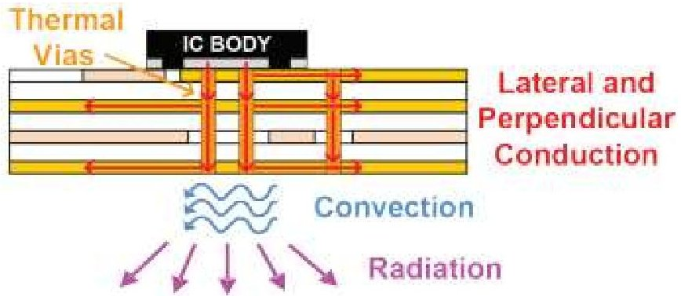

Figure 13: Heat Transfer Paths from the IC to the PCB [44]

Using thermal pads for the voltage regulator and other ICs will assist with transferring the heat from the IC into the PCB through conduction. Vias should also be utilized in the thermal pad's PCB footprint to maximize conduction vertically to the other layers on the PCB [44]. A recommended via pattern example is shown in Figure 14 [44].

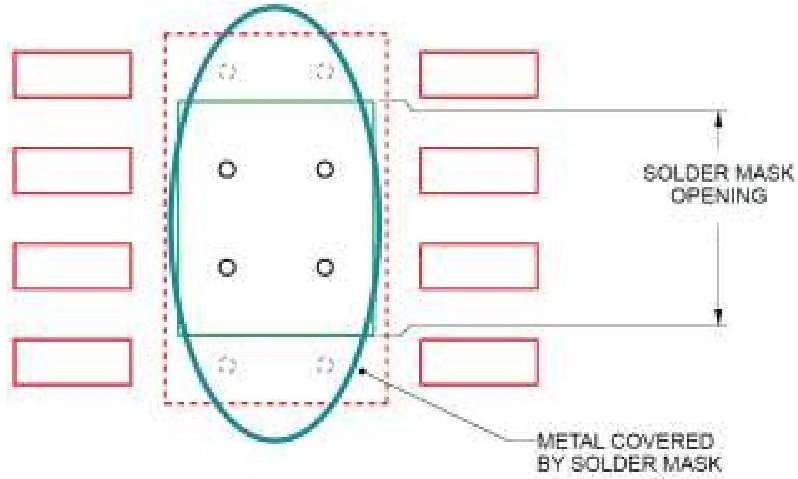

Figure 14: Via Pattern with Thermal Pad Package PCB Footprint [44]

In high operating temperature scenarios, components on the EPS Board may begin to operate above their rated junction temperature and reach thermal shutdown. Failure could occur as a result from poor PCB component layout in the circuit design [44]. When operating temperatures are near the upper limit for a component, component efficiency could be impacted. While conducting the TVCT on the EPS Board, monitor the temperature at multiple locations on the PCB with the use of thermocouples to ensure operating temperatures do not reach the

<!-- PDF_PAGE: 54 -->

junction temperature for components. The severity and likelihood were evaluated the same for the following failure mode.

Poor placement of components can result in over-stressing of components. When no input decoupling capacitors are near the input voltage and ground terminals of the converter, addition stress is induced onto the converter and potentially to other components in the circuit [44]. The preliminary design of the EPS Board did not have an input capacitor to the converter; hence failure was evaluated as having major impact (LS4) for severity, with a likelihood of likely (LL3) due to the in-house PCB design. Adding an additional input capacitor to the converter would assist with regulating voltage in the circuit. FMECA for the EPS Board is shown in Table 12.

Table 12: EPS Board FMECA

<table border="1"><tr><td>Component</td><td>Failure Mode</td><td>Failure Cause</td><td>Failure Effects</td><td>Severity(1-5)</td><td>Likelihood(1-5)</td><td>CriticalityNumber</td><td>Detection Method</td><td>Mitigation Strategies</td></tr><tr><td>EPS Board</td><td>EPS Board failure</td><td>Electrical components fail while operating in the infant mortality period</td><td>Catastrophic failure of mission</td><td>5</td><td>5</td><td>25</td><td>No communication with SeaLion</td><td>Conduct burn-in testing on PCB</td></tr><tr><td>EPS Board</td><td>Assembly failure of PCB</td><td>Human error during assembly</td><td>Components and operating modes will not function as designed</td><td>5</td><td>3</td><td>15</td><td>Errors or no data in SeaLion downlink packet</td><td>Conduct a MVI and TVCT on PCB assembly</td></tr><tr><td>EPS Board</td><td>EPS Board failure</td><td>Poor thermal design</td><td>Components experience high temperatures from operations</td><td>3</td><td>2</td><td>6</td><td rowspan="3">Significant EPS Board increase in temperature is present in the SeaLion satellite health downlink packet</td><td>Minimize cuts in the PCBs copper planes and use vias with thermal pad&#x27;s PCB footprint</td></tr><tr><td>EPS Board</td><td>High operating temperatures</td><td rowspan="2">Poor PCB layout of components</td><td>Components reach thermal shutdown</td><td>4</td><td>3</td><td>12</td><td>While conducting a TVCT on the EPS Board, monitor the temperature at multiple locations on the PCB</td></tr><tr><td>EPS Board</td><td>Over-stressing of components</td><td>Failure of converter or other components in circuit</td><td>4</td><td>3</td><td>12</td><td>Adding an addition input capacitor to the converter</td></tr></table>

## 3.3 Interface Board

The Interface Board was design to host multiple mission SeaLion components and payloads. This section is based off the current known knowledge of the Interface Board due to the final design being held up by a few components. The IMU, sun sensors, GPS receiver, and all three experimental payloads will have electrical connectors soldered onto the Interface Board. The IMU will include an accelerometer, gyroscope, and magnetometer that is used for attitude

<!-- PDF_PAGE: 55 -->

determination. The NanoDock DMC-3 dock will interface to the Interface Board using the PC/104 form factor. The NanoDock will host the OBC, UHF radio and S-Band radio hardware [6].

Attitude Determination System (ADS) will involve orbit propagation and attitude determination using COTS components. The on-board GPS will determine mission SeaLion's precise orbital position and motion. The GPS information will be sent to the OBC and used for determining the orbit propagation, which will be executed to estimate when mission SeaLion will be approaching the Virginia ground station. The orbit propagation data will be downlinked to the ground station and used for attitude determination [6].

If the orbit propagation algorithm on the OBC is incorrect, then estimates for when mission SeaLion will be approaching the ground station will be compromised. The GPS could also experience failure from environmental space conditions. Failure of the GPS would prevent the ground station personnel from knowing mission SeaLion's exact position. The last recorded position would then be used to estimate mission SeaLion's future positions [62].The severity was evaluated as having a catastrophic impact (LS5) and likelihood was evaluated as near certainty (LL4) for both failure modes.

Attitude determination will be accomplished by using six sun sensors, IMU, and magnetometer, which is a part of the OBC. Data from the three components will be downlink to the ground station to execute computations [6]. All three components could experience failure from environmental space conditions, which would impact mission SeaLion's attitude determination [1]. If the OBC fails, then mission SeaLion will be compromised. Thus, the severity was evaluated as having a catastrophic impact (LS5).

Failure of the IMU or sun sensors would impact the attitude determination, but determination could still be accomplished if one of the two fails. The sun sensors could experience saturation due to failure to filter, resulting in insufficient sun vector measurements [1]. In the unique scenario where both components fail on-orbit, then attitude determination would be compromised [62]. The severity was listed as moderate impact (LS3) for both the IMU and sun sensors. The likelihood was evaluated as unlikely (LL2) since the IMU, sun sensors, and OBC are all COTS component with space flight history. The FMECA for ADS is shown in Table 13.

<!-- PDF_PAGE: 56 -->

Table 13: ADS FMECA

<table border="1"><tr><td>Component</td><td>Failure Mode</td><td>Failure Cause</td><td>Failure Effects</td><td>Severity(1-5)</td><td>Likelihood(1-5)</td><td>Criticality Number</td><td>Detection Method</td><td>Mitigation Strategies</td></tr><tr><td>OBC</td><td>Incorrect orbit propagation</td><td>Algorithm in software outputs incorrect information</td><td>Unable to track SeaLion accurately</td><td>5</td><td>4</td><td>20</td><td>Orbit propagation data present in SeaLion downlink packet is greatly different from anticipated</td><td>Software testing simulations to ensure algorithm is working properly</td></tr><tr><td>GPS</td><td>GPS fails</td><td>GPS fails due to environmental conditions</td><td>SeaLion&#x27;s location and heading is not captured</td><td>5</td><td>4</td><td>20</td><td>No orbit propagation data present in SeaLion downlink packet</td><td>Conduct a TVCT and functionality testing</td></tr><tr><td>OBC</td><td>OBC fails</td><td>OBC fails due to environmental conditions</td><td>Catastrophic failure of mission</td><td>5</td><td>2</td><td>10</td><td>Sudden loss of communication is established with SeaLion</td><td rowspan="4">Conduct a TVCT, functionality, and software testing simulations</td></tr><tr><td>IMU</td><td>IMU failure</td><td>IMU fails due to environmental conditions</td><td>Unable to capture IMU data for attitude determination</td><td>3</td><td>2</td><td>6</td><td>No IMU data is present in SeaLion downlink packet</td></tr><tr><td>Sun Sensor</td><td>Sun sensors failure</td><td>Sun sensors fail due to environment conditions and radiation damage</td><td>Unable to measure sun vector for attitude determination</td><td>3</td><td>2</td><td>6</td><td>No sun vector data present is present SeaLion downlink packet</td></tr><tr><td>Sun Sensor</td><td>Sun sensor failure</td><td>Sun sensor experience saturation</td><td>Unable to measure sun vector accurately for attitude determination</td><td>3</td><td>2</td><td>6</td><td>Insufficient sun vector data present is present SeaLion downlink packet</td></tr></table>

Vibrations from the launch poses the greatest concern to the Interface Board. Majority of the content in this section regarding the electrical connectors and soldered joints were discussed in Section 3.2 Electrical Power System. Potential failure could occur if continuity is lost at the electrical connector. Potential failure could also occur if the solder joints fail from fatigue or if improper soldering techniques were used, resulting in the component detaching from the Interface Board [58, 59]. Both cases were evaluate as having the same severity and likelihood of failure, but mitigation strategies will differ for the two cases.

The PC/104 form factor is used to communicate and power the Interface Board to the NanoDock by a multi-pin stack-through connector [31]. If continuity is lost, power will not be supplied to the OBC and telecommunication with the ground station would be compromised. Thus, severity was evaluated as having a catastrophic impact (LS5). The DeCS payload will receive 5-VDC from the Interface Board through an electrical connector to thermally cut the tie down cable in the burn wire mechanism. If continuity is lost, then the burn wire mechanism will not receive power causing failure. The severity was listed as moderate impact (LS3), due to other mission objective still being achievable.

If the IMU 20 pin connector loses continuity, then no IMU data is captured. However, attitude determination could still be estimated using the sun sensors. Loss of continuity of the sun sensors will result in the Sun vector not being captured for attitude determination. The data captured from the magnetometer could be used to replace the sun vector data but would not be as

<!-- PDF_PAGE: 57 -->

accurate. The severity for the IMU and sun sensors were listed as having a moderate impact (LS3) due to utilizing the other components data for accomplishing the intended functions.

Failure of continuity for the GPS will compromise the precise orbit determination but again, the last recorded position would then be used to estimate mission SeaLion's future positions. The severity was listed as having a major impact (LS4). Loss of continuity of the IP and Ms-S, then payload data will not be capture. The severity for both payloads was listed as moderate impact (LS3) and likelihood was listed as likely (LL3) for all failure modes involving vibration. Table 14 show the FEMCA for the soldered joints on the Interface Board.

Table 14: Interface Board Electrical Connectors & Soldered Joints FMECA

<table border="1"><tr><td>Component</td><td>Failure Mode</td><td>Failure Cause</td><td>Failure Effects</td><td>Severity(1-5)</td><td>Likelihood(1-5)</td><td>CriticalityNumber</td><td>DetectionMethod</td><td>Mitigation Strategies</td></tr><tr><td>Interface BoardPC/104</td><td>PC/104multi-pin connector fails</td><td rowspan="7">Vibrations from the launch causes a poor electrical pin connection</td><td>Power and communication with the OBC will not be achieved</td><td>5</td><td>3</td><td>15</td><td>No communication is established with SeaLion</td><td rowspan="6">Conduct a MVI to ensure sufficient interface connectionAdd additional redundancy pinsEpoxy the electrical connector housing together</td></tr><tr><td>DeCS Payload</td><td>Burn wire mechanism connector fails</td><td>No power will be supplied to the burn wire mechanism for deployment</td><td>3</td><td>3</td><td>9</td><td>No strain gauge data is present in SeaLion downlink packet</td></tr><tr><td>IMU</td><td>IMU 20 pin connector fails</td><td>Unable to obtain IMU data for attitude determination</td><td>3</td><td>3</td><td>9</td><td>No IMU data is present in SeaLion downlink packet</td></tr><tr><td>Sun Sensor</td><td>Sun sensor connector fails</td><td>Unable to obtain Sun vector for attitude determination</td><td>3</td><td>3</td><td>9</td><td>No Sun vector data is present in SeaLion downlink packet</td></tr><tr><td>GPS</td><td>GPS 20 pin connector fails</td><td>SeaLion&#x27;s location and heading is not obtained</td><td>4</td><td>3</td><td>12</td><td>No GPS data is present in SeaLion downlink packet</td></tr><tr><td>IP Payload</td><td>IP connector fails</td><td>No IP data is captured</td><td>3</td><td>3</td><td>9</td><td>No IP data is present in SeaLion downlink packet</td></tr><tr><td>Ms-S Payload</td><td>USB connector fails</td><td>No Ms-S data is captured</td><td>3</td><td>3</td><td>9</td><td>No Ms-S data is present in SeaLion downlink packet</td></tr><tr><td>Interface BoardPC/104</td><td>PC/104multi-pin connection fails</td><td rowspan="7">Vibrations from the launch can cause fatigue to the soldered joints or defects to the solder joints can result with the electrical component detaching from the Interface Board</td><td>Power and communication with the OBC will not be achieved</td><td>5</td><td>3</td><td>15</td><td>No communication is established with SeaLion</td><td rowspan="6">Conduct a MVI on the soldered joints and execute vibration testing on PCB assemblyUse 63/37 Sn-Pb (tin-lead) solder during manufacturing</td></tr><tr><td>DeCS Payload</td><td>Burn wire mechanism connection fails</td><td>No power will be supplied to the burn wire mechanism for deployment</td><td>3</td><td>3</td><td>9</td><td>No strain gauge data is present in SeaLion downlink packet</td></tr><tr><td>IMU</td><td>IMU connection fails</td><td>Unable to obtain IMU data for attitude determination</td><td>3</td><td>3</td><td>9</td><td>No IMU data is present in SeaLion downlink packet</td></tr><tr><td>Sun Sensor</td><td>ADC to I2C Converter connection failure</td><td>Unable to obtain Sun vector for attitude determination</td><td>3</td><td>3</td><td>9</td><td>No sun vector data present in SeaLion downlink packet</td></tr><tr><td>GPS</td><td>20 Pin connection</td><td>SeaLion&#x27;s location and heading is not obtained</td><td>4</td><td>3</td><td>12</td><td>No GPS data is present in SeaLion downlink packet</td></tr><tr><td>IP Payload</td><td>IP connector fails</td><td>No IP data is captured</td><td>3</td><td>3</td><td>9</td><td>No IP data present in SeaLion downlink packet</td></tr><tr><td>Ms-S Payload</td><td>USB connector fails</td><td>No Ms-S data is captured</td><td>3</td><td>3</td><td>9</td><td>No Ms-S data present in SeaLion downlink packet</td></tr></table>

<!-- PDF_PAGE: 58 -->

## 3.4 Deployable Composite Structure Payload

The main components of the 1U volume DeCS payload are the burn wire mechanism, spool piece, four doors, and four composite booms. Strain gauges are configured on each of the four booms for validating the booms dynamics and verifying DeCS deployment [6,10]. The primary function of the DeCS payload is to capture boom dynamics using strain gauges, which will provide data in the SeaLion downlink packet. A FBD was created for the deployment of the DeCS payload to display the sequence of events and is shown in Figure 15.

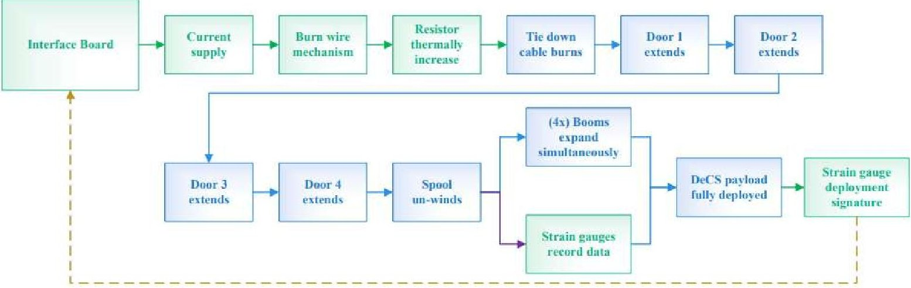

Figure 15: DeCS Deployment FBD

An FTA on the deployment of the DeCS payload was developed to assist in identifying failure modes and is shown in Figure 16.

<!-- PDF_PAGE: 59 -->

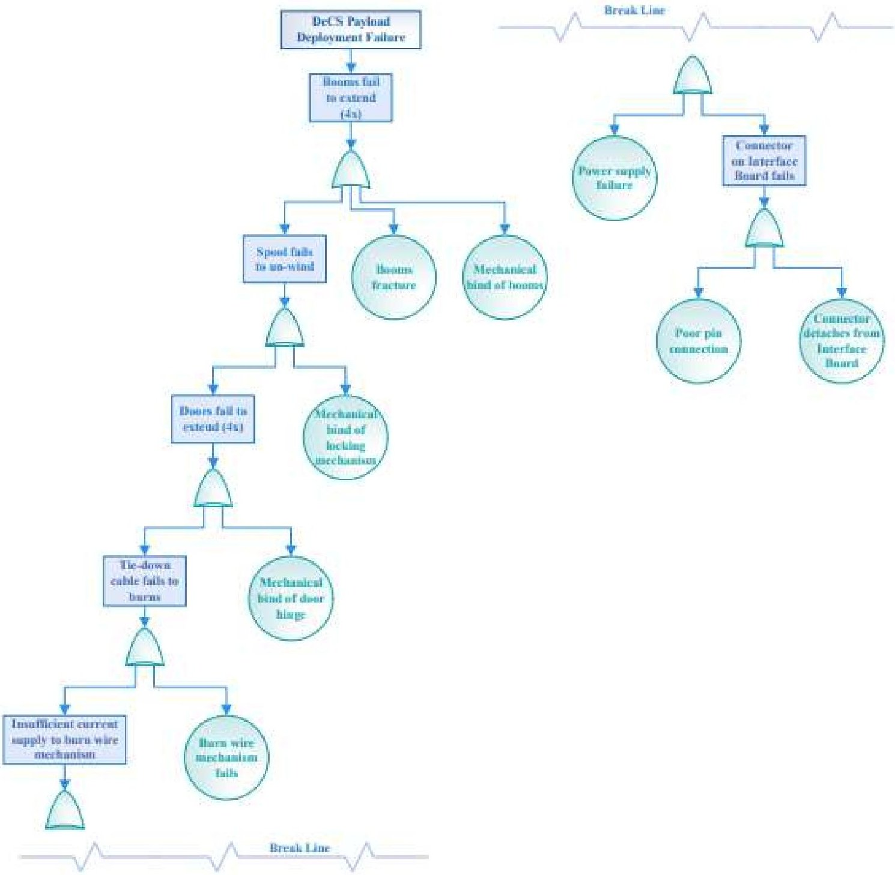

Figure 16: DeCS Deployment FTA

## Burn Wire Mechanism

Since the DeCS payload was custom-built, an extensive evaluation of the payload was executed, and mitigation strategies were made. As previously discussed, the EPS Board will supply power to the Interface Board, which will have an electrical connector for the DeCS payload to receive power and communication. If current is not supplied to the burn-wire mechanism, the deployment of the payload will not occur. This could occur if the battery pack

<!-- PDF_PAGE: 60 -->

power supply failed, which has been previous discussed in Section 3.2.1 Non-Rechargeable Battery.

The burn wire mechanism will have a resistor that will increase in temperature when the current is supplied. The resistor is in contact with a tie-down cable, which will be thermally cut and will release Door 1 on the payload while on-orbit [10]. Insufficient or unsteady current supply to the burn wire mechanism could cause failure. Insufficient current supply will cause the resistor to not reach the required temperature for the tie-down cable to thermally cut. An unsteady current supply could cause the tie-down cable to partially cut. Conducting a functionality test on the burn wire mechanism and designing the mechanism with a tight current supply tolerance, will assist with mitigating a potential failure from occurring on-orbit.

Vibrations from the launch can cause the mechanical latch that is connected to the burn wire mechanism to loosen and potentially disconnect from the mounted position. The failure modes involving the power supply and vibrations were evaluated as having a likelihood of likely (LL3). All failure modes involving the DeCS payload were evaluated as having a severity of moderate impact (LS3), due to other mission objective still being achievable.

When the tie-down cable cuts, payload Door 1 through Door 4 will extend in a consecutive order [10]. If the cable does not cut, payload Door 1 will not extend, and deployment will be compromised. The likelihood was evaluated with a high likelihood (LL4) for Door 1 failing to extend. Mitigation strategies include conducting a MVI on the components, vibration testing and verifying deployment at sea level conditions.

## Composite Boom

The composite booms were manufactured in-house and multiple molds of the boom were formed. Since the booms are wound around the spool piece, the material had to be extremely thin, but rigid. A manufactured composite boom is shown in Figure 17 [10]. Failure could occur if the composite booms fracture from dynamic forces while on-orbit. Each boom will have strain gauges for redundancy and not having sufficient data from all the booms may make it challenging to determine if the deployment was successful or not. To fully understand the potential structural degradation that the composite boom may experience, characterization testing is required [10]. Conducting a finite element analysis (FEA) and executing a bend test using

<!-- PDF_PAGE: 61 -->

cylinders will assist with verifying the integrity of the booms. Buckling, torsional, and vibration testing will also add to the mitigation efforts.

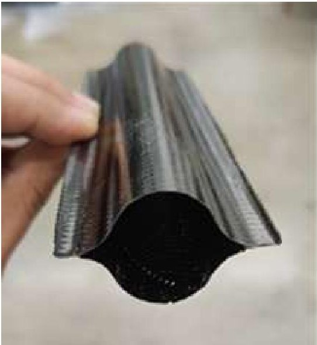

Figure 17: Composite Boom After Manufacturing

## Mechanical Piece Parts

Assuming the tie-down cable cuts and payload Door 1 extends, mechanical binding of the remaining payload doors could fail to extend. Since the payload doors have hinges, mechanical binding could be experienced due to the thermal cycles that will be experienced on-orbit. If all four payload doors do not extend, then the payloads center spool piece will not un-wind to deploy the composite booms.

If the four payload doors fail to extend, then the deployment of the composite booms will be compromised. A ratchet and pawl locking mechanism was implemented into the design to hold the spool piece in place, until it is released for deployment. The locking mechanism and composite booms are also subject to mechanical binding due to the space environment previously described involving thermal cycling. Figure 18 shows a CAD model of the spool piece in the center of the 1U volume, along with the locking mechanism [10].

<!-- PDF_PAGE: 62 -->

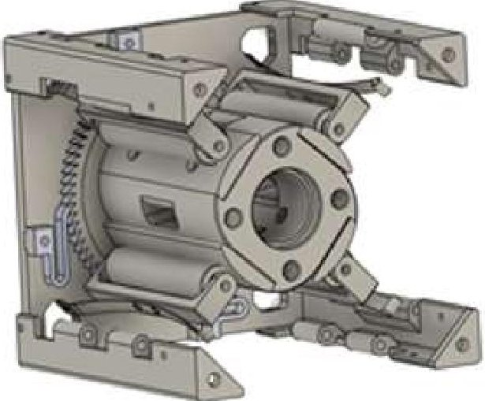

Figure 18: DeCS Spool Piece with Locking Mechanism

DeCS payload assembly will experience failure if the composite booms do not extend. Verification of deployment will be determined from the strain gauge data that will downlinked be to the ground station. To ensure that the complex payload deployment mechanism works as designed, a MVI of each component after manufactured and rigorous testing will be executed, which is detailed in Section 4.3 Deployable Composite Structure Payload Test Plan.

Once the full deployment occurs on-orbit, the booms could experience failure due to thermal damage while on-orbit. The structural integrity of the booms, along with the strain gauges that are attached to the booms and its associated wires could be subject to thermal damage. Implementing thermal protection using a reflective coating or another means for protection is needed for mitigation. The likelihood for the previously described failure modes were listed as near certainty (LL5) because the DeCS payload was completely manufactured inhouse and has no space flight history. Table 15 shows the FEMCA for the DeCS deployment.

<!-- PDF_PAGE: 63 -->

Table 15: DeCS Deployment FMECA

<table border="1"><tr><td>Component</td><td>Failure Mode</td><td>Failure Cause</td><td>Failure Effects</td><td>Severity(1-5)</td><td>Likelihood(1-5)</td><td>CriticalityNumber</td><td>Detection Method</td><td>Mitigation Strategies</td></tr><tr><td>DeCS Payload</td><td>Power supply failure to burn wire mechanism</td><td>Battery pack fails</td><td>Burn wire mechanism does not thermally cut tie-down cable</td><td>3</td><td>3</td><td>9</td><td>No strain gauge data is present in SeaLion downlink packet</td><td rowspan="2">Conduct functionality testing</td></tr><tr><td>DeCS Payload</td><td>Tie-down cable fails to cut</td><td>Insufficient current supply to the burn wire mechanism</td><td rowspan="4">Door 1 will not extend</td><td>3</td><td>3</td><td>9</td><td rowspan="4">The strain gauge signature will have multiple outliers when compared to the signature from testing</td></tr><tr><td>DeCS Payload</td><td>Tie-down cable fails to cut</td><td>Un-steady current supply to the burn wire mechanism</td><td>3</td><td>3</td><td>9</td><td>Design current supply with a tight tolerance</td></tr><tr><td>DeCS Payload</td><td>Burn wire mechanism fails</td><td>Vibrations from launch can cause the mechanical latch to loosen and potentially disconnection</td><td>3</td><td>3</td><td>9</td><td rowspan="2">Conduct a MVI, vibration testing and verify deployment at sea level conditions</td></tr><tr><td>DeCS Payload</td><td>Payload door 1 fails to extend</td><td>The tie down cable in the burn wire mechanism fails to thermally cut</td><td>3</td><td>4</td><td>12</td></tr><tr><td>DeCS Payload</td><td>Composite booms fracture</td><td>Excessive dynamic forces damage or fractures booms</td><td>Insufficient strain gauge data will be captured</td><td>3</td><td>5</td><td>15</td><td rowspan="6">The strain gauge signature will have multiple outliers when compared to the signature from testing</td><td>Conduct a FEA, vibration, characterization testing</td></tr><tr><td>DeCS Payload</td><td>Payload doors (4x) fail to extend</td><td>Mechanical bind of door hinge</td><td>Spool will not un-wind</td><td>3</td><td>5</td><td>15</td><td>Use a material that has a low thermal expansion proper</td></tr><tr><td>DeCS Payload</td><td>Payload spool fails to un-wind</td><td>Mechanical bind of the locking mechanism</td><td rowspan="2">Composite booms fail to extend</td><td>3</td><td>5</td><td>15</td><td>Conduct functionality testing at ambient temperature and pressure conditions</td></tr><tr><td>DeCS Payload</td><td>Payload spool fails to un-wind</td><td>The 4 payload doors do not extend</td><td>3</td><td>5</td><td>15</td><td>Conduct a cryogenic and thermal soak on the full DeCS assembly using the TVAC</td></tr><tr><td>DeCS Payload</td><td>Composite booms fail to extend (4x)</td><td>Mechanical bind of composite booms</td><td rowspan="2">Deployment is compromised</td><td>3</td><td>5</td><td>15</td><td>Conduct TVCT on a reduced version of the payload, deploy inside, and outside of chamber</td></tr><tr><td>DeCS Payload</td><td>DeCS payload fails to deploy</td><td>Composite booms fail to extend</td><td>3</td><td>5</td><td>15</td><td>Conduct TVCT on a reduced version of the payload, deploy inside, and outside of chamber</td></tr><tr><td>DeCS Payload</td><td>Composite booms fail</td><td>Thermal damage</td><td>Structural integrity of the composite booms is compromised</td><td>3</td><td>5</td><td>15</td><td>Large changes in strain gauge data are shown in the downlink packets</td><td>Implement thermal protection on composite booms</td></tr></table>

## Strain Gauge

A strain gauge is a type of electrical sensor that is designed to convert an induced force, tension, pressure, etc., into an electrical output signal where a measurement can be made [63]. The primary function of a strain gauge is to measure the applied force or strain on an object. An object's internal resisting force is defined as stress, whereas displacement and deformation of an object is defined by strain [63]. Strain involves compressive and tensile forces, which is distinguished by a positive and negative sign [63].

Strain gauges can measure dynamic forces and will be configured on each of the four booms for validating the boom's dynamics. The strain gauges will also be used for verifying the

<!-- PDF_PAGE: 64 -->

deployment of the DeCS by capturing data and displaying the data in the time domain [Time (ms) vs. Voltage (mV)], which will represent the strain gauge signature. The following considerations should be made when selecting a strain gauge for a desired application [63]:

1. Gauge length

2. Number of gauges in gauge pattern

3. Arrangement of gauges in gauge

4. Grid resistance

5. Strain-Sensitive alloy

6. Carrier materials

7. Gauge width

8. Solder tab type

9. Configuration of solder tab

10. Availability

Improper strain gauge selection can lead to the strain measurements being interpreted incorrectly. If an improper strain gauge is selected for mission SeaLion, potential failures involving over-strain and temperature could occur. If the operational environment of the strain gauge is outside its operating limits, insufficient data will be recorded [64]. The severity was listed as having moderate impact (LS3) for improper selection and all preceding failure modes involving the strain gauges were listed with the same severity. The likelihood was listed as likely (LL4) due to the lack of experience regarding selecting the proper strain gauge for mission SeaLion. Consulting with experts in the industry is highly recommended when selecting strain gauges.

Debonding of strain gauge occurs when the strain gauge does not adhere to a surface fully and detaches. Debonding will occur if improper installation was performed, which will produce problems with the signal. Figure 19 shows an example of tension and compression in the time domain for when a strain gauge is fully bonded to a surface properly [64].

<!-- PDF_PAGE: 65 -->

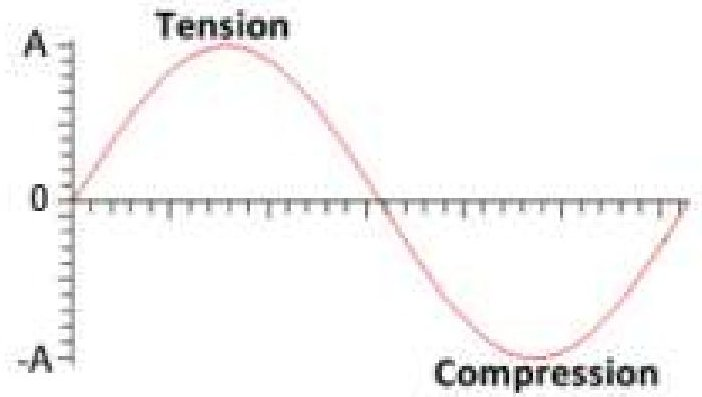

Figure 19: Symmetric Signal Detection [64]

When debonding occurs, the signal gradually decreases in amplitude until the signal terminates and the waveform becomes non-symmetric in the time domain. Depending on what region of the strain gauge is debonding, false indications could be given. Full elongation of the surface could be measured by the strain gauge while in tension. Partial elongation of the surface could be measured by the strain gauge during compression. Hence, the strain gauge grid is being pulled tight against the specimen's surface while in tension and the grid is loose to the surface while in compression. The described case for debonding of the strain gauge is illustrated in Figure 20 [64].

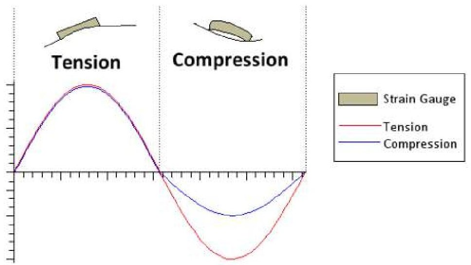

Figure 20: Non-Symmetric Signal Detection [64]

<!-- PDF_PAGE: 66 -->

Mitigation efforts involve cleaning the surface with 99% isopropyl alcohol prior to installation to ensure that the surface conditions are clean and follow the installation directions provided by the manufacture.

Wire lead termination failure occurs when the wire lead is almost to the point of complete detachment from the solder bead on the strain gauge. Failure could be caused from vibrations from the launch, improper soldering techniques during assembly, or if the strain gauge wires got snagged when the composite booms deploy. Figure 21 shows an example in the time domain for when lead termination is occurring on the strain gauge. The figure shows a normal signal for tension, but the signal for compression appears to be decreasing in amplitude due to weak signal [64]. Conducting a MVI on the strain gauges before and after vibration testing will assist with mitigating the chance of failure.

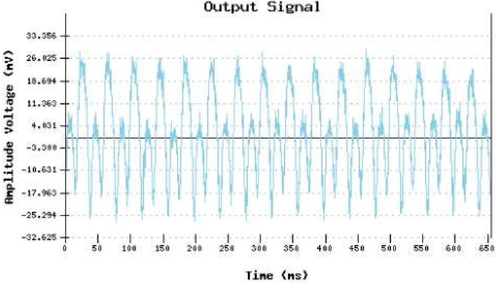

Figure 21: Strain Gauge Signal for Lead Termination [64]

Operating outside the strain gauge's temperature limits can result with insufficient data, which may show outliers in the data when compared to the signature recorded from testing [64]. It should be noted that when analyzing strain gauge data, it takes years of experience to understand what the signal is reporting, and expert knowledge will be needed when mission SeaLion is on-orbit. Implementing thermal protection on the composite booms will protect the

<!-- PDF_PAGE: 67 -->

strain gauges from potential thermal failure. The likelihood was listed as likely (LL3) for debonding, wire termination, and thermal failure.

Over-straining of the strain gauge occurs when excessive loading exceeds the component's designed operating limits. The strain gauge will not measure accurately if excessive dynamics occurs due to fatigue [64]. If the composite boom elongates beyond the strain gauge's capability, the gauge could be potentially damaged and stop functioning. When evaluating the strain gauge data in the time domain, peak-to-peak will steadily increase with time as the composite boom may start to experience fatigue, which may lead to fracture. The likelihood was listed as highly likely (LL4). Conducting vibration testing on the composite boom, with the strain gauges attached will mitigate the risk of failure.

Radiation damage could impact the performance of the strain gauges or cause failure [64]. Radiation has been previously mentioned regarding the effects it can have with random bit-flipping of data. The likelihood was listed as likely (LL3) but implementing radiation protection will help protect the data from radiation. Computations of the strain gauge data will be executed prior to being sent to the OBC. Programming errors could occur within the code, and the data could give false indications to the analyst when reviewing the data. The likelihood was listed as near certain (LL5) due to potential errors in the software. Conducting software testing for multiple scenarios will ensure that the coding is satisfactory.

The strain gauge wire leads could get snagged when the composite booms deploy, and the electrical signal could be compromised. The likelihood was listed as near certain (LL5) due to the complexity and number of moving parts that make up the DeCS payload. Mitigation strategies involve TVCT and functionality testing, which has previously been described. Table 16 shows the DeCS strain gauge FEMCA. and additional figures of the DeCS payload are shown in Appendix D.

<!-- PDF_PAGE: 68 -->

Table 16: DeCS Strain Gauge FMECA

<table border="1"><tr><td>Component</td><td>Failure Mode</td><td>Failure Cause</td><td>Failure Effects</td><td>Severity(1-5)</td><td>Likelihood(1-5)</td><td>Criticality Number</td><td>Detection Method</td><td>Mitigation Strategies</td></tr><tr><td>DeCS Payload</td><td>Strain gauges fails</td><td>Improper strain gauge selection for intended application</td><td>Strain gauge measurements is interpreted incorrectly</td><td>3</td><td>4</td><td>12</td><td>The strain gauge signature will have multiple outliers when compared to the signature from testing</td><td>Consult with experts in the industry for proper selection</td></tr><tr><td>DeCS Payload</td><td>Debonding of strain gauge</td><td>Strain gauge detaches from the composite boom caused by improper bonding techniques</td><td rowspan="3">Insufficient data will be captured and boom deployment will not be verified</td><td>3</td><td>3</td><td>9</td><td>In the time domain, the signal will gradually decrease in amplitude or the signal is deformed during compression</td><td>Following the installation directions provided by the manufacture</td></tr><tr><td>DeCS Payload</td><td>Lead termination of strain gauge</td><td>Wire lead is partially pulled off the strain gauge terminal</td><td>3</td><td>3</td><td>9</td><td>In the time domain, the signal may show a peak for tension and the signal for compression will greatly vary</td><td>Conduct a MVI before and after vibration testing</td></tr><tr><td>DeCS Payload</td><td>Thermal failure</td><td>Operating outside the temperature limits</td><td>3</td><td>3</td><td>9</td><td>The strain gauge signature will have multiple outliers when compared to the signature from testing</td><td>While conducting the TVCT, monitor the strain gauge performance</td></tr><tr><td>DeCS Payload</td><td>Over-straining of strain gauge</td><td>Composite boom elongates beyond the strain gauges capability</td><td>Strain gauge could be potentially damaged or stop functioning</td><td>3</td><td>4</td><td>12</td><td>Peak-to-peak strain gauge data will steadily increase with time and may eventually stop reporting data</td><td>Conduct vibration testing with the strain gauge attached to composite boom</td></tr><tr><td>DeCS Payload</td><td>Radiation damage to strain gauge</td><td>Radiation could potentially damage or cause issues with the strain gauge data</td><td>Boom dynamics data will be compromised</td><td>3</td><td>3</td><td>9</td><td>Sudden loss of strain gauge data in present in SeaLion downlink packet</td><td>Implement radiation protection on composite</td></tr><tr><td>DeCS Payload</td><td>Error in computation of strain gauge data</td><td>Programming error in computing strain gauge data</td><td rowspan="2">Composite boom deployment will not be verified</td><td>3</td><td>5</td><td>15</td><td>The strain gauge data will be severely insufficient or unreadable</td><td>Conduct software testing for multiple scenarios</td></tr><tr><td>DeCS Payload</td><td>Strain gauge fails</td><td>Strain gauge wire gets snagged during composite boom deployment</td><td>3</td><td>5</td><td>15</td><td>No strain gauge data will be present in SeaLion downlink packet</td><td>Conduct a TVCT and functionality testing</td></tr></table>

## 3.5 Structure

ODU designed and manufactured mission SeaLion's main structure in-house. The primary function of the structure is to safely hold all of mission SeaLion's components, while maintaining structural integrity during launch and on-orbit. The structure was manufactured with a tolerance of 0.1 mm using Aluminum 6061 based on the material properties and the mass constraint that was required. A design decision was made to transform the original 3U structure into a 2U and 1U, in which the structures are mounted together. The 2U structure will support all of mission SeaLion's components and the 1U structure will support the DeCS payload, which is shown below in Figure 22 [65]. Additional figures of mission SeaLion's structure are shown in Appendix F.

<!-- PDF_PAGE: 69 -->

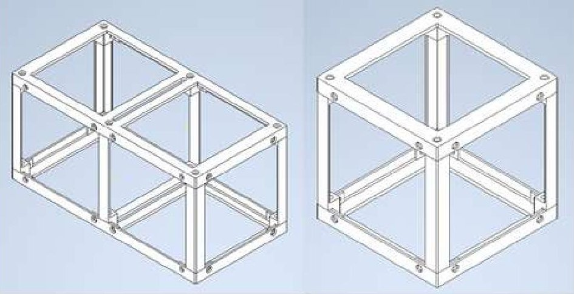

Figure 22: 2U Structure (left) & 1U Structure (right)

The main structure is made of four separate parts that is assembled using fasteners. The four structures are as follows: top plate, bottom plate, columns, and connecting rod. The structure was designed with mounting pads to accommodate all components with, again, the use of fasteners. Due to mass constraints, multiple revisions of the design were made to shave off mass while still maintaining structural integrity [65]. Potential failure modes involve assembly of structure, fasteners, alignment, and structural integrity.

If improper care of the structural parts is taken during assembly, the material could be contaminated from foreign substances. The material may have foreign residue or lubricants from manufacturing. The most common contaminations are residues from human hands when handling materials. All materials will experience outgassing while on-orbit and contamination of structural parts will increase the level of outgassing on-orbit. Clean all materials using 99% isopropyl alcohol, while wearing latex gloves when assembling is an absolute must.

Assembling the structure and components together using very small fasteners is very meticulous. Human error during assembly could cause a failure during mission SeaLion. Having two team members work together while assembling mission SeaLion will prevent one individual making a mistake by themself. The severity was evaluated as having a catastrophic impact (LS5) and likelihood was evaluated as likely (LL3) for both assembly failure modes.

The fasteners that will be used to assemble mission SeaLion will consist of very small screws, nuts, and washers. The fasteners could fail if improper torque is applied, where vibrations from the launch could cause separation. A specified torque value prior to assembly

<!-- PDF_PAGE: 70 -->

will be required. Installation of the fasteners could cross-thread if inexperienced team members are executing the assembly, which could cause the fasteners to pull-out during launch. Since a 3U CubeSat is relatively small regarding size and components are tightly configured, proper alignment is crucial. If alignment is slightly off and a team member forces a fastener into place, additional stresses will be applied to the fasteners and mounting pads. Having tight but achievable tolerance will help mitigate potential failures regarding alignment. The severity was evaluated as having a major impact (LS4), while likelihood was evaluated as likely (LL3) for the described fasteners and alignment failure modes.

As previously mentioned, multiple revisions of mission SeaLion's structure were made to shave off mass, but structural integrity could potentially be more prone to failure. Vibrations from the launch can cause fatigue to mission SeaLion's structure, which could lead to the structure failing. The structure could experience deformation or collapse due to the high vacuum space environment. Deformation will cause strain to be induced on the structural fasteners. The structure may withstand low levels of deformation, but the internal components may fracture and cause failure. The likelihood was evaluated as near certain (LL5) for both the vibration and deformation failure modes. The structure could collapse, which would cause a catastrophic failure. The severity for the structural integrity failure modes were evaluated as having a catastrophic impact (LS5) The likelihood of the structure collapsing was evaluated as unlikely (LL2). Mitigating strategies involve conducting a FEA and vibration testing. Table 17 shows the FMECA for the structure.

<!-- PDF_PAGE: 71 -->

Table 17: Structure FMECA

<table border="1"><tr><td>Component</td><td>Failure Mode</td><td>Failure Cause</td><td>Failure Effects</td><td>Severity(1-5)</td><td>Likelihood(1-5)</td><td>CriticalityNumber</td><td>Detection Method</td><td>Mitigation Strategies</td></tr><tr><td>SeaLion Structure</td><td>Assembly failure</td><td>Structure parts get contaminated during assembly</td><td>High levels of outgassing could condensate on other components on-board</td><td>5</td><td>3</td><td>15</td><td>Communication with SeaLion is lost</td><td>Clean all material and wear latex gloves when assembling</td></tr><tr><td>SeaLion Structure</td><td>Assembly failure</td><td>Human error during the assembly of parts and components</td><td>Potential mission failure</td><td>5</td><td>3</td><td>15</td><td>No communication with SeaLion</td><td>Two team members work together while assembling SeaLion</td></tr><tr><td>SeaLion Structure</td><td>Fastener fail</td><td>Fasteners are cross-thread during assembly</td><td>Fasteners to pull-out during launch</td><td>4</td><td>3</td><td>12</td><td rowspan="3">N/A</td><td>Two team members work together while assembling SeaLion</td></tr><tr><td>SeaLion Structure</td><td>Fastener fail</td><td>Insufficient torque is applied to fasteners</td><td>Potential fastener separation</td><td>4</td><td>3</td><td>12</td><td>Specify a torque value</td></tr><tr><td>SeaLion Structure</td><td>Alignment failure</td><td>Misalignment adds additional stresses</td><td>Fasteners fail during launch</td><td>4</td><td>3</td><td>12</td><td>Implement tight tolerances for structure</td></tr><tr><td>SeaLion Structure</td><td>Vibration failure</td><td>Vibrations from launch can cause fatigue to SeaLion&#x27;s structure</td><td>Catastrophic failure to SeaLion</td><td>5</td><td>5</td><td>25</td><td>No communication with SeaLion</td><td>Conduct vibration testing</td></tr><tr><td>SeaLion Structure</td><td>Structure deforms</td><td>Structure experiences deformation due to the high vacuum space environment</td><td>Internal components may fracture and cause failure</td><td>5</td><td>5</td><td>25</td><td>No communication with SeaLion</td><td rowspan="2">Conduct a FEA</td></tr><tr><td>SeaLion Structure</td><td>Structure collapses</td><td>Structure collapses due to the high vacuum space environment</td><td>Catastrophic failure to SeaLion</td><td>5</td><td>2</td><td>10</td><td>No communication with SeaLion</td></tr></table>

## 3.6 Mission SeaLion Deployment and Start-Up

The FMECA for mission SeaLion deployment and start-up was executed with the assumptions that the pre-launch requirements were met from the launch provider. The standards that must be met satisfactorily include: the CSD Data Sheet [8], CDS Rev. 13, and 3U CubeSat Acceptance Checklist [4]. Once all requirements are verified to be satisfactory, the SeaLion CubeSat will be loaded inside the CSD and the remove before flight (RBF) pin will be extracted through the access port. The EPS electrical schematic in Appendix A and the associated EPS component list in Appendix B will assist to further understand this section. A FBD was created to display the sequence of events involving deployment and start-up of mission SeaLion and is shown in Figure 23.

<!-- PDF_PAGE: 72 -->

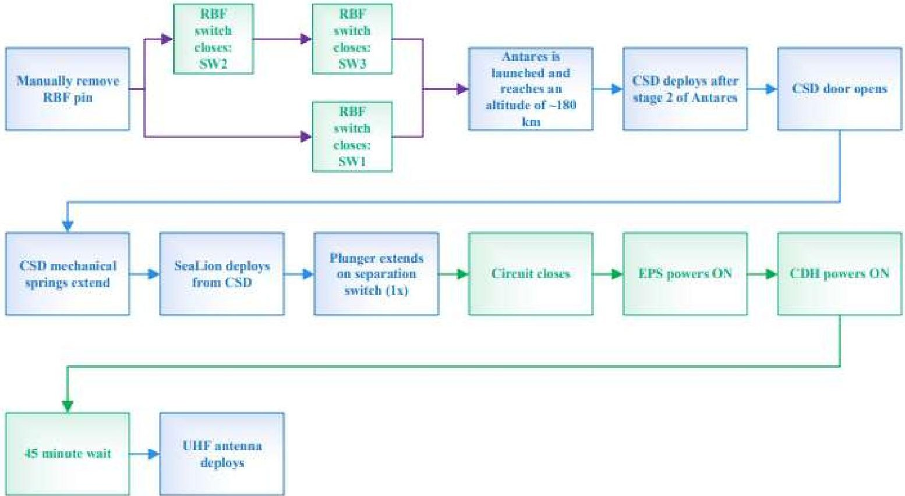

Figure 23: SeaLion Deployment and Start-Up FBD

An FTA for the deployment and start-up of mission SeaLion was developed to assist in identifying failure modes and is shown in Figure 24.

<!-- PDF_PAGE: 73 -->

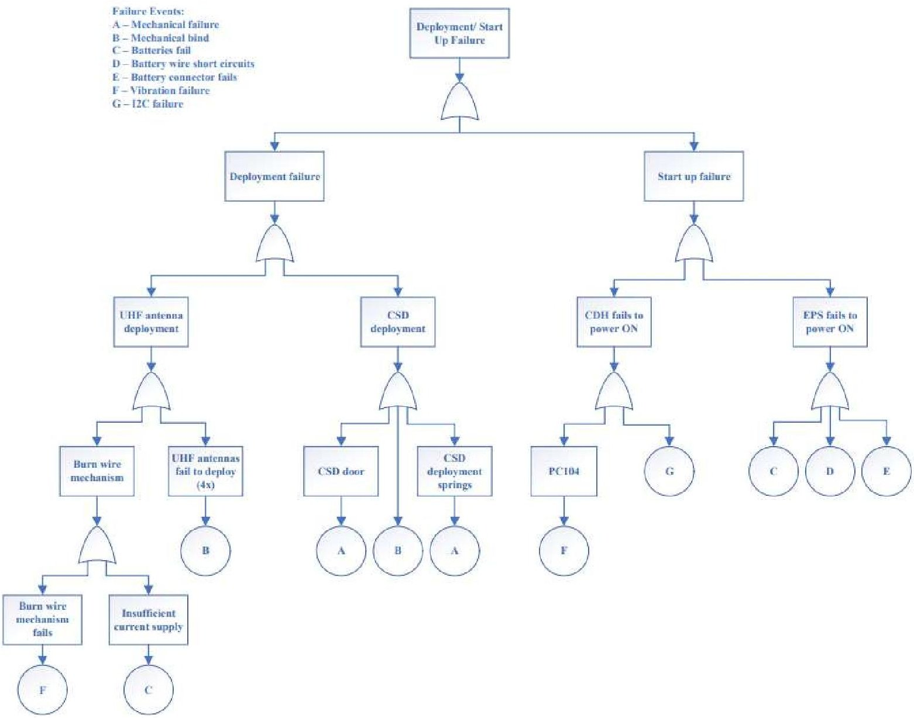

Figure 24: Deployment and Start-Up FTA

The RBF pin prevents SeaLion CubeSat from receiving power and the EPS will not receive power until the pin is removed [8, 66]. If the RBF pin fails due to mechanical binding, SeaLion CubeSat will not power on. If the RBF pin cannot be removed, the SeaLion CubeSat will be removed from the dispenser and appropriate actions will be taken. The severity of failure was evaluated as having a moderate impact (LS3). The likelihood of failure was evaluated as likely (LL3) due to the RBF pin being built in-house while following the requirements in CDS Rev. 13 [4].

When the RBF pin is extracted, three single pull double throw (SPDT) switches will close the circuit and are configured in accordance with the CSD Data Sheet [8]. The SPDT switch will only have one input, however, will have two outputs in which it can act like an on-off

<!-- PDF_PAGE: 74 -->

switch depending on the circuit configuration [43]. If an individual SPDT switch "sticks" due to mechanical failure in the linkage, the circuit will remain open, and the EPS will never receive power. This failure occurs when there is high resistance in the switch, due to surface corrosion [43]. In the scenario where the SPDT switches do not close, the severity was evaluated as having a catastrophic impact (LS5) to mission SeaLion.

Selecting a SPDT switch that have gold or nickel contacts will still conduct to the base material if potential surface corrosion is of high concern [43]. Under all environmental conditions, the most reliable metal-to-metal contact is gold plated material [37]. Solid nickel contact material will also provide excellent corrosion resistance [37]. Since the RBF pin is extracted prior to launch on ground, a visual inspection, a continuity check using a voltohmmeter and functionality testing, can be conducted prior to launch on the RBF pin and SPDT switches, preventing failure from occurring.

Northrop Grumman's Antares rocket and the CSD could experience failure, but no effort was exhausted into evaluating potential failures for both, due to the design and testing being out of ODU CubeSat team's capabilities. After successfully extracting the RBF pin, the CSD will be loaded onto the launch vehicle. Once Antares launches and reaches an altitude of roughly 180 km, the CSD will deploy from the vehicle after stage 2. The CSD door will open, and the mechanical separation spring will extend.

A single plunger style separation switch is mounted on the exterior corner of mission SeaLion. Once mission SeaLion deploys from the CSD, the plunger on the separation switch will extend, which closes the circuit, hence sending an input signal to the SPDT switches. If the plunger on the separation switch does not extend, then the circuit will remain open which would result in a catastrophic impact (LS5) to the mission. The likelihood of failure was evaluated to be likely (LL3) for both the SPDT and separation switch failure. Mitigation strategies involve conducting an MVI, vibration testing and verifying the functionality of the plunger extending on switch after testing. Adding an additional separation switch in parallel for redundancy would increase the reliability. However, doing so may be compromised due to overall mass constraints implanted by the launch provider.

The separation switch will have a wire feeding to a connector on the EPS, which could short circuit due to the insulation on the wire breaking down from high temperatures. The

<!-- PDF_PAGE: 75 -->

severity was listed as catastrophic impact (LS5) and a likelihood of unlikely (LL2).

Implementing thermal shielding on all wires on-board with high temperature polyimide tape will add extra protection and will mitigate the wires from short circuiting.

Once the circuit closes, the EPS will be powered-on, in which power will be distributed to the Command and Data Handling (CDH) and a dwell time of 45 minutes will take place. After the dwell time is complete, the four UHF antennas will deploy. The UHF has an omni-directional antenna and will be used to communicate with the ODU ground station in Norfolk, VA [31]. The UHF was designed with the same burn wire mechanism that is used for the DeCS deployment, which was detailed in Section 3.4 Deployable Composite Structure Payload.

The burn wire mechanism could fail from launch vibrations and the tie-down cable could fail to thermally cut, preventing the UHF antennas from deploying due to insufficient current supply. Mechanical binding of the UHF antenna deployer could also prevent deployment. Conducting a thermal soak, cryogenic soak in the TVAC and verifying deployment between soaks outside of chamber will mitigate potential failure. The severity of the three UHF antenna failure modes was listed as a major impact (LS4) and a likelihood of failure was listed as likely (LL3) The failure modes associated with deployment and start-up operations are shown in Table 18.

<!-- PDF_PAGE: 76 -->

Table 18: Deployment and Start-Up Operations FMECA

<table border="1"><tr><td>Component</td><td>Failure Mode</td><td>Failure Cause</td><td>Failure Effects</td><td>Severity(1-5)</td><td>Likelihood(1-5)</td><td>CriticalityNumber</td><td>Detection Method</td><td>Mitigation Strategies</td></tr><tr><td>RBF pin</td><td>RBF pin fails</td><td>RBF mechanism fails</td><td>EPS will not receive power</td><td>3</td><td>3</td><td>9</td><td rowspan="2">Detected before launch</td><td rowspan="2">Conduct MVI, continuity check and functionality testing</td></tr><tr><td>SPDT</td><td>RBF switch fails to close(3x)</td><td>Mechanical malfunction of RBF switch</td><td>Circuit will remain open and no power will be supplied to the EPS</td><td>5</td><td>3</td><td>15</td></tr><tr><td>Separation switch</td><td>Separation switch fails to extend</td><td>Plunger on switch does not extend when deployment from CSD occurs</td><td>Unable to energize EPS</td><td>5</td><td>3</td><td>18</td><td rowspan="2">No communication is established with SeaLion</td><td>Conduct MVI, vibration testing, functionality testing,and add an additional separation switch in parallel for redundancy</td></tr><tr><td>Separation switch wire</td><td>Separation switch wire short circuits</td><td>Breakdown of insulation from excessive high temperatures</td><td>The RBF switches will not close,and the EPS will not be powered</td><td>5</td><td>2</td><td>10</td><td>Implement thermal shielding by wrapping the wire with high temperature polyimide tape</td></tr><tr><td>UHF Antenna</td><td>Burn wire mechanism fails</td><td>Vibrations from launch can cause the mechanical latch to loosen and potentially disconnection</td><td>Antennas fail to deploy</td><td>4</td><td>3</td><td>12</td><td rowspan="3">S-Band communication with SeaLion</td><td>Conduct a MVI and vibration testing</td></tr><tr><td>UHF Antenna</td><td>Tie-down cable fails to cut</td><td>Insufficient current supply to the burn wire mechanism</td><td>Antennas fail to deploy</td><td>4</td><td>3</td><td>12</td><td>Design current supply with a tight tolerance</td></tr><tr><td>UHF Antenna</td><td>Antennas fail to extend(4x)</td><td>Mechanical bind of antennas</td><td>Antennas fail to deploy</td><td>4</td><td>3</td><td>12</td><td>Conduct a thermal soak,cryogenic soak in TVAC and verify deployment</td></tr><tr><td>EPS</td><td>EPS fails to power on</td><td>EPS failure</td><td>Unable to provide power to SeaLion</td><td>5</td><td>3</td><td>15</td><td rowspan="2">No communication with SeaLion</td><td rowspan="2">Conduct functionality testing</td></tr><tr><td>NanoDock</td><td>CDH fails to power on</td><td>CDH failure</td><td>Unable to operate SeaLion</td><td>5</td><td>3</td><td>13</td></tr></table>

## 3.7 Outgassing

Components that operate in high-vacuum environments are subjected to outgassing and total mass loss (TML). Outgassing occurs when trapped gases are released spontaneously within a solid or liquid while in a vacuum [67]. Outgassing also occurs during overheating scenarios when the lithium-ion battery system starts to burn, and toxic gasses develop [35]. Researchers at NASA LaRC use a thermally controlled quartz crystal microbalance (TQCM) to estimate the amount of outgassed matter from a test specimen at different temperatures [68]. Changes in the quartz crystal resonant frequency is measured by the TQCM which is a type of sensor that can determine the amount and rate of a mass that is depositing onto the sensing crystals surface [69]. By adding an additional reference crystal and thermal control, outgassing of a test specimen in a vacuum can be monitored using a TQCM [69].

The desorption of surface contaminates occurs when enough energy is achieved, reaching the molecules activation energy [68]. The molecules are now excited and move away from the reference crystal where they are absorbed to the sensing crystal on the TQCM [68]. The delta

<!-- PDF_PAGE: 77 -->

frequency of the sensing crystal and the reference crystal can be quantified by the absorption of molecular mass, which can be used to estimate the effects of outgassing [68]. The concern in contamination control is not strictly on just how much mass is being outgassed, but also the amount of the outgasses' mass will condensate onto a sensitive surface [70].

Collected volatile condensable material (CVCM) is the quantity of matter that has been outgassed from a test specimen and condensed onto a collector, while at a specific temperature for a specific duration of time [71]. CVCM is expressed as a percentage of the initial specimen mass and is calculated using the difference in mass of the collector plate before and after the test, which is the condensate mass [71].

ODU does not have the resources to estimate outgassing from a TVAC testing, but spacecraft materials can be searched in NASA's database and a materials identification usage list (MIUL), and estimates can be executed [68, 72]. Additional efforts can be executed to mitigate the amount of outgassing by performing a bake-out testing on each component. Bake-out testing is executed at high temperatures, typically in a TVAC which aims to remove impurities from the test specimens. Parameters used are just below vacuum chamber limits (95%), but special caution should be taken to ensure that the components are not exceeding their operational limits [73].

Another method that is commonly used for determining if high levels of outgassing is occurring can be executed by closely monitoring the vacuum levels during a test. If the vacuum level changes drastically due to loss of vacuum, then there is an indication that the test specimen just experienced a high level of outgassing. This indication can be correlated to outgassing only if the test engineer has properly cleaned the inside of the TVAC and is confident that there are no active leaks present. An example that would indicate if high levels of outgassing were occurring is when the vacuum level is at the low 6's $ ( 1 x 1 0^{-5} ) $ and jumps to the mid 5's $ ( 1 x 1 0^{-5} ) $ instantaneously. The pressure profile will jump vertically and then will resemble an exponential curve function, as the vacuum pump tries to regain its set-point [73].

TML is the total amount of material that is outgassed from a specimen, while at a specific temperature and pressure for a specific duration of time [70]. The conventional wisdom defines pass/ fail criteria for most spacecraft materials to be less than or equal to 0.1% CVCM and less than or equal to 1.0% for TML, which is specified in ASTM E595-07 [71]. The calculation for

<!-- PDF_PAGE: 78 -->

TML involves the mass of the test specimen before and after TVAC testing and is expressed as a percentage of the initial specimen mass [70]. Equation 2 is used for calculating TML [71].

$$
\text{Equation 2:} \% \mathrm{TML} = \left(\frac {\mathrm {L}}{\mathrm {S} _ {\mathrm {I}}}\right) \times 1 0 0
$$

where:

Mass loss: L=S_I-S_F

Initial specimen alone: $ S_{I}=(S_{I}+B_{I})-B_{I} $

Final specimen alone: $ S_{F}=(S_{F}+B_{I})-B_{I} $

Initial specimen: $ S_{I} $ (g)

Boat: B $ _{I} $ (g)

The main concern regarding high levels of outgassing involves potential condensation on electrical components and damage to optics while on-orbit. The effects of outgassing could impact the performance of components, or the release of toxic gasses could cause an explosion. Therefore, extensive efforts should be made to mitigate potential failures from outgassing [35, 67]. Mitigation strategies involve measuring the mass of the boat, initial specimen, and final specimen mass, which is used for calculating TML using Equation 2 [71]. Additional efforts involve monitoring outgassing levels by closely watching the vacuum level when conducting the TVCT [71, 74].

The material compositions of components regarding outgassing can be searched on NASA's database and used for evaluation [72]. Selecting a material that has a low level of outgassing is desired for all material that will be on-orbit. Supply chain issues became a major constraint in 2022 due to several manufactures have long-lead times up to 6 months. Thus, mission SeaLion did not have many options for selecting batteries and other COTS components.

## 3.8 Thermal Vacuum Chamber Set-Up

ODU received a TVAC that was manufactured by TotelTemp Technologies Inc. during the preliminary design phase of mission SeaLion [75]. It took several months to get the chamber set-up and configured with a coolant supply of liquid nitrogen (LN2). At first, the team did not know what was needed regarding LN2 fitting, LN2 dewar, LN2 supply configuration, safety equipment, valves, chamber cleaning supplies, etc.

<!-- PDF_PAGE: 79 -->

When the LN2 dewar was delivered, the team was not prepared regarding the scope of work that would be required to configure the supply to the TVAC. LN2 will vent off roughly 2% of its volume per day [73]. Meaning if testing is not ready to be started and the dewar sits, a 230 L dewar will completely vent off between 4-6 weeks, depending on lab temperature. The LN2 dewar that ODU used came with a relief valve that was set to 230 PSI from the gas supplier. Whenever the dewar was moved around in the lab, the relief valve would lift unexpectedly, and would exhaust for several minute. Even when no TVAC operations are in progress and the supply valve on the dewar is shut, an oxygen sensor should always be turned on when personnel are in the lab for safety. The oxygen sensor should either be placed close to the dewar or attached to personnel.

It is important to use the correct fitting when configuring a cryogenic supply line from the LN2 dewar to a TVAC. To avoid potential leaks during operations, Army Navy (AN) stainless-steel fittings were recommended and were used for ODU's TVAC. Avoid using copper fitting unless there are no other option because the fittings have a history for leaking when being used with cryogenics [73]. A pressure regulator was also configured between the LN2 dewar and supply line to the TVAC to reduce the supply pressure.

A relief valve should have been configured downstream of the regulator and set to 90% of the maximum TVAC operating pressure but was not implemented into the system. Assembly of the supply line, pressure regulator, and several AN fitting was executed with the use of thread seal tape. Caution should be taken if grease is used on the fitting due to potential contamination and outgassing.

<!-- PDF_PAGE: 80 -->

## 4. RESULTS

The failure modes that were previously described were meticulously grouped together to avoid duplication. Mitigation strategies either suggested a design change or conducting an MVI and execution of multiple test methods on the components. Ideally, failure modes with the highest CN would be mitigated first. At the time of writing, mission SeaLion had not received any COTS components and custom components were still being developed.

## 4.1 Design Changes Implemented

## Battery Pack

Potential voltage reversal of the batteries was evaluated as being a high-risk and a mitigation strategy was recommended for adding diodes to prevent the voltage from reversing [37]. A redesign of the battery configuration was made with two blocking diodes and eight bypass diodes, which is show in Figure 25. The two diodes shown at the top of the figure below are blocking diodes and the diodes between the battery cells are bypass diodes [31]. Table 19 shows the FMECA for the mitigated battery failure mode.

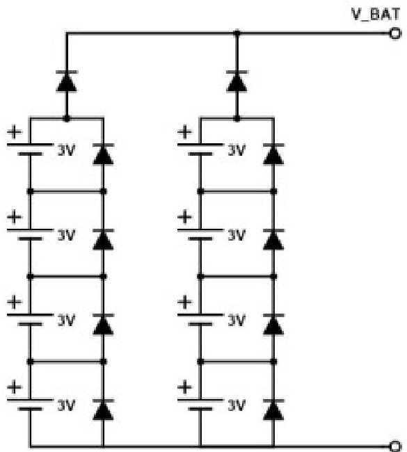

Figure 25: Redesign of Battery Configuration with Diodes

<!-- PDF_PAGE: 81 -->

Table 19: Mitigated-Battery FMECA

<table border="1"><tr><td>Component</td><td>Failure Mode</td><td>Failure Cause</td><td>Failure Effects</td><td>Severity(1-5)</td><td>Likelihood(1-5)</td><td>CriticalityNumber</td></tr><tr><td>Batteries</td><td>Voltage Reversal</td><td>Battery cell reaches0-VDC and the voltage reverses</td><td>Could cause an explosion or thermal runaway</td><td>5</td><td>1</td><td>5</td></tr></table>

## Electrical Connectors

The original design of the separation switch connector, electrical battery connector, and PC/104 multi-pin interface stack-through connector only had two pins in reference to power and ground. One out of three mitigation strategies involved adding additional pins for redundancy, which was implemented into the design [43]. Doing so greatly reduced the risk of failure for power supply and distribution throughout mission SeaLion. Table 20 shows the FMECA for the mitigated failure modes for electrical connectors on the EPS Board.

Table 20: Mitigated-Electrical Connectors FMECA

<table border="1"><tr><td>Component</td><td>Failure Mode</td><td>Failure Cause</td><td>Failure Effects</td><td>Severity(1-5)</td><td>Likelihood(1-5)</td><td>CriticalityNumber</td></tr><tr><td>Battery connector</td><td>Battery connection fails</td><td rowspan="3">Vibrations from launch can cause a poor electrical pin connection</td><td>Unable to power components and operating modes</td><td>5</td><td>1</td><td>5</td></tr><tr><td>Separation switch connector</td><td>Battery kill switch connection fails</td><td>Start-up of EPS&amp;CDH will not occur</td><td>5</td><td>1</td><td>5</td></tr><tr><td>EPS BoardPC/104</td><td>PC/104 multi-pin connection fails</td><td>Power and communication with the Interface Board will not be achieved</td><td>5</td><td>1</td><td>5</td></tr><tr><td>Interface BoardPC/104</td><td>PC/104 multi-pin connector fails</td><td>Vibrations from the launch causes a poor electrical pin connection</td><td>Power and communication with the OBC will not be achieved</td><td>5</td><td>1</td><td>5</td></tr></table>

## Soldered Joints

Additional mitigation strategies for soldered joints on-board mission SeaLion involve the solder alloy used during manufacturing. To avoid potential thermal damage to the PCB during

<!-- PDF_PAGE: 82 -->

manufacturing, 63/37 Sn-Pb (tin-lead) solder was recommended for use due to the alloy's eutectic temperature [59]. Eutectic alloys have a single melting and freezing point temperature, which means that the two phases are in equilibrium. The eutectic temperature for Sn-Pb is 183 $ ^{\circ} \mathrm{C} $ , which is determined by the point on the Phase Diagram called the eutectic point. The eutectic temperature for Sn-Pb has a lower melting point when compared to pure tin (232 $ ^{\circ} \mathrm{C} $ ) and lead (327 $ ^{\circ} \mathrm{C} $ ). The phase diagram for tin and lead is shown in Figure 26 [76]. Instructions were given to the manufacture to use 63/37 Sn-Pb solder, which reduced the risk of thermal damage to the EPS Board and Interface Board. Table 21 and Table 22 below shows the FMECA for the mitigated failure modes of soldered joints.

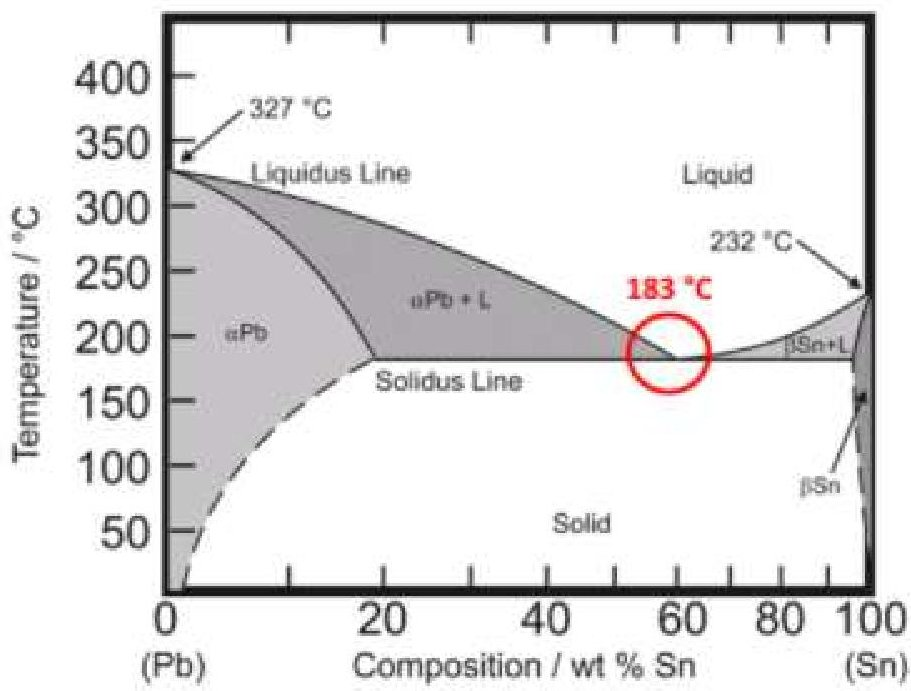

Figure 26: Sn-Pb Phase Diagram [76]

<!-- PDF_PAGE: 83 -->

Table 21: Mitigated-EPS Board Soldered Joints FMECA

<table border="1"><tr><td>Component</td><td>Failure Mode</td><td>Failure Cause</td><td>Failure Effects</td><td>Severity(1-5)</td><td>Likelihood(1-5)</td><td>CriticalityNumber</td></tr><tr><td>Battery connector</td><td>Power supply connector detaches</td><td rowspan="15">Vibrations from launch can cause fatigue to the soldered joints or defects to the solder joints can result with the electrical component detaching from the EPS Board</td><td>Unable to power components and operating modes</td><td>5</td><td>2</td><td>10</td></tr><tr><td>Separation switch connector</td><td>Separation switch connector detaches</td><td>Start-up of EPS&amp;CDH will not occur</td><td>5</td><td>2</td><td>10</td></tr><tr><td>Battery monitor</td><td>Battery monitor connector detaches</td><td>Unable to measure the batteries voltage and current output</td><td>4</td><td>2</td><td>8</td></tr><tr><td>3.3-VDC Voltage regulator</td><td>Voltage regulator connection fails</td><td rowspan="2">Unregulated voltage supply could damage downstream components or supply insufficient voltage</td><td>5</td><td>2</td><td>10</td></tr><tr><td>5-VDC Voltage regulator</td><td>Voltage regulator connection fails</td><td>4</td><td>2</td><td>8</td></tr><tr><td>Inductor</td><td>Inductor connection fails</td><td>Performance of components in the circuit could be impacted</td><td>2</td><td>2</td><td>4</td></tr><tr><td>Diode</td><td>Diode connection fails</td><td>The voltage regulator may fail to step the voltage down properly, which could potential damage downstream components</td><td>4</td><td>2</td><td>8</td></tr><tr><td>Capacitor</td><td>Capacitor connection fails</td><td>Disruption of performance or damage to downstream components</td><td>2</td><td>2</td><td>4</td></tr><tr><td>MOSFET</td><td>MOSFET connection fails</td><td>Downstream components will not receive power</td><td>4</td><td>2</td><td>8</td></tr><tr><td>3.3-VDC IC</td><td>IC connection fails</td><td rowspan="2">Downstream system protection is compromised</td><td>5</td><td>2</td><td>10</td></tr><tr><td>5-VDC IC</td><td>IC connection fails</td><td>4</td><td>2</td><td>8</td></tr><tr><td>I2C</td><td>I2C connection fails</td><td>Voltage and current monitoring data for 3.3V&amp;5V will not be transferred from the EPS to the Interface board</td><td>4</td><td>2</td><td>8</td></tr><tr><td>EPS Board PC/104</td><td>PC/104 multi-pin connection fails</td><td>Power and communication with the Interface Board will not be achieved</td><td>5</td><td>2</td><td>10</td></tr></table>

<!-- PDF_PAGE: 84 -->

Table 22: Mitigated-Interface Board Soldered Joints FMECA

<table border="1"><tr><td>Component</td><td>Failure Mode</td><td>Failure Cause</td><td>Failure Effects</td><td>Severity(1-5)</td><td>Likelihood(1-5)</td><td>CriticalityNumber</td></tr><tr><td>InterfaceBoardPC/104</td><td>PC/104multi-pinconnection fails</td><td rowspan="7">Vibrations from thelaunch can cause fatigue to the soldered joints or defects to the solder joints can result with theelectrical componentdetaching from theInterface Board</td><td>Power andcommunication with theOBCwill not be achieved</td><td>5</td><td>1</td><td>5</td></tr><tr><td>DeCSPayload</td><td>Burn wiremechanismconnection fails</td><td>No power will be supplied to theburn wiremechanism for deployment</td><td>3</td><td>2</td><td>6</td></tr><tr><td>IMU</td><td>IMU20pinconnection fails</td><td>Unable to obtainIMUdata for attitude</td><td>3</td><td>2</td><td>6</td></tr><tr><td>SunSensor</td><td>ADC toI2CConverterconnection failure</td><td>Unable to obtainSunvector for attitudedetermination</td><td>3</td><td>2</td><td>6</td></tr><tr><td>GPS</td><td>20Pinconnection</td><td>SeaLion&#x27;s location andheading is not obtained</td><td>4</td><td>2</td><td>8</td></tr><tr><td>IPPayload</td><td>IP connectorfails</td><td>No IP data is captured</td><td>3</td><td>2</td><td>6</td></tr><tr><td>Ms-SPayload</td><td>USB connectorfails</td><td>No Ms-S data is captured</td><td>3</td><td>2</td><td>6</td></tr></table>

## Electrical Power System Board

Mitigation strategies were made to the preliminary design of the EPS Board regarding manufacturing of the EPS Board that had not been considered. Requests were made to the manufacture to minimize cuts in the PCBs copper plans and to use vias with thermal pad's PCB footprint. This will assist with transferring heat generated from the voltage regulators and the other ICs [44]. Another design change was implemented to the EPS Board in which an addition input capacitor was added to each of the voltage regulators [44]. Implementation of the design changes improved the EPS Board and lowers risk of failure.

<!-- PDF_PAGE: 85 -->

Table 23: Mitigated-EPS Board FMECA

<table border="1"><tr><td>Component</td><td>Failure Mode</td><td>Failure Cause</td><td>Failure Effects</td><td>Severity(1-5)</td><td>Likelihood(1-5)</td><td>CriticalityNumber</td></tr><tr><td>EPS Board</td><td>EPS Board failure</td><td>Poor thermal design</td><td>Components experience high temperatures from operations</td><td>3</td><td>1</td><td>3</td></tr><tr><td>EPS Board</td><td>Over-stressing of components</td><td>Poor PCB layout of components</td><td>Failure of converter or other components in circuit</td><td>4</td><td>1</td><td>4</td></tr></table>

## Deployable Composite Structure Payload

The composite structure boom for the DeCS payload has gone through partial characterization testing to understand the potential structural degradation. A FEA and bending testing have been conducted to verify the integrity of the boom which is shown in Figure 27. Additional testing is still in progress and will be required to mitigate failure to the lowest risk.

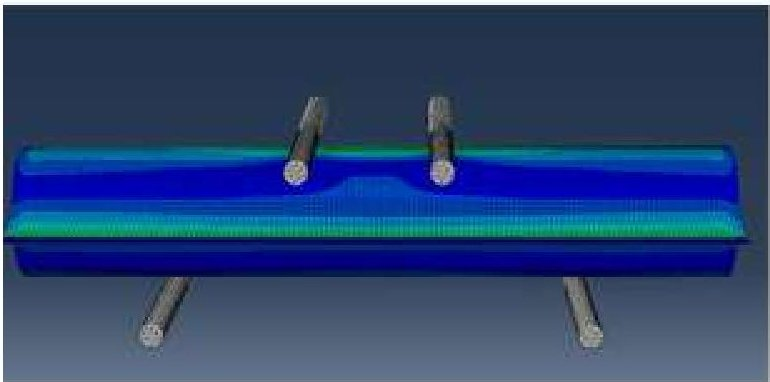

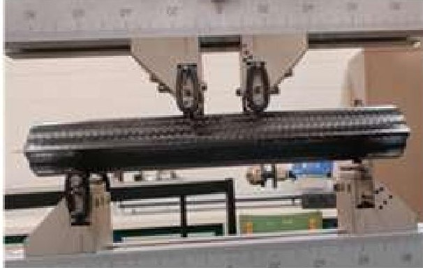

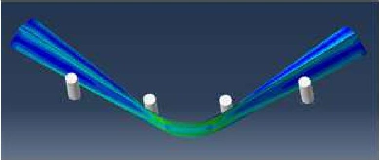

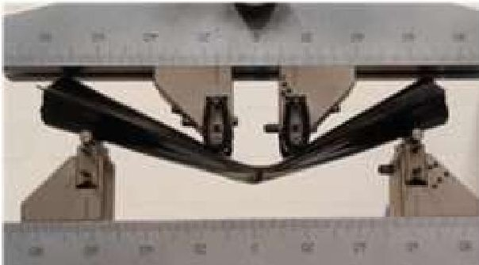

Figure 27: Composite Boom Bending Test

Mitigation efforts have been executed to reduce the risk of thermal damage to the composite booms and strain gauges. Thermal protection was accomplished with the use of a low-cost,

<!-- PDF_PAGE: 86 -->

passively thermal management by utilizing the Yoshimura folding pattern sleeve on the composite booms show in Figure 28 below.

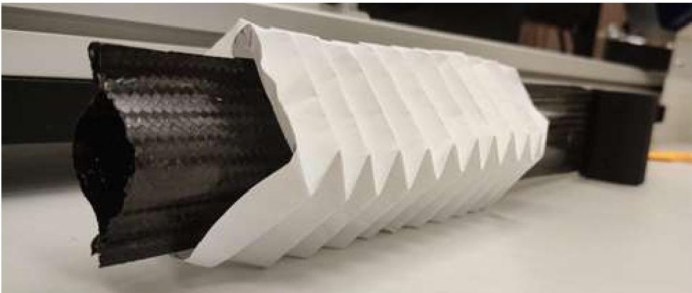

Figure 28: Composite Boom Origami Thermal Shielding

Table 24: Mitigated-DeCS Deployment FMECA

<table border="1"><tr><td>Component</td><td>Failure Mode</td><td>Failure Cause</td><td>Failure Effects</td><td>Severity(1-5)</td><td>Likelihood(1-5)</td><td>CriticalityNumber</td></tr><tr><td>DeCSPayload</td><td>Compositebooms fracture</td><td>Excessive dynamic forces damage or fracturesbooms</td><td>Insufficient strain gaugedata will be captured</td><td>3</td><td>4</td><td>12</td></tr><tr><td>DeCSPayload</td><td>Compositebooms fail</td><td>Thermal damage</td><td>Structural integrity of the compositebooms is compromised</td><td>3</td><td>3</td><td>9</td></tr><tr><td>DeCSPayload</td><td>Thermal failure</td><td>Operating outside the temperature limits</td><td>Insufficient data will be captured and boom deployment will not be verified</td><td>3</td><td>2</td><td>6</td></tr></table>

## 4.2 Thermal Vacuum Chamber Test Plan

A TVAC test plan overview was made to show key steps needed to ensure that proper execution occurs. Proper handling of test specimens and cleaning of chamber is important to avoid outgassing. Determining test level for components can be guided using MIL-STD1540 and LSP-REQ-317.01 [4]. Figure 29 below shows a general test plan that can be used for testing any component using the TVAC.

<!-- PDF_PAGE: 87 -->

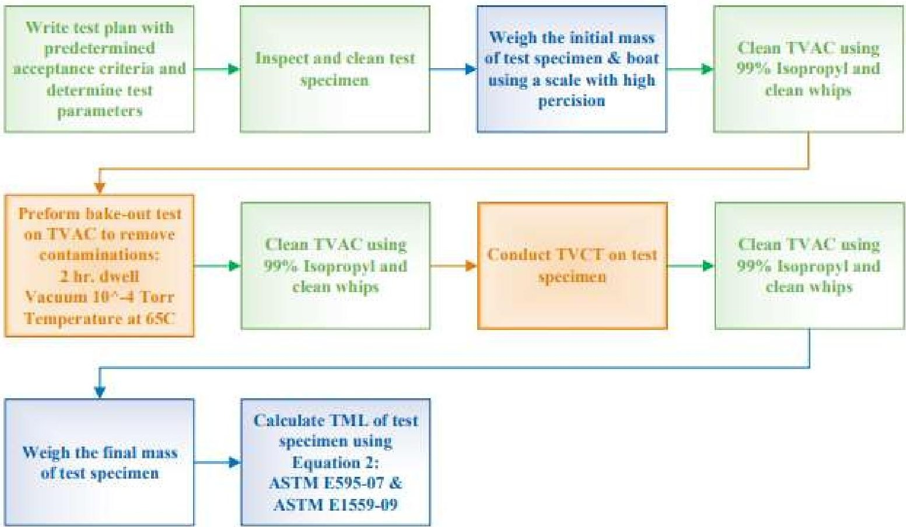

Figure 29: TVAC Test Plan

## 4.3 Deployable Composite Structure Payload Test Plan

A test plan was written with a few additional steps since the DeCS payload has several 3D printed sub-component parts. Moisture will be present in the pores of the 3D printed material and a thermal soak is required to extract any moister that may exist [73]. Strain gauge data will be recorded for each payload deployment verification and will be used to generate a signature. Capturing the strain gauge signature during testing is extremely important and will be used for understanding what an acceptable profile of data looks like.

The vacuum level will take longer for the TVAC to achieve the set point due to moister being extracted out of the 3D printed material during the first thermal soak. The TVAC will reach a stagnation point that can be monitored by watching the pressure profile on the TVAC's controller display. The vacuum level will eventually reach the desired level, but at a slower rate. The parameter for the first thermal soak was recommended by a vacuum chamber testing laboratory researcher at NASA LaRC [73]. Figure 30 shows a block diagram for testing the DeCS payload.

<!-- PDF_PAGE: 88 -->

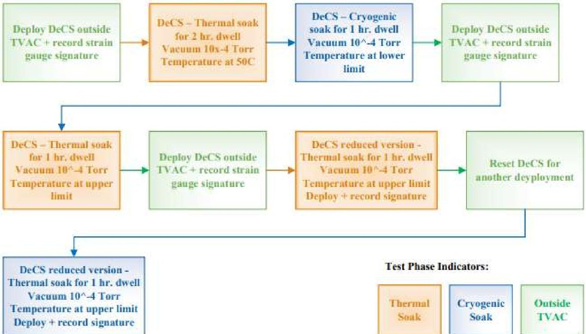

Figure 30: DeCS Payload Test Plan

## 4.4 Software Test Plan

Software testing will be executed to ensure that the coded script achieves the intended output(s). Mission SeaLion's software will first be tested at the component level to ensure that every individual script of code works as intended. Upon completion of component testing, the software script will be integrated into a larger script and tested again to ensure the intended outputs are still being achieved [77].

Currently ODU's CubeSat team is preparing to test the orbit propagation software. During initial start-up, the first recorded GPS coordinates will be sent to the OBC. Time will be captured using the real time clock (RTC) from the OBC. The combination of the GPS coordinates and time from the RTC will be used as mission SeaLion's initial conditions. Simulations of GPS and time data will be used as inputs to the on-board propagation software. The orbit propagation algorithm will then compute estimates. The data is expected to convert the input and output two-line element (TLE) data. Each mission mode will have converted TLE data when downlinked to the ground station.

<!-- PDF_PAGE: 89 -->

Verifications of the outputs the simulation will be expanded to simulate a full orbit and verify that the propagation is updating accordingly. Once the software is proven to work as designed, it will be integrated to the OBC and tested with real inputs. Integration testing will be conducted for all sensors and timers on-board. Fault injection testing will also be conducted at any point where it is determined to be appropriate to ensure a robust software script has been written. This type of testing involves introducing faults or errors to the scripted code to see how the software responds. If any errors are discovered, the scripted code will be modified and tested again [77].

<!-- PDF_PAGE: 90 -->

# 5. CONCLUSION

## 5.1 Lessons Learned

There are several lessons learned from the extensive time spent on this missions' efforts. ODU's CubeSat team was compiled with a group of diverse students at different levels in their academic careers. Nearly every team member had no experience with working with satellites or had experience working as a professional in the engineering industry, which created a large learning curve. A valuable lesson was learned to ask experts for help if resources are available because one might be surprised on how willing professionals are to assist.

ODU's CubeSat team had issues with simple communication. Several design changes were made to systems by lead engineers and unintentionally, information was not always translated with other team members. As a result, excessive re-work was conducted to adjust for modifications that impacted the FMECA and other adjacent systems. Time constraints are always one of the leading restrictions for university lead CubeSat missions and valuable time and effort was spent modifying other system designs instead of progressing forward. Lastly, to execute a complex objective like mission SeaLion, a team must be built with members who are committed to achieving their highest level of ability.

## 5.2 Conclusion

A FMECA was conducted for mission SeaLion to mitigate potential failures from occurring on-orbit, which has never been executed before in ODU's CubeSat program. Mission SeaLion was ODU's second CubeSat in the universities history and the CubeSat program is still a relatively new and developing program that will adjust and fine-tune itself with more missions. The FMECA was executed on ODU's custom-built components which included the Interface Board, EPS Board, and DeCS payload.

The Interface Board consisted of interfacing mission SeaLion components' and executing data communications with the on-board computer. The EPS is responsible for monitoring, regulating, and distributing power to all the systems on-board. The DeCS was designed with multiple 3D printed mechanical components, along with strain gauges that will be used to collect data on-orbit. The FTA was utilized for driving down to root causes and identifying failure

<!-- PDF_PAGE: 91 -->

modes. FBD were generated to display system operations and contributed to identify the downstream effects created from failures when they occur.

The CA was then executed, which ranked the failure modes based on established criteria that was tailored specifically for mission SeaLion and ODU's CubeSat experience. A qualitative approach was used for establishing the criteria and a numbering scale was applied accordingly. Extensive mitigation plans were made which included utilizing ODU's new TVAC. Since no components had been delivered to ODU at the time of writing, component testing was not executed. The FMECA was re-executed for the component failure modes that were re-designed. Thus, reducing the criticality of the failure from occurring during mission SeaLion.

Since the SeaLion CubeSat components had not been received during the spring of 2022, mitigation strategies involving re-design had only been pursued at this time. The design changes that were implemented included additional diodes added to the battery pack configuration, additional electrical pins for redundancy, and additional input decoupling capacitors were added to both 3.3-VDC and 5-VDC converters on the EPS Board. Requests were also instructed to the manufacturer to utilize 63/37 Sn-Pb solder, minimize cuts in the PCB's copper planes and to implement vias with thermal pads for both the PCB's footprint during construction. Implementing these design changes significantly reduced the CN of each associated failure modes. Thus, increasing the reliability of the SeaLion CubeSat as preparations are being executed for having a successful mission in March 2023.

## 5.3 Future Work

Extensive efforts were conducted on setting up ODU's new TVAC and tests were planned to mitigate potential failure modes, which is waiting for execution once components are received from manufactures. Utilizing the TVAC for understanding how components and materials respond in a space simulated environment should be a top priority for future ODU CubeSat teams. Efforts on understanding electrical components, 3D printed materials, and outgassing, are a few suggestions moving forward. When tests are being conducted, collection of data should be captured to fully understand what period components are operating within the Bathtub Curve, in reference to the infant mortality or normal operating life period previously shown in Figure 12.

<!-- PDF_PAGE: 92 -->

The FMECA that was executed for mission SeaLion should be used as a foundation for future ODU CubeSat missions and will contribute to having a successful 2023 mission. Expanding and improving on this work should be continued for future CubeSat missions. Execution of challenging objectives may not always go as planned and teams will experience failures, but each time failure occurs, knowledge is obtained and can be utilized to prevent future failures from occurring.

<!-- PDF_PAGE: 93 -->

## REFERENCES

[1] B. Shiotani, "Reliability Analysis of SwampSat," University of Florida, Gainesville, FL, 2011.

[2] National Aeronautics and Space Administration, CubeSat 101 Basic Concept and Processes for First-Time CubeSat Developers, NASA CubeSat Launch Initiative, 2017.

[3] J. W. Cheong, B. J. Southwell, W. Andrew, E. Aboutanios, C. Lam, T. Croston, L. Li, S. Green, A. Kroh, E. P. Glennon, J. Bultitude1, T. Broadbent, T. B. Guo, J. G. Aligno, . A. G. Dempster and B. Osborne, "A Robust Framework for Low-Cost Cubesat Scientific," Spinger Nature B.V., 2020.

[4] California Polytechnic State University, CubeSat Design Specification (CDS) Rev. 13.

[5] G. Elinoff, "6 Things to Know About CubeSats," 2019. [Online]. Available: https://www.electropages.com/blog/2019/10/six-things-know-about-cubesats. [Accessed 1st December 2021].

[6] Old Dominion University & United States Coast Guard Academy, "Critical Design Review: Mission SeaLion - ODU/CGA 3U CubeSat," 2022.

[7] Planetary Systems Corporation, 2001025C Separation Connector Data Sheet, 2013.

[8] Planetary Systems Corporation, "Canisterized Satellite Dispenser (CSD) Data Sheet," 2018.

[9] Salvo Technologies, "PixelSensor Multispectral Sensor," [Online]. Available: https://salvocoatings.com/products/pixel-sensor/. [Accessed 28th March 2022].

[10] J. Bhagatji, Interviewee, Deployable Composite Structure Design. [Interview]. 10th September 2021.

[11] M. Swartwout, "The First One Hundred CubeSats: A Statistical Look," Journal of Small Satellites, vol. 2, no. 2, pp. 213-233, 2013.

[12] S. Tafazoli, "A Study of On-Orbit Spacecraft Failures," Acta Astronautica, p. 11, 2009.

[13] E. Deems, "Risk Management of Student-Run Small Satellite Programs," Massachusetts Institute of technology, 2007.

[14] E. E. Lewis, Introduction to Reliability Engineering 2nd Ed., Canada: John Wiley & Sons, Inc., 1994.

<!-- PDF_PAGE: 94 -->

[15] Reliability Hot Wire, "About Reliability Engineering," Hottinger Bruel & Kjaer Inc., 2021. [Online]. Available: https://www.weibull.com/basics/reliability.htm. [Accessed 18th October 2021].

[16] Department of Defense, MIL-STD-1629A, Washington, D.C., 1980.

[17] J. Moubray, Reliability-centered Maintenance 2nd Edition, New York, New York: Industrial Press Inc., 1992.

[18] National Aeronautics and Space Administration (NASA), Procedure for Failure Mode Effects, and Criticality Analysis (FMECA), Washington, D.C. 20546, 1966.

[19] Quality-One International, "Failure Mode, Effects & Critical Analysis (FMECA)," 2021. [Online]. Available: https://quality-one.com/fmeca/.

[20] Department of the Army, TM 5-698-4: Failure Modes and Effects Criticality Analysis (FMECA) for Command, Control, Communications, Computer, Intelligence, Surveillance, and Reconnaissance, 2006.

[21] R. J. Duphily, "Space Vehicle Failure Modes, Effects, and Criticality Analysis (FMECA) Guide," Aerospace Assuring Space Mission Success, 2009.

[22] LimbleCMMS, "FMEA & FMECA: How to Perform Failure Mode and Effects Analysis," 10th September 2020. [Online]. Available: https://limblecmms.com/blog/fmea-and-fmeca/. [Accessed 2nd August 2021].

[23] Reliability Hot Wire, "Basic Concepts of FMEA and FMECA," Hottinger Bruel & Kjaer Inc., 2021. [Online]. Available: https://www.weibull.com/hotwire/issue46/relbasics46.htm. [Accessed 23rd August 2021].

[24] National Aeronautics and Space Administration (NASA), S3001: Guidelines for Risk Management, 2017.

[25] "NASA Systems Engineering Handbook," NASA/SP-2007-6105, Dec 2007.

[26] T. Hessing, "Fault Tree Analysis," [Online]. Available: https://sixsigmastudyguide.com/fault-tree-analysis/. [Accessed 3rd March 2022].

[27] CS Odessa Corp., "Functional Block Diagram," ConceptDraw Solutions, [Online]. Available: https://www.conceptdraw.com/How-To-Guide/functional-block-diagram. [Accessed 3rd March 2022].

[28] A. Menchinelli, F. Ingiosi, . L. Pamphili, P. Marzioli, R. Patriarca, F. Costantino and F. Piergentili, "A Reliability Engineering Approach for Managing Risks in CubeSats," Department of Mechanical and Aerospace Engineering, Sapienza University of Rome, Rome, 2018.

<!-- PDF_PAGE: 95 -->

[29] European Cooperation for Space Standardization, "Failure modes, effects (and criticality) analysis (FMEA/ FMECA)," Requirements & Standards Division Noordwijk, Netherlands, 2009.

[30] ASQ, "Failure Mode and Effects Analysis (FMEA)," [Online]. Available: https://asq.org/quality-resources/fmea.

[31] J. Siciliano, "Design and Analysis of Electrical Power and Communications Systems for 3U SeaLion CubeSat Mission," 2022.

[32] Ultralife Corporation, "Ultralife UHR-XR34610 Technical Datasheet," Ultralife Corporation, Newark, New York, 2014.

[33] National Aeronautics and Space Administration, "Li-Ion Batteries: Managing Risk to Secure Reward," 8th August 2016. [Online]. Available: https://www.nasa.gov/offices/nesc/articles/li-ion-batteries. [Accessed 16th February 2022].

[34] B. McKissock, P. Loyselle and E. Vogel, "Guidelines on Lithium-ion Battery Use in Space Applications," NASA Glenn Research Center, Cleveland, Ohio, 2009.

[35] SolarFire Systems, "Detect off gassing and prevent thermal runaway of Lithium-Ion Battery Energy Storage Systems," 18th February 2021. [Online]. Available: https://solarfiresystems.com/news/detect-off-gassing-and-prevent-thermal-runaway-of lithium-ion-battery-energy-storage systems#:~:text=The%20off%2Dgassing%20of%20a,runaway%20and%20burst%20into %20fire.. [Accessed 16th February 2022].

[36] A. Beck, "Common Failures in Lithium Battery Packs," epec Engineering Technologies, 5th January 2021. [Online]. Available: https://blog.epectec.com/common-failures-in lithium-battery-packs. [Accessed 16th February 2022].

[37] D. Linden and T. B. Reddy, Handbook of Batteries Third Edition, New York: The McGraw-Hill Companies, Inc., 2002.

[38] Texas Instruments, LM2576xx Series SIMPLE SWITCHER 3-A Step-Down Voltage Regulator, Dallas, Texas: Texas Instruments Incorporated, 2022.

[39] Analog Devices, LTC2944 60V Battery Gas Gauge with Temperature, Voltage and Current Measurement, Linear Technology Corporation, 2017.

[40] Analog Devices, LTC2990 Quad I2C Voltage, Current and Temperature Monitor, Analog Devices, Inc., 2018.

[41] Analog Devices, LTC4361-1/LTC4361-2 Overvoltage/Overcurrent Protection Controller, Analog Devices, Inc., 2018.

<!-- PDF_PAGE: 96 -->

[42] DERF Electronics Corporation, "How Voltage Regulators Work - Step by Step Explanation," [Online]. Available: https://www.derf.com/an-overview-on-voltage-regulators/. [Accessed 17th February 2022].

[43] M. McVey, Interviewee, Best Practices for Electrical Circuit Design. [Interview]. 1st November 2021.

[44] P. Shenoy and A. Fagnani, "Common Mistakes in DC/DC Converters and How to Fix Them," Texas Instruments Incorporated, 2018.

[45] Fluke Corporation, "What is a diode?," [Online]. Available: https://www.fluke.com/enus/learn/blog/electrical/what-is-a diode#:~:text=A%20diode%20is%20a%20semiconductor,flowing%20in%20the%20opposite%20direction.. [Accessed 31st January 2022].

[46] S. Arar, "How to Troubleshoot a Diode bridge Rectifier," 1st February 2019. [Online]. Available: https://www.allaboutcircuits.com/technical-articles/troubleshooting-a-diode bridge rectifier/#:~:text=The%20common%20reasons%20for%20a,overcurrent%20makes%20it %20fail%20open.. [Accessed 31st January 2022].

[47] Marathon Electric, "Diode Failure Scenarios Modes of Failure, Causes and Effects," 28th September 2004. [Online]. Available: https://merequipment.com/wp content/uploads/Diode-Failure-Scenarios.pdf. [Accessed 31st January 2022].

[48] B. Marshall and C. Pollette, "How Capacitors Work," HowStuffWorks, 9th August 2021. [Online]. Available: https://electronics.howstuffworks.com/capacitor.htm. [Accessed 16th February 2022].

[49] Electrocube, "Why Do Capacitors Fail?," [Online]. Available: https://www.electrocube.com/pages/why-capacitors-fail-technical-bulletin. [Accessed 16th February 2022].

[50] A. Williams, Interviewee, Failure Effects for Electrical Components. [Interview]. 6th December 2021.

[51] Electronics | Projects | Focus, "What is a MOSFET: Working and its Application," [Online]. Available: https://www.elprocus.com/mosfet-as-a-switch-circuit-diagram-freecircuits/. [Accessed 31st January 2022].

[52] M. Ahmad, "How and when MOSFETs blow up," WTWH Media LLC, 2022. [Online]. Available: https://www.powerelectronictips.com/how-and-when-mosfets-blow-up/. [Accessed 1st February 2022].

[53] 4QD, "Why Do Mosfets Fail?," 4QD Limited, 1997 - 2022. [Online]. Available: https://www.4qd.co.uk/docs/mosfet-failure-mechanisms/. [Accessed 1st February 2022].

<!-- PDF_PAGE: 97 -->

[54] Insight Analytical Labs, Inc., "Common Types of IC Defects - An Overview," [Online]. Available: https://www.ial-fa.com/blog/common-types-of-ic-defects-an-overview. [Accessed 14th March 2022].

[55] F. Geib, "On-board computer for PC104 format CubeSats," Czech Technical University in Prague, 2021.

[56] R. Trivedi and U. S. Mehta, "A Survey of Radiation Hardening by Design (RHBD) Techniques for Electronic Systems for Space Application," International Journal of Electronics and Communication Engineering & Technologies (IJECET), vol. 7, no. 1, pp. 75-86, 2016.

[57] J. Bouwmeester, M. Langer and E. Gill, "Survey on the Implementation and Reliability of CubeSat Electrical Bus Interface," Springerlink.com, 2016.

[58] T. Ferris, "Top 5 reasons for Solder Joint Failure," Ansys Blog, 31st July 2019. [Online]. Available: https://www.ansys.com/blog/top-5-reasons-solder-joint-failure. [Accessed 28th February 2022].

[59] S. Tomaselli, Interviewee, Electrical Soldering Best Practices and Inspections. [Interview]. 29th October 2021.

[60] D. J. Wilkins, "The Bathtub Curve and Product Failure Behavior Part One - The Bathtub Curve, Infant Mortality and Burn-in," HBM Prenscia Inc., [Online]. Available: https://www.weibull.com/hotwire/issue21/hottopics21.htm. [Accessed 21st February 2022].

[61] J. Beverly, Interviewee, Thermal Vacuum Chamber Test Levels. [Interview]. 20th August 2021.

[62] G. Williams, Interviewee, Attitude Determination System for mission SeaLion. [Interview]. 6th December 2021.

[63] Omega, "Introduction to Strain Gauges," 28th August 2018. [Online]. Available: https://www.omega.com/en-us/resources/strain-gages. [Accessed 27th March 2022].

[64] E. Brent, "Predictive Models of an Electro-mechanical Driving System for Failure Testing of Strain Gauges," University of Tennessee, Knoxville, 2007.

[65] G. Fernandez, Interviewee, Design of SeaLion Chassis. [Interview]. 1st March 2022.

[66] NanoRacks, NanoRacks External CubeSat Deployer IDD, NanoRacks, 2018.

[67] Microwave Journal, "What Is Outgassing And When Does It Matter?," 19th November 2010. [Online]. Available: https://www.microwavejournal.com/blogs/1-rogblog/post/16667-what-is-outgassing-and-when-does-it-matter. [Accessed 16th February 2022].

<!-- PDF_PAGE: 98 -->

[68] P. Coleman, Interviewee, What is Outgassing?. [Interview]. 3rd March 2022.

[69] AEON Engineering, "What is a temperature controlled quartz crystal microbalance (TQCM)?," 15th June 2021. [Online]. Available: https://aeon-eng.com/what-is-a temperature-controlled-quartz-crystal-microbalance- tqcm/#:~:text=This%20is%20achieved%20by%20placing,the%20surface%20of%20the% 20equipment.. [Accessed 16th March 2022].

[70] A. C. Tribble, B. Boyadjian, J. Davis, J. Haffner and E. McCullough, "Contamination Control Engineering Design Guidelines for the Aerospace Community," National Aeronautics and Space Adminstration Marshall Space Flight Center, Alabama, 1996.

[71] ASTM International, ASTM E595-07: Standard Test Method for Total Mass Loss and Collected Volatile Condensable Materials from Outgassing in a vacuum Environment, West Conshohocken, PA: ASTM International, 2007.

[72] National Aeronautics and Space Administration, "Outgassing Data for Selecting Spacecraft Materials," March 2017. [Online]. Available: https://outgassing.nasa.gov/ [Accessed 16th March 2022].

[73] C. Beekman, Interviewee, Vacuum Chamber Set-Up and Operations. [Interview]. 4th March 2022.

[74] ASTM Internation, ASTM E1559-09: Standard Test Method for Contamination Outgassing Characteristics of Spacecraft Materials, West Conshohocken, PA: ASTM International, 2009.

[75] TotalTemp Technologies Inc., "Thermal Platform Integrated into Space Simulation Chamber," [Online]. Available: https://www.totaltemptech.com/thermal-platformvacuum-integrated-into-space-simulation-chamber/. [Accessed 10th August 2021].

[76] FCT Solder, "Eutectic Solder," FCT Solder, 2022. [Online]. Available: https://fctsolder.com/eutecticsolder/#:~:text=The%20words%20eutectic%20solder%20describe,freezes%20at%20183 %20%C2%B0C.. [Accessed 8th March 2022].

[77] J. R. Bratcher, "Testing Program for Kysat-1," University of Kentucky, Lexington, 2010.

[78] M. K. Raghav, "Solderability test - How to Do it!," SMT INSIGHT, [Online]. Available: https://smtinsight.com/solderability-test/. [Accessed 27th February 2022].

[79] Electronic Manufacturing Service Group, Inc., "Why Do PCBs Need To Be Inspected?," [Online]. Available: https://emsginc.com/resources/pcb-inspection-techniques-and technologies/#:~:text=The%20simplest%20form%20of%20PCB,also%20look%20for%20 common%20defaults.. [Accessed 17th February 2022].

<!-- PDF_PAGE: 99 -->

## APPENDICES

<!-- PDF_PAGE: 100 -->

## A. EPS ELECTRICAL SCHEMATIC

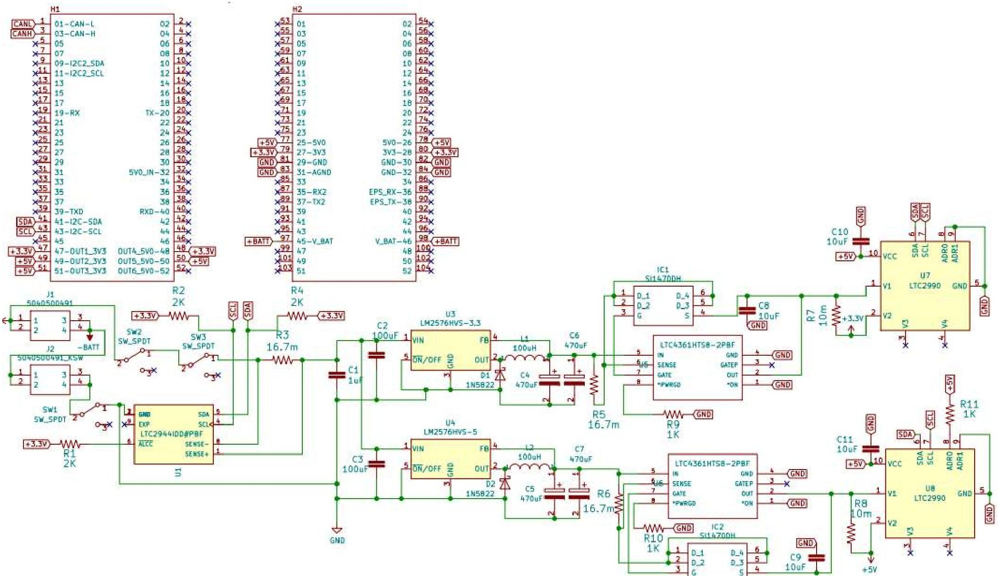

<!-- PDF_PAGE: 101 -->

## B. EPS COMPONENT LIST

<table border="1"><tr><td>Reference Identifier</td><td>Item</td></tr><tr><td>J1</td><td>Battery connector</td></tr><tr><td>J2</td><td>Separation switch connector</td></tr><tr><td>R1</td><td>Resistor</td></tr><tr><td>R2</td><td>Resistor</td></tr><tr><td>R3</td><td>Resistor</td></tr><tr><td>R4</td><td>Resistor</td></tr><tr><td>SW1</td><td>RBF Switch</td></tr><tr><td>SW2</td><td>RBF Switch</td></tr><tr><td>SW3</td><td>RBF Switch</td></tr><tr><td>U1</td><td>Battery monitor</td></tr><tr><td>U2</td><td>PC104 Bus</td></tr></table>

3. 3-V Supply

<table border="1"><tr><td>Reference Identifier</td><td>Item</td></tr><tr><td>C1</td><td>Capacitor</td></tr><tr><td>C2</td><td>Capacitor</td></tr><tr><td>C4</td><td>Capacitor</td></tr><tr><td>C6</td><td>Capacitor</td></tr><tr><td>C8</td><td>Capacitor</td></tr><tr><td>C10</td><td>Capacitor</td></tr><tr><td>D1</td><td>Diode</td></tr><tr><td>IC1</td><td>MOSFET</td></tr><tr><td>L1</td><td>Inductor</td></tr><tr><td>R5</td><td>Resistor</td></tr><tr><td>R7</td><td>Resistor</td></tr><tr><td>R9</td><td>Resistor</td></tr><tr><td>U3</td><td>Voltage regulator</td></tr><tr><td>U5</td><td>Over voltage/over current protection controller IC</td></tr><tr><td>U7</td><td>Bus Monitor:I2C voltage &amp; current monitors</td></tr></table>

5-V Supply

<table border="1"><tr><td>Reference Identifier</td><td>Item</td></tr><tr><td>C3</td><td>Capacitor</td></tr><tr><td>C5</td><td>Capacitor</td></tr><tr><td>C7</td><td>Capacitor</td></tr><tr><td>C9</td><td>Capacitor</td></tr><tr><td>C11</td><td>Capacitor</td></tr><tr><td>D2</td><td>Diode</td></tr><tr><td>IC2</td><td>MOSFET</td></tr><tr><td>L2</td><td>Inductor</td></tr><tr><td>R6</td><td>Resistor</td></tr><tr><td>R8</td><td>Resistor</td></tr><tr><td>R10</td><td>Resistor</td></tr><tr><td>R11</td><td>Resistor</td></tr><tr><td>U4</td><td>Voltage regulator</td></tr><tr><td>U6</td><td>Over voltage/ over current protection controller IC</td></tr><tr><td>U8</td><td>Bus Monitor: I2C voltage &amp; current monitors</td></tr></table>

<!-- PDF_PAGE: 102 -->

## C. SOLDERED JOINT AND PCB INSPECTION

When the EPS Board and Interface Board are received from the manufacturer, extensive inspection shall be conducted on both the soldered joints and PCB. Soldering components manually present a potential risk of voids, blistering, separation of component, burned insulation or thermal damage to the PCB from excessive thermal input [78, 79]. Thermal damage is a high risk for causing failures on the printing traces throughout the PCB [59]. Thermal damage will look like a radius of a circle around the soldered bead and the PCB may show signs of slight discoloration [59].

First, ensure that the PCB was manufactured to the correct dimensions and that the correct electrical components are present [79]. CubeSats have extremely tight fits and alignment must be perfect or issues may arise during assembly.

Conduct a MVI using a 10x magnification glass to ensure the quality of the soldered beads are satisfactory and that the components are properly fused to the PCB [59]. Have multiple team members conduct the MVI independently to increase the chances of finding defects if discrepancies exist, since human error is inevitable [59].

Closely look for the following when conducting the MVI:

- Soldered bead should have fusion to both material members

- Soldered bead is not concave

- Soldered bead does not show any signs of a roll on the joint 'toes'

- Solder bead is smooth without indications of voids or cracks [59]

- No excessive solder material outside of the soldered joint area

- No indications of thermal damage to the PCB

- No signs of PCB defects which include pinholes, pits, dents, scratches, and defects on the printing traces [79]

After the MVI is satisfactory, conduct an electrical continuity check using a volt-ohmmeter to ensure that all electrical components have sufficient continuity.

<!-- PDF_PAGE: 103 -->

## D. DECS PAYLOAD COMPONENT AND ASSEMBLY

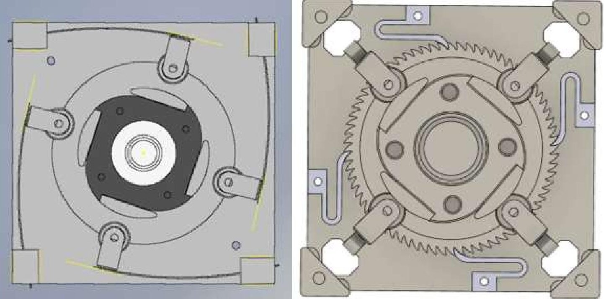

Figure D.1: Ratchet and Paw Locking Mechanism

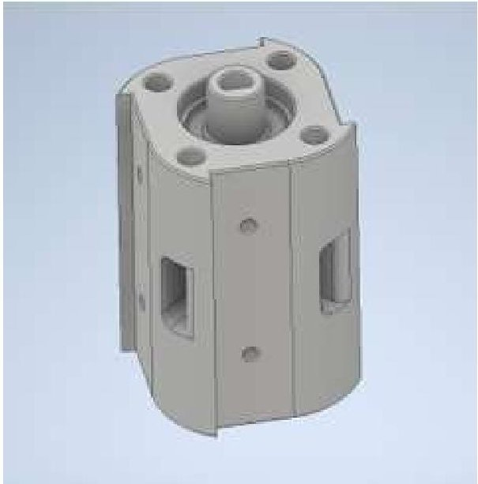

Figure D. 2: Spool Piece

<!-- PDF_PAGE: 104 -->

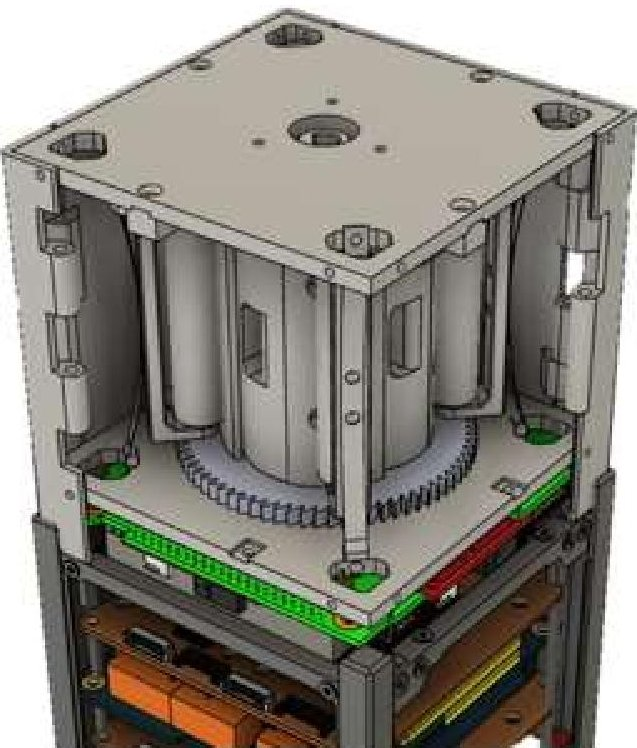

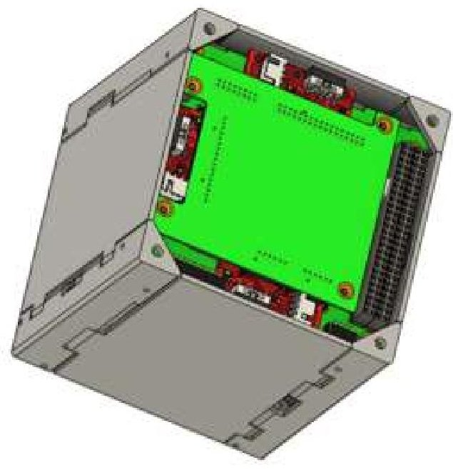

Figure D. 3: DeCS Payload Mount (left) & 1U DeCS Payload (right)

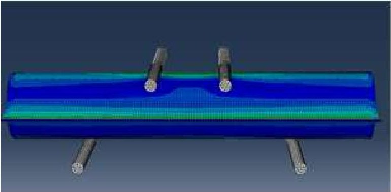

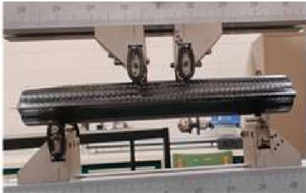

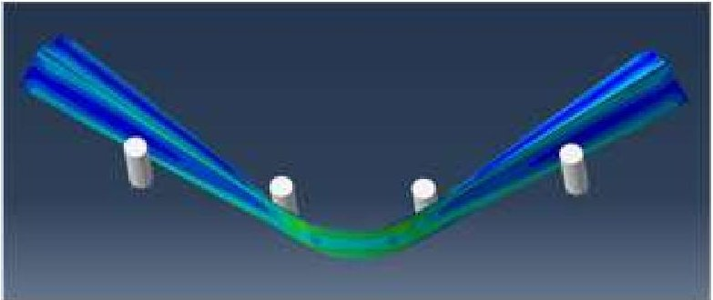

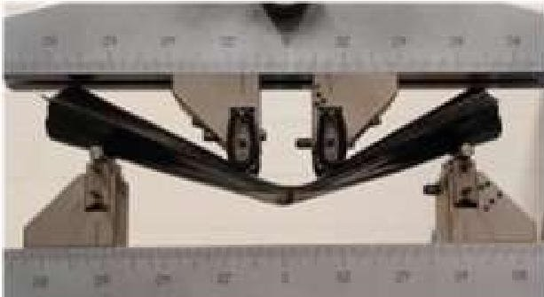

Figure D. 4: Testing of Composite Boom

<!-- PDF_PAGE: 105 -->

## E. MISSION SEALION ASSEMBLY

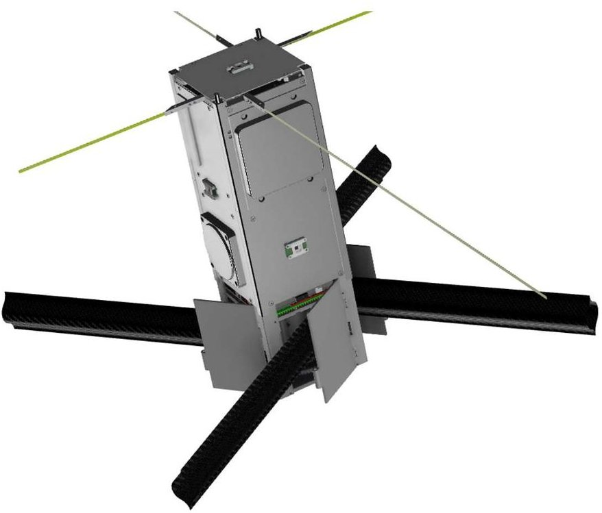

Figure E.1: Mission SeaLion Fully Deployed

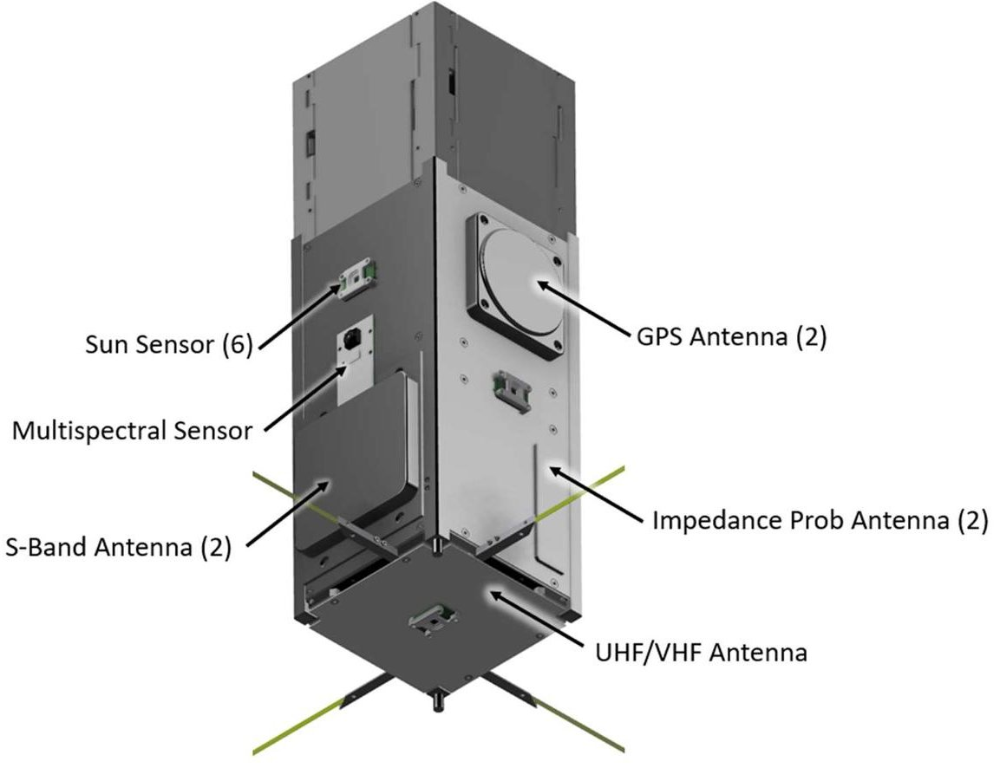

Figure E. 2: Mission SeaLion Constituents

<!-- PDF_PAGE: 106 -->

## F. MISSION SEALION STRUCTURE

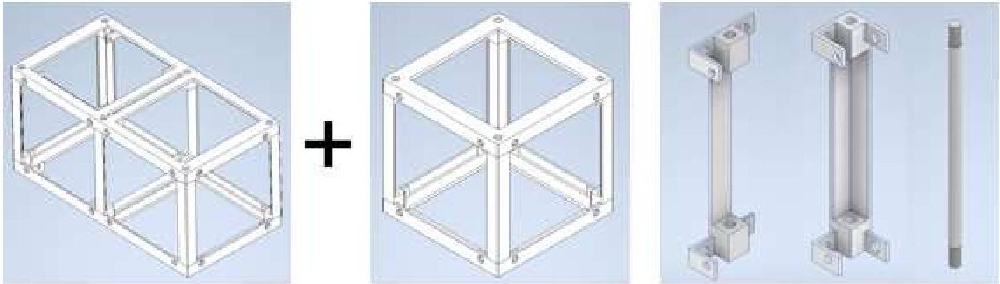

Figure F.1: Mission SeaLion Structure Assembly Structure

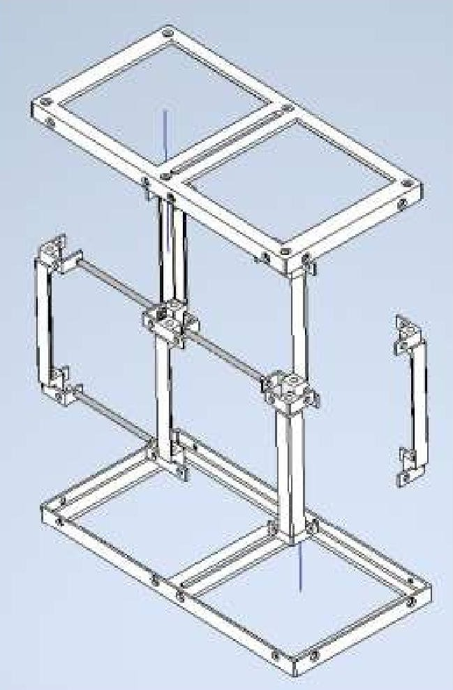

Figure F. 2: Exploded View of the 2U Structure

<!-- PDF_PAGE: 107 -->

## G. POWER BUDGET AND BALANCE

<table border="1"><tr><td>Module</td><td>Sub Component</td><td>Quantity</td><td>Current(mA)</td><td>Voltage(V)</td><td>Power(mW)</td><td>Power(mW)</td></tr><tr><td rowspan="2">COMMS1</td><td>UFHTx</td><td>1</td><td>800.00</td><td>3.3</td><td>2640.00</td><td rowspan="4">7006.50</td></tr><tr><td>UFHRx</td><td>1</td><td>55.00</td><td>3.3</td><td>181.50</td></tr><tr><td rowspan="2">COMMS2</td><td>S-BandTx</td><td>1</td><td>725.00</td><td>5.0</td><td>3625.00</td></tr><tr><td>S-BandRx</td><td>1</td><td>112.00</td><td>5.0</td><td>560.00</td></tr><tr><td rowspan="3">OBC</td><td>A3200</td><td>1</td><td>45.00</td><td>3.3</td><td>148.50</td><td rowspan="3">182.42</td></tr><tr><td>MPU-3300</td><td>1</td><td>10.00</td><td>3.3</td><td>33.00</td></tr><tr><td>HMC5843</td><td>1</td><td>0.28</td><td>3.3</td><td>0.924</td></tr><tr><td rowspan="3">AODS</td><td>Sun Sensor</td><td>6</td><td>0.10</td><td>3.3</td><td>1.98</td><td rowspan="3">1251.99</td></tr><tr><td>ADIS16400 IMU</td><td>1</td><td>70.00</td><td>5.0</td><td>350.00</td></tr><tr><td>GPS</td><td>1</td><td>272.73</td><td>3.3</td><td>900.01</td></tr><tr><td rowspan="4">EPS</td><td>LTC2944I</td><td>1</td><td>0.85</td><td>12.0</td><td>10.20</td><td rowspan="4">23.03</td></tr><tr><td>LTC2990</td><td>2</td><td>1.10</td><td>5.0</td><td>11.00</td></tr><tr><td>LTC4361-2(3.3V)</td><td>1</td><td>0.22</td><td>3.3</td><td>0.73</td></tr><tr><td>LTC4361-2(5V)</td><td>1</td><td>0.22</td><td>5.0</td><td>1.10</td></tr><tr><td rowspan="2">CGA Payload</td><td>Impedance Probe</td><td>1</td><td></td><td></td><td>0.20</td><td rowspan="2">0.45</td></tr><tr><td>Ms_S</td><td>1</td><td></td><td></td><td>0.25</td></tr><tr><td rowspan="2">DeCS</td><td>DeCS Encoder</td><td>1</td><td>120.00</td><td>5.0</td><td>600.00</td><td rowspan="2">630.00</td></tr><tr><td>Strain Gauge</td><td>4</td><td>1.50</td><td>5.0</td><td>30.00</td></tr><tr><td colspan="6">Total power(mW)</td><td>9094.39</td></tr></table>

<!-- PDF_PAGE: 108 -->

## H. MISSION SEALION COMPONENT LIST

<table border="1"><tr><td>Item #</td><td>Item Short Name</td><td>Item Description</td><td>Vendor</td><td>Part #</td><td>Nos</td></tr><tr><td colspan="6">COTS CubeSat Systems and Payloads</td></tr><tr><td>1</td><td>GPS Receiver</td><td>*CG* GPS+QZSS,L1,SBAS L1,Single Point+DGPS PNT,20Hz Data Output Rate,Base Station Corrections+Measurements,High Speed</td><td>NovAtel Inc</td><td>OEM719H-GSN-LNN-TBN-H</td><td>1</td></tr><tr><td>2</td><td>Non-rechargeable batteries</td><td>Ultralife UHR-XR34610-S-T1D-cell-Tabbed-Bulk</td><td>UltraLife</td><td>ULTRALIFE-UHRXR34610-T1</td><td>8</td></tr><tr><td>3</td><td>Flight Computer</td><td>NanoMind Power efficient on-board computer for NanoDocks</td><td>GomSpace</td><td>200284</td><td>1</td></tr><tr><td>4</td><td>UHF Radio</td><td>NanoCom AX100-UL Half duplex UHF communication transceiver.395-405MHz</td><td>GomSpace</td><td>200317</td><td>1</td></tr><tr><td>5</td><td>Sun sensors</td><td>Flight Model of FSS100-Nano Fine Sun Sensor</td><td>Tensor Tech</td><td>FSS100</td><td>6</td></tr><tr><td>6</td><td>PC104 Dock</td><td>NanoDock DMC-3 Mother board for Nano-product series,including:-Up to4GomSpace daughter boards or2 daughter boards and one GPS unit</td><td>GomSpace</td><td>200232</td><td></td></tr><tr><td>7</td><td>S-Band Radio</td><td>NanoCom AX2150</td><td>GomSpace</td><td>N108455</td><td>1</td></tr><tr><td>8</td><td>IMU</td><td>Accelerometer,Gyroscope,Magnetometer,9Axis Sensor SPI Output</td><td>Digi-Key</td><td>ADIS16400BMLZ-ND</td><td>1</td></tr><tr><td>9</td><td>S-Band Antennas and Multiplexer</td><td>Two S-band antennas for mounting on two opposite3U faces of the CubeSat</td><td>TBD</td><td>TBD</td><td>2</td></tr><tr><td>10</td><td>USCGA Payload 2-Multispectral Sensor</td><td>TBD</td><td>TBD</td><td>TBD</td><td>1</td></tr><tr><td colspan="6">Custom Design and Development-CubeSat Systems and Paylods</td></tr><tr><td>11</td><td>USCGA Payload 1-Impedance Probe</td><td>USCGA Payload 1 for measuring Plasma Density and Temperature</td><td>NA</td><td>NA</td><td>1</td></tr><tr><td>12</td><td>ODU Payload 2-Deployable Composite Structure</td><td>ODU Payload 3-Deployable Composite Structure Experiment.On orbit validation of deployment and characterization of boom dynamics</td><td>NA</td><td>NA</td><td>1</td></tr><tr><td>13</td><td>CubeSat Structure</td><td>CubeSat structure-2U CubeSat structure for hostingUSCGA payloads and bus components(ODU payload will be designed as a1U CubeSat and interfaced with it)</td><td>NA</td><td>NA</td><td>1</td></tr><tr><td>14</td><td>UHF antenna</td><td>Four elements of half dipole UHF antennas for interfacing with the UHF radio</td><td>NA</td><td>NA</td><td>1</td></tr><tr><td>15</td><td>Custom EPS and Interface Board 1</td><td rowspan="2">EPS and Interface board to regulate power from the batteries,and provide electrical interface for the payloads and peripheral sensors(Sun sensors,IMU,USCGA payloads,ODU payload,GPS receiver)</td><td>NA</td><td>NA</td><td>1</td></tr><tr><td>16</td><td>Custom EPS and Interface Board 2</td><td>NA</td><td>NA</td><td>1</td></tr></table>

<!-- PDF_PAGE: 109 -->

## VITA

Robb Christopher Borowicz is a native from the Eastern Shore, VA. He spent his childhood watching rockets being launched from Wallops Flight Facility in his parent's backyard. After high school, he decided to attend Newport News Apprentice School, affiliated with Newport News Shipbuilding, to start his professional career as a structural and pipe welder. Excelling through the Apprentice School's ship construction courses, he was selected for the Advanced Apprenticeship Program in nuclear test engineering where, in 2015, he enrolled in mechanical engineering classes. Upon being selected for the school's premier Personal Development Program, he transferred to Old Dominion University and earned a Bachelor of Science in Mechanical Engineering in 2020. During this, he continued working full-time. He also finished his hands-on 16,000-hour apprenticeship that same year and graduated from Newport News Apprentice School in 2021.

During his undergraduate studies, he become interested in CubeSat research and enrolled into Old Dominion's graduate program for Aerospace Engineering. His passion for aerospace engineering grew and he left Newport News Shipbuilding to pursue his career at NASA Langley Research Center as a Reliability Mechanical Engineer. Upon completion of his Master of Science in Aerospace Engineering, he decided to work under Dr. Asundi where he conducted his research on the universities 3U CubeSat mission. Robb's future goals are to one day contribute to human colonization on Mars.