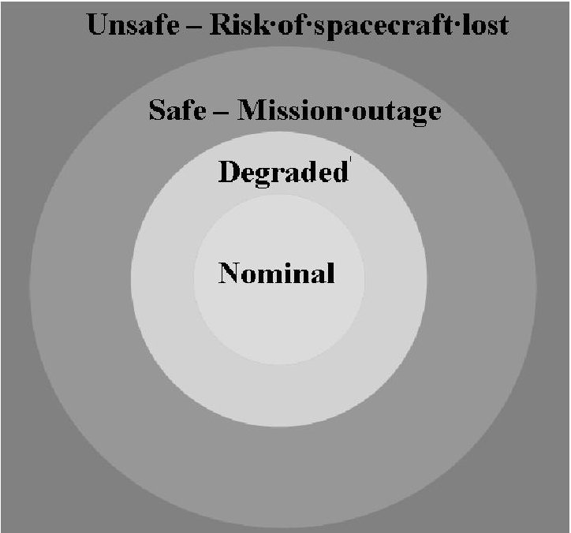
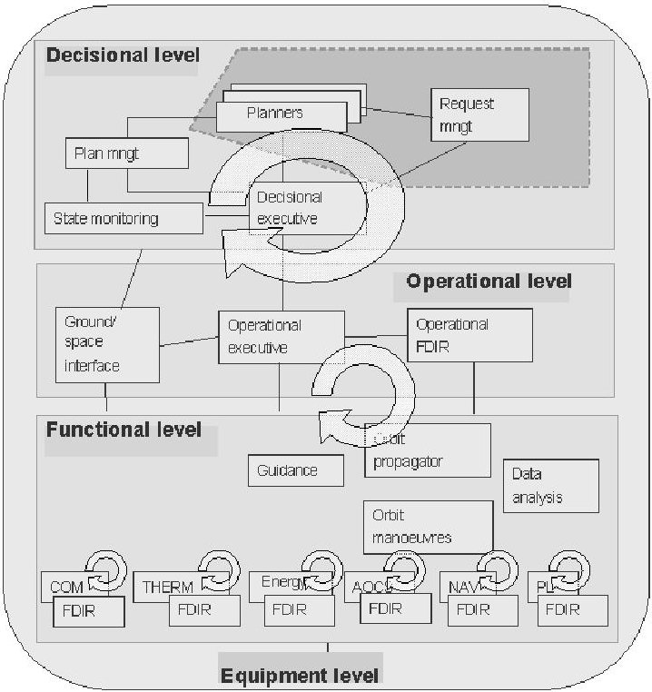
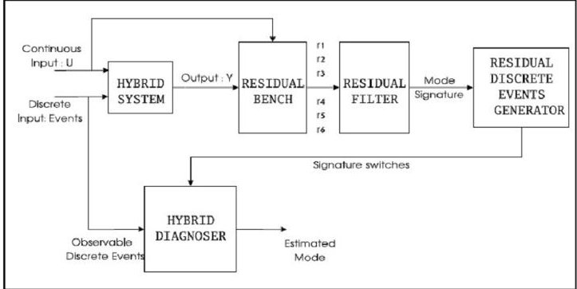
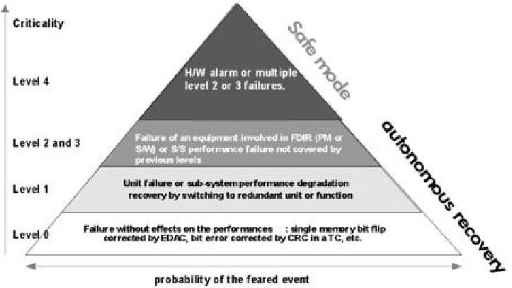
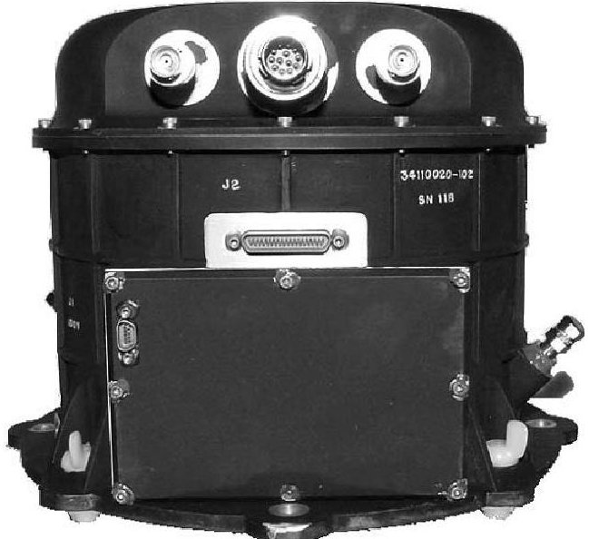
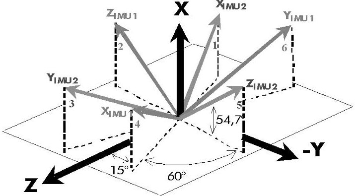
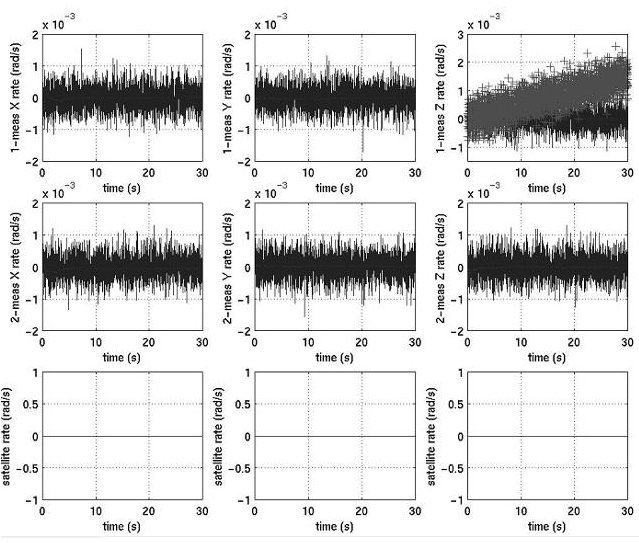
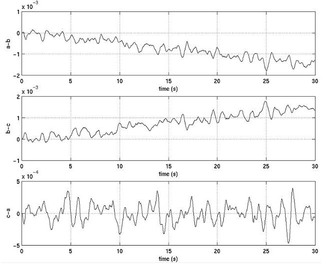

<!-- PDF_PAGE: 1 -->

# FDI(R) FOR SATELLITES: HOW TO DEAL WITH HIGH AVAILABILITY AND ROBUSTNESS IN THE SPACE DOMAIN?

XAVIER OLIVE

Thales Alenia Space

100 Boulevard du Midi, BP 99, 06156 Cannes La Bocca, France

e-mail: xavier.olive@thalesaleniaspace.com

The European leader for satellite systems and at the forefront of orbital infrastructures, Thales Alenia Space, is a joint venture between Thales (67%) and Finmeccanica (33%) and forms with Telespazio a Space Alliance. Thales Alenia Space is a worldwide reference in telecoms, radar and optical Earth observation, defence and security, navigation and science. It has 11 industrial sites in 4 European countries (France, Italy, Spain and Belgium) with over 7200 employees worldwide. Satellite evolution and the wish to design more autonomous missions imply the enhancement of the satellite architecture and special attention paid to fault management (i.e., Fault Detection, Isolation and Recovery, or FDIR, in space). Nevertheless, the constraints on FDIR techniques and strategies remain the same as for standard missions: robustness, reactive detection, quick isolation/identification and validation. This paper gives an introduction to Fault Tolerance (FT) in the space domain and some principles for the coming FT architectures. The current context of FDIR is presented by describing the approach implemented on telecommunication satellites and, more precisely, on one of the most FDIR sensible subsystems: the AOCS (Attitude and Orbit Control System). Following the current state of FDIR in the space domain, some perspectives are given such as a centralized distributed FDIR strategy for the next generation of autonomous satellites as well as some research tracks and hybrid diagnosis.

Keywords: aerospace applications, discrete-event and hybrid systems, diagnosis, fault detection.

## 1. Introduction

Today satellites are designed to find an equilibrium between three major axes: cost, performance and availability. Cost is driven by commercial constraints; performance is driven by industrial competitiveness; availability is driven by the mission. Satellites have evolved in the last 50 years from pre-programmed automata performing a priori known tasks and unable to react against unforeseen events to smart embedded systems able to take preprogrammed decisions on event occurrence or able to react against context changes. Following this trend, tomorrow satellites will become autonomous embedded systems able to achieve mission goals with limited ground interaction.

In such an evolution, FDIR systems are on the critical path of satellite design. FDIR has a direct impact on satellite cost and availability, and indirectly on the performance. It is a cornerstone for the satellite's autonomy enhancement. Like all the embedded functions on a satellite, FDIR needs to be designed and validated before being integrated. Usually this validation is time-consuming and

complex, leading to introduction of risks regarding planning and to cost overtaking. Definition of adequate FDIR strategies can decrease these risks without reducing FDIR functionalities and/or perimeter. Availability is directly dependent on the FDIR system. Reaction time for detection and fault isolation, robustness and ability to recover from a failure are indeed sizing elements of satellite availability. For missions requiring a high level of availability (like telecommunication ones), FDIR is often very sophisticated and structured in different levels in order to minimize the effect of a fault with regard to the whole satellite, leading to a reduction in mission outage. On the other hand, when the required availability level is medium (scientific Earth observation missions require availability but short mission interruption are allowed and have no consequence), satellite saving is preferred to mission follow-on.

In this case, fault isolation and recovery may be very weak, leading most of the time the satellite to its safe mode, waiting for ground intervention. Requirements for satellite on-board autonomy are constantly increasing. This need comes from a new kind of missions: Martian

<!-- PDF_PAGE: 2 -->

missions require to be able to land; in the next generation of Martian missions, they are foreseen to perform in-orbit rendezvous. In the frame of future Earth observation missions, the ground-board commandability loop required to be shortened in order to increase the reactivity: for instance, when fire or pollution detection occurs, some more detailed observations are quickly needed. Satellites will be able to take this kind of decisions autonomously, shortening the reaction loop between detection and action. This paper gives an introduction to Fault Tolerance (FT) in the space domain and some FDIR principles for the coming FT architectures. Then the current context of FDIR is presented by describing the approach implemented on telecommunication satellites and more precisely on one of the most FDIR sensible subsystems: the AOCS (Attitude and Orbit Control System). Following the current state of FDIR in the space domain, some perspectives are given: a centralized distributed FDIR strategy for the next generation of autonomous satellites and some research tracks such as active diagnosis and hybrid diagnosis.

## 2. About fault tolerance

Safety should not be confused with fault tolerance. Figure 1 shows the positioning of safety (guarantee of not loosing the spacecraft) and fault tolerance (guarantee of no mission outage) areas. The level of performance achieved by an FTC architecture is based on the fault analysis concept, which is directly related to the performance of the proposed FDIR strategy.

The result of the performance evaluation should guarantee that the design does not allow the satellite to move to the unsafe area, and that it does maintain with a given probability (close to 1) the working point in the nominal area (degraded modes are allowed in some cases). This goal is reached by an FDI strategy able to detect and identify faults quickly, and guaranteeing fault containment.

This split of the working area permits to define the criticality of faults. The following classes can be considered to sort the anticipated faults:

- Cunsafe: The fault leads to the unsafe area (in the simulation domain, the simulator becomes unstable and breaks down).

- Csafe1: The fault leads to the mission outage area (in the simulation domain, the tracking error diverges and can lead to a simulation break down).

- Csafe2: The fault leads to the degraded performance area (in the simulation domain, fault is detected and should be recovered).

- Csafe3: The fault is detectable in the nominal area (the fault has a weak impact on the control loop (partially compensated by the robustness of the design)).

- Csafe4: The fault is not detectable in the nominal area (the fault has no impact on the control loop (fully compensated by the robustness of the design), of order of magnitude similar to noise, disturbance and perturbation).

## 3. Autonomy level and a fault tolerant space architecture

Autonomy levels constitute alternatives which can be used to define the FTC architecture, based on the requested level of autonomy. Typically a mission uses today the E2 level (and for some advanced observation and science missions E3 level) as defined by the ECSS (2005). We summarize in Table 1 the different levels of autonomy defined in the ECSS standard.

3. 1. Fault tolerant space architecture. Based on the above levels of autonomy, the selected architecture should permit some flexibility in task sharing between the Board and the Ground segments. This means that some interfaces should be clearly identified between the different components of the architecture, and that the latter should be strongly structured. The use of layers allows meeting these constraints and permits the execution of some parts on the Ground instead of on the Board.

The development of a complex autonomous system consists in the organization of the components in a closed loop architecture. Many existing architectures embedding decisional capabilities are based on hierarchical layers. In the robotics domain, for instance, the "3T architecture" (Bonasso et al., 1997) is based on three layers consisting of three components which are a reactive feedback con-

Fig. 1. Safety and FTC positioning.

<!-- PDF_PAGE: 3 -->

Table 1. ECSS autonomy levels.

<table border="1"><tr><td>Level</td><td>Description</td><td>Functions</td></tr><tr><td>E1</td><td>Mission execution under ground control Limited on-board capability for safety issues</td><td>Real-time control from the Ground for nominal operations Execution of time-tagged commands for safety issues</td></tr><tr><td>E2</td><td>Execution of pre-planned, ground-defined mission operations on-board</td><td>Capability to store time-based commands in an on-board scheduler</td></tr><tr><td>E3</td><td>Execution of adaptive mission operations on-board</td><td>Event-based autonomous operations Execution of on-board operations control procedures</td></tr><tr><td>E4</td><td>Execution of goal-oriented mission operations on-board</td><td>Goal-oriented mission re-planning</td></tr></table>

trol system, a reactive plan execution system and a time-consuming deliberative system. The "LAAS architecture" (Alami et al., 1998) is also decomposed into three levels: a functional level contains a set of modules encoding the basic functionalities; a decisional level is responsible for both plan generation and plan execution; and the inbetween execution control level has a fault protection role and filters the commands sent to the functional level by the decisional level.

In the space domain, the architecture deployed for the Remote Agent experiment (Muscettola et al., 1998) integrates three hierarchical components: a planning system responsible for back-to-back mission planning, an executive used to refine the activities in the plan, and a diagnosis and reconfiguration system.

Similarly, Lemai et al. (2006) propose to organize the architecture along three hierarchical levels (see Fig.2). These levels are characterized by different reaction times, they handle more or less abstract data representations and have different types of knowledge of the system state (global or local). They interact through commands sent to the lower level and reports/alarms sent to the upper level. The decision level is in charge of programming the activities of the platform and/or the payload, and monitoring the execution of the activity plan. This level can be active (with or without planning) or inactive. The operational level is in charge of the execution of operations (decomposition and routing of commands, monitoring of the global state of the system). The functional level gathers the procedures and control loops of the operational subsystems.

The three levels of the decisional architecture allow one to organize the knowledge by an abstraction level with different time constraints. The decision level is most abstract and has the longest reaction time (order of magnitude of an hour). The functional level is the most time constrained (real time) in the architecture. The equipment level (not represented here) is a hard real time one. It handles the data and the drivers of on-board units.

3. 2. Foreseen FDIR structure in a fault tolerant space architecture. From the system level point of view, data are coming from all components (sensors, actuators, subsystems) and are considered a priori to be hybrid, discrete

or continuous. The three kinds of data must be proceeded by the system level FDIR in order to track the satellite's state. But due to the limited on-board resources and in order to reduce the FDIR algorithm computational need an abstraction of the continuous and hybrid data to discrete ones can be performed as proposed by Bayoudh et al. (2008). Abstracted discrete data are easier to compute and often require fewer computing resources. By using such an abstraction, it is possible to cope with the complexity of the whole system.

From a theoretical point of view, the discrete events used for performing the diagnosis and the monitoring of the satellite's state are used within a diagnoser framework (Sampath et al., 1995) or, for more efficiency, within a component-based diagnoser framework (Pencole et al., 2006). The diagnoser represents the different states that can be reached by the satellite. Only observables (events, alarms, residual switches, etc.) are used in the diagnoser, allowing one to remove the non-observable part of the design model but possibly leading to ambiguous

Fig. 2. Overview of a decisional architecture.

<!-- PDF_PAGE: 4 -->

states. In addition, the diagnoser can be used to determine the diagnosability degree of the fault set (Bayoudh et al., 2009). By checking the non-discriminable faults present in a diagnoser's state, one can determine the observables which have to be added to achieve complete fault isolation. The diagnoser uses only discrete events and commands as input. So all the data coming from the functional subsystems have to be abstracted to discrete events.

An implementation of such an architecture is proposed by Bayoudh et al. (2008) and illustrated in Fig. 3. Each block is briefly described hereafter.

- Residual bench: The bench is composed by all the residuals, computed in the different modes. The form of the residuals is based on the consistency, threshold and/or range checks.

- Residual filter: Mode switches are characterized by a spurious jump of the residual values that is due to the fact that the temporal window over which observations are recorded to evaluate the residuals overlaps over two modes. Since residuals have been designed for every mode separately, this may cause false alarm problems. This is solved by implementing a residual filter that takes as input residual values computed at every time step, and generating as output clean Boolean indicators that reflect the consistency between the model and the observed behaviour. The principle of the filtering is to hold on to the current value as long as the residual is not computed to a different value during a specified number of steps. This number determines filter sensitivity with respect to rough residual changes. It is set according to the time response of the physical system.

- Residual discrete events generator: The diagnosis of the hybrid system is performed by the diagnoser built from the underlying discrete-event system enriched with events that capture continuous diagnosis knowledge. To generate these events, we use pre-computed theoretical mode signatures to define discrete events associated to mode signature (based on the residuals) change. By doing so, we have defined an abstraction function from the continuous domain to the discrete-event domain. The abstraction of continuous dynamics changes in terms of discrete events allows us to define the language of the hybrid system, which describes the evolution of the system behaviour.

- Hybrid diagnoser: The diagnoser approach is applied to hybrid systems by computing a hybrid diagnoser (i.e., a finite state machine) from behaviour automaton. Then, this diagnoser is used to track the system mode on-line. It takes as input observable (pure) discrete events, and observable events issued from the abstraction of continuous dynamics.

The approach is compliant with a hierarchical FDIR strategy based on temporal filtering, to permit the detection of faults at the lowest level. The residual bench can be restricted to the use of equipment internal check, data consistency check, data transmission check, threshold or range based monitoring, etc. In this case the discrete event generator is composed by the event raised when the monitoring is violated. The hybrid diagnoser can be a simple discrete automaton, which associates to each event a recovery action, and performs the temporal filtering of fault occurrence.

Fig. 3. Principle of hybrid diagnosis.

The next section is concerned with FDIR as defined and implemented today. Most of the constraints and requirements described in the current section are fulfilled implicitly.

## 4. FDIR function and main strategies

For satellites, we consider an FDIR function having four main roles:

1. anomaly detection,

2. isolation and recovery,

3. active configuration on-board storing before fault occurrence,

4. ground information about the occurred fault and its associated recovery action.

Items 1 and 2 are usually part of the classical FDIR. Items 3 and 4 are related to industrial constraints and linked to the need to understand what has happened onboard (return of experience) and who is responsible. The FDIR function is a sizing element to reach the required level of autonomy for the satellite (this level is dependent on the orbit and variable following the mission), to have the required availability and to define the robustness.

Usually, modern FDIR prefers to maintain the mission (mandatory for the telecommunication satellite) even if it is in degraded mode, on most of the usual and anticipated fault occurrences. In any case, the extreme recovery is made of safe mode, in which the satellite is guaranteed

<!-- PDF_PAGE: 5 -->

to be controlled. In this last case, the Ground is in charge to perform an expertise and to determine the required reconfiguration to allow the satellite to return in operational conditions.

Thales Alenia Space currently uses two main satellite platforms. One is dedicated to Earth science and observation and the other to telecommunication satellites. Both have different FDIR strategies, which are detailed below.

4. 1. Half-satellite's FDIR strategy. The Earth science and observation platform is based on a very simple FDIR principle. When a fault is detected, there is no isolation phase. The satellite is fully reconfigured and all units are switched to a redundant one. This can be called a "halfsatellite" strategy. Then the Ground is in charge of recovering the satellite and correct the anomaly. This strategy is very basic and requires little validation effort. It is applicable only to mission requiring a small availability rate and guarantees keeping the satellite in a safe mode.

4. 2. Hierarchical FDIR strategy. Telecommunication satellites have a more sophisticated FDIR strategy due to the requirement of high availability. When a fault occurs, the satellite should be kept in operational mode, even if it is degraded. The strategy used by Thales Alenia Space is based on a set of hierarchical levels permitting a graduated reaction with regard to the kind of faults. Such a hierarchical structure allows recovering the fault shortly and to minimize the perimeter of the effects. Isolation is guaranteed by a local process. Each failure is recovered at the lowest possible layer to limit the impact on the mission.

The hierarchy is composed of four levels which have different reaction times and are activated successively by order of criticality. The faults are filtered at each level: a higher level can only be called when the lower level has been activated several times (or when a fault depending on this level occurs).

Level 0 deals with failures having no impact on the satellite's subsystem performances and matches faults which can be recovered by local correction (bit flip, CRC, etc.). Detection is performed internally in the units. The recovery is autonomous and local to the unit.

Level 1 deals with failures requiring switching a unit to a redundant one. Detection is performed outside the unit and the recovery is done by the subsystem in which the unit is involved. The effect of such a failure can lead to temporary degraded mode without any effect on the mission goals. For instance, when a sensor fails, the subsystem can use the last measure to perform its processing or extrapolate the next values in some cases. The recovery is autonomous and has an effect on the subsystem.

Levels 2/3 are often mixed due to the fact that they have the same kind of detection and recovery action. They deal with performance losses for a subsystem. Level 2 is

strictly related to the occurrence of several alarms coming from lowest levels. This means that the recovery action which has been engaged has not corrected the anomaly and that the fault has to be considered more globally at subsystem or the platform level. Level 3 is related to faults on FDIR units such as software or Processor Module (PM). These faults are recovered by switching on a redundant PM.

The most critical level such as Level 4, which is activated in case of several alarms from Levels 2/3 or hardware alarms. This kind of alarms are the last ones which can be raised by the satellite and are consequent to a critical breakdown leading to safe mode. Recovery in this case is done by the Ground and the mission is interrupted.

Through these four levels the identification is seldom considered due to the fact that the detection is sufficiently precise to perform the identification at the same time. Most of the detection and recovery actions are software, except for Level 4. Degraded modes are associated to the faults activating Level 1 or 2. In the case of Level 2 occurrence, mission performances are often degraded, but the mission goes on.

Figure 4 shows the hierarchical FDIR strategy. The higher the level, the more critical the fault but lower the occurrence probability of the faults. In terms of validation, the cost and effort are very high due to the complexity of the architecture. Nevertheless, the main advantage of such an architecture is the possibility to activate or deactivate one or several levels depending on the mission requirements.

## 5. AOCS

The AOCS (Attitude and Orbit Control Subsystem) is in charge of maintaining the satellite on its orbit and to control the pointing in the required range to achieve the expected performances. This subsystem is composed of sensors and actuators which have redundant units.

5. 1. FDIR overview. Detection, isolation and recovery are based on three hierarchical monitoring levels: lo-

Fig. 4. Hierarchical FDIR strategy.

<!-- PDF_PAGE: 6 -->

cal monitoring at the unit level, functional monitoring at the subsystem level, and global monitoring at the satellite level. Local monitoring deals with Levels 0 and 1 and is based on unit health monitoring, leading to detection, and at the same time to identification, of failed units and to switching to the redundant one. All the processing is performed locally in the unit environment and has no impact outside this perimeter.

The functional monitoring performs FDIR at the subsystem level in two ways: performance monitoring and consistency check between units. Functional monitoring is able to perform fault detection but often not fault isolation. Some additional processing is needed. Recovery is done by redundant unit switching, even if the diagnosis is not confirmed. Diagnosis candidates are reconfigured and then deeper analysis is performed to confirm or infirm the first conclusion. This monitoring is related to Level 1 and to Level 2 of the previously presented FDIR hierarchy.

The global monitoring is equivalent to Level 4. It implies only hardware mechanisms, which raise and lead the satellite to safe mode. Only detection is performed here (no isolation), recovery actions are always the same: switch to safe mode. Then the context is analysed by the Ground and the satellite is reconfigured to operational mode.

5. 2. Detection at Level 1. This section covers detection used for local monitoring and part of functional monitoring for the consistency based part. Detection is based on three kinds of checks: internal unit checks, data transmission checks and consistency checks.

Health internal checks are the simplest detections on a satellite. When the unit allows it, it performs some internal monitoring and provides a health status. This status is reported in the TeleMetry (TM) for the Ground and is used on-board to raise a local alarm. Depending on the criticality of the status, the unit is switched to a redundant one or the data are just corrected. This kind of detection is applied to most of the complex on-board sensors and actuators.

Data transmission checks aim at detecting protocol communication anomalies. They concern all the units connected to a data communication network. Protocol is often secured and real time, which allows one to access a set of indicators describing the data transmission status. For instance, each command is confirmed by an acknowledgement. TM uses frame counters to detect loss of data. Checksum is used to monitor the data validity. All these elements are part of the protocol and are part of the FDIR information used to detect misbehaviour of an embedded data communication network.

Consistency checks are used to complete the two previous kinds of detections and to address the monitoring of the data value. The two previous detection means allow dealing only with the unit health status and data transmission but do not cover the value of the data. This concerns again all the on-board sensors and actuators. Three different kinds of consistency checks are described below

- Data consistency: simple checks verify the continuity of the measure provided by a sensor. The detected faults are a rupture in the value dynamics or a value frozen at its last measurement.

- Measure consistency: cross checks between two redundant sensors to compute some residuals. The detected faults are an anomaly of one of the two sensors. Often redundancy measurement is only between two sensors, allowing the detection but not the isolation of the guilty unit. A detailed example is provided is Section 5.3.

- Command consistency: the goal is to confirm the expected effect of a given command. It allows validating the good behaviour of the command transmission chain and of the actuator. For instance, when a valve is requested to be opened, the flag of valve openness is checked to confirm command execution. Note that all these detection means are run under the constraint of quick detection time and use about five samples (about 0.5 seconds) of signal to make a decision.

5. 3. Measure consistency detection as an example of detection at Level 1. Measurement consistency applies on two redundant sensors. The Inertial Measurement Unit (IMU, cf. Fig. 5) is used on a satellite to measure the attitude evolution.

It is composed of a set of an accelerometer and a gyroscope. Two IMUs are present on-board and designed in a pyramidal geometrical configuration permitting to cross check the measured values. Figure 6 shows the geometrical representation of each vector position.

Fig. 5. Inertial measurement unit.

<!-- PDF_PAGE: 7 -->

Following this geometrical position, failure detection is based on three residual relations:

$$
(s 1 + s 4) - (s 2 + s 5) = 0,
$$

$$
(s 2 + s 5) - (s 3 + s 6) = 0,
$$

$$
(s 3 + s 6) - (s 1 + s 4) = 0,
$$

where si (i=1,...,6) represent trigonometric functions. This representation is used to avoid complex formula description. The example we provide below is based on a constant drift failure on the IMU1 z axis gyroscope as shown in Fig. 7.

The three relations have been computed and led to the results shown in Fig. 8. Two of the residuals are violated, (1) and (2). The third one, (3), is nominal (the value close to zero).

The three residuals allow one to perform the detection phase but not isolation. Table 2 shows for the first column having value false (residual (1) is violated), the second column having value false (residual (2)) and the third column having value true that there is an ambiguity between a failure on s2, on s5, or a double failure.

Some additional tests are then performed on-board to identify the faulty component and achieve the isolation

Fig. 6. Geometrical representation of IMU sensors.

Fig. 7. Sensor values for the IMU (axis by axis). The constant drift is shown on the right upper curve.

Table 2. Fault detection table.

<table border="1"><tr><td colspan="3">First Tests for failure detection</td><td></td></tr><tr><td>s1+s4=s2+s5?</td><td>s2+s5=s3+s6?</td><td>s3+s6=s1+s4?</td><td>Conclusion</td></tr><tr><td rowspan="4">true</td><td rowspan="3">false</td><td rowspan="3"></td><td>failure on s6</td></tr><tr><td>double failure</td></tr><tr><td>failure on s3</td></tr><tr><td>true</td><td></td><td>triple failure</td></tr><tr><td rowspan="6">false</td><td rowspan="4">false</td><td rowspan="3">true</td><td>failure on s2</td></tr><tr><td>double failure</td></tr><tr><td>failure on s5</td></tr><tr><td>false</td><td>double or triple failure</td></tr><tr><td rowspan="3">true</td><td rowspan="3"></td><td>failure on s4</td></tr><tr><td>double failure</td></tr><tr><td>failure on s1</td></tr></table>

phase. Details of these tests are not provided in the frame of this paper. Table 3 shows the fault isolation table, which ensures discriminability between the faults.

This example shows how on-board residuals are used to perform consistency checks between two redundant measurements. Not all the residuals are permanently computed, only those useful for the detection. This strategy saves the (weak) on-board resources (CPU, memory) on a satellite and is compliant with the FDIR requirements and constraints.

5. 4. Detection at Level 2. Level 2 detections are related to AOCS performance monitoring. The performance

Fig. 8. Residual computation (upper curve for (1), medium curve for (2) and bottom curve for (3)).

Table 3. Fault isolation table.

<table border="1"><tr><td colspan="4">Additional Tests for failure isolation</td><td></td></tr><tr><td>2*(s1+s3+s5)=3*(s1+s4)?</td><td>2*(s2+s4+s6)=3*(s1+s4)?</td><td>2*(s1+s3+s5)=3*(s2+s5)?</td><td>2*(s2+s4+s6)=3*(s2+s5)?</td><td>Conclusion</td></tr><tr><td>true</td><td></td><td></td><td></td><td>failure on s6</td></tr><tr><td rowspan="2">false</td><td>false</td><td></td><td></td><td>double failure</td></tr><tr><td>true</td><td></td><td></td><td>failure on s3</td></tr><tr><td></td><td></td><td></td><td></td><td>triple failure</td></tr><tr><td>true</td><td></td><td></td><td></td><td>failure on s2</td></tr><tr><td rowspan="2">false</td><td>false</td><td></td><td></td><td>double failure</td></tr><tr><td>true</td><td></td><td></td><td>failure on s5</td></tr><tr><td></td><td></td><td></td><td></td><td>double or triple failure</td></tr><tr><td rowspan="3"></td><td rowspan="3"></td><td>true</td><td></td><td>failure on s4</td></tr><tr><td rowspan="2">false</td><td>false</td><td>double failure</td></tr><tr><td>true</td><td>failure on s1</td></tr></table>

<!-- PDF_PAGE: 8 -->

is evaluated through the attitude and the mode's changes monitoring. The AOCS subsystem is based on modes which aim at acquiring the required attitude by successive and more and more precise manoeuvres.

Attitude is a key element for operational mode. Most of the spatial missions have strong constraints on the pointing, and hence on the attitude. Attitude monitoring is very basic and consists in checking the current measured attitude with regard to a range. In case of a raised alarm, the satellite is switched to a less precise mode and the AOCS tries to reach the targeted attitude again. In case of failure, a second alarm of Level 2 is raised leading to a Level 4 alarm as presented before. The satellite goes to safe mode. The whole AOCS chain is reconfigured and the mission is interrupted.

The second kind of monitoring concerns mode acquisition. A mode is acquired when it has reached its targeted attitude. To prevent an anomaly during mode changes, some time-outs are used. In case of time-out, the satellite is set back to its previous mode and there is another attempt to change AOCS mode. In case of failure, two Level 2 alarms are raised and lead to safe mode and to a total AOCS reconfiguration.

5. 5. Detection at Level 4. Level 4 detections are only hardware and constitute the last detection in terms of criticality. There are high level alarms leading to safe mode and to Ground intervention. Three hardware alarms are used. All are on sensors for the Earth and the Sun: the alarm is raised when the Earth or the Sun is out of view of the detectors; the third one deals with actuators: it is raised when a thruster is opened too long.

When these alarms occur, the satellite moves to safe mode, and the AOCS is fully re-initialized by switching all the units to redundant ones.

5. 6. Conclusion on FDIR for the AOCS. As one can notice, FDIR for the AOCS is mainly composed of simple detections (range checks, time-out, data monitoring) and autonomous reconfiguration based on redundant units switching. The identification is seldom activated due to the lack of needs. Once the satellite is flying, few possibilities of reconfigurations are available, and precise identification is not mandatory. The granularity level for a repair is at the unit (sensor, actuator, processing unit) level. Reconfiguration is based on action sequences (called event sequences or on-board control procedures Garcia et al., 2004), which are a priori programmed and then executed as a reflex reaction to an FDIR alarm (i.e., an event for the satellite).

## 6. Next generation of the FDIR strategy

The FDIR strategy presented is oriented to the telecommunication satellite market, which requires strong robustness and minimization of mission outage. The trend for this kind of mission is to keep the existing FDIR strategy by improving the detection phase. The hierarchical and decentralized aspects, will still be used in the next decades. On the other hand, observation and scientific missions require more and more advanced autonomy in terms of reaction time reduction and on-board decisions. The next generation of missions should offer an opportunity to introduce new FDIR concepts on-board.

To fulfil the requirements and constraints described in Section 3, the FDIR strategy should be hierarchical (knowledge inherited from the TAS background) and provide a unique gate to exchange information with the decisional level (role of the operational FDIR component in the decisional architecture) to manage recovery at optimal time, with regard to the current mission context and activities in progress.

The next generation of FDIR strategies should thus be centralized and distributed: centralized in the sense that on-board decision requires having at a single location a synthetic view of the satellite state; distributed in the sense that it should allow keeping local FDIR in the subsystem and at unit level. This strategy is fully compliant with the hierarchical one presented in Section 4.2. Levels 0,1 and 2 are covered by the distributed parts and Levels 3 and 4 by the centralized one. Designing such an FDIR architecture is a way of defining some generic FDIR concepts allowing TAS to re-use the centralized part; from an industrial point of view, to better master the planning and to reduce the cost.

In addition, decoupling global (at the satellite level) and local FDIR allows one to relax the constraints on the latter in terms of development, and could permit to introduce, for specific needs, some advanced FDIR techniques such as $ H_{\infty} $ based filters, etc. (cf. Grenaille et al., 2004). Exchanges between central and distributed parts are foreseen under the form of discrete events (command, residual status switch, mode change, etc.), the central part handling all these discrete events through some kinds of automata (Bayoudh et al., 2008).

Using dedicated FDIR algorithms is a cornerstone of a distributed FDIR strategy because the amount of required on-board resources can be limited and the information required by the algorithms can be minimized. Two main parameters are taken into account for the selection of the algorithms: reaction time of the system to diagnose and the kind of data to handle (discrete, continuous, hybrid). The AOCS or GNC (Guidance, Navigation and Control) require short reaction time and handle mainly continuous data (issued from sensors and processed in a control loop) and some discrete data (mode management, for instance). The techniques used for this functional chain vary from a threshold value residual to more advanced FDIR techniques (such as robust FDIR, consistency checks, etc.) (Grenaille et al., 2004)

<!-- PDF_PAGE: 9 -->

or hybrid model based diagnosis (Benazera and TravéMassuyes, 2009). At the upper level described previously, the different FDIR elements are translated to discrete events. Thresholds are converted to events occurring when the value crosses the threshold. Residuals are considered like switches: an event is raised when a residual state changes (i.e., when it is not zero). Estimators can also be used to generate residuals.

## 7. Conclusions

FDIR in the space domain appears often as very simple and seems old fashioned. There are some reasons for this related to the domain. First, the on-board resources are very weak (about 20 MHz and 4 MB RAM for a basic configuration nowadays in Europe) and do not allow one to perform complex computations on-board. Most of the complex FDIR algorithms are run on the Ground getting as input telemetry coming from the satellite. Secondly, there is a weak need to improve FDIR on-board. For the commercial market, FDIR techniques used today fulfil the customer requirements in terms of availability and autonomy, and have proven their robustness. FDIR evolution for the next years will be devoted to the FDIR development process (design, validation and tests) rather than to really increasing the on-board capabilities of the techniques.

Nevertheless, Thales Alenia Space is exploring several research axes about FDIR. The most promising seems to be active diagnosis, which consists in injecting commands to highlight the symptoms and intends to make the isolation phase easier. Another studied axis is the coupling between some on-board decision (like planning) and the FDIR.

Finally, some new mission features require particular attention with regard to FDIR, like the rendezvous mission phase, the docking and the landing. The first two deal with collision avoidance and target acquisition, and the last one with hazard avoidance. The new mission features require more accurate FDIR techniques to detect some faults with order of magnitude similar to the measurement noise level, whereas the faults considered today are at least one order of magnitude higher than the noise level.

## References

Alami, R., Chatila, R., Fleury, S., Ghallab, M. and Ingrand, F. (1998). An architecture for autonomy, International Journal of Robotics Research 17(4): 315-337.

Bayoudh, M., Trave-Massuyes, L. and Olive, X. (2008). Hybrid systems diagnosis by coupling continuous and discrete event techniques, Proceedings of the 17th World Congress of the International Federation of Automatic Control, Seoul, Korea.

Bayoudh, M., Travé-Massuyès, L. and Olive, X. (2009). Coupling continuous and discrete event system techniques for hybrid systems diagnosability analysis, Proceedings of the 18th European Conference on Artificial Intelligence, ECAI, Patras, Greece, pp. 219-223.

Benazera, E. and Travé-Massuyès, L. (2009). Set-theoretic estimation of hybrid system configurations, IEEE Transactions on Systems, Man and Cybernetics, Part B: Cybernetics 39(5): 1277-1291.

Bonasso, R.P., Firby, J., Gat, E., Kortenkamp, D., Miller, D. and Slack, M. (1997). Experiences with an architecture for intelligent, reactive agents, Journal of Experimental and Theoretical Artificial Intelligence 9(2/3): 237-256.

ECSS (2005). Space engineering: Space segment operability European Cooperation for Space Standardization Standard August.

Garcia, G., Roubion, C. and Prunier, S. (2004). Java as a standardized on-board control procedures platform?, Actes de DAta Systems In Aerospace (DASIA), Nice, France.

Grenaille, S., Henry, D. and Zolghadri, A. (2004). Fault diagnosis in satellites using $ H_{\infty} $ estimators, Proceedings of the IEEE International Conference on Systems, Man and Cybernetics Vol. 6, The Hague, The Netherlands, pp. 5195-5200.

Lemai, S., Charmeau, M. and Olive, X. (2006). Decisional architecture for autonomous space systems, 9th ESA Workshop on Advanced Space Technologies for Robotics and Automation (ASTRA 2006), ESTEC, Noordwijk, The Netherlands.

Muscettola, N., Nayak, P., Pell, B. and Williams, B. (1998). Remote agent: To boldly go where no AI system has gone before, Artificial Intelligence 103(1-2): 5-47.

Pencole, Y., Kamenetsky, D. and Schumann, A. (2006). Towards low-cost fault diagnosis in large component based systems, 6th IFAC Symposium on Fault Detection, Supervision and Safety of Technical Processes (SAFEPROCESS-06), Beijing, China.

Sampath, M., Sengputa, R., Lafortune, S., Sinnamohideen, K. and Teneketsis, D. (1995). Diagnosability of discrete event systems, IEEE Transactions on Automatic Control 40(9): 1555-1575.

Xavier Olive is a research engineer at Thales Alenia Space, France, in the Research Department, Satellite and Platform Section. He is in charge of data handling and on-board software research activities. He received a Ph.D. degree in model based diagnosis (control and computer science) in 2003 from Paul Sabatier University in Toulouse, France, and an engineering degree from Ecole des Mines d'Ales, Ales, France, in 2000. His main interest deals with embedding advanced autonomy into satellites.

Received: 17 January 2011 Revised: 27 June 2011