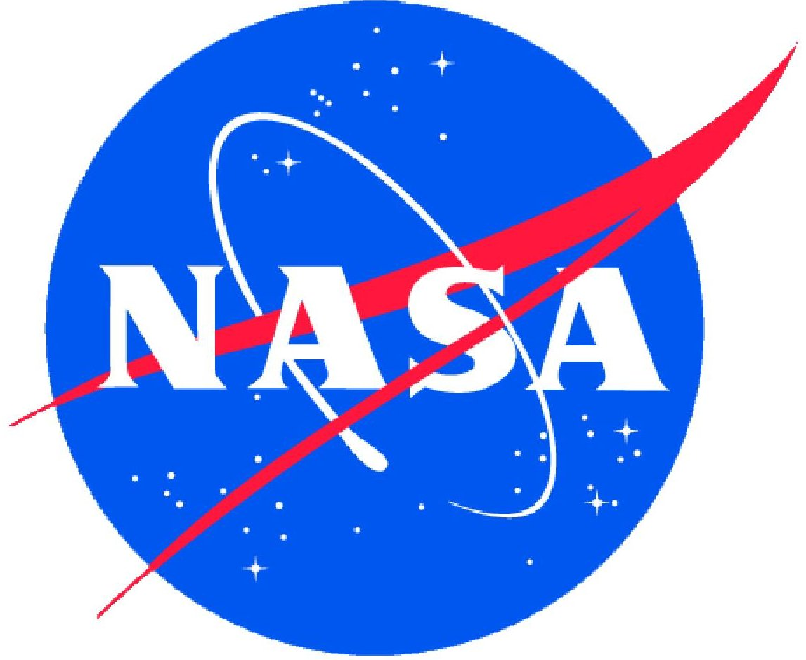
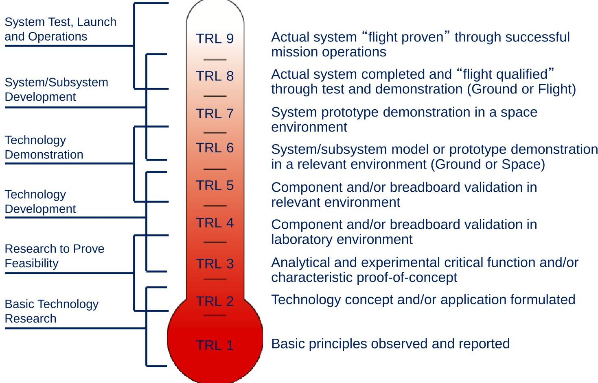
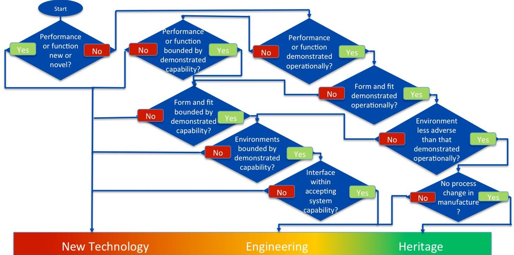
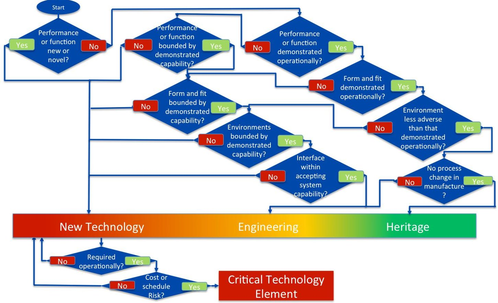

<!-- PDF_PAGE: 1 -->

# Final Report of the NASA Technology Readiness Assessment (TRA) Study Team

March 2016

Authors: HQ Office of the Chief Engineer/Steven Hirshorn and HQ Office of the Chief Technologist/Sharon Jefferies

Contributors: ARC/Kenny Vassigh, AFRC/David Voracek, GSFC/Michael Johnson, GSFC/Deborah Amato, JPL/Margaret (Peg) Frerking, JPL/Pat Beauchamp, JSC/Ronnie Clayton, KSC/Doug Willard, LaRC/Jim Dempsey, LaRC/Bill Luck, MSFC/Mike Tinker, SSC/Curtis (Duane) Armstrong

<!-- PDF_PAGE: 2 -->

## Acknowledgements

The authors of this report wish to acknowledge and thank the members of the Technology Readiness Assessment (TRA) team for their participation, dedication, effort, hard work and brilliant insights throughout the course of this study. We deeply appreciate their willingness to contribute their knowledge, experience, and time, which was the fundamental attribute leading to the success of this study. You all have been brilliant!!

## Disclaimer

The purpose of this report is to document the observations, findings, and recommendations of the NASA-wide Technology Readiness Assessment (TRA) team that conducted its work in 2014. While suggested guidance and recommendations are included, the contents of this report should not be construed as Agency-accepted practice. Establishment of an Agency-accepted practice on TRA may eventually stem from the report's contents, but at this time the report simply constitutes an outbriefing of the team's activities.

<!-- PDF_PAGE: 3 -->

## Table of Contents

1. Executive Summary ... 4

2. Introduction ... 8

3. Study Team and Background ... 9

   3.1 The TRA ... 9

   3.2 Study Background – Why this Study was Performed ... 9

   3.3 Team Representation ... 10

   3.4 Information Gathering Process ... 11

   3.5 Focus Areas ... 12

   3.6 Study Team Process ... 13

4. The Current State Defined ... 15

   4.1 Uses of TRL and TRA in NASA ... 15

   4.2 TRL and TRA in Documentation ... 20

   4.3 Execution of TRAs ... 23

   4.4 Software ... 25

   4.5 Additional Observations ... 25

   4.6 Comparison of NASA and OGA’s TRA Process ... 26

   4.7 GAO ... 27

5. Recommendations ... 28

   5.1 Develop a Consolidated TRA Handbook ... 28

   5.2 Independent TRA Validation ... 29

   5.3 Update the TRL Table (7123) and Technology Development Terminology (7120.8) ... 30

   5.4 Update the TRA process (7120.8 and NASA SE Handbook) ... 31

   5.5 Develop Standardized TRL/TRA Training ... 32

   5.6 Software ... 32

   5.7 Other Recommendations ... 33

6. Suggested TRA/TRL Guidance ... 34

   6.1 Performing Independent Validation of TRAs ... 34

   6.2 Classifying a Technology as “New” vs. “Engineering” vs. “Heritage” ... 35

   6.3 Use of CTEs ... 37

   6.4 Use of Weakest Link/Roll Up ... 38

   6.5 Use of AD2 ... 40

   6.6 TRL Definition Parsing ... 41

   6.7 TRL Inclusion in Proposal Process ... 44

   6.8 Other Readiness Levels ... 45

7 Acronyms List ... 49

Appendix 1. Recommended Changes to TRL Table (NPR 7123.1B, Appendix E) ... 51

Appendix 2. Recommended Changes to Technology Development Terminology (NPR 7120.8, Appendix J) ... 60

<!-- PDF_PAGE: 4 -->

## 1. Executive Summary

In 2014, NASA conducted a study of the Agency's use of Technology Readiness Levels (TRL) and Technology Readiness Assessments (TRA). This study, co-led by the Headquarters (HQ) Office of the Chief Engineer (OCE) and HQ Office of the Chief Technologist (OCT), was initiated after four previous, more focused and independent assessments had been conducted over the previous 3 years (primarily in the Science Mission Directorate (SMD) and the HQ OCE, each reaching similar observations and conclusions. The goals of this study, with participation from across the Agency and with representatives from all ten NASA Centers, were to: 1) Investigate the state of NASA's current TRA process, 2) Identify both current strengths to maintain and identify potential modifications, additions, and clarifications that address inconsistencies and ambiguities, 3) Prepare for audits that may result from the Government Accountability Office (GAO) TRA Best Practices Guide, which are to be included in the GAO Quick Look Book, and 4) Determine options and provide recommendations for addressing those findings to enhance the Agency's TRA process.

The data used in this study originated from four primary sources: 1) Answers to a series of questions sent to TRL and TRA practitioners at each NASA Center, representing a diversity of perspectives from research to technology development to operations, which produced a rich set of data; 2) The four independent studies previously mentioned; 3) Reviews of existing NASA documentation pertaining to TRL and TRA; and 4) Review of academic papers and publications on the subject.

The TRA team spent approximately 9 months reviewing the gathered information and discussing the topics to identify findings and observations and to develop recommendations for improvement. The team participated in a series of face-to-face meetings, workshops, and subteam activities to perform these tasks. From these meetings, the team identified approximately ten "Focus Areas" each for TRL and for TRA and used these Focus Areas to prioritize the work. For TRL, these areas included: Definitions; TRL Progression and Exit Criteria; Uses and Applications of TRL; Guidelines for Proposal Calls; Guidance on Utilizing and Interpreting the TRL Scale; TRL Roll Up; Training/Education on Readiness Levels; and Tools. For TRA, these areas included: Readiness Assessment Process; Identifying Technologies; Uses and Applications of Assessment Results; Guidance on Conducting Assessments; Development Difficulty/Risk; and Training/Education on Conducting TRAs.

Overall, the TRA team found that the NASA utilization of TRL and the process for conducting TRAs is adequate, but there are inconsistencies in execution and other opportunities for improvement. The team found that TRL is commonly used broadly across NASA by a large variety of stakeholders and practitioners, from Mission Directorates, Centers, Programs/Projects, and HQ Offices (e.g., OCE and OCT).

The most common uses of TRLs are: communication; setting a target/success criteria; project planning development; proposal development; technology selection; indicator for readiness of infusion; communicate/establish integration agreements; portfolio management; cost estimation; risk indicator; and guide/measure for engineering development prior to Preliminary Design Review (PDR).

<!-- PDF_PAGE: 5 -->

Similarly, the most common uses of TRAs are: development tracking; determining if the technology is ready for infusion in to flight projects; evaluating proposals against the target/success criteria (e.g., TRL 6 by PDR); assessing project risk based on technology maturity; project formulation; and technology portfolio management.

The team found that most applications and utilizations of TRL and TRA are appropriate and provide value. However, TRL and TRA results are occasionally used inappropriately. Examples of this include: utilization of TRL alone without association with other parameters (e.g., Advancement Degree of Difficulty (AD2)); self-assessments and liberal interpretations of definitions; when used in mathematical equations; when used in engineering development postPDR; when used in assessing maturity of software; and when used to characterize maturity of plans (e.g., mission ops/trajectory plans, planetary protection plans, etc.).

Utilization of TRL at the ten Centers varied according to the associated Center's focus, as did the specific processes used for performing TRAs. Some Centers relied on Agency-level documentation while other Centers used their own institutional processes. Some Centers do not perform TRAs.

In searching existing documentation, the team found related TRL and TRA requirements, definitions, processes, and guidance scattered through four documents: NPR 7120.8, NASA Research and Technology Program and Project Management Requirements, NPR 7123.1B, NASA Systems Engineering Processes and Requirements, NPR 7120.5, NASA Program and Project Management Processes and Requirements, and SP-2007-6105, NASA Systems Engineering Handbook. The scattering of associated TRL and TRA requirements, definitions, processes, and guidance across four documents is an obvious inefficiency.

In reviewing how assessments are performed, the team found variations on the use of TRL and in the TRAs. Some degree of variation is expected and desired due to differences in project cost/complexity/risk. However, undesired variations between TRAs remain. These tend to stem from: an inconsistent understanding and application of the TRA process; differing interpretations of how TRL is determined for a technology; and unclear communication of expectations for the TRA.

Some Program- and Center-developed processes have been created that have been used to improve consistency of TRAs, such as the New Millennium program. Ultimately, while execution of TRAs is adequate and even exemplary in cases, it was concluded that TRA results may not always accurately portray technology maturity, and that validated accuracy and agreement of the results are not generally high. There are many potential causes of this, but the most common the team found was over-optimistic assessments, where the constituent technology maturities are estimated to be a high-level of maturity than it actually is. Additionally, the team found that TRAs are frequently self-assessments performed by the respective projects and are not always independently validated. The team also found that uncertainties in TRAs are not well represented in the reports nor communicated to Project Managers.

NASA documentation actually describes two processes: 1) a TRA of a "system," documented in NPR 7120.8, and 2) a TRA of an "individual technology," documented in the NASA Systems Engineering (SE) Handbook. The 7120.8-described process only addresses a system-level TRA process and provides no guidance on how to perform an assessment for a specific technology.

<!-- PDF_PAGE: 6 -->

The SE Handbook covers both system-level and individual technology TRA process. The process in 7120.8 includes steps that include a blend of action, guidance, and observation, which can lead to confusion. Furthermore, the SE Handbook expands on some areas that are inconsistent with the 7120.8 process. On a positive note, the SE Handbook does provide some useful tools, such as the recommended TRL Assessment Matrix.

Through discussions with the software community, the TRA team found that the software TRL columns in the TRL Table in NPR 7123.1B are not widely used, nor are they accepted or agreed upon. Other team observations include the general lack of risk assessment in TRAs; the lack of certified, uniform tools for performing technology assessments; the lack of common and approved education and training materials on TRL and performing TRAs; and the presence of a variety of other readiness levels.

The team reviewed the TRA processes of other government agencies (OGA), including international agencies, and found that while the high-level processes are similar, the NASA process has a greater level of detail. Finally, NASA's HQ OCT continues to monitor the GAO's efforts to produce a TRA Best Practices Guide, a draft of which was received in February 2016. This Guide could impact the recommendations of this report.

After considerable assessment, the TRA team identified six primary recommendations, some with subsidiary sub-recommendations. They are as follows:

## Consolidated TRA Handbook

Recommendation 1: Develop a TRA Handbook that will consolidate all TRA and TRL processes, guidance, best practices, examples, and other related content into a single reference source.

Sub-Recommendation 1.1: All TRA process "requirements" (e.g., shall statements) should remain in the applicable NPRs (e.g., 7120.8). All other TRA/TRL content presently residing in applicable NPRs and the NASA SE Handbook should be removed and transferred to the TRA Handbook.

Sub-Recommendation 1.2: All applicable NPRs should be updated to reference/point to the TRA Handbook.

Sub-Recommendation 1.3: Until the TRA Handbook is published; the applicable NPRs should be updated to include the TRA team's recommended process updates and guidance.

## Independent TRA Validation

Recommendation 2: Initiate a process to independently assess or validate project TRAs and TRL estimates, when appropriate.

Sub-Recommendation 2.1: Develop and implement common standards/qualifications for independent TRA assessors

<!-- PDF_PAGE: 7 -->

## TRA Table (7123) and Technology Development Terminology (7120.8) Updates

Recommendation 3: Update the TRL Table (NPR 7123.1B Appendix E, Technology Readiness Levels) and the Technology Development Terminology (NPR 7120.8 Appendix J) with selected clarifications.

## TRA Process (7120.8 and NASA SE Handbook) Updates

Recommendation 4: Consolidate the TRA processes in NPR 7120.8, Section 4.7.2, and the NASA SE Handbook, Appendix G, into a cohesive process that accommodates both system-level and individual technology processes. Also, update the process with the below subrecommendations.

Sub-Recommendation 4.1: Add a step in the TRA process to classify technology as either "New," "Engineering," or "Heritage."

Sub-Recommendation 4.2: Provide guidance on use of Critical Technology Elements (CTEs), "Use of Weakest Link" Roll Up, and Technology Development Risk (AD2).

## Standardized TRL/TRA Training

Recommendation 5: Develop and make available standardized TRA/TRL training materials on the TRA process and best practices to increase consistency and effectiveness across the Agency.

## Software

Recommendation 6: Eliminate the software columns from the NPR 7123.1B TRL Table.

Finally, in support of many of the above recommendations, the TRA team developed significant new guidance areas. This guidance provides important clarification and elaboration of many of the concepts and ideas incumbent in utilizing TRL and performing TRAs. The new and additional guidance provided by the team covers the following areas:

1. Performing Independent Validation of TRAs

3. Use of CTEs

2. Classifying a Technology as "New" vs. "Engineering" vs. "Heritage"

4. Use of Weakest Link/Roll Up

5. Use of AD2

6. TRL Definition Parsing

7. TRL Inclusion in Proposal Process

8. Other Readiness Levels

<!-- PDF_PAGE: 8 -->

## 2. Introduction

The material in this report covers the results on the NASA-wide TRA team, who are responsible for ascertaining the full extent of issues and ambiguities pertaining to TRA/TRL and to provide recommendations for mitigation. The team worked for approximately 6 months to become knowledgeable on the current TRA/TRL process and guidance and to derive recommendations for improvement.

In February 2014, a call (letter) from the NASA HQ OCE and OCT went to all NASA Center Directors to solicit participation in an Agency-wide activity to improve the NASA's TRA process and guidance. The letter noted that in 2013 several issue areas were raised to NASA HQ concerning implementation ambiguities and technical concerns with the Agency's TRA process. Upon further investigation, many of these issues were found to be similar across the Centers and Mission Directorates, having been summarized in three separate reports $ ^{(1)} $ indicating the need to obtain better consensus across the Agency.

HQ OCE and OCT decided to initiate a joint co-led team to ascertain the full extent of issues and ambiguities pertaining to TRA/TRL and to provide recommendations for mitigation. Each Center was requested to nominate a member for this new team, with each nominee being a senior manager from the Center's OCE or OCT communities who would represent their Center's unique experience and applicable interests. Mr. Steven Hirshorn (OCE) and Ms. Sharon Jefferies (OCT) were selected to co-lead this team.

Over the course of the remainder of 2014, the team worked diligently to ascertain the present TRL and TRA state-of-the-art performance within the Agency; identify gaps, ambiguities, and other areas of inconsistency, and to provide recommendations for mitigation. The team conducted a thorough study via meetings, telecons, and workshops. As a result, the team successfully ascertained the present state-of-the-art, as well as collected a substantial amount of potential guidance for TRL and TRA practitioners.

The team presented their findings, observations, and initial recommendations to the NASA Technology Executive Council (NTEC) on December 16, 2014, in an informational format. The team returned to the NTEC on May 26, 2015, with the request for action on the formal recommendations. As of the writing of this report, no formal action has been taken, and implementation of the recommendations may be dependent on the results of the GAO TRA Guide currently under review.

<!-- PDF_PAGE: 9 -->

## 3. Study Team and Background

## 3.1 The TRA

A TRA is a systematic process to develop the appropriate level of understanding (technical and risk) required for successful technology insertion into a system under development. There are numerous reasons and benefits from performing TRAs, including reducing technology development uncertainty, providing a better understanding of project cost and schedule risk, facilitating infusion of technologies into operational systems, and improving technology investment decision-making.

TRLs are a method of estimating technology maturity of CTEs of a program. They are determined during a TRA that examines program concepts, technology requirements, and demonstrated technology capabilities. TRLs are based on a scale from 1 to 9 with 9 being the most mature technology. The use of TRLs enables consistent, uniform, discussions of technical maturity across different types of technology. NASA's TRL scale is located in NPR 7123.1B, NASA Systems Engineering Processes and Requirements, Appendix E.

## 3.2 Study Background - Why this Study was Performed

Over the course of 2011 to 2013, four independent studies were conducted on the Agency's use of TRA and TRL. All four studies indicated numerous questions, issues, ambiguities, and inconsistencies with the Agency's TRA process. These studies were:

1. A review of the TRL scale conducted by the HQ OCE's Program Executive for Systems Engineering during a revision cycle for NPR 7123 (2001).

2. A study funded and conducted by the SMD's Planetary Division titled "How to Provide a Uniform TRL Assessment Across NASA and the Broader Community." (2013).

3. An analogous study conducted by SMD's Earth Science Missions Program Office titled "TRL Definition Changes to 7123.1B and Recommendations" (2013).

4. A study of the NASA Systems Engineering Handbook (SP-2007-6105) Appendix G - Technology Assessment and Insertion, conducted by the HQ OCE during a revision cycle to the SE Handbook.

These four studies were all conducted independently of each other at different times. In general, while there were some differences, the studies resulted with many of the same conclusions regarding ambiguities, gaps, and misunderstanding of the NASA TRA process and TRL scale.

In late 2013, the HQ OCE was conducting a revision cycle of the NASA SE Handbook, which includes an appendix on technology assessments. A small team was formed from across the Agency to identify what was needed to update this appendix. While numerous issues were identified, it was at this time that the OCE became aware of the three additional studies above, many communicating the same issues and concerns. Because of the independence of this effort, it was determined the best course of action would be to gather all affected communities and perform a holistic assessment at an Agency-level.

Additionally, at approximately the same time, the GAO was preparing to initiate an effort to establish TRA best practices across all government agencies. The intended product of this GAO effort was to be a "Best Practices Guide" that documented recommended practices across all

<!-- PDF_PAGE: 10 -->

government agencies performing technology assessments. This GAO effort (and potential impact on future GAO audits of NASA), in addition to recognition of the findings in the four studies, was the primary motivation for conducting this study.

The objectives of the NASA TRA team were to:

- Investigate the state of NASA's current TRA process.

- Identify both current strengths to maintain any potential modifications, additions, and clarifications that address inconsistencies and ambiguities.

- Prepare for audits that may result from the GAO TRA "Best Practices Guide," which are to be included in the GAO Quick Look Book.

- Determine options and provide recommendations for addressing those findings to enhance the Agency's TRA process.

Upon completion of the study and team activities, it was the team's intention to: a) produce a compendium of the team's findings, recommendations, and best practices (i.e., this report); b) present the findings and strategic recommendations to the NTEC; and c) generally provide a path forward to facilitate a more consistent and robust TRA process across the Agency, including policy, practice, and documentation changes.

The primary customer of the team is the NTEC, who will receive all briefings, findings, and recommendations. Secondary customers of the team are the Mission Directorates, Chief Technologist Council (CTC), including the Center Chief Technologist community, and the Engineering Management Board (EMB), consisting of the Center Engineering Directors. Other organizations, such as the Office of Safety & Mission Assurance (OS&MA) and Office of Chief Financial Officer's (OCFO) Cost Accounting Division (CAD), will also be made aware of the team's activities. Ultimately, however, it is NASA's technology practitioners who should receive the most benefit from this report.

Although the TRL scale and TRA processes reside in the aforementioned NPRs and Handbooks under the authority of the OCE, technology policies is fundamentally responsibility of the HQ OCT. As such, it was decided that both OCE and OCT should jointly co-chair this TRA team.

## 3.3 Team Representation

In February 2014, a letter was distributed to all ten NASA Center Directors requesting nominations for team members. It was requested that the Center Directors provide nominees from their respective OCT and OCE who were senior, experienced managers in the fields of systems development and technology selection. These team members were expected to represent their applicable fields of expertise, but also to represent their respective Center's unique applications and experience. All ten NASA Centers were included to ensure diverse representation and needs across flight projects, technology development, and research communities. See table for representation.

<!-- PDF_PAGE: 11 -->

<table border="1"><tr><td>Center/Organization</td><td>Representative</td></tr><tr><td>HQ/OCT</td><td>Sharon Jefferies(co-lead)</td></tr><tr><td>HQ/OCE</td><td>Steven Hirshorn(co-lead)</td></tr><tr><td>Ames Research Center(ARC)</td><td>Kenny Vassigh</td></tr><tr><td>Armstrong Flight Research Center(AFRC)</td><td>David Voracek</td></tr><tr><td>Glenn Research Center(GRC)</td><td>Marla Perez-Davis</td></tr><tr><td>Glenn Research Center(GRC)</td><td>Chris Steffan</td></tr><tr><td>Goddard Space Flight Center(GSFC)</td><td>Mike Johnson</td></tr><tr><td>Goddard Space Flight Center(GSFC)</td><td>Deborah Amato</td></tr><tr><td>Jet Propulsion Laboratory(JPL)</td><td>Margaret(Peg) Frerking</td></tr><tr><td>Jet Propulsion Laboratory(JPL)</td><td>Pat Beauchamp</td></tr><tr><td>Johnson Space Center(JSC)</td><td>Ronnie Clayton</td></tr><tr><td>Kennedy Space Center(KSC)</td><td>Doug Willard</td></tr><tr><td>Langley Research Center(LaRC)</td><td>Jim Dempsey</td></tr><tr><td>Langley Research Center(LaRC)</td><td>Bill Luck</td></tr><tr><td>Marshall Space Flight Center(MSFC)</td><td>Mike Tinker</td></tr><tr><td>Stennis Space Center(SSC)</td><td>Curtis(Duane) Armstrong</td></tr><tr><td>NASA GAO Study POC</td><td>Jan Rogers</td></tr><tr><td>Ex Officio</td><td>Joseph Smith</td></tr><tr><td>HQ/Mid-Level Leader Program(MLLP) Detailee</td><td>Tawnya Laughinghouse</td></tr></table>

## 3.4 Information Gathering Process

The team used numerous means and methods to gather data and information. The first phase of the team's activities was for the team representatives query their respective NASA Centers on the understanding and utilization of TRA and TRL. Each Center was queried on the following questions:

- Does your Center have a TRA process, either formal or informal?

- What are TRL and TRA processes used for at your Center, and how is it applied?

- Is the process sufficient for your Center's needs?

- What is working well?

- What issues, concerns, questions do you have?

- What is missing or needs fleshing out?

- Anything else regarding TRA and TRL that you would like to bring forward?

These surveys produced an enormously rich set of raw data, information, and Center perspectives. The data were reviewed, coalesced, and separated into uniquely defined "buckets" that provided the "Focus Areas" (below) from which the team determined priorities for investigation.

A second source of information for the team was the results of the four studies previously mentioned. While the context and scope of each study was slightly different, the commonalities between them also helped the team in determining priorities for investigation.

Finally, all sources of existing associated documentation (policies and practices) were reviewed. These included the NASA documentation: NPR 7123.1B, SP-2007-6105, NPR 7120.5, and NPR 7120.8.

<!-- PDF_PAGE: 12 -->

Additionally, OGA and international agency TRA practices were sourced and reviewed. These include the US Department of Defense Technology Readiness Assessment Deskbook (2009), the US Navy's NAVAIR Instruction 3910.1 Technology Readiness Assessment Process (2009), the International Standards Organization (ISO) TRL Scale, the European Space Agency's (ESA) Technology Readiness Level Handbook for Space Applications (2008), and the Australian Government's Department of Defense Technical Risk Assessment Handbook (2010).

Finally, internet searches were conducted to locate academic peer-reviewed papers on TRA, TRLs, and related topics.

## 3.5 Focus Areas

Based on the collection of data from all of the sources mentioned, separate and unique areas were designated as "Focus Areas." These Focus Areas were then compiled into categories or "buckets" of individual issues or concerns pertaining to TRL and TRA. The Focus Areas were populated with the individual comments from the Center query activities and other observations, and were primarily used to determine how to logically break down the team's work.

The Focus Areas were as follows (note that there are some Focus Areas similar to both TRL and to TRA):

<table border="1"><tr><td>TRL</td><td>TRA</td></tr><tr><td>Definitions</td><td>Readiness assessment process</td></tr><tr><td>TRL progression and exit criteria</td><td>Identifying technologies (“New”, “Engineering,” or “Heritage”)</td></tr><tr><td>Uses and applications of TRL</td><td>Uses and applications of assessment results</td></tr><tr><td>Guidelines for proposal calls</td><td>Guidance on conducting assessments</td></tr><tr><td>Guidance on utilizing and interpreting the TRL scale</td><td>Independent assessments</td></tr><tr><td>TRL roll-up</td><td>Development difficulty/risk</td></tr><tr><td>Training/education on readiness levels</td><td>Training/education on conducting assessments and using results</td></tr><tr><td>Tools</td><td>Tools</td></tr><tr><td>Software readiness levels</td><td>Software readiness assessments</td></tr><tr><td>Other readiness levels</td><td></td></tr></table>

Once categorized and organized into Focus Areas, the following questions were identified for the team to address:

- Uses/Applications

Who uses TRL and TRA at NASA?

O What are the appropriate and inappropriate uses of TRL and TRA?

- Assessment Process

O Who is performing TRAs?

O When do we perform TRAs?

O Are there other better ways to characterize technology maturity?

O Is there a standard process used for TRAs?

O How do TRAs incorporate/assess risk?

o Is there a need for independent assessments?

<!-- PDF_PAGE: 13 -->

## TRL Definitions

o Do the present TRL definitions and descriptions need refinement?

o How do we foster more consistent interpretations of the TRL definitions?

O What is meant by "TRL 6 at handoff' between developers and flight project engineers?

How do you calculate/assign TRL through system hierarchy?

o Is guidance required on the differences between relevant vs. operational environment?

## Other Readiness Levels Tools

O Are other readiness levels used within the Agency?

o If so, is guidance required for use/application of these other readiness levels?

## Tools

What tools are being used and for what applications?

Should there be a common tool or set of tools available?

## Education/Training

Do practitioners know and understand TRL and the TRA processes?

How do we promote a more consistent interpretation of TRL and TRA among different communities?

Do we need to produce a "quick reference guide"?

O Is there a need for TRL/TRA training?

## Software

O Does the software community utilize TRL?

O Does the TRA process incorporate software readiness?

## Documentation

How do we best capture and convey TRA processes and practices?

Do we consolidate all TRA and TRL material into a single document?

What additional content needs to be included in the documentation?

## 3.6 Study Team Process

To organize and distribute the work, the team separated the content and discussions into subteams and workshops. The sub-teams consisted of portions of the team's representatives who performed their investigations per weekly or bi-weekly meetings over the course of months. Workshops consisted of one-day events in which the entire team participated.

The sub-teams were defined as follows:

- TRL Definitions

Moving from one TRL to another

Handling hierarchy (e.g., component, subsystem, system)

- Definition of terms within the TRL scale (e.g., breadboard and brassboard)

o "Environment definitions (e.g., relevant and operational)

- Technology, Engineering, Heritage Continuity

O Identifying what is Technology and what is Engineering

Heritage hardware/software

<!-- PDF_PAGE: 14 -->

## Assessment Process

O Adequacy of TRA/TRL as a project management tool

Risk quantification (i.e., AD2)

- Technology infusion/transfer issues (e.g., better communication of expectations and ensuring what is provided to technology developers meets the project needs for integration)

Need for independent assessment/validation of TRL estimates

The one-day workshops were conducted discussing the following topics:

- Applications/Uses of TRL and TRA

o Applications/uses that should be maintained or further developed

o Where is TRL applicable and when?

Identification of inappropriate applications/uses of TRL

- Applicability of other readiness levels (i.e., integration readiness level, system readiness level (SRL), manufacturing readiness level (MRL), and concept readiness level)

- Guidelines for Proposals

Aligning expectations between technology proposers and reviewers

Need for clear guidance/wording of requirements/success criteria

Standards for review boards

- Documentation

O Whether to incorporate all TRL/TRA requirements, processes, and guidance into a single document, or maintain the information distributed through NPRs 7123.1B, 7120.5, 7120.8, and the SE Handbook.

Software maturity/readiness characterization was recognized as an area of applicability (the existing TRL scale in NPR 7123.1B includes software readiness definitions), but the team recognized this as a topic that should be worked with other communities, notably the Software Engineering community.

<!-- PDF_PAGE: 15 -->

## 4. The Current State Defined

Overall, the TRA team found that the NASA process for conducting TRAs is adequate, but there are inconsistencies in execution and other opportunities for improvement.

## 4.1 Uses of TRL and TRA in NASA

The team's review indicated the need for TRLs and TRAs are both common and widely accepted across the Agency as a means to characterize technology maturity. It is considered of great value having a common frame of reference for technology maturity characterization within NASA. The TRL scale in NPR 7123.1B is also broadly considered an adequate mechanism for characterizing technology maturity.

The TRL scale is used almost universally by programs and projects for technology characterization. This is particularly true for low- to mid-TRL technology development. The team also concluded that TRL usage is less common in high-TRL development, where standard engineering measures of maturity (e.g., PDR, Critical Design Review (CDR), qualification tested, and acceptance tested) are more commonly utilized. Additionally, there are many interpretations of the TRL definitions, which leads to confusion and inconsistency in application. Transition between the TRL levels is not clear and also requires interpretation by the users.

TRLs and TRAs are used by different types of stakeholders, including engineers, developers, proposers, managers, and decision authorities. TRL and TRA are used by many organizations within NASA for a variety of purposes, such as:

- Mission Directorates use TRL and TRA for portfolio determination, characterizing maturity, project risk assessments, life-cycle design reviews, technology selection and development, solicitations, and Announcements of Opportunity.

- OCT uses TRL in technology roadmaps, portfolio management, and investment prioritization.

- Programs and projects use TRL and TRA during technology development, project formulation, life-cycle design reviews, risk discussions, and portfolio investment decisions.

The most common uses of TRL include:

- Communication - The TRL scale is a means by which programs, projects, decision makers and engineers can communicate with the same frame of reference. It can provide a common understanding of a technology's level of maturity, but different interpretations sometimes lead to miscommunication. TRL is also used to communicate relative maturities of multiple technologies and is used to communicate progress and status. Common understanding is vital both internally and externally to NASA (OGAs and international agencies).

- Examples include technology roadmaps, life-cycle design reviews, technology selection/portfolio meetings, and workshops.

- Set a target/Success Criteria - TRL is used as a target and/or success criteria during development. TRL may be used to designate minimal acceptable levels of maturity (i.e., TRL 6 by PDR). It is also used in research and technology development projects to establish starting and ending points for that project, or as Entrance and Success criteria

<!-- PDF_PAGE: 16 -->

for technology demonstration missions.

- Examples include proposals, Announcement of Opportunity, Requests For Information.

- Project Planning Development - TRL is used as a tool for the Project Manager as it assists in determining what additional testing is required, the pace of the maturation, and levels of additional fidelity that is required.

- Proposal Development - The TRL scale is used to assess technology, subsystem and system maturity plans during proposal development, solicitation, and review.

O Examples include SMD missions, Game Changing Development (GCD) Program, NASA Innovative Advanced Concepts (NIAC), Aero solicitations with industry partners.

- Technology Selection - TRL is used to help identify sufficiently mature technologies (usually TRL 5) that meet mission requirements. Program and Project Managers also use TRL during their Assessment of Alternatives (AoA) to identify candidate technologies and to down-select between options.

- Indicator for Readiness of Infusion - Project Managers provide technology developers with the TRL technology needed for infusion into their project. Technology developers use TRL to indicate to Project Managers that their technology is at the requisite maturity for infusion.

- Communicate/Establish Integration Agreements - Agreements identify both technology and engineering development that needs to be done before a PDR. They are formalized documents that try to capture information before forming a development plan.

- Portfolio Management - The TRL scale provides data to understand and communicate the spectrum of ongoing research and development (R&D) activities within a technology development portfolio. It helps facilitate balanced portfolio across the TRLs and helps target investment decisions to determine which project NASA funds.

O Examples include OCT investments, Space Technology Mission Directorate (STMD) investments, Human Exploration Operations Mission Directorate (HEOMD)/ Advanced Exploration Systems (AES) investments.

- Cost Estimation - TRLs down to the component level, whether a technology or not, are used as an input to cost estimation models. For more accurate estimates, models should also incorporate risk measures such as AD2.

- Examples include the Independent Program Assessment Office (IPAO) and cost models.

- Risk Indicator - Establishment of TRLs within a system under development assists with the determination and assignment of risk within that project. It informs the Project Manager of the level of risk in using specific technologies and helps with the decision process on make/buy. It supports risk/benefit analysis.

- Guide/Measure for Engineering Development prior to a PDR - The TRL scale can provide a measure of relative technology maturity as a function of the systems engineering life-cycle process.

Examples include project proposals and technology development/maturity plans.

<!-- PDF_PAGE: 17 -->

The most common uses of TRAs are as follows:

- Development Tracking - TRAs are used to substantiate and track technology maturation within a project. They help determine the starting status/maturity of a technology and can assist with measuring its progress of development. TRAs provide evaluation and validation of TRLs for major project reviews and can determine if project milestones are met.

Example includes life-cycle design review requirements.

- Determining if the Technology is ready for Infusion into Flight Projects - Readiness assessment can be utilized to determine the readiness of technologies to be infused into flight projects based on cost/schedule/risk of the remaining development, integration penalties, and other factors.

- Evaluating Proposals against the Target/Success Criteria (i.e., TRL 6 by PDR) - An assessment can validate whether a technology has achieved the target maturity.

- Assessing Project Risk based on Technology Maturity - TRAs are an input into the risk assessment process by characterizing the level of remaining risks to a project for continued development of the technology.

- Project Formulation - Assesses technology suitability and development needs for a proposed mission and facilitates the development of project plans, including cost and schedule.

Example includes formulation agreements.

- Technology Portfolio Management - Multiple technologies are assessed through comparative assessments for selection into technology portfolios. Also assists with down-selection of multiple technologies that serve the same function and with new business decisions.

The team found that most applications and utilizations of TRL and TRA are appropriate and provide value. However, TRL and TRA results are occasionally used incorrectly or inappropriately. Examples include:

- Utilizations of TRL alone without association with other parameters (i.e., AD2) - TRL by itself only provides a starting point and ending point, but provides no insight into the level of difficulty in maturing the technology. Other aspects such as system integration penalties may not be illuminated by the TRL scale.

Additionally, TRL has been used as a schedule prediction tool, or as an input to such a tool (Tools help estimate schedule slippage based on TRL, which is then used to estimate margin) - a practice of the former IPAO. To be really effective, TRL needs to be used in conjunction with other factors, such as the history of similar projects, as using TRL on its own to predict schedule can lead to inappropriate conclusions. The same applies to cost models.

Inappropriate to use TRL of technology without respect to passage of time/obsolescence/ shelf life (claiming the TRL the technology used to have without reassessment). What are the real risks that need to be captured at this point?

<!-- PDF_PAGE: 18 -->

- Self-assessments/liberal interpretations of definition - TRL estimates and readiness assessments are frequently performed by the associated project itself and the results may be inaccurate for multiple reasons, such as:

May be over-estimated due to desire for project/proposal to be approved.

- May be under-estimated due to greater availability of technology development funding outside of defined flight projects.

o As a marketing tool. PMs and developers may want to 'sell' their technologies and sometimes convey a TRL that is most favorable for their technology for a given audience.

- Use in mathematical equations - TRL estimates are qualitative approximation and not absolute determinations. Use of TRL in precise calculations is not advised.

- Engineering Development post-PDR - TRL is rarely used as a measure of maturity in post-PDR engineering development. Instead, location within the SE process is more commonly used and better suited to characterize maturity in a flight project. TRL alone also rarely incorporates subtleties such as system-level integration penalties. TRL is questionable when used to measure engineering risk. TRL is not a good measure of risk for engineering development because it over-estimates.

- Use in assessing readiness of software, mission ops/trajectory plans, and Planetary Protection - Other measures are likely more suitable for characterizing maturity/readiness in these areas. TRL is not well-suited for these.

The team also found there is minimal guidance on using TRL and TRA results. While some guidance exists in NPRs 7123 and 7120.8 and the NASA SE Handbook, it is minimal at best and offers no real guidance on how the information should be utilized or interpreted.

Center utilization of TRLs and TRAs differs widely. This is not unexpected as some Centers focus more on research while other Centers focus more on operations. The variances of utilization were not an indication of good or bad simply different. Based on the data collection performed by the TRA team,utilizations at the Centers were found to be as follows:

## ARC

- Typically works in the TRLs from 3 to 6.

- No Center-specific technology assessments processes.

- Works with the NASA Centers, industry, and OGAs in assessment of a technology in developing integration and testing plans.

- Performs technology assessments in informal and formal peer reviews that review the technology and make assessments for moving into ground and flight testing.

## AFRC

- Flight or research projects at AFRC follow the TRL scales and guidance according to the NPRs.

- No specific tool or assessment process is used.

- Independent Review Boards (IRB) evaluates the review of the technology through project life-cycle gate reviews (i.e., System Requirements Review (SRR), PDR, and CDR).

<!-- PDF_PAGE: 19 -->

## GRC

- Conduct TRAs in the regular course of maturing technology projects for eventual flight demonstration.

- Mostly works with the published Agency definitions (NPR 7123, NPR 7120.8, and/or the NASA HDBK 6105 Appendix G) when establishing technology project plans.

- TRL level claims are discussed in support of an overall technology project life-cycle design review.

- The Air Force Research Laboratory (AFRL)/MSFC/Bilbro TRL calculator has been applied at GRC in support of the GCD Program. This included both TRA calculator and the AD2 assessment. Another customized assessment was developed by the Lunar Dust Management Project (DMP).

## GSFC

- Projects perform a TRL assessment of their relevant technologies with as required participation from Center Chief Engineer, the Applied Engineering and Technology Directorate Chief Engineer, and the Applied Engineering and Technology Directorate Chief Technologist. Other experts are invited to participate as necessary.

- Review plans for elevating items from their current TRL level to TRL 6 or higher if they are sub-TRL-6.

- Always assess TRL 6 by PDR as part of the normal milestone review process and sometimes through special request technology reviews (at Project or Engineering Directorate Request) prior to the PDR/Key Decision Point (KDP)-C Project Milestone Review.

## JPL

- There are two major processes JPL has used: the New Millennium TRA and the Mars Technology assessment process.

- A consistent Center process is currently under development.

- There are also a lot of informal and semi-formal processes around the lab, especially for the lower TRL.

- JPL Earth Science has a process similar to SMD's Earth Science Technology Office (ESTO) assessments.

## JSC

- JSC projects use the NASA TRL definition scale and NPRs.

- The assessments are subject to the Project Manager's or Principal Investigator's (PI) understanding of the definitions and exit criteria in the NPRs.

- The performing organizations review the TRL at project formulation and at subsequent project major milestones.

## KSC

- No Center-specific TRA processes. Generally does not perform TRAs.

<!-- PDF_PAGE: 20 -->

## LaRC

- When applicable, projects follow NPR 7120.5E, NPR 7120.8, NPR 7123.1B, and reference the NASA SE Handbook.

- During Pre-Phase A TRL assessments are performed to determine the maturity of all the project's new technologies by using the NASA TRL scale found in NPR 7123.1B. At the Mission Concept Review, a Technology Development Plan (TDP) is baselined.

- The TDP contains the project's technology development cost, schedules, and risk mitigations for each of the identified new technology developments to achieve TRL 6 by PDR.

- GCD Program projects have a TRL assessment section in each project plans. These are reviewed by the Program Chief Engineer, PI, and others. The GCD Program Office and the PI are considered to be an independent TRL assessment component. TRL are revisited at the team's project continuation reviews and closeout reviews.

- Research uses the TRL criteria at the beginning of an execution year to plan and negotiate research activities needed to reach project goals, and is used at the end of the research cycle (e.g., Annual Performance Goal reviews) to gauge whether completed research milestones were met.

## MSFC

- Generally uses the NASA TRL definition scale ("thermometer") and NPRs 7120.8 and 7123. For Earth Science work and proposals, follow SMD guidance to PIs through use of TRL worksheet.

- SLS Program uses web-based TRA Tool derived from AFRL. Performed in team environment with Chief Engineers and Subsystem Managers during SRR/System Definition Review (SDR) and PDR. TRL definitions from NASA scale. (TRA Tool also used in Ares and other programs.)

- Some projects also utilize the New Millennium Program white paper with expanded TRL definitions.

- Flight Programs and Projects Office do not directly perform TRA or TRL assessments, but accept assessments from other Centers or HQ. However, TRA Tool was applied for Altair Lander Engines during the Constellation Program and other projects. Used TRL scale in previous In-Space Propulsion Program, but in a subject matter expert (SME) team environment.

- IRAD projects use the NASA TRL definition scale ("thermometer"). These assessments are admittedly subject to the PI's understanding of the definitions and technology maturity.

## SSC

- No Center-specific TRA processes. Generally does not perform TRAs.

## 4.2 TRL and TRA in Documentation

NASA provides a documented TRA process and TRL definitions. However, this information is spread through multiple documents, including:

- NPR 7120.8

Section 4.7.1, Technology Maturity Assessment

Section 4.7.2, System-level Assessment Process

<!-- PDF_PAGE: 21 -->

Appendix J, Technology Development Terminology

- NPR 7123.1B

Appendix E, TRL Definitions

Appendix G, TRA Entrance Criteria for Life-Cycle Reviews

- NPR 7120.5

- Appendices F/G/H, Program Plan/Project Plan/Formulation Agreement

- SP-2007-6106, NASA Systems Engineering Handbook

Appendix G, Technology Assessment/Insertion Process and Guidance

While the relevant content is spread among these four documents, the content does not reference one another. The TRA team found that many users do not know where to find the information they need.

The requirements for TRA are located in NPRs 7120.8 (for Research and Technology Development projects) and 7120.5E (for Spaceflight projects), as follows:

NPR 7120.8, Technical Maturity Assessment:

- 4.7.1.1 Accurate assessment of technology maturity is critical to technology advancement and its subsequent incorporation into operational products.

- 4.7.1.2 The Technology Development (TD) project lead shall ensure TRLs and/or other measures of technology maturity that are important to the customer/beneficiary are used in conjunction with key performance parameters (KPPs) to assess maturity throughout the project life-cycle. When a TD Project uses a measure of maturity other than TRLs, the measurement system should map back to TRLs. TRLs are defined in NPR 7123.1.

- 4.7.1.3 An independent group should validate the current state of maturity. The maturity assessment should involve or be reviewed by the customer(s)/beneficiary(ies) or their representatives. The initial maturity assessment is done in the formulation phase and updated at the project status reviews. At the conclusion of the TD project, an independent assessment of the final TRL is performed. The TD project lead shall assign the independent group responsible for the Technology Maturity Assessment.

- 4.7.1.4 TRLs establish the baseline maturity of a technology at a given time. Moving to a higher-level of maturity (higher TRL) requires the assessment of an entire range of capabilities for design, analysis, manufacture, and test. These additional assessments may be embodied in other measures of technology maturity, such as a Technology Maturity Index (TMI) or an AD2, which are described in the NASA SE Handbook.

## NPR 7120.5E, Technology Readiness Assessment and Development

- [Identify the specific new technologies TRL (less than 6) that are part of this project or single-project program; their criticality to the project's or single-project program's objectives, goals, and success criteria; and the current status of each planned technology development, including TRL and associated risks. Describe the specific activities and risk mitigation plans, the responsible organizations, models, and key tests to ensure that the technology maturity reaches TRL 6 by PDR.

- Identify off-ramp decision gates and strategies for ensuring there are alternative development paths available if technologies do not mature as expected. Identify potential cost, schedule,

<!-- PDF_PAGE: 22 -->

or performance impacts if the technology developments do not reach the required maturity levels.

- Provide technology development schedules, including intermediate milestones and funding requirements, during Phases A and B for each identified technology development to achieve TRL 6 by PDR. Describe expected status of each technology development at SRR, Mission Definition Review (MDR)/SDR, and PDR. Reference the preliminary or final TDP for details as applicable. Describe how the program will transition technologies from the development stage to manufacturing, production, and insertion into the end system. Identify any potential costs and risks associated with the transition to manufacturing, production, and insertion. Develop and document appropriate mitigation plans for the identified risks.]

NPR 7120.8, Section 4.7.2, includes steps for performing a TRA, but is written such that the TRA is performed at the system-level. Similarly, the NASA Systems Engineering Handbook, Appendix G, also contains steps to performing a TRA, but focuses on assessing an individual technology. It is not clear why there are two processes, nor is there overall guidance as to which one a developer should use.

The TRA team also noted the frequent usage of the "thermometer" charts (see figure below) in numerous presentations, TRAs, life-cycle design reviews, project management plans, and other sources. It is nearly as common to have this figure referenced as the official source of NASA TRL definitions as the actual official source (NPR 7123.1B). Unfortunately, this figure is almost uniformly used without reference to its source and, as such, cannot be confirmed as the latest instantiation.

<!-- PDF_PAGE: 23 -->

## 4.3 Execution of TRAs

In reviewing how assessments are performed, the team found variations on the use of TRL and in the TRAs. Some degree of variation is expected and desired, as a TRA for a high-cost/highcomplexity project (e.g., James Webb Space Telescope (JWST)), would be different than a medium-cost/medium-complexity project (e.g., New Horizons) and a low-cost/low-complexity project (e.g., Lunar Flashlight CubeSat). Those variations can depend on whether the project teams are concerned with low-TRL R&D activity vs. complex systems with mid- to high-TRL activity.

However, undesired variations between TRAs remain. These tend to stem from:

- An inconsistent understanding and application of the TRA process.

- Differing interpretations of how TRL is determined for a technology.

- An unclear communication of TRA expectations.

Some Program- and Center-developed processes have been created that have been used to improve consistency of TRAs (i.e., New Millennium Program).

Ultimately, while execution of TRAs is adequate and even exemplary in cases, it was concluded that TRA results may not always accurately portray technology maturity, and that validated accuracy and agreement of the results are not generally high. There are many potential causes of this, but the most common the team found was over-optimistic assessments, where the constituent technology maturities are estimated to be a high-level of maturity than it actually is. Additionally, the team found that TRAs are frequently self-assessments performed by the respective projects and are not always independently validated. While examples exist of

<!-- PDF_PAGE: 24 -->

independent validation of TRAs and TRL estimates, particularly in SMD, the practice could be improved and more widely implanted. Without independent validation, the Program/Project Manager's and decision maker's ability to understand the true technology risks and impacts on a project are diminished.

The team also found that uncertainties in TRAs are not well represented in the reports nor communicated to Project Managers.

NASA documentation actually describes two processes: 1) a TRA of a "system," documented in NPR 7120.8, and 2) a TRA of an "individual technology," documented in the NASA SE Handbook. The 7120.8 described process only addresses a system-level TRA process and provides no guidance on how to perform an assessment for a specific technology. The SE Handbook process covers both system-level and individual technology TRA processes. The process in 7120.8 includes steps that are a mix of action, guidance, and observation, which can be confusing. Furthermore, the SE Handbook expands on some areas that are inconsistent with the 7120.8 process. On a positive note, as guidance, the SE Handbook does provide some useful tools, such as the recommended TRL Assessment Matrix.

As an NPR, the 7120.8 process would be the controlling process where the NASA SE Handbook process is considered guidance. In practice, excepting where a Center or Mission Directorate has established a separate process, the TRA team found that most TRAs follow the 7120.8 process.

Adding to the confusion, NPR 7120.5 also provides some requirements for technology development performed in flight projects, specifically in Appendices F (Formulation Agreement template), G (Program Plan template), and H (Project Plan template), which indicate what needs to be included in TRAs. These appendices do not point to any reference for a TRA process, guidance on how to complete the required items, or relevant supporting definitions. NPR 7120.5 also incorrectly references 7120.8 for the TRL definitions (which now reside in NPR 7123.1B).

The TRA process as described in NPR 7120.8, Section 4.7.2, Assessment Process, is as follows, with the most critical portions highlighted (in bold):

a. Clearly define all terminology used in the TRL descriptions to be used throughout the life of the project.

b. Provide a formal Gap Analysis (see section 4.3.4.2) of technology needs supporting project content and identify the process for periodic project assessment, including the termination or transition of technologies out of the project and introduction of new technologies into the project.

c. Provide a formal assessment of the TRL for each new technology incorporated into the TD Project, and annually assess progress toward defined TRL goals. The assessment should occur at the system, subsystem, and component levels, as described by the TD Project's work breakdown schedule (WBS).

d. The "weakest link" concept will be used in determining overall technology maturity wherein the TRL of the system is determined by the subsystem having the lowest TRL in the system, which in turn is determined by the component having the lowest TRL in the subsystem.

e. The depth of this assessment varies greatly according to the state of the project (e.g., at the concept level), only the basic building blocks are known and the major challenges

<!-- PDF_PAGE: 25 -->

identifiable. However, as the technology matures, the WBS becomes more defined and the assessment is required to go into greater detail.

f. On the basis of the assessment, prepare a list of CTEs that are absolutely essential in meeting overall technology requirements and that have substantial risk, cost, and/or schedule associated with their development.

g. The assessment of heritage elements should consider the intended application and operational environment compared to how they were previously used.

h. Following the maturity assessment and the identification of CTEs, perform an AD2 assessment of what is required to advance the technology to the desired TRL. This is done in conjunction with the WBS and is used as the basis for the technology roadmap and cost.

i. Prepare a roadmap for each TD Project that addresses the cost, schedule, and risk associated with advancing each element to the point necessary to meet requirements in a timely manner. Identify alternate paths, decision gates, off-ramps, fallback positions, and quantifiable milestones with appropriate schedules. The roadmap outlines the overall strategy for progressing toward the KPPs, and shows how interim performance milestones will be verified through test.

j. The TD Project will be assessed on an annual basis through the aggregate assessment of the individual technologies and their progress toward the stated TRL goal.

## 4.4 Software

Through discussions with the Software community, the TRA team found that the Software TRL columns in the TRL Table in NPR 7123.1B are not widely used, nor are they accepted or agreed upon. The Software community largely concurred with the notion that they do not use TRL as a measure of software maturity. The community finds the Software TRL definitions confusing and, as such, they are largely ignored. Other comments included the perspective that TRL does not adequately characterize systems with embedded software that is required to provide necessary functionality or performance, and that the software descriptions in the TRL Table are perceived as not understood by general users, which creates confusion when assessing a system's TRL.

## 4.5 Additional Observations

The following are additional observations were made by the team:

Risk - The determination of risk in TRAs leaves much to be desired as there are multiple factors that contribute to "uncertainty" in assessments. These include:

- TRL by itself is a poor estimator of development risk.

- The difference between the current and target TRLs does not necessarily indicate the effort or resources required to span the gap nor the risks to achieving those milestones (achieving the required technical performance within cost and schedule allocations).

- There is a lack of consistency in delineating technology vs. engineering.

- There is a systemic lack of proficiency with inclusion and utilization of other assessment information, such as AD2 and MRL, which can contribute to risk assessments.

- Additional information is required to estimate the risk to achieving project goals.

<!-- PDF_PAGE: 26 -->

As a result, risk assessments are largely subjective, with their credibility highly dependent on the expertise and experience of the team conducting the assessment. This is fine if you have an experienced team, otherwise it could be problematic. While the TRA process encourages the utilization and incorporation of risk, there is presently no guidance on how this should be performed.

Other Readiness Levels - There is evidence that other Readiness Levels are used across the Agency, but their usage tends to be Center- and/or Project-specific. There is no accepted or official Agency definitions and/or guidance for any of these other Readiness Levels. Examples of other Readiness Levels utilized within NASA include: Integration Readiness Level (IRL), MRL, SRL, Concept Maturity Level (CML), Operability Assessment Scale/Cooper-Harper, and others.

Note: Due to limited resources, the TRA team did not develop recommendations on guidance or standards for other readiness levels.

Tools - The team noted that there is no Agency "certified" or official TRL/TRA tool. A few tools have been developed and are used institutionally:

- MSFC uses a "TRL Calculator," first developed by the AFRL. This tool is used widely across MSFC Programs/Projects.

- SMD's Earth Science Division uses a "TRL Worksheet," consisting of a set of pertinent questions to help assessors estimate TRL.

Education/Training - The majority of engineers, researchers, and managers within NASA are aware of TRL; however, there is wide variance of the level of understanding of the TRL scale, resulting in frequent interpretation. The level of knowledge of where to find the "official" information is low. There is presently no Agency-wide formal or common training available to technology readiness assessors or utilizers of TRL/TRA.

## 4.6 Comparison of NASA and OGA's TRA Process

In comparing NASA's TRA process to those in OGAs, the TRA team found that, while at a high level, the processes are similar, but NASA's documented process has a greater level of detail than OGA processes. For example, a simple mapping of NASA's TRA process with a few OGAs processes indicated the following:

## NASA TRA Process (NPR 7120.8)

1. Define terminology.

2. Perform gap analysis to ID technology needs.

3. Establish process for periodic assessment.

4. Perform initial assessment of new technologies.

5. Use "weakest link" roll-up.

6. Depth of detail expands as project progresses.

7. Identify CTEs.

8. Assessment of heritage elements.

9. AD2 (risk quantification).

10. Develop maturation plan.

11. Annually assess progress.

<!-- PDF_PAGE: 27 -->

## Department of Energy (DoE) TRA Process

1. Identify the CTEs.

2. Assess the TRL.

3. Develop a Technology Maturation Plan (TMP).

## ESA TRA Process

1. Formal definition of the terms of reference for the assessment (including timing, how technology data will be provided to the process, and the detailed criteria for the TRA).

2. Identification of key supporting data (e.g., operating environment and expected system applications).

3. Identification of TRA Participants (including appropriate involvement of technologists and/or systems program participants).

4. Development and delivery of technology data to the TRA (often including preparatory meetings and/or studies by members of the technology community involved).

5. Implementation of the TRA itself (often involving meetings of a formal review committee).

6. Development of a TRA report.

## Department of Defense (DoD) TRA Process

1. Establish TRA plan and schedule.

2. Form SME team.

3. Identify technologies to be assessed.

4. Collect evidence of maturity.

5. Assess technology maturity:

a. SME team assessments.

b. Prepare, coordinate, and submit TRA report.

c. Assistant Secretary of Defense (Research & Evaluation) to review and evaluate.

## 4.7 GAO

In 2014, the GAO communicated interest and intent to create a TRA Best Practices Guide including best practices from Agencies across government. A draft form of his TRA Best Practices Guide was received by the NASA OCT in February 2016.

Indications are that GAO will propose TRL definitions and steps for a process that agencies should use for assessments. However, the draft TRL definitions and process from GAO are different from NASA's TRL definitions and process - at a high level, several process steps appear similar, but NASA TRA steps provide more granularity than GAO processes. It is unknown at this time whether audits will be against documented GAO processes and TRL definitions, or if agencies will only have to demonstrate they follow an established process and set of definitions.

NASA's HQ OCT continues to follow this effort and will monitor its activities.

<!-- PDF_PAGE: 28 -->

## 5 Recommendations

In identifying and establishing recommendations, the TRA team's intent was to facilitate more consistent implementation, reduce ambiguities and inconsistencies in application, and improve the process through, where required, additional rigor.

In pursuit of this, the team identified four unique recommendations with a number of subrecommendations. The recommendations are as follows:

## 5.1 Develop a Consolidated TRA Handbook

Recommendation: Develop a TRA Handbook that will consolidate all TRA and TRL processes, guidance, best practices, examples, and other related content into a single reference source.

Goal: To facilitate a more consistent understanding and remove ambiguities of the TRA process and TRL scale.

Rationale: All the present related documentation on TRA and TRL are spread through multiple Agency documents: NPRs 7123.1B, 7120.5, 7120.8, and SP-6105/SE Handbook. Consolidation of this material into a single source will benefit practitioners via ease of access, making process and guidance more readily available to all who perform TRAs, and to external organizations outside NASA who reference these processes. This was one of the top recommendations received through the Center canvas data collection activity.

This Handbook is thus envisioned to include: a) an expansion on existing processes, and b) inclusion of additional processes and implementation guidance, best practices, and numerous practical examples, much of which has been generated by the TRA team.

Precedence for such Handbooks exists with the NASA SE Handbook (SP-2007-6105), the Space Flight Program and Project Management Handbook (SP-2014-3705), and with OGA and International TRA Handbooks (e.g., the ESA and DoD Handbooks).

It is recommended that the Handbook include guidance, best practices, and examples on the following content:

- Usage of CTEs.

- A discussion on risk quantification.

- A discussion on the developmental differences between "New" technology vs. "Engineering" vs. "Heritage".

- Usage of the Weakest Link/Hierarchy Rollup in determining TRL.

- Best practices for use of TRL tools.

Sub-Recommendation: All TRA process "requirements" (e.g., shall statements) should remain in the applicable NPRs (e.g., 7120.8). All other TRA/TRL content presently residing in applicable NPRs and the NASA SE Handbook should be removed and transferred to the TRA Handbook.

Rationale: Shall statement requirements need to remain in the NPRs as Agency policy. Agency policy cannot be documented in a Handbook.

Sub-Recommendation: All applicable NPRs should be updated to reference/point to

<!-- PDF_PAGE: 29 -->

the TRA Handbook.

Rationale: Reference pointers from the NPRs to the TRA Handbook would assist in ensuring consistent implementation.

Sub-Recommendation: Until the TRA Handbook is published, the applicable NPRs should be updated to include the TRA team's recommended process updates and guidance.

Rationale: It is recognized that creation and publication of the TRA Handbook would take considerable time (>1 year from initiation). An interim solution updating the applicable NPR TRA- and TRL-related appendices with the team's recommended updates and additions would provide for short-term improvement.

## 5.2 Independent TRA Validation

Recommendation: Initiate a process to independently assess or validate project TRAs and TRL estimates, when appropriate.

Goal: To improve validity of TRAs and to reduce the risk of project cost and schedule growth.

Rationale: Results of TRAs do not always accurately portray technology maturity. Many results prove to be optimistic for a variety of reasons (the most common being that TRL can be used as a marketing tool, with managers and developers wanting to "sell" their technologies). Inaccurate TRAs have the high potential to result in cost/schedule growth and increased risk for the project as the technology maturity is more accurately known late in project development. As TRAs are frequently self-assessments, performed by the project itself, the need for an independent set of eyes to validate the results is manifest. Furthermore, solicitations request TRL estimates, but frequently do not require justification of the assessed TRL, which promotes ambiguity by the decision authorities. Independent reviews will reduce variability and provide higher confidence estimations to the decision authority.

In the context of this recommendation, "independent" is defined as independence from the associated program or project. The TRA team did not wish to conflate "independent" with independent from NASA, independent from the associated Mission Directorates, or independent of the implementing Center. Independence simply is intended to means independence of the program or project being assessed.

The team also felt that independent assessments were recommended in some, but not all cases. The only case that the team felt warrants requiring an independent assessment is to verify the technologies for Category 1 and 2 projects (as defined by NPR 7120.5E) to achieve TRL 6 at the PDR. In most other cases, independent assessment should be encouraged by the decision authority, but not required. This is also recognition that not all Programs/Projects are the same or require the same level of rigor. A one-size-fits-all approach would be detrimental.

The TRA team acknowledges that performing independent TRA assessments is already accepted practice in some quarters. For example, the SMD utilizes the TMC to validate a TRL 6 at the PDR. However, the team felt the performance of independent validation would provide

<!-- PDF_PAGE: 30 -->

significant benefit to all Mission Directorates, particularly early during the Formulation process Finally, the TRA team recommends a plan for validating technology readiness be provided as part of the Management Agreement.

See Section 6.1 for recommended guidance for performing independent TRAs.

Sub-Recommendation: Develop and implement common standards/qualifications for independent TRA assessors

Rationale: A set of common standards, criteria and expectations for TRL assessors/validators can significantly help with reducing inconsistencies in execution. This is likely to include training and definition of core qualifications. These standards/criteria could be applied to all who perform TRAs.

Not everyone is qualified to perform or contribute to an independent TRA or validate a project's TRA. The TRA team did not develop criteria for accreditation or other measures by which potential independent assessment candidates are chosen. However, the TRA team does recommend that such criteria be developed. The purpose of these standards is to ensure consistency, quality, fairness and objectivity of the assessors and of the assessments that they perform.

A training program to qualify assessors could be developed. Considerations for such a training program are:

- Training program and materials should be managed and maintained by a single organization.

- Training should be accessible at all Centers.

- Experiential/practical training performing actual assessments is preferable over training via lecture/presentation only.

## 5.3 Update the TRL Table (7123) and Technology Development Terminology (7120.8)

Recommendation: Update the TRL Table (NPR 7123.1B Appendix E, Technology Readiness Levels) and the Technology Development Terminology (NPR 7120.8 Appendix J) with selected clarifications.

Goal: To increase consistency of TRL application and reduce ambiguity and confusion.

Rationale: The TRA team found variances in the interpretations of the different TRL definitions and descriptions. While some of this is expected (the nine TRL definitions allow for some interpretation and are somewhat broad by necessity, particularly with respect to transition between TRLs), confusion in the application is frequent. The below recommended changes are intended to provide necessary clarification in specific, targeted areas where confusion is known.

It should also be noted that the TRA team has been very selective in these changes and recognizes the sensitivity (and potential impact) to changes in the TRL Table. First, the TRL definitions are commonly accepted and broadly used in the development community and any changes to this common language has the potential to add-to confusion instead of decreasing confusion. Secondly, the team acknowledges that changes to the TRL definitions and

<!-- PDF_PAGE: 31 -->

descriptions were made in 2013 as part of the NPR 7123 revision cycle and were not well received (the definitions and descriptions have since been changed back to the original). Both of these reasons dictate caution in making any changes.

The changes also include examples for each TRL - an addition the community has requested and the deletion of the Software TRL definitions (see Section 5.6). Finally, various editorial changes were made to correct grammatical errors.

Similarly, the TRA team developed recommended changes to some of the technology and engineering development unit definitions in NPR 7120.8 and recommended new definitions for some that do not presently exist. Examples of each definition are also provided.

Appendix 1 contains the specific recommended changes to the TRL Table and Appendix 2 contains the specific recommended changes to the Technology Development Terminology.

## 5.4 Update the TRA process (7120.8 and NASA SE Handbook)

Recommendation: Consolidate the TRA processes in NPR 7120.8, Section 4.7.2 and the NASA Systems Engineering Handbook, Appendix G into a cohesive process that accommodates both system-level and individual technology processes, and Update the process with the below sub-recommendations.

Goal: To promote consistency of TRAs and to produce a more relevant product based on the project's needs.

Rationale: Having separate and occasionally conflicting TRA processes in NASA documentation can and has led to confusion.

Sub-Recommendation: Add a step in the TRA process to classify technology as either "New," "Engineering," or "Heritage."

Rationale: Currently, all technologies are handled the same way in TRAs. However, the focus (and most of the risk) of system development resides in the "new" technologies. The benefit of having these definitions and of characterizing technology in this way is to effectively reduce the risk of "New" technology early on in a project life-cycle as well as to better understand the associated cost and schedule impacts so that a project can be planned with greater confidence prior to PDR.

Section 6.2 offers suggested guidance on characterizing technologies as "New," "Engineering," or "Heritage."

Sub-Recommendation: Provide guidance on use of CTEs "Use of Weakest Link" Roll Up, and Technology Development Risk AD2.

Rationale: The existing TRA process discusses usage of CTEs, "Weakest Link" and AD2, but provides no guidance on how to use and/or apply them. Sections 6.3, 6.4, and 6.5 offers suggested guidance on all three of these areas, respectively.

<!-- PDF_PAGE: 32 -->

## 5.5 Develop Standardized TRL/TRA Training

Recommendation: Develop and make available standardized TRA/TRL training materials on the TRA process and best practices to increase consistency and effectiveness across the Agency.

Goal: To improve understanding and create consistency in executing TRAs and applying TRL.

Rationale: Training materials should be developed and provided for assessors and recipients of the TRA to provide a common basic understanding of the terms, processes, and specifics of the TRA process. Training could be Agency-focused or tailored to specific Center implementations. The training should include numerous practical examples.

Training should be made available to technology developers, technology assessors, Program/Project Managers, and decision authorities.

There are several options for providing this training. Content should be based on the process guidance and best practices captured in the suggested TRA Handbook. Training materials may also be a section in the suggested TRA Handbook.

## 5.6 Software

While the TRA team did not investigate alterations or improvements in software maturity characterization and deferred that work to the NASA Software community, the team did provide one software-related implementation recommendation and offered other considerations for forward work, listed below:

Recommendation: Eliminate the Software columns from the NPR 7123.1B TRL Table.

Rationale: Feedback from the NASA Software community indicated that the TRL Table Software definitions are not used. Other means (e.g., capability maturity model integration (CMMI) and others) are used to characterize software maturity and no one uses the TRL Table definitions.

Other Considerations:

- Consider and include software maturity/readiness when performing TRAs. Work with the NASA Software community to develop a common, usable measure for assessing software readiness in TRAs.

- Investigate changes to NPR 7123.1B PDR Entrance Criteria to meet software developer's needs (e.g., defined interfaces, data flow, and fault management).

- Investigate a more comprehensive means of defining and evaluating the maturity of integrated hardware/software developments where the desired development goals cannot be achieved by looking at the hardware and software independently. TRAs typically focused on the readiness state, development challenges, and risk posture pertaining to hardware, and software are rarely included. A more comprehensive and systemic approach to TRAs is recommended.

- Provide guidance on a recommended methodology for assessing both flight software (Class A, B, and C) and software tools (Class D and E) development.

<!-- PDF_PAGE: 33 -->

## 5.7 Other Recommendations

As the TRA team effort was limited in scope due to time and personnel availability, not all aspects of NASA's TRL and TRA implementation were able to be assessed. However, the team did try to collect and document these areas for further investigation. Additionally, some aspects of TRL and TRA that the team did cover were not brought to full closure, again due to time and personnel availability. These areas are listed as follows:

- Perform a more thorough review at TRL 7 definitions, descriptions, and exit criteria and fix inconsistencies across all three.

- Investigate a more agnostic set of TRL definitions that focus on form/fit/function regardless of mix of hardware and software.

- Assess the impact of time scales and life testing on readiness, and whether the TRL levels should consider duration.

- Evaluate advancements in modeling and simulation as a potential alternative to physical testing for achieving TRL exit criteria.

- Develop a list of approved tools for TRA and make them publically available and accessible. Assess need for additional tools.

<!-- PDF_PAGE: 34 -->

## 6. Suggested TRA/TRL Guidance

## 6.1 Performing Independent Validation of TRAs

The expectation for formality and rigor of an independent assessment of a project's TRLs should be aligned with the cost, complexity, and risk of that project. In determining the appropriate level of formality and rigor, an independent assessment process should consider the following:

- Cost, complexity, and risk of that project (as defined in NPR 7120.5E and NPR 8705.4A, respectively)

- When and under what circumstances independent review/validation would be required or recommended?

- Who bears the cost (if any) of an independent review?

- Acceptable types of assessments

- The qualifications of assessors

- Reporting requirements

The actual implementation of conducting independent assessments would be left to the applicable decision authority, implementing Center, and other stakeholders. While the TRA team did not recommend a specific implementation, the team did develop an example of how such an implementation could be developed, as shown in the figure below.

<table border="1"><tr><td></td><td></td><td colspan="6">Phase</td></tr><tr><td></td><td>(project levels representative only for overall example)</td><td>Initial assessment</td><td>Pre-proposal assessment</td><td>Program/project periodic reviews</td><td>Non-PDR Life-cycle reviews</td><td>PDR assessment</td><td>TRL progression assessment</td></tr><tr><td rowspan="5">Project Level</td><td>CAT 1&amp;2</td><td>Option 3</td><td>Option 3</td><td>Option 4</td><td>Option 2</td><td>Option 1</td><td>Option 4</td></tr><tr><td>Mid cost/mid TRL/class A&amp;B</td><td>Option 3</td><td>Option 3 or 4</td><td>Option 4</td><td>Option 3 or 4</td><td>Option 2</td><td>Option 3 or 4</td></tr><tr><td>Mid TRL/class C&amp;D</td><td>Option 4</td><td>Option 4</td><td>Option 4 or 5</td><td>Option 4</td><td>Option 3</td><td>Option 3 or 4</td></tr><tr><td>Mid cost/low TRL</td><td>Option 5</td><td>Option 4</td><td>Option 4 or 5</td><td>Option 4</td><td>Option 3</td><td>Option 4 or 5</td></tr><tr><td>Low-cost/low TRL</td><td>Option 5</td><td>Option 4</td><td>Option 5</td><td>Option 4 or 5</td><td>Option 4</td><td>Option 4 or 5</td></tr></table>

Where:

- Option 1 = Formal independent assessment by accredited third party

- Option 2 = Independent assessment by Center- or Mission Directorate-led organization

- Option 3 = SME-led assessment

- Option 4 = Tool-based validation

- Option 5 = Self assessment (e.g. no independent validation required)

In most cases, Centers could manage independent assessments of their projects utilizing Center institutional resources. For example, the GSFC OCE often performs independent assessments of GSFC projects. Managers should work with the project to decide assessment options, the size of

<!-- PDF_PAGE: 35 -->

the team, and the expertise required for the assessment. Managers should also coordinate for support from experts outside the Agency as necessary.

## 6.2 Classifying a Technology as "New" vs. "Engineering" vs. "Heritage"

There is considerable confusion regarding what should be considered when applying the TRL scale. In addition to "New" technology, should standard "Engineering" development and incorporation of "Heritage" technology be applied? In the absence of direction, different users have interpreted the application in different ways.

The context for much of the early use of the TRL scale was on only "new" or "novel" technologies. Over time, the TRL scale has been applied as measures of maturation to a much broader range of technology. In some cases "engineering challenges" or "advanced engineering" have relied on the TRL scale which, in the extreme, has led to the TRL scale being applied to all flight hardware. One example is the request to identify TRL for all elements in a Master Equipment List. Since there is no accepted distinction between "New," "Engineering," and "Heritage," all new designs are often classified as "New" technology.

This places new designs that are within the bounds of standard engineering practice on the same footing as new designs that are pushing the technical envelope and does not allow focusing of often limited resources on the most critical areas. Per many NASA Announcements of Opportunity, elements identified as "New" technology with a TRL <6 require a plan to achieve TRL 6 (including environmental testing) by PDR, and a fallback approach that is more mature (but may not have the same capabilities). This is compared with elements that are not "New," which require design verification by CDR and no fallback approach.

Thus, the TRA team's goal was to clearly and explicitly distinguish between "New" technology, "Engineering" technology, and "Heritage" technology. The benefit of having these definitions and characterizing technology in this way is to effectively reduce the risk of "New" technology early on in a project life-cycle as well as to better understand the associated cost and schedule impacts so that a project can be planned with greater confidence prior to PDR.

The spectrum from "New" to "Engineering" to "Heritage" does not have absolute boundaries. Instead, it is somewhat fuzzy, as represented below.

<table border="1"><tr><td>New Technology</td><td>Engineering</td><td>Heritage</td></tr></table>

However, in an attempt to differentiate, the TRA team generated the following broad definitions:

"New" Technology - A new and/or novel performance or function that has not been used operationally, or there is significant risk of loss of new and/or novel performance or function when engineered for a specific mission. An item is considered "New" technology if:

- Its application is new or novel, or

- Its application exceeds its demonstrated performance or functional capability, or

- Its application's fit and form exceeds previously demonstrated capability, or

- Its application's integration needs exceeds previously demonstrated capability, and

- It is neither an "Engineering" element nor a "Heritage" element.

<!-- PDF_PAGE: 36 -->

The "New" category covers different levels of development on the TRL scale:

- TRL 1-4: Focuses on new technology demonstration

- TRL 5-9: Focuses on new technology in a specific operational application. Also includes engineering development of "New" technology that maintains capability or function when engineered for: scaling in mass/power/volume (e.g., fit and form), system integration, or to survive environments.

The Dawn spacecraft's ion propulsion system is a good example of a "New" technology. The system was a method of performing the propulsion function never before used on a deep-space mission. Also, despite prior in-space validation, new fabrication processes had to be developed for the thrusters and the power processor. Additionally, the Dawn environment (propellant throughput) was greater than that previously validated.

"Engineering" Technology - Performance or function well accepted (not new or novel), but needs engineering development for a specific mission. An item is an "Engineering" technology if:

- Its development requires the use of existing, well understood components, techniques, and processes whose application is within design intention or demonstrated capability, and

- It is neither a "New" technology nor a "Heritage" technology.

Slight modifications to technologies, as long as the modification is within the technology's original design intention or demonstrated capability, may be considered an "Engineering" technology. An example of this would be a mechanical valve module where the spring has been procured from a new vendor, but using the same design specifications, standards and constraints as the old vendor.

"Heritage" Technology - Technology that has been used successfully in operation and:

- Is applied to its new use with no change to its fit, form or function, and

- The environments to which it will be exposed in its new application are no more adverse than those for which it was originally qualified, and

- There have been no process changes in its manufacturing.

An example would be a fluid filter, composed of a body, a filter element, and mounting structure, in which: no part of the mechanical design and no process in its manufacture have changed from prior use; the fluids with which it is used are unchanged; the current-use operating and launch environments are enveloped by the corresponding prior-use environments; and no new environments are present.

To determine whether a technology is "New," "Engineering," or Heritage," the TRA team recommends the following process:

<!-- PDF_PAGE: 37 -->

## 6.3 Use of CTEs

Identification of CTEs is a broadly recognized best practice outside of NASA. Readiness assessments and other risk assessments that focus on CTEs, rather than the more standard development within a project, can better focus the efforts on areas where project risk actually resides.

The concept of CTEs was introduced by the DoD and adapted by the DoE to specifically identify "new technology" that pose an operational risk. This added "risk" is a part of the selection process for those elements to be considered in a TRA. Doing so significantly reduces the number of elements to be assessed while retaining the greatest return of the evaluation.

A clear definition of CTE is necessary to ensure no confusion. An item is considered a CTE if it is:

- A "New" technology, and

- The system depends on this new technology to meet operational requirements, and

- The new technology poses a major cost or schedule risk.

If a technology is new or novel or is being used in a new or novel way and is necessary to achieve the successful deployment of a system, it is likely a CTE. The DoD states: A technology element is "critical" if the system being acquired depends on this technology element to meet operational requirements (within acceptable cost and schedule limits) and if the technology element or its application is either new or novel or in an area that poses major technological risk during detailed design or demonstration. CTEs may be hardware, software, or manufacturing related at the subsystem or component level.

For example, the Dawn ion propulsion technology would have been considered a CTE. This method for performing the propulsion function had never before been used on a deep-space mission. Also, despite prior in-space validation, new fabrication processes had to be developed for the thruster and the power processor. The Dawn environment (propellant throughput) was

<!-- PDF_PAGE: 38 -->

greater than that previously validated.

It is recommended that identification of CTEs be an added step to the TRA process.

Additionally, fallback options should be identified in a project's technology development plan for all technologies that are considered CTEs.

The TRAs should focus on the CTEs.

Utilizing the flowchart above in Section 6.3, identification of CTEs is shown below:

## 6.4 Use of Weakest Link/Roll Up

NPR 7120.8, Section 4.7.2 Assessment Process, Step d. states "The "weakest link" concept will be used in determining the overall technology maturity wherein the TRL of the system is determined by the subsystem having the lowest TRL in the system, which in turn is determined by the component having the lowest TRL in the subsystem, etc."

However, it is recognized that the "weakest link" methodology has drawbacks as it treats all technologies the same. The rollup of TRL from sub-elements of a system to the system-level often understates the maturity of the system leading to an overstatement of the system's risk. For example, the change out of an obsolete register on a heritage electronics board could lead to the entire system being designated TRL 5. Additionally, differences in system risk, fault tolerance, dissimilar redundancy, reliability, and other measures will likely make all technologies within a system not to be considered the same. The TRL team investigated whether a better process of determining hierarchical-level TRL is available.

<!-- PDF_PAGE: 39 -->

Ultimately, none was found and the team recommends continued usage of the "Weakest Link" philosophy. This is because there are scenarios where there is significant risk associated with emergent system behaviors.

The TRA team tried to better clarify the approach for both roll up and requirements for obtaining a given TRL level in the context of whether emergent behaviors are "New" technology or "Engineering" (see Section 6.4 above).

To provide further clarification, the TRA team suggest an incorrect interpretation of the "weakest link" would be:

- If the lowest TRL component in the subsystem is at TRL 4, then the subsystem is at TRL 4.

- If the lowest TRL subsystem in the system is at TRL 4, then the system is at TRL 4.

A correct interpretation of the "weakest link" would instead be:

- If the lowest TRL component in the subsystem is at TRL 4, then the subsystem can be no higher than TRL 4

- If the lowest TRL subsystem in the system is at TRL 4, then the system can be no higher than TRL 4.

Note that when determining the maturity of a subsystem or system, the difficulty of integration must be taken into account.

TRL 6 at a "subsystem" level mitigates the engineering risk for a "new technology" with respect to scaling, environments, and internal interfaces. To determine whether the "system" is also at TRL 6, the team suggest asking whether the interaction between subsystems at the system-level are:

- Engineering where the interfaces (e.g., power, data rates, and cabling) do not exceed previous experience. If so, then TRL 6, or

- "New technology" where functionality or performance emerges at the system-level that cannot be addressed at the lower level. If so, then it would make sense to identify the system with the lower TRL.

A system can be brought to TRL 6 that has elements at a lower level if "Engineering" can increase the TRL of the element separately to bring the whole system to a TRL. If "New technology" emerges at the system-level, then there will be a need to bring the system as a whole to a TRL.

As an example, consider a power unit. In this example, each item listed below are at the subsystem-level. The integration of these subsystems roll up to a system-level called the Electric Propulsion System. The weakest link in this example is the power unit is currently at TRL 4. The Electric Propulsion System consists of: an ion thruster (new technology at TRL 6), a power unit with novel switching (new technology at TRL 4), and a control unit (conventional engineering). Because the power unit is currently at TRL 4, the Electric Propulsion System is also currently at TRL 4. If the maturity of the power unit (by itself) is tested and increased to TRL 6, then the maturity of the Electric Propulsion Unit would also be increased to TRL 6.

The above conclusion assumes that integration of the power unit with the other propulsion subsystems is straightforward standard engineering with no anticipated issues with the integrated

<!-- PDF_PAGE: 40 -->

behavior of the power unit with the propulsion unit. When difficulty of integration is an unknown, there is the potential to cause a significant increase in programmatic risk. These issues would need to be resolved or mitigated before the system would be characterized as TRL 6.

For example, a system is being developed to integrate a jet engine with an automobile. The engine, engine electrical power and control subsystem, automobile drivetrain, and all other existing systems are heritage (TRL 9). The only area that requires modification is the automobile's chassis, a heritage subsystem requiring conventional engineering modifications to incorporate the jet engine. It is the integration of the subsystems in this case that is considered technology development as all the components, assemblies, and subsystems have a rich history of heritage. In this case, the level of integrated testing dictates the system's TRL. For example, TRL 4 is the jet engine integrated with other components to show they work together; TRL 5 is the jet engine integrated with other high-fidelity subsystems and validated in a relevant environment; and TRL 6 is a prototype system demonstrated in a relevant environment.

## 6.5 Use of AD2

Defining TRL start- and end-points is insufficient to fully assessing technology development risk. Quantification of the degree of difficulty in advancing the technology is also requisite. The difference between current and target TRLs does not necessarily indicate the effort or resources required to span the gap, nor the risks to achieving those milestones.

Although AD2 estimation is called out in the NASA SE Handbook, Appendix G, as a step in the technology assessment process, no guidance is provided for how to assess AD2. As such, there is no recognized Agency process for assessing AD2. While it was felt that the many avenues for assessing AD2 are available, the table below, developed by former MSFC Chief Technologist James W. Bilbro, provides a good starting point for conducting AD2 assessments, and is included for reference.

<!-- PDF_PAGE: 41 -->

<table border="1"><tr><td>Scale</td><td>Definition</td><td>Risk</td><td>Category</td><td>Success Chance</td></tr><tr><td>9</td><td>Requires new development outside of any existing experience base. No viable approaches exist that can be pursued with any degree of confidence. Basic research in key areas needed before feasibility approaches can be defined.</td><td>100%</td><td>Chaos</td><td>Almost Certain Failure (Very High Reward)</td></tr><tr><td>8</td><td>Requires new development where similarity to existing experience base can be defined only in the broadest sense. Multiple development routes must be pursued.</td><td>80%</td><td>Unknown Unknowns</td><td>High Likelihood of Failure (High Reward)</td></tr><tr><td>7</td><td>Requires new development, but similarity to existing experience base is sufficient to warrant comparison in only a subset of critical areas. Multiple development routes must be pursued.</td><td>70%</td><td>Unknown Unknowns</td><td>High Likelihood of Failure (High Reward)</td></tr><tr><td>6</td><td>Requires new development, but similarity to existing experience is sufficient to warrant comparison on only a subset of critical areas. Dual development approaches should be pursued in order to achieve a moderate degree of confidence for success. (Desired performance can be achieved in subsequent block upgrades with high confidence).</td><td>50%</td><td>Unknown Unknowns</td><td>High Likelihood of Failure (High Reward)</td></tr><tr><td>5</td><td>Requires new development, but similarity to existing experience is sufficient to warrant comparison in all critical areas. Dual development approaches should be pursued to provide a high degree of confidence for success.</td><td>40%</td><td>Known Unknowns</td><td>Probably Will Succeed</td></tr><tr><td>4</td><td>Requires new development, but similarity to existing experience is sufficient to warrant comparison across the board. A single development approach can be taken with a high degree of confidence for success.</td><td>30%</td><td>Well Understood</td><td>Almost Certain Success</td></tr><tr><td>3</td><td>Requires new development well within the experience base. A single development approach is adequate.</td><td>20%</td><td>Well Understood</td><td>Almost Certain Success</td></tr><tr><td>2</td><td>Exists, but requires major modifications. A single development approach is adequate.</td><td>10%</td><td>Well Understood</td><td>Almost Certain Success</td></tr><tr><td>1</td><td>Exists with no or only minor modifications being required. A single development approach is adequate.</td><td>0%</td><td>Well Understood</td><td>Guaranteed Success</td></tr></table>

## 6.6 TRL Definition Parsing

To provide clarification and additional dimensions to the TRL Table, the TRA team developed the following table, which includes the standard TRL definitions in additional to other parameters for each TRL level.

<!-- PDF_PAGE: 42 -->

<table border="1"><tr><td>TRL</td><td>Definition</td><td>Performance/Function</td><td>Fidelity</td><td>Level of Integration</td><td>Environment Verification</td><td>Applicable Mission</td><td>Completion Criteria</td></tr><tr><td>1</td><td>Basic principles observed and reported.</td><td>Knowledge underpinning technology concept/applications</td><td></td><td></td><td></td><td>Generic class of missions</td><td>Peer reviewed documented principles.</td></tr><tr><td>2</td><td>Technology concept and/or application formulated.</td><td>Concept formulated</td><td></td><td></td><td></td><td>Generic class of missions</td><td>Documented description that addresses feasibility and benefit.</td></tr><tr><td>3</td><td>Analytical and experimental critical function and/or characteristic proof-of-concept.</td><td>Proof-of-Concept demonstrated analytically and/or experimentally</td><td></td><td></td><td></td><td>Generic class of missions</td><td>Documented analytical/experimental results validating predictions of key parameters.</td></tr><tr><td>4</td><td>Component and/or breadboard validation in laboratory environment.</td><td>Basic functionality/performance demonstrated</td><td>Low fidelity: breadboard</td><td>Component/Assembly</td><td>Tested in laboratory for critical environments.Relevant environments identified.Life-limiting mechanisms identified.</td><td>Generic class of missions</td><td>Documented test performance demonstrating agreement with analytical predictions.Documented definition of relevant environment.</td></tr><tr><td>5</td><td>Component and/or breadboard validation in relevant environment.</td><td>Basic functionality/performance maintained</td><td>Medium fidelity: brassboard with realistic support elements</td><td>Component/Assembly</td><td>Tested in relevant environments.Characterize physics of life-limiting mechanisms and failure modes.</td><td>Generic or specific class of missions</td><td>Documented test performance demonstrating agreement with analytical predictions.Documented definition of scaling requirements.</td></tr></table>

<!-- PDF_PAGE: 43 -->

<table border="1"><tr><td>TRL</td><td>Definition</td><td>Performance/Function</td><td>Fidelity</td><td>Level of Integration</td><td>Environment Verification</td><td>Applicable Mission</td><td>Completion Criteria</td></tr><tr><td>6</td><td>System/subsystem model or prototype demonstration in a relevant environment.</td><td>Required functionality/performance demonstrated</td><td>High-fidelity: prototype that addresses all critical scaling issues.</td><td>Subsystem/System</td><td>Tested in relevant environments.Verify by test that the technology is resilient to the effects of life-limiting mechanisms.</td><td>Specific mission</td><td>Documented test performance demonstrating agreement with analytical predictions.</td></tr><tr><td>7</td><td>System prototype demonstration in an operational environment.</td><td>Required functionality/performance demonstrated</td><td>High fidelity: prototype or engineering unit that addresses all critical scaling issues.</td><td>Subsystem/System</td><td>Tested in actual operational environment and platform.</td><td>Specific mission</td><td>Documented test performance demonstrating agreement with analytical predictions</td></tr><tr><td>8</td><td>Actual system completed and "flight qualified" through test and demonstration.</td><td>Required functionality/performance demonstrated</td><td>Final product: Flight unit;Life test unit for life limited items.*</td><td>System</td><td>Tested in project environmental verification program.Completed life tests.</td><td>Specific mission</td><td>Documented test performance verifying requirements and analytical predictions</td></tr><tr><td>9</td><td>Actual system flight proven through successful mission operations.</td><td>Required functionality/performance demonstrated</td><td>Final product: Flight unit</td><td>System</td><td>Operated in actual operational environment.</td><td>Specific mission</td><td>Documented mission operational results verifying requirements</td></tr></table>

Note: * For life limited items, life testing needs to be started as early as possible

<!-- PDF_PAGE: 44 -->

Additionally, for further clarification, the following table includes parsing for the various technology and engineering development units discussed in the TRL Table:

Technology Development Units

<table border="1"><tr><td>Model</td><td>Purpose</td><td>Performance/Function</td><td>Form&amp;Fit/Scaling</td><td>Environmental Requirements</td><td>Pedigree(materials,parts,traceability)</td></tr><tr><td>Breadboard</td><td>Proof-of-concept for a potential design</td><td>Demonstrate performance/function</td><td>Not required</td><td>Not required</td><td>Not required</td></tr><tr><td>Brassboard</td><td>Demonstrate feasibility of form and fit,environments</td><td>Demonstrate performance/function</td><td>Approximate,but scaling factors should be understood</td><td>By design</td><td>Not required,but may be</td></tr><tr><td>Prototype</td><td>Representative design;pathfinder;demonstrator</td><td>Meet performance/function requirements</td><td>Representative,but scaling factors should be understood</td><td>Verified to meet environmental requirements</td><td>Not required,but may be partial or full</td></tr></table>

Engineering Development Units

<table border="1"><tr><td>Model</td><td>Purpose</td><td>Performance/Function</td><td>Form&amp;Fit/Scaling</td><td>Environmental Requirements</td><td>Pedigree(materials,parts,traceability)</td></tr><tr><td>Engineering Unit</td><td>Finalize detailed design</td><td>Meet performance/function requirements</td><td>Exact as known at time of build</td><td>Meet environmental requirements</td><td>Not required,but may be</td></tr><tr><td>Qualification Unit</td><td>Qualify design</td><td>Meet performance/function requirements</td><td>Exact as known at time of build</td><td>Meet environmental requirements</td><td>Full</td></tr><tr><td>Flight Unit</td><td>Final Product</td><td>Meet performance/function requirements</td><td>Exact</td><td>Meet environmental requirements</td><td>Full</td></tr><tr><td>Flight Spare</td><td>Final Product</td><td>Meet performance/function requirements</td><td>Exact</td><td>Meet environmental requirements</td><td>Full</td></tr></table>

## 6.7 TRL Inclusion in Proposal Process

Often the application of a TRL requirement in a proposal is not clear. Originally the application was narrow but, over time, the TRL scale has grown to be used for many applications given that TRL is an excellent maturation metric and that technology is very broad. However, that can and has led to confusion, particularly in the proposal process, where it may not be clear what type of technology the TRL requirement is to be applied to know what system-level roll up is expected.

The TRA team felt that any requirement to use TRL/TRA should explicitly identify:

- What will be assessed by the TRL scale/TRA (e.g., CTEs, just new technology, and new technology plus engineering elements)?

- What level of roll up is required? (No roll up/identify at the lowest level, instrument or

<!-- PDF_PAGE: 45 -->

spacecraft subsystem-level, flight system-level.)

As an example of how this could be implemented, the following notional Announcement of Opportunity TRL Section is offered:

New Technologies/Advanced Engineering Developments.

Requirement B-39. This section shall describe any proposed new technologies and/or advanced engineering developments and the approaches that will be taken to reduce their associated risks. Descriptions shall address, at a minimum, the following topics:

- Identification and justification of the TRL for each proposed system (level 3 WBS payload developments and level 3 WBS spacecraft elements) incorporating new technology and/or advanced engineering development at the time the proposal is submitted (for TRL definitions, see NPR 7123.1B, NASA Systems Engineering Processes and Requirements, Appendix E, in the Program Library);

- Rationale for combining the TRL values of subsystems and components to derive each full system TRL as proposed, appropriately considering TRL states of integration (see NASA/SP-4776 2007-6105 Rev 1, NASA Systems Engineering Handbook);

- Rationale for the stated TRL value of an element that is an adaptation of an existing element of known TRL;

- The approach for maturing each of the proposed systems to a minimum of TRL 6 by PDR

- Demonstration (testing) in an operational environment can be accomplished at the system-level or at lower level(s);

- If applicable, justify what demonstration(s) in an operational environment at lower level(s) (subsystem and/or subsystem-to-subsystem) would be sufficient to meet systemlevel TRL 6, considering (i) where any new technology is to be inserted, (ii) the magnitude of engineering development to integrate elements, (iii) any inherent interdependencies between elements (e.g., critical alignments), and/or (iv) the complexity of interfaces - see the Program Library for examples; and

- Include discussion of simulations, prototyping, demonstration in an operational environment, and life testing, as appropriate.

The team recommends initiating the communication process early on to facilitate closing the gap in identifying the technology readiness issues, documenting TRL transition steps, and its validation. Consider forming a team of researchers and Project Managers during project formulation to develop a process for periodic technology assessment, deliverables, qualification requirements and milestones.

## 6.8 Other Readiness Levels

The TRA team recognized that numerous other readiness levels exist that were created for various purposes and missions. While many of these are useful in application and because of the lack of collective validation, the team did not recommend that any be embraced as official NASA scales. However, the team did find many of these scales helpful and would encourage programs and projects to utilize them as they best see fit. For reference, some other readiness levels are listed below:

<!-- PDF_PAGE: 46 -->

Integration Readiness Level (IRL)

<table border="1"><tr><td>Scale</td><td>Definition</td></tr><tr><td>1</td><td>An interface between technologies has been identified with sufficient detail to allow characterization of the relationship.</td></tr><tr><td>2</td><td>There is some level of specificity to characterize the Interaction (i.e., ability to influence) between technologies through their interface.</td></tr><tr><td>3</td><td>There is Compatibility (i.e., common language) between technologies to orderly and efficiently integrate and interact.</td></tr><tr><td>4</td><td>There is sufficient detail in the Quality and Assurance of the integration between technologies.</td></tr><tr><td>5</td><td>There is sufficient Control between technologies necessary to establish, manage, and terminate the integration.</td></tr><tr><td>6</td><td>The integrating technologies can Accept, Translate, and Structure Information for its intended application.</td></tr><tr><td>7</td><td>The integration of technologies had been Verified and Validated and an acquisition/insertion decision can be made.</td></tr><tr><td>8</td><td>Actual integration completed and Mission Qualified through test and demonstration in the system environment.</td></tr><tr><td>9</td><td>Integration is Mission Proven through successful mission operations</td></tr></table>

Source: Sauser, B. et. al., "Integration Maturity Metrics, Development of an Integration Readiness Level," IKSM 9, 2010, pp. 17-46

Manufacturing Readiness Level

<table border="1"><tr><td>Scale</td><td>Phase</td><td>Definition</td></tr><tr><td>1</td><td>Material Solutions Analysis</td><td>Basic manufacturing implications identified.</td></tr><tr><td>2</td><td>Material Solutions Analysis</td><td>Manufacturing concepts identified.</td></tr><tr><td>3</td><td>Material Solutions Analysis</td><td>Manufacturing proof-of-concept developed.</td></tr><tr><td>4</td><td>Material Solutions Analysis</td><td>Capability to produce the technology in a laboratory environment.</td></tr><tr><td>5</td><td>Technology Development</td><td>Capability to produce prototype components in a production relevant environment.</td></tr><tr><td>6</td><td>Technology Development</td><td>Capability to produce a prototype system or subsystem in a production relevant environment.</td></tr><tr><td>7</td><td>Engineering and Manufacturing Development</td><td>Capability to produce systems, subsystems or components in a production representative environment.</td></tr><tr><td>8</td><td>Engineering and Manufacturing Development</td><td>Pilot line capability demonstrated. Ready to begin low rate production.</td></tr><tr><td>9</td><td>Production and Deployment</td><td>Low rate production demonstrated. Capability in place to begin full rate production.</td></tr><tr><td>10</td><td>Operations and Support</td><td>Full rate production demonstrated and lean production practices in place.</td></tr></table>

Source: Manufacturing Readiness Level Deskbook V2.0, May 2011, OSD Manufacturing Technology Program

<!-- PDF_PAGE: 47 -->

System Readiness Level (SRL)

<table border="1"><tr><td>Scale</td><td>Phase</td><td>Definition</td></tr><tr><td>0.9-10.0</td><td>Operations&amp;Support</td><td>Execute a support program that meets material readiness and operational support performance requirements and sustains the system in the most cost-effective manner over its total life-cycle.</td></tr><tr><td>0.8-0.9</td><td>Production&amp;Deployment</td><td>Achieve operational capability that satisfies mission needs.</td></tr><tr><td>0.5-0.8</td><td>Engineering&amp;ManufacturingDevelopment</td><td>Develop system capability or increments thereof; reduce integration and manufacturing risk; ensure operational supportability, reduce logistics footprint; implement human-systems integration; design for production; ensure affordability and protection of critical program information; and demonstrate system integration, interoperability, safety and utility.</td></tr><tr><td>0.2-0.5</td><td>TechnologyDevelopment</td><td>Reduce technology risks and determine and mature appropriate set of technologies to integrate into full system, demo projects.</td></tr><tr><td>0.1-0.2</td><td>MaterialSolutionAnalysis</td><td>Assess potential material solution options.</td></tr></table>

Mission Operations Directorate (MOD) Spacecraft Flight Operability Assessment Scale

<table border="1"><tr><td>Scale</td><td>Operational Impact</td><td>Programmatic Impact</td></tr><tr><td>1</td><td>Excellent Operations Capability</td><td>Operationally desirable</td></tr><tr><td>2</td><td>Negligible operational challenges that can be handled with no noticeable impact to operations feasibility or cost</td><td>Mission can be accomplished- Minimal operational impacts can be handled within existing infrastructure and budget with negligible workload impacts.</td></tr><tr><td>3</td><td>Operational challenges cause noticeable nuances to the operator, but can be handled with little impact to operations feasibility or cost</td><td>Mission can be accomplished- Minimal operational impacts can be handled within existing infrastructure and budget with negligible workload impacts.</td></tr><tr><td>4</td><td>Operations are difficult and incur significant one-time costs (manpower, facilities, and products) to ensure mission success. Some mission objectives may not be achieved.</td><td>Some mission objectives may be at risk- Operational impacts will change infrastructure requirements, cost allocations, and work prioritization from the baseline operations plan.</td></tr><tr><td>5</td><td>Operations are difficult and incur significant recurring costs (manpower, facilities, and products) to ensure mission success. Some mission objectives may not be achieved.</td><td>Some mission objectives may be at risk- Operational impacts will change infrastructure requirements, cost allocations, and work prioritization from the baseline operations plan.</td></tr><tr><td>6</td><td>Operations are difficult, mission objectives may remain at risk even after additional investments (manpower, facilities, and products) are made.</td><td>Some mission objectives may be at risk- Operational impacts will change infrastructure requirements, cost allocations, and work prioritization from the baseline operations plan.</td></tr><tr><td>7</td><td>Operational challenges reduce mission capability and degree of mission success by preventing some mission objectives.</td><td>Mission is at risk- Operational impacts will exceed the capabilities of either the operations community or the entire program.</td></tr><tr><td>8</td><td>Operational challenges put mission success at risk. No operational techniques are available to mitigate risk.</td><td>Mission is at risk- Operational impacts will exceed the capabilities of either the operations community or the entire program.</td></tr><tr><td>9</td><td>Operational challenges increase risk of loss of crew or vehicle. No operational techniques are available to mitigate risk while preserving mission content.</td><td>Mission is at risk- Operational impacts will exceed the capabilities of either the operations community or the entire program.</td></tr><tr><td>10</td><td>Operationally unsafe or unachievable.</td><td>Not operable</td></tr></table>

Source: MOD Spacecraft Operability Scale, Version 2.2, 2010, Alan R. Crocker

<!-- PDF_PAGE: 48 -->

Information Use Readiness Level

<table border="1"><tr><td>Level</td><td>Information Use</td><td>Level of Uncertainty</td><td>Risk of Use</td></tr><tr><td>7</td><td>Ready to be used in an operational environment</td><td>None</td><td>Very Low</td></tr><tr><td>6</td><td>Ready to be used in a simulated environment</td><td>Reduced to marginal levels</td><td>Low</td></tr><tr><td>5</td><td>Ready to be used to derive detailed conclusions</td><td>Reduced to all but a few general parameters</td><td>Low to Moderate</td></tr><tr><td>4</td><td>Ready to be used to derive some selected detailed conclusions</td><td>Exists, but some parameters known in detail</td><td>Moderate</td></tr><tr><td>3</td><td>Ready to be used to derive large-scale, systemic conclusions</td><td>Exists, but some parameters are generally known</td><td>Moderate to High</td></tr><tr><td>2</td><td>Conclusions remain highly suspect</td><td>Exists in most applications</td><td>High</td></tr><tr><td>1</td><td>No conclusions can be derived</td><td>Total</td><td>Very High</td></tr></table>

Source: Steven Hirshorn, NASA

<!-- PDF_PAGE: 49 -->

## 7 Acronyms List

<table border="1"><tr><td>AD2</td><td>Advancement Degree of Difficulty</td></tr><tr><td>AES</td><td>Advanced Exploration Systems</td></tr><tr><td>AFRC</td><td>Armstrong Flight Research Center</td></tr><tr><td>AFRL</td><td>Air Force Research Laboratory</td></tr><tr><td>AoA</td><td>Assessment of Alternatives</td></tr><tr><td>ARC</td><td>Ames Research Center</td></tr><tr><td>CAD</td><td>Cost Accounting Division</td></tr><tr><td>CDR</td><td>Critical Design Review</td></tr><tr><td>CML</td><td>Concept Maturity Level</td></tr><tr><td>CMMI</td><td>Capability Maturity Model Integration</td></tr><tr><td>COTS</td><td>Commercial Orbital Transportation Services</td></tr><tr><td>CTC</td><td>Chief Technologist Council</td></tr><tr><td>CTE</td><td>Critical Technology Element</td></tr><tr><td>DMP</td><td>Dust Management Project</td></tr><tr><td>DoD</td><td>Department of Defense</td></tr><tr><td>DoE</td><td>Department of Energy</td></tr><tr><td>EMB</td><td>Engineering Management Board</td></tr><tr><td>EMU</td><td>Extravehicular Mobility Unit</td></tr><tr><td>ESA</td><td>European Space Agency</td></tr><tr><td>ESTO</td><td>Earth Science Technology Office</td></tr><tr><td>EVA</td><td>Extra-Vehicular Activity</td></tr><tr><td>GAO</td><td>Government Accountability Office</td></tr><tr><td>GCD</td><td>Game Changing Development</td></tr><tr><td>GRC</td><td>Glenn Research Center</td></tr><tr><td>GSFC</td><td>Goddard Space Flight Center</td></tr><tr><td>HEOMD</td><td>Human Exploration Operations Mission Directorate</td></tr><tr><td>HQ</td><td>Headquarters</td></tr><tr><td>IPAO</td><td>Independent Program Assessment Office</td></tr><tr><td>IRB</td><td>Independent Review Boards</td></tr><tr><td>IRL</td><td>Integration Readiness Level</td></tr><tr><td>ISO</td><td>International Standards Organization</td></tr><tr><td>ITAR</td><td>International Traffic in Arms Regulations</td></tr><tr><td>JPL</td><td>Jet Propulsion Laboratory</td></tr><tr><td>JSC</td><td>Johnson Space Center</td></tr><tr><td>JWST</td><td>James Webb Space Telescope</td></tr><tr><td>KDP</td><td>Key Decision Point</td></tr><tr><td>KSC</td><td>Kennedy Space Center</td></tr><tr><td>LaRC</td><td>Langley Research Center</td></tr><tr><td>MDR</td><td>Mission Definition Review</td></tr><tr><td>MLLP</td><td>Mid-Level Leader Program</td></tr><tr><td>MOD</td><td>Mission Operations Directorate</td></tr><tr><td>MRL</td><td>Manufacturing Readiness Level</td></tr><tr><td>MSFC</td><td>Marshall Space Flight Center</td></tr></table>

<!-- PDF_PAGE: 50 -->

NASA National Aeronautics and Space Administration

NIAC NASA Innovative Advanced Concepts

NPR NASA Procedural Requirements

NTEC NASA Technology Executive Council

OCE Office of the Chief Engineer

OCFO Office of Chief Financial Officer

OCT Office of the Chief Technologist

OGA Other Government Agencies

OS&MA Office of Safety & Mission Assurance

PDR Preliminary Design Review

PI Principal Investigator

R&D Research and Development

SDR System Definition Review

SE Systems Engineering

SMD Science Mission Directorate

SME Subject Matter Expert

SP Special Publication

SRL System Readiness Level

SRR Systems Requirements Review

SSC Stennis Space Center

STMD Space Technology Mission Directorate

SVM Gaia Service Module

TB Thermal Balance

TD Technology Development

TDP Technology Development Plan

TMI Technology Maturity Index

TMP Technology Maturation Plan

TRA Technology Readiness Assessment

TRL Technology Readiness Level

TV Thermal Vacuum

WBS Work Breakdown Schedule

<!-- PDF_PAGE: 51 -->

## Appendix 1. Recommended Changes to TRL Table (NPR 7123.1B, Appendix E)

TRL1

## From:

<table border="1"><tr><td>TRL</td><td>Definition</td><td>H/W Description</td><td>S/W Description</td><td>Exit Criteria</td></tr><tr><td>1</td><td>Basic principles observed and reported.</td><td>Scientific knowledge generated underpinning hardware technology concepts/applications.</td><td>Scientific knowledge generated underpinning basic properties of software architecture and mathematical formulation.</td><td>Peer reviewed publication of research underlying the proposed concept/application.</td></tr></table>

## To:

<table border="1"><tr><td>TRL</td><td>Definition</td><td>Description</td><td>Exit Criteria</td></tr><tr><td>1</td><td>Basic principles observed and reported.</td><td>Scientific knowledge generated underpinning hardware technology concepts/applications.</td><td>Peer reviewed documentation of research underlying the proposed concept/application.</td></tr></table>

Examples:

a. In 2001, the concept of Spider Web Bolometers was developed (J.J. Bock et. al.) to measure the cosmic wave background, which was infused in a mission that flew in 2007.

b. In 2003, a broadband superconducting detector suitable for use in large arrays was developed by P. Day et.al. for cosmic wave background detection.

c. In 1999, Rui Yang et.al. at University of Houston developed the Interband Cascade Laser, which was used in MSL as part of the TLS instrument.

Rationale for change: ITAR, IP, and other reasons may prohibit peer reviewed publications, but the work needs to be documented and peer reviewed.

<!-- PDF_PAGE: 52 -->

From:

TRL2

<table border="1"><tr><td>TRL</td><td>Definition</td><td>H/W Description</td><td>S/W Description</td><td>Exit Criteria</td></tr><tr><td>2</td><td>Technology concept and/or application formulated.</td><td>Invention begins, practical applications is identified, but is speculative, no experimental proof or detailed analysis is available to support the conjecture.</td><td>Invention begins, practical applications is identified, but is speculative, no experimental proof or detailed analysis is available to support the conjecture. Basic properties of algorithms, representations, and concepts defined. Basic principles coded. Experiments performed with synthetic data.</td><td>Documented description of the application/concept that addresses feasibility and benefit.</td></tr></table>

To:

<table border="1"><tr><td>TRL</td><td>Definition</td><td>Description</td><td>Exit Criteria</td></tr><tr><td>2</td><td>Technology Concept and/or application formulated.</td><td>Invention begins, practical applications are identified, but are speculative. Neither an experimental proof nor detailed analysis is available to support the conjecture.</td><td>Documented description of the application/concept that addresses feasibility and benefit.</td></tr></table>

Example:

1. Carbon nanotube composites were created for lightweight, high strength structural materials for space structures.

Rationale for change: Correct grammar.

<!-- PDF_PAGE: 53 -->

TRL3

From:

<table border="1"><tr><td>TRL</td><td>Definition</td><td>H/W Description</td><td>S/W Description</td><td>Exit Criteria</td></tr><tr><td>3</td><td>Analytical and experimental critical function and/or characteristic proof-of-concept.</td><td>Analytical studies place the technology in an appropriate context and laboratory demonstrations, modeling, and simulation validate analytical predictions.</td><td>Development of limited functionality to validate critical properties and predictions using non-integrated software.</td><td>Documented analytical/experimental results validating predictions of key parameters.</td></tr></table>

To:

<table border="1"><tr><td>TRL</td><td>Definition</td><td>Description</td><td>Exit Criteria</td></tr><tr><td>3</td><td>Analytical and experimental proof-of-concept of critical function and/or characteristic proof-of-concept</td><td>Analytical studies place the technology in an appropriate context and laboratory demonstrations, modeling and simulation validate analytical predictions Research and development is initiated including analytical and laboratory studies to validate predictions regarding the technology.</td><td>Documented analytical/experimental results validating predictions of key parameters</td></tr></table>

Examples:

1. High efficiency Gallium Arsenide solar panels for space application is conceived for use over a wide temperature range. The concept critically relies on an improved welding technology for the cell assembly. Samples of solar cell assemblies are manufactured and submitted to a preliminary thermal environment test at ambient pressure for demonstrating the concept viability.

2. A fiber optic laser gyroscope is envisioned using optical fibers for the light propagation and Sagnac effect. The overall concept is modeled including the laser source, the optical fiber loop, and the phase shift measurement. The laser injection in the optical fiber and the detection principles are supported by dedicated experiments.

3. A chemical propulsion engine for a rocket is conceived using oxygen and hydrogen.

Rationale for change: Reword to promote clarification of meaning.

<!-- PDF_PAGE: 54 -->

From:

TRL4

<table border="1"><tr><td>TRL</td><td>Definition</td><td>H/W Description</td><td>S/W Description</td><td>Exit Criteria</td></tr><tr><td>4</td><td>Component and/or breadboard validation in laboratory environment.</td><td>A low-fidelity system/component breadboard is built and operated to demonstrate basic functionality and critical test environments, and associated performance predictions are defined relative to final operating environment.</td><td>Key, functionality critical software components are integrated and functionally validated to establish interoperability and begin architecture development.Relevant environments defined and performance in the environment predicted.</td><td>Documented test performance demonstrating agreement with analytical predictions.Documented definition of relevant environment.</td></tr></table>

To:

<table border="1"><tr><td>TRL</td><td>Definition</td><td>Description</td><td>Exit Criteria</td></tr><tr><td>4</td><td>Component and/or breadboard validation in laboratory environment.</td><td>A low-fidelity system/component breadboard is built and operated to demonstrate basic functionality in a laboratory environment. and critical test environments, and associated performance predictions are defined relative to final operating environment.</td><td>Documented test performance demonstrating agreement with analytical predictions.Documented definition of potential relevant environment.</td></tr></table>

Examples:

1. Fiber optic laser gyroscope: A breadboard model is built including the proposed laser diode, optical fiber and detection system. The angular velocity measurement performance is demonstrated in the laboratory for one axis rotation.

2. Bi-liquid chemical propulsion engine: A breadboard of the engine is built and thrust performance is demonstrated at ambient pressure.

3. A new fuzzy logic approach to avionics is validated in a lab environment by testing the algorithms in a partially computer-based, partially bench-top component (with fiber optic gyros) demonstration in a controls lab using simulated vehicle inputs.

Rationale for change: The mission is not yet defined at this point, so cannot do specific environments. Tests are done in the laboratory. Also, TRL level hardware descriptions do not include environmental prediction requirements because at TRL 4 they are not yet specifically known.

<!-- PDF_PAGE: 55 -->

From:

TRL5

<table border="1"><tr><td>TRL</td><td>Definition</td><td>H/W Description</td><td>S/W Description</td><td>Exit Criteria</td></tr><tr><td>5</td><td>Component and/or breadboard validation in relevant environment.</td><td>A medium-fidelity system/component brassboard is built and operated to demonstrate overall performance in a simulated operational environment with realistic support elements that demonstrate overall performance in critical areas. Performance predictions are made for subsequent development phases.</td><td>End-to-end software elements implemented and interfaced with existing systems/simulations conforming to target environment. End-to-end software system tested in relevant environment, meeting predicted performance. Operational environment performance predicted. Prototype implementations developed.</td><td>Documented test performance demonstrating agreement with analytical predictions. Documented definition of scaling requirements.</td></tr></table>

To:

<table border="1"><tr><td>TRL</td><td>Definition</td><td>Description</td><td>Exit Criteria</td></tr><tr><td>5</td><td>Component and/or breadboard brassboard validation in relevant environment.</td><td>A medium-fidelity system/component brassboard, with realistic support elements, is built and operated for demonstrate overall performance validation in a simulated operational relevant environment with realistic support elements that demonstrate so as to demonstrate overall performance in critical areas. Performance predictions are made for subsequent development phases.</td><td>Documented test performance demonstrating agreement with analytical predictions.Documented definition of scaling requirements.Performance predictions are made for subsequent development phases.</td></tr></table>

Examples:

1. A 6.0-meter deployable space telescope comprised of multiple petals is proposed for near infrared astronomy operating at 30K. Optical performance of individual petals in a cold environment is a critical function and is driven by material selection. A series of 1m mirrors (corresponding to a single petal) were fabricated from different materials and tested at 30K to evaluate performance and to select the final material for the telescope. Performance was extrapolated to the full-sized mirror.

2. For a launch vehicle, TRL 5 is the level demonstrating the availability of the technology at subscale level (e.g., the fuel management is a critical function for a re-ignitable upper stage). The demonstration of the management of the propellant is achieved on the ground at a subscale level.

Rationale for change: Change "breadboard" to "brassboard" in the Definition so as to match the Description. Description changes also provide grammatical clarification. Move the

"performance predictions" to the Entrance Criteria. Also, remove "system" under Definition to

<!-- PDF_PAGE: 56 -->

ensure the distinction with TRL 6.

From:

TRL6

<table border="1"><tr><td>TRL</td><td>Definition</td><td>H/W Description</td><td>S/W Description</td><td>Exit Criteria</td></tr><tr><td>6</td><td>System/subsystem model or prototype demonstration in a relevant environment.</td><td>A high-fidelity system/component prototype that adequately addresses all critical scaling issues is built and operated in a relevant environment to demonstrate operations under critical environmental conditions.</td><td>Prototype implementations of the software demonstrated on full-scale, realistic problems. Partially integrated with existing hardware/software systems. Limited documentation available. Engineering feasibility fully demonstrated.</td><td>Documented test performance demonstrating agreement with analytical predictions.</td></tr></table>

To:

<table border="1"><tr><td>TRL</td><td>Definition</td><td>Description</td><td>Exit Criteria</td></tr><tr><td>6</td><td>System/subsystem model or prototype demonstration in a relevant environment.</td><td>A high-fidelity system/component prototype of the system/subsystem that adequately addresses all critical scaling issues is built and operated tested in a relevant environment to demonstrate operational performance under critical environmental conditions.</td><td>Documented test performance demonstrating agreement with analytical predictions.</td></tr></table>

Example:

1. A remote sensing camera includes a large 3-meter telescope, a detection assembly, a cooling cabin for the detector cooling, and an electronics control unit. All elements have been demonstrated at TRL 6 except for the mirror assembly and its optical performance in orbit, which is driven by the distance between the primary and secondary mirrors needing to be stable within a fraction of a micrometer. The corresponding critical part includes the two mirrors and their supporting structure. A full-scale prototype consisting of the two mirrors and the supporting structure is built and tested in the relevant environment (e.g., including thermo-elastic distortions and launch vibrations) for demonstrating the required stability can effectively is met with the proposed design.

Rationale for change: Modifications to make the Description consistent with the Definition. Remove "component" to ensure a clear distinction between TRLs 5 and 6.

<!-- PDF_PAGE: 57 -->

From:

TRL7

<table border="1"><tr><td>TRL</td><td>Definition</td><td>H/W Description</td><td>S/W Description</td><td>Exit Criteria</td></tr><tr><td>7</td><td>System prototype demonstration in an operational environment.</td><td>A high-fidelity engineering unit that adequately addresses all critical scaling issues is built and operated in a relevant environment to demonstrate performance in the actual operational environment and platform (ground, airborne, or space).</td><td>Prototype software exists having all key functionality available for demonstration and test. Well integrated with operational hardware/software systems demonstrating operational feasibility. Most software bugs removed. Limited documentation available.</td><td>Documented test performance demonstrating agreement with analytical predictions.</td></tr></table>

To:

<table border="1"><tr><td>TRL</td><td>Definition</td><td>Description</td><td>Exit Criteria</td></tr><tr><td>7</td><td>System prototype demonstration in an operational environment.</td><td>A high-fidelity prototype or engineering unit that adequately addresses all critical scaling issues is built and operated functions in a relevant environment to demonstrate performance in the actual operational environment and platform the actual operational environment and platform(ground, airborne, or space).</td><td>Documented test performance demonstrating agreement with analytical predictions.</td></tr></table>

Examples:

1. Mars Pathfinder Rover flight and operation on Mars as a technology demonstration for future micro-rovers based on that system design.

2. First flight test of a new launch vehicle, which is a performance demonstration in the operational environment. Design changes could follow as a result of the flight test.

3. In-space demonstration missions for technology (e.g., autonomous robotics and deep space atomic clock). Successful flight demonstration could result in use of the technology in a future operational mission.

Rationale for change: Modifications to make the Description consistent with the Definition, and to represent current practices.

<!-- PDF_PAGE: 58 -->

From:

TRL8

<table border="1"><tr><td>TRL</td><td>Definition</td><td>H/W Description</td><td>S/W Description</td><td>Exit Criteria</td></tr><tr><td>8</td><td>Actual system completed and "flight qualified" through test and demonstration.</td><td>The final product in its final configuration is successfully demonstrated through test and analysis for its intended operational environment and platform (ground, airborne, or space).</td><td>All software has been thoroughly debugged and fully integrated with all operational hardware and software systems. All user documentation, training documentation, and maintenance documentation completed. All functionality successfully demonstrated in simulated operational scenarios. Verification and validation completed.</td><td>Documented test performance verifying analytical predictions.</td></tr></table>

To:

<table border="1"><tr><td>TRL</td><td>Definition</td><td>Description</td><td>Exit Criteria</td></tr><tr><td>8</td><td>Actual system completed and "flight qualified" through test and demonstration.</td><td>The final product in its final configuration is successfully demonstrated through test and analysis for its intended operational environment and platform (ground, airborne, or space). If necessary(*), life testing has been completed.</td><td>Documented test performance verifying analytical predictions.</td></tr></table>

Example:

1. The level is reached when the final product is qualified for the operational environment through test and analysis. Examples are when Cassini and Galileo were qualified, but not yet flown.

Note (*):

- "If necessary" refers to the need to life test either for worn out mechanisms, for temperature stability over time, and for performance over time in extreme environments. An evaluation on a case-by-case basis should be made to determine the system/systems that warrant life testing and the tests begun early in the technology development process to enable completion by TRL 8. It is preferable to have the technology life test initiated and completed at the earliest possible stage in development. Some components may require life testing on or after TRL 5.

Rationale for change: Life testing should be called out to ensure completion by TRL 8. Life testing is normally started at earlier TRLs.

<!-- PDF_PAGE: 59 -->

From:

TRL 9

<table border="1"><tr><td>TRL</td><td>Definition</td><td>H/W Description</td><td>S/W Description</td><td>Exit Criteria</td></tr><tr><td>9</td><td>Actual system flight proven through successful mission operations.</td><td>The final product is successfully operated in an actual mission.</td><td>All software has been thoroughly debugged and fully integrated with all operational hardware and software systems. All documentation has been completed. Sustaining software support is in place. System has been successfully operated in the operational environment.</td><td>Documented mission operational results.</td></tr></table>

To:

<table border="1"><tr><td>TRL</td><td>Definition</td><td>Description</td><td>Exit Criteria</td></tr><tr><td>9</td><td>Actual system flight proven through successful mission operations.</td><td>The final product is successfully operated in an actual mission.</td><td>Documented mission operational results.</td></tr></table>

Examples:

1. Flown spacecraft

2. Flown technologies

Rationale for change: No changes recommended.

<!-- PDF_PAGE: 60 -->

Appendix 2. Recommended Changes to Technology Development Terminology (NPR 7120.8, Appendix J)

<table border="1"><tr><td>Term</td><td>NPR 7120.8</td><td>Recommended Change</td><td>Example (to be added)</td></tr><tr><td>Breadboard</td><td>A low-fidelity unit that demonstrates function only, without respect to form or fit in the case of hardware, or platform in the case of software. It often uses commercial and/or ad hoc components and is not intended to provide definitive information regarding operational performance.</td><td>A low-fidelity unit that demonstrates function only, without respect to form or fit in the case of hardware, or platform in the case of software. It often uses commercial and/or ad hoc components and is not intended to provide definitive information regarding operational performance.</td><td>Originally, a breadboard was literally a polished piece of wood used for slicing bread. Today, breadboards are often used in a laboratory setting to build and test electronic circuit designs. A breadboard may be a terminal array board or plug-board that is solderless and reusable that can easily and quickly be constructed. Although breadboards are used frequently in electronics, the same definition can be applied to other systems, such as mechanical.</td></tr><tr><td>Brassboard</td><td>A medium-fidelity functional unit that typically tries to make use of as much operational hardware/software as possible and begins to address scaling issues associated with the operational system. It does not have the engineering pedigree in all aspects, but is structured to be able to operate in simulated operational environments in order to assess performance of critical functions.</td><td>A medium-fidelity functional unit that typically tries to make use of as much operational hardware/software of the final product as possible and begins to address scaling issues associated with the operational system. It does not have the engineering pedigree in all aspects, but is structured to be able to operate in simulated operational environments in order to assess performance of critical functions.</td><td>A brassboard is the next step up from a low-fidelity breadboard used in a laboratory environmental to a medium-fidelity unit intended for use either in the field or as part of a larger subsystem in the laboratory. As many components that are flight-like are incorporated and the final lay-out is being considered.</td></tr><tr><td>Prototype Until</td><td>The prototype unit demonstrates form, fit, and function at a scale deemed to be representative of the final product operating in its operational</td><td>The prototype unit demonstrates form, fit, and function at a scale deemed to be representative of the final product operating in its operational environment. A</td><td>Subscale prototypes are well suited for investigations of flight dynamics of aircraft and spacecraft elements. Wind tunnel tests of aircraft prototypes are used to confirm aerodynamic properties and to provide fundamental understanding of physical phenomena. These tests are valuable in predicting and analyzing</td></tr></table>

<!-- PDF_PAGE: 61 -->

<table border="1"><tr><td>Term</td><td>NPR 7120.8</td><td>Recommended Change</td><td>Example (to be added)</td></tr><tr><td></td><td>environment. A subscale test article provides fidelity sufficient to permit validation of analytical models capable of predicting the behavior of full-scale systems in an operational environment.</td><td>subscale test article provides fidelity sufficient to permit validation of analytical models capable of predicting the behavior of full-scale systems in an operational environment.</td><td>critical characteristics of new vehicle designs.</td></tr><tr><td>Engineering Unit</td><td>A high-fidelity unit that demonstrates critical aspects of the engineering processes involved in the development of the operational unit. Engineering test units are intended to closely resemble the final product (hardware/software) to the maximum extent possible and are built and tested so as to establish confidence that the design will function in the expected environments. In some cases, the engineering unit will become the final product, assuming proper traceability has been exercised over the components and hardware handling.</td><td>A high-fidelity unit that demonstrates critical aspects of the engineering processes involved in the development of the operational unit. Engineering test units are intended to closely resemble the final product (hardware/software) to the maximum extent possible and are built and tested so as to establish confidence that the design will function in the expected environments. In some cases, the engineering unit will become the final product, assuming proper traceability has been exercised over the components and hardware handling.</td><td>“Scarecrow” is an engineering model/unit for the NASA Mars Science Laboratory (MSL) used in the Mars Yard testing area at JPL. The Mars Yard is an outdoor facility designed with rock and terrain to mimic the surface of Mars where the robotics lab test drives their rovers. The engineering unit is used for test of mobility and landing. Before commands are sent to Mars they are sometimes tested with an engineering unit to ensure accurate operations.</td></tr><tr><td>Protoflight Unit</td><td>No definition</td><td>The protoflight unit is intended for flight on which a partial or complete protoflight qualification test campaign is performed before flight (as opposed to an Acceptance test campaign)</td><td>The European Space Agency (ESA) has a global space astrometry mission called Gaia that has a protoflight model of the Gaia Service Module (SVM) ready for thermal balance/thermal vacuum testing in the SIMLES chamber at Interspace Toulouse France. These tests verify the thermal performance of the spacecraft module under space conditions. Thermal Balance (TB) testing checks the performance of the spacecraft by</td></tr></table>

<!-- PDF_PAGE: 62 -->

<table border="1"><tr><td>Term</td><td>NPR 7120.8</td><td>Recommended Change</td><td>Example (to be added)</td></tr><tr><td></td><td></td><td></td><td>operating all of its systems in a vacuum and exposed to cooling shrouds, simulating the cold of deep space, until thermal equilibrium is achieved. Thermal Vacuum (TV) testing pushes the spacecraft subsystems to their thermal design limits using test heaters for the hot case, and verifies that they perform correctly</td></tr><tr><td>Flight Qualification Unit</td><td>No definition</td><td>Flight hardware that is tested to the levels that demonstrate the desired qualification level margins. Sometimes this means testing to failure. This unit is never used operationally.</td><td>Dragon is a free-flying spacecraft developed by SpaceX designed to deliver both cargo and people to orbiting destinations. Dragon is launched into space by the SpaceX Falcon 9 two stage to orbit launch vehicle.The initial test flight of the Falcon 9 carried the Dragon spacecraft qualification unit, providing valuable aerodynamic and performance data for the Falcon 9 configuration.The second Falcon 9 flight is the first flight of Dragon under the NASA COTS (Commercial Orbital Transportation Services) program, to demonstrate Dragon&#x27;s orbital maneuvering, communication and reentry capabilities.The Dragon qualification unit being outfitted with test Draco thruster housings.Depending on mission requirements,Dragon will carry as many as eighteen Draco thrusters per capsule.</td></tr><tr><td>Flight Unit</td><td>No definition</td><td>The flight unit is the actual developmental end item that is intended for deployment and operations.It is subjected to formal functional and environmental acceptance testing.</td><td>While early space suits were made entirely of soft fabrics,today&#x27;s Extravehicular Mobility Unit (EMU) is an independent anthropomorphic spacesuit that has a combination of soft and hard components to provide environmental protection,life support, communications,mobility and comfort for astronauts performing extra-vehicular activity(EVA)in Earth orbit.The suit itself has 13 layers of material,including an inner cooling garment(two layers),pressure garment(two layers),thermal micrometeoroid garment(eight layers)and outer cover(one layer).The suits are white to reflect heat and to stand out against the blackness of space;the red stripes serve to differentiate astronauts.</td></tr><tr><td>Flight Spare</td><td>No definition</td><td>The Flight Spare is the spare end item for flight.It is subjected to</td><td>The James Webb Space Telescope(JWST) is the successor to the Hubble Space Telescope and will become the</td></tr></table>

<!-- PDF_PAGE: 63 -->

<table border="1"><tr><td>Term</td><td>NPR 7120.8</td><td>Recommended Change</td><td>Example (to be added)</td></tr><tr><td></td><td></td><td>formal acceptance testing. It is identical to the flight unit.</td><td>most powerful telescope ever sent to space. JWST has a primary mirror 6.5 meters across built with mirror segments from beryllium. Each of the 18 hexagonal-shaped mirror segments is 1.32 meters in diameter, flat-to-flat.</td></tr></table>