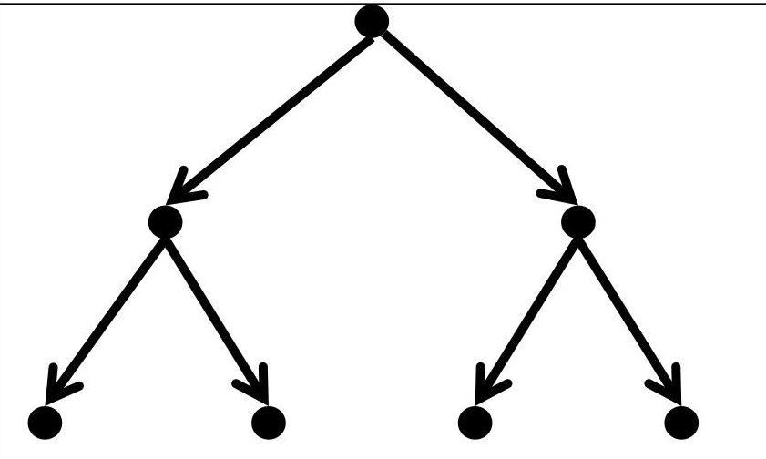
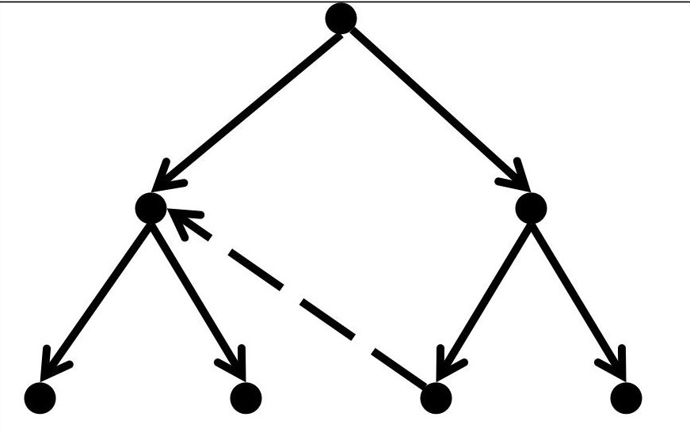
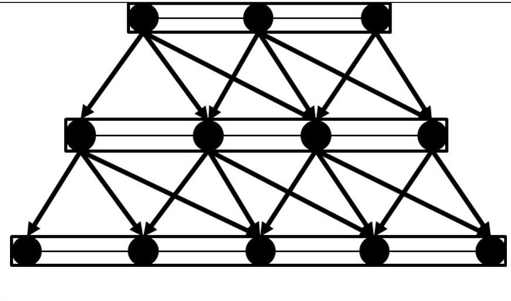

<!-- PDF_PAGE: 1 -->

# ESD Working Paper Series

# Flexibility, Complexity, and Controllability in Large Scale Systems

David A. Broniatowski

Assistant Professor of Engineering Management and Systems Engineering

Department of Engineering Management and Systems Engineering

The George Washington University

Washington, DC USA

Email: broniatowski@gwu.edu

Joel Moses

Institute Professor, Professor of Electrical Engineering and Computer Science Professor of Engineering Systems

Department of Electrical Engineering and Computer Science, and Engineering Systems Division

Massachusetts Institute of Technology Cambridge, MA USA

Email: moses@mit.edu

Paper submitted for CESUN 2014 - Fourth International Engineering Systems Symposium to be held June 8-11, 2014 at Stevens Institute of Technology.

<!-- PDF_PAGE: 2 -->

# Flexibility, Complexity, and Controllability in Large Scale Systems

David A. Broniatowski

Department of Engineering Management and Systems

Engineering

The George Washington University

Washington, DC USA

broniatowski@gwu.edu

Joel Moses

Department of Electrical Engineering and Computer

Science, and Engineering Systems Division

Massachusetts Institute of Technology

Cambridge, MA USA

moses@mit.edu

Abstract—System structure is a key determinant of system behavior. There is a particularly strong link between a system's structure and its flexibility - it's capacity to respond to changes. Often, adding flexibility entails adding complexity. In this paper, we propose measures for a system's complexity that are complementary to existing flexibility measures. Furthermore, flexibility often comes at the cost of some measure of control over the system's behavior. We therefore propose a metric for system controllability that is complementary to our flexibility metric.

Keywords—structure; entropy; hierarchy; tree; layer; grid; team; system architecture

## I. INTRODUCTION

When designing a complex system, attention must be paid to the ways in which components are allowed to interact. It is rare that a group of subsystems or components, when operating in an uncontrolled manner, will behave in a way that is beneficial to the system as a whole. Some mechanism of control is therefore necessary. A fundamental concept underlying control is the hierarchy: a structure in which elements are ordered according to a relation of superiority and subordination. Higher elements in a hierarchy have the capacity to control lower elements. Hierarchical control is therefore especially important to systems architecture.

In previous work, Moses [1] discussed three generic types of system architecture; namely tree hierarchies, layered hierarchies, and networks. In this paper, we argue that the fundamental distinction between these generic architectures is in their approach to hierarchy. we build upon Moses' [1] examinations of the flexibility of complex system to propose metrics for their controllability and complexity in terms of the fundamental hierarchical structures that they represent.

## II. FLEXIBILITY OF GENERIC SYSTEMS ARCHITECTURES

Moses [1] argues that a system's architecture can enable flexibility in the system's behavior. By flexibility we mean the ease with which a system can change its configuration in response to a change in the environment.

We represent a system's architecture as a set of nodes, with edges representing flows (e.g., of information or matter) between them. A node might be a person in an organization, a

terminal in an electric or electronic network, or any other element of the system that can be isolated. Similarly, edges can represent frequent communication between individuals (as in a social network), the transmission of packets or power within a network, or any other means by which one node can carry out an exchange with its neighbors.

Given this formalism, Moses [1] proposes a metric of flexibility. A flexible system is one in which there are several different paths from a starting state to the end states. Thus, if one path is inaccessible for whatever reason, other paths will suffice and the functionality of achieving an end state will not be lost. Furthermore, many systems that we aim to control exhibit hierarchical structure, with the top node in the hierarchy designating the controller and the bottom-most nodes designating the final output of the system. Consequently, we define a measure of flexibility for a system as the total number of paths in it, starting at a top node and ending at bottom nodes. Cycles or loops in the system are counted just once.

In what follows, we will review three generic architectures and their flexibility.

## A. Tree Hierarchies

A tree structure is a directed acyclic graph with one "root" node and several subordinate nodes. Typically, a tree structure is defined by its branching factor (indicating how many subordinates each node possesses) and its depth (indicating the maximum distance from the root node to a "leaf" node-i.e., a node with no subordinates). A tree structure is one that begins with a top node, and all other nodes are connected to exactly one parent node (see Figure 1).

<!-- PDF_PAGE: 3 -->

Fig.1. A pure tree structure with depth 2 and branching factor 2.

Tree structures are so common in our culture that most modern accounts simply call them "hierarchies" (e.g., [2, 3]). One case in which tree structures arise is when solving problems using a reductionistic approach. For example, using a decision tree to break problem into smaller and smaller subproblems, and then integrating the solutions of these subproblems to arrive at a solution of the whole is a tree-structured approach [4]. Tree structures are common, in part, because it is often easy to break problems up into subproblems in various ways. We will see that tree structures tend to be easy to control, and permit very large scale systems to function.

Consider the number of paths in a pure tree structure beginning with the parent node. This number is exactly the number of bottom "leaf" nodes in the tree. This is fewer than the total number of nodes in the tree. We will see that this is a very low measure of flexibility in contrast to the other generic architectures that we consider. In fact it is provably the lowest, since each end node has exactly one path from the root. It is reasonable to say that tree structures are inflexible using Moses' definition of flexibility. Moreover, if we consider human organizations that begin as tree structures, then as these organizations evolve, the additional interconnections between people in the firm (which are often across the tree and hence not 'legal' in the structure) will tend to result in greatly increased complexity of the connection structure with relatively little increase in flexibility due to increased number of paths (see Figure 2).

Fig. 2. A nearly pure tree structure with one non-standard edge (dashed line).

Fig. 3. A layered hierarchy with three layers.

This is characteristic of tree structures and would seem to suggest that all large hierarchical organizations are inherently inflexible. As we shall soon see, this is not necessarily the case.

## B. Layered Hierarchies

Unlike tree structures, there is no restriction on the number of parents that a node in a layered hierarchy might have, as long as the links are directed according to the hierarchy and within adjacent layers. In addition, layered systems differ from trees in that they often possess horizontal connections, which may be bidirectional. Finally, layered hierarchies may have a root layer rather than a root node. Like tree hierarchies, their hierarchical (i.e., directed vertical) structure is explicitly specified; however, horizontal links within layers may follow many different topologies.

Based on Moses' analysis in prior work [1], layered structures (also called 'flexible lateral organizations' [5]; see Figure 3) have a high degree of flexibility (see Table 1). As the number of horizontal links and multi-parent vertical links grows, either in human organizations or engineering systems, the flexibility usually tends to grow while keeping the increase in complexity in check. Moreover, when the layers are carefully designed the changes one is likely to make can usually be implemented as new nodes within existing layers (often the top layer), or new connections between existing layers. Elsewhere, Moses has argued that human organizations that are layered usually have three layers [6]. Examples are large law firms that have senior partners, junior partners and associates. An advantage of many layered human organization is that cooperation tends to be quite common, and teams that operate quickly and effectively can be readily formed [5]. A disadvantage is that a high degree of specialization may not be quite so desirable in such organizations.

Engineered physical systems will usually not have lateral connections. This is in contrast to many human organizations. Nevertheless, physicial systems that are layered will usually be quite flexible and be able to handle classes of changes readily without growing too complex. This is shown by the number of paths in such systems, which grows geometrically with the number of layers and is far higher than the corresponding number of paths in a tree structured system with a similar number of nodes. One cost of the increased flexibility is some

<!-- PDF_PAGE: 4 -->

loss of efficiency. This occurs when the system creates abstraction barriers between the layers (e.g., [7]). For example, a microprocessor interprets the bits coming into it from the layers above. The interpretation takes some time, and could have been eliminated with direct connection between the machine language instructions, now implemented in hardware, and the parts of the microprocessor that actually perform the instruction. If we had such direct connections, then it would have been difficult to change the implementation of the instruction processing at some future time. If the loss of efficiency is very great then simulation can show places where it might be advisable to break through the barrier and make direct interconnections. That is, we trade-off some flexibility for efficiency. Moore's Law has saved microprocessors from such fates, and specialized computer hardware has tended to be replaced with relatively general chips that possess abstraction barriers, but this is not the general case, of course.

A ten digit telephone number can be viewed as a path in a three layered system. Thus, the landline telephone network may be viewed as a layered hierarchy that is indexed by area code, telephone exchange number, and finally individual subscriber number. Instead of having a number of interconnections that is one half of the square of the number of phones, connecting each phone directly to each other one, the total number of interconnections is a small multiple of the number of phones. This reduces the overall cost and complexity of the system. The structure of the interconnections varies in the local loop, the regional centers, and the national centers. A national center for a long distance telephone carrier will control broadband connections between major cities. There will be multiple paths in this particular national network of connections. This has significant advantages. If one line is down or overloaded one may reroute calls through another path in the network. Moreover, the investment in a new interconnection between existing regional nodes will increase the total number of paths, and thus increase the flexibility and robustness of the overall system. Changes in the system's configuration, which permits new lines to be installed, have been fairly well automated and are indicative of the overall system's flexibility.

## C. Networks

We define a network to be any graph structure that lacks an explicit hierarchy. A network can take on several topologies including regular grid structures (with all links bidirectional), "small-world" structures [8], or Erdos-Renyi random graphs [9]. Networks in general, and undirected networks in particular, tend to be quite flexible.

The Internet can be viewed as an extension of a physical network. It relies on an addressing scheme that is an abstraction of a telephone number. The World Wide Web relies on the truly gigantic number of virtual paths in the Internet in order to access data. Adding a new link to the Internet has become a routine operation because the interface standards are fairly well understood, and such additions increase the overall flexibility of the network. Although adding a new link to the Internet somewhat increases.its structural complexity, it will not grow a great deal since the topology of the system permits such new interconnections (see section III for a formal

definition of complexity). On the other hand, complexity may increase significantly if one adds subnets and routers (i.e., hierarchical structure). In summary, networks have the property that they are quite flexible. Furthermore, their flexibility usually grows with the addition of new interconnections. Moreover, most new interconnections do not increase the overall network complexity a great deal. A key weakness of this structure, however, is that it can be difficult to control (see section IV for formal definition of controllability). Thus regional and national centers may be needed to achieve a degree of control over a network.

Consider, for example, the limiting case of a two- or three-dimensional grid network. A grid network is a graph in which each node is connected to exactly m of its nearest neighbor nodes and each link is bidirectional. Here each node is connected to a fixed number to neighboring nodes on average. There is no clear hierarchy in such systems. If a node is connected to four neighbor nodes in a two dimensional space, say, then there are $ \mathrm{O}(4^{\mathrm{n}}) $ paths in such a system. This is a huge increase over the flexibility measure of tree structures and layered structures. The cost of such a large increase in flexibility is the relative lack of control over the behavior of such a system. This absence of a hierarchy makes it difficult to identify a "controller" or "root node" (when measuring flexibility, any node can equally serve as the root). In some cases the system's behavior is chaotic and hard to predict. In contrast, tree structures are relatively well controlled and layered systems are intermediate in their controllability and also in their flexibility.

Team networks further emphasize this point. A team network is one in which all nodes are fully connected, yielding n(n-1) links and a number of paths that increase as n!. In this type of network, there is a maximal number of paths, and therefore, maximal flexibility; however, since all nodes are equally linked no hierarchy can be defined.

TABLE I. ORDER NOTATION FOR THE FLEXIBILITY OF GENERIC ARCHITECTURES

<table border="1"><tr><td>Generic Architecture</td><td>Flexibility</td><td>Notes</td></tr><tr><td>Tree Hierarchy</td><td>O(n)</td><td>n=total number of nodes</td></tr><tr><td>Layered Hierarchy</td><td>O(n^{d-1})</td><td>n=total number of nodesd=total number of layers</td></tr><tr><td>Grid Network</td><td>O(d^{m})</td><td>n=total number of nodesm=nodal degree</td></tr><tr><td>Team Network</td><td>O(n!)</td><td>n=total number of nodes</td></tr></table>

## III. COMPLEXITY OF GENERIC SYSTEMS ARCHITECTURES

A system is structurally complex when it is difficult to change its internal structure, and achieve a desired goal, e.g., in the system's behavior. Often, adding flexibility to an existing system comes at the cost of additional structural complexity. One might make ad hoc additions to a system's structure to enable the construction of new paths, such as when one connects two existing subway stations with a new underground line. Given a simple structure, such as a series of concentric circles connecting subway stations, adding a line that does not follow this pattern adds complexity-i.e., the new connection structure is messy. Having a messy internal

<!-- PDF_PAGE: 5 -->

structure does not guarantee a complex behavior, but neither does having a simple internal structure avoid complex behavior. We focus on structural, rather than behavioral, complexity because the former is of more direct relevance to systems architecture, whereas the latter has already been treated in detail elsewhere (e.g., [3]).

Structural complexity is therefore a function of the degree to which a system is ordered, or "not messy." This is a concept not dissimilar from thermodynamic entropy. In particular, we may define the complexity of a system as the entropy of adding a new link. This change in entropy will be especially high if new links move the system from something very highly ordered to something that is less ordered. (In an unordered system, adding a new link doesn't change the disorder much because it is already disordered.) Our metric of structural complexity is therefore directly influenced by thermodynamic entropy.

Given a fixed number of nodes, N, and a fixed number of links, k, we define the complexity of a structure as $ C=-\log(p) $ where p is the probability that any one given realization of the structure will occur. If there are r realizations of the structure possible, then p is just 1/r, meaning the complexity is equal to $ C=\log(r). $ The challenge is therefore to find the total number of realizations possible for a given structure. The number of realizations for a graph is equal to the number of combinations of links that are consistent with that structure. We can determine this using the combination formula:

$$
\binom {a} {b} = \frac {a !}{b ! (a - b) !}
$$

In our example, a is the number of links permissible according to the structure and b is the fixed number of links available, k. Thus, our formula for complexity:

$$
C = \log \binom {a} {k}
$$

Table 2 gives the a values for several types of generic architectures, assuming N nodes and k links.

TABLE II. NUMBER OF PERMISSIBLE LINKS FOR SEVERAL ARCHITECTURAL FORMS

<table border="1"><tr><td>Architecture</td><td># of permissible links,a</td><td>Notesb</td></tr><tr><td>Tree-structured hierarchy</td><td>N-1</td><td>A tree has up to N-1 possible links.</td></tr><tr><td>Layered hierarchy with no horizontal links</td><td>Nd-d2</td><td>d is the number of nodes per layer</td></tr><tr><td>Layered hierarchy with horizontal links</td><td>d(2N-1)-N</td><td>d is the number of nodes per layer</td></tr><tr><td>Grid network</td><td>Nm</td><td>m is the number of links per node in the grid.</td></tr><tr><td>Team network</td><td>N(N-1)</td><td></td></tr></table>

The complexity of all of these structures is undefined if the number of links, k, exceeds the maximum allowable number of links for the architecture. For example, a tree with more than N-1 links is no longer a tree and its complexity can no longer be defined according to this formula.

If we assume, for simplicity, that the structure does not have to be connected (e.g., two disconnected trees are still tree-structured as an ensemble) then the above metrics provide insight into the complexity of partially formed structures that follow a given architectural plan. Note that some fully-formed structures will have a complexity of zero because they can only be realized in exactly one way (e.g., there is only one way to

make a fully-connected team structure), whereas other structures have multiple realizations, such as trees whose conformation depends on their branching factor.

We define complexity relative to changes in architectural form. Therefore, we focus our attention on the consequences of changing architectures. In general, the complexity of adding k links to an existing structure will be a function of the total number of links in the completed form, the total number of links in the existing structure, and k. For example, a team network has a maximum number of N(N-1) links. The complexity of adding $ k_{1} $ team-structured links to a structure with $ k_{2} $ existing links will be:

$$
\log \binom {N (N - 1) - k _ {2}} {k _ {1}}
$$

TABLE III. COMPLEXITY OF ADDING K LINKS TO SEVERAL GENERIC ARHICTECTURES

<table border="1"><tr><td>Initial Architecture</td><td>Final Architecture</td><td>Added Complexity</td><td>Notes</td></tr><tr><td>Tree</td><td>Layered hierarchy with no horizontal links</td><td>log(Nd-d2-N+1/k)</td><td>d is the total number of nodes per layer</td></tr><tr><td>Tree</td><td>Layered hierarchy with horizontal links</td><td>log((d-1)(2N-1)/k)</td><td>d is the total number of nodes per layer</td></tr><tr><td>Tree</td><td>Grid network</td><td>log((N-1)m+1/k)</td><td>m is the total number of neighbors per node in the grid</td></tr><tr><td>Tree</td><td>Team network</td><td>log((N-1)2/k)</td><td></td></tr><tr><td>Layered hierarchy with no horizontal links</td><td>Layered hierarchy with horizontal links</td><td>log((d-1)(N+d)/k)</td><td>d is the total number of nodes per layer</td></tr><tr><td>Layered hierarchy with no horizontal links</td><td>Grid network</td><td>log((m-d)N+d2/k)</td><td>d is the total number of nodes per layer; m is the total number of neighbors per node in the grid</td></tr><tr><td>Layered hierarchy with no horizontal links</td><td>Team network</td><td>log(N2-N(d+1)+d2/k)</td><td>d is the total number of nodes per layer; m is the total number of neighbors per node in the grid</td></tr><tr><td>Layered hierarchy with horizontal</td><td>Grid network</td><td>log((m-2d+1)N+1/k)</td><td>d is the total number of nodes per</td></tr></table>

<!-- PDF_PAGE: 6 -->

<table border="1"><tr><td>links</td><td></td><td></td><td>layer; m is the total number of neighbors per node in the grid</td></tr><tr><td>Layered hierarchy with no horizontal links</td><td>Team network</td><td>log(N2+2dN+d/k)</td><td>d is the total number of nodes per layer</td></tr><tr><td>Grid network</td><td>Team network</td><td>log(N(N-m-1)/k)</td><td>m is the total number of neighbors per node in the grid</td></tr></table>

## IV. CONTROLLABILITY OF GENERIC SYSTEMS ARCHITECTURES

One of the advantages of tree structures over layered and network structures is their controllability. Tree structures are easy to control because each node has exactly one parent and the lines of command are accordingly clear. Whereas flexibility is measured as the total number of paths from a source node to a target node (usually a leaf), counting loops only once, we propose that the controllability of a complex system may be measured as the total number of paths in the graph (i.e., its flexibility) divided by 1+ the total number of loops in the graph. The rationale is that cycles may obfuscate lines of control by feeding information from lower layers back to higher layers. Tree hierarchies have very strict lines of control and zero loops, indicating a large value of controllability. In contrast, networks have many paths, but also many loops, leading to smaller values of controllability. Layered hierarchies are intermediate between trees and networks, and their controllability depends on their specific connection structure.

## A. Modalities of Layered Hierarchy

One open question in the study of layered hierarchies surrounds the sources of these structures' flexibility and controllability. As our analysis below will show, layered hierarchies may differ significantly from one another in these dimensions. Layered structures are defined both by the fact that their nodes might have multiple parents and that their nodes might have horizontal links. In what follows, we examine a range of layered structures in terms of their flexibility, complexity, and controllability with the aim of isolating those factors that contribute the most to a specific structure's high-level "ilities." We begin our analysis using a fixed number of nodes per layer as a baseline, as in Table IV.

TABLE IV. MODALITIES OF LAYERED HIERARCHIES WITH A FIXED NUMBER OF NODES PER LAYER

<table border="1"><tr><td rowspan="2">Picture of Graph</td><td rowspan="2">Graph Type</td><td colspan="2">Order (big O notation) of Metrics$ ^{a}$</td></tr><tr><td>Flexibility</td><td>Controllability</td></tr><tr><td></td><td>No horizontal links; minimal vertical links</td><td>n</td><td>n</td></tr><tr><td></td><td>No horizontal links; maximal vertical links</td><td>$n^{d}$</td><td>$n^{d}$</td></tr><tr><td></td><td>Minimal horizontal links; minimal vertical links</td><td>$n^{d+1}$</td><td>$n^{d}/d$</td></tr><tr><td></td><td>Minimal horizontal links; maximal vertical links</td><td>$n^{2d}$</td><td>$n^{2d-1}/d$</td></tr><tr><td></td><td>Maximal horizontal links; minimal vertical links</td><td>$n(n-1)!^{d}$</td><td>$\frac{n(n-1)!^{d}}{2^{n}d}$</td></tr><tr><td></td><td>Maximal horizontal links; maximal vertical links</td><td>$n!^{d}$</td><td>$\frac{n!^{d}}{2^{n}d}$</td></tr><tr><td></td><td>Tree</td><td>$b^{d}$</td><td>$b^{d}$</td></tr><tr><td></td><td>Tree with maximal vertical links</td><td>$be^{\sum_{i=1}^{d}i}$</td><td>$be^{\sum_{i=1}^{d}i}$</td></tr><tr><td></td><td>Tree with minimal horizontal links</td><td>$be^{\sum_{i=1}^{d}i+1}$</td><td>$b^{2-d}e^{\sum_{i=1}^{d}i+1}$</td></tr><tr><td></td><td>Tree with minimal horizontal links maximal vertical links</td><td>$be^{\sum_{i=1}^{d}2i}$</td><td>$b^{2-d}e^{\sum_{i=1}^{d}2i}$</td></tr><tr><td></td><td>Tree with maximal horizontal links</td><td>See note b</td><td>See note c</td></tr><tr><td></td><td>Tree with maximal horizontal links; maximal vertical links</td><td>See note d</td><td>See note e</td></tr></table>

n is the number of nodes per layer, and d is the number of layers (not counting the root node)

$$
b ^ {d} \prod_ {j = 1} ^ {d} \sum_ {i = 0} ^ {b ^ {j - 1}} \frac {\left(b ^ {j - 1}\right) !}{\left(b ^ {j} - i - 1\right) !}
$$

$$
\boldsymbol {b} ^ {d} \prod_ {j = 1} ^ {d} \sum_ {i = 0} ^ {b ^ {j - 1}} \frac {\left(b ^ {j - 1}\right) !}{\left(b ^ {j} - i - 1\right) !} / \left(\sum_ {i = 1} ^ {d} 2 ^ {b ^ {i}} - b ^ {i} - 1\right)
$$

$$
\prod_ {j = 1} ^ {d} b ^ {d} \sum_ {i = 0} ^ {b ^ {j - 1}} \frac {(b ^ {j - 1}) !}{(b ^ {j} - i - 1) !}
$$

$$
\prod_ {j = 1} ^ {d} \boldsymbol {b} ^ {d} \sum_ {i = 0} ^ {b ^ {j - 1}} \frac {\left(b ^ {j - 1}\right) !}{\left(b ^ {j} - i - 1\right) !} / \left(\sum_ {i = 1} ^ {d} 2 ^ {b ^ {i}} - b ^ {i} - 1\right)
$$

As can be seen from the above analysis, the flexibility of layered hierarchies comes both from having multiple parents and having several horizontal links; however, adding horizontal links tends to increase flexibility much more quickly than does adding multiple parents. In contrast, only horizontal links greatly disrupt controllability because they necessarily involve the addition of loops. This is especially

<!-- PDF_PAGE: 7 -->

true for systems that might have been transitioned from tree-structured hierarchies to layered hierarchies, because they increase significantly more nodes in the lower layers. Consequently, there is a much larger number of potential loops that might form.

## ACKNOWLEDGMENTS

## V. CONCLUSIONS

In this paper we have explored several generic architectures in terms of their flexibility, structural complexity, and controllability. We propose metrics for these three factors and highlight tradeoffs between these system-level properties that are associated with each of the generic architectures. In particular, tree structures are highly controllable and have low complexity, but they also have low flexibility. Layered hierarchies (without horizontal links) tend to be more complex without sacrificing controllability or adding much complexity. As the number of horizontal links increases, flexibility dramatically increases, but controllability decreases. Finally networks, such as grids and teams, are highly flexible, although this comes at the cost of low controllability and high complexity.

The authors would like to thank Dr. Paul Smaldino for his helpful feedback and comments.

## REFERENCES

[1] J. Moses, "Philosophy and Engineering:," vol. 2, Springer Netherlands, 2010, pp. 275-284.

[2] R. K. Sah and J. E. Stiglitz, "Committees, hierarchies and polyarchies," The Economic Journal, pp. 451-470, 1988.

[3] H. A. Simon, The sciences of the artificial. MIT press, 1996.

[4] G. Gigerenzer and W. Gaissmaier, "Heuristic decision making," Annual review of psychology, vol. 62, pp. 451-482, 2011.

[5] J. R. Galbraith, Competing with flexible lateral organizations. Addison-Wesley Reading, MA, 1994.

[6] J. Moses, "The Anatomy of Large Scale Systems Revisited," 2009.

[7] R. Abbott, "Emergence explained: Abstractions: Getting epiphenomena to do real work," Complexity, vol. 12, no. 1, pp. 13-26, 2006.

[8] M. E. Newman and D. J. Watts, "Scaling and percolation in the small-world network model," Physical Review E, vol. 60, no. 6, p. 7332, 1999.

[9] P. Erdos and A. Rényi, "On the evolution of random graphs," Publ. Math. Inst. Hung. Acad. Sci, vol. 5, pp. 17-61, 1960.