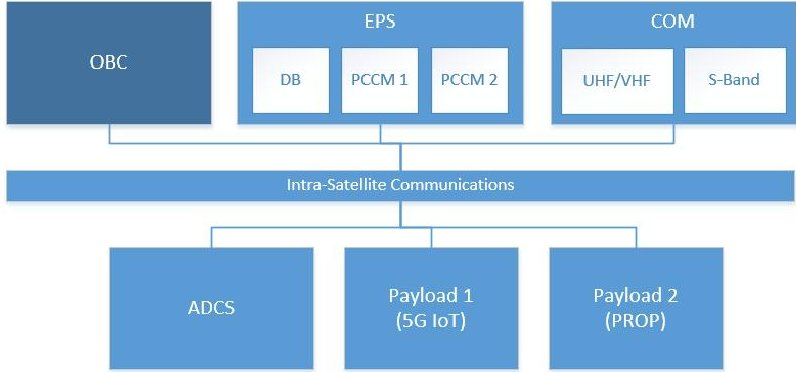
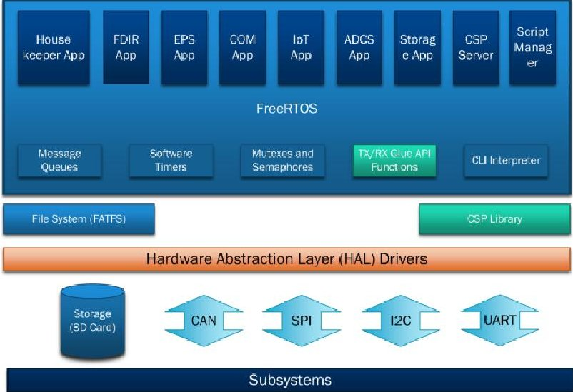
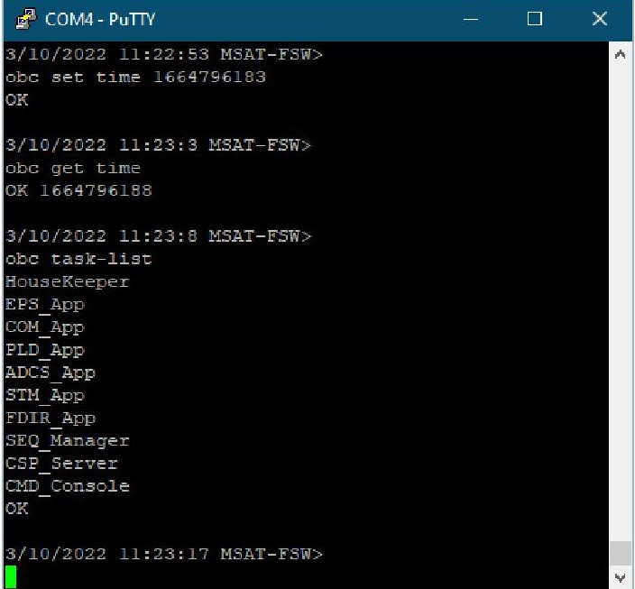

<!-- PDF_PAGE: 1 -->

# Flight Software Design and Implementation for a CubeSat

Mohammed Eshaq Mohammed Bin Rashid Space Center (MBRSC) Lab - CEIT University of Dubai Dubai, United Arab Emirates meshaq@ud.ac.ae

Shadi Atalla College of Engineering and IT (CEIT) University of Dubai Dubai, United Arab Emirates satalla@ud.ac.ae

Ibrahim Al-Midfa Data & Control Mohammed Bin Rashid Space Center (MBRSC) Dubai, United Arab Emirates ibrahim.almidfa@mbrsc.ae

Applications Development and Analysis Mohammed Bin Rashid Space Center (MBRSC) Dubai, United Arab Emirates saeed.almansoori@mbrsc.ae

Zakareyya Al-Shamsi Space Avionics Mohammed Bin Rashid Space Center (MBRSC) Dubai, United Arab Emirates zakareyya.alshamsi@mbrsc.ae

Hussain Al-Ahmad University of Dubai Dubai, United Arab Emirates halahmad@ud.ac.ae

Abstract CubeSats are on the rise and will dominate space soon due to their modularity, standardization, and lower cost. Re-using CubeSats for new missions is often possible by simply interchanging the payload 'cubes' with new ones that meet the new mission requirements, ideally with minimum changes to the hardware design. The problem that often arises with this level of modularity is that the Flight Software governing the operation of the spacecraft must also be modular and reusable for other missions. To achieve a degree of modularity and reduce the time required for software development, we propose a Flight Software designed from the ground up to achieve this goal. We do this by employing the following features. App-Based Flight Software: The Flight Software presented in this work comprises many Applications (Apps). The goal is to have a modular and service-oriented architecture where Apps can be added/removed based on mission requirements. Command Line Interface: Satellites typically comprise an onboard computer and many subsystems communicating via various protocols. Each subsystem has its own set of commands and responses. A human-readable Command Line Interface (CLI) is added as an abstraction layer that assists the team on the ground in controlling the spacecraft without needing to deal with the plethora of native binary commands and responses used in each subsystem. These commands can then be executed when the Satellite is on the ground using a Command Console, or they can be sent to the Satellite while in-mission using CubeSat Space Protocol packets (CLI/CSP). Script Engine: After defining the CLI command set, the same commands can be used in a Script Engine. Script files are simply sequences of commands. When a script file is triggered, commands are released and executed by the Script Engine while orbiting, whether the Satellite is still in contact or not.

Keywords—CubeSat, Flight Software, Onboard Computer Command Line Interface, Script Engine.

## I. INTRODUCTION

Years of technological advancements allowed us to build smaller satellites that can be held and handled by one person. A popular category of such smaller satellites is the Nanosatellite category (weighing between 1 to 10 KG) [1]. An even more popular type of Nanosatellite is the Cube Satellite (or CubeSat), a miniaturized satellite built out of standardized cubes; The name comes from the Cubed Units used to build the Satellite. Any CubeSat may have the size of 1 Unit (1U) or multiples of such units where each unit measures 10 x 10 x 10 cm. These units typically have a mass of about 1 kilogram per unit. A CubeSat of such magnitude can be quickly built with in-house-developed or commercial-off-the-shelf (COTS)

electronics and components. CubeSats are typically used for space research and commercial use [2]. This means that developers with limited to no experience in satellite technology, away from large space agencies, such as students at universities and research centers, can explore the realms of space with CubeSats [3]. CubeSats' standardization and adoption in academia and industry have led to mass production and an abundance of off-the-shelf components. Although this has resulted in a significant reduction in satellite development time and cost associated, the fact remains that a considerable amount of mission development time and effort is still spent on flight software [4] unless the code is reusable [5].

A typical satellite consists of an Onboard Computer (OBC) and many different subsystems. Each subsystem is an embedded system with a particular function, such as power or communication. The various subsystems are then connected to the OBC, which typically handles commands and responses, manages communication with the ground, and governs the operation of the Satellite. This work is primarily responsible for designing and implementing the Flight Software (FSW) that runs on the OBC. The flight software must provide "numerous services such as computer boot-up and initialization, time management, hardware interface control, command processing, telemetry processing, data storage management, flight software patch and load, and fault protection" [6]. Implementing flight software is more challenging than other commercial software; Once the Satellite has launched, there is no interaction with users unless the Satellite makes contact with the ground station. Even then, it can only communicate via uplink and downlink during a tiny time window. Most of the mission time, the FSW runs alone with no supervision from the ground. Thus, it must be able to recover from faults on its own [6].

Satellites are also becoming a fundamental part of the Internet's infrastructure, especially the Internet of Things (IoT). Therefore, the Mohammed Bin Rashid Space Center (MBRSC) has launched a Payload Hosting Initiative (PHI) program for Cube Satellites. The first iteration of this program is hosting a 5G-capable communication subsystem and a green propulsion technology as payload. This work presents the design and implementation of a flight software (FSW) for the first PHI CubeSat. This is achieved by first reviewing previous works in this realm to elicit the desired characteristics and features for our FSW. Furthermore, several Flight Software Development Kids (FSDKS) and

<!-- PDF_PAGE: 2 -->

Frameworks are considered for this project before proceeding with our custom design. Later, an FSW architecture designed in light of our findings from the Literature Review is presented. Features such as Command Line Interface (CLI), CLI commands over CubeSat Space Protocol packets (CLI/CSP), and Script Engine are thoroughly showcased. Finally, results for running the proposed FSW in a FlatSat environment are presented and discussed, leading to our conclusions and recommendations.

## II. LITERATURE REVIEW

## A. Characteristics of a Good Flight Software

We have deduced desired characteristics for our FSW architecture from many existing works and solutions.

Modular and service-oriented architecture app-based solution satisfies software requirements, allows for accelerated development, and enables re-using it for future missions by simply selecting the needed apps. [7] This was emphasized by the work done at the Norwegian University of Science and Technology—NUTS, where the design and implementation of FSW for an onboard computer of a nanosatellite was presented. However, this work differs from ours in a few aspects. One example is the heavy reliance on CSP (CubeSat Space Protocol) as their primary inter-tasks message exchange mechanism within the OBC, rather than using the more efficient and built-in message queues in the Operating System. The author in [8] took it further and asserted that modularity determines flight software quality. Every design aspect should be highly modular to make the code more flexible and modifiable. Furthermore, many additional efforts were made to develop flight softwares for CubeSats with a heavy emphasis on modularity [2] [5] [9] [10]. The work in [3] summarized several published papers describing FSWs of CubeSat missions and added that "modularity, extensibility, flexibility, robustness, and fault-tolerance have been identified as the main features of the flight software for nanosatellites". This work also proposed an approach to evaluate modular FSW for CubeSats by tracking architectures which is out of the scope of our work.

In addition to modularity, the work also concluded that most of the examined solutions implemented the FSWs as multilayered architecture to exploit abstraction layers. For example, the FSW proposed in [8] is "divided into four modular layers: at the top are application-specific tasks, next are hardware specific hardware libraries, at the bottom are microcontroller specific drivers, and supporting all layers are general purpose software libraries." This approach is similar to ours; however, the final FSW architecture differs from our design due to dissimilarities in hardware. Furthermore, the launch sequence is hardwired into the code in this work, as in most FSWs. In our design, however, we can execute the launch sequence (Launch and Early Orbit Phase - LEOP Script) by letting the script engine execute a script file. The work in [11] also demonstrated a multilayered architecture. Furthermore, it stretched the FSW development process further by introducing a robust feedback software life cycle model and technical specification verification framework, both outside our work's scope.

As for selecting the Real-Time Operating System (RTOS), operating systems such as GNU/Linux or FreeRTOS are typically preferred for CubeSat missions. Nevertheless, the selections of the microcontroller and the RTOS are closely related. On the one hand, if the FSW

requires a high-level programming language or depends on features available only in GNU/Linux, then a more powerful microcontroller is needed, which impacts power consumption. On the other hand, using a lightweight RTOS can save power at the cost of some processing capabilities [3]. In our work, we design and implement an FSW also using the Free Real-Time Operating System (FreeRTOS) [12], as in [2], [4], [7], [13], [14], and [15]. In addition, the work in [10] also uses FreeRTOS yet focuses heavily on the design of FSW robustness by employing methods of 'Fault Detection, Isolation, and Recovery' (FDIR) and 'Failure Mode, Effects, and Criticality Analysis' (FMECA).

The work in [2] implemented a Command Line Interface (CLI) used in their testing. However, we take CLI a step further and implement CLI over CSP (CLI/CSP).

The comprehensive work in [14] attempts to develop a generic FSW that seems promising. However, many generic and simulated works are published just to lay the foundation for future FSW developers without actually implementing and testing the FSW in actual satellite missions. Works as such remain theoretical and lack space heritage. This also applies to the work in [16], which can be used as a basic guideline for CubeSat FSW architecture design. This work also foresees that as technology advances, new and more efficient subsystems will be available, and "nanosatellites will, then, increase their payload capacities and will likely require flight software capable of controlling and interfacing more subsystems." Therefore, it is essential to have scalable and flexible software architectures where modules can be added, modified, or removed without affecting the architecture [16].

## B. Flight Software Frameworks and Development Kits

Several notable Flight Software Development Kits (FSDK) and Frameworks exist where developers can use any framework to accelerate their implementation. However, to satisfy MBRSC's mission requirements, we decided to develop a custom flight software from the ground up without using FSDKs, as many CubeSat teams do [13] [17]. Nevertheless, before starting the custom implementation of our FSW, we reviewed the following frameworks.

One of the few open-source and freely-available frameworks is the well-established NASA's cFS (Core Flight System) [18]. In fact, our software design was inspired by NASA's cFS framework. It employs a highly modular design where each functionality is managed by a software module and apps. Each app can be added or removed from the FSW based on the requirements, the mission, and the subsystems used. The works in [19] and [20] use cFS to develop nanosatellite FSWs. However, it is technically challenging to configure and deploy cFS due to its rooted history with large and complex satellites [4]. The OpenSatKit [21] was created to mitigate these problems; however, it adds a learning curve with even additional complexity [4] [9]. Even though this suite is tested in NASA's nanosatellite missions, its adoption is still not broad enough. Many current CubeSat FSWs are still implemented directly (without cFS) on top of simpler lightweight operating systems such as FreeRTOS [16].

Besides, NASA's cFS does not natively support FreeRTOS [22], the Real-Time Operating System we intend to use. Many attempts to 'port' cFS to FreeRTOS have been made [23]; however, running a ported cFS on our MCU with only 1 MB of RAM is not recommended [24]. Another

<!-- PDF_PAGE: 3 -->

framework by NASA is the primitive open-source F Prime [25] made by Jet Propulsion Laboratory. "Unlike cFS, it is specifically tailored for small-scale systems, reducing complexity, and uses static topologies" [4].

KubOS Framework is an open-source platform that provides the tools and libraries necessary to bring up space-ready FSWs quickly. The framework is designed to take care of all aspects of the FSW, so developers need to focus only on implanting the mission applications. The central component of this framework is the KubOS Linux operating system, a custom Linux distribution adapted to host satellite applications [9]. KubOS and other Linux-based SDKs require OBCs with relatively high hardware specifications, such as a recommended RAM size of 64 MB [26]. Other frameworks, such as CubedOS, are promising yet still work-in-progress [9]. Similarly, the NanoSat MO Framework, made by the European Space Agency, is an advanced framework for small satellites based on CCSDS Mission Operations services [27].

Ultimately, the work in [4] lists all common existing flight software development frameworks, then "proposes a software framework for CubeSat missions that expedites the CubeSat software development cycle". Our approach is similar; however, we cannot entirely follow this framework since MBRSC imposes further mission requirements.

## III. OVERVIEW OF HARDWARE ARCHITECTURE

Any typical satellite would require the following hardware components.

1. Onboard Computer: The main computer on board the Satellite is responsible for mission operation, communication, and the governance of the Satellite.

2. Electrical Power System: This component collects energy using the Solar Panel Arrays and stores it in the satellite batteries. Also, it distributes power to all other subsystems via its Distribution Board. A Power Conditioning and Control Module is also an integral part of the power system.

3. Communication Subsystem: A subsystem responsible for communication with the ground is vital for any mission. The most commonly used frequency bands in CubeSat missions are UHF alone, UHF and VHF, L-band, X-band, Ku-band, or Ka-band. [28].

4. Attitude Determination and Control Subsystem: This is a complex collection of sensors, actuators, and a Microcontroller tightly coupled to determine the Satellite's location and orientation and perform any maneuvers.

5. Payload Subsystems: These are the subsystems being delivered to space to achieve mission objectives. They can be imaging instruments, special communication devices, or a new technology that needs to be tested in space.

## A. CubeSat Components

## 1) The Onboard Computer

The FSW "typically runs on radiation-hardened processors and microcontrollers that are relatively slow and memory-limited" [6]. Our Satellite uses an ARM Cortex M7 microcontroller from STMicroelectronics. This microcontroller out-of-the-box supports third-party software libraries such as FreeRTOS, and FATFS, which are used in

this work. Unfortunately, it has a RAM of only 1 MB, which is a limitation that must be kept in mind during the implementation. The ARM processor can be considered a System on Chip, as it combines memory and many hardware modules with peripherals on the die.

## 2) The Subsystems

The subsystems comprising our CubeSat are as follows: an Electrical Power Subsystem (EPS) that has a Distribution Board (DB) and two Power Conditioning and Control Modules (PCCM) for redundancy, A Communication Subsystem (COM) that has both UHV/VHF and S-Band, an Attitude Determination and Control Subsystem (ADCS), two Payload Subsystems; one is a 5G IoT device, and the other is a green Propulsion technology to be tested in space (PROP). Refer to Fig. 1 below.

Fig. 1 CubeSat Hardware Components (Subsystems)

Unfortunately, CubeSats do not have a good mission success rate. Mission failures occur because researchers and developers usually focus on subsystems and the hardware design rather than the FSW development and the cohesion of the Satellite as a whole system. To avoid this, more effort should be invested in flight software architecture, design implementation, and fault tolerances [2].

## IV. SOFTWARE DESIGN AND ARCHITECTURE

The Flight Software (FSW) consists of many Applications (Apps) and supporting libraries. Each app has a particular purpose and function. The goal is to have a service-oriented architecture where modular Apps can be added/removed based on mission requirements and re-used in future missions. Therefore, we can briefly describe our FSW architecture as layered, modular, and service-oriented. The FSW architecture is illustrated in Fig. 2 below.

Fig. 2. Layered Software Model

<!-- PDF_PAGE: 4 -->

The Housekeeper App is mainly responsible for collecting spacecraft telemetry and storing it as Whole Orbit Data (WOD) files. The Fault Detection, Isolation, and Recovery (FDIR) Application continuously examines the gathered telemetry and determines the spacecraft's health. The FDIR employs Watch Points (WP) and Action Points (AP). The WPs are subsets of the gathered telemetry. The WPs are constantly monitored and ensured that they are within nominal levels. Each WP has an AP linked to it. If a WP falls out of the nominal range, the corresponding AP is executed in an attempt to recover from the detected fault. If recovery fails, the spacecraft goes into a 'safe mode' awaiting intervention from the ground upon contact. The EPS Application handles the Electrical Power Supply subsystem. The Communication Application (COM App) manages communications with the ground. It also sends out periodically real-time spacecraft telemetry to the ground. The Payload Application (PLD App) manages our payloads. The Attitude Determination and Control Subsystem Application (ADCS App) governs the spacecraft's attitude by controlling the ADC Subsystem. The Storage App manages and ensures the integrity of the storage unit (SD Card). It mounts and initializes a File Allocation Table File System (FATFS) volume on it, handles all commands from the ground related to files and file system, and carries out the file transfers (large data transfers) via Uplink and Downlink. A CubeSat Space Protocol (CSP) Server App is critical to our FSW. It accepts all incoming connections to the OBC, whether the connection is coming from an onboard subsystem or ultimately from the ground via the COM Subsystems. Several dedicated CSP ports were assigned and used. One port was dedicated to receiving and processing CLI commands sent in CSP packets (CLI/CSP) which are explained in the CLI Commands over CSP (CLI/CSP) Section below. A very central component of our Satellite Operation is the Script Manager App. Details on this App are highlighted in Section IV.C below.

## A. Operating System

Simple embedded softwares are now evolving into more sophisticated Embedded Operating Systems. Many of these Operating Systems are available as open-source libraries that can be ported to various microcontrollers and hardware platforms. Our operating system of choice was the Free RealTime Operating System (FreeRTOS), distributed freely under the MIT open-source license [12]. We selected FreeRTOS due to many reasons. One was that it has recently gained popularity, especially in CubeSat missions, as established in the Literature Review. FreeRTOS is also often chosen due to its simplicity and large user community in the field of satellites and other embedded systems [7]. Another reason was that our microcontroller natively supports it.

## B. Command Line Interface (CLI)

Each subsystem in the Satellite has its own set of commands and responses. Therefore, a Command Line Interface (CLI) layer is added to act as an abstraction layer that assists planners and operators on the ground in controlling the spacecraft without having to deal with the numerous native binary commands and responses used in each subsystem. The introduced CLI commands are high-level and human-readable commands implemented using FreeRTOS-Plus Command Line Interface Framework. Examples of such commands are presented in Table 1 below.

TABLE 1. CLI COMMANDS AND REPLIES

<table border="1"><tr><td>CLI Command</td><td>Expected Reply</td><td>Description</td></tr><tr><td>adcs point-to nadir</td><td>OK</td><td>Maneuver the Sat to Nadir.</td></tr><tr><td>eps iot on</td><td>OK</td><td>Power ON the IoT Payload.</td></tr><tr><td>delay 15 mins</td><td>OK</td><td>Delay the Script Engine for 15 mins.</td></tr><tr><td>eps iot off</td><td>OK</td><td>Power OFF the IoT Payload.</td></tr><tr><td>boot install FSW.bin 2</td><td>Installation COMPLETE</td><td>Install the FSW image to slot 2.</td></tr><tr><td>boot from image 2</td><td>OK</td><td>Boot from the FSW in slot 2.</td></tr><tr><td>script run sequence.scr 1</td><td>OK</td><td>Run the script stored in the file starting from line 1.</td></tr></table>

## 1) Command Console

Once CLI commands are defined, implemented, and registered with the FreeRTOS CLI Interpreter, they can be invoked anywhere within the FreeRTOS environment. Apps (FreeRTOS Tasks) can execute commands by sending a 'string' containing the command and any required parameter to the CLI interpreter function. The command is then processed (executed), and a reply is passed back to the caller.

Fig. 3. Command Console via Serial Terminal

In light of this, A Command Console was implemented to exploit this mechanism (see Fig. 3 above). When testing the Satellite on the ground, the OBC was connected to via a serial port and a terminal. Then, the commands were typed in and executed, and outputs could be observed in real-time. This allowed us to test all of the CLI commands defined and registered. The Command Console also assisted in the Assembly, Integration, and Testing (AIT) process and in testing the operation scenarios of the Satellite as a whole.

## 2) CLI Commands over CSP (CLI/CSP)

A dedicated port in the CSP Server (explained in Section IV above) was assigned to accept incoming CLI command strings encapsulated in CSP packets. Each command is then processed (executed), and a reply is sent back to the ground in another CSP packet as a reply. The team on the ground (using Mission Control Software) can communicate with the Satellite upon contact with an experience similar to using the Command Console just explained above.

<!-- PDF_PAGE: 5 -->

Having the CLI command set as an abstraction layer and relying on it in the Mission Control Software (MCS) when communicating with the Satellite makes the MCS independent of the underlying hardware architecture of the spacecraft and intra-satellite communication protocols taking place between the OBC and the various subsystems. In addition, this allows for the re-use of the MCS in future missions.

## C. Script Engine

The same CLI command set explained above can also be used in the Script Engine. A script file can be uploaded to the satellite pre-launch or upon contact. The script files are simply sequences of CLI commands optionally separated by time delays and stored in a text file. When a script file is triggered, commands are released and executed in a timely fashion while orbiting, whether the Satellite is still in contact or not.

The script engine works by first having a script file marked as 'armed'. This means that the file is now ready to be executed. Arming must be done by ground or by a previously running script. Next, the script engine reads the armed file and starts executing the (input) CLI commands stored in the script file line-by-line. Upon execution, an output file is created and filled with (output) reply lines corresponding to each CLI command executed. Upon contact, the ground team can then download and examine the output file, and new script files for subsequent satellite operation can be uploaded. At the end of each script file, another script file can also be 'armed'. Upon finishing the execution of the first one, the following script file is executed. This allows the ground team to queue or 'chain' many script files covering satellite operations for many orbits spanning many upcoming days or weeks. Thus, satellite operations do not have to be hardcoded in the FSW. Instead, they can be defined as scripts and re-used in future missions.

## V. TESTING AND RESULTS

Time spent in testing accounts for more than half of the time spent on projects. The reward for finding a bug early in the implementation phase is at least a tenfold saving compared to finding it during integration time, or worse, after launch [7]. Moreover, the incredibly harsh environment of space can cause countless system failures; The ionized particles in space can trigger catastrophic software crashes and power failures. Also, extreme temperature swings may deteriorate hardware components. CubeSats still demand significant efforts to improve their robustness [16].

## A. Test Setup

We used the Eclipse-based STM32CubeIDE for code development. STM32CubeIDE uses the GCC toolchain for development and GDB for debugging [31]. Moreover, a Version Control System is vital for such projects [8]. We used GitLab as a version-controlling tool to control software releases. We used FreeRTOS version 10.3.1, with CMSIS version 2.00. Cooperative Scheduling was used. The memory scheme used is 'heap 4'. Generally speaking, it is not recommended to use dynamic memory in embedded systems. However, in a work that evaluates different memory schemes with the CubeSat project in mind, it was concluded that 'heap 4' was the best fit for its balance between the overhead code size and segmentation level. [7]

## B. Testing Methodology

We derived test cases from the mission FSW functional and non-functional requirements. Test cases were performed, and results were recorded. Furthermore, a Long-Term Test

was performed for the FSW, where the software kept running in FlatSat setup for over ten days, and all activities were logged. No crashes were recorded where FSW was completely stuck and unable to recover. Three types of bugs were recorded, which the FSW managed to recover from independently. One memory leak event was observed. Later, the bugs were fixed, and an FDIR WP/AP was added to rectify the situation if it ever occurred. As for memory usage, the stats are shown in Table 2 below.

TABLE 2. MEMORY USAGE

<table border="1"><tr><td>Component</td><td>Memory Usage</td></tr><tr><td>RAM</td><td>1024KB</td></tr><tr><td>Total heap used(FreeRTOS)</td><td>22.55KB</td></tr><tr><td>For all Tasks</td><td>21.17KB</td></tr><tr><td>For each Task</td><td>2168B</td></tr><tr><td>For Queues</td><td>888B</td></tr><tr><td>For Timers</td><td>48B</td></tr><tr><td>For Mutex and Semaphores</td><td>440B</td></tr><tr><td>Heap Still Available</td><td>97.45KB</td></tr><tr><td>FLASH MEMORY</td><td>2048KB</td></tr><tr><td>Memory Used(1FSW Image)</td><td>226.79KB</td></tr></table>

The CPU usage was monitored and recorded for the first 16 seconds of FSW startup. After the first few seconds, it was notable that, with all the included features in the FSW, the CPU utilization remained well below 40%.

<table border="1"><tr><td></td><td>0(μs)</td><td>1.000.000</td><td>2.000.000</td><td>3.000.000</td><td>4.000.000</td><td>5.000.000</td><td>6.000.000</td><td>7.000.000</td><td>8.000.000</td><td>9.000.000</td><td>10.000.000</td><td>11.000.000</td></tr><tr><td>CSP_Server</td><td></td><td></td><td></td><td></td><td></td><td></td><td></td><td></td><td></td><td></td><td></td><td></td><td></td></tr><tr><td>STM_App</td><td></td><td></td><td></td><td></td><td></td><td></td><td></td><td></td><td></td><td></td><td></td><td></td><td></td></tr><tr><td>SEQ_Manager</td><td></td><td></td><td></td><td></td><td></td><td></td><td></td><td></td><td></td><td></td><td></td><td></td><td></td></tr><tr><td>PLD_App</td><td></td><td></td><td></td><td></td><td></td><td></td><td></td><td></td><td></td><td></td><td></td><td></td><td></td></tr><tr><td>HouseKeeper</td><td></td><td></td><td></td><td></td><td></td><td></td><td></td><td></td><td></td><td></td><td></td><td></td><td></td></tr><tr><td>FDIR_App</td><td></td><td></td><td></td><td></td><td></td><td></td><td></td><td></td><td></td><td></td><td></td><td></td><td></td></tr><tr><td>EPS_App</td><td></td><td></td><td></td><td></td><td></td><td></td><td></td><td></td><td></td><td></td><td></td><td></td><td></td></tr><tr><td>COM_App</td><td></td><td></td><td></td><td></td><td></td><td></td><td></td><td></td><td></td><td></td><td></td><td></td><td></td></tr><tr><td>CMD_Console</td><td></td><td></td><td></td><td></td><td></td><td></td><td></td><td></td><td></td><td></td><td></td><td></td><td></td></tr><tr><td>ADCS_App</td><td></td><td></td><td></td><td></td><td></td><td></td><td></td><td></td><td></td><td></td><td></td><td></td><td></td></tr><tr><td>IDLE</td><td></td><td></td><td></td><td></td><td></td><td></td><td></td><td></td><td></td><td></td><td></td><td></td><td></td></tr></table>

Fig. 4 FSW Task Trace View

Fig. 4 above is a trace view that shows the execution time of the FSW tasks. It is worth noting that the tasks were executed with a periodic delay of 1 second. This was a requirement derived from previous missions.

## C. Discussions

The main objective of our testing was to ensure the robustness of the software. The most critical step in our testing was the long-term test that lasted over ten days. The idea was to keep the Satellite as a whole (in a FlatSat setup) running while performing all the tasks in the mission and observe the behavior. The FSW recovered from faults as expected. The Test Engineers were allowed to interact with the Satellite, pretending they were in contact. However, no physical interaction (such as power cycling) was allowed with the FlatSat. The subsequent tests and results gathered were to ensure that the OBC was not overloaded and running the FSW with ease. CPU utilization was monitored as well as memory consumption. We believe faults accumulate and result in failures when systems run at their maximum potential.

<!-- PDF_PAGE: 6 -->

## VI. CONCLUSIONS AND RECOMMENDATIONS

CubeSats are becoming very popular. Nevertheless, the absence of a freely-available, truly modular and reusable FSW (and the existence of a few frameworks and development kits that require prior knowledge to exploit) often forces us to develop FSW from scratch. Achieving a truly modular, portable, and reusable FSW remains a challenge, yet this is what the scientific community should strive for.

Characteristics such as service-oriented architecture and layered software can help with software modularity to a great extent. In addition, limiting future missions to specific hardware platforms (such as the increasingly-popular FreeRTOS and, consequently, the microprocessor of choice) can drastically minimize the FSW development time in the future.Having features in the FSW such as CLI Commands Interpreter and a Script Engine allows for the reusability of the Mission Control Systems (MCS) and Mission Operations to some extent. CubeSats can be packed with such features without compromising performance.

Employing CSP as the standard way of communication in satellites contributes to FSW's modularity. Using CSP for all internal communication (intra-satellite) make the FSW more modular. Interchanging subsystems (cubes) with newer subsystems supporting CSP will reduce FSW development time. Communicating with Ground via CSP will make the FSW even more modular. We predict that the modular service-oriented architecture and use of CSP will become the de facto standard for all satellite flight software in the future.

## VII. FUTURE WORK

The true test of our flight software's desired modularity will be the next iteration of the Payload Hosting Initiative (PHI) program, where the current FSW will be re-used in a new satellite. Having new payload subsystems means having a new mission, new payload apps, and new scripts.

## REFERENCES

[1] D. D. Kekez, "Development of flight software and communication systems for the CanX-2 nanosatellite," 2006. [Online]. Available: https://tspace.library.utoronto.ca/handle/1807/120820. [Accessed 1 November 2022].

[2] K. V. C. K. de Souza, Y. Bouslimani and M. Ghribi, "Flight Software Development for a Cubesat Application," IEEE Journal on Miniaturization for Air and Space Systems, pp. 1-1, 2022.

[3] C. E. Gonzalez, C. J. Rojas, A. Bergel and M. A. Diaz, "An Architecture-Tracking Approach to Evaluate a Modular and Extensible Flight Software for CubeSat Nanosatellites," IEEE Access, vol. 7, pp. 126409-126429, 2019.

[4] A. K. El Allam, A.-H. M. Jallad, M. Awad, M. Takruri and P. R. Marpu, "A Highly Modular Software Framework for Reducing Software Development Time of Nanosatellites," IEEE Access, vol. 9, pp. 107791- 107803, 2021.

[5] J. Hanson and L. J. Hansen, "Reusable, modular, and scalable flight software," in 2014 IEEE Aerospace Conference, Big Sky, 2014.

[6] D. Dvorak, "NASA Study on Flight Software Complexity," in AIAA Infotech@Aerospace Conference, Seattle, 2009.

[7] M. Normann, "Software Design of an Onboard Computer for a Nanosatellite," Norwegian University of Science and Technology, 2016.

[8] S. F. Hishmeh, T. J. Doering and J. E. Lumpp, "Design of Flight Software for the KySat CubeSat Bus," in 2009 IEEE Aerospace Conference, Big Sky, 2009.

[9] O. D. Quiros-Jimenez and D. d'Hemecourt, "Development of a flight software framework for student CubeSat missions," TM, vol. 32, no. 8, pp. 180-197, 2019.

[10] I. Latachi, T. Rachidi, M. Karim and A. Hanafi, "Reusable and Reliable Flight-Control Software for a Fail-Safe and Cost-Efficient Cubesat Mission: Design and Implementation," Aerospace, vol. 7, no. 10, p. 146, 2020.

[11] M. Tipaldi, C. Legendre, O. Koopmann, M. Ferraguto, R. Wenker and G. D'Angelo, "Development strategies for the satellite flight software on-board Meteosat Third Generation," Acta Astronautica, vol. 145, pp. 482-491, 2018.

[12] FreeRTOS, "FreeRTOS," Amazon Web Services, [Online]. Available: https://www.freertos.org/.[Accessed 11 July 2021].

[13] K. Lamichhane, M. Kiran, T. Kannan, D. Sahay, S. Sandya and H. G. Ranjith, "Embedded RTOS implementation for Twin Nano-satellite STUDSAT-2," in IEEE Metrology for Aerospace (MetroAeroSpace), Benevento, 2015.

[14] A. E. Heunis, "Design And Implementation of Generic Flight Software for a CubeSat," December 2014. [Online]. Available: https://scholar.sun.ac.za/handle/10019.1/95911. [Accessed 31 October 2022].

[15] J. Ferreira, "ISTNanosat-1 Heart Processing and digital communications unit," Technical University of Lisbon, October 2012. [Online]. Available: https://fenix.tecnico.ulisboa.pt/downloadFile/395144736837/MScThes is-JFerreira_vFinal.pdf. [Accessed 28 July 2021].

[16] C. Araguz, M. Mari, E. Bou-Balust, E. Alarcon and D. Selva, "Design Guidelines for General-Purpose Payload-Oriented Nanosatellite Software Architectures," Journal of Aerospace Information Systems, vol. 15, no. 3, pp. 107-119, 2018.

[17] M. Doyle et al., "Flight Software Development for the EIRSAT-1 Mission," in 3rd Symposium on Space Educational Activities, Leicester, 2019.

[18] National Aeronautics and Space Administration (NASA), "core Flight System (cFS)," NASA, 16 June 2021. [Online]. Available: https://cfs.gsfc.nasa.gov/. [Accessed 11 July 2021].

[19] W.-s. Choi, J.-H. Kim and H.-d. Kim, "A Study on developing Flight Software for Nano-satellite based on NASA CFS," Journal of The Korean Society for Aeronautical & Space Sciences, vol. 44, no. 11, pp. 997-1005, 2016.

[20] M. De la Vega-Martínez, M. C. Velázquez-García, M. F. Zavala-López, E. Hernández, R. A. Gutiérrez-Esparza, D. G. Arcos-Bravo, D. Medina, H. E. Gilardi-Velázquez and D. McComas, "Implementation of the cFS framework for the development of software in aerospace missions," in IFAC Workshop on Aerospace Control Education WACE, Milan, 2021.

[21] D. McComas, "Increasing flight software reuse with OpenSatKit," in 2018 IEEE Aerospace Conference, Big Sky, 2018.

[22] D. Mitchell, "NASA - GSFC Open Source Software: OS Abstraction Layer (OSAL)," NASA's Goddard Space, 24 October 2019. [Online]. Available: https://opensource.gsfc.nasa.gov/projects/osal/. [Accessed 5 October 2022].

[23] A. Cudmore, G. Crum, S. Sheikh and J. Marshall, "Big Software for SmallSats: Adapting cFS to CubeSat Missions," [Online]. Available: https://digitalcommons.usu.edu/cgi/viewcontent.cgi?article=3303&context=smallsat. [Accessed 5 October 2022].

[24] "cFS portability on baremetal platforms," GitHub, Inc., 24 November 2021. [Online]. Available: https://github.com/nasa/cFS/discussions/374. [Accessed 5 October 2022].

[25] R. L. J. Bocchino, T. K. Canham, G. J. Watney, L. J. Reder and J. W. Levison, "F Prime: An Open-Source Framework for Small-Scale Flight Software Systems," in Small Satellites Conference (SmallSat 2018), Logan, 2018.

[26] Kubos Corporation, "Porting KubOS to a New OBC," 2020. [Online]. Available: https://docs.kubos.com/1.21.0/obc-docs/porting-kubos.html. [Accessed 31 October 2022].

[27] European Space Agency, "NanoSat MO Framework," European Space Agency, 2022. [Online]. Available: https://nanosat-mo framework.github.io/. [Accessed 29 August 2022].

[28] S. Liu, P. I. Theoharis, R. Raad, F. Tubbal, A. Theoharis, S. Iranmanesh, S. Abulgasem, M. U. A. Khan and L. Matekovits, "A Survey on CubeSat Missions and Their Antenna Designs," Electronics, vol. 11, no. 13, p. 2021, 2022.

[29] STMicroelectronics, "Integrated Development Environment for STM32," STMicroelectronics, 2021. [Online]. Available: https://www.st.com/en/development-tools/stm32cubeide.html. [Accessed 13 July 2021].