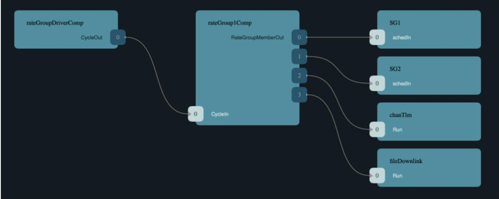

<!-- PDF_PAGE: 1 -->

<div align="center">

# FPP: A Modeling Language for F Prime

</div>

Robert L. Bocchino Jr., Jeffrey W. Levison, and Michael D. Starch Jet Propulsion Laboratory, California Institute of Technology 4800 Oak Grove Drive Pasadena, CA 91109 {robert.l.bocchino,jeffrey.w.levison,michael.d.starch} @jpl.nasa.gov

Abstract—We present F Prime Prime (FPP), a new open-source modeling language for F Prime. F Prime is an open-source flight software framework developed at JPL and deployed, among other places, on the Mars helicopter Ingenuity. FPP provides a convenient way to model the architectural elements of an F Prime application, e.g., components, ports, and their connections. It has a succinct and readable syntax, a welldefined semantics, and robust error checking and reporting. The FPP tool suite, written in Scala, analyzes FPP models, reports errors, and translates correct FPP models to a combination of XML and C++. Existing F Prime tools translate the XML to a partial implementation in C++, to be completed by the developers. The model elements have clean interfaces and are highly reusable. An accompanying visualization tool constructs diagrams of components and connections that FSW developers can use to understand and communicate their designs, for example at reviews. We discuss the design and implementation of FPP and the integration of FPP into F Prime. We also discuss our experience using FPP to construct F Prime models. Finally, we discuss our plans for future work, including improved code generation, improved visualization, and more advanced analysis capabilities.

## TABLE OF CONTENTS

<table border="1"><tr><td>1. INTRODUCTION</td><td>1</td></tr><tr><td>2. F PRIME</td><td>2</td></tr><tr><td>3. THE FPP LANGUAGE</td><td>3</td></tr><tr><td>4. THE FPP TOOL SUITE</td><td>9</td></tr><tr><td>5. EXPERIENCE WITH FPP</td><td>11</td></tr><tr><td>6. FUTURE WORK</td><td>13</td></tr><tr><td>7. RELATED WORK</td><td>14</td></tr><tr><td>8. CONCLUSION</td><td>14</td></tr><tr><td>ACKNOWLEDGMENTS</td><td>15</td></tr><tr><td>REFERENCES</td><td>15</td></tr><tr><td>BIOGRAPHY</td><td>15</td></tr></table>

## 1. INTRODUCTION

When developing flight software (FSW) for a mission, it is usually a good idea to reuse existing software as much as possible. That way you can focus your effort on the mission at hand; you don't have to re-implement behavior that has already flown successfully on other missions. The best way that we know to achieve this kind of reuse is to use a flight software framework.

F Prime [1] is a flight software framework developed at JPL. It provides a flight-proven software architecture approach; a set of ready-to-use components for basic FSW functions such as command and telemetry; and a set of tools for developing, testing, and deploying FSW. It is free and open-source, with a growing user and developer community. It has been successfully deployed on several missions. One such mission is the Mars helicopter Ingenuity, the first-ever powered aircraft to fly on another planet [2][28]. Other recent and upcoming missions include the ASTERIA space telescope [31][29], the Lunar Flashlight mission to the Moon [3], and the NEA Scout mission to a near-earth asteroid [4].

F Prime uses a model-based approach to FSW development. In this approach, developers describe the high-level structure of the software in a model, which is a machine-representable data structure with a formal specification. Using a model has several advantages: it provides a clear statement of design intent, it can be visualized as a set of diagrams, it can be automatically checked for correctness properties, and it can form the input to tools that auto-generate a partial FSW implementation in C++.

This approach requires a modeling tool, i.e., a way for developers to express the model. The modeling tool can be a domain-specific language, a graphical tool, or a combination of the two. Before F Prime v3.0.0 (released December 22, 2021), the preferred modeling tool for F Prime was Extensible Markup Language (XML) extended with an F Prime-specific schema and a code generator written in Python. Using XML has some advantages: it is widely used, lightweight, easy to parse, and flexible. However, the F Prime XML schema has some major disadvantages as a modeling language: it is verbose and inconvenient for users to read and write, its semantics is not well specified, and it has poor error checking and reporting. Many errors go through to be caught by the C++ compiler. There are also places in the model where code could be generated but is not; these gaps have to be filled in with handwritten C++.

In this paper we present F Prime Prime (FPP) [5]. FPP is a new open-source domain-specific language for constructing, analyzing, and translating F Prime models. The FPP tool suite, written in Scala, analyzes FPP models, reports errors, and translates correct FPP models to a combination of XML and C++. The existing F Prime tools translate the XML to C++. An accompanying visualization tool constructs diagrams of components and connections that FSW developers can use to understand and communicate their designs, for example at reviews.

As of F Prime v3.0.0, F Prime has integrated support for FPP, so that F Prime developers can write FPP models instead of XML models. Compared to writing XML, FPP provides a cleaner and more succinct syntax, a well-defined semantics, and robust error checking and reporting. It closes the gaps between the XML model and the implementation code.

We believe that FPP can improve the experience of using F Prime today. FPP also enables future enhancements to F Prime, including improved code generation, improved visualization, and more advanced modeling and analysis capability Finally, beyond the specifics of F Prime, FPP can serve as

<!-- PDF_PAGE: 2 -->

an example of the benefits of model-based FSW engineering supported by a clean domain-specific language.

The rest of this paper proceeds as follows. In Section 2 we give a brief overview of F Prime. In Section 3 we present the FPP modeling language. In Section 4 we present the FPP tool suite. In Section 5 we describe our experience using FPP. In Section 6 we describe our plans for future work. In Section 7 we discuss related work. In Section 8 we conclude.

## 2. F PRIME

In this section, we provide a brief overview of F Prime. First we discuss the architecture of an F Prime application. Then we describe the F Prime code base. Finally we discuss the typical process for constructing an F Prime deployment (executable program).

## Architecture

F Prime is based on the architectural concepts of components and ports. A component is like a class in an object-oriented language: it defines a collection of data and some operations on the data. Components organize FSW applications into reusable pieces with well-defined interfaces. A port is the endpoint of a connection between two component instances. Communication over a port is called an invocation; it may be either synchronous (a function call that does work) or asynchronous (a function call that puts work on a queue for later dispatch).

An F Prime executable program is called a deployment. Each deployment has a topology, i.e., a directed graph specifying the component instances and the connections between their ports. An F Prime deployment may run on an operating system (OS) or directly on hardware (bare metal). When running on an OS, each deployment consists of a single process with multiple threads. A single-process FSW application consists of one deployment. A multi-process application consists of several deployments, one for each process.

## F Prime supports three kinds of components:

1. An active component has an associated thread T. It may receive both synchronous and asynchronous invocations. A synchronous invocation runs on the thread of the caller. An asynchronous invocation runs on T. Active components typically implement background tasks and event-driven behavior. 2. A passive component has no associated thread. It receives only synchronous invocations. It provides functions that other components call directly, e.g., for filtering, transforming, or querying data.

3. A queued component has a queue, so it may receive synchronous invocations, but it has no thread; its behavior must be driven by the thread of another component. A typical use of queued components is to implement a rate group (a set of component instances that run periodically at the same rate).

Each port has a type and a kind. The type is like a function signature: it specifies the number and types of the data items carried on a port. The kind specifies whether the port is an output port (a port that sends invocations) or an input port (a port that receives invocations). Input ports are further divided into the following kinds:

1. A synchronous input port receives synchronous invocations (function calls that do work).

2. A guarded input port is a synchronous input port with concurrency control. An invocation of a guarded port takes a mutex lock, performs a synchronous invocation, and releases the lock.

3. An asynchronous input port receives asynchronous invocations (function calls that put messages on a queue).

Components have no compile- or link-time dependencies on each other. At compile time, each component depends only on the types of the ports that it uses. The connections are established at run time, when a FSW deployment starts up. This fact makes F Prime components highly modular and reusable.

## Code Base

The code base for constructing F Prime deployments consists of three main parts:

1. A core framework that provides basic services. These include (a) the behavior common to all ports and all components and (b) a platform-independent interface to OS services such as threads and queues.

2. An XML schema for expressing the F Prime architectural concepts (ports, components, and topologies) together with a code generator for converting XML specifications into C++ code.

3. A collection of reusable components that perform standard FSW functions such as dispatching commands and storing telemetry. These components are implemented using the same mechanisms (items 1 and 2 above) that developers use to write new application-specific components.

In addition to the architecture concepts discussed in the previous section, the XML schema lets developers express the following:

1. Ground dictionaries. The XML specification for a component C may include a component ground dictionary: for example, the commands that C implements and the telemetry channels that it emits. Each deployment D has a deployment ground dictionary (or just ground dictionary); it is the union of the ground dictionaries of the component instances used in D. F Prime comes with a lightweight ground data system (GDS) that provides commanding and telemetry for F Prime deployments, via the ground dictionary. The dictionary may also be translated to the formats required by other ground tools.

2. Data types. The XML schema allows developers to define basic data types: enumerations, structures, and arrays. The generated C++ code automatically serializes these types to and from a binary format. These types may appear in port types (for example as the type of data carried on a port) and in the ground dictionary (for example, as the type of data emitted as telemetry).

## Constructing a Deployment

To construct an F Prime deployment, developers typically do the following:

1. Design the topology. To manage complexity, developers typically divide the topology graph for a deployment into subgraphs: for example, one for commands, one for telemetry, and so forth. In this step, the developers decide which F Prime components they will reuse and which components they will develop. The newly developed components typically have new application-specific behavior.

2. Design, code, and test the new components. For each new component C identified in step 1, the developers de-

<!-- PDF_PAGE: 3 -->

termine what new types and ports are needed, if any, to implement C. They construct a model of the types, for the ports, and for C. They run the F Prime code generator, generating a C++ base class for C. The base class contains a pure virtual function for each of C's input port handlers. The developers write a derived class for C, overriding each pure virtual function with the desired behavior. Then they write and run unit tests for C, using F Prime's built-in support for unit testing.

3. Construct the topology. The developers write a topology model that defines the component instances and states how their ports are connected. The code generator generates (a) C++ code for connecting the component instances and (b) an XML ground dictionary. The developers also handwrite C++ code for setting up and tearing down the topology. This handwritten code calls the auto-generated function for connecting the component instances. It includes a main function for starting the application.

4. Test the topology. The developers perform integration testing on the topology, either interactively via the GDS or in a scripted manner. F Prime provides a Python interface for writing scripted integration tests.

## 3. THE FPP LANGUAGE

## Constants

FPP lets you define named constants. Constant definitions associate names with values, so that elsewhere in the model you can use the name instead of repeating the literal value. Figure 1 shows some examples of constant definitions. It also illustrates some basic features of FPP: comments, annotations, and module definitions.

We now give an overview of the FPP modeling language. For full details, see the the FPP User's Guide [6] and the The FPP Language Specification [7]. We divide the discussion into the following sections: constants, types, ports, components component instances, topologies, and ground dictionaries.

Line 1 of Figure 1 illustrates a comment. This is some text addressed to human readers; the FPP parser ignores it. Lines 2-26 illustrate a module definition. A module definition in FPP is like a namespace in C++: it introduces a name and a scope; the name qualifies all the definitions inside the scope. In this example, all the definitions are qualified with the name Constants.

Lines 5-24 of Figure 1 illustrate constant definitions of various types. In each case FPP infers the type from the expression appearing after the equals sign. The lines of text beginning with the @ character are annotations. The parser associates this text with the definition next to which it appears. The text is then available for use during code generation; a typical use is to generate a comment. Line 18 illustrates an array expression. Arrays are first-class values in FPP. In this case, the array value has three elements 1, 2, and 3, each of integer type. Similarly, line 21 illustrates a struct expression. Structures (or structs) are first-class values. In this case, the struct value has members x and y. Member x is assigned the symbolic value a, which evaluates to the integer 123. Member y is assigned the symbolic value b, which evaluates to the floating-point value 123.456. Line 24 illustrates an arithmetic expression. The constant g is assigned the value a + 1, which evaluates to 124. Evaluation of arithmetic expression occurs with arbitrary precision for integers and with 64-bit values for floating-point numbers.

# Some examples of FPP constants

```javascript

module Constants {

  @ An integer constant

  constant a = 123

  @ A floating-point constant

  constant b = 123.456

  @ A Boolean constant

  constant c = true

  @ A string constant

  constant d = "This is a string"

  @ An array constant

  constant e = [ 1, 2, 3 ]

  @ A struct constant

  constant f = { x = a, y = b }

  @ An arithmetic expression

  constant g = a + 1

}

@ A module-qualified use

constant a = Constants.a + 1

```

<div align="center">

Figure 1. FPP constant definitions.

</div>

Lines 28-29 illustrate a module-qualified use of a constant definition. The constant definition a at the outer scope refers to the constant definition a inside the Constants module, via the qualified name Constants.a. The value associated with a at the outer scope is 124.

When writing FPP definitions, the order does not matter. For example, this is allowed:

constant b = a + 1 # OK, b gets the value 2

constant a = 1

However, cycles in the graph of definitions and their uses are not allowed. For example, this is illegal:

constant a = b

constant b = a # Error: use-def cycle

## Types

FPP lets you define the following kinds of basic data types: arrays, structures (structs), and enumerations (enums). These correspond to the types expressible in F Prime XML. You can also define an abstract type; this is a type that is defined in C++ and is opaque in the FPP model. Figure 2 shows some examples.

Lines 1-8 illustrate array definitions. As shown in line 2, a basic array type specifies a name, a number of elements (here 3), and an element type (here U32, representing a 32-bit unsigned integer). The number of elements may be any constant expression of numeric type. The element type may be a signed or unsigned integer, a floating-point type, a Boolean type, a string type, or a name that refers to a type definition. Line 5 shows an array definition with an optional default value. This is the array value associated with the array type if no other value is given. The default value may

<!-- PDF_PAGE: 4 -->

```perl

@ An array type

array A1 = [3] U32

@ An array type with a default value

array A2 = [3] U32 default [ 1, 2, 3 ]

@ An array type with a format string

array WheelSpeeds = [3] U32 format "{} RPM"

@ A struct type

struct S1 { x: U32, y: string }

@ A struct type with a default value

struct S2 { x: U32, y: string } default {

  x = 1

}

@ A struct type with a member format string

struct Channel {

  name: string

  offset: U32 format "offset 0x{x}"

}

@ An enum

enum E1 { X, Y }

@ An enum with numeric values

enum E2 { X = 1, Y = 2 }

@ An enum with a representation type

enum E3: U8 { X, Y }

@ An enum with a default value

enum E4 { YES, NO, MAYBE } default MAYBE

@ A qualified use of an enumerated constant

constant maybe = E4.MAYBE

@ An abstract type

type T

```

<div align="center">

Figure 2. FPP type definitions.

</div>

be any expression whose type matches the shape (number of elements and element type) of the array. If you omit the default value, then the default value for the array has, at each element, the default value associated with the type of the element. The default value associated with a type T is zero if T is numeric, false if T is Boolean, the empty string if T is a string type, and the default value specified in the definition of T if T is a named type. Line 8 shows an array definition with an optional element format string. The format string says how to display each element of the array, after replacing the sequence {} with the value of the element. The sequence {} is called a replacement field. For example, in this case an element value of 1000 would be displayed as 1000 RPM.

Lines 10-22 illustrate struct definitions. A basic struct definition specifies a name and a sequence of struct members each of which has a name and a type. For example, line 11 specifies a struct S1 with two members: x of type U32 and y of type string. Lines 14-16 show a struct definition with an optional default value. Again, the default value specifies the value to use for the type when no other value is given. The default value may be any expression whose type matches the shape (member names and types) of the struct definition. If any member is missing from the default value, then that member gets the default value for its type. For example, the

code shown omits the member y. If no default value is given, then all members get the default values for their types. Lines 18-22 show a struct definition with an optional member format string. The member format string is similar to the format string for an array element; it says how to display the member when displaying a value of the struct type. In the code shown, the replacement field {x} says to display the member in hexadecimal format; for example an offset value of 256 would be displayed as offset 0x100.

Lines 24-34 illustrate enum definitions. An enum definition is a named type T together with several named numeric constants called enumerated constants. The enumeration constants are the values that the type T may attain. As shown in line 28, a basic enum definition specifies a name and a sequence of enumerated constants. As in C and C++, if the enumerated constants have no explicit values, then they get the values 0,1,2, and so forth. You can also provide explicit values for the constants, as shown in line 28. As shown in line 31, you can provide an optional representation type for an enum. Here the representation type is U8 (8-bit unsigned integer). The representation type is the type used to store values of type T in a binary format; the default representation type is I32 (32-bit signed integer). As shown in line 34, you can provide a default value for an enumeration type. In line 34, the default value for enumeration type E4 is MAYBE. If you give no default value, then the default is the first enumerated constant in the sequence. Line 37 shows that when referring to an enumerated constant outside the scope of the enum, you must qualify the constant name with the enum name.

Line 40 illustrates an abstract type. This definition says that the name $ \tau $ defines a type that may be used in the model. However, it doesn't say what the type is; the type is defined via a handwritten class in the C++ implementation. In this way the FPP model can refer to types that are not directly expressible in the model.

## Ports

FPP lets you define ports; these correspond to port definitions in the F Prime XML. Figure 3 shows some examples.

```perl

@ A basic port

port P1

@ A port with formal paramters

port P2(a: U32, b: string)

@ A port with a return type

port P3 -> U32

type T

@ A port with a reference parameter

port P4(

    ref result: T @< The result

)

enum Status { FAIL, SUCCEED }

@ A port that returns a status value

port P5(ref result: T) -> Status

```

<div align="center">

Figure 3. FPP port definitions.

</div>

Line 2 shows a basic port definition. This port carries no data. It could be used, for example, as a triggering event.

<!-- PDF_PAGE: 5 -->

Line 5 shows a port with formal parameters. These are similar to the formal parameters of a function signature: they provide named, typed variables that carry data. The FPP formal parameters become the formal parameters of a handler function in the C++ translation. A port may have a return type, as shown line 8. A port definition with a return type may be used only in a synchronous port specifier. The return type is the type of the value returned when invoking the port.

As shown in line 14, you can mark a port formal parameter ref. In this case, the parameter is passed by mutable reference when the port is invoked synchronously. As in C++, a mutable reference parameter provides an alternate way to return a value. For example, a C++ handler function corresponding to the port definition in lines 12-15 could store a value of type T into the parameter result. Line 14 also shows that we can annotate formal parameters, and we can use the syntax @< to place the annotation after the element being annotated.

Line 20 shows another common use of a ref parameter, to return a value by reference and a status by return type. A C++ handler function for port P5 in a component C might look like this:

```cpp

Status C::P5_handler(T& result) {

  Status status = Status::FAIL;

  if (...) {

    ...

    result = ...

    status = Status::SUCCEED;

  }

  return status;

}

```

## Components

```java

@ A port for carrying an F32 value

port F32Value(value: F32)

@ A passive component for adding F32 values

passive component PassiveF32Adder {

    @ Input 1

    sync input port f32ValueIn1: F32Value

    @ Input 2

    sync input port f32ValueIn2: F32Value

    @ Output

    output port f32ValueOut: F32Value

}

@ An active component for adding F32 values

@ Uses a port array

active component ActiveF32Adder {

    @ Inputs 0 and 1

    async input port f32ValueIn: [2] F32Value

    @ Output

    output port f32ValueOut: F32Value

}

```

<div align="center">

Figure 4. Passive and active components.

</div>

Writing components Figure 4 shows how to write a passive component and an active component. Writing a queued component is similar.

Lines 4-16 of Figure 4 show a passive component that adds two F32 values (32-bit floating-point values) and produces an F32 value. There are three port specifiers, specifying two synchronous input ports and one output port. Each port specifier states the kind, the name, and the type of the port. Here the port type is F32Value. This port type is defined in line 2 of the example.

Lines 18-28 show a similar component, but this one is active instead of passive, and the input ports are asynchronous instead of synchronous. Also, we have used an array of input ports instead of two separate named ports. In FPP, every port specifier specifies an array of ports; if no array size is given, then the default size is one.

Rules for port specifiers—FPP enforces the following rules for port specifiers:

1. No passive component may have an async input port. This is because a passive component has no message queue, so asynchronous input is not possible.

2. An active or queued component must have asynchronous input. That means it must have at least one async input port; or it must have an internal port (a port that a component can use to send a message to itself); or it must have at least one async command (described below in the section on ground dictionaries).

3. A port type used in an async input port may not have a return type. This is because returning a value makes sense only for synchronous input.

```typescript

@ An active component for adding F32 values

@ Specifies priority and queue full behavior

active component F32Adder {

  @ Inputs 0 and 1

  async input port f32ValueIn: [2] F32Value \

    priority 10 drop

  @ Output

  output port f32ValueOut: F32Value

}

```

<div align="center">

Figure 5. Priority and queue full behavior for async ports.

</div>

Priority and queue full behavior—Figure 5 shows how to specify priority and queue full behavior for an async port. This example is similar to the active component shown in Figure 4, except that the async input port has priority 10 and specifies drop for the queue full behavior. The priority is a numeric value whose meaning depends on the OS. The queue full behavior is one of assert (fail a FSW assertion and abort), block (block the sender until the queue is available), or drop (drop the message that overflowed). The default behavior is assert.

Lines 6-7 show how to distribute a unit of FPP syntax across several lines: you can escape the newline with a backslash character.

Serial ports—When writing a port instance, instead of specifying a named port type, you may write the keyword serial. Doing this specifies a serial port. A serial port does not specify the type of data that it carries. It may be connected to a port of any type. Serial data passes through the port; the data may be converted to or from a specific type at the other end of the connection.

<!-- PDF_PAGE: 6 -->

```javascript

@Component for repeating a serial data stream

passive component SerialRepeater {

    @ Input

    sync input port serialIn: serial

    @ Output

    output port serialOut: [10] serial

}

```

Figure 6. Serial ports.

Figure 6 shows an example. This is a passive component for taking a stream of serial data and repeating it by copy onto several streams.

By using serial ports, you can send several unrelated types of data over the same port connection. This flexibility comes at the cost that you lose the type compile-time type checking provided by port connections with named types.

```perl

@ A component illustrating special ports

passive component SpecialPorts {

    @ A port for receiving commands

    command recv port cmdIn

    @ A port for registering command opcodes

    command reg port cmdRegOut

    @ A port for sending command responses

    command resp port cmdResponseOut

    @ A port for emitting events

    event port eventOut

    @ A port for emitting text events

    text event port textEventOut

    @ A port for emitting telemetry

    telemetry port tlmOut

    @ A port for getting parameter values

    param get port prmGetOut

    @ A port for setting parameter values

    param set port prmSetOut

    @ A port for getting the time

    time get port timeGetOut

}

```

Special ports—A special port is a port that has a special behavior in F Prime. The special behaviors fall into five groups: commands, events, telemetry, parameters, and time. Figure 7 illustrates the special ports.

<div align="center">

Figure 7. Special ports.

</div>

1. The special command ports are command reg for registering command opcodes with the dispatcher, command recv for receiving commands, and command resp for sending command status responses to the dispatcher. Lines 4-11 illustrate these ports.

2. The special event ports are event for sending event

reports in binary form and text event for sending event reports in text form. An event report is a report of onboard activity, such as completing a file uplink. Lines 13-17 illustrate these ports.

3. The special telemetry port is telemetry for sending telemetry. Lines 19-20 illustrate this port.

4. The special parameter ports are param get for getting a parameter value and param set for setting a parameter value. A parameter is a FSW configuration constant that is stored in a parameter database and may be updated from the ground. Lines 22-26 illustrate these ports.

5. The special time port is time get for getting the time. Lines 28-29 illustrate this port.

In the section on ground dictionaries below, we explain how to specify the data sent on these ports (commands, event reports, telemetry channels, and parameters).

```perl

@ Component for checking health of

@ active components

queued component Health {

    @ Number of health ping ports

    constant numPingPorts = 10

    @ Ping output port

    output port pingOut: \

        [numPingPorts] Svc.Ping

    @ Ping input port

    async input port pingIn: \

        [numPingPorts] Svc.Ping

    @ Corresponding port numbers of

    @ pingOut and pingIn must match

    match pingOut with pingIn

}

```

## Figure 8. Matched ports.

Matched ports—Figure 8 shows a queued component Health. Its function is to send periodic messages to active components, emitting a warning or causing an abort if no response is received within a specified time interval. In order for this component to function properly, we must obey the following constraint when connecting it into a topology: for every component C that is connected to port array pingOut at port p, C must be connected to pingIn at the same port p. We enforce this constraint with a port matching specifier, as shown in line 18 of the example. When analyzing the topology, FPP will (1) check that any manually-supplied port numbers obey the constraint; (2) fill in any missing numbers in a way that obeys the constraint; and (3) emit an error if the constraint cannot be satisfied.

Figure 8 also shows that you can define a constant inside a component definition. The constant name is qualified by the component name; here the full name of the constant is Health.numPingPorts. Similarly, you can define types inside component definitions.

## Component Instances

FPP lets you define component instances that you can use to construct topologies. Figure 9 shows an example. It is a slightly modified version of the cmdSeq instance from the Ref example in the F Prime GitHub repository [8]. Ref is the reference example that exercises the F Prime framework

<!-- PDF_PAGE: 7 -->

```javascript

instance cmdSeq: Svc.CmdSequencer \

  base id 0x0600 \

  queue size Default.queueSize \

  stack size Default.stackSize \

  priority 100 \

{

  phase Fpp.ToCpp.Phases.configConstants """

  enum {

    BUFFER_SIZE = 5*1024

  };

  """

  phase Fpp.ToCpp.Phases.configComponents """

  cmdSeq.allocateBuffer(

    0,

    Alloc::allocator,

    ConfigConstants::cmdSeq::BUFFER_SIZE

  );

  """

  phase Fpp.ToCpp.Phases.tearDownComponents """

  cmdSeq.deallocateBuffer(Alloc::allocator);

  """

}

```

<div align="center">

Figure 9. The cmdSeq instance from the Ref example.

</div>

and core components and shows how to construct an F Prime project. cmdSeq is short for "command sequencer."

As shown in line 1, to define a component instance, we provide a name and a type. The type names a component. Here the name is cmdSeq and the type is Svc.CmdSequencer. Then we provide a base identifier, as shown in line 2. This number is added to the relative identifiers of the component (e.g., command opcodes and telemetry channel identifiers) to form the identifiers for the instance. For instances of active components, we provide a queue size, a stack size, and a priority, as shown in lines 3-5. The stack size and priority are parameters of the thread associated with the active component. We may also provide the number of a CPU to use to run the thread (not shown in this example).

Next we may provide init specifiers, as shown in lines 6-26. Each init specifier has a phase, which is a predefined numeric constant corresponding to a phase of code generation. Then it has a string representing C++ code to insert into the code generation in that phase. Here, lines 8-12 say to insert the specified constant into the area for configuration constants, lines 14-20 say to insert the call to cmdSeq.allocateBuffer when configuring the component instances, and lines 22-24 say to insert the call to cmdSeq.deallocateBuffer when tearing down the component instances.

The code examples in Figure 9 show the use of the multiline string literal delimited by """. This is similar to the multiline string literal in Python, Scala, and other languages.

When generating C++ code for an init specifier whose type is component C, FPP infers the use of a standard C++ header for C. To use a different header, you can write at and a header path after the base identifier. With this technique, you can use any one of several different implementations for the same component model.

```javascript

port P

passive component C {

  sync input port pIn: P

  output port pOut: P

}

instance c1: C base id 0x100

instance c2: C base id 0x200

instance c3: C base id 0x300

@ An example topology

topology Example {

  @ Makes c1 part of the topology

  instance c1

  @ Makes c2 part of the topology

  instance c2

  @ Specifies a connection graph C1

  connections C1 {

    c1.pOut -> c2.pIn

  }

  @ Specifies a connection graph C2

  connections C2 {

    c2.pOut -> c1.pIn

  }

}

```

<div align="center">

Figure 10. An example topology.

</div>

Figure 10 shows an example of an FPP topology definition. Lines 1-6 define a port P and a passive component C with port specifiers of type P. Lines 8-10 define instances c1 through c3 of component C. Lines 12 and following define the topology.

Each topology has a name; here the name is Example. Lines 15-18 show examples of component instance specifiers. These specifiers make instances c1 and c2 part of the topology. Notice that only instances c1 and c2 are used in this topology; c3 could be used in a different topology.

Lines 20-28 show examples of connection graphs. Each connection graph has a name and specifies some connections. The graphs let us divide the set of all connections into named groups. In a more realistic example, the groups would have meaningful names such as Command, Telemetry, and so forth. As shown, the connection syntax consists of an output port, a right arrow, and an input port. Each port consists of a component name, a dot, and a port specifier name. FPP checks that the connection graphs are well formed: for example, each connection goes from an input port to an output port, and the port types match at the two ends of each connection.

In this example it is possible to infer the instances from the connections. However, in general this is not true. For example, we could add instance c3 to the Example topology and add no other connections. In this case the ports of c3 would appear as unconnected ports in the topology. This is a useful procedure for adding new instances to a topology: first add the instance, and then connect its unconnected ports.

<!-- PDF_PAGE: 8 -->

Pattern graph specifiers—The connection graphs shown in Figure 10 are called direct graphs because they directly specify connections. You can also write pattern graphs. These are a shorthand way of writing common connection patterns. For example, suppose we want to connect the time get ports of component instances to a sysTime instance that provides the time. Using direct graphs, that might look like this:

```javascript

connections Time {

  a.timeGetOut -> sysTime.timeGetPort

  b.timeGetOut -> sysTime.timeGetPort

  c.timeGetOut -> sysTime.timeGetPort

  ...

}

```

This works, but it is tedious and repetitive. Instead, you can write the single line

time connections instance sysTime

and FPP will infer the connections from the types of the ports. Connection patterns are available for the following kinds of connections: commands, events, health, parameters, telemetry, and time.

Port numbering—As discussed above in the section on components, each port specifier P in the definition of a component C specifies an array of ports. When you instantiate C and use C.P in a connection graph, you have to specify which port in the array to connect. There are three ways to do this.

c1.pOut[0] -> c2.pIn[1]

1. Explicit numbering. If necessary, you can write an explicit port number, expressed as an array index, at any output or input port position. For example:

In most cases it is better not to do this, and to let FPP number the ports for you.

2. Matched numbering. For any component instance that has matched ports, as discussed in the section on components above, FPP will attempt to fill in any missing port numbers in a way that obeys the matching constraint. If it can't satisfy the constraint, then it emits an error.

3. General numbering. After resolving explicit port numbers and matched port numbers, FPP fills in the remaining port numbers in a deterministic way, using an algorithm described in the language specification.

Importing topologies—FPP lets you import one topology into another one. For example, you might have a topology for command and data handling (CDH). You might have another topology for guidance, navigation, and control (GNC). And you might have a third topology that integrates CDH and GNC. In this case the integrated topology could import the CDH topology and the GNC topology.

To import a topology B into a topology A, you put the specifier import B inside the definition of topology A. When you do this, the following happens:

1. All the component instances of topology B are added to the instances of A. Any duplicate instances are counted only once.

2. For each connection group G appearing in either A or B, all the connections of topology B in group G are added to the connections of A in group G.

It is often useful to include one or more instances in a topology solely for developing that topology. For example,

the GNC topology might require a stubbed version of a fault protection component in order to run on its own, but it might use the real fault protection component when imported into the integrated topology. In this case you can mark the stub component instance private inside the GNC topology. A private instance is available for use in the topology where it is specified, but neither it nor any connection to it is imported into other topologies.

## Ground Dictionaries

```javascript

active component Dictionaries {

  ...

  @ An async command

  async command START(a: F32, b: U32) \

    opcode 0x10

  @ An event

  event Event(

    count: U32 @< The count

  ) \

    severity activity high \

    id 0x10 \

    format "The count is {}"

  @ A telemetry channel

  telemetry Channel: F64 id 0x10 \

    update on change

  @ A parameter

  param Param: F64 default 2.0 id 0x10

}

```

<div align="center">

Figure 11. Component dictionary specifiers.

</div>

In FPP you may include dictionary specifiers in a component definition. These specifiers define the commands accepted by the component, the telemetry and events emitted by the component, and the parameters of the component. Figure 11 shows an example. Lines 5-7 show an async command with two formal parameters that become bound to arguments when the command is sent. In general, commands may be sync (handled immediately) or async (placed on a queue). Lines 9-15 show an event report with one formal parameter and a severity of high. When the event is emitted, the value of count replaces the sequence {} in the format string. Lines 17-19 show a telemetry channel, i.e., a pair consisting of an identifier and a data type. A telemetry channel emits telemetry points. Each telemetry point is a pair consisting of a channel identifier and a data value of the corresponding type. In this case the type is F64 (64-bit floating point). The channel specifier says that the telemetry is to be emitted only when it changes. Lines 21-22 show a parameter of type F64 with default value 2.0.

The opcode and identifiers shown in Figure 11 are relative to the Dictionaries component. For example, if this component is instantiated into an instance dict, then the base identifier for dict is added to the relative opcode 0x10 for START to form the opcode for sending command START to instance dict.

When a component has dictionary specifiers, it must also have the special ports from Figure 7 implied by those specifiers. For example, the Dictionaries component has commands, so it must have command ports. FPP checks and enforces this

<!-- PDF_PAGE: 9 -->

rule. Figure 11 does not show these ports; assume they are in the part of the component represented by ellipses (line 3).

## 4. THE FPP TOOL SUITE

We now discuss the FPP tool suite. This is the collection of tools for analyzing and translating FPP models. We divide the discussion into the following sections: computing dependencies, checking models, translating models, tool implementation, visualizing topologies, and integration with F Prime.

Except in the cases of visualizing topologies and converting XML to FPP, most F Prime users will not run these tools directly. Instead, they will run the F Prime build utility fprime-util to request an action, such as building a component library or deployment executable. fprime-util is a Python program that launches builds specified in CMake [9]. The CMake builds run the FPP tools to perform actions such as computing dependencies or translating FPP models.

## Computing Dependencies

In any language that distributes source text over multiple files, we must address the following problem. Suppose we want to translate a collection of files F that uses symbols defined in some other files D. In this case we call D the dependencies of F. How do we identify the files D when translating F? Broadly speaking, there are two approaches:

1. Have the developer write the dependencies into the source files. This is the approach taken in C and C++ (via header include directives) and in Python (via import directives).

2. Leave the dependencies out of the handwritten source code, and let the tools figure it out. Scala and Rust, for example, take this approach.

In FPP we opt for approach 2. It yields a cleaner source syntax, more flexibility, and less repetitive declaration. Here is how we do it:

1. We provide syntax for specifying the location of each symbol S defined in a project. The location of a symbol S is the source file where S is defined. The location specifier syntax is part of the FPP source language, but you generally do not write it by hand; instead, you let the tools generate it. 2. We provide a tool called fpp-locate-defs for scanning the source files of a project and computing the locations L of the symbols that they define.

3. We provide a tool called fpp-depend that takes the locations L and the source files F and computes the dependencies D.

Below we explain how we use these tools in the F Prime build system.

fpp-depend computes dependencies transitively: that is, a dependency of a dependency is a dependency. This is what you want for computing the input to the FPP translation tools. For computing the input to a build system, you may want direct dependencies. So fpp-depend generates these too, via a command-line option.

FPP also provides a tool called fpp-locate-uses. This tool takes as input the locations L and a set of source files F. It extracts from L the locations corresponding to symbols used in F. Whereas fpp-depend computes file-level dependencies, fpp-locate-uses computes dependencies at the

level of individual symbols. This level of detail is not needed for translating FPP models (fpp-depend suffices for that), but it is useful to developers.

## Checking Models

FPP provides a tool called fpp-check for checking the correctness of an FPP model. When run on a set of input files F, this tool does the following:

1. Parse F and construct an abstract syntax tree (AST).

2. Build a semantic model from the AST and check for semantic correctness.

If any error occurs in either step, the tool prints an error message and halts. Step 2 checks standard rules for language semantics: for example, it ensures that every use of a symbol has a matching definition and that the type of every use matches the context where it is used. This step also checks the F Prime-specific rules relating to ports, components, and topologies.

fpp-check has a command-line option that lets you check for unconnected ports in any topology. An unconnected port is a port specifier in a component instance that has no connection at any of its port numbers. Checking for unconnected ports is useful in at least two ways:

1. After adding a new instance I to a topology T, you can check for unconnected ports in T. The result shows you all the ports of I that you need to connect.

2. You can run the check as part of an implementation review. Any unconnected ports in the report should agree with the designers' intent; otherwise there is a mistake.

## Translating Models

For the first release of FPP, we opted to leverage the existing F Prime XML representation and autocoders. Accordingly, we provide a tool fpp-to-xml for generating F Prime XML from FPP. We also provide a tool fpp-to-cpp that does direct FPP-to-C++ translation of FPP features not supported by the F Prime XML format. Finally, we provide a tool fpp-from-xml that assists in porting existing XML models to FPP.

Translating FPP to XML—The fpp-to-xml tool accepts as input (1) a set F of files to translate and (2) a set I of imported files via a command-line option -i. The imported files are read for their definitions but not translated. The procedure for translating files F looks like this:

1. Run dependency analysis described above on F to generate I.

2. Run fpp-to-xml -i I F to do the translation.

When translating files F, fpp-to-xml traverses the AST represented by F and identifies the definitions of types, ports, components and topologies. For each such definition, it generates the corresponding F Prime XML file.

F Prime XML requires dependencies to be declared, via import directives. fpp-to-xml uses the locations of the FPP files to generate these directives, according to the convention that each XML file resides in the same directory as the FPP file that defined the corresponding FPP symbol.

fpp-to-xml provides an option -p that takes a list of path prefixes. When generating import directives, the tool removes the matching prefix from the path. That way the generated

<!-- PDF_PAGE: 10 -->

import directives are system independent, because they are relative to a system-dependent position (such as the top-level directory of a repository) that does not appear in the generated code.

Translating FPP to C++-fpp-to-cpp provides direct FPP to-C++ translation in two cases: (1) constant definitions and (2) topology definitions. In the first case, F Prime XML has no way to represent symbolic constants. In the second case, the F Prime autocoder does translate topology XML into C++ code for connecting ports; however there is no way to specify or generate code for constructing, initializing, and tearing down component instances. Before FPP, developers had to hand-write all that code, including a lot of boilerplate that could easily be inferred from the model. With FPP, they can write just the code that can't be inferred from the model, as illustrated in Figure 9, and use fpp-to-cpp to generate the rest.

Like fpp-to-xml, fpp-to-cpp takes as input a list I of imported files and a list F of files to translate. It generates C++ #include directives using the same strategy as for XML import directives.

fpp-to-cpp generates files FppConstantsAc.hpp and FppConstantsAc.cpp representing all the constant definitions in F. By default it uses location of the FPP source file to generate an include guard for FppConstantsAc.hpp. You can also set the include guard via command-line option.

For each topology definition $ T $ in $ F $ , fpp-to-cpp generates files $ T_{TopologyAc}.hpp $ and $ T_{TopologyAc}.cpp $ . These files provide functions for setting up and tearing down the topology $ T $ that the developers can call from a short handwritten main function. The file $ T_{TopologyAc}.hpp $ includes a file $ T_{TopologyDefs}.hpp $ that the developers must provide. It contains handwritten definitions used in the topology setup and teardown code.

Translating XML to FPP—fpp-from-xml accepts one or more F Prime XML files and generates the corresponding FPP code. To keep the tool simple, the translation is purely syntactic; the tool doesn't do any dependency analysis or semantic analysis on the XML files. As a result, symbolic values (for example, default values of array type) can't be translated, because the tool has no idea what they mean. When encountering such a value, the tool generates an annotation stating what it could not translate. The developers can then review the annotation and take appropriate action.

fpp-from-xml does not attempt to translate XML import directives. It doesn't need to, because that information will be reconstructed through dependency analysis after the XML-to-FPP translation.

## Tool Implementation

The tools for analyzing and translating FPP source files are implemented in Scala. We use a mostly pure functional style, supplemented by Scala traits for expressing visitors over structure (e.g., the AST). We use Scala's monadic for...yield construct for error handling, in lieu of throwing and catching exceptions.

## The code is organized as follows:

1. A library module implements all the analysis and translation capability. It is organized into the usual parts: syntax, semantics, and code generation. The parser uses the Scala

Standard Parser Combinator Library [10].

2. A set of Scala programs, one for each tool, provides the command-line interfaces to the tools. Each program is a small wrapper that handles command-line options and I/O and calls into the library to do the work. This way, for example, fpp-check, fpp-to-xml, and fpp-to-cpp can all use the same code base for doing parsing and semantic analysis. Command-line options are handled via scopt [11].

Installation occurs via the Simple Build Tool for Scala (sbt) [12], together with a shell script that generates Java Archive (JAR) files, generates shell scripts for invoking the JAR files, and copies everything into place.

Each of the FPP tools comes with a suite of tests for checking correctness and for conducting regression testing. The tests use a combination of ScalaTest [13] for testing the library code and shell scripts for testing the command-line tools.

## Visualizing Topologies

FPP has two companion tools for visualizing topology graphs. The first one, F Prime Layout [14], is a commandline tool written in Scala. It extracts named connection graphs from F Prime XML topologies annotated with special comments. When generating an XML topology, fpp-to-xml inserts these comments, according to the connection graphs described in the FPP model. This approach makes F Prime Layout compatible with F Prime projects that have not yet switched to FPP. For those projects, users can add the comments by hand. We use comments because the F Prime topology XML format has no way to specify named connection graphs (each topology has a single list of all its connections).

The output of F Prime Layout is a set of JavaScript Object Notation (JSON) [15] files, one for each connection graph. Each JSON file describes a layout and forms an input to the second tool, called F Prime Visualizer [16]. F Prime Visualizer is a web application written in JavaScript, HTML Canvas, and CSS. It provides a browser interface for rendering the JSON layout files, each one in a separate browser window. Figure 12 shows an example of a rendered connection graph. The graph shown represents part of the Rate Groups topology from the Ref example in the F Prime GitHub repository.

F Prime Layout uses a simple layout algorithm. As shown in Figure 12, it arranges the component instances into vertical columns. When doing this it uses a heuristic that attempts to minimize back edges and edges that cross multiple columns. Then it sorts the components vertically within each column, going left to right, using a heuristic that attempts to minimize line crossings.

In addition to generating JSON layout files, F Prime Layout can directly render connection graphs as encapsulated PostScript (EPS) files. The rendering uses the pic drawing tool for Unix. This feature is useful for quickly generating a topology rendering file, without opening a browser.

## Integration with F Prime

As of F Prime v3.0.0 (released December 22, 2021), we have integrated the FPP tools with the F Prime build environment. Developers can now use FPP source instead of XML source to generate code for F Prime types, ports, components, and topologies. Developers can also use the new C++ generation that FPP provides for constants and topologies. For backwards compatibility, building from XML source is still supported.

<!-- PDF_PAGE: 11 -->





<div align="center">

Figure 12. Part of the Rate Groups topology from the Ref example.

</div>

For the most part, the integration of FPP into the F Prime build is straightforward. First it uses the FPP tools to generate dependencies. Then it uses the FPP tools to generate XML and C++. The build architecture is the same as before, modulo some refactoring and improvement.

We did have to address several performance issues. First, the FPP tools are slow to start up. This is a general property of applications that run on the Java Virtual Machine (JVM). For example, on a 2019 MacBook Pro running Mac OS 10.15.7, running fpp-check on an empty input file takes around half a second. The F Prime build system runs the FPP tools repeatedly (multiple times per build module), and it takes this startup performance hit each time.

Second, on a modern multicore system, with a build system that is parallel (dispatching independent work to different cores) and incremental (running tools only when input files have changed), the JVM performance hit should not be a problem. However, before v3.0.0, the dependency analysis in the F Prime build system was neither parallel nor incremental. Whenever a developer changed even one source file of a project, the system would sequentially regenerate the dependencies for every source file in the project. (Then it would run the autocoder and the C++ compiler incrementally and in parallel.) This behavior was noticeably slow but tolerable when building from XML. With the FPP tools in the loop, it became unacceptable.

For now we decided to tolerate the first problem and to work around the second one. We will continue to investigate a better solution, e.g., factoring the dependency computation into a separate build step so that it is parallel and incremental.

To minimize the impact of the second problem, we used memoization [17]. When the F Prime build tools generate dependencies, they remember the input and the results. When CMake asks for dependencies, the F Prime tools check if the input has changed since the last request. If it has not, they give CMake the old results. Otherwise they generate new ones. This approach is still slow when building the first time, because all the dependencies are computed sequentially, but thereafter it is reasonably fast.

The last performance issue relates to location specifiers (described above in the section on computing dependencies). Adding or deleting a symbol definition from an FPP source file changes the location specifier for that symbol, and the location specifiers are an input to the dependency analysis.

Therefore a naive approach would regenerate the dependencies of every source file whenever a symbol definition is added to or deleted from any source file. To address this issue we do the following, whenever a new build is requested following a successful build B: (1) recompute the locations of all the symbols in the project; (2) compute the difference D between the those locations and the locations computed during B; (3) for each build module in the project, rerun dependency analysis if (a) its source files have changed or (b) if any of its dependencies appear as deletions in D. If the source files have not changed, then case (b) occurs if and only if a dependency has moved to a different file.

## 5. EXPERIENCE WITH FPP

We now discuss our experience using FPP. We divide the discussion into the following sections: the ASTERIA modeling tool, porting the Ref topology, topology visualization, comparison with XML, comparison with MagicDraw and SysML, and implementation language.

## The ASTERIA Modeling Tool

The FSW team for the ASTERIA CubeSat missions [31][29] used a prototype of FPP to develop the ASTERIA FSW. We will refer to this prototype as the ASTERIA modeling tool.

The ASTERIA modeling tool had a rudimentary parser (it accepted text files in a simple tabular form) and minimal error checking (most errors would go through to be caught at the XML or C++ levels). It had no capability for declaring symbolic constants, and it lacked FPP's pattern graph specifiers. In other respects, it behaved like FPP: it allowed users to compose F Prime models in a simple textual form, and it generated XML and C++. It supported named connection graphs and imported topologies. It auto-numbered ports, including matched ports, and it reported unconnected ports. It had a feature similar to FPP's init specifiers for associating handwritten C++ fragments with component instances. Like FPP, it inserted those fragments into the generated code for setting up and tearing down a topology.

The ASTERIA modeling tool had a simple topology visualizer based on the dot tool from the Graphviz package [18]. Like the FPP visualizer, the ASTERIA visualizer rendered each named connection graph separately. Unlike FPP, it rendered each connection between any port of a component instance A and any port of a component instance B as an arrow from A to B; it did not attempt to draw the ports or

<!-- PDF_PAGE: 12 -->

show the port numbers. The port connections and numbers were stored in a separate table that could be rendered as HTML.

In our experience the ASTERIA modeling tool gave a productivity boost, particularly in the area of topology modeling. The ASTERIA FSW consisted of several subsystems (ten for the main mission, a few more for the extended missions). Using the ASTERIA tool, we modeled each subsystem as a separate topology that could run on its own and also formed part of the release topology, via the topology import mechanism. Doing this provided the following benefits:

1. It fostered a modular approach to design and development. We could separately design, implement, and test each subsystem.

2. It helped with testing on flight-like hardware, especially in the early phases of ASTERIA FSW development, when the configuration of the testbed hardware or "flat sat" was still in flux. For example, we could build the Attitude Control subsystem as a standalone deployment and test it, even on a day when we did not have access to the Power subsystem.

3. We could isolate behavior by creating topologies with stubbed components. For example, when developing code for the ASTERIA autonomy experiments [29], we created a deployment that exercised the planning and execution software and used stubs for the functional components. This approach allowed us to test and debug the planning and execution software in a controlled way.

The ASTERIA modeling tool minimized the amount C++ code we had to write to manage topologies. We could write one fragment of initializer code per component instance, and reuse the same instances in each topology. If we had had to hand-manage a separate C++ initializer file for every topology, the amount of code duplication would have been large, constructing each new deployment would have been painful, and the code would have been difficult to maintain.

## Porting the Ref Topology

As part of the development for F Prime v3.0.0, we ported the XML model for the Ref topology example to FPP. The model has 31 components. Eight of them are specific to the Ref example and are for demonstration only. The other 23 are flight-grade generic components and are part of the standard command and data handling topology for F Prime flight projects.

Porting the Ref model let us demonstrate that FPP can successfully model an F Prime project. It also let us exercise the fpp-from-xml tool. Finally, porting the Ref model makes the reusable parts of the model available to other developers, for use in their projects.

For the most part, the porting effort went smoothly. The main challenge involved the elimination of some older styles of enumerations and port specifiers that are no longer supported in the transition to FPP.

In our experience, fpp-from-xml strikes a good compromise. It does all the tedious translation work; the part that it does not do involves minimal effort. At the same time, the tool avoids complex parsing and analysis: for example, it doesn't attempt to do any semantic analysis on the XML, or to parse fragments of C++ embedded in the XML. This compromise seems appropriate for a best-effort tool that assists a one-time porting effort.

## Topology Visualization

The topology visualizer is an important part of the FPP work flow. First, it provides a picture of the components, ports, and connections in a topology. Such a picture is essential both for understanding the design and for communicating the design to others, e.g., in design reviews. Second, the visualizer provides information that is not directly available in the FPP source files. Specifically, it provides (1) all the resolved connections from the pattern specifiers; (2) all the resolved connections from the imported topologies; and (3) all the resolved port numbers.

In our experience, dividing the topology into named connection graphs helps manage complexity of large topology graphs. It also makes the rendering problem easier. Trying to render a full project topology all at once would be taxing even for a sophisticated layout algorithm. Once we break the topology up into manageable pieces, a simple layout algorithm such as the one in the FPP visualizer is sufficient.

## Comparison with XML

Compared to F Prime XML, FPP source is much more succinct. For example, the FPP model shown in Figure 4 has 28 lines and 513 characters. The corresponding F Prime XML has 76 lines and 2,161 characters. The difference is pronounced in the area of topology models. For example, the FPP Ref topology model has 154 lines and 4,643 characters. The corresponding F Prime XML has 930 lines and 47,556 characters.

The FPP source is also much more readable. XML is intended to be read and written by machines, not people. It contains a large amount of syntactic noise (angle brackets, backslashes, redundant tag names, quotation marks) that make it hard to read and to write by hand.

FPP provides improved integration between the model and the generated code, specifically in the areas of symbolic constants and topology construction code. For topology construction, the init specifiers provide the glue between the handwritten and the auto-generated parts of topology construction. For constants, some hard-coded values in the XML component specifications (e.g., priorities, maximum string sizes) are really configuration parameters. With FPP, we can make them user-configurable. We can also make them visible to the C++ code, so the FSW implementation and tests can refer to them. We will make these improvements as we continue to develop the FPP model for core F Prime.

FPP provides robust error checking. The XML schemas do some error checking, but many semantic rules are not checked at the XML level. Errors that get through the XML cause Python autocoder errors or C++ compilation errors that can be hard to understand. FPP catches more errors at the language level, and it provides better error messages.

FPP is better specified than the F Prime XML autocoder. The F Prime User's Guide [19] gives an informal description of the intended behavior of the autocoder. Yet not all details of the behavior are covered, and the behavior in these cases can cause surprise. FPP uses a specification-oriented approach, which is closer to the way that we develop flight code at JPL. The specification aims to cover all the behavior in an unambiguous way; any surprise is either a bug in the implementation (fixed by bringing it in line with the spec) or a bug in the spec (fixed by updating the spec). We hope that this tighter approach will lead to fewer bugs and a clearer

<!-- PDF_PAGE: 13 -->

path to fixing any bugs that do occur.

## Comparison with MagicDraw and SysML

Before the ASTERIA prototype, F Prime used a modeling approach based on the MagicDraw modeling tool [20]. MagicDraw models use the System Modeling Language (SysML) [21]. A previous paper on F Prime [27] gives an overview of this approach.

There were several issues with this approach. First, MagicDraw is a commercial tool, and we wanted an open-source solution. We did not want to require F Prime users to pay for a MagicDraw license.

Second, SysML and MagicDraw are more general and powerful than required for F Prime modeling. As a result, they are unduly complex and difficult to use. For example, the MagicDraw model for the F Prime Command Dispatcher is 639K bytes in size. The corresponding FPP model is about one percent of that size, at 6,449 bytes. The MagicDraw file is much larger because it mixes metadata (e.g., information about graphical rendering) with model data. The MagicDraw format is also not human readable and not amenable to version control in git. By contrast, FPP separates model data from rendering data, and the model data is stored in a simple human-readable form that is easy to maintain in git. Finally, representing F Prime build modules as MagicDraw modules was awkward and error-prone, at least as of the version of MagicDraw that we used (version 18).

Third, graphical modeling addresses only some of the needs of F Prime. It works well for component interface diagrams and for topology diagrams. It does not provide a solution for specifying, e.g., ground dictionaries. In the F Prime MagicDraw approach, developers had to (1) write ground dictionaries directly in XML and (2) configure the SysML model to include the handwritten XML. This approach was awkward, and it remained tethered to XML as a source language. On the plus side, it provided graphical editing for topologies, a capability that we still lack in the FPP tools. We discuss this issue further in Section 6.

## Implementation Language

As discussed in Section 4, we are using Scala to implement the FPP tools. We considered using Python for consistency with the existing F Prime tools (build tools, ground data system, autocoders). We chose Scala because of its static type system and its strong support for this kind of work.

Based on our experience developing FPP so far, we are very happy with this choice. Scala's combination of functional and object-oriented features is well suited to developing parsers, analyzers, and translators. The functional features keep the code clean and high-level. The object-oriented features help with code reuse (e.g., they allow us to build up traits for visiting ASTs with increasing complexity, each one using the previous ones). Scala's static type system also really helps. Each data structure (for example, an AST node, or the data structure for holding semantic analysis results) has statically typed fields. The types come directly from the design documentation. As we develop the code, the compiler checks that we use the data structures according to their types, and therefore according to the design. When we revise the design in a way that breaks existing behavior (e.g., by modifying an AST node), the compiler tells us what we need to fix (e.g., visitors, analysis passes, and code generation passes).

As noted above, there is a performance cost to using Scala. There may also some cost to maintaining tools in two languages (Scala and Python), although we have found that sbt makes it easy to integrate Scala tools with the installation.

## 6. FUTURE WORK

In this section we discuss our plans for future work. We discuss the following topics: improving the C++ code generation, improving the visualizer, advanced analysis, and state machine modeling.

## Improving the C++ Code Generation

As mentioned above, most of the FPP-to-C++ code generation currently goes from FPP to XML (via the FPP tools) and then to C++ (via the F Prime code generator). As future work, we intend to implement all the C++ code generation in the FPP back end, cutting XML out of the loop.

This work will have at least two benefits. First, it will eliminate an extra step in the build process, increasing efficiency. Second, the F Prime autocoder uses templates written in Cheetah [22]. While these templates enabled rapid initial development of the autocoder, they are hard to maintain, because they intertwine two programs (the program doing the generation and the program being generated) in a way that obscures the structure of both. FPP uses a traditional compiler-based back end that makes better use of the implementation language (in this case, Scala) to organize the code. By switching to the FPP back end, we can make the translator code cleaner, more maintainable, and more extensible.

Once we have revised the C++ back end, we can improve the generated code. We envision at least two specific improvements:

1. As originally designed, F Prime XML did not support enum types or array types. The C++ code generation for these types uses the mechanism for representing serializable class types. However, enums don't need full serializable C++ classes. Therefore we can improve the generated code, making it more efficient in time and space.

2. F Prime XML has no way to represent constants and types inside components. When any constant or type appears inside a component definition in FPP, the corresponding C++ object uses an underscore qualifier (e.g, A-B) instead of a proper C++ qualifier (e.g., A::B) in its name. With improved code generation, we can address this issue.

## Improving the Visualizer

The current visualizer is very basic. It just shows component instances, ports, and connections. It would be useful to show more information, including the kind of each component instance (active, passive, or queued) and input port (async, sync, or guarded). The current visualizer also produces some line crossings that could be eliminated with a better layout algorithm. Finally, we could add user control over the layout of graph elements, as we did in a prototype that we previously developed [27]. That element of the prototype has not yet made it into our production release.

Some F Prime users have expressed a desire for graphical model editing similar to what MagicDraw provides. The challenge here is to provide an adequate user interface for this activity, while keeping the tool simple and usable. We envision a lightweight approach in which the graphical tool

<!-- PDF_PAGE: 14 -->

generates FPP, and all the model analysis is done in the FPP tools. Such an approach would avoid the issues we saw with the previous MagicDraw approach (e.g., overlapping implementation of model checking rules in a MagicDraw plugin and in the Python autocoder; awkward fit between MagicDraw modules and F Prime modules; lack of a source language for representing command dictionaries).

## Advanced Analysis

The FPP language and tools focus on the structure of FSW systems. As future work, we plan to extend FPP to support additional analysis based on (1) functional properties of components and topologies (e.g., performance characteristics), (2) the intended uses of components, and (3) estimated cost.

Performance analysis We would like to extend FPP modeling to support static analysis of performance properties such as timing, memory allocation, and maximum queue depth Manual analysis of these properties is challenging even for small-scale systems. An analyzer integrated with FPP could identify performance bottlenecks early, when they are less expensive to fix. It could also let developers experiment with different model parameters. To support this kind of analysis, FPP component models could include performance estimates based on profiling data. The FPP tool suite could include tools for doing the profiling.

In collaboration with Carnegie Mellon University, we have developed a prototype of this approach. In this prototype, developers use annotations, discussed in Section 3, to attach functional specifications to an FPP model. The specifications encode probabilistic estimates of performance, such as execution time. They also specify aspects of the environment, such as the number of available processors. The analysis tool uses a discrete event simulation to identify scenarios that potentially violate specified timing constraints (e.g., cycle overruns) and memory constraints (e.g., queue overflows).

Component usage analysis—Currently FPP models encode limited information about intended component uses via special ports and pattern graph specifiers, as described in Section 3. By increasing the amount of information, we can support more analysis along these lines. For example, (1) an instrument component I could be marked as requiring a specific communication protocol P, and (2) a driver component D could be marked as implementing P. The analysis could check that I and D are properly connected. Or the user could add I to a topology, and the system could infer that D is required. Or the system could provide a list of driver components $ D_{i} $ satisfying P and ask the user to select one.

Cost analysis-We can augment FPP component models to incorporate information pertaining to code size, complexity, criticality, and availability. Analysis tools can use this information to estimate implementation cost and effort. With this capability, cost assessment becomes integrated with software design. Such integration should reduce the manual effort required to construct a cost estimate. It should also lead to a better estimate.

Combined analysis—Taken together, the analysis capabilities described above can make FPP into a powerful tool for constructing FSW designs, analyzing FSW correctness and performance, justifying the use of inherited components, and estimating the cost of developing new components. These capabilities can reduce the overall cost of developing FSW, while making the resulting FSW more robust.

## State Machine Modeling

Hierarchical state machines are common in FSW and embedded programming. It is useful to model such state machines and to use the models to generate code; this activity is conceptually similar to the FSW modeling discussed in this paper. When developing FSW in F Prime, we have used tools for state machine modeling, including a MagicDraw plugin developed at JPL [23] and tools provided by Quantum Leaps [24].

Currently there is no direct support in FPP or F Prime for state machine modeling. Modeling of FSW architecture and of state machines occurs separately, and integration occurs at the C++ level, usually by making a state machine part of the C++ implementation of an F Prime component. We will investigate the possibility of extending FPP to provide direct support for hierarchical state machines.

## 7. RELATED WORK

General tools for model-based software engineering provide a natural way to represent components and ports. One can adapt these tools to represent some of the concepts in F Prime. In Section 5 we discussed a previous approach to F Prime modeling using MagicDraw [20] and SysML [21]. Halvorson et al. [30] describe a similar approach.

In this work, we chose to develop a domain-specific language (DSL) for F Prime modeling. Developing a DSL takes some effort, but the result is well-specified and well-tailored to the domain. Possibly the two approaches could be combined, by having tools such as MagicDraw generate FPP code and/or by generating a standard format such as SysML from an FPP model.

Other free and open-source FSW frameworks include cFS [25] and KubOS [26]. Like F Prime, these frameworks are based on reusable components with defined interfaces. Unlike F Prime, they both use data-driven architectures, in which components send and receive data over a shared network or bus. There are no explicit connections between components. Effectively, the F Prime topology diagram is replaced with a table of message identifiers and their uses. Such an architecture is flexible, because it encodes structure as data instead of code. On the other hand, it may be less efficient and less deterministic than using explicit compiletime connections. It also may be more opaque, because the pattern of communication between the components is implicit in the data. To our knowledge, neither cFS nor KubOS provides a way to formally model the structure of an FSW application.

## 8. CONCLUSION

We have presented F Prime Prime (FPP), a free, open-source domain-specific language for modeling F Prime FSW applications. We have discussed the design and implementation of FPP, our experiences with FPP to date, and our vision for future work. We believe that FPP can improve the experience of using F Prime. We also believe that FPP can serve as an example of the benefits of FSW modeling with domain-specific languages.

<!-- PDF_PAGE: 15 -->

## ACKNOWLEDGMENTS

This research occurred at the Jet Propulsion Laboratory, California Institute of Technology, under a contract with the National Aeronautics and Space Administration (80NM0018D0004). The authors acknowledge the following persons: Klaus Havelund, Steve Jenkins, David Wagner, Mitch Ingham, Bob Rasmussen, and the F Prime team for review and feedback on the language design; Tim Canham for suggesting pattern graph specifiers; Jordan Ishii, Rohan Dhesikan and Josh Weadick for assistance with FPP implementation, F Prime integration, and the Ref model; Rob Ray for developing the F Prime Visualizer; Tobias Durschmid for developing the F Prime analysis prototype.

## REFERENCES

[1] https://nasa.github.io/fprime.

[2] https://mars.nasa.gov/technology/helicopter.

[3] https://www.jpl.nasa.gov/missions/lunar-flashlight.

[4] https://www.nasa.gov/content/nea-scout.

[5] https://fprime-community.github.io/fpp.

[6] https://fprime-community.github.io/fpp/fpp-users-guide.html.

[7] https://fprime-community.github.io/fpp/fpp-spec.html.

[8] https://github.com/nasa/fprime.

[9] https://cmake.org.

[10] https://github.com/scala/scala-parser-combinators.

[11] https://github.com/scopt/scopt.

[12] https://www.scala-sbt.org.

[13] https://www.scalatest.org.

[14] https://github.com/fprime-community/fprime-layout.

[15] https://www.json.org/json-en.html.

[16] https://github.com/fprime-community/fprime-visualizer.

[17] https://en.wikipedia.org/wiki/Memoization.

[18] https://graphviz.org.

[19] https://nasa.github.io/fprime/UsersGuide/guide.html.

[20] https://www.3ds.com/products services/catia/products/no-magic/magicdraw.

[21] https://www.omgsysml.org.

[22] https://pythonhosted.org/Cheetah.

[23] https://github.com/JPLOpenSource/SCA.

[24] https://www.state-machine.com.

[25] https://cfs.gsfc.nasa.gov.

[26] https://docs.kubos.com/1.21.0/kubos-design.html.

[27] Bocchino, R.L. et al. F Prime: An Open-Source Framework for Small-Scale Flight Software Systems. In Proceedings of the AIAA/USU Conference on Small Satellites, 2018.

[28] Canham, T. The Ingenuity Mars Helicopter and Open Source. In Proceedings of the IEEE Aerospace Conference, 2022.

[29] Fesq, L. et al. Extended Mission Technology Demonstrations Using the ASTERIA Spacecraft. In Proceedings of the IEEE Aerospace Conference, 2019.

[30] Halvorson, M. Model-Based Systems Engineering and F': Proof of Concept Via the Creation of an On-Orbit Textual Command Parsing Component for the ABEX Mission. In Proceedings of the AIAA/USU Conference on Small Satellites, 2021.

[31] Smith, M.W. et al. On-Orbit Results and Lessons Learned from the ASTERIA Space Telescope Mission. In Proceedings of the AIAA/USU Conference on Small Satellites, 2018.

## BIOGRAPHY


Robert Bocchino is a Flight Software Engineer in the Small Scale Flight Software Group at the NASA/Caltech Jet Propulsion Laboratory, where he works on both flight projects and technology development projects. Robert was the technical flight software lead for the ASTERIA CubeSat missions. Robert is a member of the design and development team for the F Prime flight software and

embedded systems framework. He is the lead developer for the FPP flight software modeling language. Recently Robert has worked on technology development projects in the areas of spacecraft autonomy, high-performance computing, and fault tolerance. Currently he is working on the Mars Sample Return mission and the SPLICE technology development project for safe and precise landing.


Jeffrey Levison is the Supervisor for the Small Scale Flight Software Group at the NASA/Caltech Jet Propulsion Laboratory that is the delivery organization for flight software associated with several flight projects including the ASTERIA, Lunar Flashlight and Near Earth Asteroid CubeSat missions and the Ingenuity Mars Helicopter. Jeff additionally manages the F Prime Software Product

Line maintained within the group and oversees deployments utilizing F Prime throughout the Laboratory.


Michael Starch has been a software engineer at the NASA/Caltech Jet Propulsion Laboratory for over a decade. In that time he has designed and built cloud-scale data processing systems, engineered flight control software, and advocated open source software development. Most recently he was the Mars Helicopter Downlink and Tools lead for Ingenuity's first powered flight on another planet. He also functions as the cognizant engineer and community manager for the open source F' embedded systems framework used on a number of spacecraft including Ingenuity itself. Michael graduated with a Bachelors in Computer Engineering from the University of Michigan College of Engineering in Ann Arbor, Michigan. In his free time, Michael mentors students at a local high school, helps organize local technical organizations, and loves anything tech.