<!-- PDF_PAGE: 1 -->

# From CubeSats to Constellations: Systems Design and Performance Analysis

By

Anne Dorothy Marinan

B.S. Aerospace Engineering University of Michigan, 2011

Submitted to the Department of Aeronautics and Astronautics in partial fulfillment of the requirements for the degree

of

Master of Science in Aeronautics and Astronautics

ARCHIVES

at the

MASSACHUSETTS INSTITUTE OF TECHNOLOGY

September 2013

$ \textcircled{c} $ Massachusetts Institute of Technology. All rights reserved.

Signature of Author...

Department of Aeronautics and Astronautics August 22, 2013

Certified by...

Assistant Professor of Aeronautics and Astronautics Thesis Supervisor

Accepted by...

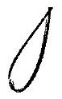

Eytan H. Modiano Professor of Aeronautics and Astronautics Chair, Graduate Program Committee

<!-- PDF_PAGE: 2 -->

# From CubeSats to Constellations: Systems Design and Performance Analysis

by

Anne Dorothy Marinan

Submitted to the Department of Aeronautics and Astronautics on August 22, 2013 in partial fulfillment of the requirements for the degree of Master of Science in Aeronautics and Astronautics

## ABSTRACT

The primary purpose of an Earth observing spacecraft constellation is to obtain global measurements with improved spatial and temporal resolution. The small size, low cost, standardized form factor, and increasing availability of commercial parts for CubeSats make them ideal for use in constellations.

In this work, we provide an in-depth analysis of how to evolve from a single Earthobserving CubeSat to an effective CubeSat constellation. We first consider pointing capability provided by three different CubeSat attitude determination and control system (ADCS) architectures to an Earth-observing payload. Our approach of performing a comprehensive orbital altitude and inclination reference point analysis for all subsystems allows us not only to evaluate trades between subsystems when designing a CubeSat that may be manifest in any low-Earth orbit, but the reference point analysis also provides a database of impacts that the orbital parameters have on subsystems and performance for designing a constellation. Next, we consider the practical challenge of trying to launch and distribute a CubeSat constellation into a specific configuration. We suggest a cost-effective way to launch a constellation of CubeSats via consecutive secondary payload launch opportunities.

<!-- PDF_PAGE: 3 -->

## Acknowledgements

I would like to acknowledge and thank my advisor, Kerri Cahoy, for her continuous encouragement and inspiration both in and out of the lab.

I further acknowledge the MicroMAS team in the SSL for their extraordinary effort and dedication to the project. Thanks also to Bill Blackwell and the MicroMAS team at Lincoln Laboratory for their advice and the motivation behind this mission and vision.

Finally, I would like to thank my family (Mom, Dad, Marie, Kathleen, Emily, and John) as well as Meghan for their invaluable support and reassurance.

This work was supported by a NASA Office of the Chief Technologist's Space Technology Research Fellowship as well as by funds provided by the William Asbjornsen Albert Memorial Fellowship. Analytical Graphics, Inc provided the Systems Toolkit software and modules used in this analysis through the Educational Alliance Program with MIT.

<!-- PDF_PAGE: 4 -->

## Table of Contents

List of Figures ... v

List of Tables ... viii

List of Acronyms ... ix

1 Chapter 1: Introduction and Motivation ... 1

1.1 Introduction ... 2

1.2 Satellite Constellations ... 2

1.3 Constellation Architectures ... 3

1.4 CubeSats ... 6

1.5 Scope of Thesis ... 12

2 Chapter 2: Designing the Prototype ... 16

2.1 Design Space ... 17

2.2 Systems and Mission Design ... 17

2.3 Power Management ... 20

2.4 Communications ... 22

2.5 Attitude Determination and Control ... 26

2.6 Thermal, Avionics, and Structures ... 36

2.7 Constellation Design ... 38

3 Chapter 3: MicroMAS System Design ... 39

3.1 MicroMAS Overview ... 40

3.2 Orbit Reference Point Analysis ... 45

3.3 Design to an Orbit ... 54

3.4 Continuing Work ... 60

4 Chapter 4: CubeSat Constellation Architectures ... 63

4.1 CubeSat Launch Opportunities ... 64

4.2 Case Study Overview ... 65

4.3 One Satellite Per Plane (No Propulsion) ... 68

4.4 Multiple CubeSats Per Plane ... 73

4.5 Summary ... 82

5 Chapter 5: Summary of Results ... 84

5.1 Systems Design Considerations ... 85

5.2 CubeSat to Constellation Process ... 86

5.3 Future Considerations ... 86

<!-- PDF_PAGE: 5 -->

6 References...87

A. Appendix A: Reference Point Analysis for Horizontal Configuration Case Study ...1

B. Appendix B: Summary of Results from Historic Launches...3

C. Appendix C: Delta V and Time Required for Multi-Spacecraft Distribution Maneuver...5

D. Appendix D: Revisit Time, Percent Coverage, and Response Time for 3 Satellites per Orbital Plane...6

<!-- PDF_PAGE: 6 -->

## List of Figures

Figure 1-1: Relative organization of distributed satellite systems based on control accuracy and inter-satellite distance. ... 2

Figure 1-2: Illustrations of Walker (left), and Streets of Coverage (right) constellation architectures ... 4

Figure 1-3: Required revisit times and ground sample distances (GSD) for Earth science and observation applications. ... 5

Figure 1-4: CubeSats are sized by number of units (U) and are typically built in 1U, 1.5U, 2U, or 3U sizes. ... 6

Figure 1-5: CubeSat Deployer (P-POD) ... 7

Figure 1-6: Trends of increasing numbers of CubeSats launched per year ... 8

Figure 1-7: Comparison of applications of small satellites in past and future missions ... 9

Figure 1-8: Past and future CubeSat orbit possibilities based on historic and announced opportunities ... 11

Figure 1-9: Illustration of case study “vertical” (left) and “horizontal” configuration. ... 12

Figure 1-10: MicroMAS constellation mission progression ... 13

Figure 1-11: The MicroMAS Satellite is a 3U CubeSat with a 1U rotating microwave radiometer payload ... 14

Figure 2-1: Coordinate frames for vertical (left) and horizontal (right) case study configurations ... 17

Figure 2-2: Deorbit time as a function of initial altitude (vertical case) ... 18

Figure 2-3: Allocations of UHF (top) and S-band (bottom) frequency bands ... 23

Figure 2-4: Diagram of torque coils on 1U CubeSat ... 28

Figure 2-5: X component of Earth's magnetic field over a range of orbital inclinations (0, 15, 30, 45, 60, 75, and 90 degrees) for a 500 km orbit ... 29

Figure 2-6: Y component of Earth's magnetic field over a range of orbital inclinations (0, 15, 30, 45, 60, 75, and 90 degrees) for a 500 km orbit ... 30

Figure 2-7: Z component of Earth's magnetic field over a range of orbital inclinations (0, 15, 30, 45, 60, 75, and 90 degrees) for a 500 km orbit ... 30

Figure 2-8: X component of Earth's magnetic field over a range of altitudes (300 km, 400 km, 500 km, 600 km, 700 km) at a 45-degree inclination orbit ... 31

Figure 2-9: Y component of Earth's magnetic field over a range of altitudes (300 km, 400 km, 500 km, 600 km, 700 km) at a 45-degree inclination orbit ... 31

<!-- PDF_PAGE: 7 -->

Figure 2-10: Z component of Earth's magnetic field over a range of altitudes (300 km, 400 km, 500 km, 600 km, 700 km) at a 45-degree inclination orbit...32

Figure 2-11: Average isometric temperature for CubeSats at different inclinations and altitudes for varying internal power consumptions...36

Figure 3-1: MicroMAS Operational Overview...41

Figure 3-2: Placement of internal components in the MicroMAS CubeSat bus...41

Figure 3-3: Block Diagram of the MicroMAS CubeSat...42

Figure 3-4: Reference point results from communications...47

Figure 3-5: Deorbit time as a function of initial altitude for the MicroMAS CubeSat...49

Figure 3-6: Diagram of MicroMAS internal component temperature ranges with acceptable overall spacecraft operational temperature ranges highlighted...50

Figure 3-7: Results of extreme hot case thermal model...50

Figure 3-8: Results of extreme cold case thermal model...51

Figure 3-9: Total Ionizing Dose for 1 mm and 1.5 mm aluminum shielding...52

Figure 3-10: Summary of expected MicroMAS performance across the orbital design space...54

Figure 3-11: MicroMAS Communications access with the Wallops Ground station...56

Figure 3-12: Power generation of MicroMAS over expected lifetime...57

Figure 3-13: Power generation of MicroMAS during first six hours of operation. Stars indicate times of panel deployment...57

Figure 3-14:MicroMAS Deorbit Time versus altitude for expected launch parameters...58

Figure 3-15: Perigee, Apogee, and Eccentricity as a function of time for MicroMAS deployed from the ISS...58

Figure 3-16: Operating and survival temperature ranges for major components on MicroMAS. Red indicates the most stringent temperature requirements, and yellow indicates a moderate operating temperature range...59

Figure 3-17: Total Radiation Dose for 400 km orbit for orbit inclinations ranging from 0 degrees to sun-synchronous...60

Figure 3-18: Diagram of information flow across subsystem simulations...61

Figure 4-1: Reference constellation showing sensor field of view (teal)...65

Figure 4-2: Illustration of Walker Constellation Orbits (Looking Down on North Pole) 66

Figure 4-3: Calendar view of 2013 launch opportunities...67

Figure 4-4: Illustration of Ad Hoc Case 1 Constellation Orbits (Looking Down on North Pole)...67

Figure 4-5: Illustration of Ad Hoc Case 2 Constellation Orbits (Looking Down on North Pole)...68

<!-- PDF_PAGE: 8 -->

Figure 4-6: Comparison of maximum revisit time for each case study (one satellite per orbital plane)...69

Figure 4-7: Average revisit time for each constellation is shown over the whole earth...70

Figure 4-8: Percent global coverage as a function of time for each case study ...71

Figure 4-9: Maximum response time for each constellation is depicted globally...72

Figure 4-10: Propellant mass requirements for different Cubesat propulsion types ...73

Figure 4-11: Deorbit time as a function of altitude for two solar panel configurations...74

Figure 4-12: Force required to compensate for drag for two solar panel configurations..75

Figure 4-13: State and control history for the even distribution of six satellites in a 320 km altitude circular orbit ...76

Figure 4-14: Maximum revisit time for each case study (six satellites per plane)...78

Figure 4-15: Average revisit time for six satellites per orbital plane...79

Figure 4-16: Percent global coverage as a function of time for six satellites per plane ...80

Figure 4-17: Maximum response time for six satellites per orbital plane...81

<!-- PDF_PAGE: 9 -->

## List of Tables

Table 1-1: Classifications of Distributed Satellite Systems ... 3

Table 1-2: Satellite Size Definitions ... 6

Table 1-3: Preliminary assessment of the feasibility of CubeSat-based missions carrying different remote sensing technologies ... 10

Table 2-1: Expected time to deorbit for a range of altitudes and inclinations (vertical case) ... 19

Table 2-2: Commercially available power generation and storage mechanisms for a 3U CubeSat with body-mounted solar panels and 30 Whr LiIon batteries ... 21

Table 2-3: Orbit average power generation vertical orientation ... 21

Table 2-4: Comparison of COTS radio boards for CubeSat use ... 25

Table 2-5: Generic CubeSat Case Studies ... 26

Table 2-6: Maximum disturbance torque about spacecraft X axis ... 26

Table 2-7: Maximum disturbance torque about spacecraft Y axis ... 27

Table 2-8: Maximum disturbance torque about spacecraft Z axis ... 27

Table 2-9: Specifications of commercially-available attitude sensors for CubeSats ... 27

Table 2-10: COTS magnetorquer comparison (torque rods and torque coils) ... 33

Table 2-11: COTS reaction wheel comparison (single wheels and integrated systems) ... 34

Table 2-12: Comparison of CubeSat thruster systems currently under development ... 35

Table 3-1: Power Generation at Beginning of Life for all four panels deployed to 120 degrees ... 48

Table 3-2: Expected lifetime for MicroMAS CubeSat ... 48

Table 3-3: Isometric Temperature Results for PV Cells ... 51

Table 3-4: Isometric Temperature Results for Kapton 0.5 mil ... 51

Table 3-5: Isometric Temperature Results for Kapton 5.0 mil ... 52

Table 3-6: Total Ionizing Dose for 1 mm aluminum shielding ... 53

Table 3-7: Link budget analysis for ISS-deployed orbit for operations – all access and business hour access only ... 55

Table 4-1: Launch Opportunities for 2013 and Beyond ... 64

Table 4-2: Summary of Results ... 82

viii

<!-- PDF_PAGE: 10 -->

## List of Acronyms

ADCS-Attitude Determination and Control System

AGI - Analytical Graphics Incorporated

BER - Bit Error Rate

COTS-Commercial off-the-shelf

CSD - Canisterized Satellite Dispensers

EPS- Electrical Power System

FCC-Federal Communications Commission

FOV-Field of View

GEO - Geosynchronous Orbit

GEVS-General Environmental Verification Standard

IAGA - International Association of Geomagnetism and Aeronomy

IGRF - International Geomagnetic Reference Field

ISIS - Innovative Solutions in Space

ISS-International Space Station

LAICE - Lower Atmosphere-Ionosphere Coupling Experiment

LEO - Low-Earth Orbit

MicroMAS - Microsized Microwave Atmospheric Satellite

MiRaTA - Microwave Radiometer Technology Assessment

NASA - National Aeronautics and Space Administration

NPSCuL - Naval Postgraduate School CubeSat Launcher

NSF - National Science Foundation

NTIA - National Telecommunications and Information Administration

OSAGS - Open System of Agile Groundstations

PPOD - PolyPicosatellite Orbital Deployer

PSS- Princeton Satellite Systems

PTS - Payload Telemetry System

RTOS-Real-Time Operating System

SS-Sun-Synchronous

STK - Systems Toolkit

TID - Total Ionizing Dose

UHF-Ultra-High Frequency

VHF - Very High Frequency

<!-- PDF_PAGE: 11 -->

## 1 Chapter 1: Introduction and Motivation

1. Chapter 1: Introduction and Motivation...1

1.1 Introduction...2

1.2 Satellite Constellations...2

1.3 Constellation Architectures...3

1.3.1 Science Applications and Benefits of CubeSat Constellations...4

1.4 CubeSats...6

1.4.1 CubeSat Specifications...7

1.4.2 Commercial Support and Operation...7

1.4.3 Scientific Feasibility...8

1.4.4 Space Access for CubeSat Constellations...10

1.5 Scope of Thesis...12

1.5.1 Generic Case Studies...12

1.5.2 MicroMAS...13

1.5.3 Organization...14

<!-- PDF_PAGE: 12 -->

## 1.1 Introduction

The purpose of this thesis is to look at considerations required for a systems-level design of a CubeSat constellation for an Earth-observing scientific mission. The idea is to progress from a single demonstration CubeSat to a constellation of identical satellites. The approach we take in this paper is to begin with a systems-level analysis of the behavior of a single satellite with an unknown destination orbit. This CubeSat would serve as a demonstration of the science and technology required for the constellation mission. A follow-on mission with increased capabilities would be a model for the satellites that would populate the constellation mission. Finally, we consider the architecture and achievable coverage of the resulting constellation.

## 1.2 Satellite Constellations

When looking at different satellite mission architectures, there are typically two main classes of satellite missions: those that use one satellite to carry out a science goal (monolithic systems) and those that require two or more satellites to fulfill the mission purpose (distributed systems). There are different applications, advantages, and disadvantages to both. There is growing interest among the science community in using distributed systems of small satellites to enhance observations for earth and space science.

One classification of distributed systems is based on satellite configurations and functions. For example, a classification scenario based on satellite separation and required control authority [1] is shown in Figure 1-1.

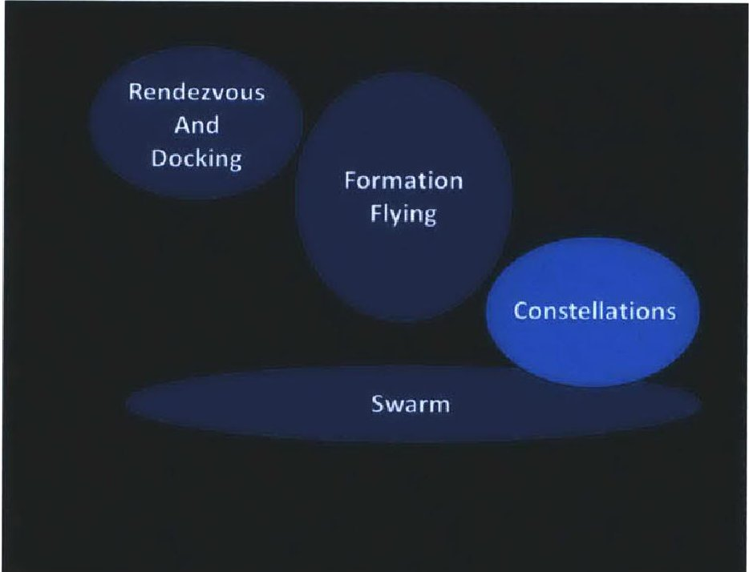

Figure 1-1: Relative organization of distributed satellite systems based on control accuracy and intersatellite distance. This study focuses on constellations. [1]

<!-- PDF_PAGE: 13 -->

The four architectures shown in this figure are defined as follows:

- Rendezvous and docking - two objects moving in the vicinity of each other

- Formation flying - small number of spacecraft flying in a concerted way at regional intersatellite separations

- Constellation - satellites in own orbital planes, achieve global coverage

- Swarm - tens or hundreds of spacecraft with no active control mechanisms

There are several more complex classifications for distributed systems. Shaw, et al (2000) use four parameters: the level of distribution (number of satellites), coordination between the satellites, homogeneity of the system architecture (relative spacing and grouping of satellites), and the operational characteristics of the satellites [2]. Table 1-1 shows additional levels of classification under these four parameters.

Table 1-1: Classifications of Distributed Satellite Systems [2]

<table border="1"><tr><td>Parameter</td><td>Levels</td></tr><tr><td>Level of distribution</td><td>Number of satellites</td></tr><tr><td>Satellite Coordination</td><td>Collaborative Symbiotic</td></tr><tr><td>Architecture</td><td>Local cluster Constellation Clusters Augmentation</td></tr><tr><td>Operational</td><td>Active/Passive Track/Search/Imaging Distributed/Concentrated Market</td></tr></table>

In this work, we focus solely on constellations of small satellites for passive imaging. Each satellite independently operates in its own orbital plane and slot with limited station keeping.

## 1.3 Constellation Architectures

Satellite constellations are typically designed to optimize coverage over specific areas or improve global revisit times. Constellation architectures have been studied and optimized for decades, e.g. [3] [4] [5] [6] [7] [8]. For optimized architectures, continuous worldwide visibility of one location can be achieved with as few as five satellites, with each in a separate orbital plane, assuming a horizon-to-horizon field of view [9]. In addition to the number of satellites and orbital planes, for Earth-observing missions, the effective sensor field of view also determines the coverage, revisit time, and optimal configuration.

<!-- PDF_PAGE: 14 -->

There are several common constellation architectures [6] [10] including

- Geosynchronous - three to five satellites in GEO providing worldwide coverage

- Streets of Coverage -polar orbits with satellite right ascensions of ascending node (RAAN) spread evenly across one hemisphere (illustrated in Figure 1-2)

- Ellipso - various elliptical orbits are used to optimize coverage over a specific region or for a specific time of day

- Polar Non-symmetric - satellites in polar orbits with varying rotational spacing designed to optimize coverage over a specific region

- Walker/Rosette - satellites in individual rotationally symmetric orbital planes with identical altitudes and inclinations (illustrated in Figure 1-2)

- String of Pearls (A-Train)- multiple satellites in same orbital plane

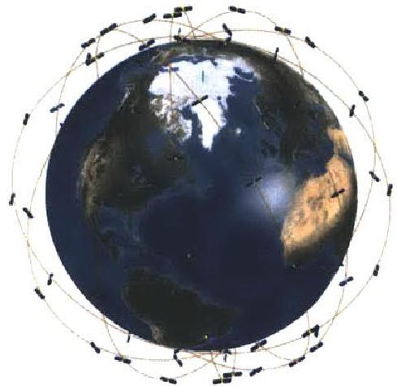

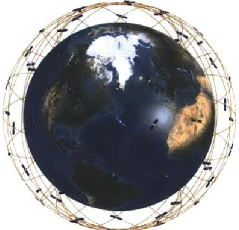

Figure 1-2: Illustrations of Walker (left), and Streets of Coverage (right) constellation architectures [10]

It is possible to achieve global coverage and improve revisit times without an intentionally designed constellation architecture using an "ad hoc" approach. An ad hoc constellation does not have identical, evenly-spaced orbital planes. Instead, ad hoc constellations take advantage of launch opportunities as they arise. Because CubeSat launches are usually ride-share, hosted, or secondary, they are dependent on the desired orbits of the primary missions, and so an ad hoc CubeSat constellation architecture depends on the schedule and availability of CubeSat launch opportunities.

In this thesis, we focus on ad hoc, Walker/Rosette, and A-Train CubeSat constellation architectures limited to Low Earth Orbit. This is described further in Chapter 4.

## 1.3.1 Science Applications and Benefits of CubeSat Constellations

The primary benefits of CubeSat constellations over monolithic systems are the increased temporal and spatial resolution of observations and measurements. Additionally, with a larger number of less-expensive satellites involved, a mission is less affected by single-satellite failures.

<!-- PDF_PAGE: 15 -->

Figure 1-3 from Rainer Sandau's paper "Status and trends of small satellite missions for Earth observation," in which he discusses the requirements for earth observation areas that can be fulfilled by small satellites, shows the spatial and temporal resolutions required to achieve desired results in a variety of Earth-observing applications such as disaster monitoring, meteorology, and hydrology.

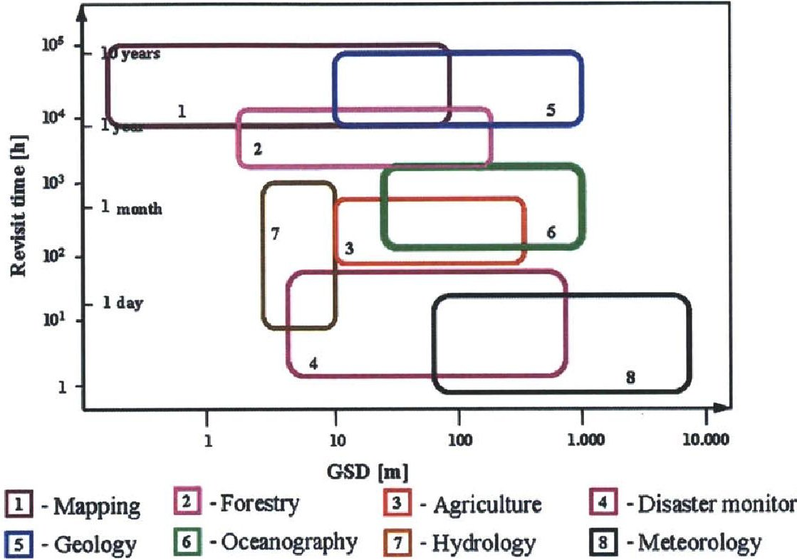

Figure 1-3: Required revisit times and ground sample distances (GSD) for Earth science and observation applications [11].

The 2007 decadal survey on Earth Science and Applications from Space announced that revisit times as fast as 15 minutes are required to achieve the high temporal resolution desired in areas such as weather science, dynamics, water resources and cycles, and climate variability [12]. For disaster monitoring, response time and coverage are critical in identifying and tracking any resulting damage [13]. A recent heliophysics decadal study specifically called for the use of a constellation of at least ten satellites to observe the effects of the sun's dynamic behavior on the Earth [14]. One study found that a 10 - 30m spatial resolution with revisit time of 30-60 minutes can be achieved with a constellation of 32 small satellites (horizon to horizon field of view).

In addition to Earth science and monitoring benefits, there are commercial applications for LEO constellations as well. Iridium provides satellite phone coverage from LEO, and Global Positioning System satellites are also in a constellation in LEO.

The applications of interest for this study are LEO constellations for Earth-observing scientific missions.

<!-- PDF_PAGE: 16 -->

## 1.4 CubeSats

The benefit of using small satellites for earth observation over large systems has been realized for a number of years [15]. Small satellites are placed in one of several categories ranging from femtosatellites (less than 10 g) to microsatellites (up to 100 kg) as summarized in Table 1-2 [16]. These satellites are generally launched into space as secondary or auxiliary payloads.

Table 1-2: Satellite Size Definitions [16]

<table border="1"><tr><td>Minisatellite</td><td>100+kg</td></tr><tr><td>Microsatellite</td><td>10-100kg</td></tr><tr><td>Nanosatellite</td><td>1-10kg</td></tr><tr><td>Picosatellite</td><td>0.01-1kg</td></tr><tr><td>Femtosatellite</td><td>0.001-0.01kg</td></tr></table>

In this work, we focus on a specific class of nanosatellites known as CubeSat. Miniaturized components and instruments for CubeSats are rapidly becoming available and could carry out observation missions such as ??? [17]. One CubeSat unit (1U) has dimensions of 10 by 10 by 10 centimeters, and CubeSats have historically been built in 1U, 1.5U, 2U, or 3U sizes. Figure 1-4 shows the relative sizing of each of these selections.

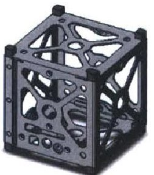

1U Skeleton CAD Model RevD

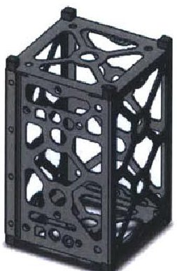

1. 5U Skeleton CAD Model

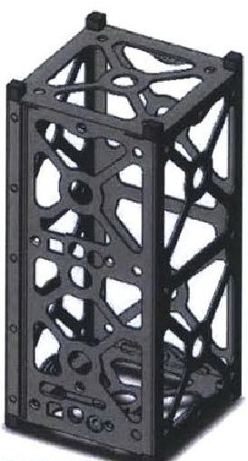

2U Skeleton CAD Model

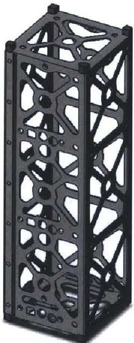

3U Skeleton CAD Model

Figure 1-4: CubeSats are sized by number of units (U) and are typically built in 1U, 1.5U, 2U, or 3U sizes. [18]

<!-- PDF_PAGE: 17 -->

## 1.4.1 CubeSat Specifications

A CubeSat is a nanosatellite with strict standards for size, mass, power, and launch configurations. CubeSats were developed by the California Polytechnic Institute as a platform with a consistent launch vehicle interface that would enable interested parties, mainly universities, to build low-cost satellites for science missions. COTS (Commercial Off-the-Shelf) components are an integral part of CubeSat design, and there are corporations that tailor components and structures specifically to CubeSat needs (Pumpkin, Clyde Space, etc). They are relatively cheap and simple to produce as compared with components and systems for larger satellites. Each unit (U) of a CubeSat is a 10 x 10 x 10cm cube with a mass of 1.33 kg [19]. Figure 1-5 shows the deployment mechanism initially developed to launch a 3U CubeSat - the PolyPicosatellite Orbital Deployer (P-POD).

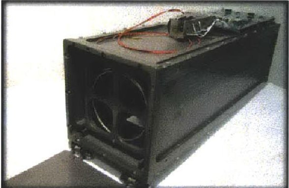

Figure 1-5: CubeSat Deployer (P-POD) [20]

This deployer and the standards that each CubeSat designs to were developed to ensure the consistency of these secondary payloads and to minimize risk to the primary mission.

## 1.4.2 Commercial Support and Operation

In recent years, CubeSats have increasingly generated interest from commercial and government sectors because of their low cost and short development time compared with traditional satellite missions [21]. Figure 1-6 shows the increasing trend in CubeSat launch opportunities since their conception in 2000.

<!-- PDF_PAGE: 18 -->

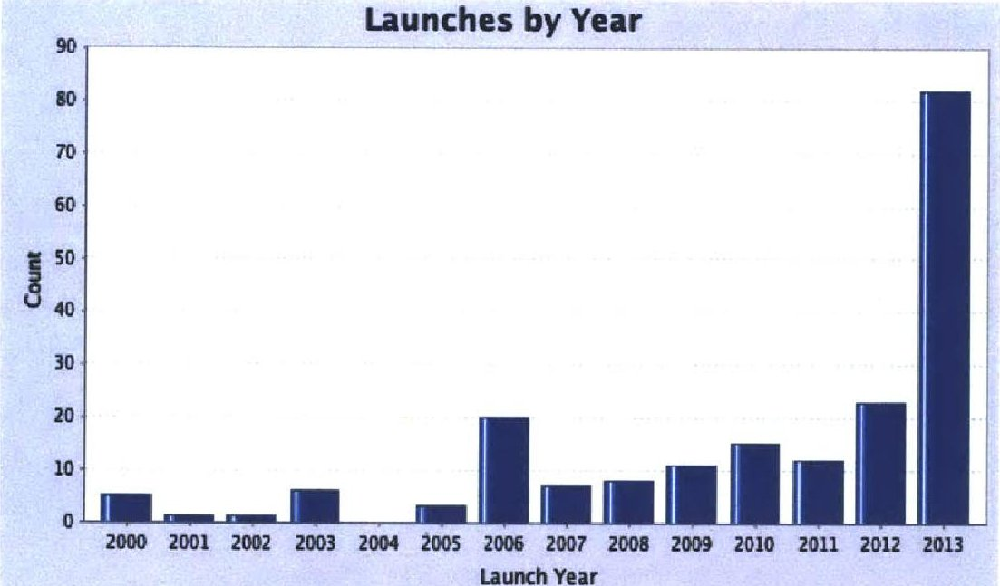

Figure 1-6: Trends of increasing numbers of CubeSats launched per year ([22])

The low cost, relative simplicity, and availability of CubeSat compatible components make these satellites increasingly popular. With this growing popularity of CubeSats, other organizations have developed their own versions of the P-POD launcher. The P-POD is developed and managed in the United States, but an international version from ISIS Space, the ISIPOD, is a popular option for launches outside the United States. The Naval Postgraduate School has also developed a CubeSat launch platform: NPSCUL.

Many commercial companies have come out of the CubeSat movement, focusing on developing components specifically tailored to CubeSat specifications [23]. There is also a growing trend to develop a 'common bus' that would be a plug-and-play type module for these nanosatellites. Companies such as Tyvak and Blue Canyon are developing units that combine avionics, power modules, and attitude control mechanisms. These units are compact and are designed to consolidate supporting subsystems into an architecture that would interface with payloads in the 1 to 1.5 U size range.

CubeSats are also getting bigger. The Lower Atmosphere-Ionosphere Coupling Experiment (LAICE) recently became the first 6U mission funded by the NSF. Its goal is to observe gravity waves and correlate airglow perturbations in the upper mesosphere with ion and neutral density fluctuations at thermospheric/ionospheric altitudes [24]. This has opened the door for many other missions, including 12U and even up to 27U that would not be possible with the restrictions of a 3U spacecraft. Specifications and requirements for these larger deployers, known as Canisterized Satellite Dispensers (CSD) are already in development [25].

## 1.4.3 Scientific Feasibility

CubeSats are an increasingly viable scientific platform [26] and their simplicity and low mass make them ideal candidates for low earth orbit constellations. Their initial popularity was due to the revolutionary ability for educational institutions to access

<!-- PDF_PAGE: 19 -->

space, and many resulting missions have been simple technology demonstrations or capability demonstrations. Projections show that future missions will see an increase in CubeSat science, as illustrated in Figure 1-7.

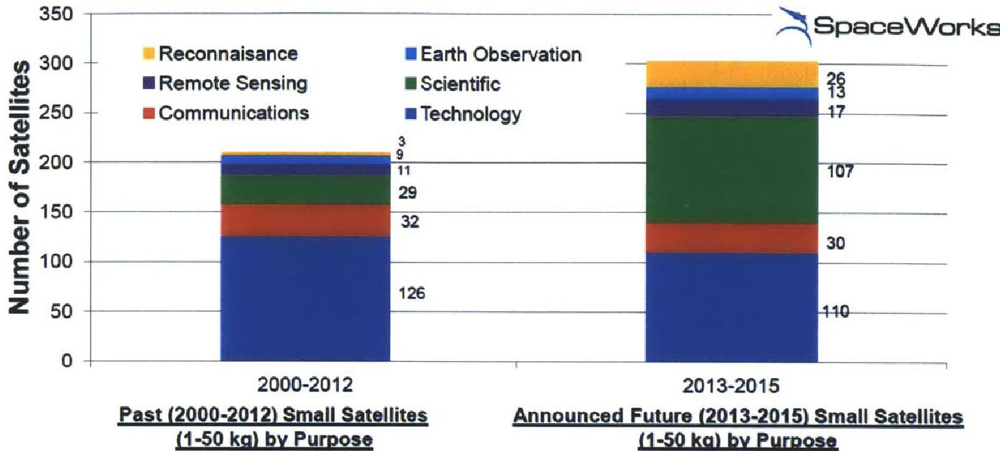

Figure 1-7: Comparison of applications of small satellites in past and future missions [27]

The usefulness and science return from small satellites is still debated. With recent improvements in technology and a push to shrink supporting electronics and subsystem components, the potential for CubeSats to contribute valuable scientific observations has increased substantially. Daniel Selva and David Krejci assessed the current state of CubeSat technology to determine feasible missions with high scientific payoff that interested parties can design to [26]. Table 1-3 shows the results of this assessment.

Although there is still significant development to be made in small-scale electronics and increasing the capabilities of these satellites, CubeSats are quickly becoming viable platforms for Earth and space science, and several institutions have developed or are developing CubeSats for science applications.

<!-- PDF_PAGE: 20 -->

Table 1-3: Preliminary assessment of the feasibility of CubeSat-based missions carrying different remote sensing technologies [26]

<table border="1"><tr><td>Technology</td><td>Feasibility Assessment</td><td>Justification</td></tr><tr><td>Atmospheric chemistry instruments</td><td>Problematic</td><td>Low sensitivity in SWIR-MIR because of limited cooling capability</td></tr><tr><td>Atmospheric temperature and humidity sounders</td><td>Feasible</td><td>e.g. GNSS radio occultation, hyperspectral millimeter-wave sounding</td></tr><tr><td>Cloud profile and rain radars</td><td>Infeasible</td><td>Dimensions, power</td></tr><tr><td>Earth radiation budget radiometers</td><td>Feasible</td><td>[28]</td></tr><tr><td>Gravity instruments</td><td>Feasible</td><td>[29]</td></tr><tr><td>High resolution optical imagers</td><td>Infeasible</td><td>Not enough resolution-swath, because limited space for optics and detectors</td></tr><tr><td>Imaging microwave radars</td><td>Infeasible</td><td>Limited power</td></tr><tr><td>Imaging multi-spectral radiometers(vis/IR)</td><td>Problematic</td><td>Limited imaging capability</td></tr><tr><td>Imaging multi-spectral radiometers(passive microwave)</td><td>Problematic</td><td>Limited imaging capability</td></tr><tr><td>Lidars</td><td>Infeasible</td><td>Limited Power</td></tr><tr><td>Lightning imagers</td><td>Feasible</td><td>[30]</td></tr><tr><td>Magnetic field instruments</td><td>Feasible</td><td>[31]</td></tr><tr><td>Multiple direction/polarization radiometers</td><td>Problematic</td><td>Limited dimensions for receiver electronics</td></tr><tr><td>Ocean color instruments</td><td>Feasible</td><td>[32]</td></tr><tr><td>Precision orbit</td><td>Feasible</td><td>[33]</td></tr><tr><td>Radar altimeters</td><td>Infeasible</td><td>Dimensions</td></tr><tr><td>Scatterometers</td><td>Infeasible</td><td>Dimensions</td></tr></table>

## 1.4.4 Space Access for CubeSat Constellations

As previously mentioned, CubeSats are typically launched as secondary payloads in Poly-Picosatellite Orbital Deployers (P-PODs) or similar deployers. The standard was developed by CalPoly, although there are other deployers seeking to enter the market with their own associated standards, such as Innovative Solutions in Space's ISIPOD, Tokyo Pico-satellite Orbital Deployer (T-POD), Tokyo Institute of Technology's CUTE Separation System (CSS), Canada's eXperimental Push Out Deployer (X-POD), and the NanoRacks NanoSat CubeLauncher. There are also several companies working to enable large numbers of CubeSats to launch as a combined volume that would fall under an ESPA-class payload. One example of this is the Naval Postgraduate School CubeSat Launcher (NPSCuL) [34]. Additional concepts include developing launch vehicles specifically for small satellites, or in-space tugs to give small satellite developers more control over the destination orbit [35].

<!-- PDF_PAGE: 21 -->

Figure 1-8 shows the past and announced orbits to which CubeSats are launched. These launches specifically noted that opportunities for CubeSats as secondary payloads were possible [35][36][37].

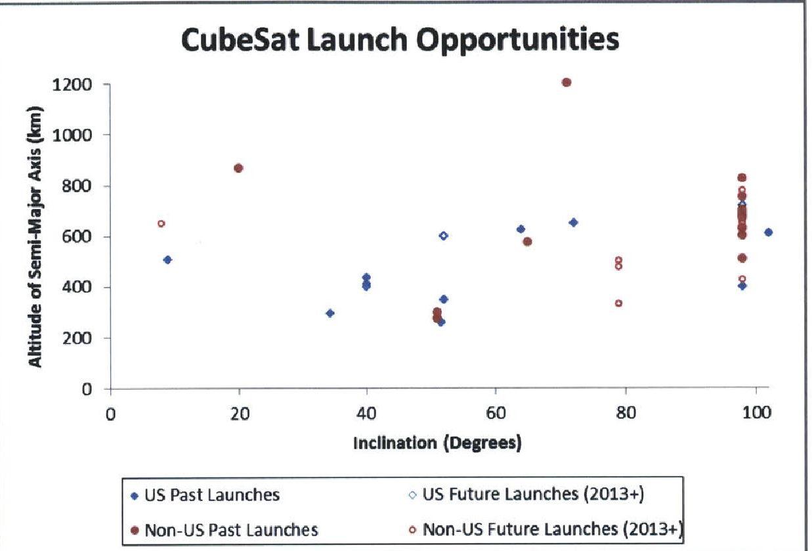

Figure 1-8: Past and future CubeSat orbit possibilities based on historic and announced opportunities [36] [38]

As described in section 1.1, optimized satellite constellations require the flexibility to choose orbits for the satellites. To accomplish this, CubeSat constellation missions would require either (1) a dedicated launch vehicle or a special carrier per plane for a primary multiple-CubeSat mission or (2) partnership with complementary primary missions that launch the CubeSats into their desired orbits. The first option puts a large cost burden on the mission on the order of tens to hundreds of millions of dollars depending on the launch vehicle to distribute the CubeSats into the desired orbits. The second option would require multiple identical launch opportunities or a transfer vehicle and longer CubeSat lifetimes. An alternative is the ad hoc approach, where each CubeSat is launched as a secondary payload on different missions as opportunities arise, so they are all launched within a given timeframe. Programs such as the NASA Educational Launch of Nanosatellites (ELaNa) strive to make secondary payload launch opportunities available for CubeSats at minimal cost to their developers. Launching as a secondary payload, however, would result in nontraditional (ad hoc) constellation architecture. Another option is to launch clusters of nanosatellites. Additional independent capability to distribute multiple CubeSats in an orbit would increase overall coverage and thus science return but require some form of on-board propulsion.

<!-- PDF_PAGE: 22 -->

One example of a planned constellation scheduled for launch in the near future is the Iridium NEXT constellation, which will launch sixty-six, 800-kg satellites into eleven orbital planes through 2015-2017. Each satellite is designed to a 10-15 year lifetime [39]. For CubeSats, the time between for successive launch opportunities must be shorter because their design lifetimes are also shorter than the Iridium satellites. Due to the use of non-radiation-hardened commercial components, CubeSats are generally expected to have an operational lifetime of a few months to over a year. Another constraint on CubeSat lifetime is drag. Depending on the altitude at which the CubeSat is deployed, it may take anywhere from a few weeks to decades to de-orbit (see Section 2.2.1 for an in-depth analysis). By taking advantage of multiple launch facilities and opportunities, the launch schedule could be compressed enough to be of value even to lifetime-constrained CubeSats and result in useful constellation missions. The resulting constellations would not be optimized for specific geographic coverage but, as we show in Chapter 4, can provide adequate revisit times for some scientific applications.

In this work we focus specifically on ad hoc CubeSat constellations with application to global science measurements. We specifically look at architectures of these constellations in Chapter 4.

## 1.5 Scope of Thesis

This thesis covers the system design process and considerations required to go from a single 3U CubeSat demonstration to a constellation of identical 3U CubeSats. We first explore the design tradespace for generic CubeSats, and then we discuss the design and performance of a specific scientific CubeSat, the Microsized Microwave Atmospheric Sounder (MicroMAS) to add deeper levels of detail to the system and subsystem design trades. We then address viable architectures and network/maintenance strategies for CubeSat constellations.

## 1.5.1 Generic Case Studies

For the majority of the trade studies and performance analyses, we assume 3U CubeSats with no deployables and body-mounted solar cells on all four long faces. Figure 1-9 illustrates the two considered flight configurations hereafter referred to as "vertical" (gravity-gradient stabilized) and "horizontal" (long axis of the spacecraft parallel to the RAM direction).

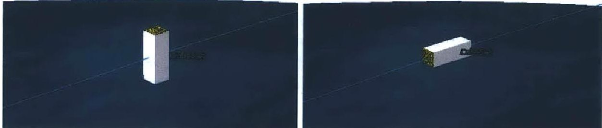

Figure 1-9: Illustration of case study "vertical" (left) and "horizontal" configuration. White surfaces indicate solar cell coverage

<!-- PDF_PAGE: 23 -->

We used a 3U CubeSat for this study because it can accommodate more actuators, sensors, and a larger volume for scientific payloads (generally 1-2U of the 3U can be used to host a scientific payload) compared with a 1U CubeSat. The launch frequency of 3U CubeSats continues to increase, which is an indicator of their ability to host payloads of scientific and/or commercial value [22]. While 6U CubeSats offer more capabilities for future missions, only one 6U CubeSat has been selected for government funding to date [24].

## 1.5.2 MicroMAS

In order to consider a case with more detailed design trades than the generic cases, we also discuss the design of the Microsized Microwave Atmospheric Satellite (MicroMAS) CubeSat developed by the MIT Space Systems Laboratory and MIT Lincoln Laboratory [40] [41]. MicroMAS is a dual-spinning 3U CubeSat, with a 2U bus that remains stabilized in the local vertical local horizontal (LVLH) frame and a 1U payload that spins at a controlled rate of about 0.8 Hz. The payload is a passive microwave radiometer that samples nine channels centered at 118 GHz (Oxygen absorption line). The payload spins in order to (a) calibrate the radiometer with a view of deep space after each Earth observation and (b) extend the effective footprint of the sensor. The bus contains all the supporting subsystems and includes deployed 2U solar panels and a measuring tape spring monopole UHF antenna.

MicroMAS is a demonstration mission that is the first step in a long-term plan to launch an entire constellation of microwave radiometers for global atmospheric characterization as illustrated in Figure 1-10.

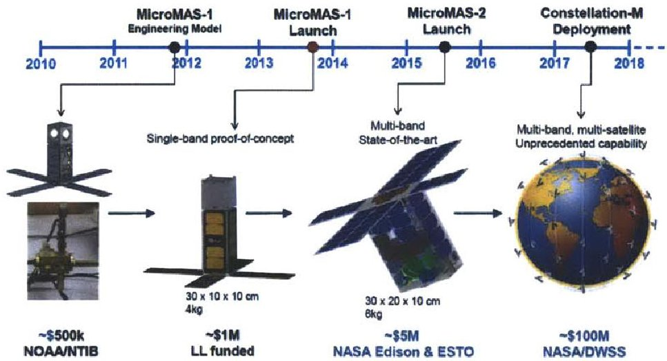

Figure 1-10: MicroMAS constellation mission progression

The 3U MicroMAS CubeSat is the basis for the progression model based on demonstrating scientific and technological capabilities with one satellite with the intent to expand on capabilities and numbers for future missions. Consequently, some of the orbital parameters and baseline components used in the generic case studies are based on design choices and components from the MicroMAS satellite (Figure 1-11).

<!-- PDF_PAGE: 24 -->

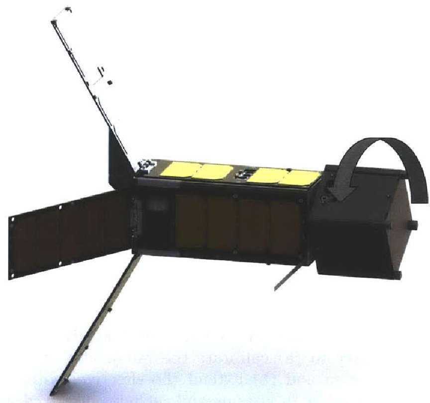

Figure 1-11: The MicroMAS Satellite is a 3U CubeSat with a 1U rotating microwave radiometer payload

MicroMAS is a modified and specialized example of Case Study 2, although it requires more control capability than most 3U satellites due to the rotation of the 1U instrument. It also features deployed solar panels (while the generic study only considers body mounted panels) which add to the overall power generation but also substantially increase the spacecraft drag. More detail about the MicroMAS mission and satellite design can be found in Chapter 3.

## 1.5.3 Organization

The goal of this thesis is to identify and quantify key design considerations when designing a constellation of identical CubeSats for scientific Earth observation missions from LEO. In addition to the three generic, scaleable case studies in Table 2-5, we present key design trades and analyses of the MicroMAS flight mission. We focus on two key areas: the performance of the CubeSat itself (in Chapters 2 and 3) and the achievable coverage from realistic constellation architectures (in Chapter 4).

Chapter 2 focuses on orbital trade studies and provides a summary of overall lifetime, power generation, attitude control authority, thermal environment, and communications access across a range of altitudes and inclinations over which a CubeSat can be expected to operate. These trade studies are compared across the three different CubeSat case studies. We also highlight design considerations and increased performance opportunities when designing to a larger CubeSat platform.

<!-- PDF_PAGE: 25 -->

Chapter 3 provides a more detailed design development and trade space analysis for the MicroMAS mission. System simulations of the satellite's behavior on orbit for its given launch parameters are also presented using the same metrics as in Chapter 2.

In Chapter 4, we first discuss the current launch capabilities and opportunities for ad hoc CubeSat constellations and show feasibility and resulting performance. We introduce three constellation case studies give an overview of three case studies and compare the revisit time, response time, and time to 100% global coverage for each. We present this analysis for one, three, and six satellites per orbital plane.

Chapter 5 summarizes the results; identifies potential improvements on the reference point analyses for future missions; and discusses operation of CubeSat constellations, in particular the maintenance, downlink/communications coverage opportunities, and schedule of use.

<!-- PDF_PAGE: 26 -->

## 2 Chapter 2: Designing the Prototype

2.1 Design Space...17

2.2 Systems and Mission Design...17

    2.2.1 Deorbit time...18

    2.2.2 Payload...19

2.3 Power Management...20

    2.3.1 Hardware Options...20

2.4 Communications...22

    2.4.1 Frequency Allocations and Link Considerations...22

    2.4.2 Hardware Options...24

    2.4.3 Orbit Design...25

2.5 Attitude Determination and Control...26

    2.5.1 Disturbance Torques...26

    2.5.2 Case 1: Magnetic Control...27

    2.5.3 Case 2: Reaction Wheels...33

    2.5.4 Case 3: Thrusters...35

2.6 Thermal, Avionics, and Structures...36

    2.6.1 Thermal...36

    2.6.2 Avionics...37

    2.6.3 Structures...37

2.7 Constellation Design...38

<!-- PDF_PAGE: 27 -->

## 2.1 Design Space

We define subsystem requirements and performance specifications for each of the three case studies introduced in Chapter 1. The main subsystems we consider are system and mission design; attitude dynamics and control; power generation, storage, and distribution; and communications. Additional subsystems such as computational processing and data management, structural and mechanical design, and thermal management, are briefly discussed, but detailed trade studies in these areas are typically payload and mission-specific and beyond the scope of this thesis. For all design parameters, we do a high-level analysis of the individual satellite's expected performance across a range of potential orbital altitudes and inclinations.

We bound the range of altitudes and inclinations in this study by the orbits typically used by CubeSats in low-earth orbit. Based on the data in Figure 1-8 we select an orbital design space that contains altitudes ranging from 300 km to 700 km and inclinations ranging from 0 degrees to sun synchronous (roughly 98 degrees).

We assume a satellite total mass of 4 kg (although some US launchers as well as non-US CubeSat launchers and deployers can accommodate masses up to or beyond 5 kg [25]) and a volume of 10 x 10 x 34.05 cm with the center of mass at the geometric center of the payload. Figure 2-1 shows the coordinate systems of each of the orientations introduced in Chapter 1.

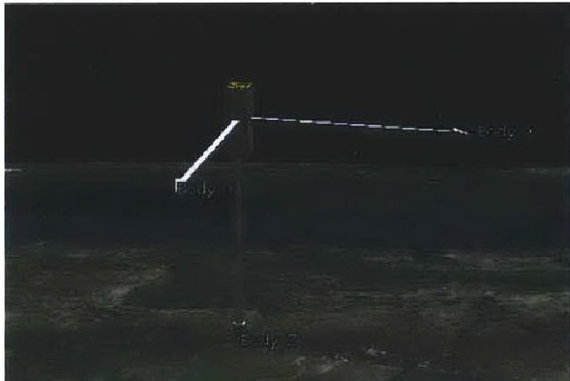

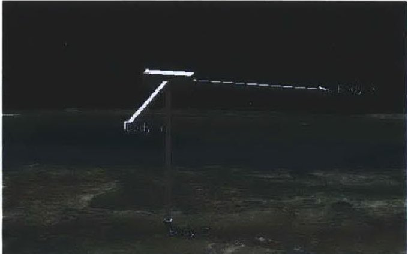

Figure 2-1: Coordinate frames for vertical (left) and horizontal (right) case study configurations

## 2.2 Systems and Mission Design

Because CubeSats are typically launched as secondary payloads, there are several constraints placed on their design. For example, the original CalPoly standards put limitations on mass, volume, location of center of mass, etc [19]. In order to meet launch requirements, the CubeSat must withstand environmental tests as dictated by the General Environment Verification Specification (GEVS) [42].

<!-- PDF_PAGE: 28 -->

## 2.2.1 Deorbit time

For missions flown or sponsored by the United States, CubeSats must deorbit within 25 years after the end of mission life [43] in order to preemptively mitigate orbital debris. Based on experimental data from past CubeSat missions [44], the drag coefficient of any given CubeSat will likely fall between 2 and 4.

The ballistic coefficient is given by Equation 2-1

$$
B C = \frac {M}{C _ {d} * A}
$$

where M is the mass of the satellite, $ C_{d} $ is the drag coefficient, and A is the cross-sectional area. For our case studies, the mass is 4 kg and the cross-sectional area is 0.03 $ m^{2} $ for the vertical configuration and 0.01 $ m^{2} $ for the horizontal configuration. Figure 2-2 shows the relationship between the initial orbital altitude of a 3U CubeSat flying vertically and the expected time it will take to deorbit.

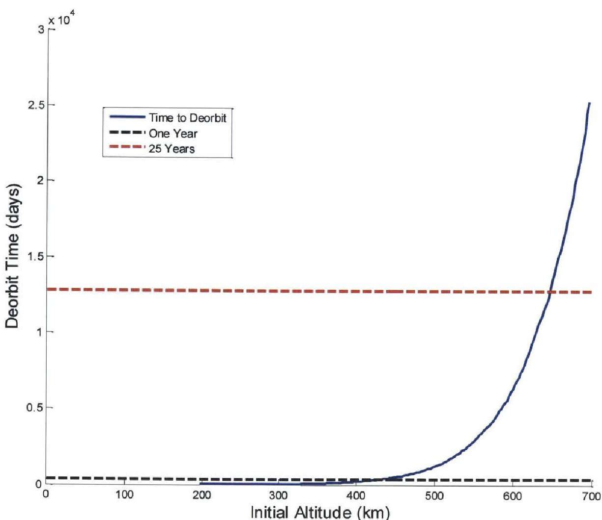

Figure 2-2: Deorbit time as a function of initial altitude (vertical case)

<!-- PDF_PAGE: 29 -->

This analysis is based on the NRLMSISE-00 atmospheric model [45]and does not take into consideration the effects of solar radiation pressure. It also assumes a constant drag area. Results may vary depending on the actual conditions seen on orbit.

The same study was performed in STK with the same atmospheric model and satellite parameters to compare the results from different methods of calculation. Table 2-1 shows the estimated orbital lifetimes of a 3U CubeSat flying in the vertical configuration as calculated by STK assuming a decay altitude of 100 km and a drag coefficient of 2.7.

Table 2-1: Expected time to deorbit for a range of altitudes and inclinations (vertical case)

<table border="1"><tr><td>Time to Deorbit(Days)</td><td>0°</td><td>15°</td><td>30°</td><td>45°</td><td>60°</td><td>75°</td><td>90°</td><td>Sun Synch</td></tr><tr><td>300km</td><td>26</td><td>26</td><td>27</td><td>30</td><td>31</td><td>33</td><td>34</td><td>32</td></tr><tr><td>400km</td><td>206</td><td>209</td><td>219</td><td>233</td><td>249</td><td>257</td><td>262</td><td>252</td></tr><tr><td>500km</td><td>2172</td><td>2268</td><td>2476</td><td>2739</td><td>2908</td><td>3021</td><td>3060</td><td>2921</td></tr><tr><td>600km</td><td>9396</td><td>9500</td><td>9844</td><td>10426</td><td>10970</td><td>11333</td><td>11680</td><td>10864</td></tr><tr><td>700km</td><td>&gt;36525</td><td>&gt;36525</td><td>&gt;36525</td><td>&gt;36525</td><td>&gt;36525</td><td>&gt;36525</td><td>&gt;36525</td><td>&gt;36525</td></tr></table>

The horizontal case has a smaller cross-sectional area compared to the vertical case, and it sees an increase in lifetime for each orbit. The results for the horizontal case can be found in Appendix A.

## 2.2.2 Payload

We are interested in the resources available (volume, power, and data rate) to an arbitrary payload on a 3U CubeSat. For this study, we assume that all supporting subsystems not including the attitude control could fit in a 1U volume (computer, radio transceiver, battery, electrical power system).

To estimate how much power remains for a payload from total power generated by a body-panel only system, we conservatively estimate the orbit average power consumption of the supporting subsystems: 500 mW for EPS and battery heaters, 1 W for computer, and 2 W for communications to be approximately 3.5 W. The power generated by the satellite is also a function of orbit altitude (see Table 2-3 which shows generated power as a function of orbit altitude and inclination).

The available data rate depends on the spacecraft radio, frequencies used, spacecraft and ground station antenna gain, as well as the orbit, atmospheric and ionospheric conditions, coding, efficiency, and other parameters that feed into the link equation (Equation 2-2):

$$
\frac {E _ {b}}{N _ {0}} = \frac {P L _ {l} G _ {t} L _ {s} L _ {a} G _ {r}}{k T _ {s} R}
$$

Where P is the transmitted power, $ L_{\mathrm{l}} $ $ L_{\mathrm{s}} $ , and $ L_{\mathrm{a}} $ are the line, space, and atmospheric loss, $ G_{\mathrm{r}} $ is the receiver gain, k is the Boltzmann constant, $ T_{\mathrm{s}} $ is the system temperature, and R is the datarate. This is described in more detail in section 2.4.

<!-- PDF_PAGE: 30 -->

Total mission data throughput also depends on the amount of onboard memory, number of ground stations, and the duration and number of ground station passes. We look at two operational frequency ranges: UHF and S-band. Based on currently available radios such as the the L3 Communications Cadet Nanosatellite radio (UHF) and the MicroHard MHX modem (S-band) and ground station networks (Wallops-UHF and OSAGS-S-band), a constant housekeeping data stream of 1 kbps, and onboard storage of at least 2 Gb, we estimate that best-case scenario payload science data generation rates of 70 kbps could be supported.

Taking the above resource constraints into account, before including consideration of the ADCS system, for a payload there remains 2U volume and average power of 6 W, mass of 2.67 kg (up to 3.67 kg depending on the launch provider), and a conservative data generation rate of about 30 kbps dependent on specifics of the spacecraft communication system (radio, antenna, and onboard storage) as well as orbit and ground station location and hardware, with a more aggressive estimate of 55-75 kbps.

The following sections go into more detail for each subsystem and identify expected performance based on orbit.

## 2.3 Power Management

For CubeSats in low-earth orbit, the need for power generation capabilities depends on the lifetime and operation plan of the satellite. For short-duration missions, primary (single-use) battery operation alone is sufficient, whereas for others (typically longerduration or higher performance), a method of power generation is required. Secondary (rechargeable) batteries are used for longer-duration missions that require operation during eclipse or for missions that do not allow secondary payloads to launch with charged batteries. Typically, batteries are either NiCad or Li Ion. NiCad are more robust but have a smaller specific energy (40-60 W-h/kg versus 100-250 W-h/kg) and overall lifetime than the Li Ion. Solar panels are the most widely used form of power generation for secondary battery systems. Orbital parameters and satellite architecture (e.g. deployed panel configurations) and orientation all affect the anticipated power generation levels for solar panel systems.

## 2.3.1 Hardware Options

A power regulation and distribution system is required to ensure that the correct voltages and currents are delivered to each component. Common power buses on CubeSats are 3.3 V, 5 V, and 12 V. Table 2-2 shows some typical power generation and storage mechanisms currently commercially available for CubeSats.

<!-- PDF_PAGE: 31 -->

Table 2-2: Commercially available power generation and storage mechanisms for a 3U CubeSat with body-mounted solar panels and 30 Whr LiIon batteries

<table border="1"><tr><td>Part</td><td>Vendor</td><td>Mass</td><td>Features</td><td>Source</td></tr><tr><td>EPS(CS-3UEPS2-41)</td><td>Clyde Space</td><td>83g</td><td>3.3V,5V,Battery Lines</td><td>[46]</td></tr><tr><td>Battery</td><td>Clyde Space</td><td>256g</td><td>6Li Polymer cells,30Wh</td><td>[47]</td></tr><tr><td>EPS+Battery</td><td>GomSpace</td><td>200g</td><td>3.3V,5V,Battery Lines1800or2600mAh batteryLithium Ion cells</td><td>[48]</td></tr><tr><td>EPS+Battery</td><td>Pumpkin</td><td>155-210g</td><td>3.3V,5V,Battery Lines2-43.7V,1500mAhLiPolymer cells</td><td>[49]</td></tr><tr><td>3U Solar Panels</td><td>Clyde Space</td><td>135-190g</td><td>7-8,UTJ cells(28.3%eff.)</td><td>[50]</td></tr><tr><td>1U Solar Panels</td><td>GomSpace</td><td>26-29g</td><td>2cells(30%eff)</td><td>[51]</td></tr><tr><td>3U Solar Panels</td><td>Pumpkin</td><td>84g</td><td>8UTJ cells(28.3%eff.)</td><td>[18]</td></tr></table>

For the purposes of this study, we assume strictly body-mounted panels. Body-mounted panels are the simplest solar panel configurations for CubeSats, although as CubeSats are increasingly becoming designed with more capabilities, the amount of required generated power increases, driving them to deployed panel arrays. Table 2-3 shows the orbit average and peak power generation for the CubeSat flying in a vertical configuration using the same tradespace of orbital parameters defined in Section 2.1.

Table 2-3: Orbit average power generation vertical orientation

<table border="1"><tr><td>Orbit Average Generated Power(W)</td><td>0°</td><td>15°</td><td>30°</td><td>45°</td><td>60°</td><td>75°</td><td>90°</td><td>98°(sun synch)</td></tr><tr><td>300km</td><td>12.4</td><td>9.8</td><td>9.9</td><td>12.3</td><td>14.0</td><td>14.7</td><td>14.7</td><td>9.2</td></tr><tr><td>400km</td><td>12.4</td><td>9.9</td><td>10.0</td><td>12.4</td><td>14.0</td><td>14.7</td><td>14.7</td><td>9.2</td></tr><tr><td>500km</td><td>12.4</td><td>9.9</td><td>10.0</td><td>12.4</td><td>14.0</td><td>14.7</td><td>14.6</td><td>9.4</td></tr><tr><td>600km</td><td>12.5</td><td>10.0</td><td>10.1</td><td>12.5</td><td>14.1</td><td>14.8</td><td>14.6</td><td>9.4</td></tr><tr><td>700km</td><td>12.5</td><td>10.0</td><td>10.1</td><td>12.5</td><td>14.1</td><td>14.7</td><td>14.6</td><td>9.5</td></tr></table>

<!-- PDF_PAGE: 32 -->

## 2.4 Communications

The communications system is responsible for the data link between the ground and the spacecraft. This subsystem is a factor in determining pointing requirements, and the hardware and frequency of transmission affects the overall CubeSat power budget as well as the amount of data throughput for the system.

## 2.4.1 Frequency Allocations and Link Considerations

Before launching, a license for the desired transmitting frequency must be obtained. This is true of all spacecraft including CubeSats. There are several approaches to frequency licensing for CubeSats. The Federal Communications Commission (FCC) controls commercial experimental licensing and will allocate a specific acceptable range of frequencies. Amateur radio bands are also an option. For government-sponsored missions, one can go through the NTIA for frequency allocations. Figure 2-3 shows the allocations for each frequency band according to the NTIA [52].

The ground stations are chosen based on factors such as their geographic latitude and number and duration of passes that coordinate with the orbital inclination, their antenna or dish gain which will close the link at the needed data rate with the LEO CubeSat, and the operating frequency of their current facilities. Another important factor in ground station selection is ability to mechanically steer and track the relatively fast overhead passes of LEO CubeSats. Steerable ground stations extend the duration of each pass. In addition to tracking dishes, there are also steerable Yagi antennas. The drives and gears and control systems required to track LEO CubeSats is also a function of antenna size (wavelength).

Amateur UHF networks are attempting to grow through worldwide open-source collaborations, although these have run into challenges with ownership and stewardship, intellectual property and export control regulations. Examples of these networks include Carpcomm and the Global Educational Network for Satellite Operations (GENSO).

<!-- PDF_PAGE: 33 -->

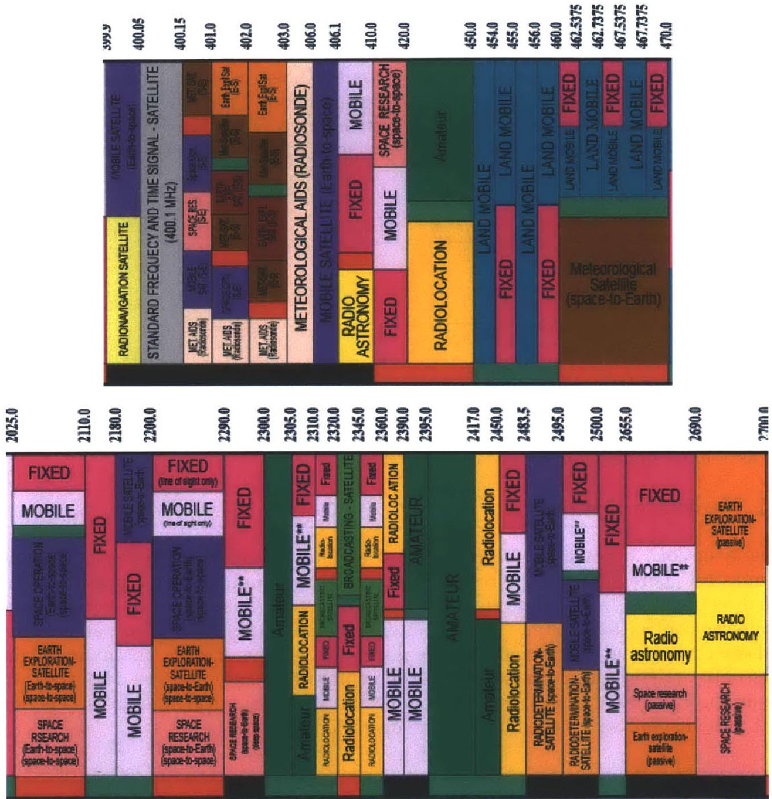

Figure 2-3: Allocations of UHF (top) and S-band (bottom) frequency bands [52]

All radio frequency transmitters need to be licensed by the NTIA or FCC. This requires planning and early decision-making as to which frequencies, spacecraft radios, spacecraft antennas, and ground station transmit/receive facilities to use, because detailed information about the complete communications system is required in order to apply for a license. Typically, CubeSats have operated in the UHF/VHF amateur radio bands, but with an increase in science capabilities and a subsequent need to downlink more data, radios are moving to S and even X band communications. Higher frequencies lead to lower magnitude space loss and higher receiver gain, which improves the overall signal to noise ratio to accommodate for a higher maximum theoretical datarate, as shown in the following series of equations.

<!-- PDF_PAGE: 34 -->

$$
\frac {E _ {b}}{N _ {0}} = \frac {P L _ {l} G _ {t} L _ {s} L _ {a} G _ {r}}{k T _ {s} R}
$$

Where $ \mathrm{E_{b}} $ is the received energy per bit; $ \mathrm{N_{0}} $ is the noise density; P is the transmitted power; $ \mathrm{L_{l}} $ $ \mathrm{L_{s}} $ , and $ \mathrm{L_{a}} $ are the line, space, and atmospheric losses; $ \mathrm{G_{r}} $ is the receiver gain; k is the Boltzmann constant; $ \mathrm{T_{s}} $ is the system temperature; and R is the datarate. Receiver gain and space loss are both wavelength (frequency) dependent, as seen in Equations 2-4 and 2-5.

$$
G _ {r} = \frac {\pi^ {2} D _ {r} ^ {2} \eta}{\lambda^ {2}} = \frac {\pi^ {2} D _ {r} ^ {2} \eta f ^ {2}}{c ^ {2}}
$$

$$
L _ {s} = \left(\frac {\lambda}{4 \pi S}\right) ^ {2} = \left(\frac {c}{4 \pi S f}\right) ^ {2}
$$

As the frequency increases, the receiver gain increases and the space loss decreases, resulting in an overall increase in signal to noise ratio. This phenomenon shows why science missions are increasingly trending towards higher frequency communications such as S-band or X-band.

## 2.4.2 Hardware Options

Antenna options depend on the operational architecture of the CubeSats. Directional antennas are more efficient but require higher precision and authority pointing control. Omnidirectional or broadbeam antennas are options for CubeSats that are spinning or have lower control authority. Typical antenna architectures have been patch antennas for shorter wavelengths (S-band) and deployed dipole or monopole antennas for longer wavelengths (UHF). There is some development work being done on deployed arrays, such as the Integrated Solar Array and Reflectarray Antenna (ISARA [53]). The length of the antenna will vary depending on the operational frequency.

There are several options for CubeSat antennas including AntDevCo [54], ISIS [55], and AstroDev [56]. The sizes and gains of the antennas depend both on the wavelength used and on the available size and volume for accommodating the antenna on the CubeSat. Most CubeSat antenna gains range between 0 dBi and 7 dBi.

CubeSat radios are commonly available in UHF and S-band (e.g. L-3 Cadet, Astrodev, GomSpace, ClydeSpace, etc.). CubeSat radios in X-band are under development and are expected to become more available in the future.

<!-- PDF_PAGE: 35 -->

Table 2-4: Comparison of COTS radio boards for CubeSat use

<table border="1"><tr><td>Vendor</td><td>Part</td><td>Dimensions(mm)</td><td>Mass(g)</td><td>Peak Power(W)</td><td>Frequencies(MHz)</td><td>Data rate(kbps)</td><td>Source</td></tr><tr><td>AstroDev</td><td>Lithium1</td><td>65x33x10</td><td>52</td><td>10(Tx)0.2(Rx)</td><td>130-450</td><td>9.6</td><td>[56]</td></tr><tr><td>ESpace</td><td>Payload Telemetry System</td><td>90x96x35</td><td>94</td><td>3.6(Tx)2.0(Rx)</td><td>2025-2120(Rx)2200-2300(Tx)</td><td>1000</td><td>[57]</td></tr><tr><td>L-3 Communications</td><td>Cadet Nanosatellite Radio</td><td>69x69x13</td><td>75</td><td>10(Tx)0.3(Rx)</td><td>450-470</td><td>3000</td><td>[58]</td></tr></table>

Radio boards, when used for transmission, are one of the highest power draws for a CubeSat. Even though transmit powers are limited to on the order of a couple of watts (depending on the frequency license) radio transmission systems are highly inefficient. It is not unusual for up to 10 W of power is required to transmit 1 W. Receive power levels are non-negligible, but much smaller. When performing mission power planning, one should assume that the receiver is always on (except when transmitting on a halfduplex system). It is generally considered risky to turn off the power on the spacecraft radio receiver.

## 2.4.3 Orbit Design

After a CubeSat has deployed, one of the first tasks of the mission is to establish a link between the satellite and the ground station. Typically there are two approaches to establish this connection: have the satellite periodically transmit its status or health telemetry until the ground station hears it (beacon), or have the satellite periodically go into receive mode and listen for a signal from the ground station. The RAX-2 CubeSat sent beacons every minute during the first few months of operation and decreased this frequency to once every two minutes later on in the mission. Because they were in the amateur band, ground stations all over the world could track the satellite as it passed overhead [59].

When a link is established, its performance depends on the geometry (orbit inclination and ground station latitude) and duration of the access, weather conditions, and the performance of the spacecraft and ground station hardware that determine the maximum data rate within the tolerable bit error rate range.

The orbit that the satellites are launched to has a large impact on the power required to transmit data and commands between the ground and the satellites. The distance separating the transmitter and receiver affects the intensity of the transmitted power as well as the loss that the signal encounters as it travels, as seen in Equation 2-5.

<!-- PDF_PAGE: 36 -->

## 2.5 Attitude Determination and Control

The attitude determination and control system affects how well the spacecraft knows where it is pointing and can orient itself. Based on the desired control authority and expected perturbations that the CubeSat will see, CubeSat ADCS architectures can vary from no ADCS, to passive ADCS, to precision ADCS systems. We focus on three different architectures of ADCS: magnetic control, reaction wheels, and thrusters. Table 2-5 describes these three cases.

Table 2-5: Generic CubeSat Case Studies

<table border="1"><tr><td>Case Study</td><td>ADCS Actuation</td><td>Rationale</td></tr><tr><td>1</td><td>Magnetic Torque Coils</td><td>Simplest, current most common actuation type</td></tr><tr><td>2</td><td>Reaction Wheels</td><td>Provides finer precision pointing than Magnetic;3-axis control</td></tr><tr><td>3</td><td>Micro-thrusters</td><td>Required for station-keeping, more control authority than with Magnetic alone</td></tr></table>

## 2.5.1 Disturbance Torques

There are four main contributors that we account for when determining the total disturbance torque on the spacecraft: atmospheric drag, solar radiation pressure, gravity gradient, and residual dipole.

The following tables (Table 2-6, Table 2-7, Table 2-8) show the total disturbance torque (summed from the four sources mentioned above) for each axis of the spacecraft. This assumes the spacecraft is flying in the vertical configuration. These data were generated using programs from the Princeton Satellite Systems CubeSat Toolbox [60]. Appendix A shows the same tables for the horizontal configuration.

Table 2-6: Maximum disturbance torque about spacecraft X axis

<table border="1"><tr><td>Total Torque(uN-m)</td><td>0°</td><td>15°</td><td>30°</td><td>45°</td><td>60°</td><td>75°</td><td>90°</td><td>98°(sun synch)</td></tr><tr><td>300km</td><td>0.26</td><td>-0.19</td><td>0.07</td><td>0.13</td><td>-0.22</td><td>0.25</td><td>-0.12</td><td>-0.18</td></tr><tr><td>400km</td><td>0.25</td><td>-0.18</td><td>0.07</td><td>0.12</td><td>-0.21</td><td>0.24</td><td>-0.11</td><td>-0.17</td></tr><tr><td>500km</td><td>0.24</td><td>-0.17</td><td>0.06</td><td>0.11</td><td>-0.20</td><td>0.23</td><td>-0.10</td><td>-0.16</td></tr><tr><td>600km</td><td>0.23</td><td>-0.16</td><td>0.06</td><td>0.11</td><td>-0.19</td><td>0.22</td><td>-0.10</td><td>-0.16</td></tr><tr><td>700km</td><td>0.22</td><td>-0.15</td><td>0.06</td><td>0.11</td><td>-0.18</td><td>0.21</td><td>-0.09</td><td>-0.15</td></tr></table>

<!-- PDF_PAGE: 37 -->

Table 2-7: Maximum disturbance torque about spacecraft Y axis

<table border="1"><tr><td>Total Torque(uN-m)</td><td>0°</td><td>15°</td><td>30°</td><td>45°</td><td>60°</td><td>75°</td><td>90°</td><td>98°(sun synch)</td></tr><tr><td>300km</td><td>7.88</td><td>7.90</td><td>7.43</td><td>7.90</td><td>7.73</td><td>7.74</td><td>7.91</td><td>7.59</td></tr><tr><td>400km</td><td>1.31</td><td>1.43</td><td>1.03</td><td>1.47</td><td>1.22</td><td>1.22</td><td>1.47</td><td>1.14</td></tr><tr><td>500km</td><td>0.28</td><td>0.40</td><td>0.30</td><td>0.46</td><td>0.21</td><td>0.19</td><td>0.46</td><td>0.23</td></tr><tr><td>600km</td><td>0.07</td><td>0.19</td><td>0.23</td><td>0.25</td><td>0.12</td><td>0.09</td><td>0.24</td><td>0.17</td></tr><tr><td>700km</td><td>0.03</td><td>0.13</td><td>0.22</td><td>0.19</td><td>0.10</td><td>0.08</td><td>0.19</td><td>0.15</td></tr></table>

Table 2-8: Maximum disturbance torque about spacecraft Z axis

<table border="1"><tr><td>Total Torque(uN-m)</td><td>0°</td><td>15°</td><td>30°</td><td>45°</td><td>60°</td><td>75°</td><td>90°</td><td>98°(sun synch)</td></tr><tr><td>300km</td><td>-3.81</td><td>-3.42</td><td>-3.14</td><td>-3.18</td><td>-3.72</td><td>-3.67</td><td>-3.20</td><td>-3.48</td></tr><tr><td>400km</td><td>-0.45</td><td>-0.42</td><td>-0.40</td><td>-0.44</td><td>-0.42</td><td>-0.43</td><td>-0.42</td><td>-0.40</td></tr><tr><td>500km</td><td>-0.08</td><td>-0.07</td><td>-0.04</td><td>-0.08</td><td>-0.05</td><td>-0.07</td><td>-0.07</td><td>-0.04</td></tr><tr><td>600km</td><td>-0.02</td><td>-0.02</td><td>0.02</td><td>-0.02</td><td>0.00</td><td>-0.01</td><td>-0.02</td><td>0.01</td></tr><tr><td>700km</td><td>0.01</td><td>-0.01</td><td>0.02</td><td>-0.01</td><td>0.01</td><td>0.02</td><td>-0.01</td><td>0.02</td></tr></table>

The sensors available for use on CubeSats are star trackers, horizon sensors (CMOS or infrared), sun sensors, magnetometers, and inertial measurement units (gyro and accelerometer). Orbit position knowledge can be obtained using a GPS receiver that has been modified and approved for use on-orbit or from two-line elements supplied by the North American Aerospace Defense Command NORAD through SpaceTrack [61]. The following table shows some typical state-of-the-art sensors and the comparative cost, size, and performance of each.

Table 2-9: Specifications of commercially-available attitude sensors for CubeSats

<table border="1"><tr><td>Type</td><td>Vendor</td><td>Dimensions</td><td>Mass</td><td>Performance</td><td>Source</td></tr><tr><td>Sun Sensor</td><td>SSBV</td><td>3.3x1.1x0.6cm</td><td>5g</td><td>0.5degree</td><td>[62]</td></tr><tr><td>Earth Horizon Sensor</td><td>Maryland Aerospace</td><td></td><td>85g</td><td>0.1degree</td><td>[63]</td></tr><tr><td>Magnetometer</td><td>MicroMag3</td><td>25.4x25.4x19</td><td>5g</td><td>0.5-3.0deg</td><td>[64]</td></tr><tr><td>Star Tracker</td><td>Blue Canyon</td><td>10x6.73x5cm</td><td>350g</td><td>6-40arcsec</td><td>[65]</td></tr></table>

## 2.5.2 Case 1: Magnetic Control

The first attitude control architecture we consider is magnetic control. This includes both passive (permanent magnets) and active (electromagnets) control. While there is no specific consideration called out in the P-POD specification, when considering any design with a permanent magnet onboard, care must be taken that the strength, location, and orientation of the magnets be noted so P-POD population and deployment can be designed to mitigate the risk of multiple CubeSats interfering or inadvertently sticking together [66]. For deployment from the ISS, NanoRacks requires enumeration of all permanent and electromagnets [67].

<!-- PDF_PAGE: 38 -->

## 2.5.2.1 Attitude Control

A magnetic ADCS architecture provides the coarsest control authority of the cases presented in this study (technically a CubeSat could use differential drag to manipulate altitude and orbit propagation [68], but that is not addressed in this thesis).

Magnetic control can be either passive or active. Passive magnetic control consists of using an element on the CubeSat with an uncommanded magnetic field such as a permanent magnet or a hysteresis rod. A permanent magnet has a constant dipole that generates a restoring torque to align the axis of the magnet with the Earth's field. A hysteresis rod is made of a conductive material whose internal dipole changes with the surrounding magnetic field. The inherent delay in this change imparts a dampening torque. Active control systems utilize torque coils (coils of wire typically mounted along the edges of the CubeSat as depicted in Figure 2-4) or torque rods, which are electromagnets composed of wire around a metallic rod, to actively change the satellite's magnetic dipole to generate torque.

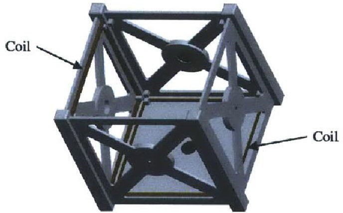

Figure 2-4: Diagram of torque coils on 1U CubeSat [69]

In most attitude control system actuator implementations, there are three of these rods mounted orthogonally to generate a dipole in any direction. These electromagnets can vary the strength and direction of the CubeSat magnetic dipole in order to control the magnetic torque applied to the spacecraft. The torque applied to the spacecraft is the torque of the dipole on the ambient magnetic field as seen in Equation 2-6, where $ \mathrm{T}_{G} $ is the generated torque, D is the spacecraft dipole vector, and B is the ambient (Earth) magnetic field vector.

$$
T _ {G} = D \times B
$$

As evidenced by this equation, torque can only be generated in a direction perpendicular to the magnetic field line (i.e. any angular momentum aligned with the Earth's magnetic field cannot be mitigated by magnetic control alone).

It is also clear that the control authority of a magnetic control system depends on the characteristics of Earth's magnetic field. Because torque rods require a strong magnetic

<!-- PDF_PAGE: 39 -->

field to torque against, magnetic control performs best at altitudes in Low Earth Orbit. The magnitude and direction of the Earth's magnetic field vary with orbital parameters as well as satellite position along the orbit.

The International Geomagnetic Reference Field (IGRF) is an established numerical model produced and maintained by the International Association of Geomagnetism and Aeronomy (IAGA) working group. The model calculates the large scale, internal part of the Earth's magnetic field based on and above Earth's surface. It is updated every five years with provisions for predicting the magnetic field variations over the five years during which the model is deemed valid. The model is in its eleventh generation and was last updated in 2010 [70]. The following analyses were performed with the IGRF 11 model.

Figure 2-5, Figure 2-6, and Figure 2-7 show how the magnitude and orientation of the magnetic field along a satellite's orbit depends on the inclination of that orbit. From the orbital tradespace, we chose a mid-range (500 km) orbit over which to vary the inclinations.

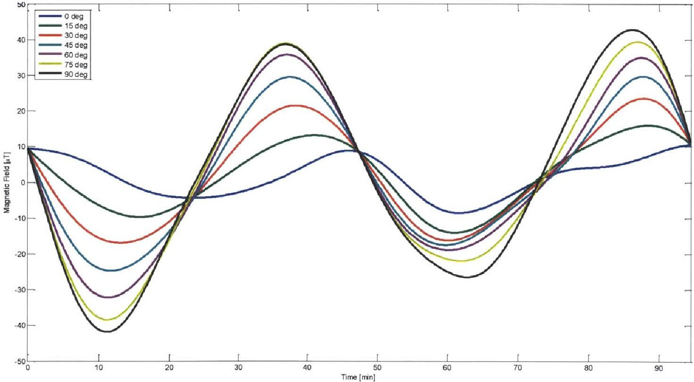

Figure 2-5: X component of Earth's magnetic field over a range of orbital inclinations (0,15,30,45,60, 75, and 90 degrees) for a 500 km orbit

<!-- PDF_PAGE: 40 -->

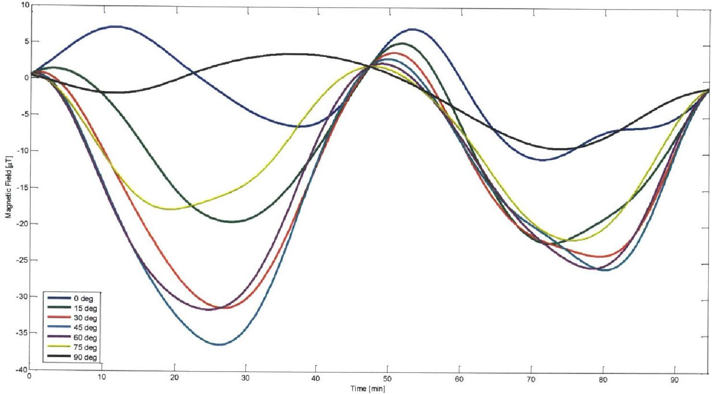

Figure 2-6: Y component of Earth's magnetic field over a range of orbital inclinations (0,15,30,45,60 75, and 90 degrees) for a 500 km orbit

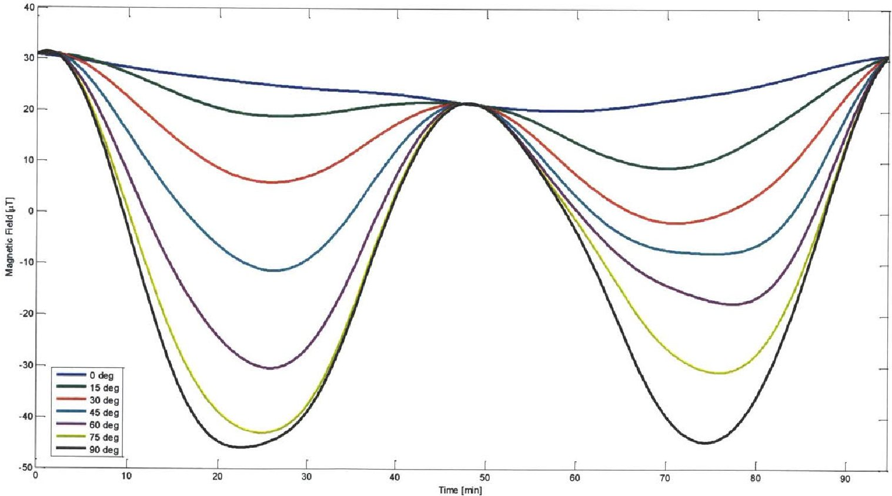

Figure 2-7: Z component of Earth's magnetic field over a range of orbital inclinations (0,15,30,45,60, 75, and 90 degrees) for a 500 km orbit

<!-- PDF_PAGE: 41 -->

The Earth's magnetic field was also simulated across the range of orbital altitudes specified in the orbit reference point parameters. Figure 2-8, Figure 2-9, and Figure 2-10 show these results for a mid-range inclination (45 degrees).

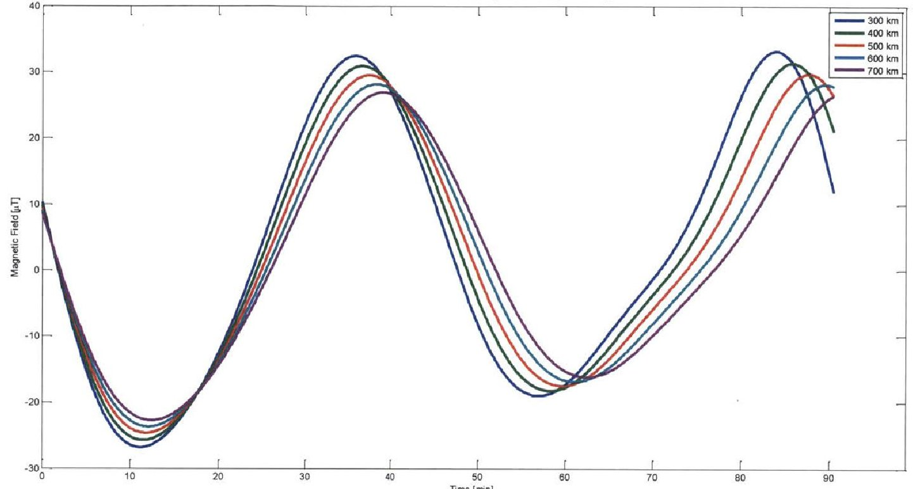

Figure 2-8: X component of Earth's magnetic field over a range of altitudes (300 km, 400 km, 500 km, 600 km, 700 km) at a 45-degree inclination orbit

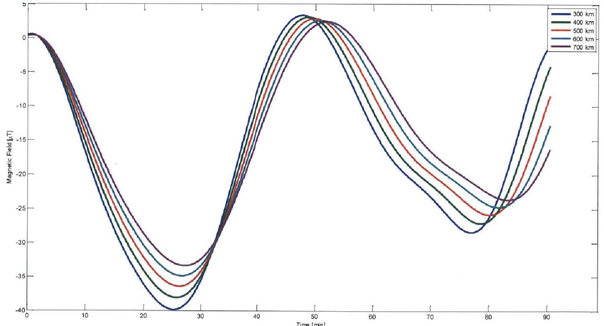

Figure 2-9: Y component of Earth's magnetic field over a range of altitudes (300 km, 400 km, 500 km, 600 km, 700 km) at a 45-degree inclination orbit

<!-- PDF_PAGE: 42 -->

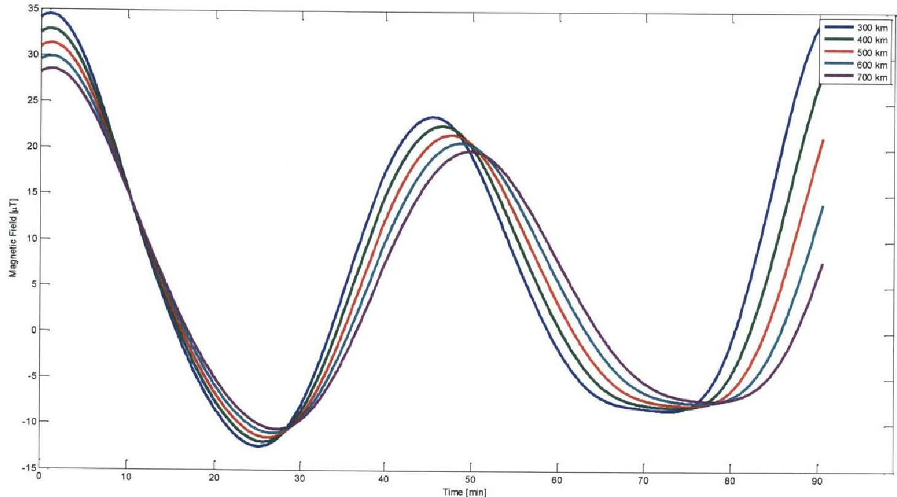

Figure 2-10: Z component of Earth's magnetic field over a range of altitudes (300 km, 400 km, 500 km, 600 km, 700 km) at a 45-degree inclination orbit

The magnetic torque generated by torque coils depends on the orientation and strength of the magnetic field as well as the design of the coils themselves: number of turns, area of the coils, and current through them.

One of the basic functions of CubeSat attitude control is to detumble the spacecraft, as the deployment mechanism will impart an initial tip-off rate. A B-dot control method is typically applied - Equations 2-10 through 2-11 where $ \omega $ is the 3-dimensional vector containing the angular (tumbling) rate of the satellite, B is the magnetic field vector, D is the desired spacecraft dipole vector, k is the gain value applied, and $ \mathbf{T}_{c} $ is the control torque that applies the dipole vector to the magnetic torque coils or torque rods.

$$
\dot {B} = - \omega \times B
$$

$$
\boldsymbol {D} = - k \dot {\boldsymbol {B}} = k \omega \times \boldsymbol {B}
$$

The B-dot control law is commonly used for Earth-orbiting spacecraft, and allows the spacecraft to damp out motion in any direction except that which is aligned with the magnetic field.

<!-- PDF_PAGE: 43 -->

## 2.5.2.2 Common Designs and Manufacturers

CubeSats with passive magnetic control typically align a hysteresis rod or permanent magnet along one of the spacecraft's axes in order to keep that axis aligned with the Earth's magnetic field.

Table 2-10 gives two examples of commercially-supplied torque rods and coils for CubeSats. Solar panel providers also offer the option to install magnetic torquers on body or deployed panels [50] [51].

Table 2-10: COTS magnetorquer comparison (torque rods and torque coils)

<table border="1"><tr><td>Vendor</td><td>Part</td><td>Dimensions(mm)</td><td>Mass(g)</td><td>Magnetic Moment($\mathrm{Am^{2}}$)</td><td>Power(W)</td><td>Source</td></tr><tr><td>ISIS</td><td>ISISMagnetorquerBoard(3-axis)</td><td>96x90x15</td><td>195</td><td>0.24</td><td>0.24</td><td>[71]</td></tr><tr><td>Clyde Space</td><td>StandaloneMagnetorquer</td><td>100x100x4.3</td><td>50</td><td>0.19</td><td>0.2</td><td>[72]</td></tr></table>

Magnetic control systems will interfere with onboard magnetometer readings. The system should be designed such that the onboard magnetometer is not sampled while the electromagnets are operating and that the magnetometer is placed as far away as possible from sources of magnetic noise.

## 2.5.2.3 Effects on Usable Payload Space

Magnetic control will add to the overall mass and internal volume of the supporting subsystems. At most, the subsystem will add 200 g, about 0.1U, and 250 mW, leaving the payload with about 2.5 kg, 1.9 U, and 5.5 W.

## 2.5.3 Case 2: Reaction Wheels

Reaction wheels offer significant pointing control capabilities over magnetic coils alone and are an increasingly common addition to CubeSats for attitude control. Component miniaturization is still a challenge, but there are several vendors with components in the works for these systems.

## 2.5.3.1 Attitude Control

The Reaction wheels counter external torques and can offset internal sources of angular momentum by rotating a small wheel (relative to the size of the CubeSat) at a much higher rotation rate. If there are components spinning internal to the CubeSat, if all external torques on the system are 0, the function of the reaction wheels is simply to keep the system in equilibrium according to Equation 2.9.

<!-- PDF_PAGE: 44 -->

$$
I _ {r w} \omega_ {r w} = - I _ {s c} \omega_ {s c}
$$

For a perfectly balanced 4 kg 3U CubeSat, the inertia matrix is

$$
I _ {s c} = \left[ \begin{array}{c c c} 6 6. 7 & 0 & 0 \\ 0 & 3 3. 3 & 0 \\ 0 & 0 & 3 3. 3 \end{array} \right] k g \cdot m m ^ {2}
$$

Reaction wheels can become saturated (i.e. reach their maximum rotation rate), so momentum dumping using other actuators such as torque rods becomes necessary. As seen in section 2.5.2, the orientation and orbital position of the satellite determines the strength of the magnetic field and the resulting external torque that can be generated to offload the reaction wheels.

## 2.5.3.2 Common Designs and Manufacturers

Reaction wheels draw more power and take up more internal volume than torque rods due to the extra components required - the wheel, motor assembly, and supporting sensors and drive electronics. Some vendors sell integrated units that house all reaction wheels, but obtaining individual wheels is also a possibility and provides more flexibility with internal spacing and configurations. Table 2-11 shows a comparison of products from different vendors.

Table 2-11: COTS reaction wheel comparison (single wheels and integrated systems)

<table border="1"><tr><td>Vendor</td><td>Type</td><td>Dimensions(mm)</td><td>Mass(g)</td><td>Peak Power(W)</td><td>MomentummNms</td><td>Torque(mNm)</td><td>Source</td></tr><tr><td>Sinclair</td><td>Wheel(Picosatellite)</td><td>50x50x30</td><td>120</td><td>0.7</td><td>10(3410RPM)</td><td>1</td><td>[73]</td></tr><tr><td>MarylandAerospace</td><td>Wheel(MAI300)</td><td>69x69x33</td><td>317</td><td>1.75</td><td>7.6mNms(10000RPM)</td><td>0.625</td><td>[74]</td></tr><tr><td>BlueCanyonTechnologies</td><td>Wheel(Micro)</td><td>43x43x18</td><td>150</td><td>1</td><td>18mNms(6000RPM)</td><td>0.6</td><td>[75]</td></tr><tr><td>MarylandAerospace</td><td>Integrated(MAI400)</td><td>100x100x50</td><td>694</td><td>3.2</td><td colspan="2">3-axis reaction wheel3-axis electromagnetsEarth Horizon Sensor</td><td>[63]</td></tr><tr><td>BlueCanyonTechnologies</td><td>Integrated(XACT)</td><td>100x100x50</td><td>700</td><td>2</td><td colspan="2">3-axis reaction wheel3-axis torque rodsStar Tracker0.003°-0.007°accuracy10°/s slew rate(8kgCubeSat)</td><td>[65]</td></tr></table>

<!-- PDF_PAGE: 45 -->

## 2.5.3.3 Effects on Usable Payload Space

As seen in Table 2-11, reaction wheel assemblies require at least 0.5U of the available CubeSat volume, 700 g, and up to 2-3 W. Using the power, mass, and volume estimates from Section 2.2.2, this leaves a usable payload design space with 1.5U volume, 3-4 W average power draw, and 2 kg mass.

## 2.5.4 Case 3: Thrusters

The addition of thrusters on a CubeSat currently requires a waiver process through CalPoly. The motivation behind this was originally pressurized vessels for propellant, but with electric thrusters this is no longer an issue.

Thrusters offer a distinct advantage over reaction wheels and magnetorquers in that they can contribute to stationkeeping and position control, not just attitude. For low orbits where drag is the primary disturbance force, satellite lifetimes are often very limiting to CubeSat missions. The addition of thrusters can prolong the operational lifetime of a satellite in low orbits.

## 2.5.4.1 Common Designs and Manufacturers

Table 2-12 gives the specifications of a few CubeSat thruster systems currently in development by both commercial vendors and university researchers.

Table 2-12: Comparison of CubeSat thruster systems currently under development

<table border="1"><tr><td>Developer</td><td>Type</td><td>Volume(mm)</td><td>Mass(g)</td><td>Power(W)</td><td>Thrust</td><td>Isp(s)</td><td>Source</td></tr><tr><td>Busek</td><td>Electrospray</td><td>85x85x60</td><td>1150</td><td>9</td><td>0.7mN</td><td>800</td><td>[76]</td></tr><tr><td>Clyde Space</td><td>Pulsed Plasma</td><td>90x90x27</td><td>200</td><td>0.5</td><td>1.8J(shot energy)</td><td>590</td><td>[77]</td></tr><tr><td>MIT Space Propulsion Laboratory</td><td>Ion Electrospray</td><td>10x10x2.5</td><td>600(including supporting electronics and fuel)</td><td>TBD</td><td>100μN</td><td>1000</td><td>[78]</td></tr></table>

## 2.5.4.2 Effect on Usable Payload Space

As seen in Table 2-12 above, a thruster system can take up a significant portion of the mass and volume in a 3U space. The power requirements alone reach the limit of what is achievable with only body-mounted panels.

<!-- PDF_PAGE: 46 -->

There are operational considerations to take into account with thrusters. If the payload or any other components on the CubeSat are sensitive to contamination (e.g. optical elements) the thrusters must be positioned and oriented to avoid interference.

It is possible to perform both attitude control and orbit maneuvers with thrusters. A combination of fine control with reaction wheels and orbit maintenance with thrusters would provide the greatest control authority for the spacecraft, but based on the internal volume, mass, and power requirements this architecture (with a scientific payload) cannot be supported on a 3U platform.

## 2.6 Thermal, Avionics, and Structures

The remaining components are largely mission-dependent as desired processing and modes of operation vary based on science goals and onboard components. General considerations for thermal management, avionics performance, and structural design are discussed.

## 2.6.1 Thermal

Typically, CubeSats are passively thermally controlled. Active thermal control systems could include components such as heaters and louvers, which add complexity by consuming more power or containing moving parts. For a constellation, it is typically best to design to radiate for the hottest condition (it is extremely power inefficient to attempt to actively cool a spacecraft) and then incorporate internal heaters as necessary if components get cold at other times. Components with very sensitive operating temperature ranges (e.g. batteries) sometimes come with their own internal power regulation system. Figure 2-11 shows the expected isometric temperatures for a typical 3U CubeSat.

<table border="1"><tr><td rowspan="2" colspan="2"></td><td colspan="2">Altitude:300km</td><td colspan="2">Altitude:700km</td></tr><tr><td>MinTemp(℃)</td><td>MaxTemp(℃)</td><td>MinTemp(℃)</td><td>MaxTemp(℃)</td></tr><tr><td rowspan="13">Inclination</td><td rowspan="2">0°</td><td>PV Cells</td><td>2.0</td><td>33.0</td><td>5.0</td><td>37.5</td></tr><tr><td>Kapton0.5</td><td>-16.5</td><td>19.5</td><td>-14.5</td><td>23.0</td></tr><tr><td rowspan="2">30°</td><td>PV Cells</td><td>2.0</td><td>42.0</td><td>5.0</td><td>49.0</td></tr><tr><td>Kapton0.5</td><td>-16.5</td><td>26.0</td><td>-14.5</td><td>31.5</td></tr><tr><td rowspan="2">42°</td><td>PV Cells</td><td>2.0</td><td>46.0</td><td>5.0</td><td>65.0</td></tr><tr><td>Kapton0.5</td><td>-16.5</td><td>28.5</td><td>-14.5</td><td>43.0</td></tr><tr><td rowspan="2">60°</td><td>PV Cells</td><td>2.0</td><td>56.5</td><td>5.0</td><td>65.0</td></tr><tr><td>Kapton0.5</td><td>-16.5</td><td>37.0</td><td>-14.5</td><td>43.0</td></tr><tr><td rowspan="2">90°</td><td>PV Cells</td><td>2.0</td><td>56.5</td><td>5.0</td><td>65.0</td></tr><tr><td>Kapton0.5</td><td>-16.5</td><td>37.0</td><td>-14.5</td><td>43.0</td></tr><tr><td rowspan="2">98°(SS)</td><td>PV Cells</td><td>2.0</td><td>56.5</td><td>5.0</td><td>65.0</td></tr><tr><td>Kapton0.5</td><td>-16.5</td><td>37.0</td><td>-14.5</td><td>43.0</td></tr></table>

Figure 2-11: Average isometric temperature for CubeSats at different inclinations and altitudes for varying internal power consumptions.

<!-- PDF_PAGE: 47 -->

This table was generated using the method described in Space Mission Engineering, The New SMAD [79]. The orbit altitude and inclination (beta angle) were varied across the range specified in the reference point study. The solar irradiance $ (1 3 1 7-1 4 1 9 \mathrm{~ W / m^{2}}) $ and internal thermal power $ (0. 7 5-5. 2 5 \mathrm{~ W}) $ were also varied to calculate the range of expected temperatures. The red values noted in the figure are temperature ranges outside the range deemed acceptable based on the MicroMAS mission (see Chapter 3).

## 2.6.2 Avionics

The avionics system is primarily responsible for the command and data handling of the spacecraft and is generally customized for the mission and payload. Satellite avionics require real-time operations and typically use mission-specific embedded computer systems. Onboard data processing and compression, task managers, and control algorithms are all examples of parameters that vary with mission requirements.

Especially when working with COTS components, interface management in both software and hardware can be complicated. Software interface management includes timing, synchronization, task management, proper drivers for each external component. Hardware interfaces require pin mapping and management as well as tracking of the number and usage of serial ports. Due to internal volume constraints, a common configuration for CubeSats is to use a 104-pin CSK bus that provides electrical connections through the entire stack.

Common CubeSat processors are microcontrollers and (less common initially, but becoming more common as CubeSat capabilities increase) FPGAs. The CubeSat kit from Pumpkin provides its own RTOS, Salvo, that can be customized for mission-specific applications.

As alluded to in Chapter 1, one of the limiting factors for the CubeSat operational lifetime is the impact of radiation on CubeSat electronics. Based on a study in which CubeSats were exposed to different levels of radiation, some CubeSat electronics (SD cards especially) are susceptible to errors from radiation [80]. To keep costs down, CubeSat components are typically not radiation-hardened, although there are several ways to mitigate the impact of radiation and single event upsets on electronics. Radiation can be mitigated to some degree through shielding and material choice. It can also be mitigated in software by clever use of watchdog timers and "self-aware" coding where self-verification is consistently monitored.

## 2.6.3 Structures

As mentioned in section 3.1, CubeSats have specific dimensions and mass requirements, which limits the available structural trades. Some considerations to take into account when designing the CubeSat structure are internal component placement and accommodation, overall chassis design and manufacturing, and environmental qualifications.

<!-- PDF_PAGE: 48 -->

While the outer structure of the CubeSat is kept standard, the internal positioning depends on the components included in the system. The overall mass of the CubeSat is limited to between 4 and 8.45 kg depending on the launch provider, and the internal placement of components requires careful consideration due to the limited volume capacity (10 x 10 x 34.05 cm) and the requirement that the center of gravity (CG) lie within a 2 cm sphere of the geometric center. This CG offset will have an impact on the overall inertia of the spacecraft, which will affect the on-orbit attitude behavior of the satellite.

Internal component placement also has an impact on accessibility to components. Access to the onboard computer, communications, and power system (battery charging) are required for ground testing and debugging after satellite integration, and the removebefore-flight pin must be accessible when the CubeSat is integrated into the deployer [19].

Launch providers specify a range of standards to which the spacecraft must be tested. Structures have to adhere to GEVS standards [42] (unless otherwise specified by the launch provider) to ensure that they survive the launch and operational environment.

## 2.7 Constellation Design

To capitalize on economies of scale and to ease the manufacturing process, the CubeSats in a constellation would be identical. As secondary payloads, CubeSats are subject to the orbital parameters of the primary mission. With an ad hoc constellation architecture, each spacecraft could be launched to a different orbit, where the environment and operating conditions can vary greatly. To design identical spacecraft that would nominally work in virtually every potential orbit, one should consider the least optimal conditions for each subsystem under which the CubeSat would be expected to operate and design the spacecraft to meet performance requirements under those conditions.

The next chapter goes into more detail on a similar analysis performed on the MicroMAS CubeSat.

<!-- PDF_PAGE: 49 -->

## 3 Chapter 3: MicroMAS System Design

3.1 MicroMAS Overview...40

3.1.1 Mission...40

3.1.2 Satellite Design...41

3.2 Orbit Reference Point Analysis...45

3.2.1 Communications...46

3.2.2 Power...48

3.2.3 Lifetime...48

3.2.4 Thermal...49

3.2.5 Radiation...52

3.2.6 Summary...53

3.3 Design to an Orbit...54

3.3.1 Communications...55

3.3.2 Power Generation...56

3.3.3 Lifetime...57

3.3.4 Thermal...59

3.3.5 Radiation...59

3.4 Continuing Work...60

3.4.1 Systems Simulation...60

3.4.2 Follow-on Missions and Constellation Vision...61

<!-- PDF_PAGE: 50 -->

## 3.1 MicroMAS Overview

As described in Chapter 1, MicroMAS (Microsized Microwave Atmospheric Satellite) is a 3U CubeSat built in conjunction with the MIT Space Systems Laboratory and MIT Lincoln Laboratory. The payload is a 1U passive microwave spectrometer. [40][41] MicroMAS is the first step in a larger vision to create a constellation of small satellites with microwave radiometers to image hurricanes and tropical storms with improved temporal revisit over current systems.

## 3.1.1 Mission

The overall objective of the MicroMAS mission is twofold. The science goal is to generate vertical profiles of the temperature and water vapor content of the atmosphere through microwave spectrometry. This mission will also serve as a technology demonstration for both the miniaturized science instrument and a bus that supports a rotating payload.

The payload spins in order to calibrate the microwave radiometer with readings from deep space on every pass. This rotation also allows the sensor to cover a much wider swath, increasing the sensor footprint and effective observational area.

MicroMAS is planned for launch as a hosted payload through Spaceflight Services and NanoRacks from the International Space Station. After deployment there is a required 30 minute timeout after which the solar panels and tape spring antenna will deploy. After deployment the CubeSat will detumble and slew to a local-vertical local-horizontal attitude. Once it is in a stable attitude configuration, the payload module will spin up to the desired rate (nominally 0.8 Hz). When the payload achieves a steady rotation and the spacecraft remains stable, the radiometer will be turned on. Nominal science operations involve the radiometer spinning continuously with the payload operating at a 50% duty cycle to conserve power. The data are periodically downlinked to the Wallops 18 m UHF ground station. Throughout mission life, anomalies and faults will be handled on a case-by-case basis. The end of the MicroMAS mission is marked by its reentry into Earth's atmosphere. This concept of operations is illustrated in Figure 3-1.

<!-- PDF_PAGE: 51 -->

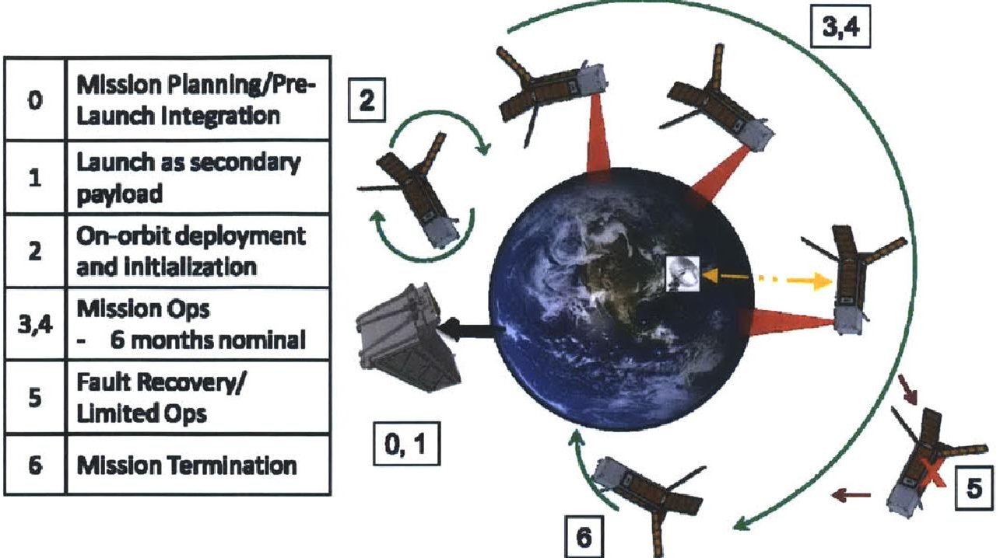

Figure 3-1: MicroMAS Operational Overview

## 3.1.2 Satellite Design

The internal placement of key components is illustrated in Figure 3-2, and Figure 3-3 shows a functional block diagram of the MicroMAS CubeSat. Most of the components were procured from commercial vendors, although some of the structural components and avionics boards are of custom design. The following sections describe the satellite subsystems.

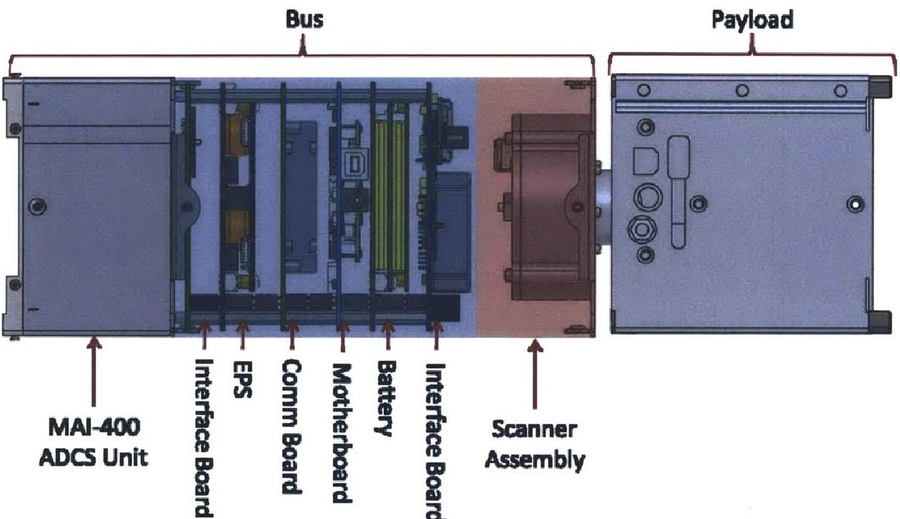

Figure 3-2: Placement of internal components in the MicroMAS CubeSat bus

<!-- PDF_PAGE: 52 -->

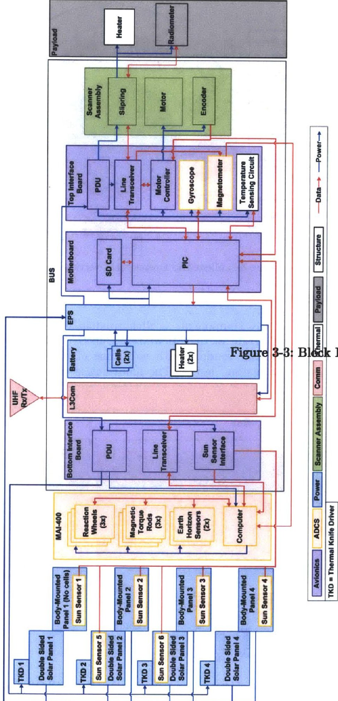

Block Diagram of the MicroMAS Cu

<!-- PDF_PAGE: 53 -->

## 3.1.2.1 Power

MicroMAS generates power using body-mounted and double-sided deployed solar panels. All the panels are 2U in length with 4-5 cells on each face. The deployed panels have cells on both sides and all four are deployed at a 120-degree angle. For the expected initial orbit of 402 x 424 km with 51.6fl inclination, the satellite will nominally see 36 minutes in eclipse and 57 minutes in daylight (5568 sec per orbit). On average, the solar panels can generate up to 14.5 W. Energy is stored onboard using secondary 20 W-hr lithium polymer batteries. A ClydeSpace EPS (CS-XUEPS2-60) monitors the solar panels and batteries, collects generated power and regulates battery charging. The EPS provides 3.3 V, 5 V, and 12 V regulated lines as well as a raw battery voltage line.

Power regulation for individual components is done using custom circuitry on two avionics interface boards. The payload will operate in a 50% duty cycle during nominal science operations to keep the power and energy draw below the desired battery depth of discharge (30%) and solar power generation capabilities. The payload will be operated as continuously as possible (e.g., on for half an orbit and off for half an orbit) to maximize science return. The maximum battery depth of discharge is expected to be 30.4%, which occurs if the payload operates throughout eclipse.

## 3.1.2.2 Communications

The MicroMAS communications system draws heavily from the Utah State University and NSF Dynamic Ionosphere CubeSat Experiment (DICE) mission with a nearly identical architecture [81]. The spacecraft transceiver is the half-duplex L-3 Communications Cadet UHF Nanosatellite radio. The L-3 Cadet UHF nanosatellite radio modem is not directly compatible with the CubeSat kit board stack architecture, therefore, a custom carrier card was designed to map its data signals to the appropriate pins on the bus. Additionally, PDU circuits were added to allow the OBC to control power being supplied to the modem.

The ground station is the NASA Wallops Flight Facility 18-meter dish equipped with the DICE radio and computer equipment. The uplink frequency is 450 MHz at ~9.6 kbps GFSK (19.2 kbps with FEC), and the downlink frequency is 468 MHz at ~1.5 Mbps OQPSK (3 Mbps with FEC). The average data rate from the payload to the bus for downlink is ~19.2 kbps. The radio includes a 4 GB memory buffer which stores payload data and housekeeping telemetry between ground station passes.

The antenna is a monopole tape spring tuned to the downlink frequency. The antenna itself is folded down on the body panel in the opposite direction of the deployable solar panels, which are folded on top of it and restrain it prior to deployment.

<!-- PDF_PAGE: 54 -->

## 3.1.2.3 Attitude Determination and Control

The 1U radiometer payload continuously spins at a rate of 0.8 Hz, and the ADCS both cancels the momentum induced by the scanner assembly spinning the 1U, 1 kg payload as well as maintains orbit stability with one face of the 2U bus nadir-pointing. This requires active attitude determination and control, using a combination of sensors and actuators. The actuators on MicroMAS are three orthogonally mounted miniature reaction wheels by Maryland Aerospace Inc. (MAI-400), which include a set of torque rods to enable magnetic momentum dumping. This reaction wheel assembly was chosen because of its momentum storage capability compared to other COTS options. The MAI-400 reaction wheels have angular momentum storage capability of 11.8 mNms compared to a requirement of 6.2 mN $ \cdot $ m $ \cdot $ s (derived from payload inertia of $ 1.224\times10-3 $ kg $ \cdot $ m2 and spin rate of 0.8 Hz). The ADCS sensors include a 3-axis magnetometer (RM3000), an Analog Devices ADIS16334 six degree of freedom (DOF) inertial measurement unit (IMU), Silonex SLCD-61N8 photodiodes used as coarse sun sensors, and Excelitas TPS334 fine $ (6^{\circ} $ FOV) and coarse $ (60^{\circ} $ FOV) thermopiles as static Earth horizon sensors (EHS).

## 3.1.2.4 Structure

The primary MicroMAS bus structural components consist of the scanner assembly, the bus chassis, the board stack, and the spring-tape monopole antenna support structures.

The Scanner Assembly is located at the payload end of the 2U bus and facilitates the rotation of the 1U payload module. It consists of an Aeroflex Z-0250-050-3-104 brushless DC zero-cogging motor equipped with an Elmo Hornet motor controller and MicroE M1500V optical encoder and MicroE 301-00075 rotary grating for position knowledge, and a 12-wire slip ring module to transfer power and data between the bus and the payload. Due to the tight size constraints of the CubeSat platform, a custom assembly was designed, as no COTS product was found that contained all three of the above components that also fit within the 10 cm x 10 cm footprint

A custom chassis was designed to accommodate both the payload, which is externally mounted on the scanner assembly on one end, and the MAI-400 reaction wheel unit on the other end. The chassis is a solid-walled anodized aluminum structure with custom cutouts to support sensor viewing windows and solar panel connectors and circuitry.

## 3.1.2.5 Avionics

The MicroMAS avionics design incorporates a mix of COTS and custom components. The avionics architecture is largely based on the CubeSat Kit (CSK) design popularized by Pumpkin Inc. The CSK architecture consists of a connectorized board stack and standardized pin mapping. To provide the mission-specific circuitry and interfaces, two custom boards were incorporated into this board stack. The on-board computer (OBC) is based on the Pumpkin Motherboard with a PIC24FJ256GB210 microcontroller.

<!-- PDF_PAGE: 55 -->

The top interface board sits at the payload end of the CSK board stack. This board houses a brushless DC motor controller (Elmo Hornet), a magnetometer (PNI RM3000), an IMU with three-axis gyro (ADIS16334), temperature sensor interface circuitry, and numerous power distribution units. The power distribution units (PDUs) are compact high-side power switches that allow the spacecraft's OBC to control power to various subsystems. This board also provides the RS-422 signaling interfaces that are used to communicate with the radiometer payload. A custom packet format has been defined to transport data between the payload and bus over this connection.

The bottom interface board sits at opposite end of the CSK board stack, nearest the MAI-400 reaction wheels. The MAI-400 uses a rigid board-to-board interface connector, which requires end users to supply a custom PCB with the appropriate mating connector. The bottom interface board also provides the interface circuitry needed for the sun sensors that are installed on various body-mount and deployable solar panels. The analog outputs of the sun sensor interface circuit are routed directly to the MAI- 400 for processing. The bottom interface board also includes PDUs that can be used to manage the power supplied to the MAI-400 reaction wheels.

## 3.1.2.6 Thermal Management

Thermal management for MicroMAS involves on-board temperature monitoring, passive cooling, and some heating. On-board monitoring is achieved using Innovative Sensor Technology P1K0 RTDs. Passive thermal management is used as much as possible, though several individual components require active heating, specifically those with limiting minimum operating temperature values (e.g., ClydeSpace batteries, MicroE encoder sensor).

## 3.2 Orbit Reference Point Analysis $ ^{1} $

As a secondary payload, there are limited options for rides to space, and CubeSat designers must trade between ideal orbital conditions and launch availability. Initially, MicroMAS was awarded an ELaNa launch, but as it had not yet been manifest, during the early design stages there was not a specific orbit to be designed to. We performed and kept a multi-orbit reference point study updated to (a) determine the ideal orbit for MicroMAS and (b) get a sense of the satellite's performance across a range of altitudes and inclinations within the limits of where a launch opportunity might become available.

This orbit reference point study covers altitudes from 300 km to 700 km in 100 km increments, and inclinations of $ 0^{\circ} $ $ 30^{\circ} $ $ 42^{\circ} $ $ 60^{\circ} $ $ 90^{\circ} $ , and sun-synchronous. The five main areas analyzed were communications, power, lifetime, thermal, and radiation.

<!-- PDF_PAGE: 56 -->

Attitude determination and control is also a major component in the behavior of MicroMAS-a separate study covers this aspect of the mission [82].

## 3.2.1 Communications

The parameters for the communications study are as follows:

- Transmitter: monopole tape spring antenna

- Transmission frequency: 460-470 MHz

- Data Downlink: 1.5 Mbps

- Transmitted Power: 2 W

- Modulation: OQPSK

- Groundstation: Wallops

- Antenna diameter: 18.3 m

- Antenna Gain: 35.0 dBi

The primary metric used in this analysis was the required collection rate of science data onboard the spacecraft. To achieve science objectives, this rate must be (on average) 19.2 kbps. The ability to downlink all of these data (and the storage required onboard) is determined by the number and duration of accesses between the satellite and ground station. Using STK for range as well as our own calculations, for each of the reference orbits we performed a link budget analysis to determine these access times and durations with constraints of a maximum BER 10e-5 and a 5 degree minimum angle of elevation. Figure 3-4 shows the expected communications performance across the range of altitudes and inclinations.

<!-- PDF_PAGE: 57 -->

<table border="1"><tr><td rowspan="2"></td><td colspan="3">0 day</td><td colspan="3">30 day</td><td colspan="3">42 day</td><td colspan="3">60 day</td><td colspan="3">90 day</td><td colspan="3">Sun Sundrances</td></tr><tr><td>h=300km,i=0</td><td>Gap</td><td>Access</td><td>h=300km,i=30</td><td>Gap</td><td>Access</td><td>h=300km,i=42</td><td>Gap</td><td>Access</td><td>h=300km,i=60</td><td>Gap</td><td>Access</td><td>h=300km,i=90</td><td>Gap</td><td>Access</td><td>h=900km,i=90</td><td>Gap</td><td>Access</td></tr><tr><td>Mean(s)</td><td>86400</td><td>0Mean(s)</td><td>17086.522</td><td>241.847</td><td>Mean(s)</td><td>12042.484</td><td>350.435</td><td>Mean(s)</td><td>21355.699</td><td>325.738</td><td>Mean(s)</td><td>21355.699</td><td>325.738</td><td>Mean(s)</td><td>17081.281</td><td>248.399</td><td>Mean(s)</td><td>21361.859</td><td>317.522</td></tr><tr><td>Max(s)</td><td>86400</td><td>0Max(s)</td><td>44900.356</td><td>327.229</td><td>Max(s)</td><td>38600.892</td><td>414.197</td><td>Max(s)</td><td>38514.007</td><td>406.593</td><td>Max(s)</td><td>38514.007</td><td>406.593</td><td>Max(s)</td><td>39237.644</td><td>370.098</td><td>Max(s)</td><td>42157.054</td><td>386.42</td></tr><tr><td>Req P/L Rate</td><td colspan="3">Req P/L Rate</td><td>19200</td><td>Req P/L Rate</td><td>19200</td><td>Req P/L Rate</td><td>19200</td><td>Req P/L Rate</td><td>19200</td><td>Req P/L Rate</td><td>19200</td><td>Req P/L Rate</td><td>19200</td><td>Req P/L Rate</td><td>19200</td><td>Req P/L Rate</td><td>19200</td><td>Req P/L Rate</td></tr><tr><td>Max P/L Rate</td><td colspan="3">Max P/L Rate</td><td>21231</td><td>Max P/L Rate</td><td>43650</td><td>Max P/L Rate</td><td>22879</td><td>Max P/L Rate</td><td>22879</td><td>Max P/L Rate</td><td>22879</td><td>Max P/L Rate</td><td>22879</td><td>Max P/L Rate</td><td>21813</td><td>Max P/L Rate</td><td>22296</td><td>22296</td></tr><tr><td>Req Storage (MB)</td><td colspan="3">Req Storage (MB)</td><td>328</td><td>Req Storage (MB)</td><td>231</td><td>Req Storage (MB)</td><td>410</td><td>Req Storage (MB)</td><td>410</td><td>Req Storage (MB)</td><td>410</td><td>Req Storage (MB)</td><td>410</td><td>Req Storage (MB)</td><td>328</td><td>Req Storage (MB)</td><td>410</td><td>Req Storage (MB)</td></tr><tr><td>h=400km,i=0</td><td>Gap</td><td>Access</td><td>h=400km,i=30</td><td>Gap</td><td>Access</td><td>h=400km,i=42</td><td>Gap</td><td>Access</td><td>h=400km,i=60</td><td>Gap</td><td>Access</td><td>h=400km,i=90</td><td>Gap</td><td>Access</td><td>h=400km,i=90</td><td>Gap</td><td>Access</td><td>h=400km,i=90</td></tr><tr><td>Mean(s)</td><td>86400</td><td>0Mean(s)</td><td>16987.766</td><td>365.294</td><td>Mean(s)</td><td>11965.791</td><td>439.914</td><td>Mean(s)</td><td>16953.841</td><td>407.699</td><td>Mean(s)</td><td>16953.841</td><td>407.699</td><td>Mean(s)</td><td>21288.169</td><td>415.774</td><td>Mean(s)</td><td>16945.06</td><td>418.675</td></tr><tr><td>Max(s)</td><td>86400</td><td>0Max(s)</td><td>45248.705</td><td>435.148</td><td>Max(s)</td><td>39418.374</td><td>504.031</td><td>Max(s)</td><td>39373.411</td><td>494.976</td><td>Max(s)</td><td>39373.411</td><td>494.976</td><td>Max(s)</td><td>40033.36</td><td>478.768</td><td>Max(s)</td><td>40171.669</td><td>470.496</td></tr><tr><td>Req P/L Rate</td><td colspan="3">Req P/L Rate</td><td>19200</td><td>Req P/L Rate</td><td>19200</td><td>Req P/L Rate</td><td>19200</td><td>Req P/L Rate</td><td>19200</td><td>Req P/L Rate</td><td>19200</td><td>Req P/L Rate</td><td>19200</td><td>Req P/L Rate</td><td>19200</td><td>Req P/L Rate</td><td>19200</td><td>Req P/L Rate</td></tr><tr><td>Max P/L Rate</td><td colspan="3">Max P/L Rate</td><td>32255</td><td>Max P/L Rate</td><td>55146</td><td>Max P/L Rate</td><td>36071</td><td>Max P/L Rate</td><td>36071</td><td>Max P/L Rate</td><td>36071</td><td>Max P/L Rate</td><td>36071</td><td>Max P/L Rate</td><td>29296</td><td>Max P/L Rate</td><td>37062</td><td>37062</td></tr><tr><td>Req Storage (MB)</td><td colspan="3">Req Storage (MB)</td><td>526</td><td>Req Storage (MB)</td><td>230</td><td>Req Storage (MB)</td><td>326</td><td>Req Storage (MB)</td><td>326</td><td>Req Storage (MB)</td><td>326</td><td>Req Storage (MB)</td><td>326</td><td>Req Storage (MB)</td><td>409</td><td>Req Storage (MB)</td><td>325</td><td>Req Storage (MB)</td></tr><tr><td>h=500km,i=0</td><td>Gap</td><td>Access</td><td>h=500km,i=30</td><td>Gap</td><td>Access</td><td>h=500km,i=42</td><td>Gap</td><td>Access</td><td>h=500km,i=60</td><td>Gap</td><td>Access</td><td>h=500km,i=90</td><td>Gap</td><td>Access</td><td>h=500km,i=90</td><td>Gap</td><td>Access</td><td>h=500km,i=90</td><td>Gap</td></tr><tr><td>Mean(s)</td><td>86400</td><td>0Mean(s)</td><td>5474.486</td><td>393.376</td><td>Mean(s)</td><td>11912.897</td><td>501.623</td><td>Mean(s)</td><td>14029.906</td><td>444.113</td><td>Mean(s)</td><td>14029.906</td><td>444.113</td><td>Mean(s)</td><td>16916.662</td><td>454.173</td><td>Mean(s)</td><td>21239.63</td><td>480.494</td></tr><tr><td>Max(s)</td><td>86400</td><td>0Max(s)</td><td>40493.316</td><td>529.256</td><td>Max(s)</td><td>40274.643</td><td>586.458</td><td>Max(s)</td><td>34429.944</td><td>550.967</td><td>Max(s)</td><td>34429.944</td><td>550.967</td><td>Max(s)</td><td>35295.919</td><td>540.247</td><td>Max(s)</td><td>40166.822</td><td>547.684</td></tr><tr><td>Req P/L Rate</td><td colspan="3">Req P/L Rate</td><td>19200</td><td>Req P/L Rate</td><td>19200</td><td>Req P/L Rate</td><td>19200</td><td>Req P/L Rate</td><td>19200</td><td>Req P/L Rate</td><td>19200</td><td>Req P/L Rate</td><td>19200</td><td>Req P/L Rate</td><td>19200</td><td>Req P/L Rate</td><td>19200</td><td>Req P/L Rate</td></tr><tr><td>Max P/L Rate</td><td colspan="3">Max P/L Rate</td><td>107784</td><td>Max P/L Rate</td><td>63161</td><td>Max P/L Rate</td><td>47482</td><td>Max P/L Rate</td><td>47482</td><td>Max P/L Rate</td><td>47482</td><td>Max P/L Rate</td><td>47482</td><td>Max P/L Rate</td><td>40272</td><td>Max P/L Rate</td><td>33934</td><td>33934</td></tr><tr><td>Req Storage (MB)</td><td colspan="3">Req Storage (MB)</td><td>105</td><td>Req Storage (MB)</td><td>229</td><td>Req Storage (MB)</td><td>269</td><td>Req Storage (MB)</td><td>269</td><td>Req Storage (MB)</td><td>269</td><td>Req Storage (MB)</td><td>269</td><td>Req Storage (MB)</td><td>325</td><td>Req Storage (MB)</td><td>408</td><td>Req Storage (MB)</td></tr><tr><td>h=600km,i=0</td><td>Gap</td><td>Access</td><td>h=600km,i=30</td><td>Gap</td><td>Access</td><td>h=600km,i=42</td><td>Gap</td><td>Access</td><td>h=600km,i=60</td><td>Gap</td><td>Access</td><td>h=600km,i=90</td><td>Gap</td><td>Access</td><td>h=600km,i=90</td><td>Gap</td><td>Access</td><td>h=600km,i=90</td><td>Gap</td></tr><tr><td>Mean(s)</td><td>86400</td><td>0Mean(s)</td><td>13985.921</td><td>496.895</td><td>Mean(s)</td><td>11849.623</td><td>575.44</td><td>Mean(s)</td><td>11925.956</td><td>468.45</td><td>Mean(s)</td><td>11925.956</td><td>468.45</td><td>Mean(s)</td><td>16841.113</td><td>548.586</td><td>Mean(s)</td><td>14061.402</td><td>406.313</td></tr><tr><td>Max(s)</td><td>86400</td><td>0Max(s)</td><td>41245.631</td><td>612.911</td><td>Max(s)</td><td>35289.365</td><td>664.066</td><td>Max(s)</td><td>35151.761</td><td>624.907</td><td>Max(s)</td><td>35151.761</td><td>624.907</td><td>Max(s)</td><td>35951.765</td><td>589.472</td><td>Max(s)</td><td>36206.055</td><td>621.73</td></tr><tr><td>Req P/L Rate</td><td colspan="3">Req P/L Rate</td><td>19200</td><td>Req P/L Rate</td><td>19200</td><td>Req P/L Rate</td><td>19200</td><td>Req P/L Rate</td><td>19200</td><td>Req P/L Rate</td><td>19200</td><td>Req P/L Rate</td><td>19200</td><td>Req P/L Rate</td><td>19200</td><td>Req P/L Rate</td><td>19200</td><td>Req P/L Rate</td></tr><tr><td>Max P/L Rate</td><td colspan="3">Max P/L Rate</td><td>53292</td><td>Max P/L Rate</td><td>32843</td><td>Max P/L Rate</td><td>58920</td><td>Max P/L Rate</td><td>58920</td><td>Max P/L Rate</td><td>58920</td><td>Max P/L Rate</td><td>58920</td><td>Max P/L Rate</td><td>48861</td><td>Max P/L Rate</td><td>43344</td><td>43344</td></tr><tr><td>Req Storage (MB)</td><td colspan="3">Req Storage (MB)</td><td>269</td><td>Req Storage (MB)</td><td>228</td><td>Req Storage (MB)</td><td>229</td><td>Req Storage (MB)</td><td>229</td><td>Req Storage (MB)</td><td>229</td><td>Req Storage (MB)</td><td>229</td><td>Req Storage (MB)</td><td>323</td><td>Req Storage (MB)</td><td>270</td><td>Req Storage (MB)</td></tr><tr><td>h=700km,i=0</td><td>Gap</td><td>Access</td><td>h=700km,i=30</td><td>Gap</td><td>Access</td><td>h=700km,i=42</td><td>Gap</td><td>Access</td><td>h=700km,i=60</td><td>Gap</td><td>Access</td><td>h=700km,i=90</td><td>Gap</td><td>Access</td><td>h=700km,i=90</td><td>Gap</td><td>Access</td><td>h=700km,i=90</td><td>Gap</td></tr><tr><td>Mean(s)</td><td>86400</td><td>0Mean(s)</td><td>13924.967</td><td>570.093</td><td>Mean(s)</td><td>11767.993</td><td>671.187</td><td>Mean(s)</td><td>11855.476</td><td>568.612</td><td>Mean(s)</td><td>11855.476</td><td>568.612</td><td>Mean(s)</td><td>16803.693</td><td>595.384</td><td>Mean(s)</td><td>11935.441</td><td>475.318</td></tr><tr><td>Max(s)</td><td>86400</td><td>0Max(s)</td><td>42114.925</td><td>689.467</td><td>Max(s)</td><td>35974.921</td><td>737.723</td><td>Max(s)</td><td>35890.753</td><td>721.99</td><td>Max(s)</td><td>35890.753</td><td>721.99</td><td>Max(s)</td><td>36663.476</td><td>688.237</td><td>Max(s)</td><td>36954.368</td><td>693.669</td></tr><tr><td>Req P/L Rate</td><td colspan="3">Req P/L Rate</td><td>19200</td><td>Req P/L Rate</td><td>19200</td><td>Req P/L Rate</td><td>19200</td><td>Req P/L Rate</td><td>19200</td><td>Req P/L Rate</td><td>19200</td><td>Req P/L Rate</td><td>19200</td><td>Req P/L Rate</td><td>19200</td><td>Req P/L Rate</td><td>19200</td><td>Req P/L Rate</td></tr><tr><td>Max P/L Rate</td><td colspan="3">Max P/L Rate</td><td>61405</td><td>Max P/L Rate</td><td>55555</td><td>Max P/L Rate</td><td>71943</td><td>Max P/L Rate</td><td>71943</td><td>Max P/L Rate</td><td>71943</td><td>Max P/L Rate</td><td>71943</td><td>Max P/L Rate</td><td>53148</td><td>Max P/L Rate</td><td>59736</td><td>59736</td></tr><tr><td>Req Storage (MB)</td><td colspan="3">Req Storage (MB)</td><td>267</td><td>Req Storage (MB)</td><td>226</td><td>Req Storage (MB)</td><td>228</td><td>Req Storage (MB)</td><td>228</td><td>Req Storage (MB)</td><td>228</td><td>Req Storage (MB)</td><td>228</td><td>Req Storage (MB)</td><td>523</td><td>Req Storage (MB)</td><td>229</td><td>Req Storage (MB)</td></tr></table>

<!-- PDF_PAGE: 58 -->

As seen from the color scheme in the above figure, in order to downlink all science data, an orbit with inclination higher than 0 degrees and an altitude higher than 400 km are required.

## 3.2.2 Power

For the current expected power draw, the daylight average power generation must be at least 12 W. After going through a number of iterations with length and deployment angle of the solar panels, the final chosen configuration was four deployed 2U panels and four body-mounted panels. The power generation calculated for each reference orbit for this architecture is illustrated in Table 3-1.

Table 3-1: Power Generation at Beginning of Life for all four panels deployed to 120 degrees

<table border="1"><tr><td></td><td>0</td><td>30</td><td>42</td><td>60</td><td>90</td><td>SS</td></tr><tr><td>300</td><td>14.03</td><td>13.86</td><td>14.09</td><td>13.60</td><td>11.92</td><td>11.51</td></tr><tr><td>400</td><td>14.08</td><td>13.91</td><td>14.13</td><td>13.64</td><td>10.32</td><td>11.50</td></tr><tr><td>500</td><td>14.12</td><td>13.94</td><td>14.17</td><td>13.68</td><td>11.93</td><td>11.47</td></tr><tr><td>600</td><td>14.15</td><td>13.96</td><td>14.20</td><td>13.71</td><td>11.92</td><td>11.42</td></tr><tr><td>700</td><td>14.18</td><td>13.95</td><td>14.23</td><td>13.73</td><td>11.90</td><td>11.41</td></tr></table>

Orbit inclination has more of an impact on power consumption than altitude. For these mission specifications, an orbit with an inclination 60 degrees or below is required for full mission operation. Higher inclination orbits could be accepted with a decrease in overall mission performance, manifest in the duty cycle of payload operation.

## 3.2.3 Lifetime

The initial mission requirements were to operate over a year. The higher lifetime requirement comes from the 25 year deorbit limitation from end of mission life. Table 3-2 summarizes the expected lifetime for the satellite.

Table 3-2: Expected lifetime for MicroMAS CubeSat

<table border="1"><tr><td>Time to Deorbit(Days)</td><td>0°</td><td>30°</td><td>42°</td><td>60°</td><td>90°</td><td>Sun Synch</td></tr><tr><td>300km</td><td>N/A</td><td>N/A</td><td>N/A</td><td>N/A</td><td>N/A</td><td>N/A</td></tr><tr><td>400km</td><td>91</td><td>97</td><td>100</td><td>104</td><td>108</td><td>107</td></tr><tr><td>500km</td><td>694</td><td>767</td><td>804</td><td>840</td><td>877</td><td>840</td></tr><tr><td>600km</td><td>5260</td><td>5442</td><td>5588</td><td>5844</td><td>6110</td><td>5881</td></tr><tr><td>700km</td><td>30900</td><td>32142</td><td>32873</td><td>33566</td><td>34005</td><td>33274</td></tr></table>

The final mass of MicroMAS used to calculate its lifetime is 4.4 kg. Its drag area is $ 0.072 \mathrm{~m}^{2} $ (1U facing RAM with four 8.2 cm x 22 cm panels deployed at 120 degrees). The expected ballistic coefficient of MicroMAS falls between 30.6 and $ 15.3 \mathrm{~kg} / \mathrm{m}^{2}. $ We use 2.7 as the nominal drag coefficient. Figure 3-5: Deorbit time as a function of initial

<!-- PDF_PAGE: 59 -->

altitude for the MicroMAS CubeSatFigure 3-5 shows the deorbit time (in days) as a function of initial orbit altitude for a nominal mid-range inclination of 42 degrees as calculated using MATLAB. Table 3-2 gives expected orbital lifetimes for the described tradespace based on calculations using STK. Each program uses the NRLMSISE2000 atmospheric model and a ballistic coefficient of $ 2 2. 6 \mathrm{~ k g / m^{2}}. $

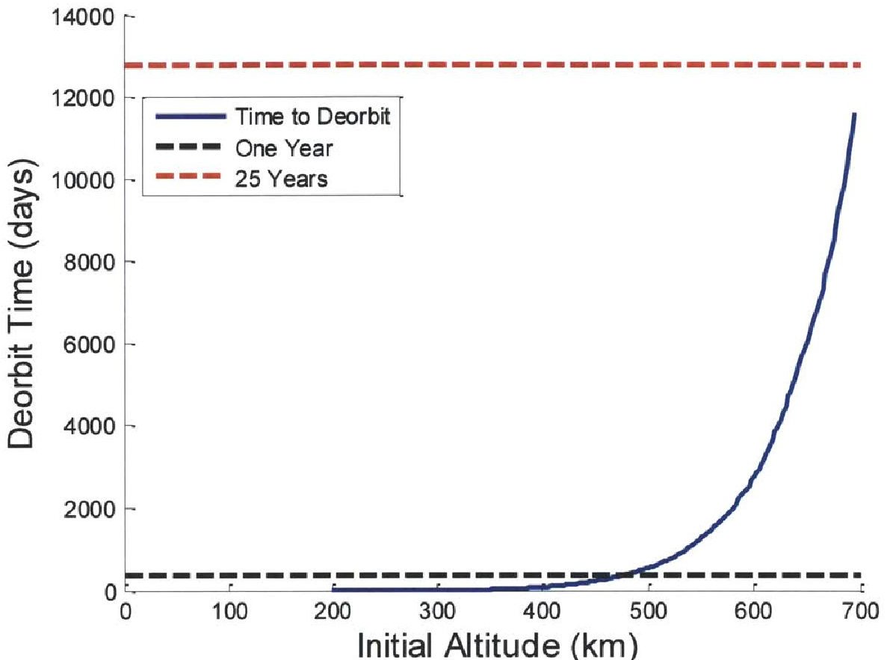

Figure 3-5: Deorbit time as a function of initial altitude for the MicroMAS CubeSat

Based on these results, to satisfy both the mission and decay requirements, the satellite's ideal initial orbit would be between 400 km and 600 km at any inclination. Altitudes higher than this are not an option without an active deorbit mechanism due to the orbital debris requirement. Lower altitudes are still an option if a reduced mission life can be tolerated.

## 3.2.4 Thermal

The defined standard operating temperature range of the CubeSat is nominally 10 to 40 degrees C; 0 to 50 degrees C with margin, as shown in Figure 3-6.

<!-- PDF_PAGE: 60 -->

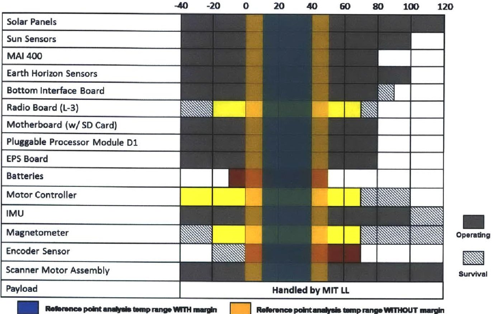

Figure 3-6: Diagram of MicroMAS internal component temperature ranges with acceptable overall spacecraft operational temperature ranges highlighted

Using a similar approach as in section 2.2.6, we performed a thermal analysis using an isometric model of the spacecraft. Figure 3-7 and Figure 3-8 show the results for the extreme hot case and extreme cold cases for this isometric study.

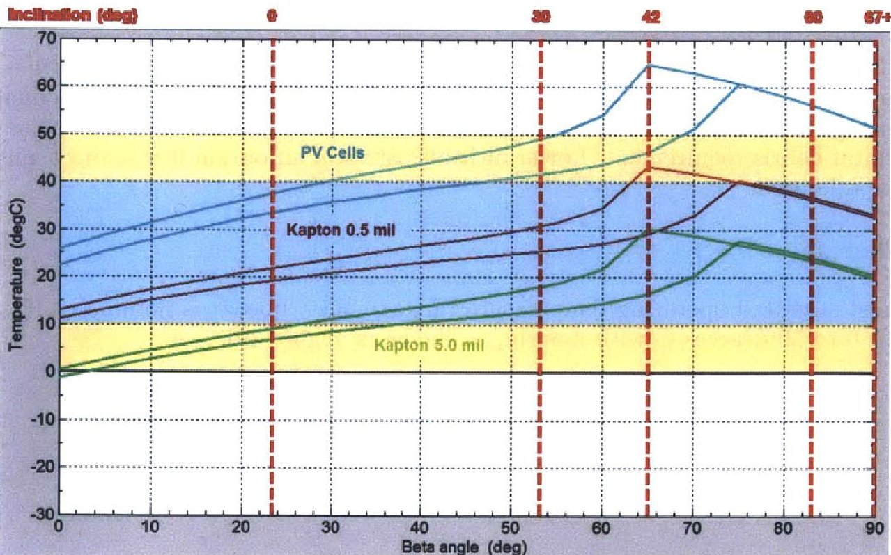

Figure 3-7: Results of extreme hot case thermal model

<!-- PDF_PAGE: 61 -->

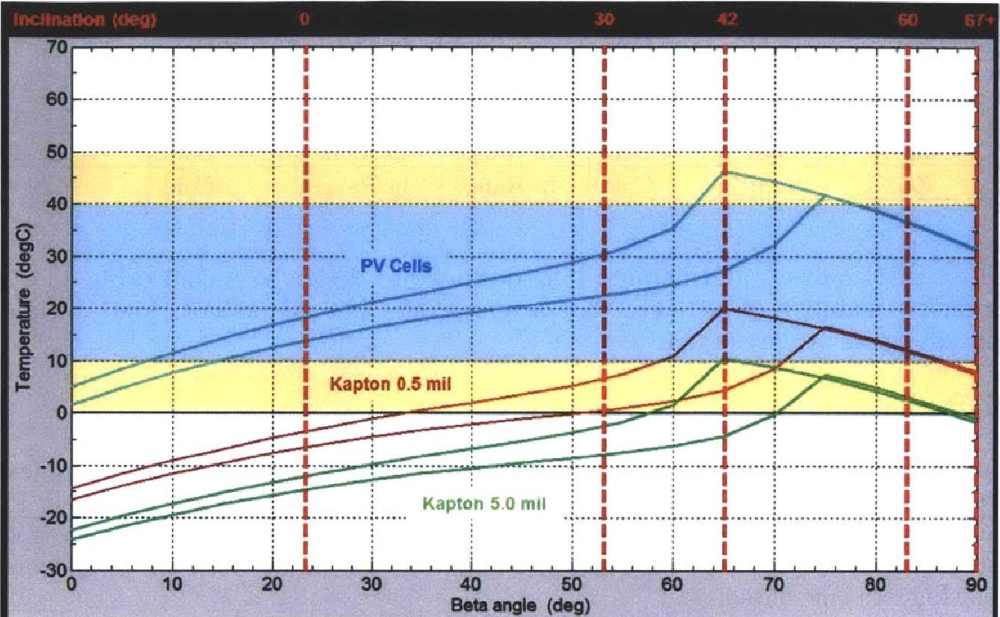

Figure 3-8: Results of extreme cold case thermal model

Based on these results, we could determine the orbits for which the expected temperature range would fall outside the nominal operating zone. The findings are summarized for PV cells in Table 3-3.

Table 3-3: Isometric Temperature Results for PV Cells

<table border="1"><tr><td></td><td>0</td><td>30</td><td>42</td><td>60</td><td>90</td><td>SS</td></tr><tr><td>300</td><td>In Range</td><td>In Range</td><td>In Range</td><td>Hot</td><td>Hot</td><td>Hot</td></tr><tr><td>400</td><td>In Range</td><td>In Range</td><td>In Range</td><td>Hot</td><td>Hot</td><td>Hot</td></tr><tr><td>500</td><td>In Range</td><td>In Range</td><td>Hot</td><td>Hot</td><td>Hot</td><td>Hot</td></tr><tr><td>600</td><td>In Range</td><td>In Range</td><td>Hot</td><td>Hot</td><td>Hot</td><td>Hot</td></tr><tr><td>700</td><td>In Range</td><td>In Range</td><td>Hot</td><td>Hot</td><td>Hot</td><td>Hot</td></tr></table>

Table 3-4: Isometric Temperature Results for Kapton 0.5 mil

<table border="1"><tr><td></td><td>0</td><td>30</td><td>42</td><td>60</td><td>90</td><td>SS</td></tr><tr><td>300</td><td>Cold</td><td>In Range</td><td>In Range</td><td>In Range</td><td>In Range</td><td>In Range</td></tr><tr><td>400</td><td>Cold</td><td>In Range</td><td>In Range</td><td>In Range</td><td>In Range</td><td>In Range</td></tr><tr><td>500</td><td>Cold</td><td>In Range</td><td>In Range</td><td>In Range</td><td>In Range</td><td>In Range</td></tr><tr><td>600</td><td>Cold</td><td>In Range</td><td>In Range</td><td>In Range</td><td>In Range</td><td>In Range</td></tr><tr><td>700</td><td>Cold</td><td>In Range</td><td>In Range</td><td>In Range</td><td>In Range</td><td>In Range</td></tr></table>

<!-- PDF_PAGE: 62 -->

Table 3-5: Isometric Temperature Results for Kapton 5.0 mil

<table border="1"><tr><td></td><td>0</td><td>30</td><td>42</td><td>60</td><td>90</td><td>SS</td></tr><tr><td>300</td><td>Cold</td><td>Cold</td><td>Cold</td><td>In Range</td><td>Cold</td><td>Cold</td></tr><tr><td>400</td><td>Cold</td><td>Cold</td><td>Cold</td><td>In Range</td><td>Cold</td><td>Cold</td></tr><tr><td>500</td><td>Cold</td><td>Cold</td><td>In Range</td><td>In Range</td><td>Cold</td><td>Cold</td></tr><tr><td>600</td><td>Cold</td><td>Cold</td><td>In Range</td><td>In Range</td><td>Cold</td><td>Cold</td></tr><tr><td>700</td><td>Cold</td><td>Cold</td><td>In Range</td><td>In Range</td><td>Cold</td><td>Cold</td></tr></table>

Based on this analysis, and because it is desirable to design to a cold orbit due to the inefficiencies/inability to actively cool a spacecraft that is too hot, low altitude/low inclination orbits are preferable.

## 3.2.5 Radiation

As introduced in Chapter 2, the amount of radiation collected by the electronics in a spacecraft can severely affect their performance. Figure 3-9 shows the expected TID at the altitudes and inclinations studied for the MicroMAS mission. The thickness of the chassis walls are 1.3 mm, so the absorbed radiation will be between the 1 mm and 1.5 mm thicknesses calculated.

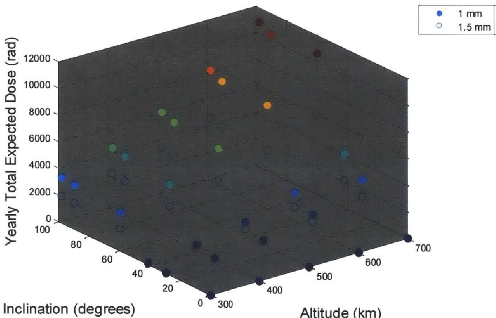

Figure 3-9: Total Ionizing Dose for 1 mm and 1.5 mm aluminum shielding

For MicroMAS, the processor and a few supporting electronics components were exposed to a Cobalt 60 source [80]. One set was exposed to 8 krad, and one was exposed to 24 krad. Each of the components was tested before and after the radiation exposure to quantify the effect of the radiation on the components.

<!-- PDF_PAGE: 63 -->

For the reference point analysis, assuming a 1.3 mm chassis wall thickness, we set the upper desired limit for the total ionizing radiation dose to 8 krad because it is unknown at what TID between 8 krad and 24 krad the components that failed, failed.

The wall thickness of MicroMAS is over one millimeter; Table 3-6 lists the expected radiation dose at each orbit and highlights the regions that see a dose higher than 8 krad.

Table 3-6: Total Ionizing Dose for 1 mm aluminum shielding

<table border="1"><tr><td></td><td>0</td><td>30</td><td>42</td><td>60</td><td>90</td><td>SS</td></tr><tr><td>300</td><td>0</td><td>2.2</td><td>112</td><td>2900</td><td>3300</td><td>3430</td></tr><tr><td>400</td><td>0</td><td>59.8</td><td>417</td><td>4000</td><td>4400</td><td>4620</td></tr><tr><td>500</td><td>0.04</td><td>384</td><td>1060</td><td>5610</td><td>5960</td><td>6260</td></tr><tr><td>600</td><td>0.41</td><td>1200</td><td>2220</td><td>7790</td><td>7950</td><td>8350</td></tr><tr><td>700</td><td>2</td><td>2780</td><td>4090</td><td>10600</td><td>10400</td><td>10900</td></tr></table>

For a 1 mm thickness, the only orbits that see radiation levels above 8 krad are at inclinations of above 90 degrees for altitudes above 600 km.

## 3.2.6 Summary

The results of these five analyses were combined to form a comprehensive idea of the performance of the MicroMAS CubeSat over this range of orbits. Figure 3-10 shows the summary of passed criteria for each of the five parameters. The color-coding is based on the number of subsystems whose design requirements are met by the given orbit.

<!-- PDF_PAGE: 64 -->

<table border="1"><tr><td></td><td>0°</td><td>30°</td><td>42°</td><td>60°</td><td>90°</td><td>98°</td></tr><tr><td>300km</td><td>Power
Thermal
Radiation</td><td>Comm
Power
Thermal
Radiation</td><td>Comm
Power
Thermal
Radiation</td><td>Comm
Power
Radiation</td><td>Comm
Radiation</td><td>Comm
Radiation</td></tr><tr><td>400km</td><td>Comm
Power
Thermal
Radiation</td><td>Comm
Power
Thermal
Radiation</td><td>Comm
Power
Thermal
Radiation</td><td>Comm
Power
Radiation</td><td>Comm
Radiation</td><td>Comm
Radiation</td></tr><tr><td>500km</td><td>Power
Lifetime
Thermal
Radiation</td><td>Comm
Power
Lifetime
Thermal
Radiation</td><td>Comm
Power
Lifetime
Radiation</td><td>Comm
Power
Lifetime
Radiation</td><td>Comm
Lifetime
Radiation</td><td>Comm
Lifetime
Radiation</td></tr><tr><td>600km</td><td>Power
Lifetime
Thermal
Radiation</td><td>Comm
Power
Lifetime
Thermal
Radiation</td><td>Comm
Power
Lifetime
Radiation</td><td>Comm
Power
Lifetime
Radiation</td><td>Comm
Lifetime
Radiation</td><td>Comm
Lifetime
Radiation</td></tr><tr><td>700km</td><td>Power
Thermal
Radiation</td><td>Comm
Power
Thermal
Radiation</td><td>Comm
Power
Thermal
Radiation</td><td>Comm
Power</td><td>Comm</td><td>Comm</td></tr></table>

Figure 3-10: Summary of expected MicroMAS performance across the orbital design space

These results indicate that the ideal orbit for MicroMAS would be within the range of 30-60 degrees at altitudes of 400-600 km. If possible, MicroMAS should avoid highinclination, high-altitude orbits.

## 3.3 Design to an Orbit

MicroMAS has a launch opportunity on the Orbital-built Cygnus capsule. This opportunity was made available by NanoRacks, LLC via its Space Act Agreement with NASA's U.S. National Lab, in collaboration with Spaceflight. The launch is no earlier than December 1, 2013. Instead of being deployed from the launch vehicle as a secondary payload, MicroMAS will be delivered to the ISS and deployed using a NanoRacks launcher. The resulting initial orbit will be a roughly elliptical 400 x 425 km with 51.6 degrees inclination. This case was not specifically included in the analysis presented in Section 3.2, although some metrics can be interpolated from the results. The following analysis shows a more detailed expected performance in these same five areas for the given orbit.

<!-- PDF_PAGE: 65 -->

## 3.3.1 Communications

The communications parameters explored in section 3.2.2 are listed in Table 3-7 for the expected orbital parameters based on an ISS deployment. The ink budget closes with tens of dB margin for each pass.

Table 3-7: Link budget analysis for ISS-deployed orbit for operations - all access and business hour access only

<table border="1"><tr><td>Wallops</td><td>Gap</td><td>Access</td></tr><tr><td>Mean(s)</td><td>5165</td><td>432.9</td></tr><tr><td>Max(s)</td><td>57645</td><td>603.2</td></tr><tr><td>Req P/L Rate</td><td colspan="2">19200</td></tr><tr><td>Max P/L Rate</td><td colspan="2">67641</td></tr><tr><td>Req Storage (Mb)</td><td colspan="2">553</td></tr><tr><td>Number of Accesses</td><td colspan="2">452</td></tr></table>

<table border="1"><tr><td>Wallops Business Hours Only</td><td>Gap</td><td>Access</td></tr><tr><td>Mean(s)</td><td>5155.6</td><td>439.4</td></tr><tr><td>Max(s)</td><td>87823.8</td><td>582.6</td></tr><tr><td>Req P/L Rate</td><td colspan="2">19200</td></tr><tr><td>Max P/L Rate</td><td colspan="2">68656</td></tr><tr><td>Req Storage (Mb)</td><td colspan="2">843</td></tr><tr><td>Number of Accesses</td><td colspan="2">155</td></tr></table>

As the orbit precesses, the time of day for the ground station pass changes. Nominally access to the ground station is limited to working business hours (9:00 AM to 5:00 PM), which limits the effective access and downlink capacity. Figure 3-11 illustrates this effect. Even limited to business hours of operation only, the link budget closes.

<!-- PDF_PAGE: 66 -->

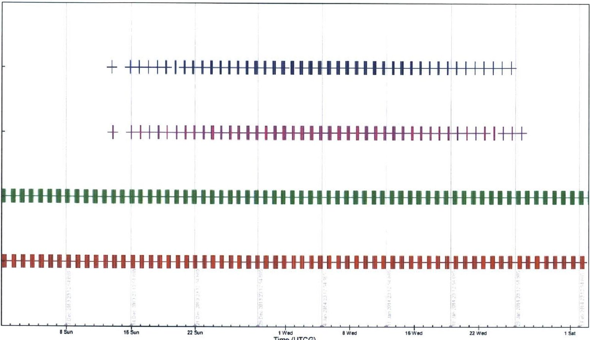

Figure 3-11: MicroMAS Communications access with the Wallops Ground station. Blue - Accesses for uplink during business hours only; Purple - Accesses for downlink during business hours only; Green - Accesses for uplink with no time restrictions; Red - Accesses for downlink with no time restrictions

## 3.3.2 Power Generation

From the reference point study introduced in section 3.2.2, the average power generation at the start of the orbit would be between 13.64 and 14.13 W. This should be sufficient for the total power consumption requirements.

In addition to the cyclical variation that the power generation follows over each orbit (daylight, eclipse), the power generation profile also changes as a function of the Right Ascension of the Ascending Node, which changes as the orbit precesses. The satellite will precess over 360 degrees of RAAN in a period of roughly 70 days. Figure 3-12 shows a simulation of the power generation over the entire CubeSat lifetime.

<!-- PDF_PAGE: 67 -->

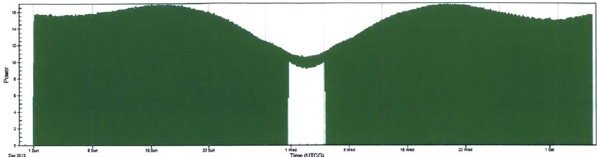

Figure 3-12: Power generation of MicroMAS over expected lifetime

For the first few hours of the mission, the panels deploy one at a time. Figure 3-13 shows a simulation of the increased power draw that comes from each panel deployment.

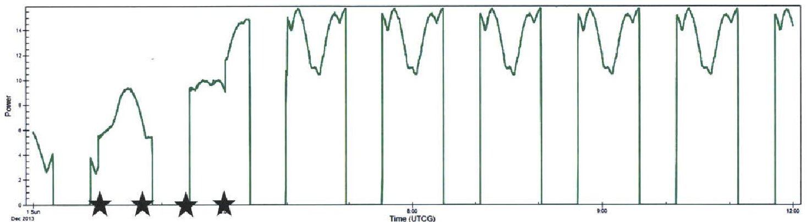

Figure 3-13: Power generation of MicroMAS during first six hours of operation. Stars indicate times of panel deployment.

## 3.3.3 Lifetime

As with the analysis done in Chapter 2, this study assumes a constant drag area for the duration of the mission. In reality as the spacecraft attitude is perturbed, this drag area will vary with time.

Based on the initial conditions of an ISS orbit, the MicroMAS satellite will deorbit within several months of deployment. The High-Precision Orbit Propagator (HPOP) in STK was used to simulate how the orbital parameters of the satellite would change over the course of the mission life. The results from the Matlab deorbit simulation are shown in Figure 3-14, and the changes in apogee, perigee, and eccentricity as the satellite deorbits (calculated using the HPOP in STK) are shown in Figure 3-15.

<!-- PDF_PAGE: 68 -->

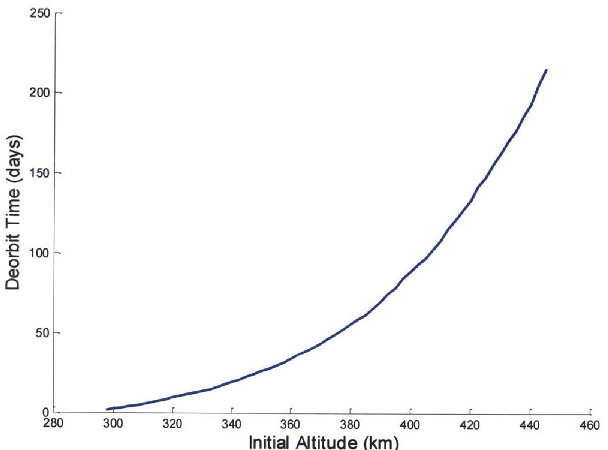

Figure 3-14:MicroMAS Deorbit Time versus altitude for expected launch parameters

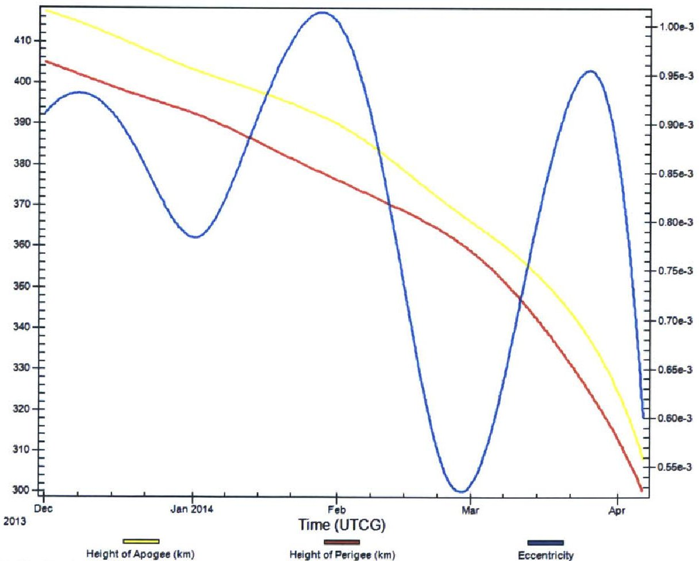

Figure 3-15: Perigee, Apogee, and Eccentricity as a function of time for MicroMAS deployed from the ISS

<!-- PDF_PAGE: 69 -->

Overall the MicroMAS CubeSat will have a lifetime of three to four months. The original mission requirements specified a mission lifetime of at least one year to ensure that the satellite would operate during tropical storm season, but three to four months will be sufficient to carry out the desired science and technology demonstration goals.

## 3.3.4 Thermal

The thermal analyses described in Chapter 2 and Section 3.2.3 were for isometric models of the CubeSat (for simplicity's sake it assumed the entire spacecraft was a uniform temperature). In reality, each of the components has a different range of survival and operating temperatures, and each component will see a different temperature based on thermal paths in the system. With a known orbit, a detailed component-level thermal analysis becomes more pragmatic.

Figure 3-16 shows the operational and survival temperature ranges for the major components on MicroMAS. The overlayed range depicts the expected temperature extremes based on the actual orbit.

<table border="1"><tr><td></td><td>-40</td><td>-20</td><td>0</td><td>20</td><td>40</td><td>60</td><td>80</td><td>100</td><td>120</td></tr><tr><td>MAI 400</td><td></td><td></td><td>-12</td><td>3</td><td></td><td></td><td></td><td></td><td></td></tr><tr><td>Radio Board (L-3)</td><td></td><td></td><td></td><td>-4</td><td></td><td></td><td>63</td><td></td><td></td></tr><tr><td>Motherboard (w/SD Card)</td><td></td><td></td><td></td><td>-3</td><td>23</td><td></td><td></td><td></td><td></td></tr><tr><td>EPS Board</td><td></td><td></td><td></td><td>-9</td><td>23</td><td></td><td></td><td></td><td></td></tr><tr><td>Batteries</td><td></td><td></td><td></td><td></td><td>25</td><td></td><td></td><td></td><td></td></tr><tr><td>Motor Controller</td><td></td><td></td><td></td><td></td><td>19</td><td></td><td>63</td><td></td><td></td></tr><tr><td>IMU</td><td></td><td></td><td></td><td></td><td>14</td><td>36</td><td></td><td></td><td></td></tr><tr><td>Magnetometer</td><td></td><td></td><td></td><td></td><td>2</td><td>37</td><td></td><td></td><td></td></tr><tr><td>Encoder Sensor</td><td></td><td></td><td></td><td></td><td>0</td><td>28</td><td></td><td></td><td></td></tr><tr><td>Scanner Motor Assembly</td><td></td><td></td><td>-14</td><td>18</td><td></td><td></td><td></td><td></td><td></td></tr></table>

Figure 3-16: Operating and survival temperature ranges for major components on MicroMAS. Red indicates the most stringent temperature requirements, and yellow indicates a moderate operating temperature range.

## 3.3.5 Radiation

Because MicroMAS has a relatively low initial orbit and short mission life, accmulated radiation is not a major risk factor to the mission. As shown in Figure 3-17, the yearly expected radiation does for MicroMAS is less than 1 krad.

<!-- PDF_PAGE: 70 -->

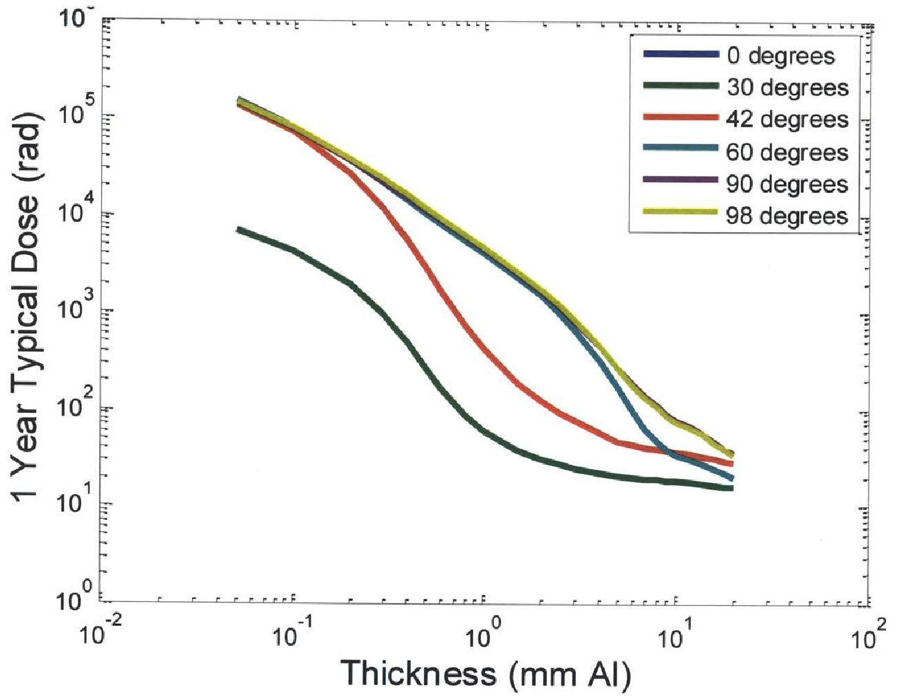

Figure 3-17: Total Radiation Dose for 400 km orbit for orbit inclinations ranging from 0 degrees to sunsynchronous

## 3.4 Continuing Work

MicroMAS is slated for launch in December of 2013, but the mission it supports is part of a larger view to design a constellation of CubeSats for weather sensing.

## 3.4.1 Systems Simulation

The current operating scheme for subsystem simulations is that each subsystem has been keeping its own design and performance simulations and asks for additional information from other subsystems when required. This method of operation has worked relatively successfully but a fully integrated system simulation of the bus performance would be an ideal project, tying together models of each of the subsystems that currently exist across a variety of programs.

For example, the current flow of information is illustrated in Figure 3-18

<!-- PDF_PAGE: 71 -->

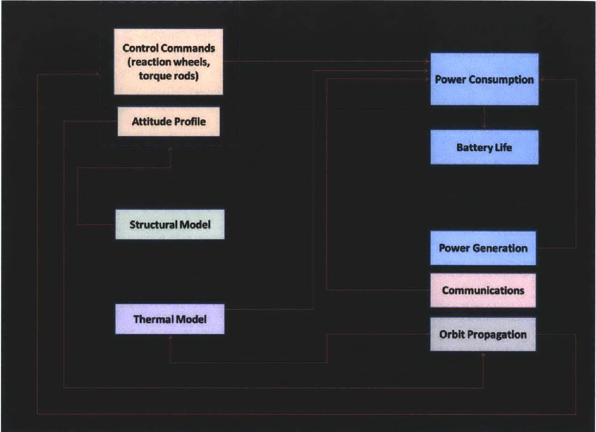

Figure 3-18: Diagram of information flow across subsystem simulations.

Such an integrated model would reduce the delay in flowing down changes in subsystem parameters to other affected subsystems and would ensure that each simulation would run the most up-to-date model of the satellite.

## 3.4.2 Follow-on Missions and Constellation Vision

MicroMAS is a demonstration mission to prove the technology and calibration method of a small-scale microwave radiometer and to establish experience and heritage within the laboratory of building CubeSats in order to facilitate the development of a constellation of identical satellites for global weather observations.

The next phase of the mission is the Microwave Radiometer Technology Assessment CubeSat (MiRaTA), another 3U CubeSat with the same microwave radiometer payload as MicroMAS. This mission is exploring a different method of radiometer calibration using GPS Radio Occultation. It will 1) Validate new ultra-compact and low-power technology for CubeSat-sized microwave radiometers operating near 52-58, 175-191, and 206-208 GHz; 2) Validate new GPS receiver and antenna array technology necessary for CubeSat tropospheric radio occultation sounding, and 3) Test a new approach to

<!-- PDF_PAGE: 72 -->

radiometer calibration using concurrent GPS radio occultation (GPSRO) measurements. This 90-day mission will mark the first ever implementation of co-located radiometer+GPSRO sounding and the first CubeSat implementation of both temperature+humidity radiometric sounding and GPSRO atmospheric sounding. MiRaTA will not only validate multiple subsystem technologies, but will also demonstrate new sensing modalities that would dramatically enhance the capabilities of future weather and climate sensing architectures. [83]

With the development of launch mechanisms for 6U and larger CubeSats, another step in the CubeSat-to-constellation vision is the development of a 6U version of MicroMAS or MiRaTA. A 6U provides more surface area for solar panels, a larger internal volume to accommodate larger reaction wheels or torque rods, and there is room to support subsystem redundancy.

<!-- PDF_PAGE: 73 -->

## 4 Chapter 4: CubeSat Constellation Architectures

4.1 CubeSat Launch Opportunities...64

4.2 Case Study Overview...65

4.2.1 Reference Case – Walker Constellation...66

4.2.2 Ad Hoc Case 1 – US Launches Only...66

4.2.3 Ad Hoc Case 2 – Both Non-US and US Launches...68

4.3 One Satellite Per Plane (No Propulsion)...68

4.3.1 Revisit Time...69

4.3.2 Time to 100% Coverage...71

4.3.3 Response Time...71

4.4 Multiple CubeSats Per Plane...73

4.4.1 CubeSat Propulsion and Distribution...73

4.4.2 Coverage Analysis...77

4.5 Summary...82

<!-- PDF_PAGE: 74 -->

## 4.1 CubeSat Launch Opportunities

Some CubeSat missions are constrained to only use US launch vehicles (e.g. if the launch is funded through the NASA ELaNa program). For this analysis, we use the expected launch schedule to develop the case studies for the ad hoc constellations. Table 4-1 denotes the specifics for the expected launches starting in 2013.

Table 4-1: Launch Opportunities for 2013 and Beyond

<table border="1"><tr><td>Date</td><td>Provider</td><td>Inclination(degrees)</td><td>Altitude(km)</td></tr><tr><td>Q12013</td><td>US</td><td>51</td><td>750</td></tr><tr><td>H12013</td><td>Non-US</td><td>98</td><td>775</td></tr><tr><td>H12013</td><td>Non-US</td><td>98</td><td>600x800</td></tr><tr><td>H12013</td><td>Non-US</td><td>98</td><td>825</td></tr><tr><td>H12013</td><td>US</td><td>52</td><td>600</td></tr><tr><td>Mid2013</td><td>Non-US</td><td>98</td><td>650</td></tr><tr><td>H22013</td><td>Non-US</td><td>8</td><td>650</td></tr><tr><td>H22013</td><td>Non-US</td><td>98</td><td>675</td></tr><tr><td>H22013</td><td>Non-US</td><td>79</td><td>500</td></tr><tr><td>Q42013</td><td>Non-US</td><td>98</td><td>700</td></tr><tr><td>Q42013</td><td>US</td><td>52</td><td>600</td></tr><tr><td>2013</td><td>US</td><td>98</td><td>400</td></tr><tr><td>2013</td><td>US</td><td>72</td><td>641x652</td></tr><tr><td>H12014</td><td>Non-US</td><td>98</td><td>650</td></tr><tr><td>H12014</td><td>Non-US</td><td>98</td><td>425</td></tr><tr><td>H22014</td><td>Non-US</td><td>79</td><td>475</td></tr><tr><td>Q32014</td><td>US</td><td>98</td><td>720</td></tr><tr><td>Q42014</td><td>US</td><td>98</td><td>600</td></tr><tr><td>April2015</td><td>Non-US</td><td>79</td><td>330</td></tr><tr><td>H12015</td><td>Non-US</td><td>98</td><td>700</td></tr><tr><td>Q22015</td><td>US</td><td>98</td><td>600</td></tr></table>

In the following section, we take as input these specific opportunities and use them to generate the ad hoc constellations for comparison to traditional constellation architectures.

<!-- PDF_PAGE: 75 -->

## 4.2 Case Study Overview

We consider two ways in which constellations of CubeSats could be deployed: (1) one or more Cubesats at a time into separate orbital planes or, (2) in a cluster of ten or more CubeSats from a single launch vehicle. We assume that the goal of this constellation is to obtain global measurements of data with high temporal coverage (frequent revisits). In this study, we do not focus on revisiting specific geographic regions and targets, but plan to address constellation targeting in future work.

For the following analysis, the CubeSats are assumed to all be identical in mass and form factor - 3U CubeSats (10 cm x 10 cm x 34 cm, 4 kg [4]) flying in a non-gravity gradient configuration (0.01 $ m^{2} $ area in the ram direction). This is to maximize the amount of time each satellite would spend on orbit at lower altitudes. For the purposes of this study, we compared an example of an ad hoc constellation architecture with a reference uniform Walker constellation. The sensor on each satellite has a conical field of view with half angle 45 degrees (see Figure 4-1), and we assume that the sensors operate in both daylight and eclipse conditions.

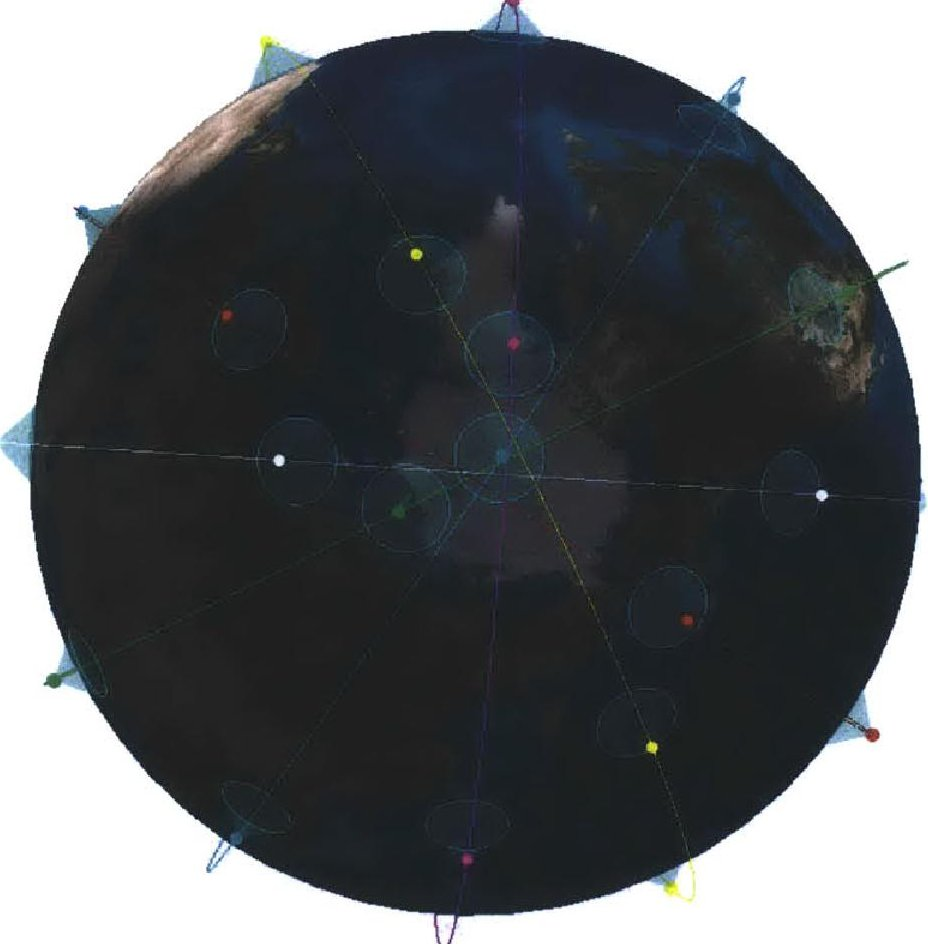

Figure 4-1: Reference constellation showing sensor field of view (teal)

To generate the ad hoc constellation we use launch opportunities during the 2013 calendar year. We assume that each CubeSat has a nominal operational lifetime of one year, unless the CubeSats orbits will decay in less than a year, in which case their lifetime is their deorbit time. For a 4 kg, 3U CubeSat flying horizontally (not gravity-

<!-- PDF_PAGE: 76 -->

gradient stabilized), the initial orbit altitude must be above 370 km to stay in orbit for over one year. Interestingly, all noted future launch opportunities in 2013 currently are above this altitude constraint for a one year lifetime. If more ISS resupply orbits become available (325 km, 52 degrees inclination), the effect of initial altitude becomes more of an issue (see Appendix A for examples of architectures based on past launches [14]).

## 4.2.1 Reference Case - Walker Constellation

The first case, a Walker constellation, is the reference case. It features six evenly distributed orbital planes at an inclination of 86.4 degrees (same inclination as the Iridium constellation) and an altitude of 500 km. These orbits are all assumed to be circular unless otherwise noted. An image of this constellation is shown in Figure 4-2.

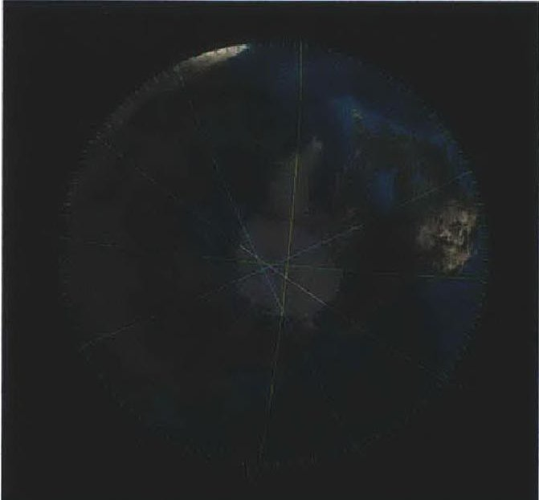

Figure 4-2: Illustration of Walker Constellation Orbits (Looking Down on North Pole)

For the analysis, we varied the number of satellites per orbital plane to quantify the effects on overall coverage. The analyses done for each of the following cases consider one, three, and six CubeSats per orbital plane. The coverage and revisit times for the ad hoc constellation cases are compared to those of the Walker constellation to identify what kind of impact the number of satellites per plane has on the ad hoc constellation.

## 4.2.2 Ad Hoc Case 1-US Launches Only

The parameters of each destination orbit as well as the expected timeframe for the launch are shown in Figure 4-3. There were no specific launch dates associated with each launch - only the halves or quarters of the year were indicated. The first ad hoc case is illustrated in Figure 4-4. This constellation is made up of only US launches over the 2013 calendar year. This corresponds to five launches of 1-6 CubeSats each.

<!-- PDF_PAGE: 77 -->

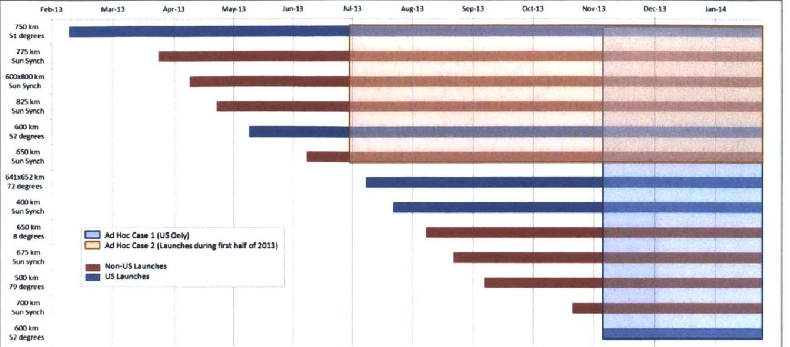

Figure 4-3: Calendar view of 2013 launch opportunities - the US launches in the blue box make up Ad Hoc Case 1, and all six launches in the orange box make up Ad Hoc Case 2.

For the purposes of this study, we evenly distributed multiple launches during the listed quarter or half. The final schedule of launches will vary as the launch dates get closer.

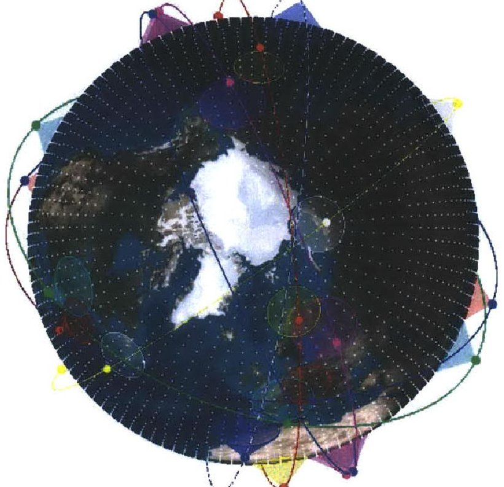

Figure 4-4: Illustration of Ad Hoc Case 1 Constellation Orbits (Looking Down on North Pole) There are only five US launches during 2013, so there is not the same number of satellites for this case as the reference case, but because a number of projects may be limited to US-only launches, it is important to separately analyze these opportunities. Depending on the actual launch schedule, the entire constellation would be in place for about one month before the first-launched satellites reach the end of their lifetime.

<!-- PDF_PAGE: 78 -->

## 4.2.3 Ad Hoc Case 2 - Both Non-US and US Launches

The orange box in Figure 4-3 corresponds to the orbits selected for a constellation architecture that is not constrained to US-only launches. Because each of these launches is expected to launch during the first half of 2013, regardless of the order in which they are actually launched, the entire constellation will be in place for six months before the first satellites reach the end of their expected operational lifetime. This constellation is illustrated in Figure 4-5.

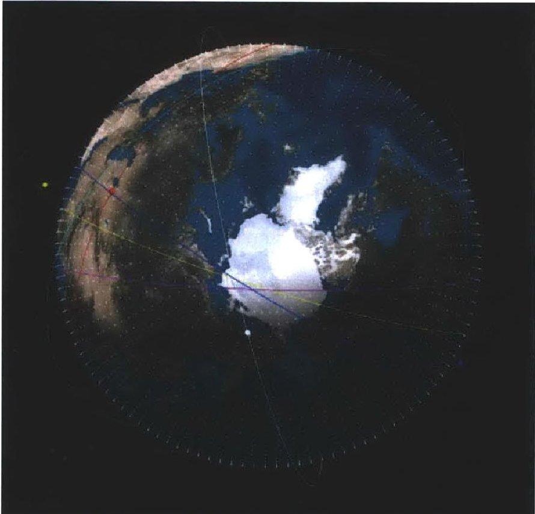

Figure 4-5: Illustration of Ad Hoc Case 2 Constellation Orbits (Looking Down on North Pole)

## 4.3 One Satellite Per Plane (No Propulsion)

Each of the case studies was analyzed using Analytical Graphics Inc.'s Satellite Toolkit (STK) [84] and MATLAB. The analysis focused on three parameters: revisit time, percent coverage, and response time.

These attributes were calculated by defining a coverage grid ranging across all degrees of longitude and from -85 degrees to 85 degrees latitude. The grid points are arranged by a separation of three degrees in both latitude and longitude. Figure 4-2, Figure 4-4, and Figure 4-5 show this coverage grid, represented by white dots.

<!-- PDF_PAGE: 79 -->

## 4.3.1 Revisit Time

The revisit time for each satellite is defined as the duration of intervals over which coverage is not provided [84]. In this analysis, the revisit time is calculated with respect to each grid point in the coverage definition. To achieve the temporal coverage desired for earth science observations, we look for revisit times of less than an hour. Figure 4-6 shows the maximum revisit time for each of the three cases as a function of latitude. The distribution for the Walker constellation is more predictable, but the Ad Hoc Case 2 constellation tends to have the lowest revisit time. Ad hoc case 1 (US only launches) shows the highest revisit time at higher latitudes, and the Walker constellation sees gaps in coverage over mid-latitudes.

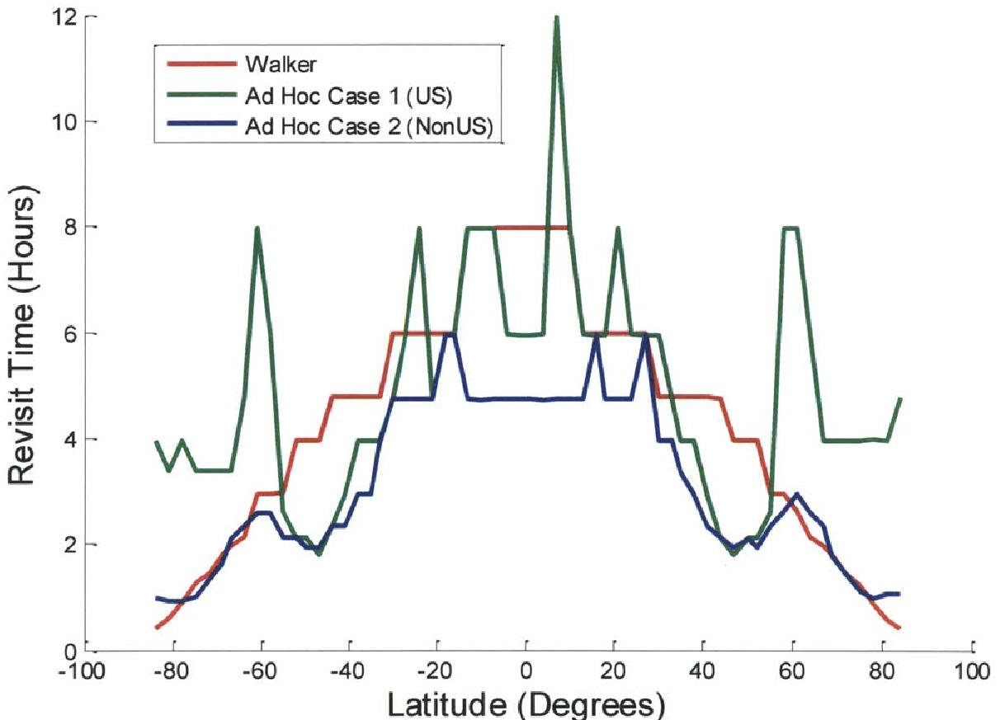

Figure 4-6: Comparison of maximum revisit time for each case study (one satellite per orbital plane)

The following series of plots shows the average revisit time at each grid point for each constellation (Figure 8). The time scale is consistent across each plot, and it ranges from 20 minutes (blue) to 12 hours (red). These results are plotted on an equidistant cylindrical projection of the Earth with political boundaries marked.

<!-- PDF_PAGE: 80 -->

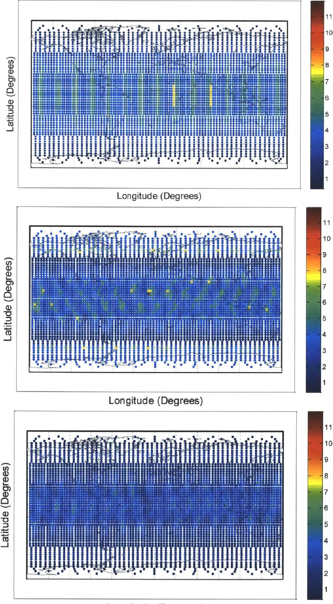

Figure 4-7: Average revisit time for each constellation is shown over the whole earth: Top - Walker constellation, Middle - Ad Hoc Case 1, Bottom - Ad Hoc Case 2 (Color scale in hours)

<!-- PDF_PAGE: 81 -->

Overall, the ad hoc constellations give better coverage at equatorial latitudes. For all cases, polar regions see the best revisit times with durations of less than an hour.

## 4.3.2 Time to 100% Coverage

The following plot (Figure 4-8) shows the expected percentage of global coverage as a function of time for each of the case studies.

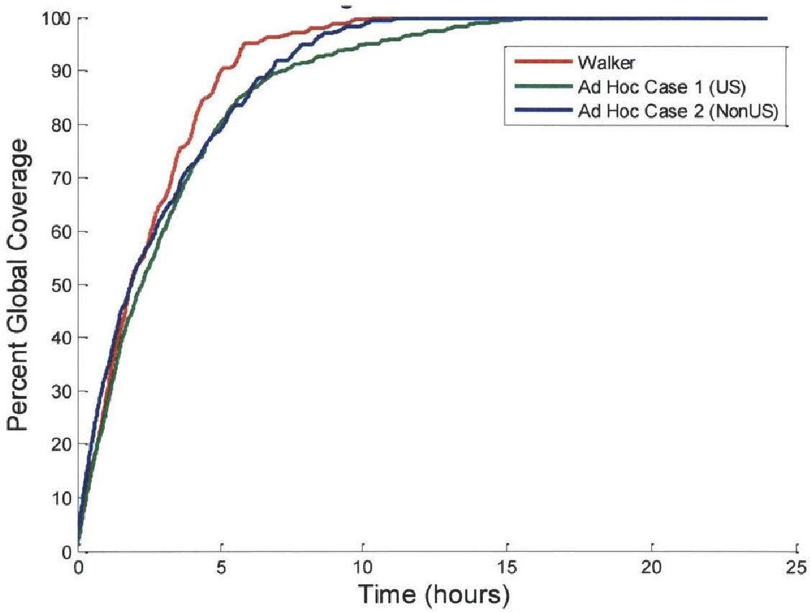

Figure 4-8: Percent global coverage as a function of time for each case study

The Walker constellation gives coverage to the entire globe faster than each of the ad hoc cases, achieving 95% coverage in six hours, but Ad Hoc Case 2 is close behind with eight hours to 95% coverage. Ad Hoc Case 1 requires 10 hours to reach 95% global coverage. The final 5% coverage is really what distinguishes each of the cases. The Walker constellation takes 10 hours to reach 100% coverage, while Ad Hoc Cases 1 and 2 take 22 and 12 hours, respectively.

## 4.3.3 Response Time

The third criterion analyzed is the maximum response time for any given position on the globe as defined by the grid points previously mentioned. This metric is the time measured between a request for coverage at the point and the time at which coverage is achieved [84]. Figure 4-9 shows a comparison of the expected response time for each of the constellation case studies. The time scale on each of the plots is identical and is measured in hours. It ranges from 1.5 to 23 hours.

<!-- PDF_PAGE: 82 -->

Figure 4-9: Maximum response time for each constellation is depicted globally: Top - Walker constellation, Middle - Ad Hoc Case 1, Bottom - Ad Hoc Case 2 (Color scale in hours)

<!-- PDF_PAGE: 83 -->

Overall, the Walker constellation demonstrates better revisit time than the ad hoc constellations. Both ad hoc cases see comparatively worse revisit times at the poles, but the Walker and Ad Hoc Case 2 are much closer in overall magnitude than Ad Hoc Case 1.

## 4.4 Multiple CubeSats Per Plane

To optimize global coverage with multiple CubeSats per orbital plane, the satellites should be as evenly distributed as possible over the orbit. We look at onboard propulsion as a way to achieve this architecture.

## 4.4.1 CubeSat Propulsion and Distribution $ ^{2} $

In recent years, a variety of options for Cubesat propulsion have been developed. Assuming a fixed final mass of 4kg for a 3U Cubesat, Figure 4-10 plots the required fuel mass as a function of required impulse for a variety of typical Cubesat propulsion options.

Figure 4-10: Propellant mass requirements for different Cubesat propulsion types

For the purposes of this analysis, it was assumed that each satellite is equipped with electrospray propulsion units with a maximum thrust of 100 $ \mu $N and a specific impulse

<!-- PDF_PAGE: 84 -->

of 1000s. These thrusters were based on thrusters in development by Espace Inc. [78] and are also similar to ones being developed by Busek Co. Inc. [76]. A full propulsion trade study is out of the scope of this paper, but this choice of propulsion represents a technology which we anticipate will be available for use in the near term and will be qualitatively similar to most other Cubesat propulsion options.

## 4.4.1.1 Simulation

In order to evaluate the fuel cost and time required to evenly distribute the satellites around a given orbital plane, a MATLAB simulation was used to propagate the orbit in the presence of altitude-varying aerodynamic drag. The primary life-limitation considered for this constellation was deorbiting due to drag. This is highly dependent on the drag profile of the spacecraft, which is driven by the choice of solar panels.

To start with, we considered two options for solar panels, but ultimately proceeded with analysis using only body-mounted panels. The two initial configurations considered were body-mounted panels (0.01 $ m^{2} $ cross-sectional area) and "petal" panels, which are 3U long and deployed from each 3U face at a $ 90^{\circ} $ angle for total cross sectional area of 0.13 $ m^{2} $ . We assumed that the satellites have sufficient attitude control to maintain their orientation such that the long axis of the satellite always faces in the velocity direction. The time to deorbit as a function of altitude (assuming no thrust is applied) for both the body-mounted and "petal" solar panel cases is shown in Figure 4-11.

Figure 4-11: Deorbit time as a function of altitude for two solar panel configurations

<!-- PDF_PAGE: 85 -->

Another way of looking at this is to examine the amount of continuous thrust required to counteract drag at a certain altitude. This is plotted in Figure 4-12.

Figure 4-12: Force required to compensate for drag for two solar panel configurations

Although it is not strictly required that the constellation maintain altitude (i.e. they could slowly lose altitude over the lifetime of the mission), it does show that the fuel cost increases dramatically as altitude decreases and that there is a lower limit dependent on the drag profile. Because a significant number of the examined orbits have low altitudes, the body-mounted solar panels are assumed for the remainder of this analysis.

## 4.4.1.2 Control Law

Because the thrusters chosen have very low thrust, it is not appropriate to assume impulsive maneuvers. Therefore, in order to accurately predict how this distribution maneuver would actually be performed, an equinoctial orbit element feedback controller based on [85] was implemented.

Although all six orbital elements were actively controlled, the primary component of the control is in the tangential (velocity) direction and it functions to modify the spacecraft altitude (and indirectly the anomaly). This component $ \left(u_{t}\right) $ , for nearly circular orbits, can be expressed as:

<!-- PDF_PAGE: 86 -->

$$
u _ {t} \approx - 2 K _ {a} \left(a - a ^ {*}\right)
$$

Where the error in altitude $ \left( \mathrm{a}^{*} \right) $ is given by:

$$
a ^ {*} = \left(- K _ {M} \left(M - M _ {r e f}\right) + a _ {r e f} ^ {- 3 / 2}\right) ^ {- 2 / 3}
$$

$ \mathrm{K_{a}} $ and $ \mathrm{K_{M}} $ are designer-selected positive gains. For correcting altitude errors only, $ \mathrm{a^{*}}= $ $ \mathrm{a_{ref}} $ . However, in order to correct errors in the anomaly, it is necessary to change the semi-major axis. It can be seen that as the error in anomaly decreases then $ \mathrm{a^{*}} $ approaches $ \mathrm{a_{ref}} $ and the satellite converges to the desired altitude and anomaly.

One potential issue with the control law is that it does not explicitly account for the increase in aerodynamic drag as altitude decreases. In some cases, it may be possible for the satellite to decrease its altitude to the point where it cannot raise its altitude back to the nominal one due to the increased drag force. To address this, an altitude limit of 10 km was imposed.

As an example case, a state and control history for a dispersion maneuver of 6 satellites in a 320 km altitude circular orbit is shown in Figure 4-13. In the second subplot, $ \mathrm{M}_{0} $ is the mean anomaly at some epoch time assuming the nominal orbit's rate, and each satellite is commanded to go to a specific position in the orbit such that the six satellites will be evenly spaced.

Figure 4-13: State and control history for the even distribution of six satellites in a 320 km altitude circular orbit

<!-- PDF_PAGE: 87 -->

The behavior of the controller is as desired: the orbits are raised to decrease the anomaly and lowered to increase the anomaly, with the altitude returning to nominal as the anomaly approaches the desired value. It is important to note that in the steady state the thrust is non-zero in order to compensate for the drag and maintain the nominal altitude.

This analysis was repeated for each launch in the list of possible upcoming opportunities to evaluate the fuel and time required to complete the distribution maneuver. The full list of results is presented in Appendix B. The maneuver times range from 31.3 to 38.0 days and the fuel cost for the maneuvers range from 9.6 m/s to 30.8 m/s, with higher fuel costs being at lower altitudes. Some of the orbits have are low enough that the satellites cannot complete a one-year mission without deorbiting, so the fuel costs (in addition to the maneuver cost) to ensure a one-year mission life are also included in the appendix.

## 4.4.1.3 Alternate Methods

There are other distribution methods not included in this analysis that could be used for propagating spacecraft within (or even between) orbital planes. The QB50 constellation is using one launch vehicle to put forty satellites in orbit at once, and over time these satellites will distribute more evenly around the orbital plane [86]. Differential drag could be used for coarse control of the satellite distribution.

Launch vehicle providers are also looking into using upper stages of launch vehicles to tow small satellites to different altitudes or different orbits altogether after primary missions are deployed from the launch vehicles. In addition to altering the destination orbit, this could be useful in distributing individual satellites around the orbital plane to avoid on-board satellite propulsions systems.

## 4.4.2 Coverage Analysis

Any given constellation would have better coverage with more satellites per orbital plane. The analysis described in Section 4 was repeated for constellations with three and six satellites per orbital plane. The results for six satellites per plane are shown here; see Appendix C for results from each case with three satellites per plane.

## 4.4.2.1 Revisit Time

Figure 4-14 is analogous to Figure 4-6 from section 4.2.1 and shows a comparison of the maximum revisit time for the Walker and both ad hoc constellations assuming propulsion and even satellite distribution.

<!-- PDF_PAGE: 88 -->

Figure 4-14: Maximum revisit time for each case study (six satellites per orbital plane)

The overall behavior of each constellation is very similar to that shown in the previous section the main difference is that the time scale has been reduced by a factor of 4 (Figure 4-15).

<!-- PDF_PAGE: 89 -->

Figure 4-15: Average revisit time for six satellites per orbital plane: Top - Walker constellation, Middle - Ad Hoc Case 1, Bottom - Ad Hoc Case 2 (Color scale in hours)

<!-- PDF_PAGE: 90 -->

The time scales are again consistent between all three graphs and given in hours, but it ranges between about two minutes (blue) and an hour (red). For six satellites per orbital plane, the maximum revisit time for any of the constellations falls under an hour for most points on the globe. Ad Hoc Case 2 sees a lower revisit time across the board, with the Walker constellation getting worse coverage in equatorial regions and Ad Hoc Case 1 getting worse coverage in polar regions.

Time to 100% Coverage--The following plot (Figure 4-16) shows the amount of time it takes on average for the entire constellation to achieve coverage of the entire globe.

Figure 4-16: Percent global coverage as a function of time for six satellites per orbital plane

It takes 105 minutes to achieve full coverage for the Walker constellation, 15 hours for Ad Hoc Case 1, and 8 hours for Ad Hoc Case 2. This shows a marked improvement over one satellite per orbital plane, and there is a more pronounced advantage for the Walker constellation for this architecture.

## 4.4.2.2 Response Time

The following plots (Figure 4-17) show the expected response time by latitude and longitude for each constellation case. The time scale for each plot is again given in hours and ranges from about 40 minutes (blue) to 16 hours (red).

<!-- PDF_PAGE: 91 -->

Figure 4-17: Maximum response time for six satellites per orbital plane: Top - Walker constellation Middle - Ad Hoc Case 1, Bottom - Ad Hoc Case 2 (Color scale in hours)

<!-- PDF_PAGE: 92 -->

These plots indicate that for six satellites per orbital plane, the reference Walker constellation is an order of magnitude faster in response time than Ad Hoc Case 1. Ad Hoc Case 2 fairs a little better, but it still sees significantly longer response times than the reference case (6-7 hours versus 40-60 minutes).

## 4.5 Summary

The principal conclusions of this work are mixed. For any number of satellites per plane, the ad hoc constellations provide better revisit times than their reference Walker counterpart, but for percent coverage and response times, the Walker constellation has better performance. Some improvement in temporal resolution is possible over existing systems with either ad hoc constellation, although architectures with multiple CubeSats per orbital plane are even more effective, as shown in Table 4-2.

Table 4-2: Summary of Results

(One satellite per orbital plane)

<table border="1"><tr><td>Case</td><td>Revisit Time (Max,hrs)</td><td>Response Time (Max,hrs)</td><td>Hours to 100% Coverage</td></tr><tr><td>Walker</td><td>8</td><td>12</td><td>10</td></tr><tr><td>Ad Hoc1</td><td>12</td><td>23</td><td>22</td></tr><tr><td>Ad Hoc2</td><td>6</td><td>13</td><td>12</td></tr></table>

(Six satellites per orbital plane)

<table border="1"><tr><td>Case</td><td>Revisit Time (Max,hrs)</td><td>Response Time (Max,hrs)</td><td>Hours to 100% Coverage</td></tr><tr><td>Walker</td><td>0.8</td><td>2</td><td>2</td></tr><tr><td>Ad Hoc1</td><td>1.0</td><td>16</td><td>15</td></tr><tr><td>Ad Hoc2</td><td>0.7</td><td>9</td><td>8</td></tr></table>

To distribute CubeSats in the orbital plane, we looked at onboard propulsion capabilities. For the altitudes we analyzed, an average deltaV of about 10-11 m/s is needed to achieve full distribution of six satellites over a timeframe of one month. In terms of added mass (which can sometimes be an issue for CubeSats), above the weight of the propulsion system itself, these maneuvers require less than ten grams of fuel regardless of the chosen propulsion method.

From the coverage and propulsion analysis, it is apparent that the US-based constellation architecture is not an ideal option. Only five launches are scheduled for 2013, and the expected constellation lifetime is barely long enough to cover the

<!-- PDF_PAGE: 93 -->

distribution time if multiple satellites are used. If only one satellite is launched per plane, the resulting coverage from this constellation architecture is worse than for the other cases by a factor of 2 in all parameters.

There were a number of assumptions made in this study that could be adjusted to refine the results. Each CubeSat was assumed to be identical in mass and profile. To study the effect of differential drag, for example, satellites flying in different configurations (or satellites with deployable components) should be included in a future iteration. Once launch schedules are further defined with both date and approximate time of launch, the constellation architectures can be adjusted to get a more accurate picture of what they would actually be.

Other areas of future work involve sensitivity analyses to quantify the effect of instrument fields of view and different orbits on the overall constellation coverage. Expected datasets could be simulated and compared with data collected from existing systems. As mentioned, this study targets current technology and launch opportunities. Up-and-coming capabilities (e.g. small-satellite-specific launches and transferring upper stages) should also be considered for future analyses.

<!-- PDF_PAGE: 94 -->

## 5 Chapter 5: Summary of Results

5.1 Systems Design Considerations ...85

5.2 CubeSat to Constellation Process...86

5.3 Future Considerations...86

<!-- PDF_PAGE: 95 -->

From a systems design perspective, reference point analysis identifies the subsystems impacted by different altitudes and inclinations and should be implemented early in the design process to enable trades between requirements and constellation architecture. Given the constraints of the CubeSat form factor, pointing and attitude control requirements appear to dictate available resources for the payload(s). While CubeSats benefit from low-cost COTS components and "easy" access to space for a small number (1-2) units compared with larger satellites, they do not yet have an equivalent benefit on the ground communications and operations side, where they are currently as labor-intensive as larger spacecraft. We show it is possible to achieve (insert metric of how good) constellation coverage using an ad-hoc approach to constellation development. The community is still developing new ways to launch CubeSats and constellations of CubeSats (e.g. PlanetLabs is planning to launch 28 nanosatellites off of the same cargo payload on the ISS as MicroMAS will be on, and there is work on multi-CubeSat deployers, etc.), and still working on ways to ease the high overhead cost of ground station communications as well as trying to streamline the frequency licensing process.

## 5.1 Systems Design Considerations

A reference point analysis gives a comprehensive view of subsystem-specific conditions the satellite will encounter within the range of potential orbits. This study can be applied one of two ways. For satellites with limited design flexibility (i.e. later in the design process), the reference point study provides information on expected limitations in performance that would result from a less ideal orbit. Early in the design process, a satellite can be designed to achieve nominal performance levels even for the worst-case orbits. This is especially applicable to designing identical satellites for an ad hoc constellation architecture.

The reference point study we performed gave a good initial sense of the satellite performance over the range of potential orbits, but several improvements can be made.

- The study can be expanded to include all subsystems and achieve a more comprehensive understanding of spacecraft performance.

- The metrics for each subsystem can be refined to more accurately reflect the aspects most important to the mission.

- Finer altitude resolution on the reference matrix values, and an inclusion of the variation of the Right Ascension for each orbit.

For a generic CubeSat system, the resources available for a payload will be largely dependent on the architecture of the attitude determination and control system. In addition to affecting the pointing accuracy and slewing capability of the CubeSat, the component decisions have a large impact on power draw and internal volume availability.

Secondary payloads are limited in their choice of orbit, and until dedicated small satellite launch vehicles are developed will continue to trade performance with available mission parameters.

<!-- PDF_PAGE: 96 -->

## 5.2 CubeSat to Constellation Process

The MicroMAS mission plan involves many steps to designing and realizing a constellation of CubeSats.

The first step is to demonstrate the technologies in a laboratory (Earth-based) setting. Then the relevant technologies can be fit to a CubeSat concept demonstration mission and flight-qualified to prove that the technologies will work on orbit. The procedures and results from this design and qualification process should be documented.

The design and build process with the first satellite gives insight to alternate approaches and components that would be better to explore. A second revision of the satellite improves capability and further cements the application of the concept.

The constellation can be designed with identical CubeSats to streamline the design and manufacturing process. Each of these satellites should be designed to operate in the worst-case orbit.

The ad hoc constellation configuration for CubeSats is an increasingly viable architecture based on trends in increased availability of launch opportunities. We analyzed the coverage for example ad hoc constellation configurations. Compared with a Walker constellation, the ad hoc CubeSat architectures possible with 2013 launch opportunities provided comparable results and a revisit time that would meet the requirements of several of the mission areas outlined in Chapter 1. This study can be expanded upon to include updated launch opportunities as well as to capitalize on the use of upper stages or dedicated small-satellite launchers to distribute satellites without the need for propulsion onboard the CubeSat.

## 5.3 Future Considerations

There are many aspects of constellation architectures and maintenance that are beyond the scope of this thesis. Network communications and large data processing are a primary source of concern with operating a distributed satellite system. Another issue to be addressed during mission design considerations is the idea of constellation maintenance - launching replacement satellites, identifying acceptable orbit opportunities, managing launch delays, and maintaining satellite performance for long shelf times.

<!-- PDF_PAGE: 97 -->

## 6 References

[1] Eberhard Gill, "Potentials and Challenges of Distributed Space Systems," TUDelft, 17-Sep-2008.

[2] Graeme B. Shaw, D. W. Miller, and D. E. Hastings, "Generalized Characteristics of Communication, Sensing, and Navigation Satellite Systems," Journal of Spacecraft and Rockets, vol. 37, no. 6, pp. 801-811, 2000.

[3] J.G. Walker, "Continuous Whole-Earth Coverage by Circular-Orbit Satellite Patterns," Royal Aircraft Establishment, Farnborough, Hants, UK, Technical Report 850100, Mar. 1977.

[4] Elizabeth Hayes, "An algorithm for the computation of coverage area by Earth observing satellites," presented at the AIAA Astrodynamics Conference, 1986, p. 121- .

[5] Beste, D.C., "Design of Satellite Constellations for Optimal Continuous Coverage," IEEE Transactions on Aerospace and Electronic Systems, vol. AES-14, no. 3, pp. 466-473, May 1978.

[6] Stefania Cornara, Theresa W. Beech, and Miguel Bello-Mora, "Satellite constellation mission analysis and design," Acta Astronautica, vol. 48, no. 5-12, pp. 681-691, 2001.

[7] Cyrus Jilla and David Miller, "Multi-Objective, Multidisciplinary Design Optimization Methodology for Distributed Satellite Systems," Journal of Spacecraft and Rockets, vol. 41, no. 1, pp. 39-50, 2004.

[8] Louis Edward Atchison IV, "Increased Fidelity Space Weather Data Collection Using a Non-linear CubeSat Network," Doctor of Philosophy, University of Southern California, 2009.

[9] A. H. Ballard, "Rosette constellations of Earth Satellites," IEEE Transactions on Aerospace and Electronic Systems, vol. AES-16, no. 5, pp. 656-673, 1980.

[10] Douglas J. Pegher and Jason A. Parish, "Optimizing Coverage and Revisit Time in Sparse Military Satellite Constellations: A Comparison of Traditional Approaches and Genetic Algorithms," Master's Thesis, Naval Postgraduate School, Monterey, CA, 2004.

[11] Rainer Sandau, "Status and trends of small satellite missions for Earth observation," Acta Astronautica, vol. 66, pp. 1-12, 2010.

[12] Committee on Earth Sciences and Applications from Space, "Earth Science and Applications from Space: National Imperatives for the Next Decade and Beyond," National Academy of Sciences, Washington, D.C., Decadal Survey ISBN: 0-309-66714-3, 2007.

[13] Brenda Jones, "US Geological Survey Disaster Response," in Proceedings of the AIAA/USU Conference on Small Satellites, Logan, UT, 2012.

[14] National Research Council, "Solar and Space Physics: A Science for a Technological Society," National Academy of Science, Washington, D.C., Decadal Survey 978-0-309-16428-3, 2012.

[15]Granville Paules and Michael Luther, "Increasing science opportunity and payoff through small satellites," Acta Astronautica, vol. 46, no. 2-6, pp. 61-64, 2000.

<!-- PDF_PAGE: 98 -->

[16]A. Petro, "Small Spacecraft Technology," NASA - Office of the Chief Technologist, 2012. [Online]. Available: http://www.nasa.gov/offices/oct/crosscutting`capability/edison/smallsat`tech.html.

[17]Hank Heidt, Jordi Puig-Suari, Augustus S. Moore, Shinichi Nakasuka, and Robert J. Twiggs, "CubeSat: A new Generation of Picosatellite for Education and Industry Low-Cost Space Experimentation," in SSC00-V-5, Logan, UT, 2001.

[18] Pumpkin, Inc, "3D Models of the CubeSat Kit," CubeSat Kit. [Online]. Available: http://www.cubesatkit.com/content/design.html.

[19]The CubeSat Program, Cal Poly SLO, "CubeSat Design Specification, Rev. 12," 2009. [Online]. Available: http://www.cubesat.org/images/developers/cdsrev12.pdf.

[20]“P-POD Launcher." [Online]. Available: http://www.quakefinder.com/research/quakesat-ssite/qs'ppod.htm.

[21] Maria-Mihaela Burlacu and Pascal Lorenz, "A survey of small satellites domain: challenges, applications and communications issues," ICaST: ICST's Global Community Magazine, 2010.

[22] M. Swartwout, "Cheaper by the dozen: the avalanche of rideshares in the 21st century," presented at the IEEE Aerospace Conference, Big Sky, MO, 2013, p. 1,12.

[23]Kirk Woellert, Pascale Ehrenfreund, Antonio J. Ricco, and Henry Hertzfeld, "Cubesats: Cost-effective science and technology platforms for emerging and developing nations," Advances in Space Research, vol. 47, pp. 663-684, 2011.

[24]G. D. Earle, G. R. Swenson, R. L. Bishop, and S. L. Vadas, "Lower Atmosphere Ionosphere Coupling Experiment (LAICE)."

[25] Ryan Hevner, Walter Holemans, Jordi Puig-Suari, and Robert Twiggs, "An Advanced Standard for CubeSats," presented at the AIAA/USU Conference on Small Satellites, Logan, UT, 2011.

[26] Daniel Selva and David Krejci, "A survey and assessment of the capabilities of CubeSats for Earth observation," Acta Astronautica, vol. 74, pp. 50-68, 2012.

[27] Dominic DePasquale and John Bradford, "Nano/Microsatellite Market Assessment," Feb-2013.

[28]R. Willson, "The ACRIMSAT/ACRIM III experiment-extending the precision, longterm total solar irradiance climate database," Earth Obs., vol. 13, no. 3, pp. 14-17, 2011.

[29]P. Visser, "Verification of CHAMP accelerometer observations," Adv. Space Research, vol. 31, no. 8, pp. 1905-1910, 2003.

[30]J. Praks et al, "AALTO-1 - an experimental nanosatellite for hyperspectral remote sensing," IEEE International Geoscience and Remote Sensing Symposium, 2011.

[31]N. Olsen, "New approaches to explore the Earth's magnetic field," J. Geodyn., vol. 33, no. 1-2, pp. 29-41, 2002.

[32]K. Sarda, "Canadian advanced nanospace experiment 2: scientific and technological innovation on a three-kilogram satellite," Acta Astronautica, vol. 59, no. 1-5, pp. 236-245, 2006.

[33]B. Laborde, P. Deschamps, and M. Dorrer, "DORIS (Doppler orbitography and radiopositioning integrated from space): system assessment results with DORIS on SPOT 2," Acta Astronautica, vol. 25, no. 8-9, pp. 497-504, 1991.

[34] M. Willcox, "Atlas Aft V Bulkhead Carrier Rideshare System," presented at the AIAA/USU Conference on Small Satellites, Logan, UT, 2012.

<!-- PDF_PAGE: 99 -->

[35] J. Andrews, "Spaceflight Secondary Payload System (SSPS) and SHERPA Tug - A New Business Model for Secondary and Hosted Payloads," presented at the AIAA/USU Conference on Small Satellites, Logan, UT, 2012.

[36] "Gunter's Space Page.".

[37] Microcom Systems Ltd, "Satellite on the Net," 2012. [Online]. Available: http://www.satelliteonthenet.co.uk/index.php/2013.

[38] "Spaceflight Services.".

[39]Iridium Everywhere, "Iridium Next Satellite Constellation Overview," Jul-2011. [Online]. Available: http://www.iridium.com/About/IridiumNEXT.aspx.

[40]Bill Blackwell et al, "Nanosatellites for Earth Environmental Monitoring: the MicroMAS Project," presented at the AIAA/USU Conference on Small Satellites, Logan, UT, 2012.

[41] William Blackwell et al, "MicroMAS: A First Step Towards a Nanosatellite Constellation for Global Storm Observation," presented at the 27th Annual AIAA/USU Conference on Small Satellites, Logan, UT, 2013.

[42]J. Scott Milne Jr. and Daniel S. Kaufman, "General Environmental Verification Specification," Goddard Space Flight Center.

[43] "IADC Space Debris Mitigation Guidelines," Inter-Agency Debris Coordination Committee, IAD-02-01, Rev. 1, Sep. 2007.

[44] Daniel L. Oltrogge and Kyle Leveque, "An Evaluation of CubeSat Orbital Decay," presented at the 25th Annual AIAA/USU Conference on Small Satellites.

[45] J.M. Picone, D.P. Drob, R.R. Meier, and A.E. Hedin, "NRLMSISE-00: A New Empirical Model of the Atmosphere," US Naval Research Laboratory, 2003. [Online]. Available: http://www.nrl.navy.mil/research/nrl-review/2003/atmospheric science/picone/.

[46] Clyde Space, "CubeSat Power," Clyde Space, Glasgow, UK, Datasheet, 2012 2005.

[47] Vicki McLaren, "User Manual: Standalone 30 Wh Battery," Clyde Space, Glasgow, UK, User Manual C3-USM-5016-CS-BAT-30Wh.

[48] GomSpace ApS, "NanoPower P-series Datasheet," GomSpace ApS, Denmark, Datasheet gs-ds-nanopower-p31u-8.0, Jun. 2013.

[49] Andrew Kalman, "CubeSat Kit Linear EPS," Pumpkin, Inc, Datasheet Rev F, Jul. 2012.

[50] Clyde Space, "Small Satellite Solar Panels," Clyde Space, Glasgow, UK, Datasheet, 2012 2005.

[51] GomSpace ApS, "NanoPower Solar Panels," 2013-2007. [Online]. Available: http://gomspace.com/index.php?p=products-p110.

[52] US Department of Commerce, "United States Frequency Allocations: The Radio Spectrum," National Telecommunications and Information Administration Allocation, Aug. 2011.

[53]David E. Steitz and Rachel Hoover, "To the Stars: NASA Selects Small Spacecraft Technology Demonstration Missions," NASA News Releases, 09-Aug-2012. [Online]. Available: http://www.nasa.gov/home/hqnews/2012/aug/HQ12- 274'Small'Tech'Demo'Missions.html.

[54] Bruce Belvins and Thomas Greenling, "Antenna Development Corporation," 20-Jul 2013. [Online]. Available: www.antdevco.com.

[55]ISIS, "Deployable UHF and VHF Antennas," Innovative Solutions in Space, The Netherlands, Brochure, 2011.

<!-- PDF_PAGE: 100 -->

[56] Astronautical Development, LLC, "Li-1 User Manual," Astronautical Development, LLC, Datasheet Revision 0.5, Apr. 2012.

[57] Greg Huffman, "PTS SPI Interface," GMH Engineering, ICD, Oct. 2012.

[58] David Jones, "Interface Control Document for the NanoSat Modem Hardware," L3 Communications, 60089436, 2012.

[59] University of Michigan RAX Team, "Amateur Radio Beacon Info," Radio Aurora Explorer. [Online]. Available: http://rax.engin.umich.edu/?pageid=311.

[60] Princeton Satellite Systems, Inc, "CubeSat Toolbox," Princeton Satellite Systems, 2013. [Online]. Available: http://www.psatellite.com/cst/.

[61]Scitor, "Space-Track," Space-Track, 2013. [Online]. Available: https://www.space track.org/.

[62]SSBV, "CubeSat Sun Sensor." [Online]. Available: http://www.ssbv.com/ProductDatasheets/page39/page29/index.html.

[63] Maryland Aerospace Corporation, "MAI 400 A La Carte," Maryland Aerospace Corporation, Datasheet, 2013.

[64] PNI Corporation, "MicroMag3: 3-axis Magnetic Sensor Module," PNI Corporation, Santa Rosa, CA.

[65]Blue Canyon Technologies, "XACT: High Performance Attitude Control for CubeSats," Blue Canyon Technologies, Boulder, CO, Brochure.

[66] John Springmann, Andrew Bertino-Reibstein, and James W. Cutler, "Investigation of the On-Orbit Conjunction Between the MCubed and HRBE CubeSats," presented at the IEEE Aerospace 2013, Big Sky, MO, 2013.

[67] NanoRacks, LLC, "Interface Control Document Between NanoRacks CubeSats, NanoSat CubeLauncher and ISS," NanoRacks, Houston, TX, Interface Control Document NR-SRD-029.

[68] Skyler M. Shuford, "Feasibility of CubeSat Formation Flight Using Rotation to Achieve Differential Drag," American Institute of Aeronautics and Astronautics, 092407, Jun. 2013.

[69] Sanjay Jayaram, "Design of template to fabricate magnetic torquer coils for nano and picosatellite missions," Journal of Engineering, Design, and Technology, vol. 8, no. 2, pp. 158-167, 2010.

[70]International Association of Geomagnetism and Aeronomy, Working Group V-MOD, "International Geomagnetic Reference Field: the eleventh generation," Geophysical Journal International, vol. 183, pp. 1216-1230, 2010.

[71]Isispace, "CubeSat Magnetorquer Rod," CubeSatShop.com, 2013. [Online]. Available: www.cubesatshop.com/index.php?page=shop.product'details&product'id=75&flypage=flypage.tpl&pop=0&option=com'virtuemart&Itemid=65&vmcchk=1&Itemid=65.

[72] Clyde Space, "Z-Axis Magnetorquer," 2013. [Online]. Available: http://www.clydespace.com/cubesat'shop/adcs/mtq'rods/215'z-axis-magnetorquer.

[73] Sinclair Interplanetary, "Picosatellite Reaction Wheels (RW-0.01-4)," Datasheet.

[74] Maryland Aerospace Corporation, "MAI-300: Single Axis Reaction Wheel," Maryland Aerospace Corporation, Maryland.

[75]Blue Canyon Technologies, "Micro Reaction Wheel: High Performance Attitude Determination for CubeSats," Blue Canyon Technologies, Boulder, CO, Datasheet.

[76] W. D. Williams, "Propulsion Solutions for CubeSats," presented at the AIAA/USU Conference on Small Satellites, Logan, UT, 2012.

[77] Clyde Space and Mars Space, Ltd, "Effective Electric Propulsion for Nanosatellite Applications," Clyde Space, Glasgow, UK, Datasheet, 2011.

<!-- PDF_PAGE: 101 -->

[78] L. Perna, P. Lozano, and F. Martel, "Miniature Ion Electrospray Thrusters and Performance Tests on CubeSats," presented at the AIAA/USU Conference on Small Satellites, Logan, UT.

[79] J. Wertz et al., Space Mission Engineering, the New SMAD, 1st ed., vol. 28. Microcosm Press, 2011.

[80]R. Kingsbury, F. Schmidt, K. Cahoy, and D. Sklair, "TID Tolerance of Popular CubeSat Components," presented at the NSREC, 2013.

[81] Chad Fish, et al, "DICE Mission Design, Development, and Implementation: Success and Challenges," presented at the AIAA/USU Conference on Small Satellites, Logan, UT, 2012.

[82] E.D. Wise, "Design, Analysis, and Testing of a Precision Guidance, Navigation, and Control System for a Dual-Spinning CubeSat," S.M. Thesis, Massachusetts Institute of Technology, Cambridge, MA, 2013.

[83] William Blackwell, et al., "Radiometer Calibration Using Co-located GPS Radio Occultation Measurements," IEEE Transactions on Geoscience and Remote Sensing [Submitted], September 2013.

[84] Analytical Graphics, Inc, "STK/Coverage," 2012. [Online]. Available: https://www.agi.com/products/by-product-type/applications/stk/add-on modules/stk-coverage.

[85]B. J. Naaz, "Classical Element Feedback Control for Spacecraft Orbital Maneuvers," M. S. Thesis, Virginia Polytechnic Institute and State University, Blacksburg, VA, 2002.

[86]“QB50, an FP7 Project: Project Description.” [Online]. Available: https://www.qb50.eu/index.php/project-description.

<!-- PDF_PAGE: 102 -->

## A. Appendix A: Reference Point Analysis for Horizontal Configuration Case Study

Table A-1: X disturbance torque for generic case study horizontal configuration

<table border="1"><tr><td>Total Torque(uN-m)</td><td>0°</td><td>15°</td><td>30°</td><td>45°</td><td>60°</td><td>75°</td><td>90°</td><td>98°(sun synch)</td></tr><tr><td>300km</td><td>0.27</td><td>-0.18</td><td>0.07</td><td>0.13</td><td>-0.21</td><td>0.26</td><td>-0.11</td><td>-0.17</td></tr><tr><td>400km</td><td>0.26</td><td>-0.17</td><td>0.07</td><td>0.13</td><td>-0.20</td><td>0.25</td><td>-0.10</td><td>-0.16</td></tr><tr><td>500km</td><td>0.25</td><td>-0.16</td><td>0.07</td><td>0.12</td><td>-0.19</td><td>0.23</td><td>-0.10</td><td>-0.15</td></tr><tr><td>600km</td><td>0.24</td><td>-0.15</td><td>0.06</td><td>0.12</td><td>-0.18</td><td>0.23</td><td>-0.09</td><td>-0.15</td></tr><tr><td>700km</td><td>0.23</td><td>-0.15</td><td>0.06</td><td>0.12</td><td>-0.17</td><td>0.22</td><td>-0.09</td><td>-0.14</td></tr></table>

Table A-2: Y disturbance torque for generic case study horizontal configuration

<table border="1"><tr><td>Total Torque(uN-m)</td><td>0°</td><td>15°</td><td>30°</td><td>45°</td><td>60°</td><td>75°</td><td>90°</td><td>98°(sun synch)</td></tr><tr><td>300km</td><td>2.31</td><td>2.77</td><td>2.51</td><td>2.52</td><td>2.77</td><td>2.42</td><td>2.31</td><td>2.77</td></tr><tr><td>400km</td><td>0.39</td><td>0.63</td><td>0.35</td><td>0.35</td><td>0.62</td><td>0.33</td><td>0.39</td><td>0.63</td></tr><tr><td>500km</td><td>0.26</td><td>0.28</td><td>0.14</td><td>0.10</td><td>0.27</td><td>0.19</td><td>0.26</td><td>0.28</td></tr><tr><td>600km</td><td>0.23</td><td>0.21</td><td>0.11</td><td>0.08</td><td>0.20</td><td>0.16</td><td>0.23</td><td>0.21</td></tr><tr><td>700km</td><td>0.22</td><td>0.18</td><td>0.11</td><td>0.08</td><td>0.17</td><td>0.15</td><td>0.22</td><td>0.18</td></tr></table>

Table A-3: Z disturbance torque for generic case study horizontal configuration

<table border="1"><tr><td>Total Torque(uN-m)</td><td>0°</td><td>15°</td><td>30°</td><td>45°</td><td>60°</td><td>75°</td><td>90°</td><td>98°(sun synch)</td></tr><tr><td>300km</td><td>-1.04</td><td>-1.07</td><td>-1.23</td><td>-1.22</td><td>-1.07</td><td>-1.15</td><td>-1.04</td><td>-1.07</td></tr><tr><td>400km</td><td>-0.12</td><td>-0.16</td><td>-0.14</td><td>-0.14</td><td>-0.15</td><td>-0.13</td><td>-0.12</td><td>-0.16</td></tr><tr><td>500km</td><td>0.00</td><td>-0.04</td><td>-0.01</td><td>-0.02</td><td>-0.03</td><td>-0.01</td><td>0.00</td><td>-0.04</td></tr><tr><td>600km</td><td>0.02</td><td>-0.01</td><td>0.00</td><td>0.01</td><td>-0.01</td><td>0.01</td><td>0.02</td><td>-0.01</td></tr><tr><td>700km</td><td>0.02</td><td>0.00</td><td>0.01</td><td>0.02</td><td>-0.01</td><td>0.01</td><td>0.02</td><td>0.00</td></tr></table>

<!-- PDF_PAGE: 103 -->

Figure A-1: Deorbit time as a function of altitude for generic case study horizontal configuration

<!-- PDF_PAGE: 104 -->

B. Appendix B: Summary of Results from Historic Launches

<table border="1"><tr><td>Case</td><td>Date</td><td>Altitude(km)</td><td>Inc.(fl)</td><td>Launch Facility</td></tr><tr><td rowspan="5">A</td><td>5/20/2010</td><td>300</td><td>51</td><td>Tanegashima</td></tr><tr><td>7/12/2010</td><td>630</td><td>98</td><td>Sriharikota</td></tr><tr><td>11/19/2010</td><td>650</td><td>72</td><td>Kodiak</td></tr><tr><td>12/8/2010</td><td>300</td><td>34.5</td><td>Canaveral</td></tr><tr><td>3/4/2011</td><td>690</td><td>98</td><td>Vandenberg</td></tr><tr><td rowspan="9">B</td><td>7/12/2012</td><td>300</td><td>51</td><td>Tanegashima</td></tr><tr><td>8/14/2012</td><td>770x480</td><td>64</td><td>Vandenberg</td></tr><tr><td>10/2012</td><td>600</td><td>98</td><td>Dombarovsky/Yasniy</td></tr><tr><td>10/2012</td><td>750</td><td>98</td><td>Sriharikota</td></tr><tr><td>10/2012</td><td>275</td><td>51</td><td>Wallops</td></tr><tr><td>12/21/2012</td><td>300</td><td>51</td><td>Canaveral</td></tr><tr><td>2012</td><td>300</td><td>51</td><td>Tyuram/Baikonur</td></tr><tr><td>2012</td><td>400</td><td>98</td><td>Kauai</td></tr><tr><td>Summer2013</td><td>400</td><td>40</td><td>Wallops</td></tr></table>

<!-- PDF_PAGE: 105 -->

Figure B1: Calendar of Opportunities for Historic Case A

Figure B2: Calendar of Opportunities for Historic Case B

<!-- PDF_PAGE: 106 -->

## C. Appendix C: Delta V and Time Required for Multi-Spacecraft Distribution Maneuver

This table shows the maneuvers and delta V required to achieve global separation of six satellites per orbital plane. Additionally, the minimum delta V required to counter drag at low orbits to extend mission life to a year is indicated. Note: this column is only valid for orbits below 400 km.

<table border="1"><tr><td></td><td>Altitude[km]</td><td>Inclination[°]</td><td>Maneuver Time[days]</td><td>Maneuver ΔV[m/s]</td><td>Mission Life without Drag Compensation[days]</td><td>Minimum Additional ΔV for 1 Year Mission Life[m/s]</td><td>Extra ΔV to Maintain Altitude for 1 Year[m/s]</td></tr><tr><td rowspan="4">Future US</td><td>400</td><td>98.0</td><td>32.1</td><td>12.6</td><td>402.0</td><td>N/A</td><td>24.0</td></tr><tr><td>680</td><td>98.1</td><td>34.1</td><td>10.6</td><td>&gt;405</td><td>N/A</td><td>0.3</td></tr><tr><td>705</td><td>98.2</td><td>34.3</td><td>10.6</td><td>&gt;405</td><td>N/A</td><td>0.2</td></tr><tr><td>830</td><td>98.7</td><td>35.2</td><td>10.3</td><td>&gt;405</td><td>N/A</td><td>0.1</td></tr><tr><td rowspan="8">Past US</td><td>288x301</td><td>34.5</td><td>31.4</td><td>24.0</td><td>43.6</td><td>166.2</td><td>191.2</td></tr><tr><td>400</td><td>40.0</td><td>32.1</td><td>12.6</td><td>402.0</td><td>N/A</td><td>24.0</td></tr><tr><td>270x280</td><td>51.0</td><td>31.3</td><td>30.8</td><td>27.4</td><td>264.0</td><td>287.6</td></tr><tr><td>480x770</td><td>64.0</td><td>33.8</td><td>11.2</td><td>&gt;405</td><td>N/A</td><td>0.6</td></tr><tr><td>420x450</td><td>40.0</td><td>32.4</td><td>11.9</td><td>&gt;405</td><td>N/A</td><td>12.7</td></tr><tr><td>650</td><td>72.0</td><td>33.9</td><td>10.7</td><td>&gt;405</td><td>N/A</td><td>0.4</td></tr><tr><td>690</td><td>98.0</td><td>34.2</td><td>10.6</td><td>&gt;405</td><td>N/A</td><td>0.3</td></tr><tr><td>400x820</td><td>102.0</td><td>33.6</td><td>11.5</td><td>&gt;405</td><td>N/A</td><td>0.8</td></tr><tr><td rowspan="4">Future Non-US</td><td>280x270</td><td>51.0</td><td>31.3</td><td>30.8</td><td>27.4</td><td>264.0</td><td>287.6</td></tr><tr><td>300</td><td>51.0</td><td>31.4</td><td>22.5</td><td>49.5</td><td>145.3</td><td>170.6</td></tr><tr><td>600</td><td>97.8</td><td>33.6</td><td>10.8</td><td>&gt;405</td><td>N/A</td><td>0.9</td></tr><tr><td>750</td><td>98.4</td><td>34.7</td><td>10.5</td><td>&gt;405</td><td>N/A</td><td>0.1</td></tr><tr><td rowspan="5">Past Non-US</td><td>867</td><td>20.0</td><td>35.5</td><td>10.2</td><td>&gt;405</td><td>N/A</td><td>0.0</td></tr><tr><td>1200</td><td>71.0</td><td>38.0</td><td>9.6</td><td>&gt;405</td><td>N/A</td><td>0.0</td></tr><tr><td>510</td><td>97.4</td><td>32.9</td><td>11.2</td><td>&gt;405</td><td>N/A</td><td>3.5</td></tr><tr><td>630</td><td>98.0</td><td>33.8</td><td>10.8</td><td>&gt;405</td><td>N/A</td><td>0.6</td></tr><tr><td>668</td><td>98.1</td><td>34.1</td><td>10.7</td><td>&gt;405</td><td>N/A</td><td>0.3</td></tr></table>

<!-- PDF_PAGE: 107 -->

## D. Appendix D: Revisit Time, Percent Coverage, and Response Time for 3 Satellites per Orbital Plane

For the following average revisit time and repsonse time plots, the scale of the colorbars is seconds.

<!-- PDF_PAGE: 108 -->

Average Revisit Time for Three Satellites in Each Orbital Plane (Walker)

Average Revisit Time for Three Satellites in Each Orbital Plane (Ad Hoc Case 1)

Longitude (Degrees)

<!-- PDF_PAGE: 109 -->

Average Revisit Time for Three Satellites in Each Orbital Plane (Ad Hoc Case 2)

Time to 100% Coverage for Three Satellites Per Orbital Plane

<!-- PDF_PAGE: 110 -->

Maximum Response Time for Three Satellites in Each Orbital Plane (Walker)

Longitude (Degrees)

Maximum Response Time for Three Satellites in Each Orbital Plane (Ad Hoc Case 1)

Longitude (Degrees)

<!-- PDF_PAGE: 111 -->

Maximum Response Time for Three Satellites in Each Orbital Plane (Ad Hoc Case 2)

Longitude (Degrees)