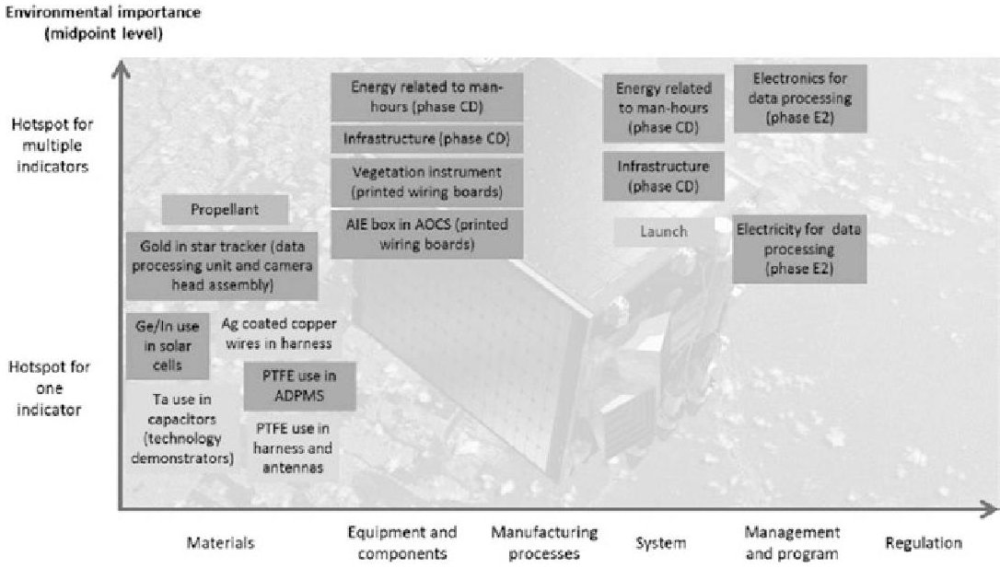

<!-- PDF_PAGE: 1 -->

# Ecodesign as a New Lever to Enhance the Global Value Proposition: From Space to Corporate

Kevin Le Blévennec, An Vercalsteren, and Katrien Boonen

Abstract As our technology-driven society is facing new environmental challenges, more and more companies' key decision-makers are committing to limit the impact of their products and services on the environment. While ecodesign approaches have shown the potential to increase companies' global value proposition, the integration of environmental parameters at an early stage of the design process will only be possible if such approach is tailored to a specific sector and customer expectations. To support environmental experts in charge of organizing the integration of such approach in the design process of complex engineering systems, VITO retrospectively analysed a project initiated by the European Space Agency (ESA), from a product strategy perspective. A transposable and replicable action-step methodology facilitating the creation of a common language and enabling the translation of environmental commitments into functional requirements is resulting.

## 1 Introduction

## 1.1 Principles of Responsibility Driving Stronger Environmental Commitments

Launched in 2000, the United Nations Global Compact (UNGC) is both a policy platform and a practical framework for companies that are committed to sustainable business practices. It seeks to align business operations and strategies everywhere with ten universally accepted principles in support of achieving the Sustainable Development Goals by 2030. Over 12,000 organizations around the world, including 9953 companies, have joined the UNGC. Principles number 8,9 and 10, respectively, mention that businesses should support a precautionary approach to environmental challenges, undertake initiatives to promote greater environmental

<!-- PDF_PAGE: 2 -->

responsibility and encourage the development and diffusion of environmentally friendly technologies [1].

Within this global context, the objectives set in the EU's seventh Environmental Action Programme, entitled 'Living well, within the limits of our planet', gave rise to a political focus on the circular economy. The resulting Circular Economy Action Plan includes several measures covering the whole material cycle, from production and consumption to waste management and the market for secondary raw materials. The proposed actions, highlighting the essential role of the private sector, aim to contribute to the transition to a circular economy by 'closing the loop' of product life cycles through an increase of recycling and reuse, benefiting both the environment and the economy [2].

By signing the UNGC, companies are committing to a deliberate, responsible approach to the protection of the environment. It is often reflected in a policy to reduce environmental impacts and risks in various activities of the company. Due to the environmental challenges that our society is facing, new stakeholders such as investors are getting concerned and involved. Not only to comply with this evolving political framework, many key decision-makers have considered their commitment to the UNGC as a driver of ambitious environmental policies shaping new opportunities in their business practices and enhancing their global value proposition. To reinforce their commitment, goals are set in terms of energy, climate, waste, environmental management of the supply chain and increasingly concerning product design. More and more companies are now committing to a responsible approach which aims at limiting the impact of their products and services on the environment.

The role of product design is a key in the transition to a circular economy; the effective implementation of those environmental policies now targeting products could thus accelerate this transition. By recirculating products instead of throwing them out, not only is the value of products and components retained, but also the demand for virgin materials decreases, as do the energy demand and the production of (hazardous) waste. Product design heavily influences a product's life cycle impacts and is crucial for connecting different stages and actors along the life cycle.

## 1.2 From a Commitment to an Effective Implementation?

In many sectors, the regulatory and normative contexts as well as the pressure of markets are leading more and more companies to deepen a process characterized by the integration of environmental parameters since the design of products. Since the 1990s, engineers and designers, in joint efforts and gradually enriched, have defined an approach to those environmental concerns: ecodesign also defined as design for environment but with the same meaning - 'design with environment' [3].

In many situations, ecodesign demonstrated its effectiveness. By implementing this activity, companies have managed to reduce their costs, access new markets, develop new partnerships and arouse new investors' interest. Not only reducing

<!-- PDF_PAGE: 3 -->

products environmental impact, it has been proved as a concrete source of industrial competitiveness [4].

While benefits might be multidimensional, many ecodesign approaches also showed some limits. Their integration within existing company practices is key. Only a few organizational tools exist and are with difficulty transposable from one company to another. Integration of environmental parameters needs to be done in a collaborative way and using suitable tools, chosen in function of the company's size, maturity regarding ecodesign and existing design processes. The one-off intervention as well as the development of tools and methods only intelligible by environmental experts has sometimes showed the limit of ecodesign integration within companies. When implementing ecodesign activities, a deep understanding of the current business context has also been listed as a key success factor [5-7].

## 1.3 Challenges Related to Constrained Engineering Environments

Many authors have emphasized the importance of the business context: the integration of an ecodesign approach is progressive and needs to be tailored to the company's sector and customer expectations. If effective ecodesign approaches have shown their effectiveness in mass-consumer goods producers, the situation is not so advanced in business-to-business industries, even less for companies developing complex engineering systems.

In sectors such as the space and aerospace sectors, many companies are developing and offering a range of solutions along the critical decision chain. Their activities are mainly referring to business-to-business and/or business-to-government with customers oriented towards security, reliability and performance. Those solutions are evolving in a complex environment requiring an integration of an important number of functionalities and constraints to face up to any events and ensuring customers' security. Due to a possible evolving customer demand during the design process or again due to high prototypes costs, concurrent engineering methodologies are applied to ensure the critical dependencies of defined functional requirements. Complexity of those solutions mainly implies that those organizations are characterized by multiple highly specialized experts who infrequently communicate together [8].

Driven by performance and technological considerations, those companies are part of highly competitive markets in which value creation is at the heart of the concerns. The previous limited number of customer requests with regard to ecodesign and the specificity of product development life cycles did not lead most of internal actors to collaborate and anticipate this environmental parameter integration into design processes. While ecodesign approaches have shown the potential to increase companies' global value proposition, the integration of environmental parameters in the design process can still be considered as a constraint by many key

<!-- PDF_PAGE: 4 -->

actors. The following research question is thus appearing: how to organize the integration of an efficient ecodesign into the current design process of complex engineering systems?

## 2 Retrospective Analysis of the GreenSat Project

## 2.1 Objective and Methodological Approach

In order to reduce the risk of inactions of companies evolving in constrained engineering environment which have committed to limit the impact of their products and services on the environment, or again limit divergent or unfinished actions within those companies, the objective of this research is to develop a methodology supporting environmental experts in charge of organizing the integration of an ecodesign approach into the current design process of the solutions developed by their company.

Being the archetype of a constrained engineering environment, a case study within the space sector has been selected. In the GreenSat project initiated by the European Space Agency (ESA), VITO was commissioned (together with QinetiQ) to identify and select ecodesign options for the PROBA-V mission. A brief introduction to this study, focusing on the different steps having enabled the achievement of the project rather than on the results themselves, is provided in Sect. 2.2. Those results were fully described in the final report of the study [9].

Based on this case study approach and within the framework of its 'design for the circular economy' strategic research activities, VITO has retrospectively analysed this project from a product strategy perspective. The learnings and outcomes are reported in Sect. 2.3.

## 2.2 Introduction to the GreenSat Project

PROBA (PRoject for On-Board Autonomy) is a family of small satellites developed for ESA by QinetiQ Space and launched in 2013. The PROBA-Vegetation (PROBA-V) mission, an earth observation mission, was selected as a continuation of the Vegetation programme. The main payload of the PROBA-V satellite is the Vegetation instrument. Through the GreenSat project, ESA wanted to evolve from assessment to reduction of environmental impact through the redesign of an existing satellite mission and to check the feasibility of implementing ecodesign in the development of future space missions.

In a first step of the GreenSat project, a life cycle assessment (LCA) has been performed with the following objectives:

<!-- PDF_PAGE: 5 -->

1. To identify environmental hotspots of the mission, which was considered as an important starting point to look for ecodesign options.

2. To quantify the environmental impact of the mission, to understand the impacts and the sources, which is a baseline to benchmark the environmental impact of the ecodesigned GreenSat mission and which allows to assess the environmental impact reduction.

Concerning the redesign of the mission, ESA identified initial requirements that would need to be adapted in case of a 'GreenSat' PROBA-V mission. In particular, the system should achieve equivalent function, meaning that the functional requirements should be almost all the same. As a consequence, while functional requirements should not be significantly different, design and operations requirements however could be significantly different.

The functional unit has been defined conforming to the space system LCA guidelines: 'one space mission in fulfilment of the mission's requirements'. The PROBA-V LCA includes all activities in the space and ground segment, but the launch segment was excluded. The life cycle impact assessment (LCIA) for PROBA-V was performed for the environmental impact categories and according to the defined LCIA methods as provided in the LCIA method in the ESA LCA database [10]. Given the relevance of critical materials use in space applications, an additional 'impact category (criticality - weighted)' that assesses the availability of raw materials, taking into account socio-economic constraints, has been defined.

Environmental profile of the PROBA-V mission was thus obtained. The LCA allowed identifying the environmental hotspots for the PROBA-V mission, which were considered most relevant to look at for the ecodesign exercise in the next study phase. Hotspots per mission phase were identified, and a distinction was made between the different levels the hotspot can relate to: materials, equipment and components, manufacturing processes, system, management and programmatic issues and regulation. If an environmental hotspot contributes to more than one impact category, its environmental importance was considered higher (Fig. 1).

As ESA has only little influence in the ground segment activities (e.g. energy use, data processing equipment), it was considered essential, and it has been decided to focus the ecodesign phase of the study on technologies where ESA has impact on. Starting from the identified environmental hotspots, ecodesign options for improving the environmental performance have been defined. For that, an external workshop was first organized at ESA concurrent design facility premises, with a wider group of stakeholders. Then an internal brainstorm was coordinated at QinetiQ Space, with experts specifically involved in the PROBA-V life cycle stages. A long list of ecodesign options was generated for space missions in general and PROBA-V in particular. As only a limited number of ecodesign options could be further developed in the framework of the GreenSat project, a selection process was applied to the full list of options.

As a first step, the analytic hierarchy process (AHP) methodology was used to select the 25 most promising options among the 70+ identified. AHP allows calculating weighting factors for the trade-off criteria, based on input from different

<!-- PDF_PAGE: 6 -->

Fig.1 Hotspots of the PROBA-V mission

stakeholders (brainstorm participants). Scores are then assigned to each ecodesign option by VITO and QinetiQ, which leads to a final ranking of all ecodesign options. This trade-off was based on specific criteria:

1. Solution implementation effort (cost, manhours, means)

2. Duration (time to market/launch)

3. Risk (feasibility, applicability, performance, availability of alternatives, flexibility)

4. Impact (operational cost)

5. Overall environmental impact

6. Reusability of the solution

7. Space relevance (technologies for the space segment, activities related to the space segment and their preparation that differ from other ground activities, system approach)

In a next step, a semi-quantitative analysis was done to assess the potential reduction of each option, leading to the down-selection of ten options. In a third step, an estimate of the required design and development effort and related environmental impact to estimate the risk of burden shifting was initiated, leading to the final selection of six options.

A technical assessment was then performed, and an analysis of the environmental effects was done by LCA. The analysis was done per option, at different levels (e.g. material, satellite production and mission). Finally, a combined analysis of the environmental impacts including the three most promising options, improved data processing, more sustainably produced germanium and optimized electronics, was performed to assess the overall reduction potential of the redesign of the PROBA-V mission.

<!-- PDF_PAGE: 7 -->

Overall, it was concluded that the implementation of ecodesign from the start of a space mission design and development process can actually reduce the environmental impact of the space mission significantly. It was recommended to focus efforts in a first instance on the environmental hotspots of a space mission as this leads to the largest improvements. Improvements are related not only to the satellite production but also to the operational phase of the satellite (e.g. data processing). In addition to a final report, the results have been summarized and communicated through an infographic.

## 2.3 Retrospective Analysis from a Product Strategy Perspective

VITO aims to accelerate the transition towards a circular economy by providing advice to companies. As product design is key for enabling circularity, VITO decided to capitalize on the achievement of the GreenSat project for developing a methodology supporting environmental experts in charge of organizing the integration of an ecodesign approach into the current design process of complex engineering systems. An internal brainstorm session between 'circular economy assessment methods and indicators' and 'design for the circular economy' VITO experts has been organized. The objective of this session was to bring face to face those two research perspectives in order to detect essential factors for the development of the methodology.

Outcomes of this brainstorm session have been summarized (Tables 1 and 2). Elements listed in the project perspective (Table 1) refer to a specific action undertaken during the GreenSat project, as described in Sect. 2.2. Corresponding elements in the product strategy perspective (Table 2) refer to a derived analogy between this specific action and identified key success factors for an effective implementation of an ecodesign approach, as introduced in Sects. 1.2 and 1.3.

## 3 A Transposable and Replicable Resulting Methodology

The retrospective analysis of the GreenSat project from a product strategy perspective allowed illustrating key success factors for efficiently implementing an ecodesign approach with concrete specific actions undertaken during a project within a constrained engineering environment. Based on those analogies (Tables 1 and 2), the creation of a common language ensuring the compatibility of the stakeholders' different sources of value creation appears to be essential for efficiently implementing an ecodesign approach. Necessary actions facilitating the creation of this common language thus originate from this analysis.

By organizing those necessary actions and generalizing some elements specific to the GreenSat project, the following action-step methodology enabling the creation of this common language has been developed (Table 3).

<!-- PDF_PAGE: 8 -->

Table 1 Outcomes of internal brainstorm session bringing face to face two research perspectives - part 1

<table border="1"><tr><td>Element</td><td>Project perspective</td></tr><tr><td>1.</td><td>[...] project initiated by the European Space Agency(ESA),VITO was commissioned by QinetiQ[...]</td></tr><tr><td>2.</td><td>[...] With the GreenSat project,ESA wanted to check the feasibility of implementing ecodesign in the development of future space missions[...]</td></tr><tr><td>3.</td><td>[...] The system should achieve equivalent function,meaning that the functional requirements should be almost all the same[...]</td></tr><tr><td>4.</td><td>[...] Conform to the space system LCA guidelines[...],[...] ESA LCA database[...],[...] Given the relevance of critical materials use in space applications,an additional‘impact category’[...] has been defined[...]</td></tr><tr><td>5.</td><td>Figure1 Hotspots of the PROBA-V Mission,[...] communicated through an infographic[...]</td></tr><tr><td>6.</td><td>[...] As ESA has only little influence in the ground segment activities(e.g.energy use,data processing equipment),it was considered essential,and it has been decided to focus the ecodesign phase of the study on technologies where ESA has impact on[...]</td></tr><tr><td>7.</td><td>[...] An external workshop was first organized at ESA concurrent design facility premises,with a wider group of stakeholders.Then an internal brainstorm was coordinated at QinetiQ Space,with experts specifically involved in the PROBA-V life cycle stages[...]</td></tr><tr><td>8.</td><td>Analytic Hierarchy Process(AHP) methodology</td></tr><tr><td>9.</td><td>Specific criteria used for the AHP methodology</td></tr><tr><td>10.</td><td>[...] Per option,a technical assessment was performed and an analysis of the environmental effects was done byLCA[...]</td></tr><tr><td>11.</td><td>[...] Implementation of ecodesign from the start of a space mission design and development process can actually reduce the environmental impact of the space mission significantly[...]</td></tr></table>

All these actions-steps are further explained:

1. The project was initiated by ESA which wanted to reduce the environmental impact of their product. ESA through the ESA Clean Space initiative supports the UNGC, having a Committee on the Peaceful Uses of Outer Space: 'States and international intergovernmental organizations should promote the development of technologies that minimize the environmental impact of manufacturing and launching space assets and that maximize the use of renewable resources and the reusability or repurposing of space assets to enhance the long-term sustainability of those activities' [11]. The commitment of key decision-makers is thus the real starting point of this project. To integrate environmental parameters at an early stage of a design process, it is essential to have the internal support of companies' key decision-makers. To convince them, it will be essential to demonstrate that the ecodesign approach will benefit the company's environmental strategy. Listing all environmental commitments associated with products and services is thus considered as a first step.

2. The GreenSat project reflected an efficient external collaboration between three main stakeholders. Based on identified environmental commitments associated

<!-- PDF_PAGE: 9 -->

Table 2 Outcomes of internal brainstorm session bringing face to face two research perspectives - part 2

<table border="1"><tr><td>Element</td><td>Product strategy perspective</td></tr><tr><td>1.</td><td>External collaboration between three stakeholders. ESA being the customer. QinetiQ being the industrial partner collaborating with VITO for their environmental expertise</td></tr><tr><td>2.</td><td>Description of the project objective showing a customer interested in the implementation of an ecodesign approach</td></tr><tr><td>3.</td><td>System driven by performance. While having the objective to reduce the environmental impacts, environmental and industrial sources of value creation should be compatible</td></tr><tr><td>4.</td><td>Tailoring of existing tools (guidelines, database, impact category) to a specific business context, i.e. space sector</td></tr><tr><td>5.</td><td>Intelligibility of results adapted to interested stakeholders</td></tr><tr><td>6.</td><td>Focus on customer sources of value creation</td></tr><tr><td>7.</td><td>Collaboration between highly specialized experts from different fields</td></tr><tr><td>8.</td><td>Use of a specific methodology for connecting highly specialized experts&#x27; inputs</td></tr><tr><td>9.</td><td>Criteria including parameters being source of value creation for all stakeholders: Customer, industrial, environmental</td></tr><tr><td>10.</td><td>Ensure the compatibility of industrial and environmental sources of value creation</td></tr><tr><td>11.</td><td>Early stage integration of environmental parameters</td></tr></table>

Table 3 Definition of an action-step methodology for organizing the integration of an efficient ecodesign approach

<table border="1"><tr><td>Number</td><td>Action step</td></tr><tr><td>1</td><td>List environmental commitments associated with products and services</td></tr><tr><td>2</td><td>Identify the right stakeholders</td></tr><tr><td>3</td><td>Understand individual value creation processes</td></tr><tr><td>4</td><td>Connect individual value creation processes</td></tr><tr><td>5</td><td>Deliver efficient messages</td></tr></table>

with products and services, it is essential to understand what expertise(s) and thus which stakeholder(s) will be required to collaborate for achieving those commitments. For instance, if a commitment refers to the use of a minimum recycled content for materials of specific products, involving the engineering teams, the marketing and/or the purchasing department might be relevant. If relevant expertise cannot be identified internally, involving the right external stakeholders is also determining.

3. The retrospective analysis highlighted that a factor for ensuring an external collaboration between highly specialized experts from different fields, with regard to the integration of environmental parameters, was to ensure the compatibility between different sources of value creation. In this case study, the search of ecodesign options was, for instance, reduced to ESA's scope of actions, and the AHP methodology was integrating parameters' source of industrial competitiveness but also benefiting the environment. Before ensuring their compatibility, it

<!-- PDF_PAGE: 10 -->

is thus essential to understand individual 'business languages' and how each of the identified stakeholders individually creates value for their company or own departments within an organization. An analysis of individual stakeholders' value creation processes is thus recommended.

4. Once individual stakeholders' value creation processes are understood, the objective is to ensure their compatibility. For that, there is a need to develop tailored tools and practices ensuring the creation of a common language between those stakeholders. ESA LCA guidelines and database are a concrete example. The space sector has unique characteristics like low production rates, long development cycles and specialized materials and processes, and the sector's activities create impacts on environments generally not considered in LCA. Issued in 2016, these guidelines aim to establish methodological rules for performing space-specific LCA. A methodology mostly used by environmental experts is thus tailored to a specific business context thus facilitating the communication and exchange of information with highly specialized engineers.

5. Also shown with the analysis of the GreenSat project, intelligibility of results was considered as determining in this collaborative process. The described matrix (Fig. 1) is, for instance, translating results often only intelligible by LCA experts into clear messages in a language perfectly intelligible for a system engineer. Once tailored tools and practices have been developed, it is thus key to ensure their effective use. The last step of this methodology thus emphasizes the fact that results need to be illustrated and intelligible for non-environmental experts. This last step is also a key for delivering convincing arguments to relevant stakeholders.

By following the different steps of this methodology, the translation of environmental commitments into functional requirements should be facilitated for environmental experts in charge of organizing the implementation of an efficient ecodesign approach into their companies.

## 4 Conclusion

This case study within the space sector demonstrated that implementing an ecodesign approach could enhance companies' global value proposition by ensuring a compatibility of stakeholders' sources of value creation during the integration of environmental parameters at an early stage of the design process. Originating from a retrospective analysis from a product strategy perspective of this space project, an action-step methodology supporting environmental experts in charge of organizing the integration of an ecodesign approach into the current design process of the solutions developed by their company has been defined. While arising from a case study in a constrained engineering environment, this methodology could be replicated in different sectors and applicable to external as well as internal collaborations. In a next applied research step, 'design for the circular economy' VITO experts aim to

<!-- PDF_PAGE: 11 -->

test and validate this methodology with different use cases to finally propose this methodology as a service, in order to support the private sector in accelerating the transition towards a more circular economy.

## References

1. https://www.unglobalcompact.org/what-is-gc/mission/principles. Accessed 14 Jan 2020.

2. European Commission. (2015). Closing the loop-An EU action plan for the circular economy. European Commission.

3. Abrassart, C., & Aggeri, F. (2002). La naissance de l'éco-conception. Du cycle de vie au management environnemental produit. Responsabilité et Environnement - Annales des Mines, 25, 14-63.

4. Charter, M. (1997). Managing eco-design. UNEP Industry and Environment, 20, 29-31.

5. Knight, P., & Jenkins, J. (2009). Adopting and applying eco-design techniques: A practitioners perspective. Journal of Cleaner Production, 17(5), 549-558.

6. Pascual, O., Boks, C., & Stevels, A. (2003). Communicating eco-efficiency in industrial contexts: A framework for understanding the (lack) of success and applicability of eco-design. In IEEE international symposium on electronics and the environment (pp. 303-308). IEEE Computer Society.

7. Domingo, L., Buckingham, M., Dekoninck, E., & Cornwell, H. (2015). The importance of understanding the business context when planning eco-design activities. Journal of Industrial and Production Engineering, 32(1), 3-11.

8. Cluzel, F., Yannou, B., Leroy, Y., & Millet, D. (2016). Eco-ideation and eco-selection of R&D projects portfolio in complex systems industries. Journal of Cleaner Production, 112(5), 4329-4343.

9. VITO. (2019). GreenSat TN4 - Assessment of selected ecodesign options. VITO.

10. European Space Agency. (2016). Space system Life Cycle Assessment (LCA) guidelines. European Space Agency.

11. United Nations. (2017). Guidelines for the long-term sustainability of outer space. Committee on the Peaceful Uses of Outer Space.

Open Access This chapter is licensed under the terms of the Creative Commons Attribution 4.0 International License (http://creativecommons.org/licenses/by/4.0/), which permits use, sharing, adaptation, distribution and reproduction in any medium or format, as long as you give appropriate credit to the original author(s) and the source, provide a link to the Creative Commons license and indicate if changes were made.

The images or other third party material in this chapter are included in the chapter's Creative Commons license, unless indicated otherwise in a credit line to the material. If material is not included in the chapter's Creative Commons license and your intended use is not permitted by statutory regulation or exceeds the permitted use, you will need to obtain permission directly from the copyright holder.

