<!-- PDF_PAGE: 1 -->

IFP/WKP/FGS(2011)4

MULTI-DISCIPLINARY ISSUES

INTERNATIONAL FUTURES PROGRAMME

## OECD/IFP Futures Project on "Future Global Shocks"

## "Geomagnetic Storms"

CENTRA Technology, Inc., on behalf of Office of Risk Management and Analysis, United States Department of Homeland Security

This report was written by Centra Technology, Inc. as a contribution to the OECD project "Future Global Shocks". The opinions expressed and arguments employed herein are those of the author, and do not necessarily reflect the official views of the OECD or of the governments of its member countries.

Contact persons:

Pierre-Alain Schieb: +33 (0)1 45 24 82 70, pierre-alain.schieb@oecd.org

Anita Gibson: +33 (0)1 45249627, anita.gibson@oecd.org

14th January 2011

<!-- PDF_PAGE: 2 -->

## ABSTRACT

The present paper considers prospects for a future global shock caused by an extreme geomagnetic storm and its effect on critical infrastructure for electrical power and satellite-enabled communications, navigation, and monitoring. Following a brief review of the phenomenon and selected risk assessment examples, the paper describes a "worst reasonable case" scenario, potential consequences, and the current state of efforts to mitigate vulnerabilities and consequences. Many such efforts are operational measures relying on adequate warning. In addition to operational and infrastructure hardening measures, mitigation opportunities exist in the form of international cooperation to address critical "bottlenecks" in the replacement of extra high-voltage transformers.

<!-- PDF_PAGE: 3 -->

## TABLE OF CONTENTS

ABSTRACT ... 2

EXECUTIVE SUMMARY ... 6

INTRODUCTION ... 7

Space Weather and Geomagnetic Storms ... 7

Severity ... 9

Timing ... 9

Geographic Distribution ... 10

Critical Infrastructure and Geomagnetic Storms ... 10

Macro Socioeconomic Trend: Growing Reliance on Interdependent Infrastructures ... 11

Notable Historic Geomagnetic Storms and Associated Consequences ... 12

The October–November 2003 Halloween Event ... 12

The 1989 Quebec Power Outage Event ... 13

The Carrington Event of 1859 ... 13

GEOMAGNETIC STORM RISK ASSESSMENT: STATE OF THE ART ... 14

Consequence Assessment ... 16

Vulnerability Assessment ... 17

Threat Assessment ... 18

Risk Assessment ... 20

Risk Mitigation ... 20

Summary of the State of the Art ... 21

INTERNATIONAL RISKS FROM A WORST REASONABLE CASE ... 21

Scenario Description ... 23

<!-- PDF_PAGE: 4 -->

Estimating Consequence ... 24

First-Order Consequences: Electric Power ... 25

Second-Order Consequences of Electrical Power Loss ... 30

First-Order Consequences: Communications (Satellite) ... 33

Second-Order Consequences of Communications (Satellite) Disruption ... 34

Other First-Order Consequences ... 34

Psychological Consequences: Social Unrest, Behavioral Changes, and Social Vulnerability35

Estimating Threat ... 39

Current Understanding of Risk ... 40

INTERNATIONAL RISK MITIGATION EFFORTS ... 40

Existing Management Structures and Regulations ... 41

Space Weather Monitoring and Prediction Cooperation ... 42

Industry-Specific Risk Mitigation Efforts ... 43

Electricity Transmission Industry ... 43

The Satellite Operator Industry ... 44

The Aviation Industry ... 45

Risk Mitigation Conclusion ... 45

Communicating Geomagnetic Storm Risk ... 46

THE IMPACT OF SELECT SOCIOECONOMIC CHANGES ON THE RISKS OF EXTREME GEOMAGNETIC STORMS ... 47

Smart Grids and Energy ... 48

Greater Transnational Electricity Distribution ... 48

NEXT STEPS FOR INTERNATIONAL RISK MANAGEMENT: ... 49

RECOMMENDATIONS ... 50

BIBLIOGRAPHY ... 54

LIST OF ACRONYMS ... 66

ENDNOTES ... 69

<!-- PDF_PAGE: 5 -->

## Tables

Table 1. Key Terms and Their Definitions ... 15

Table 2. Estimated Frequencies for Geomagnetic Storms of Different Magnitudes ... 19

## Figures

Figure 1. The Potential for Satellite Effects from a Geomagnetic Storm: Total Electron Content (TEC) from 30 October 2003 storm ... 8

Figure 2. Probability of a North American Event... 19

Figure 3. Responsibilities for Geomagnetic Storm Risk Management Based on Relative Probability and Geographic Range of the Estimated Effects ... 23

Figure 4. The Global Footprint of Geomagnetic Storm from April 2000... 24

Figure 5. Vulnerability of North American Electric Power Assets to Geomagnetic Storms ... 27

Figure 6. Vulnerability of Selected European Electric Power Assets to Geomagnetic Storms29

Figure 7. First and Second Order Critical Infrastructure Disruptions... 31

Figure 8. OECD Social Unrest Model ... 36

Figure 9. Ranking Table for Psychological Impacts... 37

Figure 10. Social Vulnerability – Average U.S. National Percentiles for Select Areas... 38

Figure 11. The 30 Most Intense Geomagnetic Storms from 1932 to 2003, Based on the Ap Index ... 39

Figure 12. Large Magnetic Storms from 1859 to 2003, Based on Horizontal Intensity ... 39

Figure 13. Solar Proton Events with Greater than 30 MeV Fluence from 1570 to 1950... 40

## Boxes

Box 1. Geomagnetic Storm Scales...9

<!-- PDF_PAGE: 6 -->

# EXECUTIVE SUMMARY

Over the last six years, natural hazards have caused catastrophic consequences across the globe. Tsunamis, hurricanes, flooding, earthquakes, and volcanic eruptions have led to hundreds of thousands of fatalities and billions of dollars in economic costs. Geomagnetic storms-a type of space weather-are much less frequent, but have the potential to cause damage across the globe with a single event. In the past, geomagnetic storms have disrupted space-based assets as well as terrestrial assets such as electric power transmission networks. Extra-high-voltage (EHV) transformers and transmission lines-built to increase the reliability of electric power systems in cases of terrestrial hazards-are particularly vulnerable to geomagnetically induced currents (GICs) caused by the disturbance of Earth's geomagnetic field. The simultaneous loss of these assets could cause a voltage collapse and lead to cascading power outages. As a natural event whose effects are exacerbated by economic and technological developments, geomagnetic storms pose a systemic risk that requires both domestic and international policy-driven actions.

As part of the OECD Future Global Shocks project, this case study on geomagnetic storms was undertaken to identify the strengths, weaknesses, and gaps in current international risk management practices. The literature on geomagnetic storm risk assessments indicates that the state of the art for assessing the security risk from this type of event is still inchoate. There are examples of analyses that describe threat, vulnerability, and consequence, but they are not integrated, primarily because of the weakness in the threat analysis. The lack of valid risk assessments has limited risk mitigation efforts in many critical infrastructure sectors, as it is difficult to demonstrate the utility of investing in either hardening or operational mitigation efforts, especially if these investments reduce time and money spent in preparing for more common risks.

To explore the risk to the international community, this report presents a platform to discuss the risk of geomagnetic storms by describing a worst reasonable scenario and its risk factors. Our analysis identifies areas with EHV assets that are in vulnerable locations due to latitude and ground conductivity, and examines the first- and second-order consequences of an extreme storm, highlighting those consequences with an international impact such as scarcity of surplus EHV transformers and satellite communication signal degradation. In addition to exploring the expected economic consequences of a geomagnetic storm event, the report also assessed psychological consequence in the form of social unrest, behavioral changes and social vulnerability. The potential for international consequences if an extreme event occurs are high, although the severity of those consequences can be mitigated if the international community takes certain actions in advance, such as investing in additional geomagnetic storm warning systems.

Geomagnetic storms can be categorized as a global shock for several reasons: the effects of an extreme storm will be felt on multiple continents; the resulting damage to electric power transmission will require international cooperation to address; and the economic costs of a lengthy power outage will affect economies around the world. As a global shock event, a severe geomagnetic storm, although unlikely, could lead to major consequences for OECD governments.

<!-- PDF_PAGE: 7 -->

# INTRODUCTION

The OECD has identified geomagnetic storms as having the potential to disrupt interdependent critical infrastructure sectors. This study focuses specifically on the risk that this form of severe space weather $ ^{1} $ may propagate disruptions on a global level, and cause secondary effects in other areas of society and the economy. Socioeconomic trends are increasing both the vulnerability to and the potential consequences of severe geomagnetic storms. Thus, the most severe geomagnetic storms, which are low-frequency/high-consequence (LF/HC) events, pose an increasingly important risk to modern society.

## Space Weather and Geomagnetic Storms

The Sun is the source of severe space weather. Large, violent eruptions of plasma and magnetic fields from the Sun's corona, known as coronal mass ejections (CMEs), are the origin of geomagnetic storms (National Academy of Sciences [NAS], 2008). CME shock waves create solar energetic particles (SEPs), which are high-energy particles consisting of electrons and coronal and solar wind ions (mainly protons). When CMEs head towards the Earth, these geomagnetic storms create disturbances that affect the Earth's magnetic field. It takes approximately two to three days after a CME launches from the Sun for a geomagnetic storm to reach Earth and to affect the Earth's geomagnetic field (NERC, 1990).

Disturbances in the Earth's geomagnetic field can disrupt the operation of critical infrastructures relying on space-based assets but also can result in terrestrial effects, including disrupting electricity distribution networks. Geomagnetic storms can affect a satellite's signal strength negatively, such as signals from satellites involved in the Global Positioning System (GPS) (NAS, 2008, 2009). Figure 1 shows the potential for GPS satellite effects by mapping the total electron content (TEC) of the October 2003 geomagnetic storm. The TEC of the Earth's ionosphere increases during a geomagnetic storm, which increases the density of the ionosphere and leads to signal propagation delays to and from satellites (Gubbins, et al., 2007). A value of 90 TEC units, for example, corresponds to a range delay of about 15 meters (Rao, et al., 2009).

<!-- PDF_PAGE: 8 -->

Figure 1. The Potential for Satellite Effects from a Geomagnetic Storm: Total Electron Content (TEC) from 30 October 2003 storm

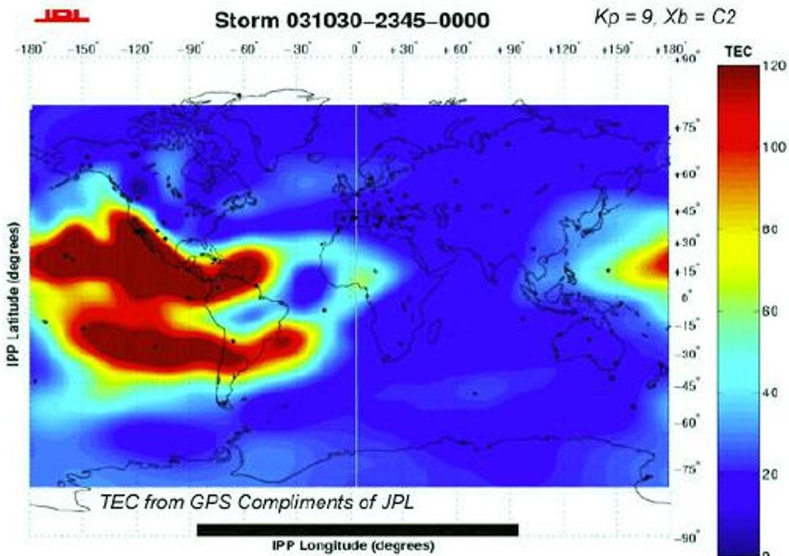

## Source: NOAA, 2004a

Critical infrastructures relying on this space-based asset can suffer disruption in the event of a geomagnetic storm. For instance, an international oil field services company experienced survey interference at its surveying and drilling sites during the October-November 2003 "Halloween" geomagnetic storm event (described later in the report) (NOAA, 2004a; NAS, 2009). Geomagnetic storms also can drive terrestrial effects. For instance, geomagnetic storms can cause ground induced currents (GICs) that can pose a threat to electric grids (NOAA, 2004a). To understand the effects of a severe geomagnetic storm, it is important to examine the severity, timing, and geographic distribution of the storm.

<!-- PDF_PAGE: 9 -->

## Box 1. Geomagnetic Storm Scales

There are several scales used to measure the severity of geomagnetic storms. The K and $ A_{k} $ indices are used to categorize the intensity of geomagnetic storms. The K values ranges from 0 to 9 and are based on the maximum magnetic field deviation during a 3-hour period. The $ A_{k} $ index values range from 0 to 400 for "a 24-hour index derived from eight daily 3-hour K indices" (Molinski et al., 2000). So-called "quiet" geomagnetic storms are classified with K values ranging from 0 to 4 and $ A_{k} $ values ranging from 0 to 20. A "minor" geomagnetic storm classification is based on a K value of 5 or $ A_{k} $ values ranging from 30-50. A "severe" geomagnetic storm is categorized using K values ranging from 7 to 9 and $ A_{k} $ values ranging from 100-400 (Molinski et al., 2000). Switching scales in 1999, the National Oceanic and Atmospheric Administration (NOAA) introduced the G scale, based on the planetary K index to measure the projected geomagnetic effects on physical infrastructure (Molinksi et al., 2000). A planetary K index, also known as a $ K_{p} $ is calculated for K indices observed at 13 stations, primarily in the Northern Hemisphere. The $ K_{p} $ indices are used to determine the ap index. The ap index is a mean amplitude of magnetic activity.

Source: NOAA, 2004a

## Severity

More severe storms are expressed with higher negative-value Dst indices. A severe geomagnetic storm is defined as any event with a Dst of less than -500 nanoTeslas (nT). In addition, geomagnetic storm intensity is frequently described in terms of positive nanoTeslas per minute (nTs/min). The Carrington Event of 1859 (described later in the report) was measured at -1760 nT (Lakhina et al., 2005). The Carrington storm was approximately three times as intense as the most severe geomagnetic storm of the past thirty years, the 1989 storm responsible for the Quebec power outage (also described later in the report). This geomagnetic storm registered at a Dst of -640 nT (Lakhina et al., 2005). The 2003 geomagnetic storm referenced in Figure 1 peaked at -410nT. No recorded geomagnetic storm since 1932 has exceeded -760 nT (Cliver and Svalgaard, 2004).

## Timing

At the start of a geomagnetic event, plasma emitting from the sun would register at -5 nT (Tsurutani and Gonzales 1993). The Carrington Event storm took 17 hours and 40 minutes to travel from the Sun to Earth, at a speed of 2380 km/s (Lakhina et al., 2005). In comparison, the 1972 geomagnetic storm took 14.6 hours to reach Earth at a speed of 2850 km/s, which is the fastest time recorded for a storm (Lakhina et al., 2005). When the storm reaches the Earth's magnetic field, it progresses through three phases, the initial phase, the main phase and the recovery phase. All three phases can affect infrastructure. The initial phase takes minutes to hours to complete and can emit a maximum of tens of nTs. The main phase can take between 30 minutes and several hours and produces negative hundreds of nTs. The duration of the recovery phase, which is the longest of the three, ranges from tens of hours up to a week and is the phase in which nT levels return back to normal (Tsurutani and Gonzalez, 1993).

<!-- PDF_PAGE: 10 -->

Higher nT/min measurements are directly correlated with higher GIC levels and the potential for corresponding surges in EHV lines and transformers (Kappenman et al., 2000). Severe geomagnetic storms at higher negative Dst levels can cause GICs to surge transmission lines in a short period of time. The 1989 geomagnetic storm took only one minute and ten seconds to approach the Quebecois electrical grid and interrupt it entirely (A.W.P. Thomson, et al., 2009)

## Geographic Distribution

Although higher geographic latitudes are more susceptible to geomagnetic storm activity than lower regions, damage from GICs have been witnessed in countries in lower latitudes, such as South Africa (Koen and Guant, no date) and Japan (Thomson et al., 2009). During the Carrington storm, auroral displays were observed at $ 2 3^{\circ} $ magnetic latitude North and South (Lakhina et al., 2005). Auroral sightings of the 1989 storm also were witnessed at lower magnetic latitudes around $ 2 9^{\circ} \mathrm{N} $ (Cliver and Svalgaard, 2004). In addition to affecting various regions of the world, GICs also can shut down numerous grids simultaneously on a regional or global scale (Thomson et al., 2009).

A more accurate model of GIC geographical prediction than solely charting latitudinal ranges would involve mapping ground conductivity data based on rock type, fluid content and mineral composition of each region. This modeling approach would involve three-dimensional, multi-layered mapping, as there is an association between higher GIC levels and areas with greater conductivity levels (Thomson et al., 2009).

In addition to mapping out regions based on geological conductivity to predict GIC distribution, a more influential factor on GICs involves changes in the Earth's magnetic field (Thomson et al., 2009). Together with ground conductivity, these magnetic field changes can generate electric fields which move GICs throughout electrical grids (Kappenman et al., 2000). GICs also are driven by currents from the earth's magnetosphere and ionosphere. Because at all latitudes GIC movements are strongly correlated with the rate of change over time of the Earth's magnetic field, the only way to anticipate GIC movements would be to predict magnetic field movements, but predicting changes in the magnetic field is presently very difficult to do (Thomson et al., 2009).

## Critical Infrastructure and Geomagnetic Storms

Geomagnetic storms can disrupt a number of different critical infrastructures. Electric power systems are particularly vulnerable to the effects of a geomagnetic storm, and are highlighted in this report. As geomagnetic storms reach the Earth's surface they cause the Earth's magnetic field to fluctuate, which in turn causes flows of electric currents through conductors at the Earth's surface. These GICs can flow through power transmission grids (as well as pipelines and undersea cables) and lead to power system problems (Kappenman et al., 2000). The severity of GICs for electric utilities is determined by the Earth's surface horizontal geoelectric field and the equipment operated at the electric utilities (Molinski et al., 2000).

Electrical power transmission networks face greater vulnerability to geomagnetic storms as they span longer distances to supply demand centers due to the use of high-voltage transmission lines to convey electricity over longer geographic distances (Kappenman and Albertson, 1990). This is because the longer distances make them better "antennas" to pick up the electrical currents induced by the geomagnetic storms. As a result of deregulation, international electricity trading has risen across Europe and North America. For example, in Western Europe, the deregulation and market integration of electricity has led to improved cross-border flows of electricity in the European Union (Ahvenniemi, 2005). The transportation of electric power over long distances has increased transmission networks vulnerability to GICs resulting from geomagnetic storms. For example, the

<!-- PDF_PAGE: 11 -->

northeastern region of the United States receives regular power transfers from Canada (Kappenman and Albertson, 1990).

GICs can overload electrical power grids, with recent estimates stating that 300 large EHV transformers would be vulnerable to GICs in the United States (NAS, 2008). $ ^{2} $ A map illustrating the locations of EHV assets in the United States is shown in the section on Estimating Consequence below. The NAS (2009) has reported that:

GICs can overload the grid, causing severe voltage regulation problems and potentially, widespread power outages. Moreover, GICs can cause intense internal heating in extra-high-voltage transformers, putting them at risk of failure or even permanent damage.

Damage to an EHV transformer from a GIC could take months to repair. Replacing EHVs would require significant time and incur significant cost. Replacement times for EHV transformers can reach as long as one year (Barnes and Van Dyke, 1990). Countries located in northern latitudes, such as Canada, the United States, and the Scandinavian nations, are extremely vulnerable to geomagnetic storms. Power systems located in these countries are more likely to experience significant GICs because of their location in the northern latitudes, the soil type (igneous rock) surrounding electrical infrastructure which is a somewhat better conductor, and the fact that transmission networks in these countries cover longer distances to the load center (an area that has high demand for power) (Kappenman and Albertson, 1990). Power systems located in the northern regions of the North American continent are extremely vulnerable because of their proximity to the Earth's magnetic north pole (Kappenman et al., 1990). Countries farther south also can be susceptible to geomagnetic storms but the severity of consequences is likely less than for those in the northern latitudes.

## Macro Socioeconomic Trend: Growing Reliance on Interdependent Infrastructures

The interdependency of critical infrastructures has grown significantly due to technological advances, such as the use of the Internet by both users and operators of the infrastructure. A geomagnetic storm that disrupts the electric power grid affects not only the energy sector but also all the other infrastructure sectors that rely on electricity to carry out their mission. This socioeconomic trend increases both the vulnerability to and the potential consequences of severe geomagnetic storms. In the past two decades, there has been an increased awareness of threats posed by geomagnetic storms to the interdependent infrastructures of modern society. Electric power, spacecraft, aviation, and GPS-based position industries are vulnerable to the effects of severe geomagnetic storms (Kappenman and Albertson, 1990). The NAS (2009) notes that:

During the century and a half [following the 1859 Carrington event], the growth of the electric power industry, the development of telephone and radio communications, and a growing dependence on space-based communications and navigation systems, the vulnerability of modern society and its technological infrastructure to space weather has increased dramatically.

While the immediate and direct impact of geomagnetic storms may be an electrical power outage, society's dependence on electricity has leading experts concerned about a long-term power outage for critical services (NAS, 2008). Once fuel for backup power runs out, resupply of fuel (e.g., through gasoline pumps) is reliant on electricity. A power blackout lasting longer than 72 hours could create long-term implications for interdependent public and private infrastructures. Such a long-term power outage could interrupt communication systems, stop freight transportation, and affect the operations of

<!-- PDF_PAGE: 12 -->

financial institutions. For example, during the 2003 blackout in the U.S., some retail banking operations were closed for the first two days of the blackout (Financial and Banking Information Infrastructure Committee, 2003). Additionally, emergency and medical systems could be strained and food supplies dependent on just-in-time delivery could face shortages (NAS, 2008). Leading experts on geomagnetic storms state that potential effects from major geomagnetic storms on the U.S. power grid could persist for multiple years and in turn, "could pose the risk of the largest natural disaster that could affect the United States." (U.S. House Homeland Security Committee, 2009).

Government agencies, along with international firms (construction, agricultural, oil and gas), use precision geolocation services reliant on GPS signals to carry out their operations. Geomagnetic storms can degrade the strength of and distort signals emitted by GPS satellites. The consequence of such a disruption is that GPS receivers "miss a user's exact location." For example, errors in location given by the GPS signal could affect positioning operations of deep-ocean drilling platforms, which could result in the platform changing its position and causing a drill line to break (NAS, 2008). Geomagnetic storms also have the potential to damage satellites permanently, but signal degradation is a more common consequence of this space weather phenomenon.

## Notable Historic Geomagnetic Storms and Associated Consequences

The following section details three major geomagnetic storms, the October-November 2003 "Halloween" event, the Quebec Power Outage of 1989, and the Carrington Event of 1859. These three historical severe geomagnetic storms illustrate the vulnerability of various types of infrastructure to geomagnetic storms, discuss which industries were affected, and indicate the potential for widespread disruption to interdependent critical infrastructures on a global scale.

## The October-November 2003 Halloween Event

From late October to early November 2003, large geomagnetic storms affected the power system infrastructure, the aviation industry, and satellite communications. In Sweden, the Sydkraft Group (a large power utility) experienced transformer problems, which led to a system failure and a subsequent power outage. (NOAA, 2004a).

During the October-November 2003 Halloween event, the international airline industry experienced communication problems on a daily basis, with significantly degraded communications at highlatitudes. The solar activity caused communication problems for ground and airline controllers and degraded high-frequency communications. As part of airline carriers' preventive measures against high solar radiation exposure levels and communication blackout areas, the carriers decided to reroute high-latitude flights, which cost airlines $10,000 to $100,000 per rerouted flight (NOAA, 2004a). The Federal Aviation Administration (FAA)'s GPS-augmented aviation navigation guidance was affected by the geomagnetic storms and the FAA could not provide GPS navigational guidance for approximately 30 hours (NAS, 2008).

The strong radiation storms caused the National Aeronautics and Space Administration (NASA) to issue a flight directive to its astronauts on the International Space Station, ordering them to take precautionary measures and suspend space walks. NASA's Goddard Space Flight Center Space Science Mission Operations Team reported that 59 percent of missions were affected by the geomagnetic storms during this time period. Following the October-November 2003 CME, the Japanese ADEOS-2 satellite lost contact with the Japan Aerospace Exploration Agency. The assessed damage to the ADEOS-2 satellite could be the major reason why it has not recovered since the incident. Similarly, the Cosmic Hot Interstellar Plasma Spectrometer (CHIPS) satellite computer went offline for 27 hours.

<!-- PDF_PAGE: 13 -->

## The 1989 Quebec Power Outage Event

On 13 March 1989, a geomagnetic storm affected Canadian and U.S. power systems, resulting in a major power outage for nine hours for the majority of the Quebec region and for parts of the northeastern United States (Molinski et al., 2000). The Hydro-Quebec grid's geographic location and its 1,000 km transmission lines to the load center made it susceptible to geomagnetic storms (Kappenman and Albertson, 1990). Central and southern Sweden also experienced power losses when GICs disrupted six 130kV power lines (Babayev et al., 2007). The GICs flowing through the power system severely damaged seven static compensators on the La Grande network in the Hydro-Quebec grid, causing them to trip or shut down automatically before preventive measures were possible (NERC, 1990). The loss of the compensators resulted in a system disturbance and severe equipment damage. The unavailability of new equipment to replace the La Grande network's damaged equipment prevented power restoration to the transmission network. The power delay was also due to the damaged equipment and load transfers at the distribution network level. While work was being conducted to bring power back to the Hydro-Quebec grid, the New Brunswick and Ontario power systems helped provide emergency assistance to Quebec. As power was restored to Hydro-Quebec, it received assistance from New England and New York systems as well as the Alcan and McLaren systems based in Quebec. The voluntary reduction of power use by industrial customers during the incident also helped Quebec to meet its power demands.

After nine hours, 83 percent of full power was restored but one million customers were still without electrical power (NERC, 1990). The total cost of the Hydro-Quebec incidents is estimated to be $6 billion. (Canada/OCIPEP, 2002). Since the incident, the Canadian government has set up protective measures at the Hydro-Quebec site, such as transmission line series capacitors, which cost more than $1.2 billion, to block GICs from damaging the system (Canada/OCIPEP, 2002).

## The Carrington Event of 1859

The most severe space weather event recorded in history is the Carrington Event of 1859. From 28 August to 4 September 1859, auroral displays, often called the northern or southern lights, spanned several continents and were observed around the world. A British amateur astronomer, Richard Carrington, recorded the solar outburst, a white-light flare, which was verified independently by Richard Hodgson in London. According to modern experts, the auroras witnessed were actually two intense geomagnetic storms. Across the world, telegraph networks experienced disruptions and outages as a result of the currents generated by the geomagnetic storms. In addition to disturbing the telegraph networks, operators in various locations disconnected batteries from their systems and used the current generated by the aurora to send messages (NAS, 2008). The economic costs associated with a catastrophic event similar to that of the Carrington Event could measure in the range of several trillion dollars (U.S. House Homeland Security Committee, 2009).

<!-- PDF_PAGE: 14 -->

# GEOMAGNETIC STORM RISK ASSESSMENT: STATE OF THE ART

Awareness of geomagnetic storms and their potential effects has grown in the past two decades, but a comprehensive understanding of the risks has proved elusive. One of the obstacles to productive discussions of the risks from space weather is inconsistent terminology. Although the literature contains analysis putatively on threat, vulnerability, hazard, and risk, most of the analysis on space weather focuses on potential consequences (Canada/OCIPEP, 2002; Shaw and Howes, 2001; Jansen et al., 2000). Although there are multiple definitions for risk, it is generally accepted that a risk assessment should endeavor to answer the three basic questions posed by Kaplan and Garrick (1981):

- What can happen?

- How likely is it to happen?

- What are the consequences if it does?

At a minimum, then, any discussion of the risk form space weather must address the likelihood of a significant space weather event occurring and then the potential unwanted outcomes. To establish a foundation for the discussion of the effect of space weather on infrastructure, this paper will use the terms and definitions found in Table 1 to describe the risks and their contributing factors. To assess the state of the art for risk analysis and risk management for space weather and its effects, the following sections address the literature for assessments of consequence, vulnerability, threat, risk, and risk mitigation.

<!-- PDF_PAGE: 15 -->

Table 1. Key Terms and Their Definitions

<table border="1"><tr><td>Term</td><td>Definition</td></tr><tr><td>Consequence</td><td>The effect of an event, incident, or occurrence, commonly measured in four ways, human, economic, mission, and psychological, but may also include other factors such as impact on the environment.</td></tr><tr><td>Criticality</td><td>The importance to a mission or function, or to continuity of operations.</td></tr><tr><td>Hazard</td><td>A natural or man-made source or cause of harm or difficulty.</td></tr><tr><td>Likelihood</td><td>The chance of something happening, whether defined, measured or estimated objectively or subjectively, or in terms of general descriptors (such as rare, unlikely, likely, almost certain), frequencies, or probabilities.</td></tr><tr><td>Mitigation</td><td>An ongoing and sustained action—implemented prior to, during, or after an incident occurrence—to reduce the probability of, or lessen the impact of, an adverse incident.</td></tr><tr><td>Risk</td><td>The potential for an unwanted outcome resulting from an incident, event, or occurrence, as determined by its likelihood and associated consequences; the potential for an adverse outcome assessed as a function of threats, vulnerabilities, and consequences associated with an incident, event, or occurrence.</td></tr><tr><td>Risk Management</td><td>The process of identifying, analyzing, assessing, and communicating risk and accepting, avoiding, transferring or controlling it to an acceptable level considering associated costs and benefits of any actions taken.</td></tr><tr><td>Scenario</td><td>A hypothetical situation comprised of a hazard, an entity impacted by that hazard, and associated conditions including consequences when appropriate.</td></tr><tr><td>Threat</td><td>A natural or man-made occurrence, individual, entity, or action that has or indicates the potential to harm life, information, operations, the environment and/or property. For the purpose of calculating risk, the threat of an intentional hazard is generally estimated as the likelihood of an attack being attempted by an adversary; for other hazards, threat is generally estimated as the likelihood that a hazard will manifest.</td></tr></table>

<!-- PDF_PAGE: 16 -->

<table border="1"><tr><td>Vulnerability</td><td>A physical feature or operational attribute that renders an entity, asset, system, network, or geographic area open to exploitation or susceptible to a given hazard; a qualitative or quantitative expression of the level to which an entity, asset, system, network, or geographic area is susceptible to harm when it experiences a hazard.</td></tr></table>

Source: DHS (U.S. Department of Homeland Security) (2010), Risk Lexicon.

## Consequence Assessment

The literature primarily refers to economic consequences when discussing geomagnetic storms. There are additional consequence factors, such as psychological consequences, that will be discussed later in the report. One of the simplest ways to assess consequence is to aggregate insured losses. The insurance industry tends to evaluate natural hazards from this perspective and this is reflected in the 2000 Swiss Re report on space weather (Jansen et al., 2000). Although the report identifies a series of potential losses, the clearest estimates are of past incidents that involved the loss of an insured asset, such as communication satellites. A similar approach typifies the first step of economic cost estimates of effects on the energy sector. These begin by assigning monetary values to assets that require replacement due to the geomagnetic storm and the "replacement energy cost" to a region given that it cannot produce electric power for a short period of time and must purchase it from other providers.

Replacements costs are ultimately a very small contributor to the estimates of the overall costs from power outages. These estimates include a rough estimate of costs for "unserved demand," usually a monetary value for a standard energy unit (kilowatt hour, kWh) multiplied by the expected demand (Barnes and Van Dyke, 1990). The monetary values are not the current market value of a kWh, however, but a higher estimate that typically is based either on assumptions of loss-lost income, food spoilage, lost production, overtime wages, and opportunity costs for services (Electricity Consumers Resource Council, 2004)or consumers' willingness to pay to avoid a power outage. Willingness to pay models usually are based on surveys of consumers and can produce values of 10 to 100 times the market price for a kWh (Sanghvi, 1982).

Willingness to pay is a useful metric in that it takes into account aversion to loss in addition to the inherent value of an asset or service, but it is an estimate of perceived value rather than a true value in a market or actuarial sense (Jennings and Jennings, 2000). Willingness-to-pay models also can be skewed by participants' emotions and the perception of probability rather than rationale choices or objective probabilities (Sunstein, 2003). Although they provide some insight into the public's perception of the losses, estimates based on willingness-to-pay models represent an inflated value over actual economic losses. The upper bound for the estimate of the Northeast power outage of August 2003, for example, was based on a willingness-to-pay value of 120 times the average price per Megawatt hour (MWh), with no allowance for fluctuation in demand in the hours within the power outage (ICF, no date). Discrepancies in assumptions or the value used for willingness to pay account for the billions of dollars' differences in estimates of the same large-scale event (such as the Northeast power outage of August 2003). Such estimates are useful in that they all fall within the same order of magnitude and allow a common view of the societal costs of an event, but they are a poor substitute for an actual estimate of economic costs for an event. At a minimum, they fail to consider industry attempts to recover lost production, deferred consumer spending, intra-sector transfers of production, or increased spending as a result from the equipment losses (Ghaus-Pasha, 2009; Joo et al., 2007).

<!-- PDF_PAGE: 17 -->

An alternate approach to assessing the consequences of a geomagnetic storm is to avoid cost estimation and focus on the effect within a sector of infrastructure. There are three clear examples of approaches to take. The first details all the potential effects on the types of components within an electric system (including production, transmission, and distribution). The 1991 study prepared by Oak Ridge National Laboratory used this approach to document past problems encountered in various types of equipment (Barnes et al., 1991). The report acknowledged that these problems could cause degradation or disruption of service, but did not provide an estimate of scenario-specific consequences. The second approach goes a step further to describe the anticipated effects of a geomagnetic storm on the components of a system. In a 2002 assessment of the electric power transmission system of the mainland United Kingdom, the consequences for multiple scenarios that varied by storm severity and location of the electrojet (flows of electric current in the Earth's ionosphere) were expressed as estimates for reactive power losses (Erinmez et al., 2002). Such an analysis provides information on the reactive reserve power requirements for a power system, but does not forecast whether the system can or cannot sustain such an event and maintain service. The third approach is to make that determination of continuity of service. Kappenman (2007) illustrated the potential effects of a geomagnetic storm of the estimated severity of a May 1921 storm. In that simulation, a geomagnetic storm was estimated to have introduced 4,800 nT/min at 50 degrees geomagnetic latitude, creating exceedingly large demand for reactive power to maintain voltage in the transmission system (over 100,000 megavolt-ampere reactive [MVAR]). This, in turn, could lead to "probable large-scale voltage collapse" and "major power grid blackout." (Kappenman, 2007). North American Electricity Reliability Corporation (NERC) (2010) drew from the 2007 Kappenman analysis and stated that a severe storm "could entail the potential for widespread damage to EHV transformers," which could lead to "prolonged restoration and long-term chronic shortages of electricity supply capability."

Estimates of consequence to other infrastructure sectors follow similar patterns. They can list any potential effects, provide scenario-specific changes in operating parameter, or describe the effects on services or missions. They can estimate economic costs by focusing on replacement costs of affected hardware or they may attempt to provide a larger economic cost estimate that incorporates other direct or indirect costs. Those that simply list potential effects are the most common and exist for multiple infrastructure sectors (Koskinen et al. 2001; Lanzerotti, 2007; Bedingfield et al., 1996; Jansen et al., 2000).

## Vulnerability Assessment

The March 1989 geomagnetic storm led to new interest in the vulnerability of the electric power infrastructure to space weather in general and GICs more specifically. The 1991 study prepared by Oak Ridge National Laboratory identified some important vulnerability factors, noting that storm severity by itself was a poor indicator of whether a geomagnetic storm would have an effect on electric utility systems. Ground conductivity played an important role, as did the direction of EHV lines because magnetic field fluctuations generally flow in an east-west direction (Barnes et al., 1991). Similarly, researchers concluded that longer EHV lines are exposed to larger GICs, and that equipment in more northern latitudes was most likely to be affected. A 2000 study divided vulnerability into two categories: 1) the planet's surface geoelectric field, and; 2) the type and configuration of the equipment (Molinski et al., 2000). The geoelectric field is based on the ground's conductivity and proximity to the polar auroral zone. Equipment susceptibility is based on the directional orientation of the transmission lines, their lengths, the electrical Direct Current resistance of the transmission conductors and transformer windings, the transformer type and mode of connection, and the method of station grounding and resistance (Molinski et al., 2000). These considerations are consistent components of vulnerability analysis for individual systems or larger interconnections.

<!-- PDF_PAGE: 18 -->

The vulnerability factors differ for other industries, but latitude is a common consideration. The aviation industry, for example, is concerned primarily with risks during high-latitude (above 50 degrees) and polar operations (above 78 degrees). For satellite systems, the equatorial region has the highest potential for ionospheric irregularities (American Meteorological Society, 2007). For satellite communications, latitude is an important factor in total electron count density (along with altitude and time of day), which in turn is a major component of vulnerability to interference and delays of signals (NAS, 2008). Infrastructure sectors outside the energy sector do not have similar scenario-based vulnerability frameworks, complicating cross-sector analysis.

## Threat Assessment

French (2007) notes that to make an informed decision on any type of risk, an organization requires some consideration of the frequency of an unwanted event (such as for a natural hazard) or indicators that an event may occur (such as for a terrorist attack). The lack of a framework to assign any type of value or relative assessment of geomagnetic storms is a major weakness in the current state of the art. The Oak Ridge National Laboratory study (Barnes et al., 1991) acknowledged the lack of insight into threat information. It describes the 11-year cycle of geomagnetic disturbances that gives some insight into when to expect peak solar activity, but cautions that "no accurate method is presently available to predict either the onset or the magnitude of a geomagnetic disturbance." In his analysis of the U.S. electric power sector, Kappenman (2007) stated that a geomagnetic storm of the estimated severity of a May 1921 storm is "not a zero probability event." Although the statement is true, it does not provide meaningful insight to decision makers who must weigh various risks and investments in risk mitigations. Molinski and colleagues (2000) attempted to put a frequency on severe geomagnetic events over a "whole 22-year solar cycle" based on latitude. They estimated the probability of occurrence "ranges from two-tenths of a percent in northern latitudes to two-thousandths of a percent in, for example, the southern regions of the United States" (see Figure 2, below). Molinski's definition of "severe," however, is greater than 300 nT/min, below the severity of the March 1989 geomagnetic storm (480 nT/min) and more than an order of magnitude below the severity required for the consequences in the United States estimated by Kappenman in his 2007 analysis.

Without a quantitative or qualitative approach to comparing the potential threat of geomagnetic storms to other phenomena, it is exceedingly difficult for any organization or nation to assess the risks to meaningfully inform strategic policy and planning decisions. While Love and Gannon (2009) have modeled data from 1958 to 2007 to develop estimated frequencies for geomagnetic storms of different magnitudes (see Table 2, below), they note that " [w]ithout the compilation of disturbance storm time (Dst) statistics from a longer time span, it is difficult to say" whether these estimates are reasonable. Note also the difference in units between Dst in nT, and dB/dt in nT/min, in describing storm severity. The disturbance storm time (Dst) index measures the intensity of geomagnetic storms in nanoTesla (nT) units. DB/dt, which is measured in nanoTesla units/ per second (nT/s), tracks the changing rate of the B-field, which is the magnetic component of the electromagnetic field (Balch, undated).

<!-- PDF_PAGE: 19 -->

Figure 2. Probability of a North American Event

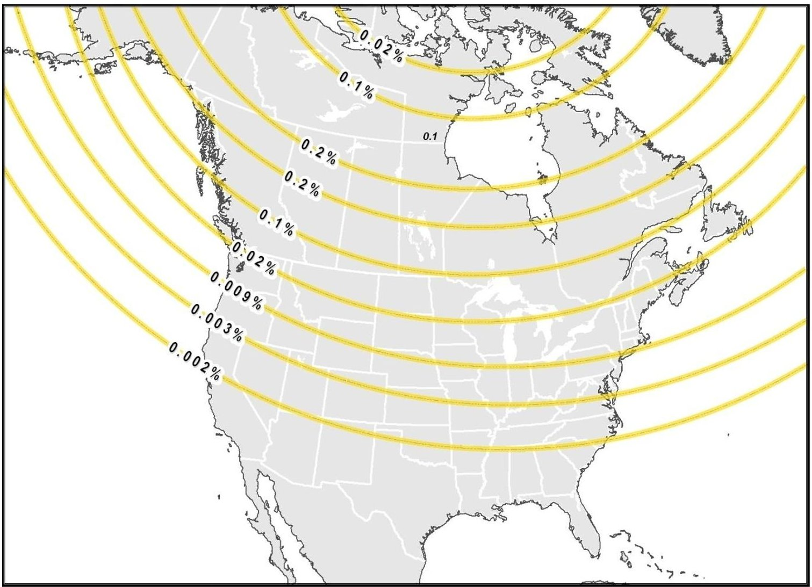

Source: Molinski et al. (2000)

Table 2. Estimated Frequencies for Geomagnetic Storms of Different Magnitudes

<table border="1"><tr><td>Strength of the Storm(nanoTesla)</td><td>Frequency</td></tr><tr><td>&gt;100</td><td>4.6 per year</td></tr><tr><td>&gt;200</td><td>9.4 per 10 years</td></tr><tr><td>&gt;400</td><td>9.73 per 100 years</td></tr><tr><td>&gt;800</td><td>2.86 per 1,000 years</td></tr><tr><td>&gt;1,600</td><td>7.41 per 1,000,000</td></tr></table>

Source: Love and Gannon (2009)

<!-- PDF_PAGE: 20 -->

## Risk Assessment

The lack of a valid threat assessment precludes a true risk assessment. There are, however, some very valuable analytic reports that allow decision makers to examine the issue of geomagnetic storm risk. One of the first was the Oak Ridge National Laboratory study (Barnes et al., 1991) that documented past problems encountered in various types of equipment. Although it does not produce an actual threat assessment (as discussed above), the report describes geomagnetic storms in relation to the 11 year sun spot cycle with a predictable peak in activity. The report then describes vulnerability factors and potential consequences. The general conclusions are that the vulnerability of U.S. electric grid connections likely will rise due to the trends in industry and increasing use of EHV equipment that is essential in modern electric power transmission.

Molinski and colleagues (2000) examined the risk to U.S. and Canadian electrical grid connections and provided some valuable contributions to the field. By displaying probability and vulnerability geographically, the analysis provided one approach for urban areas to consider the likelihood of an event. In Molinski's maps, Montreal, Ottawa, Quebec, and Vancouver, for example, fall into regions of high conductivity and in between probability bands of 0.02 and 0.1 percent of a storm within a 22 year cycle that introduces changes in the magnetic field of more than 300 nT/min. Boston, New York, and Seattle are also in regions of high conductivity, but within a lower probability band (between 0.02 and 0.009 percent). Molinski also compares this likelihood to other natural hazards, such as wind and ice storms, which are much more common (relatively). The analysis also explores consequences and the potential for voltage collapse in extreme scenarios. Like the Oak Ridge report, it does not attempt to combine the risk factors, but it does discuss them sequentially, providing a general framework for discussing the issue.

The 2002 assessment of the UK mainland grid by Erinmez and colleagues followed a similar pattern but provided much more insight into operational risks. This assessment incorporated the vulnerability components that the strategic assessments identified by determining regional ground conductivity and then mapping the electric transmission system to identify susceptible equipment. The team then used four scenarios of storm severity and simulated grid performance in those conditions. This allowed the team to calculate GIC strength and estimate MVAR demand. The result was a scenario-by-scenario estimate of the reactive power reserve requirements for various storm scenarios. Unfortunately, this lacked any differentiation by likelihood of the scenarios, but the results were useful nonetheless in that they provided decision makers with the potential severities of the consequences given an occurrence and the assessed vulnerability of the system.

## Risk Mitigation

The literature on mitigating risk of geomagnetic storm effects on electric power systems is very consistent, focusing on two basic methods of reducing either the vulnerability or the consequence. The first risk mitigation method is hardening; the second is operational procedures. In recent testimony to the U.S. Congress, William Radasky and John Kappenman described the potential for both (U.S. House Homeland Security Committee, 2009). Electric power utilities can harden their systems against GICs through passive devices or circuit modifications that can reduce or prevent the flow of GICs. Hardening is most effective for critical transformers that play a major role in power transmission, are very expensive, and difficult to replace. As mentioned in the "Notable Historic Geomagnetic Storms" section earlier in the report, the Canadian government has set up hardening measures such as transmission line series capacitors that cost more than $1.2 billion in Canadian dollars (Government of Canada, 2002). Operational mitigations are actions taken to minimize potential exposure to GICs, such as taking assets off-line, maintaining real-time situational awareness,

<!-- PDF_PAGE: 21 -->

and reacting aggressively to developments to avoid voltage collapse. Operational mitigations tend to cost far less than hardening but rely on warnings, alerts, monitoring devices, and proper execution of plans and procedures.

Barnes et al. (1991) in the Oak Ridge National Laboratory report described these same basic mitigation methods. Although a more limited selection of GIC-blocking devices were available and operational strategies were relatively new (based largely on the March 1989 storm) these two mitigation approaches have been the foundation for geomagnetic risk management for the past two decades. The literature for risk mitigation in other sectors parallels that of the energy sector. Analyses of other sectors that may be affected by geomagnetic storms such as the communications sector, describe potential consequences as well as potential hardware designs that allow equipment or vehicles to withstand a geomagnetic storm, or operational procedures that reduce exposure and help limit effects.

## Summary of the State of the Art

The literature indicates that the state of the art for assessing the security risk from geomagnetic storms is still in development. There are examples of analyses that describe threat, vulnerability, and consequence, but they do not integrate them, primarily because of the weakness in the threat analysis. Some elements of these strategic assessments—specifically the use of probability to describe the threat of geomagnetic storms—hold promise, and the scenario-based assessment used by Erinmez and colleagues provides a solid foundation for addressing risks to the electric infrastructure, as well as cascading effects. The literature does not reveal similar efforts for other sectors of infrastructure, which tend to rely on ad hoc consequence assessments to provide insight into the potential risks from geomagnetic storms. The lack of valid risk assessments in some ways has limited risk mitigation efforts. Without a sense of the likelihood of such events or at least a mechanism for relative comparisons, cost-benefit analyses have been unable to demonstrate the utility of investing either in hardening or in testing and maintaining operational procedures, especially if these investments reduce investments in preparing for more common risk, such as ice storms. The lack of scenario-based analyses in sectors other than electric power has limited the ability to perform multi-sector analysis and obtain a more thorough understanding of the operational constraints that nation or region may encounter in response to a major geomagnetic storm, and therefore represents a severe impediment to response planning.

<!-- PDF_PAGE: 22 -->

# INTERNATIONAL RISKS FROM A WORST REASONABLE CASE

To understand the risks geomagnetic storms pose to the international community and determine whether investments beyond current levels are warranted, decision makers need to establish a context to provide the parameters for assumptions, analysis, and discussion. Although much of the literature addresses extremely severe storms, the beginning of any discussion must acknowledge that storms of different severity occur with different frequencies and that there are generally accepted, if unstated, expectations for the types of organizations that are responsible to manage these risks. Most geomagnetic storms are quiet or minor, but even these have some effects, if only by increasing wear and fatigue in electric or electronic equipment. Utilities and infrastructure operators are expected to address these risks through monitoring, maintaining equipment, and rapid responses should outages occur. Past events (the March 1989 Quebec storm in particular) have caused more acute damage to equipment, which in turn had an effect over a geographic region, as opposed to localized effects.

Infrastructure operators have the responsibility for incident management and play the lead role in response. A few governments have taken steps to support industry in managing these risks by investing in high-cost monitoring to assist with warnings and alerts (for a detailed discussion, see section on "International Risk Mitigation Efforts," below). The evidence of worse storms that predate modern infrastructure indicates that there is a risk of extremely severe storms that have the potential to cause damage on a continental or global scale. The consequences of such an event would require international cooperation for response and restoration.

To support international examination of this issue and assist the OECD in establishing a platform to discuss the risk of geomagnetic storms in depth, the following sections describe a potential scenario that would fall into this last category (see Figure 3) and its risk factors. Figure 3 also helps illustrate that geomagnetic storms pose a systemic risk as defined by OECD, natural events whose effects are exacerbated by economic and technological developments, and which require both domestic and international policy-driven actions to address. (OECD, 2010)

<!-- PDF_PAGE: 23 -->

Figure 3. Responsibilities for Geomagnetic Storm Risk Management Based on Relative Probability and Geographic Range of the Estimated Effects

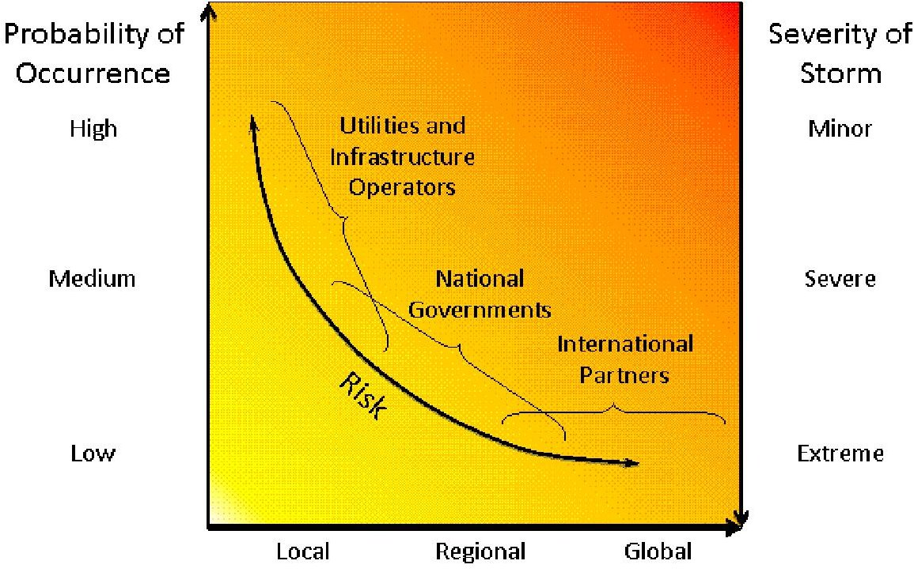

Geographic Range of Effects

Source: original to this document

## Scenario Description

As discussed above, an extreme geomagnetic storm would affect the northern latitudes most. A geomagnetic storm that occurred in April 2000 illustrates the geographic range of a severe storm, touching North America, Europe, and Asia (see Figure 4). This storm produced magnetic field variations of 348 nT/min and 8 A GICs, but did not have a significant effect on electric power systems. Using the basic framework in Figure 3, this storm represents a "severe storm" (defined by Molinski and colleagues as greater than 300 nT/min) and a case in which government warning assisted tactical preparation by the local utilities. For multinational effects, the threshold for severity of the storm must be larger. As a simplifying assumption, let us define "extreme" storms as the following:

An extreme storm is a storm that produces magnetic disturbances of an order of magnitude stronger than a severe storm (3,000 nT/min), extending the geographic area that can be affected and the potential for physical damage to EHV equipment.

Kappenman in 2007 has described storms that have peaks between 3,000 and 5,000 nT/min as plausible. Therefore, our reasonable, worst-case scenario is: a storm of a maximum strength of 3,000 nT/min at 50 degrees geomagnetic latitude. $ ^{3} $ Using our definition of an extreme storm, we assume that a 3,000 nT/min storm would represent a K-9 level storm, an $ A_{k} $ level of 400 and a G-5 extreme score on the NOAA scale (see Box 1, "Geomagnetic Storm Scales" in the Introduction).

<!-- PDF_PAGE: 24 -->

Figure 4. The Global Footprint of Geomagnetic Storm from April 2000

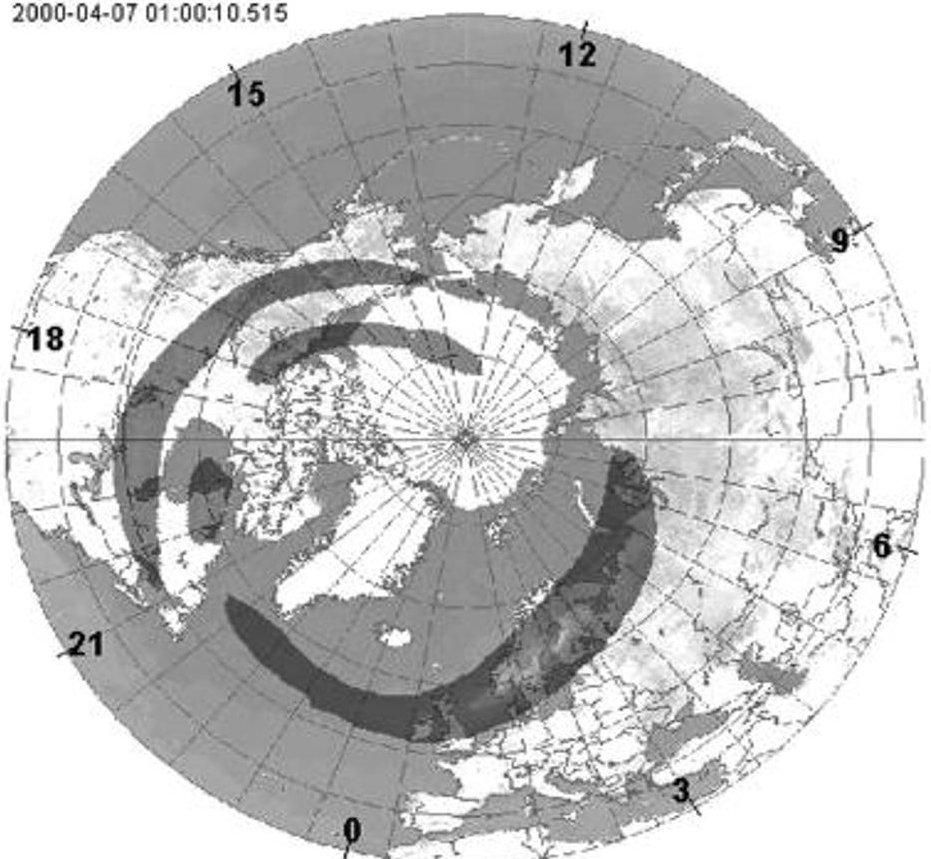

Fig. 8. Global footprint of electrojet predicted by the forecasting system at 01:00UT on 7th April 2000.

Source: Erinmez et al., 2002

## Estimating Consequence

The consequence assessment for this scenario considered economic, casualty, and psychological impacts, as well as potential disruptions of critical infrastructure. The impact of such a scenario would primarily be economic, due to replacement costs from damaged or destroyed assets (e.g., electrical power transformers and satellites) and from the costs associated with the disruption of critical infrastructure and industry. The potential for loss of life is low in this scenario, restricted to indirect loss of life associated with the loss of electricity and the resulting cascading effects on other critical infrastructures. The loss of electricity could cause mass transit and passenger rail systems to fail and traffic signals to stop working, both situations where accidents could ensue. The loss of refrigeration could affect those who rely on medications that must be kept cold. Water shortages due to the failure of electrical pumps to convey the water or power the purification plants could also lead to acute exposure to toxicants or disease. Firefighters would not have access to water to put out fires and hospitals would not have access to water to take care of at-risk patients. In each case, however, other circumstances beyond a geomagnetic event are necessary to lead to injury, illness, or death.

In many ways, the first- and second-order effects on infrastructure are the cause of the economic costs, the potential for indirect loss of life, and the disruption of essential societal missions. To further examine the consequences of the scenario, therefore, the following sections identify these cascading consequences and highlight those with international implications. Without the ability to run a complex simulation, the authors based these cascading consequences on historical examples and existing analyses. Analysis indicates an extreme geomagnetic storm scenario would result in first-

<!-- PDF_PAGE: 25 -->

order consequences for eight critical infrastructure sectors and sub-sectors (as categorized by the U.S. Department of Homeland Security):

1. Communications (Satellite)

2. Communications (Wireline)

3. Energy (Electric Power)

4. Information Technology

5. Transportation (Aviation)

6. Transportation (Mass Transit)

7. Transportation (Pipeline)

8. Transportation (Rail)

The most significant effects from past events have occurred in the electric power sector; subsequently, most of the analyses of potential future events also have focused on electric power. For these reasons and due to the fundamental role electric power plays in supporting the other sectors of infrastructure as well as the general population, this assessment will begin by examining the potential effects to electric power before describing effects in other sectors.

## First-Order Consequences: Electric Power

The damage or loss of transformers and the resulting power grid outages are direct, or first-order consequences of an electric power disruption due to a geomagnetic storm, leading to widespread outages. A severely damaged transformer generally cannot be repaired in the field and may need to be replaced with a new unit, which often have manufacture lead times of 12 months or longer (NAS, 2008). The large transformers that support heavy transmission lines can cost in excess of $10 million each (Marusek, 2007). The March 1989 blackout in Quebec and the October-November 2003 outages of electric power equipment in the northeastern United States are clear examples of the impact of a severe space weather event on the electric power industry. According to a study by Metatech Corporation, an event like the great geomagnetic storm of May 1921 would result in large-scale blackouts affecting more than 130 million people in the United States and exposing more than 350 EHV transformers to the risk of permanent damage (NAS, 2009).

The economic impact of the loss of such critical infrastructure would be high; the lowest estimate of the economic costs to the United States of the August 2003 blackout in North America (not due to an extreme geomagnetic storm, whose consequences would be worse) is $6 billion U.S. dollars (U.S.- Canada Power System Outage Task Force, 2004). The blackout resulted in the loss of 61,800MW of electric load serving more than 50 million people on both sides of the U.S.-Canada border (U.S.- Canada Power System Outage Task Force, 2004). Nearly half of the Canadian economy is located in Ontario and was affected by the blackout. Most areas were fully restored within two days, although parts of Ontario experienced rolling blackouts for more than a week before full power was restored (Electricity Consumers Resource Council, 2004).

The worst consequence from the 1989 geomagnetic storm was the voltage collapse (a progressive and uncontrollable decline in voltage) that caused the power outage in the Hydro Quebec system, affecting most of the province of Quebec. An extreme geomagnetic storm could create worse effects. GICs that destroy EHV transformers and therefore cause a transmission system to lose voltage or that cause a sudden loss of reactive power can lead to voltage collapse, potentially leading to cascading power outages. Although a voltage collapse did not cause the 2003 Northeast power outage, the chain of events would be similar due to the simultaneous loss of key assets. NERC (2010) states that an extreme geomagnetic storm could result in the loss of "multiple major transmission lines, which could cause widespread outages."

<!-- PDF_PAGE: 26 -->

There are many factors that influence the probability of transformer loss, reactive power needs, and voltage collapse in the event of such a storm, but the loss of a percentage of EHV step-up transformers near generation plants almost certainly would cause generated power to be suddenly unavailable for transmission and distribution, leading to instability in the grid. Because lines of over 345 kV are the least resistant to GICs and transformers of 345 kV and larger will consume proportionally the largest amounts of reactive power, our analysis will focus on those assets (NERC, 2010). The map below (Figure 5) displays those assets in North America, as well as regional conductivity and the areas of geomagnetic disturbance. Regions with high ground conductivity above the geomagnetic latitude of 50 degrees (demarked by the orange line in Figure 5) are most susceptible to GICs.

<!-- PDF_PAGE: 27 -->

Figure 5. Vulnerability of North American Electric Power Assets to Geomagnetic Storms

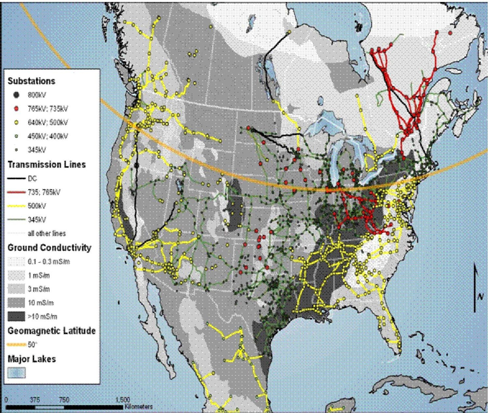

Source: Transmission Lines and Substations, HSIP Gold (2010); Ground Conductivity, World Atlas of Ground Conductivities (1992)

<!-- PDF_PAGE: 28 -->

Figure 5 above shows a small number of North American EHV assets that fall within the area of likely greatest geomagnetic disturbance or the regions of highest regional conductivity (or both), and where we would expect the most severe consequences, while Figure 6 below shows the same information for northern Europe. Although there are assessments of a truly cataclysmic event, such as a power outage along the entire eastern seaboard of the United States, there are fewer studies of storms that fall between that extreme and the historical benchmark of the 1989 storm, and none that attempt to predict the damage and recovery time in North America. This is due to the very low likelihood of that type of storm severity. The energy sector has experienced widespread power outages before, perhaps most notably in August 2003, but those did not involve the replacement of multiple EHV assets. Without a more suitable basis for analysis, therefore, this analysis will rely on a simplifying assumption that a severe geomagnetic storm would cause the loss of multiple EHV assets in areas above the 50 degree geomagnetic latitude, leading to a widespread power outage for four areas around the globe: Scandinavia; the United Kingdom; the Pacific Northwest region shared by the United States and Canada, and; the Northeast region shared by the United States and Canada, to include Quebec, New York, and New England.

<!-- PDF_PAGE: 29 -->

Figure 6. Vulnerability of Selected European Electric Power Assets to Geomagnetic Storms

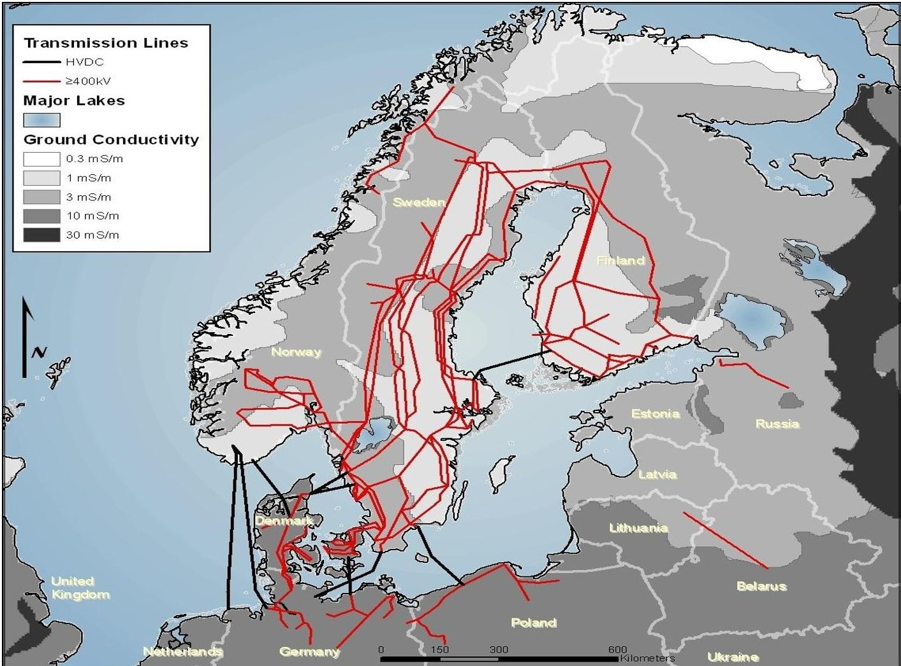

Source: ELFORSK in Lundstedt (2006)

<!-- PDF_PAGE: 30 -->

## International Impact

One aspect of an electrical power outage that could have an international impact is EHV transformer scarcity. EHV transformer production is a global business, with manufacturers located in countries including but not limited to the United States, Mexico, Korea, Belgium, India, Japan and France. Firms offering higher-capacity transformers include ABB, GE Prolec, Seimens, HICO, and Pauwels. EHV transformer costs range from $1 million to $5 million, with those with the capacities greater than 765 kV exceeding $5 million. As of 2006, there were approximately 2,500 large-power transformers in the United States alone, capable of supporting 115-765 kV transmissions (U.S. Department of Commerce, 2006).

Fast-growing economies in Asia such as the People's Republic of China and India are logically the fastest growing high-voltage transformer markets. Cost increases in copper and high-grade steel directly affect transformer prices. In the event of massive increases in new transformer demand, the prices of these commodities also would experience significant increases. Although additional transformer production labor can be trained relatively quickly (U.S. Department of Commerce, 2006), additional manufacturing facilities for transformers with larger capacities would require significant development time. Long waits for replacement transformers almost certainly would ensue. Transformer producers would enjoy significant opportunity for price gouging and prioritizing delivery to customers could become a politically charged issue.

## Second-Order Consequences of Electrical Power Loss

The loss of electric power due to an extreme geomagnetic storm would have second-order or cascading consequences in a number of different infrastructure sectors due to the interconnectedness of critical infrastructures in modern society. Figure 7 shows this interconnectedness, as it lists 20 critical infrastructure sectors and subsectors that would be affected by an electrical power outage. Figure 7 displays first- and second-order disruptions, along with their disruption severity level, ranging from localized degradation (meaning available but reduced quality service in local areas within the affected region) to widespread outage (meaning unavailability of a service throughout the affected region). Given the uncertainty in a scenario of an extreme geomagnetic storm, we examined three periods of outage: during the storm, after one week, and after one month. These snapshots in time help illustrate the potential cascading effects and the necessity for rapid recovery. Among other sector disruptions, a long-term power outage could: disrupt transportation, communication, banking and finance systems, and government services; cause the breakdown of the distribution of potable water owing to pump failure; and cause the loss of perishable foods and medication because of lack of refrigeration (NAS, 2008). The emergency services sector also would be affected by the prolonged loss of power, through the potential loss of their communications, water supply or even non-working traffic signals preventing emergency vehicles from quickly responding to an emergency. The water sector requires energy for supply, purification, distribution and treatment of water and wastewater (U.S. Department of Energy, 2006). Individuals can only survive for a three- or four-day period without access to clean drinking water. Without electricity to power the city water pumps and water purification plants, many individuals could lose access to clean drinking water. Lack of clean drinking water could become a critical issue during an extended power blackout lasting weeks or months (Marusek, 2007).

<!-- PDF_PAGE: 31 -->

Figure 7. First and Second Order Critical Infrastructure Disruptions

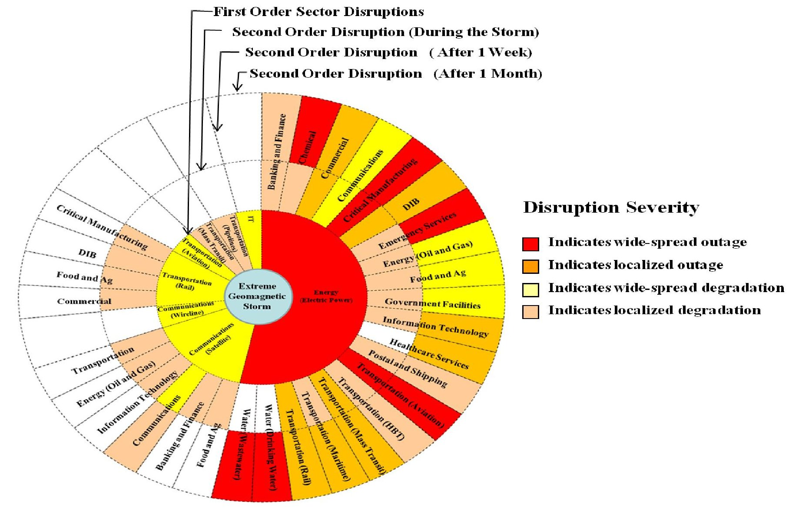

Source: original to this document

<!-- PDF_PAGE: 32 -->

The length of the outage would affect the missions of infrastructure sectors differently. Many lifeline systems have backup power generation, to include sewage pumping stations, communications switching systems, hospitals and first responder facilities, so they likely would not be immediately affected. Other sectors would be affected more quickly. During the August 2003 Northeast blackout, cell phone transmitter stations typically had 3 to 6 hours of backup generation and gas stations were forced to close without power (U.S. Department of Homeland Security/NISAC, 2005). Government services and emergency services are two sectors that would see their mission of maintaining order severely affected if the outage lasted a month. In many cases, the cascading effects could be more damaging and wide-reaching than the loss of power to a single entity. For example, the loss of power to a government facility would be disruptive, but the loss of water due to a power outage could have widespread consequences on sectors which have a strategic dependence on water, such as public health and emergency services (e.g., firefighting).

Figure 7 shows that after one month with no electrical power, the water, transportation, emergency services, critical manufacturing, and chemical sectors all could face widespread outages within the affected region. Water and healthcare services would not be disrupted immediately due to backup power supplies, but the disruption severity would increase over time for both sectors. The loss of water systems due to a power outage would lead to many cascading effects. Hospitals, schools, nursing homes, restaurants, and office buildings all rely on water to operate. Water is used for drinking, sanitation, and heating and cooling systems in those facilities. Many manufacturing operations either use water as an ingredient in their processes or rely on wastewater systems to remove and process their manufacturing waste. In the emergency response arena, firefighters depend on water to carry out their mission, and access to safe water is necessary for providing mass care services and preventing the spread of disease (EPA, 2007).

Importantly, Figure 7 illustrates that the severity of disruptions to different critical infrastructures selectively worsens over time. Some sectors are able to maintain continuous operations for a short period of time, such as drinking water or health care facilities. Even these, however, begin to see degradation of services after a week without power. If the power outage continues for over a month, then critical outages emerge in sectors that have public safety implications, such as drinking water, wastewater, emergency services, and health care. Note that these cascading effects are possible, but depend on the specifics of the affected areas. Although there were certainly economic costs associated with the August 2003 power outage in the northeast United States and Canada, other infrastructure sectors maintained operations in the four days the outage lasted. Some cities have water supplies that are not dependent on electric power. Others may have immediate rather than delayed cascading effects due to the design, lack, or failure of contingency plans. The concerns as time progresses after the storm grow from economic costs to major health and safety issues. This is an important point from a policy perspective because it allows governmental organizations to understand when the event may become a crisis, and therefore establish milestones for progress. Organizations can then communicate their plans for when and how to intervene, and at an appropriate level of intensity.

There are no openly available estimates for how long a restoration from an event of this scale would take. The Quebec outage was a matter of hours. The 2003 power outage required four days. Ice storms, hurricanes, and blizzards have caused power outages that have lasted days to more than a week. Localized power outages occur with sufficient frequency that contingency plans are known and executed in the most sensitive facilities, such as hospitals and emergency operations centers. These contingency plans rely on the use of local generators that are not EHV generators nor grounded through a transformer, making them less vulnerable to the effects of a GIC. However, most continuity plans suffice for a period of days, not weeks. After a damage assessment following an extreme geomagnetic storm, government and industry need to estimate the time it will take to replace hardware

<!-- PDF_PAGE: 33 -->

and restore energy distribution. If power anticipation is anticipated to require more than a month, governments will have to make contingency plans for its population and infrastructure needs.

## First-Order Consequences: Communications (Satellite)

One of the consequences with an international impact is the effect of a geomagnetic storm on satellites. In addition to a geomagnetic storm's interference with the signals a satellite sends to earth (e.g., as with GPS satellites), geomagnetic storms pose a threat to satellites themselves. Geomagnetic storms pose a less significant risk to satellites and satellite operations than solar radiation storms, but regularly interfere with satellite operations. Both geomagnetic storms and solar radiation storms induce electrostatic discharges in satellites. But, unlike solar radiation storms that cause the internal components of a satellite to build up excess charge relative to each other (deep dielectric or internal charging), geomagnetic storms cause the surface of the satellite to build excess charge relative to its surrounding space plasma (Fennell et al., no date). This surface charging (also referred to as "differential charging") usually does not result in immediate operational failures in satellites (NOAA, "Satellites and Space Weather," no date). Instead, surface charging interferes with the uplink/downlink to the satellite, degrading command and control as well as potentially altering the satellite's orientation (NAS, 2008). In severe geomagnetic storms, surface charging can damage a satellite's internal components through electromagnetic interference (NOAA, "Satellites and Space Weather," no date) and loss of command and control can sometimes render the satellite effectively dead. $ ^{4} $

Satellite operators deal with surface charging on a regular basis, as other space weather phenomena other than geomagnetic storms can cause this problem (NAS, 2008). Satellite susceptibility to surface charging is a function of its construction and orbit. Surface charging is most common in satellites in geosynchronous orbit (GEO), although satellites in low-Earth orbit (LEO) with high-voltage power systems also suffer from greater surface charging incidents (Holbert, no date). Surface charging severity depends on the severity of the geomagnetic storm as well as the satellite local time. Although surface charging can occur at any time of day, severity usually increases at satellite local times between midnight and dawn, with increasing susceptibility during day/night and night/day transitions (NOAA, "Satellites and Space Weather," no date).

An extreme geomagnetic storm of G5 on NOAA's space weather scale likely would result in extensive surface charging in a large number of satellites in GEO. Interference with or damage to satellites in GEO would affect several critical infrastructures. For instance, global communications networks would experience significant disruption. Temporary interference with satellite signals would harm communications provider revenues. Communication provider revenue loss from a geomagnetic storm with an intensity comparable to the 1859 Carrington Event has been estimated on the order of $30 billion (Odenwald, 2007). As of 1 July 2010, 255 of the 943 satellites in GEO were commercially owned communications satellites (Union of Concerned Scientists, 2010). Surface charging resulting in damage to as few as ten percent (25) of these satellites' internal components would pose a significant replacement challenge.

In the event of an extreme geomagnetic storm resulting in permanent internal damage to satellites, launch capacity is insufficient to satisfy replacement needs. In 2009, 78 satellite launches occurred worldwide. This represented a decrease of 40 percent from 2008, a trend explained by global macroeconomic conditions. Global launch capacity under normal circumstances would seem to be approximately 100 to 110 satellites annually. At first glance, this capacity would seem adequate to launch 25 satellites to replace damaged commercial communications satellites after an extreme geomagnetic storm. But, these 25 replacement satellites would represent additional demand above and

<!-- PDF_PAGE: 34 -->

beyond existing estimates forecasting demand for 20 new commercial communications satellite launches annually between 2010 and 2019 (FAA, 2010).

Replacing commercial communication satellites illustrates only part of the problem following an extreme geomagnetic storm. The 255 commercial communications satellites are not the only satellites in GEO. Another 100 commercial satellites fulfilling other purposes, as well as civil and military satellites, occupy GEOs (Union of Concerned Scientists, 2010). Each of these satellite user communities also likely would need to replace damaged satellites. Additional launch capacity is not easily added, as constructing launch facilities represents a highly capital-intensive endeavor. Prioritizing replacement slots would pose a challenge, especially as only a small number of countries own and operate launch facilities capable of supporting the full range of satellite payloads. Balancing military and civil government replacement needs against commercial needs also could raise significant challenges.

As shown in Figure 7, above, second-order disruptions resulting from the degradation of satellite communications could affect the following sectors: transportation, energy, information technology, communications, banking and finance, and food and agriculture.

## Second-Order Consequences of Communications (Satellite) Disruption

First-order disruptions to the communications (satellite) critical infrastructure sector due to an extreme geomagnetic storm would have second-order or cascading consequences in a number of different infrastructure sectors due to the interconnectedness of critical infrastructures in modern society. Figure 7 illustrates this interconnectedness. For instance, precision agriculture would be affected by any degradation in the positioning information provided by the GPS system. Drilling operations in the energy (oil and gas) sector would also be hampered by the degradation or loss of GPS signals. The loss of satellites would affect the communications sector. The reliance of components of the IT sector on the timing information provided by the GPS system also exposes it to second-order consequences stemming from an extreme geomagnetic storm impacting the communications (satellite) sector.

As indicated by Figure 7, during the storm, second-order disruptions would result in localized degradation of the food and agriculture, banking and finance, IT, energy (oil and gas) and transportation sectors. This set of second-order consequences is driven by a temporary degradation in satellite signal strength that would not extend beyond the storm's conclusion. Depending on the severity of the storm, damage to satellites providing navigation, positioning and timing information as well as communications services could have longer lasting effects. But, satellites providing GPS typically occupy LEOs. As discussed above, a large number of commercially owned communications satellites occupy the GEOs that more susceptible to surface charging that could hypothetically result in long-term damage to the satellite itself. So, second-order disruptions to the communications (satellite) sector after one week could reach the level of widespread degradation.

## Other First-Order Consequences

In addition to the electrical power sector and the satellite communications sector, a geomagnetic storm could cause first-order disruptions in the following sectors: wireline communications, transportation (rail, aviation, mass transit, and pipelines) and IT. Out of these sectors, the freight rail transportation sector is the only sector with second-order disruptions. These include: critical manufacturing, defense industrial base, food and agriculture and commercial sectors. Second-order disruptions stemming from first-order disruption to the rail transportation sector lessen over time and are not expected to extend beyond a few weeks at most.

<!-- PDF_PAGE: 35 -->

## Psychological Consequences: Social Unrest, Behavioral Changes, and Social Vulnerability

There are multiple ways of assessing psychological consequence. The OECD project on Future Global Shocks provides a framework for considering the risk of social unrest-an expression of collective dissatisfaction with the political system that manifests itself in unconventional forms of protest behavior-and identifies failed infrastructure as one potential cause (OECD, 2010). In the case of geomagnetic storms, there is no pre-existing sense of social unease that would necessarily indicate a high potential for social unrest. Unlike with other subsectors of the energy sector, such as petroleum or nuclear energy, the electric power transmission subsector does not carry the same connotations for environmental effects or social justice. An extreme geomagnetic storm is a sufficiently rare event that the public would be unlikely to ascribe the effects to concepts such as the exclusion or exploitation of a certain social class or ethnicity.

In the event of an extreme geomagnetic storm, however, there would certainly be a high degree of dissatisfaction with the immediate circumstances, especially the widespread loss of electric power. Although the situation may lack a perception of inequity or injustice, there may be a loss of public trust in industry and elected leaders. This could be the result of lack of communication from leadership or the demonstration of a poor understanding of the situation and the needs of the population. This latter aspect may be sufficient to lead to the first stage of social unrest in the OECD framework: communication (See OECD Social Unrest Model in Figure 8 below).

Given the lack of electric power described in the scenario, the most effective means for communication might be word of mouth or radios and phones. The sheer number of people affected may be sufficient for self-organization (with organization being the second stage of social unrest). Similarly it is possible that such populations would be self-mobilizing (with mobilization being the third stage). Work stoppages and school closings certainly would provide a large number of people with the time and availability for large-scale protests and demonstrations. The fourth stage of social unrest, organized civil violence, would be unlikely. In past power outages, looting has occurred (and would be highly likely to recur), but deliberate and organized civil violence seems much less likely than isolated violence or small outbreaks of destructive or maladaptive activity.

<!-- PDF_PAGE: 36 -->

Figure 8. OECD Social Unrest Model

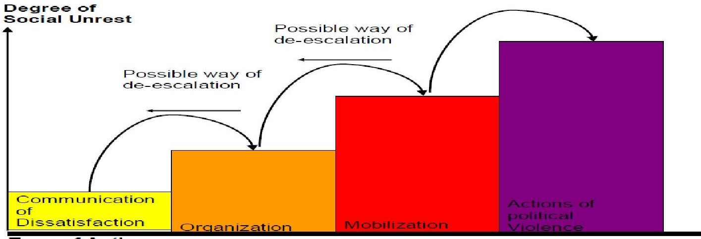

Type of Action

Source: OECD, 2010

To consider psychological consequences, it may be more pertinent to consider the expected behavioral changes that would result from such a long-term power outage. This may include: workplace, school, or event attendance; demands on government or health care services; information-seeking behavior; and compliance with government instructions. Some of these aspects will vary geographically (e.g., may be concentrated near the outage area) and others will vary over time (e.g. the duration of a crisis). On a qualitative scale, such a scenario would be highly likely to see significantly dysfunctional consumer behavior and potentially spontaneous evacuation of affected areas. Table 3 below displays five degrees of consequence for six areas of population behavior:

- Consumer behavior

- Compliance with government instructions

- Demands on government or healthcare services

- Information-seeking behavior

- Social consciousness

- Workplace, school, or event attendance

This approach has been used for national-level and regional-level risk assessments for terrorism and provides one basis for making comparative judgments about psychological consequence (U.S. Department of Homeland Security, 2008). Typically, the various behavioral changes are not ranked individually. Rather, the types of effects are taken into consideration and psychological impact is ranked as a single factor.

<!-- PDF_PAGE: 37 -->

Figure 9. Ranking Table for Psychological Impacts

<table border="1"><tr><td colspan="2"></td><td>None/Negligible</td><td>Minor</td><td>Moderate</td><td>Significant</td><td>Catastrophic</td></tr><tr><td>Component</td><td>Psychological Impact</td><td>No measurable change in population behavior: no effect on social functions</td><td>Minor change in population behavior: minor disruption of non-essential social functions</td><td>Significant changes in population behavior: loss of non-essential social functions; temporary disruptions of essential social functions</td><td>Dysfunctional changes in population behavior: disruption of essential social functions</td><td>Widespread and sustained loss of essential social functions</td></tr><tr><td rowspan="6">Attributes</td><td>Consumer Behavior</td><td>No measurable change in consumer behavior</td><td>Limited stockpiling of essential resources(canned goods,fuel,etc)</td><td>Significant increase in local consumer spending on essential resources,some shortages</td><td>Regional shortages of essential resources; looting for essential resources and for profit</td><td>National shortages of essential resources; widespread looting</td></tr><tr><td>Governance</td><td>Public is compliant with government instructions and rule of law</td><td>Government services overwhelmed by demand</td><td>Moderate disregard for government instructions; loss of belief in specific government institutions</td><td></td><td>General loss of belief in government institutions; widespread disregard for government instructions</td></tr><tr><td>Healthcare Behavior</td><td>No measurable change in healthcare behavior</td><td>Significant increase in local health care service utilization</td><td>Shortages in healthcare resources:people,vaccines,treatment space</td><td></td><td></td></tr><tr><td>Information-Seeking behavior</td><td>Detectable increase in information-seeking behavior</td><td>Surge behavior overwhelms information systems,hotlines</td><td></td><td></td><td></td></tr><tr><td>Social Consciousness</td><td>No measurable change in social consciousness,positive or negative</td><td>Measurable positive change in altruistic behaviors;limited measurable negative change in destructive behaviors</td><td>Moderate scapegoating and hate crimes</td><td>Intense scapegoating and hate crimes;decrease in positive altruistic behaviors;increase in survival behaviors</td><td></td></tr><tr><td>Workplace,school,or event attendance</td><td>No measurable change in workplace,school,or event attendance</td><td>School,event,and work attendance drops moderately</td><td>School and work attendance drops significantly;major events are cancelled</td><td>High levels of absenteeism in critical positions;spontaneous evacuation</td><td></td></tr></table>

Source: U.S. Department of Homeland Security (DHS), 2008

Although social unrest and behavioral changes may be adequate approaches to assessing the consequence of a disaster, they do not provide much insight into the likelihood of those consequences, or which areas may be comparatively more likely to experience them or are robust enough to limit the degree of consequence. The concept of social vulnerability of a region incorporates considerations of population density, education levels, income levels, demographics, etc. to evaluate the extent to which a population will be able to adequately prepare for and respond to a natural or manmade disaster. Two populations, exposed to the same shock, will demonstrate differing vulnerabilities, coping mechanisms, and rates of recovery, resulting in different consequences. The experiences of New Orleans with Hurricane Katrina emphasize that communities with fewer resources were more

<!-- PDF_PAGE: 38 -->

significantly affected by the hurricane because they had less information and access to resources to evacuate or otherwise prepare for or respond to the hurricane.

Susan Cutter (2003) of the University of South Carolina's Hazards & Vulnerability Research Institute developed an approach for quantifying a geographic locality's vulnerability to hazards based on its underlying socioeconomic and demographic profile. The social vulnerability index (SoVI) compares several socio-economic factors to the national mean, including: personal wealth, age, density of built environment, single-sector economic dependence, housing stock and tenancy, race and ethnicity, occupation, and infrastructure dependence. The index is a sum of the deviation from the mean for each of the factors listed.

Experience indicates a strong relationship between the losses from natural hazards and the socioeconomic levels of those most affected. A logical extension of this argument is that populations with higher socio-economic levels would be more likely to have the means and access to information to deal with effects from severe geomagnetic storms.

The current SoVI index, which draws on 2000 U.S. Census data, aggregates socio-economic factors and weighs them all equally. This index contains potential insights into the extent to which a major event such as an extreme geomagnetic storm will have an effect on the population of a region. Figure 9 highlights the SoVI index of the three U.S. areas this report's scenario focused on, all regions likely to be affected by a geomagnetic storm. As seen below, New York has the highest SoVI index of the three areas and could therefore be the most likely to exhibit behavioural changes or unrest.

Figure 10. Social Vulnerability-Average U.S.National Percentiles for Select Areas

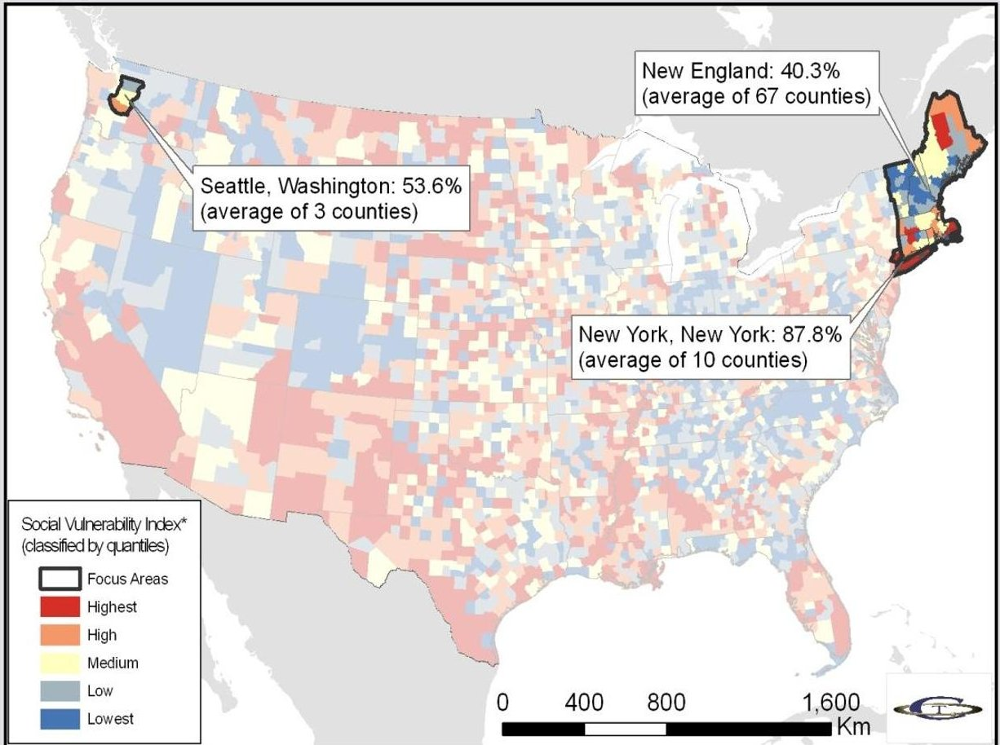

Source: derived from SoVI data from the Hazards and Vulnerability Research Institute (HVRI) of the University of South Carolina

<!-- PDF_PAGE: 39 -->

## Estimating Threat

It is relatively difficult to calculate a frequency for extreme geomagnetic storms. Figure 10, below, displays severe storms as measured by the Ap index since it was established in 1932. It shows three storms at or above the intensity of the 1989 storm that affected the power system of Quebec. Extreme storms are even less frequent. Figures 11 and 12 below show two other perspectives on the frequency of severe and extreme storms. Figure 11 shows large magnetic storms based on the horizontal intensity (one way to measure magnetic disturbance). It covers a 150-year period and shows nine storms of higher intensity than the 1989 storm, including the Carrington event of 1859. Figure 12 examines large solar proton events that can lead to severe or extreme geomagnetic storms over a 450-year period, and shows 19 events of which the Carrington event is the largest by more than twice the next largest storm. It reveals twelve solar proton events larger than the one associated with the 1946 geomagnetic storm in Figure 10. Although geomagnetic storms cannot be predicted in the long term, it is reasonable to plan for a severe event once every 50 years (a period that some utilities use to estimate the lifetime of hardware in a power system) for areas of high susceptibility. Extreme storms are less frequent, with an estimated range of once every 150 to 500 years (with some studies estimating even lower frequencies).

Figure 11. The 30 Most Intense Geomagnetic Storms from 1932 to 2003, Based on the Ap Index

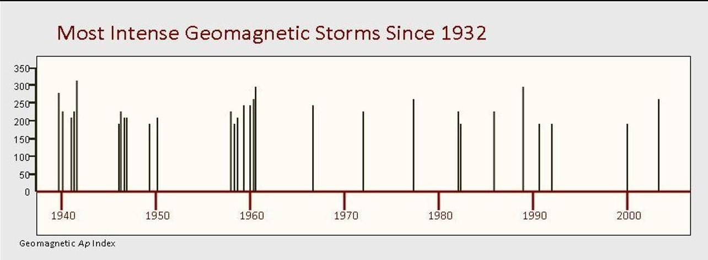

Source: NOAA, 2004a

Figure 12. Large Magnetic Storms from 1859 to 2003, Based on Horizontal Intensity

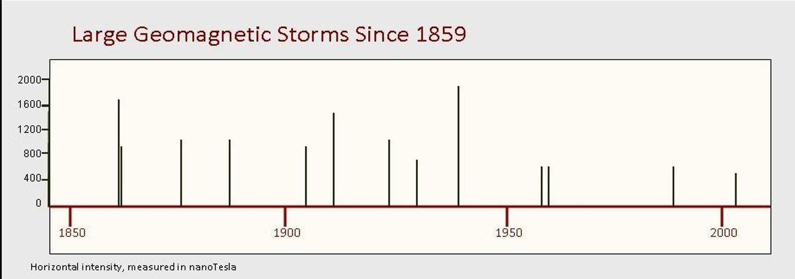

<!-- PDF_PAGE: 40 -->

Figure 13. Solar Proton Events with Greater than 30 MeV Fluence from 1570 to 1950

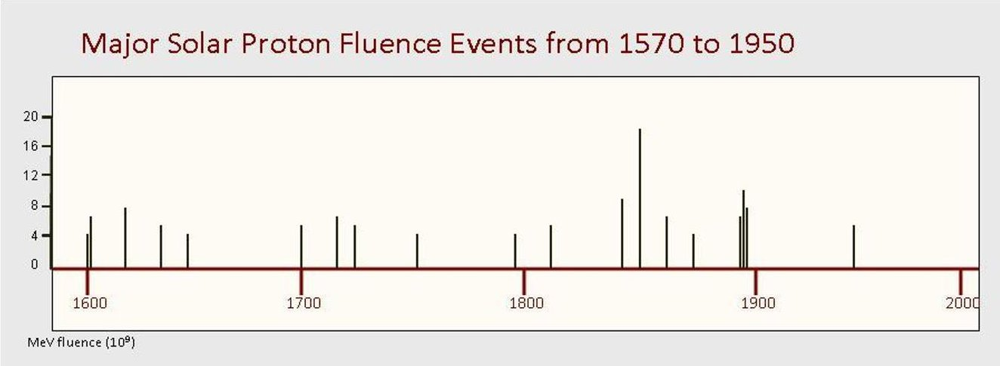

Source: Shea et al., 2006

## Current Understanding of Risk

One of the difficulties in risk analysis is identifying the relative risks across a spectrum of unwanted events. With so little known about frequency of geomagnetic storms and the uncertainties of the dynamics that lead severe storms to have severe effects on infrastructure, it is exceedingly difficult to compare this to other major natural hazards and man-made effects. Regardless, in terms of expected loss-a likelihood over a time period multiplied by consequences-it is possible to say that extreme geomagnetic storms are not high-risk natural hazards to the international community, given that these are very low-frequency events. Yet the potential consequences dictate some attention and action. Indeed, a few nations have dedicated resources to manage geomagnetic risk, specifically in assisting industry with support to operational mitigations by providing the means to provide warnings and alerts with regard to space weather in general and geomagnetic storms in particular. The sections that follow describe these in more detail and identify further steps that can further support international risk management. The final section makes recommendations for the international community to further mitigate against extreme consequences.

## INTERNATIONAL RISK MITIGATION EFFORTS

Even without a complete picture of the risks of geomagnetic storms, the international community—led by a small number of nations—has begun to address these risks by investing in detection and early warning, researching vulnerability and consequence, and sharing best practices. The following sections will examine existing mitigation measures, mitigation cooperation efforts, and industry-specific risk mitigation measures.

<!-- PDF_PAGE: 41 -->

## Existing Management Structures and Regulations

Threat notification efforts dominate the geomagnetic storm risk management efforts of those OECD member states examining this issue. In most OECD states, space agencies lead governmental risk assessment efforts, but this mitigation activity focuses on space weather monitoring and prediction. A combination of inter-governmental cooperation and private-public partnerships provides current space weather threat notification services. However, the international community lacks a formal geomagnetic storm risk management mechanism.

As previously noted, OECD member states' geomagnetic storm risk activities primarily take the form of space weather monitoring and prediction services, rather than full-scope risk analysis or management. The activities of U.S. NOAA and the European Union's European Space Agency (ESA) fit this trend. Interest in this topic is growing within OECD governments' components responsible for disaster planning and emergency preparedness. In February 2010, the U.S. FEMA, the Swedish Civil Contingencies Agency (MSB) and U.S. NOAA conducted a workshop focusing on the transatlantic impact of geomagnetic storms (FEMA, 2010). The Swedish government's involvement in the workshop represents a greater interest in geomagnetic storm risk than that of most European OECD governments. This interest is almost certainly driven by Sweden's historical experience with the impact of GICs on its electric grid. Even so, the electricity industry has driven geomagnetic storm risk analysis within Sweden and other Nordic OECD members.

OECD member states generally lack national-level geomagnetic storm risk management structures. Additionally, coordination on the issue within OECD member states is frequently limited. Although the U.S. NOAA cooperates with the United States Air Force (USAF) on space weather issues, no standing entity or structure exists within the U.S. Department of Homeland Security to coordinate cross-U.S. Government geomagnetic storm risk analysis, despite the clear threat to critical infrastructure. In general, other OECD member states display a similar attitude towards geomagnetic storm risk analysis and management. The European Union lacks a single coordination entity for this issue. The Chair of the ESA's Space Weather team acknowledges that Europe could improve its efforts around this issue, noting that, in Europe, coordination of space weather efforts could improve and that responsibility is "very fragmented" (Brooks, 2009).

OECD member states' limited geomagnetic storm risk management and analysis activities are fulfilled largely by scientific departments and agencies rather than by entities with regulatory authorities. In general, OECD member states do not dedicate the same resources to geomagnetic storm risk management and analysis as they do to other international risks, such as global pandemics. With several OECD members, the electricity sector has focused on geomagnetic storm risk analysis. But, this activity is in response to economic drivers and the desire to satisfy pre-existing regulations concerning system reliability rather than in response to regulations specific to geomagnetic storm risk. Some of the mitigation measures OECD member governments have in place to mitigate other risks promote resilience to geomagnetic storms.

Experts call for a mix of infrastructure hardening and operational strategies measures to reduce vulnerability to and consequences of severe geomagnetic storms. Economic considerations drive private sector critical infrastructure operators towards operational risk mitigation strategies, which are highly dependent on reliable geomagnetic storm forecasting (Erinmez et al., 2002). With adequate warning, critical infrastructure owners and operators in several sectors can implement contingency plans modifying the way they do business during severe geomagnetic storms. For instance, during the October 2003 geomagnetic storms, multiple North American power grid operators implemented operational mitigation measures in response to NOAA Space Weather Prediction Center's warnings

<!-- PDF_PAGE: 42 -->

(NAS, 2008). At least one large utility has contingency plans in place to implement emergency procedures to minimize with as little as one hour's notice the GIC threat to transformers (Erinmez et al., 2002). Although it also notes changes in electric grids that increase susceptibility to severe geomagnetic storms, the NAS (2008) notes greater availability of space weather warning information and increased space weather awareness have reduced geomagnetic storm risk for electric utility operators over time.

## Space Weather Monitoring and Prediction Cooperation

Considering the dependence of operational risk mitigation strategies on geomagnetic storm threat notification, it should not be surprising that there is significant national government and intergovernmental cooperation around space weather monitoring and prediction. Although there is increasing activity within the UN World Meteorological Organization (WMO) focusing on space weather in general (Stills et al., 2010), the International Space Environment Service (ISES) serves as the primary international cooperation mechanism on geomagnetic storms. The official mission of ISES is to encourage and facilitate near-real-time international monitoring and prediction of the space environment. ISES depends on data inputs and the assets of Regional Space Weather Warning Centers (RWCs) in more than a dozen countries. Academic institutions, national government agencies, and regional space agencies provide the actual assets and manpower for ISES. Additionally, space weather monitoring and prediction cooperation also occurs under other forums and between entities under auspices other than ISES. For instance, the U.S. NOAA National Weather Service's Space Weather Prediction Center (SWPC) maintains partnerships with twelve other non-ISES institutions that contribute space weather-related data. $ ^{7} $ Although the ESA plays an important role in ISES in its capacity as a data exchange hub for European RWCs, the SWPC plays an even more fundamental role, serving as a "World Warning Agency" (ISES, "Regional Warning Centers," no date) providing data integration services and forecasts for the entire RWC network. Increasing numbers of government agencies and private sector entities are subscribing to the SWPCs subscription services (Bogdan, 2010).

The SWPC's role illustrates ISES dependence on national assets to accomplish its international mission. Although the ESA's Solar and Heliospheric Observatory (SOHO) spacecraft contributes important operational data to international space weather monitoring and prediction efforts (Murtagh, 2007), the system relies to a great degree on American assets. The U.S. NASA Advanced Composition Explorer (ACE) satellite provides real-time solar wind data that, when combined with other information, can yield real-time GIC forecasts (Lundstedt, 2006). NASA's Solar Terrestrial Relations Observatory (STEREO) also plays a critical role, along with NOAA's Geostationary Operational Environmental Satellite (GOES) and Polar Operational Environmental Satellite (POES) satellites. The Constellation Observing System for Meteorology, Ionosphere and Climate (COSMIC) satellite program, a joint effort between the United States and Taiwan, supports the prediction of geomagnetic storms' impact on GPS satellites (Murtagh, 2007). Finally, cooperation between the USAF's Weather Agency (NAS, 2008) and the NOAA SPWC benefits all ISES members. But, no international agreements codify American military support levels for international space weather monitoring and prediction efforts.

Although many of these satellites were launched with the explicit intention of providing benefit to the entire scientific community, their maintenance costs and potential replacement remain the sole responsibility of national governments. Much of the international community benefits from the international geomagnetic storm alerting system without contributing to the maintenance of the hardware providing space weather monitoring and prediction data. The ACE satellite, in particular, illustrates this issue. ACE's orbital position allows it to provide data to support highly accurate

<!-- PDF_PAGE: 43 -->

forecast techniques and the issuance of alerts and warnings for impending major geomagnetic disturbances. But, numerous space weather experts note that ACE is operating beyond its originally designed operational life. Yet, its replacement depends entirely on the United States as no international mechanism exists to fund a replacement (NAS, 2008). The US NOAA has requested funds for a replacement for ACE in its FY11 budget request (Showstack, 2010).

Private-public partnerships play an important role in the global space weather alerting system. By themselves, the alerts, warnings and watch documents issued by ISES through the SWPC are not always useful to industry consumers without additional analysis (FEMA, 2010). For instance, air travel dispatchers require decision support products providing analysis beyond SWPC alerts American Meteorological Society, 2007). Private sector entities take information from ISES as well as other sources and tailor it to the needs of specific industries, including utilities with transmission assets and pipeline operators. For instance, the Electric Power Research Institute (EPRI) combines space weather monitoring and prediction data from multiple sources and then performs its own GIC economic impact analysis for its member utilities (Pulkkinen et al., 2010).

Still, room for improvement exists in the public-private partnership. First, private-sector entities have not emerged yet to provide full-scope geomagnetic storm risk analysis for all critical infrastructure sectors. Private-sector geomagnetic storm risk analysis service providers focus primarily on fulfilling the utility, satellite operator, and pipeline industries' requirements. Second, the different public- and private-sector entities performing space weather monitoring and prediction services use different terminology. Space weather monitoring and prediction service providers do not use a common terminology. Even within OECD member states, different government agencies employ different terminology (American Meteorological Society, 2007). A standardized terminology would facilitate consumer's use of space weather monitoring and prediction information (FEMA, 2010).

## Industry-Specific Risk Mitigation Efforts

Although isolated cases of increased governmental interest in the topic exist, OECD member states have not developed regulatory regimes accounting for geomagnetic storm risk. Industry has been left largely to regulate its own approach to dealing with geomagnetic storm risk. Subsectors of the electric power industry have done some geomagnetic storm risk analysis and management. The satellite industry also has done some work in this area. The transportation sector is consumer of a space weather monitoring and prediction services, but does not conduct full-scope geomagnetic storm risk analysis or management efforts.

## Electricity Transmission Industry

Electrical grid operators in OECD member countries, including the United States and much of Europe, are engaged in varying levels of geomagnetic storm risk analysis and management. Firms involved in electricity generation and transmission drive much of the demand for commercial space weather monitoring and prediction services. Full-scope national electric grid geomagnetic storm risk analyses covering individual transformers are not conducted commonly at a national level. A 1999 risk assessment conducted by the UK's National Grid Company provides a notable exception (Erinmez et al., 2002).

Interest in geomagnetic storm risk has increased in response to industry efforts to promote transnational electricity trading. International electricity trading dates to 1901 between the United States of America and Canada and 1929 in Europe (Charpentier and Schenk, no date). Economic liberalization during the 1990s across many OECD members increased electricity trading and interest in establishing

<!-- PDF_PAGE: 44 -->

new interconnections between electricity transmission networks, especially in Europe (Nies, no date). But, electrical grids across OECD members remain largely national in scope. Focus on the implications of geomagnetic storms for international electricity trading has been driven by industry reliability organizations' examining the consequences of increased electricity trade within and between national transmission networks.

Utilities in North America and European OECD member states have a long history of cooperating to ensure the reliable delivery of bulk power transmission. In the United States and Canada, the NERC performs this function. NERC is a nongovernmental organization driven by industry. In the United States, the Energy Policy Act of 2005 (U.S.Code, 16 U.S.C. $ 8240(b)(1) $ makes compliance with NERC standards mandatory for all American utilities. Since 2006, NERC standards have been mandatory for Canadian utilities in Ontario, Quebec, Nova Scotia and utilities managing international transmission lines (Perkins Coie LLP, no date). International electricity exchange occurs within NERC's Eastern Interconnection and Western Interconnection between the United States of America and Canada through 34 transmission lines. But, only ten of these international transmission interconnections have a capacity of 345kV or more (Canadian Electricity Association, 2006). NERC's Texas Interconnection is integrated to non-NERC utilities in Mexico. NERC has conducted some work on geomagnetic storm risk (NERC, 2010).

International electricity interconnections are more common between OECD members in Europe than they are in North America. For instance, the Scandinavian countries alone have 13 interconnections with capacities of 345 kV or more with each other, Germany, Poland, and Estonia (Nordel, no date). In Europe, Transmission Network Operators (TSOs) manage the transfer of large amounts of electricity within a national grid or across national borders. As a result of the European Union's "3rd Package" of Electricity Legislation, five regional electricity transmission organizations representing 42 TSOs in 34 countries merged in July, 2009 into the European Network of Transmission Operators for Electricity (ENTSO-E). ENSTO-E represents a merger of several regional European reliability organizations but does not reflect a single, interconnected system or a uniform regulatory framework. ENTSO-E members have agreed to work together to adopt common standards for electricity reliability, but the 3rd Package approach relies on the gradual convergence and reinforcement of national electricity regulators rather than the creation of an EU-wide super-regulator for electricity (Nies, no date).

ENSTO-E has not yet emphasized geomagnetic storms as a priority. But, NORDEL, the reliability entity historically fostering cooperation amongst Nordic utilities, was one of the entities merging to form ENSTO-E. Nordic utilities have demonstrated a focus on geomagnetic storm risk in the past and may push ENSTO-E to pay greater attention to this issue.

## The Satellite Operator Industry

Satellite operators in OECD member countries are well aware of the effects a range of space weather phenomena could have on their assets. They are familiar with the risks posed to their assets by geomagnetic storms and are frequent consumers of the NOAA SWPC's space weather alerts as well as geomagnetic storm risk offerings from private sector entities. Geomagnetic storms pose a range of threats to satellites. Not only can signals between the satellites and their ground stations be interrupted, but geomagnetic storms can even alter the course and trajectory of satellites, requiring course correction (NOAA, 2010).

Satellite operators do not enjoy the economically beneficial option of relying on a wide range of operational mitigation of geomagnetic storm risk. Satellites in GEO can be temporarily moved into a

<!-- PDF_PAGE: 45 -->

graveyard orbit, an orbit hundreds of miles above a satellite's normal geosynchronous orbit where spacecraft are placed at the end of their operational life. However, this requires significant fuel and moving large numbers of GEO satellites into graveyard orbit in a short period of time preceding an extreme geomagnetic storm would raise require significant coordination between commercial satellite operators and national governments. Hardening a satellite's electronics serves as the primary space weather risk mitigation option. But, by increasing the satellite's weight, hardening makes it more expensive to launch. So, hardening is not frequently used in commercial satellite construction.

Even if the satellite is hardened, geomagnetic storms can interrupt their operation. Geomagnetic storms can interrupt satellite communication with ground stations, making command and control difficult and interrupting the flow of information from the satellite (NOAA, "Solar Effects," no date). During geomagnetic storms, the vulnerability of GPS satellites to irregularities in the Earth's ionosphere interrupting their communication when near the equator is extended to higher latitudes (NAS, 2008). Loss of command and control of the satellite is not always easily re-established. Analysts believe damage caused during a 2002 geomagnetic storm could be the primary reason Japan's ADEOS-2 satellite remains unresponsive (NOAA, 2004a).

## The Aviation Industry

The opening of over-the-Pole routes to air travel during the 1990s provided civil aviation shorter flight paths between Asia and North America. But, these routes introduced new operational challenges further complicated by space weather. In 2002, the International Civil Aviation Organization (ICAO) recognized space weather as an aviation hazard (Stills, et al., 2010). Space weather raises several issues for commercial aviation, including the threat of solar radiation to crew and passengers at high altitudes or latitudes. Geomagnetic storms raise issues for over-the-Pole routes. Although a range of communication options exist for commercial aviation at lower latitudes, only high-frequency (HF) radio transmissions function over-the-Pole routes and geomagnetic storms disrupt them (NAS, 2008). When this disruption occurs, over-the-Pole flights must be diverted to lower latitude routes to take advantage of alternative communication mechanisms. But, the rerouting is technically taken in response to the communications disruption, not specifically due to geomagnetic storms specifically.

In contrast to electric utilities, and satellite operators, the aviation industry has been dealing with geomagnetic storm risk for a comparatively short time. The aviation industry lacks a mature understanding of the impacts of space weather on its operations and senior decision makers have demonstrated a reluctance to conduct true geomagnetic storm risk analyses (American Meteorological Society, 2007). Although national regulations exist relating to communication requirements, international regulations specifying the incorporation of space weather information into air transportation sector operations are still at the working paper stage (Stills et al., 2010). Firms using polar routes consume space weather monitoring and prediction services, but the market for most private sector enhancements to reporting offered through ISES is not experiencing high growth. Although the risk of HF communications interruption is greatest for over-the-Pole civil aviation, large parts of Africa and South America also rely on HF communications that could be interrupted by more severe geomagnetic storms (American Meteorological Society, 2007). To implement operational mitigation, aviation planners need warnings at least three to four hours in advance, although having the information six to ten hours in advance would permit greater cost savings through avoidance of flight rerouting (NAS, 2008).

## Risk Mitigation Conclusion

Although OECD member governments generally lack comprehensive national-level geomagnetic storm risk management strategies, many of them have implemented mitigation measures to address

<!-- PDF_PAGE: 46 -->

other risks that also will serve to mitigate geomagnetic storm risk. The combination of the existing space weather alert system with operational mitigation strategies in the electricity, aviation and satellites industries means most geomagnetic storms will not result in long-term damage to OECD member governments' critical infrastructures or disruption of related services for more than a few hours. Still, relying on measures developed to mitigate other risks in the absence of full geomagnetic storm risk management is not necessarily a sound strategy for OECD member governments. At least one participant in a 2008 National Academies Workshop on Severe Space Weather Events noted that social and political institutions assume constant conditions for planning purposes and that severe space weather poses a LF/HC event challenging existing disaster response and emergency preparedness plans (NAS, 2008).

Cooperation between OECD member governments around critical infrastructure resilience is not mature. Even highly interdependent economies such as the United States and Canada have not yet established mature critical infrastructure risk mechanisms. $ ^{8} $ In 2008, the Council of the European Union adopted a "Directive on the Identification and Designation of European Critical Infrastructures and the Assessment of the Need to Improve Their Protection" focusing solely on the European Union's energy and transport sectors. However, regulatory responsibility remains with EU member states and the Directive calls for building community-wide cooperation from a foundation of existing bilateral arrangements (European Union, 2008).

## Communicating Geomagnetic Storm Risk

The relative absence of public awareness of space weather phenomenon in general and the specific risks posed by geomagnetic storms to critical infrastructure contributes to the lack of national-level strategic planning amongst OECD member states. Even when geomagnetic storms impact critical infrastructures like satellite-based global positioning services and electricity, the public does not associate these failures with specific geomagnetic storms (Hawk, 2010). The scientific community and some private sector entities providing enhanced analysis of space weather alert information have attempted to increase public understanding of geomagnetic storm risk.

Most efforts to increase public and policy maker awareness of geomagnetic storm risk focus on emphasizing worst-case scenarios involving the potential consequences on modern electrical grids of a geomagnetic storm with a severity similar to the 1859 Carrington Event. The potential effects of a geomagnetic storm also sometimes are associated with those of an electromagnetic pulse attack. In the $ 111^{\mathrm{th}} $ US Congress, bills H.R. 2195 and S. 946 focused on cyber and EMP threats to critical electrical infrastructure, but also mention that severe space weather incidents could result in similar effects (Lautenbacher, no date). Neither bill has become law.

Space weather and geomagnetic storm risk awareness among OECD member countries' publics is low. At the NOAA SWPC's 2010 Space Weather Workshop, a representative of the American Institute of Aeronautics and Astronautics (AIAA) suggested a more aggressive public marketing campaign. He presented a proposal for a "Space Weather Week" and suggested using the proposed replacement for ACE, the Deep Space Climate Observatory (DSCOVR) satellite as a public rallying issue to increase awareness about space weather (Dickman, 2010). Participants in the February 2010 workshop, Managing Critical Disasters in the Transatlantic Domain - the Case of a Geomagnetic Storm, discussed using government agencies and social media to educate and to inform the public about geomagnetic storms (FEMA, 2010).

The United Nations Committee on the Peaceful Uses of Outer Space (UNCOPUOS) currently is sponsoring a three-year developmental period for the International Space Weather Initiative (ISWI).

<!-- PDF_PAGE: 47 -->

The ISWI will connect space researchers and observers globally through various means of communication for Member States to share empirical data on space weather activities with one another (International Space Weather Initiative Informal Summary, 2). Specifically, the ISWI will:

...explore the solar corona, deepen understanding of the function of the Sun and the effects that the variability of the Sun could have on Earth's magnetosphere, environment and climate, explore the ionized environments of planets, determine the limits of the heliosphere and deepen understanding of its interaction with interstellar space (International Space Weather Initiative Informal Summary, 2).

UN Member States will sponsor scientists and participants operating in facilities located around the world. Researchers will form regional teams to produce collaborated data analyses and reports (ISWI Slideshow, 2.1). The ISWI proposal also establishes a system to track and to warn against low-frequency, high-impact events such as geomagnetic storms. Scientists can produce predictive models to estimate space weather activity and can use methodologies to anticipate the magnitude and timing of a projected geomagnetic phenomenon. The reports produced by scientists will be disseminated to 192 member countries in any of the six official UN languages (ISWI Slideshow, 2.3). The ISWI also will rely on resources provided by colleges and universities from around the world to conduct research and analyses (ISWI Slideshow, 2.2).

<!-- PDF_PAGE: 48 -->

# THE IMPACT OF SELECT SOCIOECONOMIC CHANGES ON THE RISKS OF EXTREME GEOMAGNETIC STORMS

A variety of possible future socioeconomic shifts would impact the risk posed by extreme geomagnetic storms. As previously discussed, extreme geomagnetic storms would result in first-order disruptions to eight critical infrastructure sectors and sub-sectors:

1. Energy (Electric Power)

2. Communications (Satellite)

3. Communications (Wireline)

4. Information Technology

5. Transportation (Aviation)

6. Transportation (Mass Transit)

7. Transportation (Rail)

8. Transportation (Pipeline)

Socioeconomic developments could impact the risk posed by an extreme geomagnetic storm to these eight critical infrastructure sectors and sub-sectors. The following examples of two possible developments in the Energy (Electric Power) critical infrastructure sector illustrate the importance of considering such socioeconomic developments in any formal risk assessment.

## Smart Grids and Energy

Increased investment in one aspect of the smart grid concept would reduce the risk posed by an extreme geomagnetic storm. Investment in smart grid technology is growing across OECD members. The smart grid concept encompasses a variety of technological advancements and process changes in the way electricity is generated, distributed, and transmitted. These technologies and process changes range from advancements at the consumer level, like smart meters, to fundamental shifts in the underlying architecture of electric grids. Electric power grids historically have been highly centralized networks driven by electricity producers. Smart grids represent an alternative to this model, adding distributed, small-scale electricity generation capabilities to the grid to augment and even potentially replace large-scale generation capabilities.

If electrical grids transform to include large numbers of distributed, small-scale electricity sources, the dependence on high-voltage transmission lines will be reduced. Certainly, high-voltage transmission lines will continue to play an important role in national electrical grids, but the potential loss of transformers connecting these lines to local electricity distribution networks due to GICs stemming from an extreme geomagnetic storm no longer would result in widespread power outages. Areas with smart grids likely would experience no worse than localized or widespread degradation in local electricity availability rather than the widespread power outage likely today in the event of an extreme geomagnetic storm.

## Greater Transnational Electricity Distribution

Increased integration of the still largely national-level electricity distribution grids in Western Europe and some other regions would increase the risks posed by an extreme geomagnetic storm if utilities do not implement appropriate hardening and operational mitigation strategies. As previously discussed, high-voltage transmission lines above 345 MV suffer greater susceptibility to GICs. Integration

<!-- PDF_PAGE: 49 -->

between national electricity transmission networks frequently, although not always, relies on high-voltage transmission lines, including dedicated Direct Current (DC) lines. Numerous interconnects between OECD members in Western Europe are DC lines. Increasing use of high-voltage transmission lines without appropriate mitigation measures against GICs such as hardening and operational mitigation procedures will increase the risks posed by an extreme geomagnetic storm.

<!-- PDF_PAGE: 50 -->

# NEXT STEPS FOR INTERNATIONAL RISK MANAGEMENT:

## RECOMMENDATIONS

The consequences of an extreme geomagnetic storm certainly would be severe at the local and national levels. The failure of transnational electric power systems would set off a series of cascading effects, including the disruption of government operations. The potential for international consequences if an extreme event occurs are high, although the severity of those consequences can be mitigated if the international community takes certain actions in advance. In particular, recommendations 1 through 3 provide low-cost mitigation mechanisms the international community can pursue to manage the international risks posed by an extreme geomagnetic storm.

1. The international community should mitigate against the risk of a single point of failure in the current space weather warning and alert system.

The investments that some nations have made in warning systems provide a valuable tool in helping all nations lower the risk of such catastrophic consequences. Today, the ACE satellite represents a critical possible point of failure in the global geomagnetic storm alert and monitoring network. The international community is relying on the United States of America to replace ACE. Although funds have been proposed in the FY11 U.S. Department of Commerce budget to fund an ACE replacement, DISCVR, the international community should carefully consider investing in additional satellite resources to complement the ACE replacement's planned CME directional detection capabilities.

2. The international community should improve the current geomagnetic storm warning and alert system.

The efforts to date fostered under ISES, and those of the SWPC in particular, are laudable. But, significant room for improvement remains in the international geomagnetic storm warning and alert infrastructure. First, understanding the consequences of geomagnetic storms requires a greater understanding of the ground induced currents resulting from those storms. Greater investment in magnetometers worldwide and integration of the resulting data would improve the SWPCs ability to assess storm severity.

The international geomagnetic storm alerting and warning community currently uses a 5- level scale to communicate the severity of an impending geomagnetic storm. This scale lacks sufficient granularity at the high end to provide useful tactical guidance to geomagnetic storm alerting and warning information customers. As consumers of space weather forecasting services, the electric power industry would benefit from greater granularity differentiating between severe and extreme geomagnetic storms for tailored operational mitigation measures.

3. Electricity-generating companies should be encouraged to harden high-voltage transformers connecting major power generating assets to electric grids.

<!-- PDF_PAGE: 51 -->

Even with warning and alert procedures in place, operational mitigations may be overwhelmed by a sufficiently large storm. Hardening all critical infrastructures against geomagnetic storms is neither economically cost-effective nor technically possible. Hardening high-voltage transmission lines with transmission line series capacitors and the transformers connected to these lines through the installation of neutral-blocking capacitors is possible. But, doing so for all utilities supporting 345 MV and above would prove economically prohibitive (Molinski, 2000). For instance, since the 1989 Quebec electricity outage, Hydro-Quebec has spent more than $1.2 billion on transmission line series capacitors (Government of Canada, 2002). Although hardening all high-voltage transmission lines and transformers is not likely an economically viable strategy, OECD member governments should consider encouraging electricity generation companies and publicly owned utilities to harden transformers connecting critical electricity generation facilities to their respective electrical grids. Ensuring the survival of these high-voltage transformers in the event of an extreme geomagnetic storm will facilitate faster restoration of national electrical grids and remove part of the likely demand for replacement high-voltage transformers in an extreme geomagnetic storm scenario.

4. OECD members should define an allocation process for replacement high-voltage transformers in the event of increased international demand following an extreme geomagnetic storm.

As discussed above, the major international aspects from such an event are likely to be competition for limited resources necessary for recovery of electric power transmission capabilities. Joint planning, therefore, is a clear necessity. The international community would be wise to establish a framework or at least a forum for discussing various mechanisms for prioritization of needs in a competitive environment. Willingness to cooperate post-crisis, however, will depend in many ways on the individual nations' policies and planning prior to the crisis, and likely anticipated demands from consumers, both individual and corporate. If one nation invests nothing in warning, emergency procedures, and exercises, for example, it will have difficulty arguing that it should be first in line to receive replacement transformers after a disaster strikes.

Similarly, the international community should have a common understanding of how and when to communicate the possibility of catastrophic effects from an extreme geomagnetic storm prior as an immediate alert. Public panic and unrest can be caused or exacerbated by conflicting or inaccurate information. Clear communications are facilitated by plans and international understanding of roles and responsibilities that have been established prior to an emergency.

To ensure that each participating nation participates to a degree to support such an international partnership, it may be helpful to conduct a more thorough risk assessment. The assessment included in this report is based largely on existing data that have severe limitations and assumptions where there are no data. There are many aspects of the scenario presented here that could be improved through simulation, exercises, and additional analysis of operational procedures. The physical aspects of geomagnetic storms are relatively well known. The reaction of infrastructure operators, the public, and government leaders are more uncertain. These require more thorough understanding so that appropriate incentives can be developed for optimum policy development and implementation.

5. National governments should conduct mission disruption assessments.

<!-- PDF_PAGE: 52 -->

The critical infrastructure interdependence analysis included in this report indicates a wide range of critical infrastructure sectors and sub-sectors would suffer second-order consequences stemming from the first-order consequences of an extreme geomagnetic storm. This analysis identifies eight critical infrastructure sectors and sub-sectors likely to experience first-order disruptions as a result of an extreme geomagnetic storm:

1. Communications (Satellite)

2. Communications (Wireline)

3. Energy (Electric Power)

4. Information Technology

5. Transportation (Aviation)

6. Transportation (Mass Transit)

7. Transportation (Pipeline)

8. Transportation (Rail)

As described starting on page 27, disruptions to three of these critical infrastructures would drive second-order disruptions to other critical infrastructures. For example, an extreme geomagnetic storm would result in widespread outages in the electric grids of the U.S.A. and Canada, in turn driving second-order disruptions to 20 other critical infrastructure sectors and sub-sectors (using U.S. DHS definitions for critical infrastructure sectors and sub-sectors). The extreme geomagnetic storm described in the scenario also would drive similar widespread electricity outages in Western Europe and Scandinavia, with second-order consequences similar to those suffered in the U.S. and Canada likely. The scale of these second-order consequences will vary from country to country, depending on a range of factors such as domestic legislation dictating back-up power requirements for hospitals.

The potential for cascading effects on critical infrastructure stemming from an extreme geomagnetic storm means OECD member governments should carefully consider conducting formal risk assessments in at least two areas. First, at a minimum, OECD members should conduct critical infrastructure dependence exercises determining the cascading effects of the loss of electric power. In addition to providing insight into the consequences stemming from an extreme geomagnetic storm, this form of risk analysis will also be applicable to other hazards that could interrupt electricity supplies. Second, OECD member governments should conduct assessments evaluating their dependence on space-based assets for continuity of government. An extreme geomagnetic storm could result in both short- and longer-term disruptions to space-based assets leveraged by OECD member governments for communications, navigation, and information technology.

6. The international community needs a commonly applied methodology to evaluate social vulnerability.

The international community lacks a commonly accepted methodology to assess social vulnerability across national lines. With increasing interest in the implications of social unrest as a global shock, the OECD should take a leading role in facilitating the development of methodology that could be applied internationally. The analysis in this report uses the University of South Carolina Social Vulnerability Index, which is designed for analysis within the United States. This has provided useful insight into the contributors to social vulnerability and comparative analysis for prioritization efforts. To compare similar phenomena across national boundaries, the international community would need to overcome challenges of

<!-- PDF_PAGE: 53 -->

inconsistent population area definitions, internationally comparable socio-economic factors, and political considerations that allow for application to a variety of types of government, emergency management, and hazard mitigation. The benefits would be a more robust approach to comparing a wide variety of hazard risks to nations and populations across the globe.

<!-- PDF_PAGE: 54 -->

## BIBLIOGRAPHY

Ahvenniemi, Rasmus (2005), "Analysis of the Continental European Electricity Market under Liberalization," Thesis for Master of Science in Engineering, Helsinki University of Technology.

Albert, Reka et al. (2004), "Structural Vulnerability of the North American Power Grid," Physical Review E 69.025103.

Alexander, David et al. (2006), "A Brief History of CME Science," Space Science Reviews.

American Meteorological Society Policy Program and SolarMetrics (2007), Integrating Space Weather Observations & Forecasts into Aviation Operations, American Meteorological Society & SolarMetrics Policy Workshop Report.

Babayev, E.S. et al. (2007), "Technological, Socio-Economic and Ecological Aspects of Space Weather Impacts on the Normal Operation of Oil and Gas Pipeline Systems and Reliability of Electric Power Supply Grids in Azerbaijan and the South Energy Corridor Region," Euro-Asian Journal of Sustainable Energy Development Policy, 2007.

Balch, Stephen J., "Geophysics in Mineral Exploration: Fundamentals and Case Histories Ni-Cu Sulphide Deposits with Examples from Voisey's Bay," Inco Technical Services Limited, 1.

Barnes, P.R. and J.W. Van Dyke (1990), "Economic Consequences of Geomagnetic Storms (a Summary)," IEEE Power Engineering Review.

Barnes, P.R. et al. (1991), Electric Utility Industry Experience with Geomagnetic Disturbances, Oak Ridge National Laboratory.

Bedingfield, K.L. et al., (1996), Spacecraft System Failures and Anomalies Attributed to the Natural Space Environment, NASA (National Aeronautics and Space Administration) Reference Publication 1390.

Bogdan, Thomas J. (2010), "State of the Space: Weather Prediction Center 2010," presentation given at the Space Weather Prediction Center Space Weather Workshop, Boulder, Colorado, U.S.A., 27-30 April 2010.

Bonadonna, Lt Col Michael F., (2000), "Living with a Star: DoD [U.S. Department of Defense] Perspective," presentation to Living with a Star Workshop, 11 May 2000.

Boteler, D.H. et al. (1998), "The Effects of Geomagnetic Disturbances on Electrical Systems at the Earth's Surface," Advances in Space Research 22:1.

Boteler, D.H., et al. (2000), "On Calculating the Electric and Magnetic Fields Produced in Technological Systems at the Earth's Surface by a 'Wide' Electrojet," Journal of Atmospheric and Solar-Terrestrial Physics, 62.

Bower, John (2003), A Review of European Electricity Statistics, Oxford Institute for Energy Studies.

<!-- PDF_PAGE: 55 -->

Britt, Robert Roy (2003), "Major Solar Storm Brings Onslaught on Earth," Space.Com, 28 October 2003, http://www.space.com/scienceastronomy/solar_flare_031028.html, accessed 17 September 2010.

Brooks, Michael (2009), "Space Storm Alert: 90 Seconds from Catastrophe," New Scientist, 23 March 2009.

Canadian Electricity Association (2006), Power Generation in Canada: A Guide, Canadian Electricity Association.

Carroll, D.P., et al. (1993), Harmonic Effects of Solar Geomagnetically Induced Currents on the Electrical Distribution System in Nuclear Power Plants, University of Florida.

Charpentier, J.P. and K Schenk, "International Power Connections: Moving from Electricity Exchange to Competitive Trade," World Bank, http://rru.worldbank.org/documents/publicpolicyjournal/042charpe.pdf., accessed 20 September 2010.

Clark, Toby D.G., A Review of the Effects of Space Weather on Ground-Based Technology, British Geological Survey.

Cliver, E.W. (2006), "The 1859 Space Weather Event: Then and Now," Advances in Space Research 38.

Cliver, E.W. (2007), "Solar and Solar Wind Disturbance Predictions," AFRL-RV-HA-TR-2007-1107 U.S. Air Force Research Laboratory, Hanscom AFB.

Cliver, E.W. and L. Svalgaard (2004), "The 1859 Solar-Terrestrial Disturbance and The Current Limits of Extreme Space Weather Activity," Solar Physics 224.

Cutter, Susan et al. (2003), "Social Vulnerability to Environmental Hazards," Social Science Quarterly 84(2) 242-261.

Damsky, Ben et al. (1990), "The SUNBURST Network: Recording and Analyzing Solar Magnetic Disturbances," IEEE Power Engineering Review.

Denig, W. (2010), "Space Weather Data Stewardship in NOAA," presentation to Space Weather Workshop, Boulder, Colorado, U.S.A., 30 April 2010.

DePalma, Anthony (2006), "Sewage Failure in Blackout Puts City Under Court's Thumb," The New York Times, 10 February 2006.

Dickman, Bob (2010), "Space Weather Week," Space Weather Prediction Center Space Weather Workshop 2010, http://helios.swpc.noaa.gov/sww/2010/wednesday/DICKMAN%20SWW%202010.pdf, accessed 22 September 2010.

European Commission, Directorate-General for Research Sustainable Energy Systems (2006), European SmartGrids Technology Platform: Vision and Strategy for Europe's Electricity Networks of the Future.

<!-- PDF_PAGE: 56 -->

Dorman, L. I. et al., (2008), "Space Storms as Natural Hazards," Advances in Geosciences, 10 April 2008.

Dow, J.M. et al. (2005), "The International GPS Service: Celebrating the 10th Anniversary and Looking to the Next Decade," Advances in Space Research 38.

Electricity Consumers Resource Council (2004), The Economic Impacts of the August 2003 Blackout.

Elliott, Andrew (2003), "Sewage Spill During Blackout Exposes a Lingering Problem," The New York Times, 28 August 2003.

Elovaara, J. (2005), "Finnish Experiences on Grid Effects of GICs," presentation to ESA Space Weather Workshop, 17 November 2005.

ENTSO-E (European Network of Transmission System Operators for Electricity), "We Are the European TSOs. We Are ENTSO-E," https://www.entsoe.eu/index.php?id=25, accessed 19 September 2010.

Erinmez, I. Arslan, et al. (2002), "Management of the geomagnetically Induced Current Risks on the National Grid Company's Electric Power Transmission System," Journal of Atmospheric and Solar-Terrestrial Physics 64.

European Union (2008), "Council Directive 2008/114/EC of 8 December 2008 on the Identification and Designation of European Critical Infrastructures and The Assessment of the Need to Improve Their Protection," Official Journal of the European Union.

FAA (2010), 2010 Commercial Space Transportation Forecasts, Government Printing Office, Washington, D.C.

Fagnan, Donald R., et al. (1990), "Monitoring Solar Magnetic Disturbances in Power Systems (a Summary)," IEEE Power Engineering Review 1990.

Feinberg, Eugene A., et al. (2002), "Load Pocket Forecasting," presentation given at the International Conference, Crete, Greece, 25-28 June 2002.

FEMA (U.S. Federal Emergency Management Agency) (2010), Managing Critical Disasters in the Transatlantic Domain-The Case of a Geomagnetic Storm Workshop Summary, February 23-24, 2010 Boulder, Colorado, U.S.A., Washington, DC, Government Printing Office.

Fennell, J.F., et al., "Spacecraft Charging: Observations and Relationship to Satellite Anomalies," The Aerospace Corporation 1.

Fernberg, P.A., et al. (2007), "Earth Conductivity Structures and Their Effects on Geomagnetic Induction in Pipelines," Annales Geophysicae 25.

French, G.S. (2007), "Intelligence Analysis for Strategic Risk Assessments," Critical Infrastructure Protection: Elements of Risk, Arlington, VA, George Mason School of Law, 12-24.

Gary, Dale E., et al. (2005), "Effects of Solar Radio Bursts on Wireless Systems," NATO Science Series II: Mathematics, Physics and Chemistry 176.

<!-- PDF_PAGE: 57 -->

Gaunt, C.T and G. Coetzee (2007), "Transformer Failures in Regions Incorrectly Considered to Have Low GIC-Risk," Power Tech IEEE Lausanne.

Ghaus-Pasha, Aisha (2009), "Economic Cost of Power Outages," Institute of Public Policy Beaconhouse National University, Lahore Pakistan http://ippbnu.org/files/Cost%20of%20Power%20Outages.pdf, accessed 16 September 2010.

Gombosi, Tamas (2010), "Is SWMF Ready for R2O?," presentation to Space Weather Workshop, Boulder, Colorado, U.S.A., 29 April 2010.

Gopalswamy, Nat, et al. (2003), "Coronal Mass Ejection Activity During Solar Cycle 23."

Gordon, Charmaine and Michael Berk (2003), "The Effect of Geomagnetic Storms on Suicide," South African Psychology Review.

Government of Canada, Office of Critical Infrastructure Protection and Emergency Preparedness (2002), Threat Analysis: Geomagnetic Storms - Reducing the Threat to Critical Infrastructure in Canada.

Green, James L. and Scott Boardsen (2005), "Duration and Extent of the Great Auroral Storm of 1859," submitted to Advances in Space Research.

Green, James L., et al. (2006), "Eyewitness Reports of the Great Auroral Storm of 1859," Advances in Space Research 38.

Groves, Keith M., et al. (2010), "Impacts of the December 2006 Solar Radio Bursts on the Performance of GPS," presentation to NOAA/SWPC Space Weather Workshop, 27-30 April 2010.

Gubbins, David, Emilio Herrero-Bervera, Encyclopedia of Geomagnetism and Paleomagnetism, Springer, The Netherlands, 2007.

Hawk, Denise Stephenson (2010), "Critical Infrastructure Support," National Space Weather Program Council Space Weather Enterprise Forum, http://www.ofcm.gov/swef/2010/Presentations/g Session_5/s5-03Stephenson_Hawk.pdf, accessed 22 September 2010.

Heidergott, William (2000), "Commercial Space Systems: User Perspective," presentation to the Living with a Star Workshop, NASA Goddard Space Center, Greenbelt, Maryland, U.S.A., 11 May 2000.

Heller, Miriam (2001), "Interdependencies in Civil Infrastructure Systems," National Academy of Engineering 31:4.

Hesse, Michael (2010), "Extracting Space Weather Information from Research Models: Opportunities and Challenges," presentation to Space Weather Workshop, Boulder, Colorado, U.S.A., April 2010.

Hines, P., et al. (2010), "The Topological and Electrical Structure of Power Grids."

Holbert, Keith, "Spacecraft Charging," Arizona State University School of Electrical, Computer, and Energy Engineering, 19 January 2006, http://holbert.faculty.asu.edu/eee560/spc-chrg.html, accessed 24 September 2010.

<!-- PDF_PAGE: 58 -->

Horne, Richard B. (2001), Space Weather Parameters Required by the Users Synthesis of User Requirements, British Antarctic Survey.

Hughes, W. Jeffrey (2010), "From Research to Operations: Transitioning CISM [Center of Integrated Space Weather Modeling] Models," presentation to Space Weather Workshop, Boulder, Colorado, U.S.A., 29 April 2010.

ICF Consulting, "The Economic Cost of the Blackout," undated, http://www.icfconsulting.com/Markets/Energy/doc files/blackout-economiccosts.pdf, accessed 24 July 2006.

ISES (International Space Environment Service), "ISES," http://www.ises spaceweather.org/ISES.php?target=about-ISES&id=p1&include=about-ISES&title=ISES&lang=, accessed 20 September 2010.

ISES, "Regional Warning Centers," http://ises spaceweather.org/ISES.php?target=Regional_Warning_Centers&id=p4&include=Regional_Warning_ Centers&title=Regional+Warning+Centres, accessed 20 September 2010.

Jakowski, N., et al. (2010), "Products and Services Provided by the 'Space Weather Application Center - Ionosphere' (SWACI)," presentation to Space Weather Workshop, Boulder, Colorado, U.S.A., 27-30 April 2010.

Jansen, Frank, et al. (2000), Space Weather: Hazard to the Earth?, Swiss Reinsurance Company.

Jennings, William P. and Penelope R. Jennings (2000), "Risk, the Willingness-to-Pay, and the Value of a Human Life," Journal of Insurance Issues, 23(2): 180-184.

Joo, Sung-Kwan, et al. (2007), "Empirical Analysis of the Impact of 2003 Blackout on Security Values of US Utilities And Electrical Equipment Manufacturing Firms," IEEE Transactions on Power Systems 22:3.

Kaplan, Stanley and B. John Garrick (1981), "On the Quantitative Definition of Risk," Risk Analysis, 1(1): 11-27.

Kappenman, John G. (1996), "Geomagnetic Storms and Their Impact on Power Systems," IEEE Power Engineering Review 1996.

Kappenman, J.G. (2007), "Geomagnetic Disturbances and Impacts Upon Power System Operations," in The Electric Power Engineering Handbook, 2nd Edition, ed. Leonard L. Grigsby, Boca Raton, Florida, CRC Press/IEEE Press, 16-1-16-22.

Kappenman, John (2008), "The Vulnerability of the US Electric Power Grid to Severe Space Weather Events and Future Outlook," presentation given at the National Academy of Sciences' Committee on the Societal and Economic Impacts of Severe Space Weather Events: A Workshop, National Research Council, Washington D.C., United States, 22-23 May 2008.

Kappenman, John (2009), "Electric Power Grid Vulnerability to Geomagnetic Storms: An Overview."

Kappenman, John G., et al. (1990), "Solar Wind Monitor Satellite Crucial for Geomagnetic Storm Warning," IEEC Power Engineering Review 1990.

<!-- PDF_PAGE: 59 -->

Kappenman, John G. et al. (2000), "Advanced Geomagnetic Storm Forecasting: A Risk Management Tool for Electric Power System Operations," IEEE Transactions On Plasma Science 28:6.

Kappenman, John G. and Vernon D. Albertson (1990), "Bracing for the Geomagnetic Storms: As Solar Activity Moves Toward an 11-Year Peak, Utility Engineers Are Girding for the Effects of Massive Magnetic Disturbances," IEEE Spectrum 1990.

Kappenman, John G. and Peter Warner (2007), "An Assessment of the Threat Potential to the US Electric Power Grids from Extreme Space Weather Storms-Analysis of US Power System Impacts from Large Geomagnetic Storm Events," Meta-R-295.

Koen, J. and C.T. Gaunt, Geomagnetically Induced Currents At Mid-Latitudes, Department of Electrical Engineering, University of Cape Town, South Africa.

Koskinen, H., et al. (1999), "Space Weather and Interactions with Spacecraft," SPEE Final Report, FMI, Helsinki.

Koskinen, H., et al. (2001), Space Weather Effects Catalogue, ESA Space Weather Study.

Krivelyova, Anna and Cesare Robotti (2003), Playing the Field: Geomagnetic Storms and the Stock Market, Federal Reserve Bank of Atlanta.

Lakhina, G.S., et al. (2006), "On Magnetic Storms and Substorms," International Living With a Star (ILWS) Workshop 2006, Goa, India, 19-24 February 2006.

Lakhina, G. S., et al. (2005), "Research on Historical Records of Geomagnetic Storms," International Astronomical Union.

Lanzerotti, Louis J. (2001), "Space Weather Effects on Communications," Space Storms and Space Weather Hazards, NATO Science Series II-38, Kluwer 313.

Lautenbacher, Conrad C., Jr. (2010), "The Growth of the Space Weather Enterprise," National Space Weather Program Council Space Weather Enterprise Forum, http://helios.swpc.noaa.gov/sww/2010/wednesday/LAUTENBACHER%20SWW%202010.pdf accessed 20 September 2010.

Lesher, Robert L., et al. (1994), "Sunburst-A Network of GIC Monitoring Systems," IEEE Transactions on Power Delivery 9:1.

Li, Xinlin, et al., "The Predictability of the Magnetosphere and Space Weather," University of Colorado at Boulder, U.S.A., Laboratory for Atmospheric and Space Physics (LASP).

Love, Jeffrey J. (2008), "Magnetic Monitoring of Earth and Space," Physics Today, February 2008.

Love, J.J. and J.L. Gannon (2009), "Revised Dst and the Epicycles of Magnetic Disturbance: 1958- 2007," Annales Geophysicae 27.

Lundstedt, H. (2006), "The Sun, Space \Weather and GIC Effects in Sweden," Advances in Space Research 37:6.

<!-- PDF_PAGE: 60 -->

MacNeice, P., et al. (2010), "Preparing Heliospheric Models for Space Weather Operation-A CCMC Perspective," presentation to Space Weather Workshop, Boulder, Colorado, U.S.A., 29 April 2010.

Marusek, James A. (2007), "Solar Storm Threat Analysis," http://www.breadandbutterscience.com accessed 16 November 2010.

Moldwin, Mark B. (2010), "What's the Worst That Can Happen? Space Weather Impacts in 2012," The Coronal Courant, 27 August 2010.

Molinski, Tom S., et al. (2000), "Shielding Grids from Solar Storms," IEEE Spectrum, November 2000.

Mukherje, Shubu, et al. (2005), "Radiation-Induced Soft Errors: An Architectural Perspective," briefing presented at 11th International Symposium on High- Performance Computer Architecture (HPCA), San Francisco, California, U.S.A., February 2005.

Murtagh, Bill (2007), "Predicting and Mitigating the Effects of Space Weather: A Global Challenge," presentation given at the CDI/CSDS Conference, London, UK, October 2007.

Murtagh, Bill (2009), "Space Weather: The Next Frontier in Severe Impacts," presentation given at the Rising Above the Weather Conference, sponsored by the American Meteorological Society, 2 April 2009.

NAS (National Academy of Sciences) (2008), Severe Space Weather Events—Understanding Societal and Economic Impacts Workshop Report, National Academies Press, Washington, D.C.

NAS (2009), Severe Space Weather Events—Understanding Societal and Economic Impacts: A Workshop Report - Extended Summary, National Academies Press, Washington, D.C.

NASA (National Aeronautics and Space Administration) (2009), "Severe Space Weather--Social and Economic Impacts," NASA Science News.

National Energy Board (2007), Reporting of Electric Reliability Information by Canadian Entities.

NERC (North American Electric Reliability Corporation) (1990), March 13, 1989 Geomagnetic Disturbance, NERC, Princeton, NJ.

NERC (2008), 2008 Long-Term Reliability Assessment 2008-2017, NERC, Princeton, NJ.

NERC (2010), High-Impact, Low-Frequency Event Risk to the North American Bulk Power System, NERC, Princeton, New Jersey, U.S.A.

Nevanlinnaa, Heikki, et al. (2001), "Breakdown Caused by a Geomagnetically-Induced Current in the Finnish Telesystem in 1958," Journal of Atmospheric and Solar-Terrestrial Physics 63.

Nies, Susanne, "At the Speed of Light? Electricity Interconnections for Europe," Institut Francais des Relations Internationales (Ifri), http://www.ifri.org/files/Energie/Interconnectionbis.pdf, accessed 20 September 2010.

<!-- PDF_PAGE: 61 -->

NOAA (National Oceanic and Atmospheric Administration), "Customer Services," National Weather Service Space Weather Prediction Center, http://www.swpc.noaa.gov/Services/index.html, accessed 20 September 2010.

NOAA, "Solar Effects," Space Weather Prediction Center, http://www.swpc.noaa.gov/info/SolarEffects.html, accessed 19 September 2010.

NOAA, "NOAA Space Weather Scales," Space Weather Prediction Center, http://www.swpc.noaa.gov/NOAAscales/#G1, accessed 19 September 2010.

NOAA (2004a), Intense Space Weather Storms October 19-November 7, 2003, Government Printing Office, Washington, D.C.

NOAA (2004b), Halloween Space Weather Storms of 2003, NOAA Technical Memorandum OAR SEC-88.

NOAA (2010), "A Profile of Space Weather," Space Weather Prediction Center, http://www.swpc.noaa.gov/primer/primer_2010.pdf, accessed 19 September 2010.

Nooij, Michiel de, et al. (2007), "The Value of Supply Security the Costs of Power Interruptions: Economic Input For Damage Reduction And Investment In Networks," Energy Economics 29.

Nordell, Daniel E. (1991), "Solar Effects on Communications," IEEE Power Engineering Review 11:9.

Nordel, "Grid Disturbance and Fault Statistics 2008," https://www.entsoe.eu/fileadmin/user_upload/_library/publications/nordic/operations/entsoe_nordic_FaultStatistics2008.pdf, accessed 19 September 2010.

Northeast Power Coordinating Council (2007), Procedures for Solar Magnetic Disturbances Which Affect Electric Power Systems, Document C-15, Northeast Power Coordinating Council, New York.

Odenwald, Sten F. and James L. Green (2007) "Forecasting the Impact of an 1859-Caliber Superstorm on Geosynchronous Earth-Orbiting Satellites: Transponder Resources," Space Weather 5.

OECD (2010). OECD International Futures Project on Future Global Shocks-Draft Document for "Social Unrest," OECD, Paris, France, May 2010.

Office of the Federal Coordinator for Meteorological Services and Supporting Research (2006), Report of the Assessment Committee For The National Space Weather Program, Office of the Federal Coordinator for Meteorological Services and Supporting Research, Silver Spring, MD.

Perkins Coie LLP, "Is Your Organization Prepared for Compliance with NERC Reliability Standards?" Environment, Energy & Resources, Licensing & Technology, http://www.perkinscoie.com/files/Publication/673094e2-81aa-4a67-b905- 50b5e7a22d29/Presentation/PublicationAttachment/c0f49b2c-a8a0-4abd-a7ce- bcc8d2ff4403/Is%20Your%20Organization%20Prepared%20for%20Compliance%20With%20NERC %20Reliability%20Standards.pdf, accessed 20 September 2010.

Pirjola, Risto (2000), "Geomagnetically-Induced Currents During Magnetic Storms," IEEE Transactions On Plasma Science 28:6.

<!-- PDF_PAGE: 62 -->

Plunkett, Simon P. and Shi Tsan Wu (2000), "Coronal Mass Ejections (CMEs) and their Geoeffectiveness," IEEE Transactions On Plasma Science 28:6.

Posch, Josef (1991), "European Transmission Interconnection: Eurasian Power Grid," IEEE Power Engineering Review 11:9.

Public Safety Canada, "Canada-United States Action Plan for Critical Infrastructure," http://www.publicsafety.gc.ca/prg/em/ci/cnus-ct-pln-eng.aspx#LinkTarget_300, accessed 18 September 2010.

Pulkkinen, Antti, et al. (2010), "Solar Shield: Forecasting and Mitigating Space Weather Effects on High-Voltage Power Transmission Systems," Natural Hazards 53.

Radasky, William and John Kappenman (2008), "The Threat of a 100-Year Geomagnetic Superstorm to the U.S. Power Infrastructure," Meta-R-280.

Rao, N. Venkateswara, et al. (2010), "Geomagnetic Storm Effects on GPS Aided Navigation over Low-Latitude South Indian Region," IJCSNS International Journal of Computer Science and Network Security, 10:3.

Rao, P.V.S. Rama, S. Gopi Krishna, J. Vara Prasad, S.N.V.S. Prasad, D.S.V.V.D. Prasad, and K. Niranjan, "Geomagnetic Storm Effects on GPS-Based Navigation," Annales Geophysicae, 7 May 2009.

Rekstad, Gary (1994), Protection of Telecommunication Links from Radiation Effects, National Communications System.

Riswadkar, A.V. and Buddy Dobbins (2010), Solar Storms: Protecting Your Operations Against the Sun's 'Dark Side,' Zurich Services Corporation Risk Engineering.

Rubin, Harvey (2010), Future Global Shocks: Pandemics, OECD, Paris, forthcoming.

Sanghvi, Arun P. (1982), "Economic Costs Of Electricity Supply Interruptions: US And Foreign Experience," Energy Economics 4:3.

Schroter, Regina, et al. (2010), Social Unrest, OECD, forthcoming.

Scottberg, Erin (2010), "Who Watches Out for Solar Storms?: Timeline" Popular Mechanics, 20 May 2010.

Shaw, Andy and Sally Howes (2001), ESA Space Weather Programme Study Market Analysis-Final Report, ESYS Consulting.

Shea, M.A., et al. (2006), "Solar Proton Events For 450 Years: The Carrington Event In Perspective," Advances in Space Research 38.

Showstack, Randy (2010), "Proposed U.S. Space Weather Budget for Fiscal Year 2011 Would Fund Key Programs," Space Weather Quarterly.

Sigsbee, Kris (1997), "The Winds of Heaven," Minnesota Technology.

<!-- PDF_PAGE: 63 -->

Silverman, S.M. and E.W. Cliver (2001), "Low-Latitude Auroras: The Magnetic Storm of 14-15 May 1921," Journal of Atmospheric and Solar-Terrestrial Physics 63.

Stauning, Peter, "Modeling Electrojet Currents Causing Power Line Disturbances During Large Geomagnetic Storms," Danish Meteorological Institute.

Stills, Mike, et al. (2010), "Aviation Space Weather: International Activities," presentation given at the Space Weather Prediction Center Space Weather Workshop, Boulder, Colorado, U.S.A., 27-30 April 2010.

Sunstein, Cass R. (2003), "Terrorism and Probability Neglect," Journal of Risk and Uncertainty, 26: 121-136.

Thomson, A.W.P. (2000), "Evaluating Space Weather Forecasts of Geomagnetic Activity from a User Perspective," Geophysical Research Letters, Vol. 27, No. 24.

Thomson, A.W.P., et al. (2009), "Present Day Challenges In Understanding The Geomagnetic Hazard To National Power Grids," Advances in Space Research 45.

Tsurutani, Bruce T. and Walter D. Gonzalez (1993), "The Causes of Geomagnetic Storms During Solar Maximum," EOS 79.

Tsurutani, B.T. et al. (2003), "The Extreme Magnetic Storm of 1-2 September 1859," Journal of Geophysical Research, Vol. 108, No. A7.

Trenberth, Kevin (2005), "Uncertainty in Hurricanes and Global Warming," Science Magazine, June 2005.

Turner, James (2009), "Solar Storms Ahead: is Earth Prepared? Sunspot Cycle Beginning in 2012 May Put Satellites, Power Grids at Risk," The Christian Science Monitor, 5 May 2009.

UCTE (Union for the Co-ordination of Transmission of Electricity) (2007), Final Report: System Disturbance on 4 November 2006.

Union of Concerned Scientists, "UCS Satellite Database - Satellite Quick Facts," http://www.ucsusa.org/nuclear_weapons_and_global_security/space_weapons/technical_issues/ucs satellite-database.html, accessed 24 September 2010.

United Kingdom Houses of Parliament Office of Science and Technology, "Space Weather," http://www.parliament.uk/documents/post/postpn361-space-weather.pdf, accessed 30 September 2010.

United Nations Committee on the Peaceful Uses of Outer Space (2010), "International Space Weather Initiative" (Informal Summary),, http://www2.nict.go.jp/y/y223/sept/ISWI/COPUOS2010/ISWI_STSC2010Vienna_Summary.pdf accessed 29 September 2010.

USA Today, "EU Says Europe's 'Superior' GPS System on Track for 2014," 7 January 2010.

<!-- PDF_PAGE: 64 -->

U.S.-Canada Power System Outage Task Force (2004), Final Report on the August 14, 2003 Blackout in the United States and Canada: Causes and Recommendations.

U.S. Code, 16 U.S.C. $ \§ 8 2 4 \mathrm{o} (\mathrm{b})(1) $

U.S. Department of Commerce (2006), "Benefits of Using Mobile Transformers and Mobile Substations for Rapidly Restoring Electrical Service: A Report to the United States Congress Pursuant to Section 1816 of the Energy Policy Act of 2005," Government Printing Office, Washington D.C.

U.S. Department of Energy (2006), "Energy Demands on Water Resources: Report to Congress on the Interdependency of Energy and Water."

U.S. Department of Homeland Security, National Infrastructure Simulation and Analysis Center (NISAC) (2005), "Comments and Analysis: Review Draft: Scenario for a Magnitude 6.7 Earthquake on the Seattle Fault, A Project Funded by the Earthquake Engineering Research Institute and the Washington Emergency Management Division."

U.S. Department of Homeland Security, Office of Risk Management and Analysis (RMA) (2008), National Capital Region Strategic Hazard Identification and Evaluation for Leadership Decisions (NCR SHIELD), Final Report, Vol. 2, Methodologies.

U.S. House of Representatives, Energy and Commerce Committee, Subcommittee on Energy and Environment (2009), Protecting the Electric Grid: H.R. 2165, the "Bulk Power Protection Act of 2009," and H.R. 2195, "To Amend the Federal Power Act to Provide Additional Authorities to Adequately Protect the Critical Electric Infrastructure Against Cyber Attack, and for Other Purposes," Preliminary Hearing Transcript, 27 October 2009.

U.S. House of Representatives, Homeland Security Committee, Subcommittee on Emerging Threats, Cybersecurity, and Science and Technology (2009), Statement Prepared by Dr. William Radasky and Mr. John Kappenman, 111th Cong., 2nd sess., 21 July 2009.

U.S. House of Representatives, Science Committee, Subcommittee on Environment, Technology and Standards (2003), What Is Space Weather and Who Should Forecast It? 108th Cong., $ 1^{\mathrm{st}} $ sess., 20 October 2003.

Veselovsky, I.S. (2005), "Similarity and Diversity Of Solar Extreme Events," Memorie della Societa Astronimica Italiana, Vol. 76, 1056.

Viljanen, Ari et al. (2004), "Magnetic Environment: Science of GIC," presentation for First European Space Weather Week, Netherlands, 2004.

Walker, Charles V. (1861), "On Magnetic Storms and Earth-Currents," Philosophical Transactions of the Royal Society of London, 151.

Watermann, J. (2004), "Space Weather Effects Observed On The Ground- Geomagnetic Effects," presentation to ESA Space Weather Workshop.

Weigel, R.S., et al. (2006), "Decision Theory And The Analysis Of Rare Event Space Weather Forecasts," Space Weather 4.

<!-- PDF_PAGE: 65 -->

Zhao, Ming, et al. (2009), "Simulations of Global Hurricane Climatology, Interannual Variability, and Response to Global Warming Using a 50-km Resolution GCM," Journal of Climate 22.

Ziegler, J. F. et al. (1996), "IBM Experiments In Soft Fails in Computer Electronics 1978-1994," IBM Journal of Research and Development 40:1.

<!-- PDF_PAGE: 66 -->

## LIST OF ACRONYMS

ACE: Advanced Composition Explorer

AIAA: American Institute of Aeronautics and Astronautics

CHIPS: cosmic hot interstellar plasma spectrometer

CME: coronal mass ejection

COSMIC: Constellation Observing System for Meteorology, Ionosphere and Climate

DSCOVR: Deep Space Climate Observatory

DC: direct current

Dst: disturbance storm time

ENTSO-E: European Network of Transmission Operators for Electricity

EPRI: Electric Power Research Institute

ESA: European Space Agency

EHV: extra high-voltage

FAA: Federal Aviation Administration

GEO: geosynchronous orbit

GIC: geomagnetically induced current

GOES: Geostationary Operational Environmental Satellite

GPS: Global Positioning System

HF: high frequency

ICAO: International Civil Aviation Organization

ISES: International Space Environment Service

<!-- PDF_PAGE: 67 -->

ISWI: International Space Weather Initiative

IT: Information Technology

kWh: kilowatt hour

LEO: low-earth orbit

LF/HC: low frequency/high consequence

MSB: Swedish Civil Contingencies Agency

MWh: megawatt hour

MVAR: megavolt-ampere reactive

MV: medium voltage

NAS: National Academy of Sciences

NASA: National Aeronautics and Space Administration

NERC: North American Electricity Reliability Corporation

NOAA: National Oceanic and Atmospheric Administration

nT: nanoTeslas

nT/min: nanoTeslas per minute

nT/s: nanoTeslas per second

POES: Polar Operational Environmental Satellite

RWC: Regional Space Weather Warning Center

SEP: Solar Energetic Particle

SOHO: Solar and Heliospheric Observatory

SoVI: Social Vulnerability Index

STEREO: Solar Terrestrial Relations Observatory

SWPC: Space Weather Prediction Center

TEC: total electron content

TSO: Transmission Network Operator

UNCOPUOS: United Nations Committee on the Peaceful Uses of Outer Space

<!-- PDF_PAGE: 68 -->

USAF: United States Air Force

WMO: World Meteorological Organization

<!-- PDF_PAGE: 69 -->

## ENDNOTES