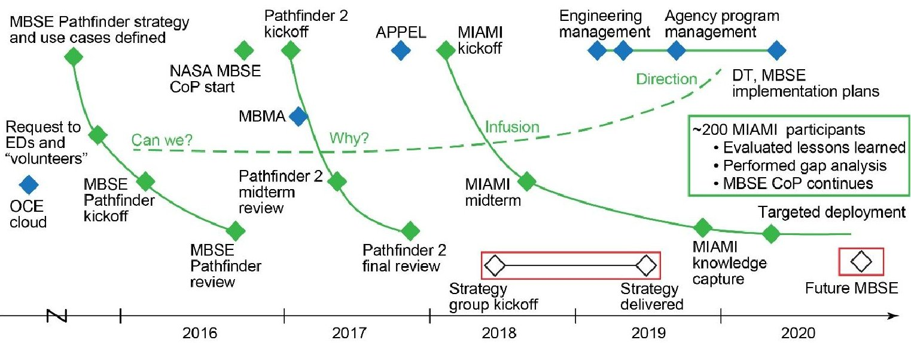
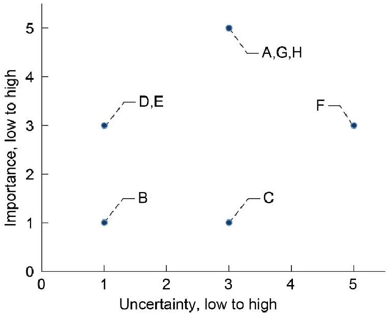
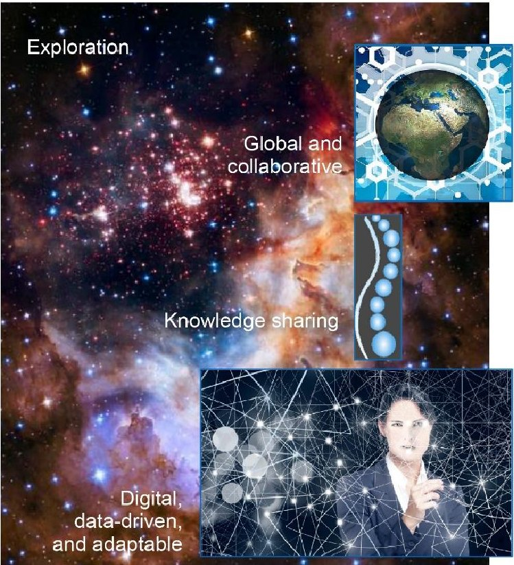
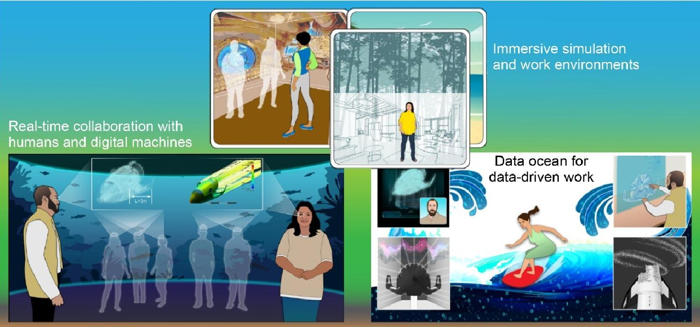
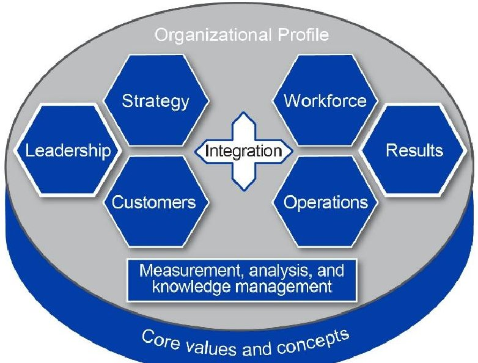

# Future model-based systems engineering vision and strategy bridge for NASA

Authors: Weiland, Karen, J

<!-- PDF_PAGE: 1 -->

NASA/TM-20210014025

Future Model-Based Systems Engineering Vision
and Strategy Bridge for NASA
Karen J. Weiland
Glenn Research Center, Cleveland, Ohio

October 2021

<!-- PDF_PAGE: 2 -->

NASA STI Program . . . in Profile

Since its founding, NASA has been dedicated                     •   CONTRACTOR REPORT. Scientific and
to the advancement of aeronautics and space science.                technical findings by NASA-sponsored
The NASA Scientific and Technical Information (STI)                 contractors and grantees.
Program plays a key part in helping NASA maintain
this important role.                                            •   CONFERENCE PUBLICATION. Collected
                                                                    papers from scientific and technical
                                                                    conferences, symposia, seminars, or other
The NASA STI Program operates under the auspices
                                                                    meetings sponsored or co-sponsored by NASA.
of the Agency Chief Information Officer. It collects,
organizes, provides for archiving, and disseminates             •   SPECIAL PUBLICATION. Scientific,
NASA’s STI. The NASA STI Program provides access                    technical, or historical information from
to the NASA Technical Report Server—Registered                      NASA programs, projects, and missions, often
(NTRS Reg) and NASA Technical Report Server—                        concerned with subjects having substantial
Public (NTRS) thus providing one of the largest                     public interest.
collections of aeronautical and space science STI in
the world. Results are published in both non-NASA               •   TECHNICAL TRANSLATION. English-
channels and by NASA in the NASA STI Report                         language translations of foreign scientific and
Series, which includes the following report types:                  technical material pertinent to NASA’s mission.

•   TECHNICAL PUBLICATION. Reports of                           For more information about the NASA STI
    completed research or a major significant phase             program, see the following:
    of research that present the results of NASA
    programs and include extensive data or theoretical          •   Access the NASA STI program home page at
    analysis. Includes compilations of significant                  http://www.sti.nasa.gov
    scientific and technical data and information
    deemed to be of continuing reference value.                 •   E-mail your question to help@sti.nasa.gov
    NASA counter-part of peer-reviewed formal
                                                                •   Fax your question to the NASA STI
    professional papers, but has less stringent
                                                                    Information Desk at 757-864-6500
    limitations on manuscript length and extent of
    graphic presentations.
                                                                •   Telephone the NASA STI Information Desk at
                                                                    757-864-9658
•   TECHNICAL MEMORANDUM. Scientific
    and technical findings that are preliminary or of           •   Write to:
    specialized interest, e.g., “quick-release” reports,            NASA STI Program
    working papers, and bibliographies that contain                 Mail Stop 148
    minimal annotation. Does not contain extensive                  NASA Langley Research Center
    analysis.                                                       Hampton, VA 23681-2199

<!-- PDF_PAGE: 3 -->

NASA/TM-20210014025

Future Model-Based Systems Engineering Vision
and Strategy Bridge for NASA
Karen J. Weiland
Glenn Research Center, Cleveland, Ohio

National Aeronautics and
Space Administration

Glenn Research Center
Cleveland, Ohio 44135

October 2021

<!-- PDF_PAGE: 4 -->

Acknowledgments

This work was performed as part of the model-based systems engineering (MBSE) Infusion and Modernization Initiative
(MIAMI) that was sponsored by the NASA Engineering and Safety Center, Systems Engineering Technical Discipline Team.
The contributions of Jon Holladay and Jessica Knizhnik for their assistance and inspiration are greatly appreciated.

                            Trade names and trademarks are used in this report for identification
                               only. Their usage does not constitute an official endorsement,
                               either expressed or implied, by the National Aeronautics and
                                                  Space Administration.

                  Level of Review: This material has been technically reviewed by technical management.

                                                       Available from
NASA STI Program                                                                           National Technical Information Service
Mail Stop 148                                                                                              5285 Port Royal Road
NASA Langley Research Center                                                                               Springfield, VA 22161
Hampton, VA 23681-2199                                                                                             703-605-6000

               This report is available in electronic form at http://www.sti.nasa.gov/ and http://ntrs.nasa.gov/

<!-- PDF_PAGE: 5 -->

Future Model-Based Systems Engineering Vision and
                      Strategy Bridge for NASA
                                           Karen J. Weiland
                             National Aeronautics and Space Administration
                                        Glenn Research Center
                                        Cleveland, Ohio 44135

                                              Summary
    A vision for the future of model-based systems engineering (MBSE) at NASA in 2029 and a strategy
bridge towards that future are presented. Strategic thinking and leading change concepts were used to
analyze reports and presentations on global trends and visionary thinking about the future of systems and
digital engineering. The context, strategic time horizon, stakeholders, strategic challenges, strategic
advantages, driving forces, and opportunities were considered. The analysis resulted in a future vision of
MBSE that shows what NASA systems engineers and digital machines will do to perform rapid,
extraordinary, and unprecedented missions. The NASA systems engineer, in this future vision, works
with a global project team in a virtual and collaborative environment, engineers the system, and uses
digital approaches as the routine and default way of working. The digital machines provide data-driven
and automated mission designs; have a backbone of program and project management, systems
engineering, and product life-cycle management; and are a knowledge-sharing infrastructure. The NASA
systems engineer and the systems engineering team are envisioned to use digital machines to plan and
perform rapid exploration missions, develop a digital twin that lasts across the life cycle, and develop
enduring and adaptable systems. NASA has an engineering enterprise and a life-cycle management
framework that endure, adapt, and respond. A strategy bridge based on the Baldrige Criteria for
Performance Excellence Framework and lessons learned from a recent MBSE initiative illuminates a way
forward from today to this desired future. The bridge lays out a strategy for leaders and recommends
investments of today for immediate benefits and for benefits in 2029.

1.0     Introduction
     Model-based systems engineering (MBSE) is defined as the formalized application of modeling to
support system requirements, design, analysis, verification and validation activities beginning in the
conceptual design phase and continuing throughout development and later life-cycle phases (Ref. 1). In
late 2015, the first MBSE Pathfinder strategy and use cases were defined and the MBSE Pathfinder ran
throughout 2016 (Ref. 2). The goal was to find out how well NASA systems engineers could use MBSE,
and what the engineers knew and what they did not know about implementation and use on real projects.
Over 30 participants from 8 of the 10 NASA centers worked on four teams, each with its own mission
focus area. Most of the participants were less than full time on the MBSE Pathfinder. The teams were
multicenter and everyone met as a large group for training and two face-to-face meetings but otherwise
worked virtually. At the end of 2016, a review and knowledge capture meeting provided a treasure trove
of findings, lessons learned, and recommendations for next steps directly from the participants. The
following year, in 2017, the MBSE Pathfinder was expanded to more teams and involved additional
partners and participants. The goal for this year was to find out why NASA should do MBSE and how to
use it on projects to perform useful work. A technical peer review panel and a pilot of the MBSE
community of practice (CoP) were added. Over 50 participants, with about 50 percent turnover between

NASA/TM-20210014025                                 1

<!-- PDF_PAGE: 6 -->

2016 and 2017, were on the MBSE Pathfinder in 2017. These 2 years provided the information and
confidence to proceed with further infusion into projects and building foundations for the user
community.
     In 2018, the effort was renamed to the MBSE Infusion and Modernization Initiative (MIAMI) to
indicate the growth of MBSE use on projects and the establishment of an advisory board, expansion of
the CoP, and a strategy group. Throughout MIAMI’s 5 years, the participants worked virtually across
centers and with partners inside and outside of NASA. Participants would often be part of MIAMI for 1
or 2 years, and carry their knowledge and expertise between MIAMI, their centers, and their project work.
The virtual experience foreshadowed and made it easier for the MBSE user community to adapt to
mandatory telework during the COVID–19 pandemic.
     Figure 1 summarizes the timeline for MIAMI from its start in the MBSE Pathfinder through its
completion at the end of September 2020. The downward trending arcs show the work in 2016, 2017,
2018 to 2020, and major events. The initial major themes are “Can We?” followed by “Why?” The
upward arc shows progress towards more formal Agency adoption and direction from the Agency
Program Management Council in the themes of “Infusion” and “Direction.” The rectangles show the time
period of the strategy group and future MBSE work.
     The strategy group was established in June 2018 and ran for a year. It had 11 early to midcareer
individuals from six different NASA centers who would directly see the benefits from their thought
processes. The group collectively had knowledge of trends in political, technological, educational,
organizational, and engineering areas; discipline expertise in areas related to systems engineering; and
adeptness in one or more new technologies (e.g., augmented reality, virtual reality, gaming, MBSE,
Internet of Things, data analytics, machine learning, natural language processing, etc.). The individuals
were willing to experiment with unproven ideas; able to work across geographic locations; able to
communicate and discuss ideas; self-starters; and interested in culture change, innovation, and creativity.
     The strategy group was asked to consider a big-picture view of systems engineering at NASA, which
would be digitally based and 20 years into the future. They produced a vision, a top-level roadmap, and a
strategic approach that was technology focused (Ref. 4). A complete report of the strategy group is
available in References 4 and 5.

 Figure 1.—Model-based systems engineering (MBSE) Infusion and Modernization Initiative (MIAMI) systems
   engineering digital strategy. Academy of Program/Project and Engineering Leadership (APPEL). Community of
   practice (CoP). Digital transformation (DT). Engineering directors (EDs). Model-Based Mission Assurance
   (MBMA). Office of Chief Engineer (OCE) (Ref. 3).

NASA/TM-20210014025                                   2

<!-- PDF_PAGE: 7 -->

The follow-on to the strategy group work is the future MBSE vision and strategy bridge as described
in this report. This vision and strategy bridge was one of the last major deliverables from MIAMI to the
Systems Engineering Technical Discipline Team.
     Although MIAMI ended in September 2020, the MBSE CoP continues with its 200+ members, a
NASA Engineering Network (NEN) website, and a Microsoft® TeamsTM channel. Over its 5 years,
MIAMI garnered over 200 participants who now make up a “smart buyer” MBSE user community. The
NEN site contains publications, reports, and modeling resources for the user community.
     The MIAMI leaders have many lessons learned from the past 5 years, as do the participants
themselves. The MIAMI leaders used the knowledge gained and lessons learned to evaluate gaps, point
the way, provide recommendations for Agency leaders and broaden awareness for the NASA community
(Refs. 3 and 6).

2.0     Approach
     The approach had four major steps: identify and gather sources of information, extract insights and
observations from the sources, analyze and generate conclusions and recommendations, and present the
results through technical reports and presentations.
     Papers, news articles, and reports of relevance to the future of MBSE were identified and gathered
from NASA, industry, other Government agencies, academia, professional societies, and software
vendors. Additional sources were the work done by the strategy group and a dialogue with the NASA
MBSE CoP. The 17 sources used are listed in the Appendix. Observations of trends and environments,
examples of visionary thinking about the future of systems engineering, digital engineering, and
engineering in general were extracted from each source. The complete list of extracted observations is in
the Appendix.
     The analysis of observations relied on strategic thinking and change leadership concepts and tools.
This included an examination of the context and selection of the strategic time horizon as well as
consideration of stakeholders, strategic challenges and advantages, driving forces, and current status. The
results were captured in the form of a vision, a gap analysis, and recommendations. The vision was
depicted in both text and graphics with details of how future work processes, environment, and culture
will differ from those of today. The gap analysis is presented in terms of what systems engineers will do
in the future, what they will not do in the future that they do today, and why should anyone care. The
recommendations for bridging the gap between the future and today were organized using criteria from
the Baldrige Performance Excellence Framework (Ref. 7).

3.0     Observations and Analysis
    This section discusses the observations and analysis results for context, stakeholders, strategic
challenges, strategic advantages, driving forces, and the strategic time horizon.

3.1     Context
     It is important to know the context of the world around NASA, both within and outside of aerospace,
as related to MBSE. Social, political, technological, economic, and other environments affect NASA
overall and how NASA does systems engineering. At NASA, the systems engineer plays a key role in the
project organization (Ref. 8). Trends and changes in the contextual environment will affect the ways in
which NASA does systems engineering for successful aeronautics and spaceflight endeavors going
forward.

NASA/TM-20210014025                                   3

<!-- PDF_PAGE: 8 -->

Two quotes illustrate the context of the global environment for aerospace organizations. The first
quote is from Eric Pearson, the Chief Information Officer of the International Hotel Group, who said “It’s
no longer the big beating the small, but the fast beating the slow” (Ref. 9). The second quote is from
Timothy West and Mark Blackburn, who wrote, “The digital transformation of the aerospace industry is
well underway, and there is no turning back” (Ref. 10). The message from these quotes is clear: those
who do effective digital transformation the fastest are more likely to be successful!
     In its Digital Engineering Strategy, the U.S. Department of Defense (DOD) recognized the imperative
for digital engineering and MBSE (Ref. 11). The DOD has the challenges of “balancing design, delivery,
and sustainment of complex systems with rapidly changing operational and threat environments, tight
budgets, and aggressive schedules.” They are implementing digital engineering to improve
responsiveness to threats and increase affordability, among other cited benefits. NASA has similar
challenges for quicker timelines from idea to mission operations and to provide the best possible return on
investment from taxpayer dollars for cost and mission effectiveness. NASA’s investigation of MBSE
during the MIAMI identified similar benefits in the areas of efficiency, effectiveness, priorities, and
understanding risks and opportunities (Ref. 5).
     To obtain a sense of the extent to which MBSE is being used or considered in the United States and
which companies are hiring in this area, a search of job postings on LinkedIn in late September 2020 was
done. The search criteria were MBSE jobs in the United States posted over the previous month. The
search returned over 1,000 results. Aerospace industry companies and others in transportation and
electronics, such as Ball Aerospace (part of the Ball Corporation), Bell Flight (part of Bell Textron, Inc.),
John Deere (Deere & Company), and Honeywell International, Inc., were among those represented. These
metrics provide a snapshot of how United States industry in many technical areas embrace the use of
MBSE and seek staff with expertise in MBSE and indicate the competition that Government agencies
such as NASA face for talent.
     A digital transformation initiative is underway at NASA (Ref. 12). NASA senior managers see digital
transformation as imperative to manage the risk of ambitious missions. MBSE is part of one of the six
digital thrusts in the digital transformation initiative, that of model-based everything. NASA leaders
acknowledged the importance of committed leadership to drive the effort and established a Digital
Transformation Officer position in October 2020. Their strategy is to coordinate an enterprise-wide digital
transformation. The work performed by the MIAMI leaders and participants was cited as an example of
the importance of having the benefiting organizations assume ownership of the transformational change
(Ref. 12).

3.2     Stakeholder Analysis
    The observations that were analyzed for aspects related to stakeholders are listed in the Appendix. A
summary of the stakeholders, expectations, and priority are in Table 1. The high priority stakeholders are
systems engineers and their managers and program and project managers due to their direct interactions
with the MBSE tools, the workforce, and the products from the tools. Software developers are also a high
priority as they are needed to code, adapt, modify, and maintain the MBSE tools and the digital
infrastructure in which the tools reside. The last set of high-priority stakeholders are the committed
Agency leaders for digital transformation initiatives such as MBSE. Although other groups of
stakeholders are listed as medium and low priority, all the listed stakeholders are important for the future
of MBSE.

NASA/TM-20210014025                                  4

<!-- PDF_PAGE: 9 -->

TABLE 1.—STAKEHOLDER ANALYSIS MATRIX
 Prioritya    Stakeholder                       Expectations                                     Challenge for model-based
                                                                                                  systems engineering (MBSE)
                                                                                                             leaders
    H           Systems         MBSE is how SEs do their work and is the backbone           Continue the momentum from
             engineers (SEs)    for all their work. SEs interact with other engineers,      MBSE Infusion and Modernization
                                engineering managers, program managers, project             Initiative (MIAMI); Build the use
                                managers, human resource specialists, and acquisition       of MBSE across the project life
                                specialists in a digital environment.                       cycle
    H           Systems         Managers are trained and educated in MBSE to increase       Having systems engineering
              engineering       their knowledge and understanding of what it is and its     managers enthusiastically get
               managers         value, in order to clearly guide and control an effective   behind and advocate for the
                                implementation.                                             changes implied by MBSE
    H         Program and       SEs get their work done and provide the information         Getting program and project
                 project        and products in a format that they can use to better        managers buy in to the new
               managers         understand the programs and projects they manage. SEs       paradigm of MBSE
                                provide information for data-driven decisions. Much of
                                the routine work is automated.
    H           Software        A high demand to support the digital transformation         Dedicated workforce with software
               developers       exists. NASA uses ways to reduce the effort for             competencies beyond the normal
                                software development and increase the pool of software      day-to-day work
                                developers.
    H        Agency leaders     NASA has strong and corporate commitment to MBSE.           Systems engineering leaders pay
                                Leadership expectations are clear and made known.           sufficient attention to the
                                Leaders delegate authority and resources to lower levels    development of the digital user
                                of management.                                              community and look beyond the
                                                                                            technology
    M           Industry        NASA uses MBSE to collaborate with industry to              Defining the interfaces
                                deliver products and services with increased efficiency.    (contractual and information
                                NASA acknowledges that MBSE gives companies a               technology (IT)) between NASA
                                competitive advantage. NASA has a corporate-wide            and industry for data and model
                                strategy for MBSE that considers industry as a key          delivery and exchange
                                partner in the approach.
    M           Software        NASA continues to purchase MBSE tools and IT. Large         Leaders with sufficient knowledge
                vendors         purchasers from other Government agencies and               of MBSE to make appropriate
                                industry and the Object Management Group (OMG)              choices for where to allocate
                                drive the capabilities of the tools.                        resources and investments; tool
                                                                                            choice drives systems engineering
                                                                                            processes
    M          Engineers        SEs better enable engineers in other disciplines to get     Integration of the data,
                                their work done in a more informed, efficient, and          information, and models across
                                effective manner. SEs aid the discipline engineers and      multiple disciplines
                                provide the information and products in a format that
                                they can use as well as provide information for data-
                                driven decisions. Much of the routine work is
                                automated.
    L             Academic      NASA needs SEs who have coursework and experience           Transition from academic training
                 institutions   in MBSE. NASA buys courses to train and upskill its         to actual use on a project
                                systems engineering workforce.
    L          Nontechnical     Visualization and experiential viewpoints allow             Methodological aspects of tool
                  audiences     nonexpert stakeholders to understand the models and         language become noise because
                                provide timely and meaningful feedback.                     they are far outside their domains
    L           Acquisition     Acquisition regulations allow the use of models for         Acquisition specialists buy in to
                  specialists   acquisition activities (proposals, deliverables, etc.). A   new paradigm of MBSE
                                digital acquisition process has the steps to do this.
aPriorities are high (H), medium (M), or low (L).

NASA/TM-20210014025                                            5

<!-- PDF_PAGE: 10 -->

3.3       Strategic Challenges
    The observations that were analyzed for strategic challenges for NASA are listed in the Appendix.
Five major challenges emerged from the observations.
      1. There is difficulty attracting and retaining workforce.
         a. Early-career, midcareer, and experienced people are leaving NASA for industry.
         b. Salaries, for civil service employees, are comparatively low for some locations.
         c. Rigid processes and overwhelming workloads are barriers to innovation.
      2. NASA has large numbers of acquisitions from the aerospace industry in which companies are
         moving rapidly into digital transformation.
         a. NASA acquisition life cycles and processes may not align with an industry that is going
             model based.
         b. NASA interacts with industry through public-private partnerships and fixed price contracts to
             a greater extent than in the past.
         c. The rights and access to intellectual and data property and digital artifacts and NASA
             procurement regulations and practices may present legal and organizational barriers.
      3. Availability of leaders and decision-makers who are familiar with understanding, leading and
         implementing MBSE, innovation, and change is insufficient.
         a. Many managers are familiar with technical advancements and less so with leading and
             implementing far-reaching innovation and change.
         b. There is a need for more committed leaders with authority and resources who provide clear
             strategic expectations that are aligned with innovation.
         c. Leaders and managers face difficulties in balancing their efforts to reduce barriers and
             remove roadblocks for innovation while minimizing disruption of critical and essential
             missions and services.
         d. Managers encounter obstacles when advocating for MBSE within current organizational
             structures and processes that expect document-centric systems engineering.
      4. Development times for major efforts are growing longer.
         a. Government Accountability Office High Risk Series report from 2019 stated that NASA
             acquisition management has been on its high risk list since 1990 and regressed between 2017
             and 2019 (Ref. 13). The report called out a skills gap in systems engineering and other areas.
         b. There is a risk of continued cost and schedule growth for major programs and projects.
      5. The complexity of NASA missions and system of systems approaches in NASA missions and
         organizations is increasing.
    A complex system comprises large numbers of strongly interacting elements that often have nonlinear
behavior, multiple feedback loops, and changing or uncertain boundaries (Ref. 14). A system of systems
has multiple components, each of which may be owned and operated by different entities, that combine to
deliver the desired service or product. Although NASA is one entity at the Federal agency level, NASA
has within it many organizational structures that are controlled and managed somewhat independently
from each other. The aspects of complexity and systems of systems that are relevant to MBSE are listed
here.

      •   Complexity:
          ○ The complexity of NASA missions is growing faster than our ability to manage it. Example
             missions are autonomous spacecraft and aircraft, launch vehicles, and crewed missions to
             distant, unexplored destinations.

NASA/TM-20210014025                                   6

<!-- PDF_PAGE: 11 -->

○   The complexity of NASA missions and organizations makes communications with all
              stakeholders similarly complex.
      •   System of systems:
          ○ Missions and organizational structures are each system of systems.
          ○ Major missions have increasing numbers of interacting elements with uncertain boundaries,
              emerging behaviors, and unanticipated consequences.
          ○ Engineers have difficulty using traditional systems engineering and project management
              processes to develop, test, operate, and maintain these systems.
          ○ Multiple internal and external organizations are involved in programs, projects, and
              innovation initiatives.
          ○ Informal partnerships and leveraging can occur with unclear, overlapping lines of authority,
              responsibility, and access to information.

3.4       Strategic Advantages
    The observations that were analyzed for strategic advantages specific to NASA are listed in the
Appendix. The sources were mainly NASA interactions and reports and presentations by NASA leaders.
Five major advantages emerged from the observations.
      1. Missions to explore the unknowns in both our own planet and beyond, and travel to distant
         worlds provide motivation for the workforce and has high interest from the public.
      2. NASA has an experienced workforce and world-class test and computational facilities.
      3. NASA has and continues to accomplish difficult, complex missions with high uncertainty,
         international partnerships, and long durations.
      4. NASA is using new partnerships with commercial industry and academia to accomplish its
         mission.
      5. NASA is known as a national leader in technical innovation.
    NASA has strategic advantages, beyond the ones listed here, that are specific to exploration,
development, and use of MBSE. For more than a decade, hundreds of engineers have had hands-on use of
MBSE on real projects and now form a “smart buyer” CoP with members from all NASA centers. During
the MIAMI existence from 2016 to 2020, the MIAMI leaders sought to capture knowledge and lessons
learned from the participants. The lessons learned that are applicable for when and how to implement
MBSE on programs and projects to provide value added solutions to real NASA engineering problems
were summarized in Reference 5. Additional suggestions of approaches for development of MBSE
capabilities, project deployment, technology and methods evolution, and the change process and how to
map those to an MBSE vision were presented in Reference 6. Through the MIAMI results and
experiences, NASA has an understanding of change leadership, change processes, and partnerships for
innovation and culture change, in addition to the technical aspects of MBSE.

3.5       Driving Forces
     The observations that were analyzed for driving forces are listed in the Appendix. Eight driving
forces were deemed to be most relevant to MBSE and are listed in Table 2 and shown in Figure 2 with
ratings for each of their importance for MBSE growth and level of uncertainty.

NASA/TM-20210014025                                  7

<!-- PDF_PAGE: 12 -->

TABLE 2.—KEY DRIVING FORCES FOR MODEL-BASED SYSTEMS ENGINEERING (MBSE)
                                                  [Also, legend for Figure 2.]
       Label                                               Key driving force
        A     Responding to new technology and the digital revolution
        B     Motivation to explore through science and innovation
        C     Change in national priorities
        D     Competition in global economy for employees
        E     Department of Defense and industry leadership in MBSE and digital engineering
         F    Need for rapid and agile responses to the increase in complex, quickly changing environments
        G     Barriers to change, cultural resistance
        H     Skepticism arising from lack of evidence for the value proposition or return on investment for MBSE

                               Figure 2.—Importance and uncertainty of key driving
                                 forces. Legend is in Table 2.

     The world around us continues at an accelerating rate of change in new technology and the digital
revolution. One recent example is a smartwatch with built-in health monitoring. What used to take
specialized equipment and a trip to the doctor’s office or hospital (electrocardiogram and blood oxygen
level) can now be captured on your wrist. New technology and the digital revolution continue to open up
opportunities for MBSE.
     The DOD and industry leaders in MBSE and digital engineering drive the acquisition chain from
service branches to suppliers of systems and their suppliers, along with software and service vendors, and
academic institutions who provide education. Many of the DOD suppliers and vendors are also NASA’s
suppliers.
     The increase in complex, quickly changing environments drives the examination of new approaches
to doing traditional systems engineering, which are based on practices developed decades ago. The
environment at NASA has changed significantly and new capabilities can be wielded for these
environments.
     Figure 2 provides different ways of determining a path forward. If an organization is considering an
initiative in an area that is driven by a force with high uncertainty, it may wish to investigate and explore
the area to understand the driving force and reduce the uncertainty. An organization may also choose to
sponsor initiatives in high-impact, low-uncertainty areas. Low uncertainty does not mean it is easy to
address the driving force; it means that the driving force is known.

NASA/TM-20210014025                                         8

<!-- PDF_PAGE: 13 -->

3.6     Strategic Time Horizon
    The initial timeframe considered for the future of MBSE at NASA was 20 years in the future, or
2039. After completing the analysis of context, challenges, and driving forces, it was apparent from the
pace of change that the timeframe could be reduced to 10 years or less. The question was asked: what are
NASA systems engineers doing in 2029 or next year?

4.0     Results
    The future MBSE vision is presented as a summary with in-depth perspectives. The vision describes
what NASA systems engineers and digital machines will do and how they will interact. A strategy bridge
based on the Baldrige Criteria for Performance Excellence Framework provides recommendations for
leaders and strategy and where investments of today would provide immediate and longer term benefits.

4.1     Future Model-Based Systems Engineering Vision—2029
     The future MBSE vision statement is in three parts: (1) what the NASA systems engineer does, (2)
what the digital machines do, and (3) what the NASA systems engineers and the digital machines do for
NASA missions and what that means for NASA organizations. The vision statement conveys what it
means to be a NASA systems engineer in the future and allows systems engineers to see themselves and
envision their work activities. The vision statement allows systems engineers to see how they do their
work with people and digital machines. And the vision statement tells systems engineers the reasons why
they are doing their work, the NASA missions, and the infrastructure that enables the missions. Important
attributes of the vision are depicted in Figure 3.

                           Figure 3.—Important attributes of future model-based systems
                             engineering vision.

NASA/TM-20210014025                                  9

<!-- PDF_PAGE: 14 -->

The vision statement has three main parts with supporting statements for each part.

  1. The NASA systems engineer works with a global project team in a virtual and collaborative
     environment, engineers the system, and uses digital approaches as the routine and default way of
     working.
         a. NASA systems engineers work with many people on the project in a virtual, collaborative
             environment. The team is located around the globe and they are immersed in an
             environment that simulates their system of interest in operation. They have digital
             assistants, and they personalize their mixed-reality work environments. Learning is
             through personalized interactions with a knowledge-sharing infrastructure that provides
             knowledge and data when asked.
         b. NASA systems engineers “engineer the system” and design and develop at the system
             level to achieve the desired system performance. They provide the needs, concept of
             operations, and constraints, and guide digital machines to generate and optimize system
             architectures and designs. They use the digital machines to obtain deeper insights, do
             tradeoffs, and carry alternatives for design options until key decision points.
         c. NASA systems engineers use digital approaches as the routine and default way of
             executing the project. They use digital information, data, and models from many
             locations in a seamless way across the entire project life cycle. The NASA systems
             engineers develop, test, and operate a system of systems, that is, a large number of
             interacting elements with uncertain boundaries, emerging behaviors, and unanticipated
             consequences.
  2. The digital machines provide data-driven and automated mission designs; have a backbone of
     program and project management, systems engineering, and product life-cycle management; and
     are a knowledge-sharing infrastructure.
         a. The digital machines provide data-driven, automated mission designs. Their
             computational power drives simulations and builds optimized designs. The digital
             machines know standards and guidelines and account for them.
         b. The digital machines have a backbone of program and project management, systems
             engineering, and product life-cycle management activities. The digital machines store and
             supply physics-based, human, social, and economic aspects of the system and its life-
             cycle management activities.
         c. Digital machines are a knowledge-sharing infrastructure. The machines provide
             information that the NASA systems engineer needs at the right time. The machines
             gather, retain, and provide information and the wisdom of pioneers to the NASA
             workforce.
  3. The NASA systems engineer and the systems engineering team use digital machines to plan and
     perform rapid exploration missions, develop a digital twin that lasts across the life cycle, and
     develop enduring and adaptable systems. NASA has an engineering enterprise and a life-cycle
     management framework that endure, adapt, and respond.
         a. The NASA systems engineer and team use digital machines to plan and perform robotic
             and human exploration missions on and off planet Earth.
         b. The NASA systems engineer and team develop a digital twin that lasts across the life cycle.
             They use an integrated simulation of a system, including humans, that applies models,
             information, and input data to mirror and predict activities and performance over the life of

NASA/TM-20210014025                               10

<!-- PDF_PAGE: 15 -->

its corresponding physical twin. They share information across many disciplines and
               organizations by the computational and communications framework of a digital thread.
            c. The NASA systems engineer and team develop systems that endure and adapt to complex
               and changing conditions. They respond rapidly with verified and validated solutions.
            d. The NASA systems engineer and team use an engineering enterprise and a life-cycle
               management framework that also endure, adapt, and respond.

     Figure 4 shows indications of the future. The strategy group anticipated that four forces—mission,
people, technology, and place—will interplay. Human creativity integrates with machine capabilities, and
engineers use system-focused, human-centered technologies to design bold, new missions. The graphics
are from those prepared by the strategy group in 2019 (Ref. 3). Please refer to the publication for
additional and more specific information.
     The lower left panel of Figure 4 depicts how real-time collaboration with humans and digital
machines allows team members to look at different views of the same system, and discuss them, at the
same time. Each sees the aspects of the system that are of interest. This example shows two engineers
viewing a vehicle, with one seeing dimensions and the other seeing stress calculations. This collaborative
environment enables rapid interaction in a distributed, seamless way and provides the engineers with
deeper insight into mission design requirements and constraints.
     The top center panel of Figure 4 depicts how immersive simulation environments let an engineer
observe the system in action in its intended environment. The example shows an engineer “viewing” the
interior of a vehicle design. Another example is watching how a small launch vehicle launches from the
surface of another planet, such as Mars. An immersive work environment lets individual engineers work
where they want to be, in the forest or at the beach. New technologies and applications blur the
boundaries of physical, digital, and biological worlds, and change the ways we live, work, interact, and
communicate.
    The lower right panel of Figure 4 depicts an engineer surfing the data ocean for data-driven work.
The 1s and 0s in the data ocean and waves may be used for a model library, human-artificial intelligence
collaboration, data-driven manufacturing, and dynamic testing.

                     Figure 4.—Aspects of future model-based systems engineering vision.

NASA/TM-20210014025                                  11

<!-- PDF_PAGE: 16 -->

4.2       Future Model-Based Systems Engineering Vision—2029 Deeper Look
     A deeper look at the future MBSE vision provides a thought-provoking, but not predictive, view of
the future. Each part of the vision is considered in terms of what will be done in the future, what will not
be done compared to today, and why should anyone care. Table 3 is about the NASA systems engineer in
2029. The easier and better ways in which a systems engineer will work are in the first column labeled
“Will do in the future.” The challenges that a systems engineer faces daily are in the column labeled “Will
not do in the future that we do today.” The expected benefits to the systems engineers are in the third
column labeled “Why should I care?”
     Table 4 is about the digital machines in 2029 and has three columns labeled the same as Table 3. The
first column is what the digital machines will do in 2029. The second column is what NASA systems
engineers will not do that the digital machines will do instead. The third column, again, provides reasons
for why one should care. The information covers many of the needs and desires that systems engineers,
managers, and educators have expressed based on their knowledge of what the digital machines can do
currently and their projections into the future. The accelerating pace of development of digital machines,
infrastructure, and software codes suggests that these capabilities may be available very soon. A systems
engineer should have a mindset that is open to the new ways of working with digital machines, and let the
machines do what they are good at and let the people do what they are good at.
     Table 5 brings it all together for NASA missions in 2029. It shows how the NASA systems engineer
uses digital machines to plan and perform NASA missions in 2029, and the engineering enterprise and
life-cycle management framework. The three columns are labeled the same way as the previous tables.

                                      TABLE 3.—NASA SYSTEMS ENGINEER IN 2029
       Will do in the future          Will not do in the future that we do today                 Why should I care?

 Global project team                 Siloed, disconnected, burdensome               Easier access to expertise from anywhere;
                                          approaches for knowledge transfer              better connections between areas of
                                          among individuals in different                 deep expertise (silos); and opportunity
                                          organizations                                  to work on interesting projects from
                                                                                         any location
 Virtual, collaborative              Excessive travel or commute time               Spend more time doing engineering work
      environmenta                                                                       that contributes to accomplishing
                                                                                         NASA’s missions
 Immersive simulation of system      Testing that covers all possible conditions;   Easier to explore more of the option space;
    of interest in operation              large leaps of imagination                     greater confidence that the design
                                                                                         works as predicted; higher likelihood of
                                                                                         optimal solution; and quicker
                                                                                         understanding
 Digital assistant                   Spend time looking for documents and           Spend more time doing engineering work
                                         data                                            that contributes to accomplishing
                                                                                         NASA’s missions
 Engineers the system:                Lock in prematurely on the design and rely    Better access to broad knowledge base;
      automated generation and             solely on the knowledge of subject            easier to explore more of the option
      optimization of                      matter experts of components                  space; and higher likelihood of optimal
      architectures and designs                                                          solution
 Digital approaches as routine        Not Microsoft® OfficeTM-based and             On-demand, seamless, and integrated view
      and default way of                   messages from everywhere (email,              of your work
      working                              chats)
 aFace-to-face meetings and working in laboratories, test cells, and facilities have definite value and will continue. The work

      that can be done virtually will be done that way.

NASA/TM-20210014025                                             12

<!-- PDF_PAGE: 17 -->

TABLE 4.—DIGITAL MACHINES IN 2029
       Will do in the future             Will not do in the future that we do today                    Why should I care?
Data-driven, automated mission         Design by separated individuals and teams        Less reliance on institutional memory and
    designs                                                                                  easier to explore design space beyond the
                                                                                             imagination
Simulations and build optimized        Build and evaluate point designs; select the     Overall system is better optimized for desired
    designs                                 design early and cannot easily adjust to         performance, cost, schedule, and risk;
                                            changing environments                            assistance to make sound decisions by
                                                                                             fully understanding the impact of changes
                                                                                             to parameters and interfaces when the
                                                                                             digital machine presents alternative
Know and account for standards         Manually select and assess compliance to         Shortens time and reduces errors
     and guidelinesa                      standards and guidelines
Backbone of program and project        Managers and engineers mentally                  Managers and engineers are presented more
     management, systems                  synthesize separated information                 comprehensive and clearer integrated
     engineering, and product life-                                                        project views
     cycle managementb
Store and supply physics-based and     Individual, physics-based aspects                Better understanding of how the system and its
     social aspectsc                                                                         environment, including humans, interact
Knowledge-sharing infrastructured      Process data and information into                Easier access to all of NASA’s historical data;
                                           databases; track down the experts; and            faster access to the right information at the
                                           search the World Wide Web                         right time; and reduces errors, which have
                                                                                             led to past mishaps
aPeople tailor the standards appropriately.
bThese disciplines serve as the underpinnings of NASA programs and projects and their life cycles from concepts through

     development, operations, and retirement. It is important to match the digital machines, in infrastructure and processes, with the
     ways in which NASA does business.
cExamples of physics-based aspects are structures, materials, heat transfer, optics, and chemical reactions. Examples of social aspects

     are how humans will use the systems, how accepting is the public of NASA’s systems, how do the people at NASA interact to
     develop and operate the systems, and how do people at NASA share knowledge.
dTraining will be more efficient and enjoyable through knowledge-sharing infrastructure and personalized interactions with the

     machine. There will be continuous data gathering and incremental learning.

                                                 TABLE 5.—NASA MISSIONS IN 2029
          Will do in the future               Will not do in the future that we do today               Why should I care?
  Plan and perform rapid exploration     Long time between brilliant idea and the           NASA does rapid, extraordinary, and
       missions                               mission or flight                                   unprecedented missions
  Develop a digital twina                Functional models of hardware and                  Reduces the amount of scrap and rework
                                              software and individual analyses and                and enables focused testing and
                                              simulations                                         evaluation at lower cost and less time
  Mirror and predict performance         Time- or exposure-based maintenance and            Data-driven maintenance allows mission
      over the life of the system             repair upon failure                                 to intervene before failure
  Share information across               Manually collect information from many             Shared, authoritative information available
      disciplines and organizations           sources and assess which is the right               on demand to everyone on the project
      by a digital thread                     version to use                                      (NASA and partners)
  Develop enduring and adaptable         Develop brittle systems for one purpose and Easy reuse of existing systems for new or
      systems                                 discard or mothball systems because                 changing purposes and conditions
                                              they are not easily adaptable or
                                              reusable
  NASA engineering enterprise and        Large infrastructure changes to                    NASA missions reflect the flexibility and
      life-cycle management                   accommodate new methods and                         adaptability of our organizations and
      framework endure and adapt              technology and years to decades                     up-to-date systems compared to our
                                              behind in new technology                            suppliers and partners
  aAnalyses pull from an authoritative source of truth, so that all the analysts are looking at the same design at the same time.

  NASA/TM-20210014025                                              13

<!-- PDF_PAGE: 18 -->

The rest of this report provides recommendations for how NASA can start to attain this future. Many
large and small changes are needed to attain this vision. The phrase “what you foresee, is what you get”
expresses how expectations, strategic thinking, and approaches used for innovation such as design
thinking, may help NASA determine how to get to the future vision, what NASA should do, and who
should lead (Ref. 15).

4.3     Model-Based Systems Engineering Strategy Bridge
     The anticipated changes have significant complexity with multiple disciplines and rapidly evolving
technologies. Within NASA, there are many organizations and individuals with responsibility and
influence that could be part of realizing the future MBSE vision. From 2016 to September 2020, the
NASA Engineering and Safety Center Systems Engineering Technical Discipline Team led MBSE for the
Agency through its sponsorship of MIAMI. The top lessons learned were captured near the end of
MIAMI (Ref. 5). The Agency MBSE CoP continues on and leads the user community to learn, develop,
and advance MBSE. The Agency MBSE CoP interacts with center-level groups, often at the user level.
An Agency MBSE Leadership Team was formed that took over the leadership of MBSE for the Agency
from MIAMI. Each NASA center has a representative on this team. NASA established a Business
Innovation Office to lead its digital transformation. One of the six digital thrust areas, that of Model-
Based X, has MBSE as part of the thrust area, as are model-based mission assurance and model-based
project management and others. The remaining five digital thrust areas, those of artificial intelligence and
machine learning, collaboration, culture and workforce, data, and process transformation, all have a role
in realizing the future MBSE vision. The Digital Transformation team has representatives from NASA
centers, mission directorates, and mission support areas. There are also external entities in other
Government agencies, industry, and academia who are advancing MBSE. Many of these entities and
individuals engage in professional societies, working groups, and standards organizations.
     Because of the number of disciplines, rapidly evolving technologies, and numbers of organizations
involved, a strategy bridge from today to the future is needed. The strategy bridge organizes the “what”
NASA should do, and the characteristics of “who should lead.” The strategy bridge from today to the
future needs enough structure to close the gaps and to be flexible and adaptable.
     The Baldrige Criteria for Performance Excellence Framework (Ref. 7), as shown in Figure 5, is one
approach for a strategy bridge and is used here. The framework provides a way for an organization to
examine its adherence to core values and concepts, such as valuing people, visionary leadership,
customer-focused excellence, and more. It also provides a way for an organization to examine how its
core values and concepts are embedded in its processes for leadership, strategy, customers, measurement,
analysis, and knowledge management, workforce, and operations. The framework provides a way for an
organization to examine how the processes yield results in the areas of financial, leadership, products, the
workforce, and more. The results are represented at the top of the cylinder in the right-most hexagon.
     The organizational profile aspects of leadership and strategy were considered first and are
summarized in Table 6. The left column of the table lists what leaders should do and what they need to
know. The right column of the table lists important aspects of a strategy for obtaining the future MBSE
vision.

NASA/TM-20210014025                                 14

<!-- PDF_PAGE: 19 -->

Figure 5.—Baldrige Criteria for Performance Excellence
                               Framework (Ref. 7) (Credit: Adapted from Baldrige
                               Performance Excellence Program. 2021. 2021–2022
                               Baldrige Excellence Framework: Proven Leadership and
                               Management Practices for High Performance. Gaithersburg,
                               MD: U.S. Department of Commerce, National Institute of
                               Standards and Technology. https://www.nist.gov/baldrige.)

                        TABLE 6.—BRIDGING THE GAP WITH LEADERS AND STRATEGY
                           Leaders                                                   Strategy
     •   Understand and communicate a big-picture, long-term      •   Provide a framework to lead and manage future
         vision                                                       MBSE as a unified whole
     •   Express clear expectations                               •   Provide a supportive environment, processes,
     •   Demonstrate organizational commitment to model-              and resources that encourage innovation
         based systems engineering (MBSE);                        •   Allow for significant and rapid change, agility,
     •   Engage with the workforce, partners, and customers to        and flexibility in approaches
         produce results                                          •   Minimize disruption of critical and essential
     •   Leverage lessons learned from the workforce and              missions and services
         Agency and local MBSE leaders                            •   Tap into workforce motivation and competence,
     •   Balance short-term demands with long-term                    test and computational facilities, and partnership
         investments                                                  experience
     •   Knowledgeable about MBSE, and implementation             •   Show the value of MBSE and gain advocates
         approaches for culture change and new technology             along the way
     •   Knowledgeable about digital engineering, digital twin,
         and more

     The leaders in Table 6 are the people who lead Agency and center-level groups and organizations
with responsibility and authority to advance MBSE. The leaders are also members of the workforce in
any organizational level or role. The workforce members help leaders by filling in knowledge gaps, being
open about their experiences and concerns, and communicating with their peers. Workforce members
help leaders by asking the right questions, such as what is your big-picture and long-term vision? what are
your expectations of me in this area? and how can I help you, help all of us? The leaders and workforce
members can do their parts by learning more about MBSE, new technology, and culture change as a place
to start. Each person has strengths and weaknesses, and together, the leaders and members have the
collective knowledge and leadership for success.
     The aspects of the strategy listed here are relevant to the operating environment, leverage the
organization’s strengths, and recognize the challenges of innovation and change leadership. Each of these

NASA/TM-20210014025                                         15

<!-- PDF_PAGE: 20 -->

was used during MIAMI (Refs. 2 to 6). This recommended strategy builds upon the successes of MIAMI
towards realizing the future MBSE vision. In addition, the MIAMI leaders adapted and applied concepts
and tools from design thinking, lean startup, high-technology marketing, and change leadership (Refs. 15
to 18).
     A strategy is more than the vision; it is how the vision is realized in terms of organizational
environment, approach, and resource allocation. The details and specifics are in the tactics. It should have
insight into the current and future contexts and contain decisions on goals and objectives. Milestones and
plans for its implementation can be tracked, evaluated, and adjusted. A strategy should consider how to
implement changes without disrupting critical and essential missions and services. It is undesirable for it
to stop NASA missions for months to years for changes. It may be useful for the long timeframes of
decades or short timeframes of months to years. The time duration for a strategy depends on the strategic
time horizon. It will need regular tuneups, such as quarterly. Lastly, a strategy is as much about what is
chosen not to do as much as what is chosen to do. Deliberate decisions on where the organization focuses
its efforts and resources mean that not everything can be done nor should it.
     The organizational profile aspects for customers; workforce; operations; and measurement, analysis,
and knowledge management were considered next. Recommendations for investments that would provide
immediate benefits are summarized in Table 7. Leaders and their strategy will drive the selection and
priority of investments in these profile aspects.
     Recommendations for investments of today that would provide benefits in 2029 or earlier are
summarized in Table 8. The future will arrive sooner than we perceive, and industry partners are moving
this way very quickly. Leaders and their strategy will drive the selection and priority of investments in
these profile aspects.

                                TABLE 7.—INVESTMENTS OF TODAY FOR IMMEDIATE BENEFITS
   Measurement, analysis, and                Customersb                         Workforcec                Operations and processesd
       knowledge managementa
      •     Digital knowledge        Program and project                •     Engaged in future              •   Virtual,
            sharing infrastructure        managers, systems                   model-based systems                collaborative
      •     Ways to measure and           engineers, and                      engineering (MBSE)                 environment
            analyze meaningful            product life-cycle                  planning and                   •   Work processes that
            performance                   managers are satisfied              implementation                     improve workforce
            improvement data                                            •     Trained and upskilled              performance and
                                                                              workers                            reduce errors
                                                                        •     Stay on the job with
                                                                              workforce retention
                                                                              policies and incentives
 aThe metrics by which success is evaluated through performance improvement data will drive behavior and may result in unintended

      consequences.
 bInvolve program and project managers, systems engineers, and product life-cycle managers to understand their needs and what will

      satisfy them. You will have happy stakeholders, and they will tell their friends.
 cInvest in training and upskilling workers, even for those who may appear less able to learn MBSE. Many of NASA’s best MBSE

      modelers are later-career employees. Workforce retention policies and incentives help convince a skilled workforce to stay on
      the job.
 dThe virtual, collaborative environment builds upon what became so essential for NASA in 2020 and 2021 during the global COVID

      pandemic.

NASA/TM-20210014025                                          16

<!-- PDF_PAGE: 21 -->

TABLE 8.—INVESTMENTS OF TODAY FOR 2029
  Measurement, analysis, and             Customers                    Workforce              Operations and processes
      knowledge management
    •    Digital knowledge           •   Have access to         •   Receive performance          •   Digital
         and accounting for              information                incentives for digital           approaches as
         standards and                   across disciplines         approaches                       routine and
         guidelines                      and organizations      •   Work from anywhere               default way of
    •    Digital, data-driven,           by a digital thread        under policies for a             working
         automated mission           •   Access physics-            global project team          •   Develop
         designs                         based and social       •   Dedicated workforce              enduring and
    •    Digital system                  aspects of their           with competencies                adaptable
         simulations and                 system before              beyond day-to-day                systems
         optimized designs               completion                 work
         including digital twin

5.0       Application of Lessons Learned From Modeled-Based Systems
          Engineering Infusion and Modernization Initiative
    From 2016 through 2020, over 200 participants on MIAMI captured important lessons learned. These
were highlighted in the NASA Engineering and Safety Center webinar on October 14, 2020, by Jessica
Knizhnik, on “MBSE to MIAMI to Implementation, an Overview” and are in References 4 and 5. These
lessons learned, along with experiences in leading a change initiative, are described here for their
application to the future MBSE vision and strategy bridge.

      •   Do things with a purpose and to solve a problem. Consider ways to bring together the multiple
          disciplines and organizations needed for the future MBSE vision. A problem-based challenge,
          similar to the Defense Advanced Research Projects Agency (DARPA) Grand Challenge for an
          autonomous vehicle, could bring together people from a broad spectrum of disciplines and create
          the conditions for rapid development and engagement (Ref. 19).
      •   Do things slowly and steadily. A good approach is to evolve, take small steps, test a little, learn,
          iterate or pivot, and build. Do not boil the ocean to start, instead first boil water for the teacup and
          grow. Point your efforts to the big change and you will get there.
      •   Find the bold, committed leaders, and give them authority and resources. This demonstrates
          organizational commitment and empowers the leaders for real action. The leaders then empower
          people at lower levels who understand and are guided by the vision.
      •   Use new ways of thinking to look at the problem in new ways. Use and adapt approaches from
          other disciplines, such as the design and business worlds, to your advantage. Design thinking,
          lean startup, high technology marketing, strategic thinking, and others can assist you in reframing
          and solving your problems.
      •   Engage and reengage with stakeholders, especially with those most impacted by the future MBSE
          vision. There are many changes in processes, skills, the use of technology, and infrastructure
          associated with this vision. Any approach needs to acknowledge that there are parts of the future
          MBSE vision that make people uncomfortable. Keep at the forefront the needs of the users.

    The barriers to change are real and must be acknowledged. The main ones are cultural resistance to
change, difficulties with the software tools, and the insufficient pipeline and training of systems engineers
with skills in these areas. These barriers may be overcome with knowledgeable and committed leaders;
more and improved training; and designated responsibilities and roles for MBSE in the NASA
organizations.

NASA/TM-20210014025                                       17

<!-- PDF_PAGE: 22 -->

6.0     Concluding Remarks
    A future model-based systems engineering (MBSE) vision shows what NASA systems engineers and
the digital machines do to perform rapid, extraordinary, and unprecedented missions in 2029. The NASA
systems engineer works with a global project team in a virtual and collaborative environment, engineers
the system, and uses digital approaches as the routine and default way of working. The digital machines
provide data-driven and automated mission designs; have a backbone of program and project
management, systems engineering, and product life-cycle management; and are a knowledge-sharing
infrastructure. The NASA systems engineer and the systems engineering team use digital machines to
plan and perform rapid exploration missions, develop a digital twin that lasts across the life cycle, and
develop enduring and adaptable systems. NASA has an engineering enterprise and a life-cycle
management framework that endures, adapts, and responds.
    A strategy bridge illuminates a way from today to a desired future and how MBSE adoption can be
more rapid with committed leaders and managers with authority and resources to establish a long-term
capability.

NASA/TM-20210014025                                18

<!-- PDF_PAGE: 23 -->

Appendix—Future Model-Based Systems Engineering Sources
                                and Observations
    Table 9 contains a list of publications, reports, and presentations from which observations about
model-based systems engineering have been made. These observations are broken down by the type of
organization the observation is from and indicate each category the observation would fulfill. The
following list indicates the tables by organization.

    •       Table 10: academia
    •       Table 11: industry
    •       Table 12: NASA
    •       Table 13: other Government agencies
    •       Table 14: professional societies
    •       Table 15: software vendors

                       TABLE 9.—FUTURE MODEL-BASED SYSTEMS ENGINEERING SOURCES
 Citation                                         Publication
 number
    1        Bajwa, Anupa R., et al.: Strategic Perspectives on the Future of Systems Engineering at NASA. NASA/TM-
                  20205002911, 2020. https://ntrs.nasa.gov
    2        Pawlikowsi, G.: Independent Assessment of Perception From External/Non-NASA Systems Engineering (SE)
                  Sources. Report Submitted to NASA Tech Fellow for SE, 2020.
    3        NASA Model-Based Systems Engineering Community of Practice. Future MBSE Channel of MBSE CoP, MS
                  Team Chat, Download 2020-08-17, 2020.
    4        Department of Defense: Digital Engineering Strategy. Office of the Deputy Assistant Secretary of Defense for
                  Systems Engineering, 2018.
    5        International Council on Systems Engineering: State of the Discipline. 2019.
    6        Huldt, T.; and Stenius, I.: State-of-Practice Survey of Model-Based Systems Engineering. Systems Engineering,
                 2018, pp. 1–12.
    7        Watson, M.D.: Future of Systems Engineering. INCOSE Insight, vol. 22, no. 1, 2019, pp. 8–12.
    8        Watson, M.D.: Systems Engineering Principles and Hypotheses. INCOSE Insight, vol. 22, no. 1, 2019, pp. 18–28.
    9        Mordecai, Y.; and Dori, D.: Towards a Quantitative Framework for Evaluating the Expressive Power of
                  Conceptual System Models. INCOSE Insight, vol. 21, no. 1, 2018, pp. 28–37.
   10        Peterson, T.: Systems Engineering: Cracking the Code of Digital Transformation. INCOSE Insight, vol. 22, no. 1,
                  2019, pp. 29–31.
   11        Ryan, M.: On the Use of Perspective in Managing Complexity. INCOSE Insight, vol. 21, no. 1, 2018, pp. 38–41.
   12        Stoewer, H.; and Lin, C.: Results from the Panel on MBSE Transition Towards the Digital Enterprise—Where Do
                 We Go From Here? INCOSE Insight, vol. 22, no. 1, 2019, pp. 51–53.
   13        West, T.D.; and Blackburn, M.: Demonstrated Benefits of a Nascent Digital Twin. INCOSE Insight, vol. 21, no. 1,
                 2018, pp. 43–47.
   14        McDermott, T.; and Salado, A.: Art and Architecture: Effectively Communicating Models of Systems. Proceedings
                 of the 2018 Annual IEEE International Systems Conference, Vancouver, Canada, 2018.
                 https://ieeexplore.ieee.org/document/8369605
   15        Hale, J.P., et al.: Digital Model-Based Engineering: Expectations, Prerequisites, and Challenges of Infusion.
                 NASA/TM—2017-219633, 2017. https://ntrs.nasa.gov
   16        Madni, A.; and Sievers, M.: Model-Based Systems Engineering: Motivation, Current Status, and Research
                 Opportunities. Syst. Eng., vol. 21, 2018, pp. 172–190.
   17        Holladay, J.; and Crumbley, T.: SE Strategic Vector. Draft presentation, 2018.

NASA/TM-20210014025                                           19

<!-- PDF_PAGE: 24 -->

TABLE 10.—FUTURE MODEL-BASED SYSTEMS ENGINEERING (MBSE) OBSERVATIONS: ACADEMIA
        [Stakeholder analysis (SA). Strategic challenges (SC). Strategic advantages (SAD). Key driving forces (KDF).
                                                       Future MBSE vision (FMV).]
Citation                                     Observations                                 SA SC SAD            KDF FMV
   2       Source has a digital manufacturing and design (DMD) perspective; is             X
                involved with Coursera Inc. DMD and MBSE courses, and an
                Industrial Systems Engineering Department, dealing with industry
                systems.
   2       Source co-authored the book titled Effective Model-Based Systems                X
                Engineering.
   2       Source has taught short courses on Systems Modeling Language (SysML)            X
                and how to model with No Magic (Dassault Systemes) at most NASA
                Centers and currently at Naval Air Systems Command (NAVAIR).
   2       We offer a systems engineer (SE) Master’s and Doctor of Philosophy              X
                degrees and a SE certificate with MBSE and SysML courses.
   2       Source has a computer science course that teaches students how to build         X
                MBSE tools.
   2       “I do not believe SysML is that scalable and cannot do formal reasoning, so                          X    X
                we have been going down a road to replace SysML with building
                ontologies and infrastructure semantic digital twins.”
   2       MBSE will be replaced by digital twin because SysML by itself is only                                X    X
                useful for the front end of product development life cycle.
   2       Model-based engineering (MBE) will have to find its way into courses for        X
                bachelor’s degrees and below.
   2       A key challenge with making systems engineering faster and more efficient            X               X
                is dealing with cultural issues and change.
   2       A key challenge in adopting MBSE is adequate training; if we are not            X    X               X
                training them until they get their Master’s, we are not infusing MBSE
                enough into the culture.
   6       There is a need to increase the capabilities to perform model-based                                       X
                approaches on a greater scale, for example, life-cycle, program, and
                portfolio management.
   6       Latter parts of the systems engineering life cycle need further development
                of MBSE applications, methods, and notations, to support, for example,
                risk management, technical reviews, and verification and validation
                (V&V).
   6       The main inhibitors include cultural hurdles, the MBSE learning curve, and      X    X               X
                availability of skills.
   6       An inhibitor is due to cultural and general issues.                                  X               X
   6       An inhibitor is the lack of perceived value of MBSE.                                                 X
   6       An inhibitor is the availability of skills.                                     X                    X
   6       An inhibitor is the lack of management support.                                 X    X               X
   6       An inhibitor is the MBSE learning curve.
   6       Inhibitors can most likely be significantly reduced if management, training,    X    X               X
                and structures are improved, which again is a matter for the
                organization's management.
   6       Organizations that have not addressed these issues (hurdles) at the             X    X               X
                appropriate management level (e.g., choosing to delegate authority and
                resources to lower levels of management) have failed to establish a
                long-term capability.
   6       A successful implementation of a model-based approach is a management           X    X               X
                issue that can only be resolved through a clear and committed
                leadership. This requires that managers have the relevant understanding
                and competence.

NASA/TM-20210014025                                      20

<!-- PDF_PAGE: 25 -->

TABLE 10.—Continued.
Citation                                     Observations                                   SA   SC   SAD   KDF   FMV
   6       However, systems engineering tools are not generally applied in a wider                                 X
                context to support collaborative environments to integrate different
                technical domains. The consequence will most likely be that the full
                potential of introducing an MBSE approach is not reached, and the
                effects are typically constrained to the systems engineering domain.
   6       Of the responders, 61 percent thought improved organizational structures         X    X          X
                would be the preferred means of improving an MBSE approach, while
                21 percent thought training and education, 14 percent thought tools and
                infrastructure, and 5 percent thought process and methods.
   6       Systems engineering is a relatively young discipline and there are no well-                      X
                established methods on how to measure its benefits on a larger
                organizational scale. This will also have an impact on how MBSE is
                perceived and validated.
   6       Well-defined and largely deployed methodologies and standards, for                               X     X
                example, SysML, could increase the ability to evaluate systems
                engineering in general and thereby support a more accurate manner on
                how to verify its value.
   6       An area to improve is the lack of strong management structures to support             X          X
                and guide the implementation, from higher echelons and down to its
                execution.
   6       An area to improve is the lack of understanding of what MBSE is and what                         X
                value it brings
   6       An area to improve is the lack of knowledge to integrate a model-based           X    X
                approach with current business processes.
   6       An area to improve is the lack of available trained resources.                   X    X
   6       There is a need for further development for the MBSE approach, supporting             X
                how to manage a successful implementation rather than improving its
                execution.
   6       Management levels need to be trained and educated in the topic in order to       X    X          X
                increase the knowledge and understanding of what it is and its value, in
                order to clearly guide and control an effective implementation.
   6       There is a need to further strengthen and develop how an MBSE approach                X
                should be introduced and managed to be able to utilize the full potential
                of MBSE.
   9       We introduce MIA—Model Informativity Analysis—a quantitative, utility-                                 X
                based, prescriptive approach for boosting conceptual models’
                expressive power and measuring the value of the information they
                provide.
   9       Progress is underway in the area of knowledge-based design automation.                                 X
   9       We also study the improvement in informativity of protocol and standard                                X
                models as part of transitioning to a model-based standard and protocol
                authoring.
  11       Researchers can readily show that the perceived complexity of an entity               X          X
                under consideration can vary dramatically if they take different
                perspectives.
  11       We need to have two different perspectives: first, the system of systems              X
                (SoS) perspective, which describes what each SoS will do, the
                constituent elements that are present, and what the SoS expects of each
                of the constituent systems in that SoS, and second, the system
                perspective, which describes what the system itself does and what
                interfaces are required for the system to allow it to belong to each of
                the SoS for which it is required to be a constituent element.
  13       A truly perfect digital twin model is both infeasible and impractical in the          X          X
                near term. Imperfect digital twin models and related “disruptive”
                technologies showed 30 percent cost reductions and 25 percent weight
                reductions in industry and Department of Defense (DOD).

NASA/TM-20210014025                                           21

<!-- PDF_PAGE: 26 -->

TABLE 10.—Continued.
Citation                                     Observations                                   SA   SC   SAD   KDF   FMV
   13      DOD defines digital twin as an “integrated multiphysics, multiscale,                                    X
                probabilistic simulation of an as-built system, enabled by Digital
                Thread, that uses the best available models, sensor information, and
                input data to mirror and predict activities and performance over the life
                of its corresponding physical twin.”
  13       Our concern was that, by overpromising on what such tools could deliver in       X    X          X
                the near term, the community risks losing the strong advocacy it has
                attained at the highest level of DOD if we fail to deliver on those
                promises. The goal of that paper was to add perspective during this
                second phase of Gartner’s hype cycle in order to more effectively
                manage expectations of what digital engineering could soon deliver.
  13       Although we still maintain that the realization of a digital twin technology                     X     X
                with perfect fidelity is decades into the future, many excellent works
                across the community continue to prove that a model does not have to
                be perfect to be highly effective in reducing the amount of scrap and
                rework that occurs in the development process, enabling more focused
                test and evaluation, and facilitating more streamlined system
                sustainment.
  13       The Air Force teamed with the National Defense Industrial Association            X    X          X     X
                (NDIA) to convene three workshops with representatives from across
                government and the defense industry to discuss the challenges
                associated with creating a “digital ecosystem,” the necessary tools and
                technologies needed to develop such an ecosystem, and the changes to
                the acquisition rules and regulation to better facilitate the use of this
                ecosystem.
  13       Our prior paper raised concerns with the time and talent required to develop     X               X
                robust models, highlighting the need to develop a model-savvy
                workforce to support the digital transformation. A recognized
                assumption in the paper was an extrapolation of historical software
                development rates for an unprecedentedly large software development
                effort. However, multiple factors could dramatically reduce the
                software development rate and increase the national pool of software
                developers. Light Table (Kodowa, Inc.) and the Safety-Critical
                Application Development Environment (SCADE) (Ansys, Inc.) are
                examples.
  13       The Ansys, Inc., SCADE, which offers a “model-based development                       X
                environment for critical embedded software,” is already transforming
                how Subaru, Piaggio Aerospace, Airbus, and similar companies design
                and validate code in their cyber-physical systems.
  13       Artificial intelligence (AI), when coupled with requirements pseudocodes
                and automatic code generation, promise to accelerate the model process
                even more.
  13       The Government may not need exclusive ownership of the digital twin to           X
                reap its benefits. An example is the Naval Sea Systems Command
                (NAVSEA) and Huntington Ingalls Industries, Inc., data model.
  14       We further explore three core methods—composition, abstraction, and                                    X
                communicating and focusing—that the architect uses to convey their
                vision.
  14       Four Noise Killing (NK) strategies to aid the artist or architect in                  X          X
                decomposing and recomposing a complex system or situation in order
                to effectively convey the quality or goodness of selected solutions are
                to subtract details, symmetry, to list and group, and to split. NKs are
                analysis methods.

NASA/TM-20210014025                                           22

<!-- PDF_PAGE: 27 -->

TABLE 10.—Continued.
Citation                                    Observations                                     SA   SC   SAD   KDF   FMV
   14      Four Meaning Adding (MA) strategies that aid the artist or architect in                            X
                decomposing and recomposing a complex system or situation in order
                to effectively convey the quality or goodness of selected solutions are
                to emphasize, to remix and reconnect, power of the center, and to
                contrast and balance. MAs are synthesis methods.
  14       They share a common theme of communication: NK strategies help to                      X          X     X
                simplify the system to explain it, and MA strategies help to capture
                abstractions that communicate the complexity without overwhelming
                the observer.
  14       Being able to align the system architect’s internal context for their decisions   X                     X
                and the external context of goodness for the stakeholders is the critical
                gap in communicating models of architecture.
  14       In engineering today, architects learn tools to document their internal
                perspectives of the architecture but are seldom taught to express their
                internal context in forms that are meaningful to other stakeholders.
  14       Good architects use visual models that employ similar MA strategies as                 X          X     X
                artists: using symmetry to visualize general system archetypes that
                portray balance, or lack of symmetry to portray imbalances; employing
                visual references with color, contrast, or other emphases to highlight
                central effects; and centering concepts around different themes to help
                simplify and reduce complexity.
  14       There are typically two different languages a system architect must learn to      X                     X
                speak. One, which is referential, reflects the context of the stakeholder
                needs and solutions. The other one, which is methodological, reflects
                the tools used to represent the model formally. Engineers who are well
                trained in analytical and methodological practices must develop the
                conceptual and compositional skills needed to communicate
                conceptually with stakeholders.
  14       Mastering creative thinking is an essential part of systems thinking and                                X
                systems architecture. In our experience, inelegant solutions often result
                from inability of engineers and senior decision makers to communicate
                their joint desires. Learning across three disciplines of art, systems
                thinking, and system architecture provides an effective background to
                improve these skills. At the core of such learning outcomes are proper
                use of composition.
  14       As complexity increases, the communications gap between system modelers           X    X          X     X
                and decision makers continues to grow.
  14       With nontechnical stakeholders, the methodological aspects of a tool              X                     X
                language become noise because they are far outside their domains.
  16       MBSE is a holistic, systems engineering approach centered on the evolving                               X
                system model, which serves as the “sole source of truth” about the
                system. It comprises system specification, design, validation, and
                configuration management.
  16       The systems engineering community has turned to MBSE to manage                    X    X          X
                complexity, maintain consistency, and assure traceability during system
                development.
  16       The model embodies multiple complementary, mutually compatible                    X                     X
                perspectives. Typically, multiple perspectives are needed to answer
                stakeholder questions. This is in sharp contrast to engineering with
                models, where multiple models are employed, often with inconsistent
                assumptions and underlying semantics.
  16       Engineers have used models in a variety of forms for centuries, while                  X          X
                “engineering with models” has been an integral part of the engineering
                profession for decades. However, the increasing scale and complexity
                of systems have caused SE to rethink the approach to systems
                development.

NASA/TM-20210014025                                            23

<!-- PDF_PAGE: 28 -->

TABLE 10.—Continued.
Citation                                      Observations                                        SA   SC   SAD   KDF   FMV
   16      The value of MBSE stems from the fact that all system-related information                               X     X
                 is stored and configuration-managed in a central repository. This
                 characteristic enables the interconnection of model elements, effective
                 information retrieval, and reasoning about the system. This
                 interconnectivity also enables automatic propagation of design changes,
                 consistency checking, and error identification.
  16       In large organizations, maintaining a shared context is especially important           X                     X
                 for meaningful collaboration.
  16       Having a clear representation of needs is a prerequisite to meaningful
                 discussions about their relative importance and merits.
  16       With model-based approaches, documents that reflect the state of system
                 development can be automatically generated from the model for the
                 different stakeholders.
  16       An implied assumption in modeling is that model validation scope is defined
                 with respect to the objectives of the model. In this regard, Active
                 Nonlinear Tests (ANTs), a promising V&V technique, explicitly
                 formulates a set of mathematical tests to “break the model.” Each time
                 a model fails a validation test, it is modified until it passes the test. This
                 iterative process builds confidence in model validity.
  16       Although there are strong benefits to using a common repository for all                X                     X
                 model content (e.g., to generate seamless views from the model for
                 each stakeholder), there are significant challenges as well (e.g.,
                 different representational needs for different technical domains).
                 Therefore, many organizations instead opt for a federated model
                 concept, to address the challenge of heterogeneous representation of
                 information.
  16       This concept and approach (federated model concept) can work well if the                                     X
                 different repositories containing model information are kept consistent
                 and synchronized.
  16       Current modeling approaches can be roughly classified into those supporting
                 graphical representations and those supporting both graphical and
                 semantic representations.
  16       Unified Modeling Language (UML®) (Object Management Group®, Inc.)
                 and SysML have flexible semantics that enable rendering models in
                 ways tailorable for different purposes. However, a fair criticism is that
                 this flexibility also contributes to ambiguity, that is, there can be
                 situations in which the meaning of diagrams or how the model operates
                 may not be clear or may depend on the tool used to interpret the model.
  16       Object Process Methodology (OPM) comprises a small set of building
                 blocks consisting of objects (an entity that exists for a finite time and
                 exists in one or more states) and links (structural and procedural).
                 Structural links show how objects relate to each other while procedural
                 links connect processes to objects.
  16       Semantic representations provide models of computation, that is, rules
                 governing execution of and interaction between model components.
                 Examples include Foundational Unified Modeling LanguageTM
                 (fUML), Ptolemy, State Analysis, Modeling and Analysis of Real-Time
                 and Embedded Systems (MARTE), Design Structure Matrix (DSM),
                 Lustre® (OpenSFS and European Open File System), and SCADE
                 models. These semantic representations each have human-interpretable
                 graphical representations.
  16       fUML and its associated Action Language for fUML (ALF) are a directly
                 executable, rigorous semantic, subset of UML®.
  16       Ptolemy, another modeling tool, was developed to rigorously model
                 heterogeneous, real-time, embedded systems using super-dense time in
                 which time is divided into microsteps within a time continuum.

NASA/TM-20210014025                                               24

<!-- PDF_PAGE: 29 -->

TABLE 10.—Continued.
Citation                                     Observations                                      SA   SC   SAD   KDF   FMV
   16      State analysis is a formal process for identifying and modeling system states
                and state relationships in control systems.
  16       The MARTE profile is an extension of UML® that supports the development
                and analysis of real-time hardware and software systems.
  16       DSM is an n × n matrix in which rows and columns represent the
                components and activities within a system. The matrix enables quickly
                identifying which functions depend on results from which other
                functions.
  16       Lustre® is a formally defined, declarative, and synchronous dataflow
                programming language intended for reactive, cyclic programs.
  16       SCADE comprises a graphical tool suite that supports software analyses,
                design, verification, and autogeneration for Lustre®.
  16       A model-based V&V approach, shown in Figure 7, mitigates several
                shortcomings of the “V” by using system models to begin the V&V
                process.
  16       Decomposition of each requirement on the left is accompanied by a more
                detailed model along with several test cases initially used for model
                V&V. Importantly, Figure 8 shows that test cases developed at a given
                iteration are used as regression tests at the next level. Moreover, tests
                developed during model development are applied on the right-hand side
                of the “V” allowing comparison of model and physical system results...
                that the results of each design iteration are checked before moving on
                to the next iteration. Equally important is the fact that testing is
                considered during the requirements decomposition phase, not as an
                afterthought.
  16       It may also be the case that the design effort proceeds at different rates or the
                verification of some requirements may not require detailed models of
                the entire system. The modified model-based V&V accommodates this
                range of concerns by allowing certain aspects of the system to be
                abstracted (“selective abstraction”) while focusing on issues that are of
                interest to stakeholders.
  16       Model-based V&V activities encompass several complementary and                                            X
                synergistic approaches: model appraisal; guided modeling, simulation;
                formal proof; and digital twin and digital thread.
  16       Model Appraisal involves domain experts, ...assessing the quality of a
                system model.
  16       Guided modeling assists system modelers (i.e., system designers) in system               X                X
                of interest (SOI) modeling. Guided modeling comprises pattern-based
                approaches, template-driven approaches, and feedback-enabled
                approaches.
  16       Simulation involves executing models of the SOI to explore the behavior of                                X
                the system, uncover issues (e.g., constraint violations, performance
                shortfalls), update SOI models in the light of the feedback and rerun the
                simulations.
  16       Formal proof is based on formal methods, languages, and tools. Formal
                methods are mathematics and logic methods to specify, develop, and
                verify systems.
  16       A digital twin is a digital version of a system that can be used for                                      X
                verification.
  16       A digital thread comprises the computation and communications framework                                   X
                enabling sharing of information among siloed viewpoints that are
                common in multiagency, multicompany, multideveloper environments.

NASA/TM-20210014025                                             25

<!-- PDF_PAGE: 30 -->

TABLE 10.—Continued.
Citation                                     Observations                                   SA   SC   SAD   KDF   FMV
   16      The fundamental challenge to widescale MBSE adoption is gaining wide              X   X           X
                acceptance in the systems acquisition and program management
                communities. Because MBSE does not readily fit the traditional
                “documentation and review” paradigm that most customers are
                accustomed to, the move to MBSE requires a cultural change during
                system development.
  16       There is a noticeable gap in the documentation produced from models and          X
                what customers are accustomed to today. Also, while training can be
                expected to reduce reliance on traditional systems engineering artifacts,
                a subset of these will always be needed.
  16       MBSE needs to incorporate artifacts and objects that are maintained outside
                the MBSE database.
  16       What constitutes a complete set of models is a fundamental gap that is
                beyond the purview of MBSE. Also, the specification of model uses
                and how to use models is an overarching concern for model-based
                approaches.
  16       Then there are MBSE-specific issues. For example, is it possible to have a                             X
                single, unified model? If not, how should different heterogeneous
                models communicate? How should different disciplines and attendant
                models interact with each other? What measures need to be taken to
                assure common assumptions and consistent semantics across different
                models from the different disciplines? How should quality attributes be
                incorporated in system models and how can the models be analyzed in
                terms of the degree to which they satisfy the quality attributes? What is
                the best way to capture knowledge, decisions, decision rationale, and
                expertise of system engineers? Last, since a model is a shared, living
                representation of multiple domains of interest, how can a consistent
                “baseline” be established, and how should it be reviewed?
  16       Importantly, complex systems pose even greater challenges to systems                  X    X     X     X
                engineering, whether done following a traditional document-based
                approach or a model-based approach. Complex systems typically
                comprise large numbers of strongly interacting elements (i.e., agents,
                processes). To understand these interactions requires nonlinear
                modeling methods and new tools. These characteristics (e.g., nonlinear
                behavior, multiple feedback loops, and changing or uncertain
                boundaries) make complex systems difficult to validate, test, and
                evaluate.
  16       The gaps in MBSE methodology and immaturity of associated tools limit the                              X
                breadth and depth of system reasoning, requirement elicitation, tradeoff
                analyses, V&V, and collaboration that we can achieve.
  16       Extensive work has been done at the boundary of systems architecting and              X          X
                MBSE, in particular, investigating the importance of patterns in
                systems engineering of complex systems.
  16       Blackburn and his collaborators, under Systems Engineering Research
                Center sponsorship, have been working on assessing the technical
                feasibility of creating and leveraging a more holistic MBSE approach.
                In addition to his group’s research addressing various MBSE
                challenges including model management, model transformation, and
                consistency checking.
  16       Young et al. are investigating how to close the culture chasm in defense              X          X
                space applications of MBSE.
  16       Paredis has also laid out a roadmap for academic research in MBSE.               X
  16       Bock has investigated the use of SysML and UML® 2.0 for MBSE.
  16       Johnson et al. are conducting research on integrating models and simulations                           X
                of continuous dynamics into SysML.

NASA/TM-20210014025                                           26

<!-- PDF_PAGE: 31 -->

TABLE 10.—Continued.
Citation                                     Observations                                 SA   SC   SAD   KDF   FMV
   16      A particularly challenging issue for MBSE is finding ways to reach a wider,     X                     X
                and often nontechnical, stakeholder community. MBSE needs to add
                visualization and experiential viewpoints, so that nonexpert
                stakeholders can understand the models and provide timely and
                meaningful feedback.
  16       There is ongoing research in interactive storytelling-enabled experiential
                perspective and experiential design languages.
  16       Another key research advance that needs to occur is augmenting MBSE with                             X
                descriptive and analytic models of humans.
  16       Interactive Epoch-Era Analysis (EEA), which investigates systems under              X          X     X
                dynamic uncertainty using a time-based description in which the
                system is evaluated through a series of stochastically changing static
                contexts; Model-Centric Decision Making, which examines how
                stakeholders interact with models, how trust in models can degrade,
                and how heuristics and guidelines for model-centric policies and
                practices can be developed; Framing Multistakeholder Tradespace
                Exploration, which focuses on eliciting inputs from stakeholders who
                cannot or will not express concerns and preferences in a standardized
                format; and Curation of Model-Centric Environments, which addresses
                the management of complex models.
  16       Complex systems modeling methods include matrix methods such as DSM                 X          X
                Engineering System Multiple Domain Matrix (ES–MDM), Change
                Propagation Analysis, and Dynamic ES–MDM. MBSE can be
                augmented with these approaches to strengthen the capabilities for
                dependencies and interaction analysis.
  16       Visual analytics is a related area of research that evaluates large design
                spaces enabling early removal of unacceptable design alternatives while
                continuing with promising options.
  16       A particularly powerful feature of open model-based environment (OMBE)                               X
                (Open Model Based Engineering Environment, OpenMBEE) is its
                ability to aggregate information from heterogeneous sources into a
                linked data architecture.
  16       MBSE can guide test planners in developing test strategies and detailed test                         X
                designs for evaluating technical performance parameters. As tests are
                performed and data collected, the physical models can be updated with
                test data. The updated models can be evaluated through simulation to
                determine if the system model meets user requirements.
  16       MBSE may need to be more broadly defined as MBE to address the cyber,          X                     X
                physical, and human/social elements of the system. This broader
                perspective can make MBE the preferred approach for cyber–physical–
                social systems modeling, analysis, and design.
  16       A recent International Council on Systems Engineering (INCOSE) MBSE            X                     X
                workshop keynote prognosticated that MBSE will advance first and fast
                along the “hard” (i.e., physics-based) engineering aspects and
                subsequently integrate with the “soft” (i.e., human, social, economic,
                and environmental) aspects that influence systems engineering.
  16       Management must enthusiastically get behind the cultural change implied by     X    X          X
                MBSE. The current culture of relying on document-centric systems
                engineering is arguably the most serious impediment to adopting
                MBSE in most organizations.
  16       There is a need for the acquisition community to move beyond traditional       X    X          X     X
                documentation and review paradigm to which government customers
                have become accustomed. For industry management to get more
                enthusiastically behind the cultural change implied by MBSE, the
                government customer needs to buy in to the new paradigm as well.

NASA/TM-20210014025                                          27

<!-- PDF_PAGE: 32 -->

TABLE 10.—Concluded.
Citation                                  Observations                                 SA   SC   SAD     KDF    FMV
   16      MBSE methods must cover the full system life cycle. Extending MBSE                                    X
               methods will require both methodological advances and development
               of supporting processes and tools.
  16       The MBSE value proposition needs to be convincingly demonstrated on         X                  X
               real-world problems. Specifically, the benefits of MBSE (e.g.,
               elimination of rework, cycle-time reduction, risk reduction, and cost
               reduction) need to be shown to system acquisition managers, program
               managers, and SEs for large-scale projects covering different real-
               world systems of interest.
  16       SEs should begin to think of V&V of system models and quality of models
               in much the same way as software engineers have.
  16       Recent advances in complex systems engineering methodologies need to be          X             X
               incorporated within the MBSE rubric.

      TABLE 11.—FUTURE MODEL-BASED SYSTEMS ENGINEERING (MBSE) OBSERVATIONS: INDUSTRY
        [Stakeholder analysis (SA). Strategic challenges (SC). Strategic advantages (SAD). Key driving forces (KDF).
                                                     Future MBSE vision (FMV).]
Citation                                     Observations                                 SA SC SAD            KDF FMV
   2       A transformation program started in February 2019.
   2       We are redefining the future of model-based engineering (MBE), trying to                                  X
                evolve a path for MBSE as an enterprise-wide effort contributing
                mostly to our defense side.
   2       An industry organization is working with Department of Defense (DOD) to                              X
                help them with solutions and dealing with the transition to Dr. Griffin's
                vision at Office of the Secretary of Defense (OSD) and David Cohen’s
                goals at Naval Air Systems Command (NAVAIR).
   2       We have already been using Systems Modeling Language (SysML) and                                          X
                engage more digital tapestry and integrated digital domain approaches
                and will continue to be more efficient.
   2       The ability to make improvements in automating systems engineering is                                X
                directly related to the value that companies place on systems
                engineering in the first place.
   2       It will take another decade to grow the need for a truly dedicated functional   X    X
                homeroom and managers to help capture it and develop systems
                engineers (SEs).
   2       There is a strong upward trend in the use of MBSE that is being driven by       X                    X
                the largest aerospace companies, NAVAIR, and others.
   2       There is not as much of a trend at smaller companies, but they are getting
                driven towards it by their customers.
   2       Large and small companies are all looking for increased efficiency.             X    X               X
   2       It will take some time for us to have some evidence of the value of MBSE                             X
                before it really takes off unless some forcing function comes along,
                which we are starting to see.
   2       I am involved with accelerating the deployment of MBSE across our                    X
                company and minimizing the risk in doing it.
   2       We have seen an enormous increase in interest in systems modeling over the           X               X
                past 2 years.
   2       Companies are beginning to see good SEs as a competitive advantage in           X                    X
                being able to unlock value.
   2       Has 20 years experience with MBE, and 7 years with SysML using Capella
                software.
   2       We are well over 70 percent model based in the early phases of a project. It         X
                is easier to support a model in the earlier phases.

NASA/TM-20210014025                                        28

<!-- PDF_PAGE: 33 -->

TABLE 11.—Concluded.
Citation                                      Observations                                  SA   SC   SAD   KDF   FMV
   2       We are dipping into the shallow end of the pool for MBSE.
   2       We started hiring industrial engineers with systems engineering background       X
                 3 years ago. Our propulsion and thermal groups are using modeling.
                 Our biggest tool designers are model based.
   2       However, we do not have a real requirement for MBSE with our systems                  X          X
                 complexity.
   2       I expect a far more collaborative environment up and down the supply             X                     X
                 chain.
   2       One industry response for what works best with the way your organization                               X
                 currently engages systems engineering is enterprise-wide approaches
                 for MBSE versus a project approach.
   2       “Ten to fifteen percent now, but significant growth will occur, on the order          X
                 of three to four times that over the next 3 years; We are preparing some
                 big programs to use MBSE.”
   2       One of the biggest adopters to date has 25 to 30 percent now but rapidly              X          X
                 closing to 80 percent in the next 5 years in MBE.
   2       We are focused on reducing development cycle time from 10 to 12 years to              X          X     X
                 less than 3 years through MBSE.
   2       There is a worry about tools being selected that end up driving processes        X
                 that are not conducive to doing good systems engineering.
   2       We are trying to work across our space programs to standardize use of                 X                X
                 MBSE.
   2       Companies are beginning to see good systems engineering as a competitive         X    X          X     X
                 advantage in being able to unlock value and allow people to see novel
                 and more efficient ways to do things.
   2       I am leading our corporate-wide functional leadership team while focusing        X
                 on MBSE.
   2       Another key challenge in adopting MBSE is tools can be too inflexible
                 especially as you marry tool sets together.
   2       Another key challenge in adopting MBSE are tool and model transition                                   X
                 issues as not all tools work together.
   2       Another key challenge area is dealing with standards, defining proper                                  X
                 ontologies, and lack of model continuity all along the life cycle.
   2       Another big challenge is the interface of MBSE with the customer.                X    X
   2       A key challenge with making systems engineering faster and more efficient             X          X
                 is dealing with cultural issues and change.
   2       Key challenge #3 for MBSE is workforce training issues.                          X
   2       A strong uptick occurring in systems engineering and MBSE and Digital                 X          X
                 Engineering Strategy is happening.
   2       Demonstrating evidence of value and real examples of return on investment                        X
                 appear to be the key barrier to growth for MBSE.
   2       It is extremely important that SEs be innovative at my company.                       X

NASA/TM-20210014025                                           29

<!-- PDF_PAGE: 34 -->

TABLE 12.—FUTURE MODEL-BASED SYSTEMS ENGINEERING (MBSE) OBSERVATIONS: NASA
                      [Stakeholder analysis (SA). Strategic challenges (SC). Strategic advantages (SAD).
                                      Key driving forces (KDF). Future MBSE vision (FMV).]
Citation                                    Observations                                   SA SC SAD       KDF   FMV
   1      The goals of MBSE Infusion and Modernization Initiative (MIAMI) are to                                  X
               make systems engineering easier.
   1      The digital revolution provides new solutions.                                                 X  X    X
   1      The digital revolution offers new capabilities.                                                   X    X
   1      The vision is this: NASA engineers enable extraordinary, unprecedented            X               X    X
               missions by adopting system-focused, human-centered, influential
               technologies for the benefit of all.
   1      Envisioned a future automated mission design that is human centered and                                X
               data driven.
   1      Immersive, collaborative environments will enable rapid interaction in a                          X    X
               distributed, seamless way.
   1      Immersive, collaborative environments will enable deeper insight into                                  X
               mission design requirements and constraints.
   1      An immersive environment simulates system of interest in operation.                                    X
   1      Immersive, collaborative environments will enable distributed, seamless                                X
               collaboration in a personal, mixed-reality work environment.
   1      Digital personal assistants will help increase productivity.                                           X
   1      The machine will know NASA guidelines and account for them in the                                      X
               design; the human will tailor guidelines as appropriate for each design.
   1      Technical training will be more efficient and enjoyable through knowledge-                             X
               sharing infrastructure and personalized interactions with the machine.
   1      The machine will retain and provide the wisdom of the pioneers.                                        X
   1      Development cycles will evolve to take advantage of that wisdom. There                                 X
               will be continuous data gathering and incremental learning.
   1      Human-guided, machine-generated mission design is a projected far-term                                 X
               capability.
   1      A software architecture that is flexible and independently deployable is a        X
               projected far-term capability.
   1      Software service and marketplace for automated verification and validation                             X
               of software is a projected far-term capability.
   1      Radical digital transformation is a projected far-term waypoint.                                  X
   1      Artificial intelligence (AI) tools for autonomous decisions are a projected
               far-term capability.
   1      AI tools for continuous learning are a projected far-term capability.                                  X
   1      Automated data queries that provide knowledge when asked are a projected                               X
               far-term capability.
   1      Predictive analytics is a projected far-term capability. What will happen?                             X
   1      Science and innovation drive is a strength at NASA.                                            X  X
   1      Motivation to explore the unknown is a strength at NASA.                                       X  X    X
   1      Exploration missions to distant planets are a strength at NASA.                                X  X    X
   1      World-class facilities are a strength at NASA.                                                 X
   1      A very experienced workforce is a strength at NASA.                               X            X
   1      Short-term funding cycles are a weakness.                                               X         X
   1      Rigid procedures that limit innovation are a weakness at NASA.                          X
   1      The cost and schedule overruns on some major programs are weaknesses at                 X
               NASA.
   1      The aging information technology (IT) infrastructure is a weakness at                   X
               NASA.
   1      The comparatively low salaries are a weakness at NASA.                                  X         X
   1      The aging workforce is a weakness at NASA.                                              X

NASA/TM-20210014025                                      30

<!-- PDF_PAGE: 35 -->

TABLE 12.—Continued.
Citation                                    Observations                                   SA   SC   SAD   KDF   FMV
   1       Commercial partnerships offer opportunities at NASA.                             X         X           X
   1       Digital transformation provides opportunities for NASA.                                    X    X      X
   1       High-performance computing and space communications provide                                X
                opportunities at NASA.
   1       Low-cost satellites (CubeSats and SmallSats) provide opportunities at                     X
                NASA.
   1       Competition in hiring and retaining science, technology, engineering, and            X          X
                mathematics (STEM) employees is a potential threat to NASA.
   1       The deprioritization of the basic science research pipeline is a potential           X
                threat to NASA.
   1       A potential threat to NASA is a change in national priorities.                       X          X
   1       The waning of public interest is a potential threat to NASA.                         X
   3       MBSE plays a critical role in the radical transformation of NASA, especially                    X
                as you increase the number of missions ×10, ×100, ×1,000(+) and
                eliminate most nontouch overhead positions.
   3       A metric we should track is what percentage of resources does the agency
                spend in MBSE-related activities versus all others. The amount now
                may be somewhere between 10 to 30 percent. In 20 years, expect that
                to be somewhere between 70 to 90 percent.
   3       Running digital transformation to its logical conclusion is not an easy task,        X          X
                not only physically and resource wise, but even conceptually.
   3       How broad is the MBSE community in 20 years? Assume model-based                 X                     X
                across engineering, so MBSE is not separated any more than systems
                engineering is separated out from other disciplines.
   3       How broad is the MBSE community in 20 years? Can we talk about what
                we might not see coming? We want to make leaps rather than
                extrapolating linearly.
   3       How broad is the MBSE community in 20 years? It will be integrated              X                     X
                through to management and human resources and connected through
                engineering.
   3       What are people doing with MBSE? They are meeting more special needs,                                 X
                getting information we need from where we need it, but definitely not
                using a single tool for everything.
   3       What are our new ways of working? There are many tools, but choosing by
                preference and features, you do not have to worry about if they will
                interface because, of course, they will.
   3       What are our new ways of working? There is a menu for how to initiate
                systems engineering; there are tools developed and available that can
                optimize it.
   3       What are our new ways of working? One can see the beginning of what we                          X
                have now and assume it will be mature or can assume a disruption will
                happen that changes how we work.
   3       What are our new ways of working? There is component-based systems                                    X
                engineering that is highly reusable and open source with components,
                frameworks, and models designed by composition, instead of
                decomposition.
   3       What are our new ways of working? A breakthrough in software is that we         X
                can use Application Programming Interfaces (APIs) and wrappers to
                make use of predefined modules for each capability.
   3       What are our new ways of working? There are visualizations to pull up data                            X
                processes and information in more understandable ways, like how
                Excel® (Microsoft®) transformed data visualization.
   3       What are our new ways of working? We use haptics and auditory cues.

NASA/TM-20210014025                                          31

<!-- PDF_PAGE: 36 -->

TABLE 12.—Continued.
Citation                                      Observations                               SA   SC   SAD   KDF   FMV
   3       What are our new ways of working? It can give information about a concept                            X
                of operations (conops) and functional architecture.
   3       What are our new ways of working? There is more intelligence to offer ideas                         X
                for tradeoffs and design options.
   3       What are our new ways of working? Help to filter data and options will be                           X
                very helpful and necessary.
   3       What are our new ways of working? MBSE was inspired by MB Software                                  X
                Engineering where the future of software engineering could be
                "machine programming." Systems engineers (SEs) can specify conops
                and machine system engineering builds optimized designs.
   3       How might you want to get there? Meet in the middle.
   3       How might you want to get there? Directing from top does not work without     X    X
                the individual will to do it.
   3       How might you want to get there? Focus on making connections and seeing                             X
                and sharing those in systems easier is needed.
   3       How might you want to get there? We need just the right amount of                  X
                structure with some agility in the roadmap to help.
   3       How might you want to get there? Strategic group should set expectations,                           X
                avoid tools, etc. (e.g., anyone can work anywhere, anyone can use any
                tool, data seamlessly linked, etc.).
   3       How might you want to get there? System design and MBSE added to core,                        X
                basic engineering curriculum.
   3       How might you want to get there? System modeling and Systems Modeling
                Language (SysML) (or its advanced derivatives) included as an
                engineering methodology in addition to the usual mathematical and
                analytical modeling.
   3       There is a need to be more natural and discipline rich in our work.                                 X
   3       Better visualizations are needed.                                                                   X
   3       Discussion theme: agile versus structured approach to MBSE development,
                after breakthroughs we get several solutions, then filter into best
                practices until next disruption.
   3       There should not be an “MBSE community” in 20 years.                                                X
   3       Much like the use of computer-aided design (CAD) in design no longer                                X
                needs advocates, we should be aiming at normalizing MBSE to the
                point it is the default way of executing a project.
   3       MBSE is absorbed as a routine and common practice in future engineering       X                     X
                activity.
   3       MBSE evolves to include within itself the ability to expose and explain a
                systems model's functions and behavior to nontechnical readers.
   3       Any spacecraft or system (especially any involving humans) will routinely                           X
                embed or contain within itself its own maintenance and repair manual
                that includes its system model along with other functional, assembly
                and component schematics, independent verification and validation
                (IV&V) test results, etc. The embedded maintenance and repair manual
                is expected to include tools and software (e.g., SysML) to render and
                explore the models contained within.
   3       How might you want to get there? Today's model-based SEs do not know          X                     X
                they are model-based SEs. They think they are SEs who just happen to
                use modern thinking and tooling.
  17       An action is to assess and recommend a MBSE approach for use across           X                     X
                NASA and NASA tool standardization for model sharing and use of
                MBSE tools on projects.

NASA/TM-20210014025                                         32

<!-- PDF_PAGE: 37 -->

TABLE 12.—Concluded.
Citation                                    Observations                                  SA   SC   SAD   KDF   FMV
   17      A focus area to improve systems engineering: MBSE use across NASA can           X                     X
               make system engineering easier by allowing computers to do what
               computers are good at so people can focus on what people are good at
               doing.
  17       A focus area to improve systems engineering: MBSE workforce approach           X                     X
               across NASA and NASA tool standardization for model sharing.
  17       A longer term (5 to 20 years) outcome of systems engineering improvement                             X
               is more intense systems-based perspective and understanding
               throughout the agency.
  17       A longer term (5 to 20 years) outcome of systems engineering improvement       X                     X
               is system modeling tools that integrate with manufacturing and
               software development.
  17       A longer term (5 to 20 years) outcome of systems engineering improvement                       X     X
               is adapting to emerging capabilities and technology.
  17       A longer term (5 to 20 years) outcome of systems engineering improvement                             X
               is reusable requirements and test procedures.
  17       A longer term (5 to 20 years) outcome of systems engineering improvement       X               X     X
               is a more integrated, progressive, efficient, and capable agency.
  17       A longer term (5 to 20 years) benefit of systems engineering improvement is    X    X    X     X     X
               improved integration across complex projects involving multiple
               centers and partners.
  17       A longer term (5 to 20 years) benefit of systems engineering improvement is         X    X     X     X
               complex system of systems modeling and increased integration
               between hardware and software.
  17       A longer term (5 to 20 years) benefit of systems engineering improvement is         X          X     X
               the ability to support the integration of complex program information
               and data architectures.
  17       A longer term (5 to 20 years) benefit of systems engineering improvement is
               consistency across the NASA systems engineering workforce.
  17       A longer term (5 to 20 years) benefit of systems engineering improvement is    X               X     X
               to take advantage of statistical engineering, advanced modeling, and
               physics-based capabilities.
  17       A longer term (5 to 20 years) benefit of systems engineering improvement is                          X
               more effective design solutions and risk awareness.
  17       A longer term (5 to 20 years) benefit of systems engineering improvement is         X                X
               to reduce development time and cost.
  17       A longer term (5 to 20 years) implementation is a fully integrated systems                     X     X
               data architecture via model-based engineering (MBE).
  17       A longer term (5 to 20 years) implementation is a design baseline (T, t, $)
               maintained across product life cycle.
  17       A longer term (5 to 20 years) implementation is a design baseline to systems                         X
               simulation.
  17       A longer term (5 to 20 years) implementation is a more robust systems                                X
               engineering analysis capability.
  17       A longer term (5 to 20 years) implementation is a richer more graphical                              X
               evaluation capability.
  17       A longer term (5 to 20 years) implementation is digital twins of operational                         X
               components (hardware and software).
  17       A longer term (5 to 20 years) implementation is a design baseline to
               advanced manufacturing capability.

NASA/TM-20210014025                                          33

<!-- PDF_PAGE: 38 -->

TABLE 13.—FUTURE MODEL-BASED SYSTEMS ENGINEERING (MBSE) OBSERVATIONS:
                                             OTHER GOVERNMENT AGENCIES
                      [Stakeholder analysis (SA). Strategic challenges (SC). Strategic advantages (SAD).
                                       Key driving forces (KDF). Future MBSE vision (FMV).]
Citation                                     Observations                                  SA SC SAD       KDF   FMV
   2       “We just developed our Digital Engineering transformation strategy. We                           X
                took the Department of Defense (DOD) strategy and asked—What does
                that mean to our organization, and what do we need to do the next 3, 5,
                and 10 years?”
   2       Led effort in establishing the DOD-led national Institutes for Manufacturing
                Innovation (IMIs) such as the Digital Manufacturing and Design
                Innovation (DMDI) Institute.
   2       Our digital engineering strategy originated out of my office.                                    X
   2       I developed an open concurrent design software as a multidisciplinary tool       X                    X
                that uses a lot of Systems Modeling Language (SysML) and design
                constructs involving 20 to 25 disciplines from early conceptual design
                used to support the concurrent design process.
   2       I have been heading up our effort to start using model-based engineering
                (MBE) approaches starting 7 years ago.
   2       MBSE has been fully embraced by our leadership.                                  X     X
   2       We jumped into our systems engineering transformation initiative in 2014.
                We are now 5 years into it, and it is expected that we will complete the
                majority of the work over the next couple of years.
   2       Heads up a 1-year-old department involved with nuclear weapons
                component development to better focus systems engineering and grow
                use of MBSE SysML modeling.
   2       We are 15 to 20 percent MBSE after 10 months, but we should be >50
                percent in 2 to 3 years from now.
   2       Until we change acquisition policies that allow for use of digital artifacts, I        X         X
                am not sure we will get much further than 40 to 50 percent of our
                systems engineering doing MBE.
   2       I am disappointed that different SysML tools do not better work together.
   2       A key challenge with making systems engineering faster and more efficient              X         X
                is dealing with cultural issues and change.
   2       The basics of systems engineering people leadership skills (PLS) and                   X
                systems thinking are not overtly being emphasized at the DOD with no
                training.
   2       There is greater recognition of the need and increased emphasis for strong             X
                PLS. It is mostly something that is innate to start with and people with
                strong PLS have to be hired.
   2       Innovation is fundamental to systems engineering; systems engineers do                        X       X
                tradeoffs and look at alternative ways of doing things.
   4       We must modernize our defense systems and prioritize speed of delivery to                        X
                be able to fight and win the wars of the future.
   4       These comprehensive engineering environments will allow DOD and its              X                    X
                industry partners to evolve designs at the conceptual phase, reducing
                the need for expensive mockups, premature design lock, and physical
                testing.
   4       The (DOD) goals promote the use of digital representations of systems and                        X    X
                components and the use of digital artifacts as a technical means of
                communication.
   4       Through increased computing speed, storage capacity, and processing                                   X
                capabilities, digital engineering has empowered a paradigm shift from
                the traditional design-build-test methodology to a model-analyze-build
                methodology.

NASA/TM-20210014025                                       34

<!-- PDF_PAGE: 39 -->

TABLE 13.—Continued.
Citation                                     Observations                                  SA   SC   SAD   KDF   FMV
   4       This shift extends beyond the engineering community with an impact on the        X   X
                research, requirements, acquisition, test, cost, sustainment, and
                intelligence communities.
   4       The digital engineering transformation offers similar positive changes for      X    X                X
                business operations including acquisition practices, legal requirements,
                and contracted activities.
   4       DOD defines digital engineering as an integrated digital approach that uses                     X     X
                authoritative sources of system data and models as a continuum across
                disciplines to support life-cycle activities from concept through
                disposal.
   4       The DOD Goal 1 is to formalize the development, integration, and use of                               X
                models to inform enterprise and program decision making.
   4       The DOD Goal 2 is to provide an enduring, authoritative source of truth.                              X
   4       The DOD Goal 3 is to incorporate technological innovation to improve the             X          X     X
                engineering practice.
   4       The DOD Goal 4 is to establish a supporting infrastructure and                                        X
                environments to perform activities, collaborate, and communicate
                across stakeholders.
   4       The DOD Goal 5 is to transform the culture and workforce to adopt and           X               X     X
                support digital engineering across the life cycle.
  15       A challenge that organizations may encounter when infusing digital model-       X               X
                based engineering (DMbE) is assessing the value added to the
                organization (Challenge 1).
  15       Overcoming organizational and cultural hurdles will be a challenge                   X          X
                including resistance to adoption and barriers to adoption and
                implementation (Challenge 2).
  15       A challenge that organizations may encounter when infusing DMbE is                   X
                adopting contractual policies and technical data management
                (Challenge 3).
  15       A challenge that organizations may encounter when infusing DMbE is                                    X
                redefining configuration management. The DMbE environment
                changes the range of configuration information to be managed to
                include performance and design models, database objects, as well as
                more traditional book-form objects and formats (Challenge 4).
  15       A challenge that organizations may encounter when infusing DMbE is                                    X
                developing an information technology (IT) infrastructure that is
                flexible, reconfigurable, and updatable (Challenge 5).
  15       A challenge that organizations may encounter when infusing DMbE is                   X
                ensuring security of the “single source” of truth (Challenge 6).
  15       A challenge that organizations may encounter when infusing DMbE is the
                potential overreliance on quantitative data over qualitative data;
                properly assess the quantitative results to give them the appropriate
                weight in subsequent decision making (Challenge 7).
  15       The Task team developed a recommendation to conduct a study to                  X    X
                understand how contractual language influences current acquisition and
                engineering processes with regard to the exchange of electronic data
                and models among various types of organizations (e.g., government-
                government boundary and government-industry boundary) and what
                kind of impact DMbE would have on the relationships is needed. The
                results from the study should also identify what configuration items
                need to be addressed in the contractual language (Recommendation 1).
  15       The Task team developed a recommendation to identify best practices and                               X
                framework necessary to convey the technical accuracy, precision, and
                uncertainty of data and information sufficient for subsequent,
                unambiguous, interpretation and use (Recommendation 2).

NASA/TM-20210014025                                          35

<!-- PDF_PAGE: 40 -->

TABLE 13.—Continued.
Citation                                     Observations                                     SA   SC   SAD   KDF   FMV
   15      The Task team developed a recommendation to identify metrics that                                   X
                highlight how an organization can qualify and quantify its return on
                investment in DMbE, which will vary based on project or program
                (Recommendation 3).
  15       The Task team developed a recommendation to develop a well-defined                      X
                process to identify when and where to employ DMbE (ensure
                tailorability). Rather than attempt a complete shift, consider staging the
                transition. Identify a common activity or process and make a
                determination of how that activity would occur with digital artifacts
                rather than written ones. When feasible, incorporate existing processes
                that already use digital artifacts (Recommendation 4).
  15       The Task team developed a recommendation to establish a follow-on task             X
                team to identify forums for implementers and users of DMbE to
                identify and share best practices, gaps, and tools for cross-platform and
                cross-agency use and build or update a calendar to maintain situational
                awareness (Recommendation 5).
  15       One expectation an organization might have regarding the potential benefit                               X
                or result of incorporating DMbE is informed decision making through
                increased transparency and greater insight (Expectation 1).
  15       One expectation an organization might have regarding the potential benefit                               X
                or result of incorporating DMbE is enhanced communication
                (Expectation 2).
  15       One expectation an organization might have regarding the potential benefit                               X
                or result of incorporating DMbE is increased understanding for greater
                flexibility and adaptability in design (Expectation 3).
  15       One expectation an organization might have regarding the potential benefit                               X
                or result of incorporating DMbE is increased confidence that the
                capability will perform as expected (Expectation 4).
  15       One expectation an organization might have regarding the potential benefit                               X
                or result of incorporating DMbE is increased efficiency
                (Expectation 5).
  15       Prerequisites for the infusion of DMbE include management support and              X    X          X
                advocacy, technical capability readiness, and organizational and
                cultural willingness (or lack of resistance) to adopt a new methodology.
  15       DMbE is the use of digital artifacts, digital environments, and digital tools in                         X
                the performance of engineering functions.
  15       DMbE is intended to enable practitioners to engineer capabilities using                            X     X
                digital practices and artifacts in a collaborative environment, creating a
                digitally integrated approach with a federated single source of truth.
  15       Disrupting the current practices with different methods could appear to put        X    X
                the success at meeting or exceeding expectations at risk, with
                potentially negative consequences for the taxpayer, system user, and
                recipient of the engineered item.
  15       At the NASA Jet Propulsion Laboratory symposium, a conversation ensued             X    X
                from Dr. Miller’s presentation regarding how to aid in the adoption of
                MBSE across Federal organizations with varying missions. It was
                evident from this discussion that leadership expectations were largely
                unknown.

NASA/TM-20210014025                                            36

<!-- PDF_PAGE: 41 -->

TABLE 13.—Concluded.
Citation                                    Observations                                    SA   SC   SAD      KDF      FMV
   15      In 2014, at the Jet Propulsion Laboratory’s (JPL) MBSE Symposium,                 X   X     X
                NASA’s Chief Technologist Dr. David Miller briefed his view of
                model-based infusion with “MBSE: Harnessing Technology to
                Revolutionize NASA’s Engineering Practice.” Dr. Miller presented his
                perspective on the interactions among science, technology, and
                engineering disciplines (Figure 1). Many members of the audience
                viewed this briefing as the first written indication from a senior leader
                within a Federal agency regarding what leadership would expect from a
                wholesale shift to the method of model-centricity in systems
                engineering (Figure 2); e.g., what problems it might solve, what
                improvements it might make, and what advancements might be
                possible.

             TABLE 14.—FUTURE MODEL-BASED SYSTEMS ENGINEERING (MBSE) OBSERVATIONS:
                                                   PROFESSIONAL SOCIETIES
         [Stakeholder analysis (SA). Strategic challenges (SC). Strategic advantages (SAD). Key driving forces (KDF).
                                                      Future MBSE vision (FMV).]
 Citation                                      Observations                                SA SC SAD            KDF     FMV
    5       Future of systems engineering (FuSE) is focused on transforming systems              X               X       X
                 engineering to realize a vision that stretches beyond the current
                 boundaries of systems engineering to address the complexity and
                 nondeterministic nature of tomorrow’s problems.
    5       A 10-year major development effort is needed for responding to disruptive       X    X               X
                 technologies and complexities that challenge the status quo.
    5       One of the biggest common systems engineering challenges is the impact of                            X      X
                 advanced technologies such as autonomy, artificial intelligence, and
                 augmented reality.
    5       One of the biggest common systems engineering challenges is the increase                             X      X
                 in nondeterministic, quickly changing environments with high levels of
                 uncertainty.
    5       One of the biggest common systems engineering challenges is the greater                              X
                 levels of vulnerabilities from interconnectedness.
    5       One of the biggest systems engineering challenges is finding systems            X    X
                 engineering leaders without a poor knowledge of management and
                 leveraging of resources and a good understanding of investments across
                 the life cycle of a project and across projects.
    5       Two of the biggest systems engineering challenges are finding partners with          X               X      X
                 a fast rate of adaptation and adoption of technology advances and that
                 business, mission, and operations complexity is growing faster than our
                 ability to manage it.
    7       Artificial intelligence (AI) is leading systems engineering into this next
                 evolutionary state (of systems engineering processes and models).
    7       MBSE will be a set of models used to understand different aspects of the                                    X
                 system.
    7       Agent-based models provide a modeling approach to study the sociological                                    X
                 influences within an organization and culture directly. This provides
                 insight into how the public may respond to new services or capabilities
                 and how social interactions may help or hurt the flow of information
                 within the organizations.
    7       The next level of systems requires an evolution of systems engineering
                 processes and models.
    7       System models open the door for systems engineers (SEs) to provide design       X                           X
                 guidance, not on the engineering of components, but on the engineering
                 of the system, allowing a balance of system component functions to
                 achieve a best balance of system performance.

NASA/TM-20210014025                                           37

<!-- PDF_PAGE: 42 -->

TABLE 14.—Concluded.
 Citation                                      Observations                                  SA   SC   SAD   KDF   FMV
    7       System models will provide the transfer medium to collect and maintain                                  X
                 knowledge of the system and its performance.
    7       As system models advance, we will need new methods, which will lead to
                 the definition of new practices.
    7       This system-modeling basis is necessary for the next evolutionary step                X
                 toward more complex artificial intelligence (AI) systems.
    7       AI is leading systems engineering into this next evolutionary state
                 (of systems engineering processes and models).
    7       Organizational system models can show the sociological influences on the
                 flow of development and operations within the organizational
                 structures.
    7       Organizational system models show how the system interacts with                                        X
                 sociological forces in application, providing some early understanding
                 of emergent behavior and possibly some unintended consequences.
    7       Systems value models will aid validation and provide the capability to
                 directly compare the preferences of stakeholders to the system
                 characteristics through the development life-cycle phases.
    7       SEs need to employ tools (system models) that enable design and                                        X
                 development at the system level.
    7       Systems engineering transformation will evolve more quickly with the
                 definition of the set of system models needed to properly understand a
                 specific system.
    8       System value models appear to provide a mathematical basis to define and
                 guide the system development with the stakeholder’s expectations.
    8       Mathematical category theory provides the mathematical definition of a                                 X
                 system. Category theory provides the mathematical structure to identify
                 the system theoretical aspects from the physical, logical, and social
                 functions and interrelationships of the system.
   10       Agility and resilience are measured not only by the system's ability to               X          X     X
                 endure and adapt in context but also the ability of the engineering
                 enterprise, and all of its life-cycle management activities, to rapidly
                 respond with verified and validated solutions.
   10       MBSE is the core business capability to digitally transform for advantage.                       X     X
   10       Multidisciplinary in nature, systems engineering spans over traditional          X    X    X           X
                 boundaries providing an integrative view of the essential concepts
                 required to innovate.
   12       Systems engineering will have to invest a lot of effort in the coming years to                         X
                 overcome the many hurdles towards seamless interactions across the
                 life cycle.
   12       A big challenge for the future is to better align MBSE and product lifecycle                           X
                 management (PLM) initiatives.
   12       An aligned combination of MBSE and PLM capabilities could become the                       X     X     X
                 backbone for enabling such (digital) enterprises in the future since they
                 combine essential properties needed for a structured digital transition.
   12       For this digital transition to happen, it needs a strong and corporate           X    X          X
                 commitment with foresight, software competencies beyond those on
                 board for normal day-to-day work, and lots of attention to the
                 development of the digital user community.
   12       The lack of comprehensive, seamless, commercially available MBSE tools                                 X
                 has been noted all along as a big handicap for the advancement of
                 MBSE.

NASA/TM-20210014025                                            38

<!-- PDF_PAGE: 43 -->

TABLE 15.—FUTURE MODEL-BASED SYSTEMS ENGINEERING (MBSE) OBSERVATIONS: SOFTWARE VENDORS
        [Stakeholder analysis (SA). Strategic challenges (SC). Strategic advantages (SAD). Key driving forces (KDF).
                                                    Future MBSE vision (FMV).]
 Citation                                    Observations                                SA SC SAD             KDF FMV
    2       There are 7,000 tool customers.                                                X
    2       I am responsible for adopting MBSE in the United States using Systems          X
                 Modeling Language (SysML) and building awareness and promoting
                 its advantages.
    2       No Magic (Dassault Systemes) kicked off its new academic program               X
                 initiative.
    2       We are the bridge between MBSE and engineering analysis.                       X                         X
    2       Vendor is working the digital factory and how to digitalize product            X                         X
                 development process.
    2       We are “by systems engineers (SEs) for SEs,” not software people, but          X
                 systems people.
    2       Siemens and IBM are looking at replacing SysML and are pushing digital         X                         X
                 twin.
    2       A key challenge with making systems engineering faster and more efficient           X               X
                 is dealing with cultural issues and change.

                                                  References
1. INCOSE Technical Operations: Systems Engineering Vision 2020. Version 2.03, International
   Council on Systems Engineering INCOSE–TP–2004–004–02, 2007.
2. Weiland, Karen J.; and Holladay, Jon: Model-Based Systems Engineering Pathfinder: Informing the
   Next Steps. 27th Annual INCOSE International Symposium, Adelaide, Australia, 2017.
   https://ntrs.nasa.gov
3. Knizhnik, Jessica, et al.: MBSE to MIAMI to Implementation, an Overview. National Aeronautics
   and Space Administration webcast, NESC Academy Online, 2020.
   https://nen.nasa.gov/web/se/webcast/-/webcast/detail/8101 Accessed July 1, 2021.
4. Bajwa, Anupa R., et al.: Strategic Perspectives on the Future of Systems Engineering at NASA.
   NASA/TM-20205002911, 2020. https://ntrs.nasa.gov
5. Bajwa, Anupa, et al.: Strategic Perspectives on the Future of Systems Engineering at NASA:
   Supplemental Information: Appendixes A to K. NASA/TM-20205002911/SUPPL, 2020.
   https://ntrs.nasa.gov/
6. Knizhnik, Jessica R.L., et al.: An Exploration of Lessons Learned From NASA's MBSE Infusion and
   Modernization Initiative (MIAMI). Proceedings of the 11th Model-Based Enterprise Summit,
   National Institute of Standards and Technology, Gaithersburg, MD, 2020.
7. National Institute of Standards and Technology: 2021–2022 Baldrige Excellence Framework: Proven
   Leadership and Management Practices for High Performance. Baldrige Performance Excellence
   Program, Gaithersburg, MD, 2021. https://www.nist.gov/baldrige Accessed July 2, 2021.
8. National Aeronautics and Space Administration: NASA Systems Engineering Handbook.
   NASA SP–2016–6105 Rev2, 2016.
   https://www.nasa.gov/sites/default/files/atoms/files/nasa_systems_engineering_handbook_0.pdf
   Accessed June 15, 2021.
9. Eric Pearson: SPEED Is More Important Than Ever. 2017.
   https://www.cio.com/article/3198121/whats-now-in-digital-transformation.html Accessed Aug. 6,
   2021.

NASA/TM-20210014025                                      39

<!-- PDF_PAGE: 44 -->

10. West, Timothy D.; and Blackburn, Mark: Demonstrated Benefits of a Nascent Digital Twin. INCOSE
    Insight, vol. 21, no. 1, 2018, pp. 43–47.
11. Department of Defense: Digital Engineering Strategy. Office of the Deputy Assistant Secretary of
    Defense for Systems Engineering, Washington, DC, 2018.
12. Marlowe, Jill; and Nunley, Deana: Small Steps, Giant Leaps: Episode 45, Digital Transformation.
    NASA APPEL Knowledge Services podcast, 2020. https://www.nasa.gov/mediacast/small-steps-
    giant-leaps-episode-45-digital-transformation Accessed June 15, 2021.
13. United States Government Accountability Office: Substantial Efforts Needed to Achieve Greater
    Progress on High-Risk Areas. High-Risk Series, Report to Congressional Committees,
    GAO–19–157SP, 2019.
14. Madni, Azad; and Sievers, Michael: Model-Based Systems Engineering: Motivation, Current Status,
    and Research Opportunities. Syst. Eng., vol. 21, 2018, pp. 172–190.
15. Lewrick, Michael; Link, Patrick; and Leifer, Larry: The Design Thinking Playbook. Wiley, Hoboken,
    NJ, 2018.
16. Blank, Steve; and Euchner, Jim: The Genesis and Future of Lean Startup: An Interview With Steve
    Blank. Research-Technology Management, vol. 61, no. 5, 2018, pp. 15–21.
    https://doi.org/10.1080/08956308.2018.1495963 Accessed August 16, 2019.
17. Moore, Geoffrey A.: Crossing the Chasm. Third ed., HarperCollins Publishers, New York, NY, 2014.
18. Kotter, John P.: Leading Change. Harvard Business School Press, Boston, MA, 1996.
19. Defense Advanced Research Projects Agency: Report to Congress, DARPA Prize Authority. Fiscal
    Year 2005 Report in Accordance With 10 U.S.C. § 2374a, 2006.
    https://archive.darpa.mil/grandchallenge/docs/Grand_Challenge_2005_Report_to_Congress.pdf
    Accessed March 23, 2021.

NASA/TM-20210014025                              40

## Figures

