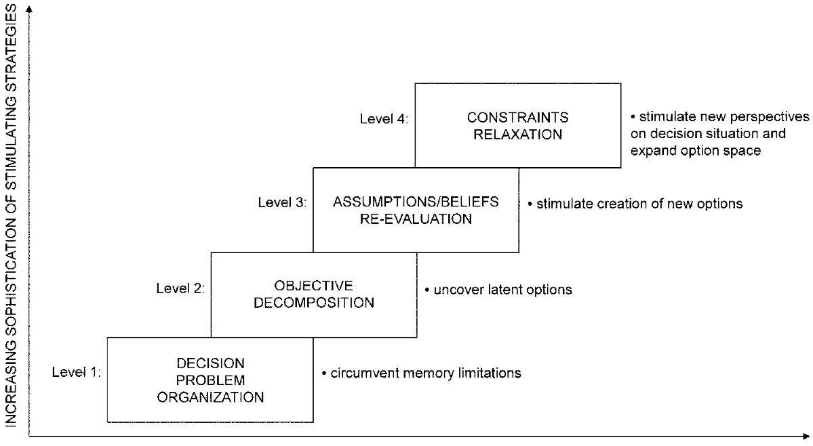
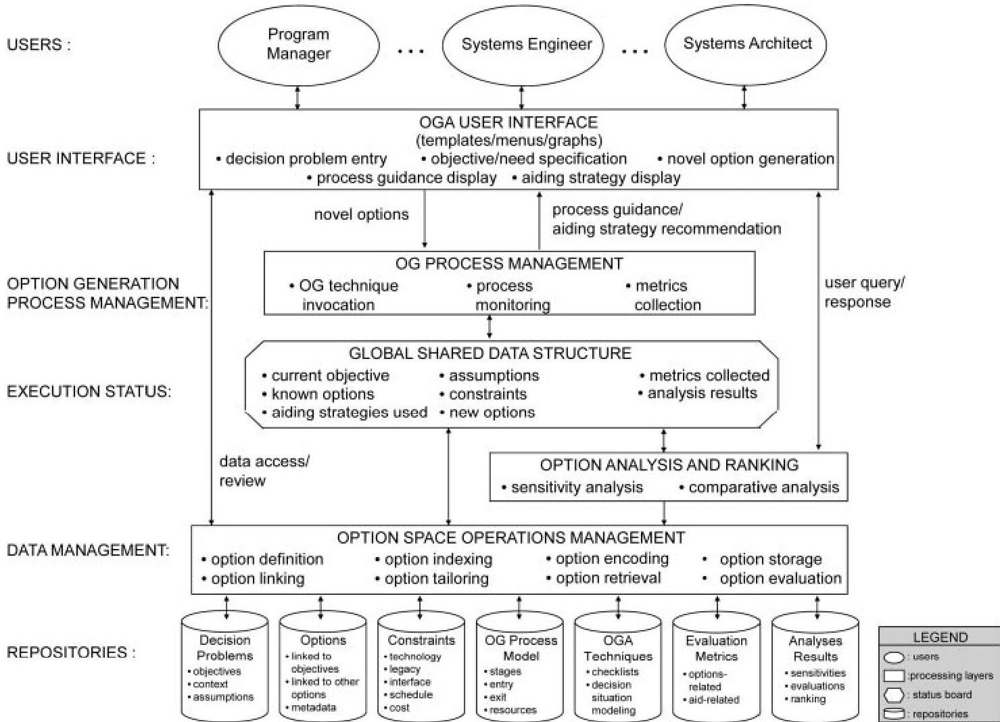
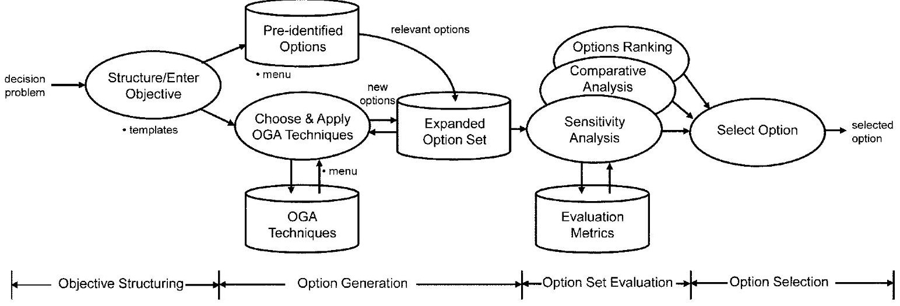

<!-- PDF_PAGE: 1 -->

# Generating Novel Options during Systems Architecting: Psychological Principles, Systems Thinking, and Computer-Based Aiding

Azad M. Madni $ ^{*} $

Epstein Department of Industrial and Systems Engineering, Viterbi School of Engineering, University of Southern California, Los Angeles, CA 90089-0193

Received 26 October 2011; Revised 13 September 2012; Accepted 13 September 2012, after one or more revisions Published online 18 April 2013 in Wiley Online Library (wileyonlinelibrary.com). DOI 10.1002/sys.21245

## ABSTRACT

Systems Architecting is a decision-intensive process that stands to benefit from access to historical architectural options and the ability to rapidly generate novel ones. Despite this recognition, option generation, and, more precisely, the process of creative option generation has been underemphasized in both the decision making and system architecting literature. This paper reviews the literature on option generation from the perspective of systems architecting. It presents a framework for option generation that exploits systems thinking and psychological principles for stimulating creative option generation. It presents the system concept of an option generation aiding system that can assist systems architects in expanding and systematically exploring the option space in the early stages of architecting and design when cost avoidance is more easily achieved and change is possible. $ \textcircled{c} $ 2013 Wiley Periodicals, Inc. Syst Eng 17:1-9,2014

Key words: systems architecting; option generation; creativity; psychological principles; systems architect; systems thinking

## 1. INTRODUCTION

Systems architecting is an integrative, decision-rich activity that requires continual generation and evaluation of options (i.e., alternatives) in the face of ongoing technological advances and programmatic and institutional constraints. From a decision making perspective, option generation (OG) circumscribes the set of potential decisions/actions available to system architects. It makes the system architect define the

decision parameters of the architecting problem in precise terms. It sets upper and lower bounds on the quality of the architect's choices. And yet, surprisingly, option generation is not given the attention it deserves [Madni el al., 1985; Keller and Ho, 1988]. The question is why? To begin with, many of the decision-theoretic models assume that the decision maker (the systems architect, in our case) already has a set of options and the problem is one of representing the available options in a formal decision framework [Raiffa, 1974; Keeney and Raiffa, 1976; Janis and Mann, 1977]. Even though the constraint of having a set of options available at the start was removed in subsequent methods [Keeney, 1996; Hammond et al., 1999; Altshuller, 1997], option generation remains a difficult knowledge-intensive task. It requires substantial knowledge of both the problem domain (e.g., air

<!-- PDF_PAGE: 2 -->

traffic control, healthcare) and understanding of the decision context. A key challenge in option generation is reducing the effort required to extract, process, and represent knowledge in usable form.

There are other challenges as well. First, relevant information stored in a database must initially be recognized as relevant to option generation, and then retrieved, translated, and formatted for presentation in a useful form. Second, human memory tends to be imperfect and biased toward the contextual specifics at the time that information was collected, assimilated, encoded, and stored. Consequently, efficient information recall requires presentation of the associated context, i.e., context at the time that the information was encoded. Third, human judgment tends to be fallible. Specifically, research in decision analysis [Fischhoff et al., 1978] suggests that humans tend to be relatively insensitive to portions of the problem that may have been inadvertently left out, thereby tacitly but erroneously assuming "completeness" of the option set. In other words, upon viewing information in a certain form and format, humans tend to be limited in their ability to envision and supply what's missing. In fact, the ability of humans to interpolate across gaps in problem representation can often be severely limited without explicit amplification/augmentation of cognitive processes. And, finally, the formal structure within which option generation fits does not suggest the content of the options. Not surprisingly, both humans and decision aids have difficulty generating novel options. In light of the foregoing, this paper provides a conceptual framework and principles from systems thinking and cognitive psychology for novel option generation. The paper also provides the system concept and architecture of an option generation aid along with evaluation metrics for assessing the quality of an option, and the efficacy of the option generation aid. The remainder of this paper is organized as follows. Section 2 presents a conceptual framework for novel option generation. Section 3 presents the principles for novel option generation. Section 4 presents the system concept and functional architecture of an option generation aid (OGA) that embodies these principles. Section 5 presents evaluation metrics. Section 6 offers concluding comments and outlook for the future of OGA for complex systems architecting.

## 2. CONCEPTUAL FRAMEWORK FOR NOVEL OPTION GENERATION

Novel options, by definition, are options without precedent, or those which possess unique characteristics. Developing

novel options can be facilitated by having a conceptual framework within which several option generation aiding techniques can be employed [Madni et al., 1985; Adams, 2001]. However, developing such a conceptual framework poses several challenges. First, decision scientists tend to view novel option generation as a creative process outside the purview of normative decision making techniques [Arbel and Tong, 1982]. Second, having individuals simply enumerate options tends to be inadequate because people tend to fixate on the problem representation provided to them [Madni et al., 1985]. In fact, psychological studies have shown that even in the most benign circumstances, humans tend to focus on a narrow range of alternatives. Third, the experiential knowledge base of an individual is hard to access when generating options. Fourth, while formal methods and models provide a convenient means for representing options, they neither suggest options nor provide the means for creating novel ones.

Despite these challenges, option generation during systems architecting can hardly be ignored. In fact, option generation is critical to the initial stages of systems architecting that tend to be decision-intensive. Having a systematic process for option generation has several payoffs. It helps ensure completeness of the option space which is essential for making effective architectural tradeoffs. It enforces a certain structure that causes system architects to precisely define problem parameters. It promotes understanding and facilitates communication of the decision problem associated with systems architecting [Rechtin, 1990, 1999; Maier and Rechtin, 2009; Hari and Weiss, 1996; Dickerson and Mavris, 2009]. While option generation comes into play throughout the system lifecycle [Johnson and Raab, 2003; Klein and Wolf, 1988; Klein et al., 1995], its impact during systems architecting is especially consequential. In particular, option generation plays a key role in concept of operation development, interface design, human-system integration, legacy integration, integration architecture development, and downstream test and evaluation. Table I presents a representative set of parameters that characterize the system architect's options space.

The real world constraints on option generation are both human-related and context-related. Human-related constraints tend to be mostly psychological constraints. They include: the inherent difficulty of humans in articulating and circumscribing a decision situation; human cognitive limitations, ability to organize and manage generated options; ability to make best use of past experiences; and limiting assumptions/beliefs about a decision situation. Context-related constraints, which are primarily environment-related,

Table I. The Systems Architect's Option Space

<table border="1"><tr><td>·Objectives/Goals</td></tr><tr><td>·Needs Characterization</td></tr><tr><td>·Regulations/Policies(existing,expected)</td></tr><tr><td>·Technologies(readiness levels,expected maturity rates)</td></tr><tr><td>·Technical Constraints:legacy;test and evaluation</td></tr><tr><td>·Programmatic Constraints:schedule,funding,space,location,acceptance criteria</td></tr><tr><td>·Operational Constraints:environment,terrain,weather,rules of engagement,human limitations</td></tr></table>

<!-- PDF_PAGE: 3 -->

INCREASING LEVELS OF COGNITIVE PROCESSING

Figure 1. Framework for facilitating novel Option Generation (OG) during systems architecting.

include organizational rules and hierarchies, institutional biases and orthodoxies, structure and content of social and cultural interactions, and, sometimes, distance constraints. It is against this backdrop that the option generation framework shown in Figure 1 was developed.

The unified multilayered framework, depicted in Figure 1, is amenable to computer-based aiding. It employs four levels of cognitive processing to stimulate option generation during systems architecting. Level 1 is concerned with organizing architecting-related variables associated with a decision situation and modeling the decision situation. By having an explicit representation of the decision situation, human memory limitations are circumvented. Level 2 is concerned with decomposing the objective as a means to uncover latent architectural options buried within the formal representation of the problem structure. Level 3 is concerned with questioning and evaluating assumptions, constraints, beliefs about the prevailing context/environment, and the decision situation, with a view to further stimulating creative option generation. Level 4 is concerned with relaxing constraints (shown in Table I) on the option space associated with systems architecting. Examples of constraints that can be relaxed are resource limitations, schedule, organizational hierarchy, human skill level, funding limitations, and business policies. Systematically relaxing these constraints and then examining the option space associated with systems architecting can stimulate new perspectives on decision situations that arise during systems architecting

## 3. PRINCIPLES FOR STIMULATING NOVEL OPTION GENERATION

Madni et al. [1985] presented a set of domain-independent principles for stimulating option generation. These principles, which have been extended and adapted for systems architecting, are presented and discussed next.

Systems Thinking. People tend to frequently confuse objectives and options [Madni et al., 1985]. They tend to espouse an objective while inadvertently making implicit assumptions that leads them to settling for an option as an objective. Systems thinking encourages humans to revisit their objectives in light of the larger problem context, to ascertain whether or not there is a higher level objective. For example, an objective might be to assess how "green" an automobile is. By viewing just the automobile (e.g., Prius), one can come up with an answer. However, looking at the larger context such as the overall supply chain and system disposal, one may have an entirely different answer. By having people revisit objectives after making assumptions explicit can often produce higher level objectives that capture their true intent. Cycling between objectives and options (i.e., alternatives) is a key aspect of option generation. Objectives drive option generation. The options generated and evaluated inform the structure and level of the objectives, possibly changing them, and thereby closing the cycle. This cycling between the objectives and options is key to enriching the options set.

Checklists. Checklists, which are created in the development phase, consist of objectives and a set of default options that go with that objective. By presenting a checklist of frequently used or generic options (including the "status quo" option), human decision makers can be offloaded from having to recall these from memory. It is well known that in some situations humans can fail to recall options for simple and repeatedly performed tasks [Wilkins and Baddeley, 1978]. Since memory recall is fallible, humans employ a variety of internal memory aids (e.g., stories, visuals) and external memory aids (e.g., memos, lists). However, despite awareness of internal memory aids, it appears that their use is less frequent than might be expected [Harris, 1978]. Thus, expecting humans to create internal memory aids is questionable at best. For this reason, it makes sense to rely on external memory aids such as checklists. Checklists also ensure that in the pursuit of novel options, decision makers don't ignore

<!-- PDF_PAGE: 4 -->

obvious options. A checklist can be expected to evolve over time, growing in number through the addition of new and specialized options (i.e., options specialized for different decision situations). An example of effective use of a checklist is in sensor selection for a mission with specific requirements. Associated with the mission objective are a set of default sensors that can detect objects at various ranges. When the user specifies the mission objective and calls up sensors for that mission, the full prestored list of sensors shows up for that mission. Then, the user starts to review the constraints on sensor selection (e.g., sensor needs to be integrated into an air vehicle that has limitations on payload weight and size; the probability of detection needs to be at the individual person level). These constraints help prune the set of sensors in the checklist. The user may conduct tradeoffs between altitude, weight, and probability of detection $ P_{d} $ . The results of the tradeoffs further prune and prioritize the sensors in the checklist for the specific mission objective.

Decision Situation Modeling. This technique is concerned with "framing" the problem [Smirnov, 2007]. Explicitly modeling a decision situation in terms of options, uncertainties, consequences, and expected values and selectively focusing on each characteristic can expand the option set. By having the decision maker focus on anticipated consequences, enumerate and assess uncertainties, identify riskiest options, then attempt to generate riskier ones, and then generate expected values of decision/action alternatives, the option space can be expanded [Gettys and Fisher, 1979; Pitz et al., 1980]. For example, let us say that we have specified a sensor system for development. Within the specified parameters, we come up with design alternatives. We ask ourselves if there are any more design alternatives. We then investigate how the specification was developed. This investigation can shed new light on the specification (e.g., the problem was too tightly specified, the spec was too narrow, or had an error), and potentially lead to the creation of new design alternatives.

Subjective Probability Analysis. Making the knowledge associated with an option explicit improves probability assessments (by reducing uncertainty) and stimulates broad thinking about a decision problem [Kahneman and Tversky, 1972]. The quality of probability assessments is improved by considering both supporting and contradicting evidence. Grouping evidence that supports/contradicts the effectiveness of an option stimulates associative mental activity that can potentially stimulate the generation of new options. In the same vein, grouping evidence that supports a common set of options can potentially help define the option space and encourage thinking about new options. Similarly, grouping evidence that contradicts a common set of options can potentially reveal inadmissible portions of the option space. The intent of this strategy is to overcome "failure of imagination" by looking at the decomposition from the point of view of probability distributions, rather than as a point problem. The emphasis is on making the underlying assumptions explicit, and looking for distributions of possible outcomes rather than researching only the best case scenario. We examine the underlying assumptions in the alternative, and systematically vary the assumptions to assess what the alternatives might achieve (i.e., how robust the alternative is). For example, let us say that we are designing a robotic system that is intended

to achieve a certain outcome. Let us say that we don't take into account the reliability of the different components, and the probability of failure. When we finally do, we can end up with different alternatives that turn out to be more resilient than the original set.

Problem "Back-Translation." This technique is motivated by the recognition of an inherent problem that exists when working in groups. When individuals communicate descriptions of problem situations to others, certain characteristics of the situation are highlighted or altered in the transmission [Allport and Portman, 1990]. When the situational information is retransmitted by the recipient to the sender, a new perspective on the original problem can potentially emerge. Options along with option generation parameters (e.g., objectives, constraints) are transmitted to others for redefinition. "Back-translation" strategies introduce novel perspectives on a problem and help reveal ambiguous elements, leading to new option generation opportunities. Translation and communication of decision situations to foster option generation is enabled through network connectivity and intelligent networking architectures. For example, let us consider the design activity. The design activity, simply stated, is the translation of a specification into a design. Now consider translating a specification into design and forwarding the design to a member of the collaborative design team. This individual reviews the design and back-translates it into what the specification might have been, and sends that specification to the sender. Upon comparing the original specification with the "back-translated" specification, more often than not a "delta" will be discovered. This "delta" can offer new insights into the creation of new design alternatives.

Opponent or Competitor Analysis. Individuals typically perceive themselves as behaving on the basis of a different set of principles than others placed in identical situations. Specifically, people tend to view themselves as responding more to circumstantial factors than others would. The analysis begins with conducting decision situation modeling (DSM) for both one's own situation and that of the opponent or competitor. This is followed by determining the set of environmental factors that might drive the behavior of the opponent or competitor. Then implications of the competitor's/opponent's attributes such as constraints and resources are explored relative to the development of one's own option set. This process can potentially enrich one's option set. For example, consider the competitors to one's new product. The competitors are faced with a set of questions (e.g., who to partner with, what standards to adopt immediately, what regulations to comply with, etc.). Systematically performing "what-if" analysis for each such variable after prioritizing them can enrich one's option set.

Temporal Analysis. When things don't work, it always appears that the outcome was foreseeable. Imagine, 2 years out, a system that is operating normally fails. How will we have looked at the design that we have created now? Consider NASA's Mars mission and the Seven Minutes of Terror. The Curiosity rover was poised to hit the top of the Martian atmosphere at 13,000 mph. If all went according to plan, the rover was to be slowly lowered by cables into a massive crater in the final few seconds. NASA's plans for Curiosity called for a series of braking maneuvers, similar to those employed

<!-- PDF_PAGE: 5 -->

by the Space Shuttle, and a supersonic parachute to slow it down. Then the heat shield for the fiery descent was to be discarded. Then the rover was to be lowered by cables from a hovering rocket-powered "sky crane." At touchdown, the cords were to be cut, and the sky crane was supposed to crash at a distance. Everything had to go like clockwork in this mission which, by any measure, would be considered highly complex. Fortunately, the mission did go like clockwork. But what if the mission didn't work as expected? What would the system engineers have looked at? Would the current design be still what they would go with? Should they have considered an alternative design? It is worth noting that they were working to an outcome that they wanted to achieve from the alternatives that they had chosen. They would need to shift their perspective from a point outcome to a distribution of outcomes. So, they would need to "move forward" in time and imagine certain unintended outcomes and ask themselves if the design still works. This is what temporal analysis is all about. It is about shifting the psychological frame of reference around the design problem (e.g., specification, outcome, translation of specification into design, temporal perspective and unintended outcomes, problem evaluation method).

In sum, the temporal perspective from which a situation is viewed influences one's judgments about the situation. For example, events seem more probable in hindsight than in foresight. In foresight, many pathways appear to lead to an objective, while in hindsight only one pathway appears probable. Similarly, anticipated gains can outweigh anticipated losses in a future time horizon rather than in the immediate time horizon. Specifically, temporal analysis consists of: (i) modifying (adding/deleting) option-generation parameter sets according to how a problem situation would appear if set in alternative time frames; (ii) exploring the consequences of candidate options in both near-time and far-time horizons; (iii) generating options for future time frame; and (iv) then applying the attributes of the future option set to the present situation to enhance the option set for the present situation.

Causal Modeling. Humans have a tendency to rely on mental organization to track and manage complexity. This is problematic in that humans tend to be linear thinkers whereas systems' complexity demands systems thinking, an inherently nonlinear activity. Fortunately, humans are good at articulating causal chains. Thus, causal modeling (e.g., fault tree analysis, event tree analysis, system dynamics model) can be employed to enhance understanding of how a particular system state can or should come about. The psychological principles that inform causal modeling are that humans can, in fact, adequately map a set of primitive parameters of a problem (e.g., an objective) to a set of conditions that can be realized in terms of actions or events, but that analysts perceive problem analyses to be more complete than they actually are. The implication of causal modeling is that objectives need to be reevaluated and redefined in light of their degree of fulfillment by candidate options. For each option, the steps involved in achieving objectives are traced. Furthermore, asking analysts directly to imagine how and where problem analyses could be incomplete can potentially stimulate new perspectives and new options. In sum, human capabilities should be exploited to articulate causal chains while human limitations (e.g., inability to recognize how probabilities fall

off, inability to make judgments about entities that change exponentially) need to be avoided.

Debiasing Institutional Inhibition. Decisions are made in the context of institutions that include social norms and culture. Organizational constraints in design can be powerful. Thus, the problem context often poses unacknowledged/inadvertent constraints on option generation (e.g., respect for organizational hierarchies/echelons, restrictions to doctrinal objectives and options), thereby inhibiting option generation and preventing realization of the actual size and content of the option space. For example, a system architect/engineer working in an organization with formal policies and procedures might feel inhibited to express a good idea that might appear to violate an organizational policy. In such cases, time and space need to be set aside where individuals can freely express these ideas without fear of reprimand. In light of the foregoing, institutional constraints need to be separated from real situation-related (i.e., contextual) constraints. "Unthinkable" objectives and options should be allowed into the discourse about the problem domain with a view to uncovering options that may, in fact, turn out to be acceptable and effective. "As-if" techniques should be implemented to enable option generators (i.e., decision makers) to assume higher or lower levels of authority than they actually have.

Analogical Reasoning. Reasoning by analogy is viewed as a core aspect of human cognition [Gentner, 1983; Altshuller, 1997]. It is important for learning and classification, and for thought and explanation. Analogical reasoning is involved in key scientific discoveries, and, in fact, many argue that analogies are central to creative thinking. Holyoak and Thagard (1995)zaq;1 introduced the concept of "mental leaps" to characterize analogies. They argued that the act of forming an analogy requires seeing one thing as if it were another. In so doing, the individual makes a kind of "mental leap" between domains. In fact, mental leaps are evident in well-known scientific analogies. A famous example of analogical reasoning is Archimedes' insight that water displaced by an object can be used to quantify the mass of different objects. Analogical reasoning looks beyond traditional engineering boundaries into other disciplines such as biology, sociology, and culture to discover examples, paradigms, and metaphors that may well offer a solution to the problem at hand. In this way, analogical reasoning can be exploited to uncover novel options [Madni, 2007; Madni 2010). For example, the human immune system offers a wonderful analogy for building a cybersecurity infrastructure.

Sensitivity Analysis. Sensitivity analysis, a natural outgrowth of decision analysis, tests the robustness of a problem analysis to variations in its input parameters. Sensitivity analysis highlights alterations in assumptions about factors such as objectives, constraints, states of the world, facts, user beliefs, and values. Alterations in problem assumptions facilitate the opening of "mental locks" that inhibit creative option generation. To this end, the specific strategies that facilitate this process include: systematically altering problem features and option-generation parameters; asking the user to assume that some (or all) constraints exist, or changing the probability that a particular constraint exists; encouraging users to assume different risk levels; and asking users to assume nonexistence of certain relevant facts (e.g., intelligence reports).

<!-- PDF_PAGE: 6 -->

These perturbations can illuminate new options that can be added to the option set [Madni et al., 1985; Arbel and Tong, 1982]. For example, let us say a design architecture is based on a mature technology (i.e., Technology Readiness Level 7 or higher). The design solution based on this technology provides a certain level of effectiveness comparable to that offered by the competition. Now let us say that a promising technology at TRL 3 is substituted for the mature technology. The result of the sensitivity analysis in this case clearly shows the value proposition of this technology, but there is the risk that the technology is immature. In this case, the system architect/engineer may incorporate a real option [Madni and Allen, 2011; Wang and de Neufville, 2005; Wang, 2005; de Neufville, 2003] relative to this immature technology by investing modestly in the infrastructure to make such substitution possible at a later date. If the technology matures in time, the architect can exercise the real option. If the technology does not mature in time, the architect can pass on exercising the option. This is an example of how sensitivity analysis can inform and shape strategic decision making.

Option Management. One of the problems that occur in complex organizations (e.g., an engineering organization) is that, all too frequently, the organization pursues a Course of Action without making explicit why other paths (i.e., Courses of Action) were not taken. For example, it is imperative that if Option B was discarded in favor of Option A, then that fact

and the supporting rationale needs to be documented. This capability falls under the rubric of option management. As important, every option has a life as we look down the road, and every decision alternative is a good idea up to a point. In other words, we can't go by "goodness of alternative." Rather, we need to work with probabilities. It is important to realize that at some point, every good decision alternative will look bad or fail. So, how do we protect against this reality? We need to look far enough and understand how long a particular option remains viable before the need to revisit it arises. Option management conceptualizes the option generation process during system architecting in terms of an evolutionary "lifecycle" that spans: option generation, option representation (i.e., option expression in a language consistent with the decision problem); option evaluation (i.e., assessment of option quality); option implementation (i.e., option reduction for communication, recording, and alteration); and option control (i.e., option maintenance, learning from experience, and process iteration). An option generation aid must have some referent to the architectural tradeoffs made and decision making history of the performing organization. Options generated for similar past situations are recalled for consideration. Options eliminated from the option set are retained for future references for either the same or different problem situations.

Figure 2. System concept and layered architecture of Option Generation Aid (OGA).

<!-- PDF_PAGE: 7 -->

## Table II. Operations Performed on the Option Space

<table border="1"><tr><td>•Option Definition...defining an option in domain independent or domain-specific terms</td></tr><tr><td>•Option Generation...the selection of existing options and creation of new ones</td></tr><tr><td>•Option Indexing/Metadata Tagging...associating attributes with options to facilitate their access</td></tr><tr><td>•Option Encoding...associating contextual attributes at the time option was created</td></tr><tr><td>•Option Storage...persistent storage of options in a repository</td></tr><tr><td>•Option Linking...inter-relating and cataloguing options that share common attributes</td></tr><tr><td>•Option Tailoring...customizing an option for a particular problem</td></tr><tr><td>•Option Retrieval...fetching an option from an option repository based on key attributes</td></tr><tr><td>•Option Space Management...tracking options and monitoring option space throughout option generation lifecycle</td></tr><tr><td>•Option Presentation...presentation of an option in textual/visual form to the decision maker</td></tr><tr><td>•Option Sensitivity Analysis...varying specific inputs to an analysis and observing effects on the recommended option</td></tr><tr><td>•Option Ranking...prioritization of options based on user-defined criteria</td></tr><tr><td>•Options Comparative Analysis...comparison of options using evaluation metrics</td></tr></table>

## 4. SYSTEM CONCEPT AND FUNCTIONAL ARCHITECTURE OF OPTION GENERATION AID (OGA)

The key principles for stimulating novel option generation (Sec. 3) are employed in the option generation aid shown in Figure 2. The option generation aid (OGA) is intended to assist decision makers (e.g., system architects, program managers) in rapidly retrieving available options and generating novel ones during systems architecting. The system concept is based on the conceptual framework (Fig. 1) and principles for stimulating novel option generation.

Users of the aid are system architects, system engineers, and program managers. The user interface of the system employs templates, menus, and graphs. Templates are used by the user to fill in the particulars of an option, menus are used to choose an option or attribute, and graphs are used to depict relationships among objectives and options, and between options. The option generation process management layer supports interactive option generation aiding technique invocation, process monitoring, and metrics collection. The option stimulation techniques range from decision problem organization to objective decomposition to assumptions/beliefs re-evaluating to constraints relaxation (Fig. 1). The constraints that are systematically relaxed are presented in Table I. The shared global data structure ("blackboard") maintains current execution status of the option generation process. It maintains status of variables such as current objective, known options associated with the objective, aiding strategies used, assumptions and constraints relaxed, new options generated, and metrics collected. The option analysis and ranking layer supports sensitivity analysis and companion of options, and produces a prioritized option set for the prevailing objective. The option space management layer supports the various operations performed on options including definition, indexing, storage, linking (to objectives and other options), and retrieval (Table II). The operations performed on the option space, informed by past research of Madni et al. [1995] and Altshuller [1997], are presented in Table II.

The repository layer comprises decision problems and objectives, prestored options, various restrictions that generated options need to satisfy (e.g., constraints associated with technology (e.g., TRL), legacy components, interfaces, schedule and cost), option generation process model (i.e., stages, entry/exit criteria, resource required), option generation aiding techniques (e.g., systems thinking, checklists, decision situation, modeling, causal modeling), metrics col-

Figure 3. OGA usage concept.

<!-- PDF_PAGE: 8 -->

lection (e.g., process metrics, outcome metrics), and analysis results library.

From a usage perspective, the OGA is an interactive application that guides and aids the user through the various stages of the option generation lifecycle that includes objective structuring, option generation, option set evaluation, and option selection. Figure 3 presents the overall usage concept of the OGA.

The user begins by structuring and entering the objective(s) using the templates provided by the OGA. The OGA retrieves preidentified options associated with the objective and presents them to the user. The user reviews the option and decides to generate additional options using a combination of available OGA techniques. Specifically, the user chooses a technique from the menu of available OGA techniques, and applies the technique to interactively generate new options. These options are added by the OGA to the list of predetermined options. The user then chooses the next OGA technique and goes through the same process until satisfied with the available option set, or until all techniques have been used. The user then proceeds to evaluate and rank the option set after conducting sensitivity analysis and comparative analysis of options. The user finally selects the preferred option to act on or implement.

## 5. OGA EVALUATION METRICS

Ultimately, the efficacy of the option generation approach and OGA need to be evaluated in terms of utility of the approach and usability of the aid. Evaluation metrics include the quality of the options generated, the quality of the overall option set, and the efficacy of the option generation aid. The submetrics associated with the quality of an option are: implementability novelty, and clarity. Implementability pertains to the realizability of the option in the real world. Novelty implies an unprecedented option or unprecedented use of an existing architectural option. Clarity pertains to how straightforward and easy it is to communicate an option to others and for others to understand that option. The submetrics associated with the quality of the option set are quantity, transparency, and coverage [Fischhoff and MacGregor, 1986]. Quantity pertains to the number of options generated. Transparency pertains to the inspectability of the option set. And coverage pertains to the breadth of response to the architecting decision problem. The metrics associated with the efficacy of the aid are the utility of the guidance provided by the aid, the time to generate a comprehensive set of relevant options, the value of a particular aiding technique in different problem contexts, and the improvement in decision maker performance. These metrics collectively provide the means for assessing the efficacy of the option generation aid.

## 6. CONCLUSION

In today's highly interconnected and competitive world, traditional methods that pursue incremental improvements no longer suffice. Rather, creativity and relentless innovation are needed. These require effective methods to stimulate novel

option generation using new ways of thinking. Such is the case when it comes to systems architecting. Option generation (OG) is a central component of decision making and key to generating new perspectives and insights during systems architecting. Despite this recognition, it is only now that option generation is being given the attention it deserves [Ward et al., 2010, 2011]. A key reason is that once routine options have been readily identified, it is all too tempting to stop there. Another reason is that the generation of novel options is a substantive task that requires domain knowledge and new ways of thinking that often go beyond traditional disciplinary boundaries and problem constraints. This paper has presented a set of principles grounded in systems thinking and cognitive psychology to stimulate novel option generation during systems architecting. These principles fit within the conceptual framework that informs both the concept of operation and architecture of the option generation aid. This paper has also presented evaluation metrics for assessing the efficacy of the aid, the quality of the options generated, and the comprehensiveness of the option set. As systems continue to grow in scale and complexity, novel option generation will become key to achieving desired outcomes and mitigating risks in complex systems architecting and development.

## REFERENCES

J.L. Adams, Conceptual blockbusting: A guide to better ideas, 4th edition, Basic Books, 2001.

G.W. Allport and L. Portman, The psychology of rumor, Holt, New York, 1947.

G. Altshuller, 40 Principles: TRIZ keys to technical innovation, Technical Innovation Center, TrizTools, Vol. I, Worcester, MA, 1997.

A. Arbel and R.M. Tong, On the generation of alternatives in decision analysis problems, J Oper Res Soc 33 (1982), 377-387.

R. de Neufville, Real options: Dealing with uncertainty in systems planning and design, Integrated Assess J 4(1) (2003), 26-34.

C. Dickerson and D. Mavris, Architecture and principles of systems engineering, CRC Press, Boca Raton, FL, 2009.

B. Fischhoff and D.G. MacGregor, Calibrating databases, J Amer Soc Inform Sci 37 (1986), 222-233.

B. Fischhoff, P. Slovic, and S. Lichtenstein, Fault trees: Sensitivity of estimated failure probabilities to problem representation, J Exp Psychol Hum Perception Perform 4 (1978), 330-344.

D. Gentner, Structure-mapping: A theoretical framework for analogy, Cognitive Sci 7(2) (1983), 155-170.

C. Gettys and S.D. Fisher, Hypothesis plausibility and hypothesis generation, Org Behav Hum Perform 24 (1979), 93-110.

J.S. Hammond, R.L. Keeney, and H. Raiffa, Smart choices: A practical guide to making better decisions, Harvard Business Press, Cambridge, MA, 1999.

A. Hari and M.P. Weiss, ICDM—an inclusive method for customerdriven conceptual design, Proc 2nd ASI Annu Total Prod Dev, Pomona, CA, November 1996, pp. 721-747.

J.E. Harris, "External memory aids," in M.M. Gruneberg, P.E. Morris, and R. N. Sykes (Editors), Practical Aspects of Memory, Academic, London, 1978, pp. 172-179.

J.K. Holyoak and P. Thagard, Mental leaps: Analogy in creative thought, MIT Press, 1996.

<!-- PDF_PAGE: 9 -->

I.L. Janis and L. Mann, Decision making, Free Press, New York, 1977.

J.G. Johnson and M. Raab, Take the first: Option generation and resulting choices, Org Behav Hum Dec Process 91 (2003) 215-229.

D. Kahneman and A. Tversky, Subjective probability: A judgment of representativeness, Cognitive Psychol 3 (1972), 430-454.

R.L. Keeney, Value focused thinking: A path to creative decision making, Harvard Business Press, Cambridge, MA, 1996.

R.L. Keeney and H. Raiffa, Decision with multiple objectives: Preferences and value tradeoffs, Wiley, New York, 1976.

L.R. Keller and J.L. Ho, Decision problem structuring: Generating options, IEEE Trans Syst Man Cybernet 18(5) (September/October 1988), 715-728.

G. Klein and S. Wolf, The role of leverage points in option generation, IEEE Trans Syst Man Cybern Part C Appl Rev 28(1) (February 1988), 157-160.

G.A. Klein, S. Wolf, L. Mitello, and C. Zsambok, Characteristics of skilled option generation in chess, Org Behav Hum Decision Process 62 (1995), 63-69.

A.M. Madni, Transdisciplinarity: Reading beyond disciplines to find connections, J Integrated Des Process Sci 11(1) (March 2007), 1-11.

A.M. Madni, Transdisciplinary systems science: Implications for healthcare and other problems of global significance, J Eng Sci 1(1) (December 2010), 39-54.

A.M. Madni and K. Allen, Systems thinking-enabled real options reasoning for complex socio-technical systems and programs, 2011 Conf Syst Eng Res (CSER), Redondo Beach, CA, 2011.

A.M. Madni, M.A. Brenner, I. Costea, D. MacGregor, and F. Meshkinpour, Option generation: Problems, principles, and computer-based aiding, Proc 1985 IEEE Int Conf Syst Man Cybernet, Tucson, AZ, November 1985, pp 757-760.

M. Maier and E. Rechtin, The art of systems architecting, 3rd edition, CRC Press, Boca Raton, FL, 2009.

G.F. Pitz, N.J. Sachs, and J. Harboth, Procedures for eliciting choices in the analysis of individual decisions, Org Behav Hum Perform 26 (1980), 346-408.

H. Raiffa, Decision analysis: Choice under uncertainty, Addison-Wesley, Reading, MA, 1974.

E. Rechtin, Systems architecting: Creating and building complex systems, Prentice Hall, Englewood Cliffs, NJ, 1990.

E. Rechtin, Systems architecting of organizations: Why eagles can't swim (Systems Engineering), CRC Press, Boca Raton, FL, 1999.

A. Smirnov, Situation modeling in decision support systems, Integration Knowledge-Intensive Multi-Agent Syst (KIMAS), 2007, pp. 34-39.

T. Wang, Real options "in" projects and systems design—identification of options and solutions for path dependency, Ph.D. Thesis, Massachusetts Institute of Technology, Cambridge, MA, 2005.

T. Wang and R. de Neufville, Real options "in" projects, 9th Real Options Annual International Conference, Paris, France, 2005.

P. Ward, J. Suss, D.W. Eccles, A.M. Williams, and K.R. Harris, "Skill-based differences in option generation in a complex task: A verbal protocol analysis," in Cogn Process 12 (2011), 289- 300.

P. Ward, J. Torof, J. Whyte, D.W. Eccles, and K.R. Harris, Option generation and decision making in critical care nursing, Proc Hum Factors Ergonom Society Annual Meeting, 54(4) (September 2010), 354-358.

A.J. Wilkins and A.D. Baddeley, "Remembering to recall everyday life. An approach to absentmindedness," Practical Aspects of Memory, Academic Press, London, 1978.

Azad Madni is a Professor in the Daniel J. Epstein Department of Industrial and Systems Engineering, and the Director of the multidisciplinary Systems Architecting and Engineering (SAE) Program in the University of Southern California's Viterbi School of Engineering. He holds joint appointments in USC's Keck School of Medicine and Rossier School of Education. He is the founder, Chairman, and Chief Scientist of Intelligent Systems Technology, Inc. He received his B.S., M.S., and Ph.D. degrees from the University of California, Los Angeles. His research has been sponsored by several major government research agencies including OSD, DARPA, DHS S&T, MDA, DTRA, ONR, AFOSR, AFRL, ARI, RDECOM, NIST, DOE, and NASA. He is the recipient of the 2011 Pioneer Award from the International Council of Systems Engineering. In 2012, he received INCOSE-LA's Exceptional Achievement Award for transformative advances in systems engineering. He is also the recipient of SBA's 1999 National Tibbetts Award for California, the 2000 Blue Chip Entrepreneurship Award from MassMutual, and the U.S. Chamber of Commerce, the2008 President's Award and the 2006 C.V. Ramamoorthy Distinguished Scholar Award from the Society of Design and Process Science. He is also the recipient of the Developer of the Year Award from the Technology Council of Southern California in 2000 and 2004. He is a Life Fellow of IEEE and IETE, and a Fellow of AAAS, INCOSE, AIAA, and SDPS. He is listed in the major Who's Who including Marquis Who's Who in Science and Engineering, Who's Who in Industry and Finance, and Who's Who in America.