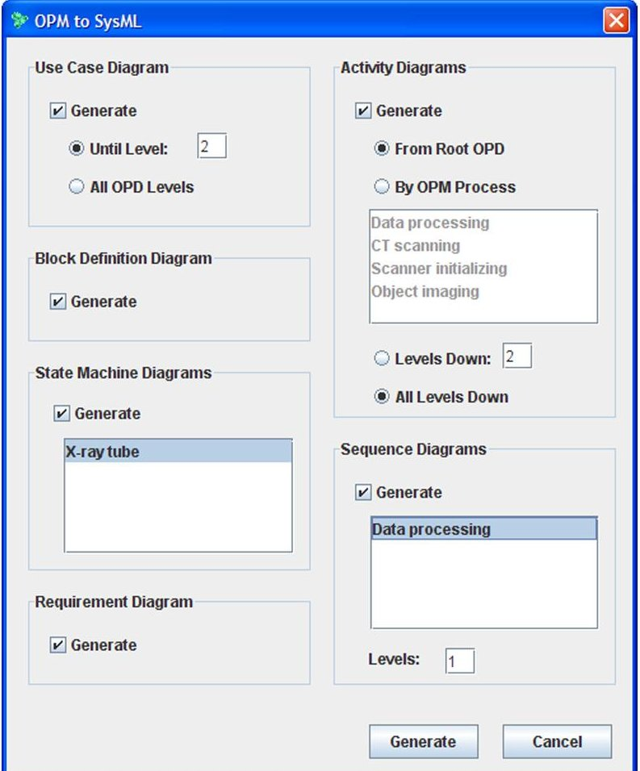
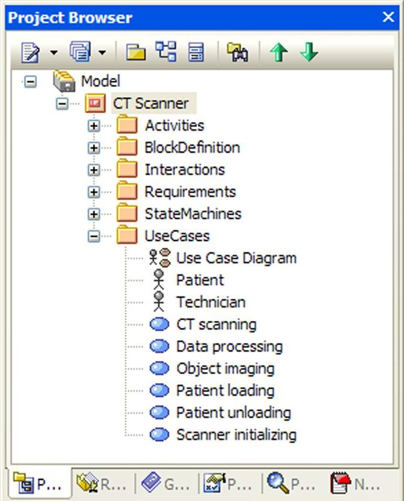
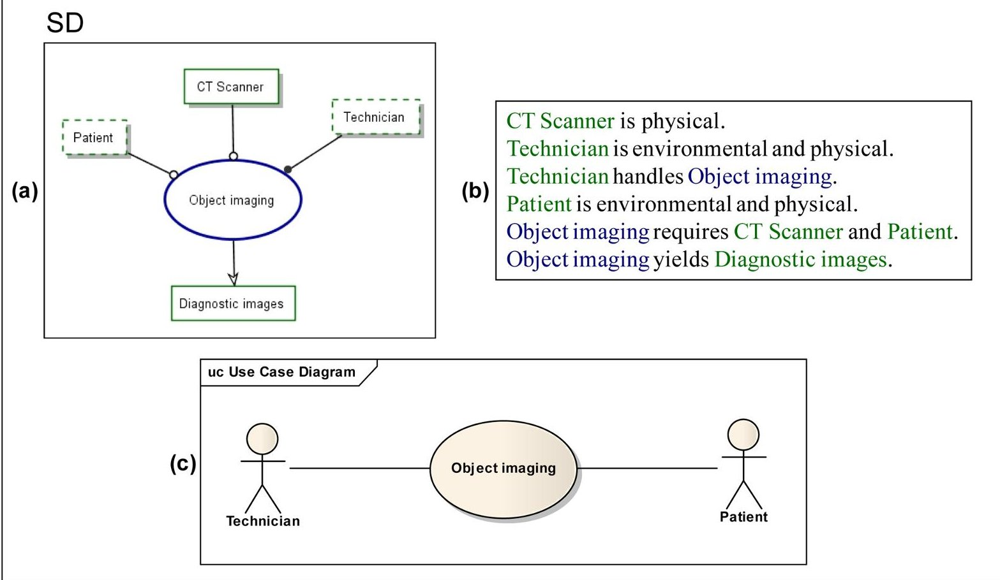
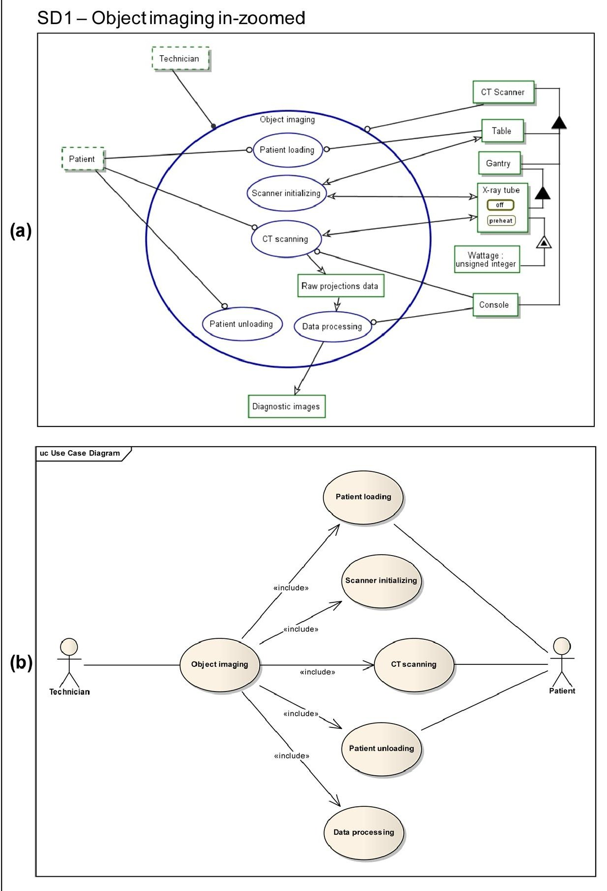
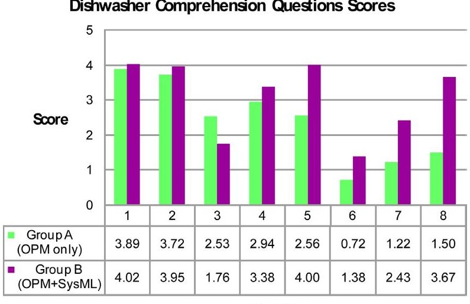
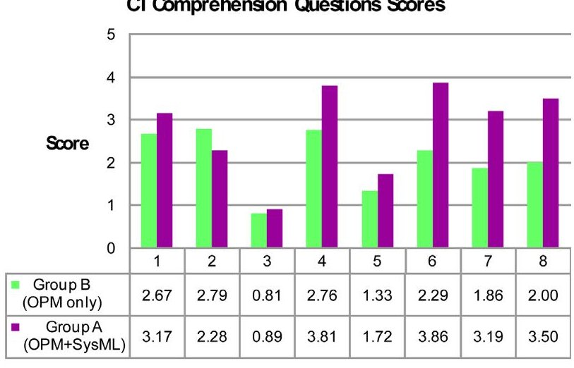

<!-- PDF_PAGE: 1 -->

# Generating SysML Views from an OPM Model: Design and Evaluation

Yariv Grobshtein $ ^{1} $ and Dov Dori $ ^{1,2,*} $

$ ^{1} $Faculty of Industrial Engineering and Management, Technion—Israel Institute of Technology, Technion City, Haifa 32000, Israel $ ^{2} $Engineering Systems Division, Massachusetts Institute of Technology, Cambridge, MA 02139

Received 8 February 2010; Revised 19 October 2010; Accepted 19 October 2010, after one or more revisions Published online 16 February 2011 in Wiley Online Library (wileyonlinelibrary.com). DOI 10.1002/sys.20181

## ABSTRACT

Conceptual modeling is key to Model-Based Systems Engineering (MBSE) approaches. OPM (Object-Process Methodology) and SysML (OMG Systems Modeling Language) are two state-of-the-art conceptual modeling languages. While both languages aim at the same purpose of providing a means for general-purpose systems engineering, these languages take different approaches in realizing this goal. As each of the languages has its relative strengths and weaknesses, ways to create synergies between them are considered in this work. We propose combining advantages of each language through automatic generation of several SysML views from an OPM model. To this end, we developed a new algorithm and software application for implementing the OPM-to-SysML views generation, and evaluated the results through an experiment conducted for this purpose. The formally constructed experiment described in this paper, which has been designed to test the quality of the auto-generated diagrams and their impact on system comprehension, indicates that the addition of some auto-generated SysML views to an OPM system model has increased system comprehension level. Our approach can benefit various stakeholders by promoting better system understanding, standardization, and improved interoperability. $ \textcircled{c} $ 2011 Wiley Periodicals, Inc. Syst Eng 14: 327-340, 2011

Key words: conceptual modeling; Model-Based Systems Engineering; OPM—Object-Process Methodology; SysML; model translation

## 1. INTRODUCTION

Overcoming the challenges inherent in developing ever larger and complex systems calls for transitioning from a traditional, document-centric to a modern, model-based approach. Construction and usage of a comprehensive conceptual system model throughout the system lifecycle is a key factor in successful management of contemporary systems development complexity. In this context, an important factor is the modeling language to be used for specifying the system's conceptual model.

In this paper we focus on two major state-of-the-art systems modeling languages: Object-Process Methodology, OPM [Dori, 2002] and OMG Systems Modeling Language, SysML [OMG, 2008, 2009]. Although both languages are intended for conceptual modeling of general systems, each takes a different approach to fulfilling this mission. Previous studies [Grobshtein and Dori, 2008; Grobshtein et al., 2007] investigated the characteristics of these languages in the context of general systems engineering through a comparative evaluation. In what follows, we briefly summarize these studies, which have led us to the work described in this paper.

<!-- PDF_PAGE: 2 -->

These studies suggest that, on the one hand, OPM promotes smooth holistic understanding of the system and its environment thanks to the well-organized hierarchy of the single diagram type, Object-Process Diagram (OPD), as well as simultaneous representation of both the structure and the behavior of the system. With combination of other features of the language, it allows OPM to present the overall picture of the system and the system's different hierarchy levels in a clear and consistent manner. This ability is of great importance especially in the early stages of the conceptual design. On the other hand, SysML, which is a rich and comprehensive language, is more suitable for modeling detailed views of some aspects, a need that usually arises during later stages of the design process. The conclusions of the studies suggest that the selection of the modeling language should consider several factors, such as the characteristics of the specific system, the development stage, and the involved stakeholders. Obviously, subjective preferences are also an important factor.

Each of the languages under consideration has its benefits and drawbacks. For example, OPM allows holistic concurrent modeling of structure and behavior using a single diagram type, together with its bimodal graphic and text representations, namely, the set of Object-Process Diagrams (OPDs) and their corresponding Object-Process Language (OPL) text. OPL is the textual counterpart modality of the graphical OPD set, which equivalently specifies the same OPM model in a subset of English. Every OPD construct is expressed by a semantically equivalent OPL sentence or phrase that is generated automatically in response to the user's input by an OPM-supporting modeling tool such as OPCAT [Dori, Linchevski, and Manor, 2010]. According to the modality principle of the cognitive theory of multimodal learning [Mayer, 2001], this dual graphic/text representation of the OPM model increases the human processing capability. A sample OPD along with its corresponding OPL text is shown in Figure 3.

However, OPM sometimes does not provide for a detailed enough model as it lacks built-in dedicated support of some aspects, such as requirements modeling and parametric constraints. SysML exhibits rich and comprehensive language constructs using standard and common notation that enjoys a wide support of tools, making it widespread and common in industry. On the down side, SysML is big and complicated, so learning and using all the parts of the language (a set of over 100 symbols belonging to nine diagram types) for both construction and comprehension involves considerable time and effort. As a result, many modelers elect to use only a relatively small subset of SysML views. The subset varies from one enterprise to another, creating a multitude of dialects that do not necessarily "talk" to each other.

Recognizing that each of the languages under study exhibits various advantages (and drawbacks) calls for finding ways to create synergies between them. While taking into account the findings from the previous aforementioned studies, we explored and developed one such way, which can potentially add value to various stakeholders. The way we present in this paper is by automatic creation of a SysML model and set of views (diagrams) from an OPM model. This approach enables initial top-down OPM-based conceptual modeling, which can be translated at will to any subset of SysML views for purposes of standardization, communication, and further elaboration.

The structure of the rest of this paper is as follows: In Section 2 we describe the essence of the OPM-to-SysML translation and SysML view set creation, including motivation, algorithm design approach, and the framework of the implemented application. Section 3 presents a subset of OPM to SysML mapping schemes and translation procedures for several SysML views. In Section 4 we present the evaluation performed for the application: We describe the experiment population, design, results and their interpretation, limitations, and conclusions. Finally, in Section 5 we summarize and discuss future research directions.

## 2. OPM-TO-SysML VIEWS CREATION

In this section we concisely describe the OPM-to-SysML design concept and application. The section is divided into three subsections. We start in subsection 2.1 with motivation and description of the expected benefits of the application of our approach. In subsection 2.2 we present our design approach for creating the views. Finally, in subsection 2.3 we describe the framework within which we implemented the algorithm to create a functional software application.

## 2.1. Motivation and Benefits

As noted, we have developed an algorithm and application for automatically creating several SysML views (with their underlying model) from an OPM system model. Developing such a mechanism is interesting since it has potential benefits which are described and argued for next.

First, an OPM-to-SysML application would allow OPM users to share and present their models to other stakeholders who are familiar with the SysML notation in a relatively easy and quick manner. This advantage should not be underestimated, as common understanding of the system and improved communication among the various stakeholders are two of the most important benefits of Model-Based Systems Engineering (MBSE) in general and of conceptual systems modeling in particular. In practice, when taking into account the wide familiarity of software engineers/systems engineers with the UML/SysML notation, it is highly likely that this model translation ability addresses a real industry need. For example, it is reasonable to assume that, for some reason, a stakeholder (from inside or outside the organization) may prefer, or even requires, getting documentation of the system model in SysML. One possible scenario is when an external customer demands to get the system model in SysML, while the developing organization has used OPM.

Another potential benefit is improved system analysis and understanding. As indicated in previous studies [Grobshtein and Dori, 2008; Reinhartz-Berger and Dori, 2005; Peleg and Dori, 2000], having dedicated aspect views may be helpful in some cases. The additional automatically generated SysML views might enable further "slicing and dicing" of the system model, so even skilled OPM users can find it useful. The additional views can be helpful for both model construction and model comprehension. This is somewhat analogous to the

<!-- PDF_PAGE: 3 -->

ability to examine and analyze a large body of data in a data warehouse using data mining techniques.

Generation of SysML views along with the underlying SysML model can also promote interoperability. A possible scenario is, for example, integration of one subsystem modeled in OPM with another subsystem modeled in SysML. This can happen due to various reasons, for example, when the subsystems are developed by different organizations or when the organization is shifting from one language to the other.

Another usage scenario could be a case in which the user is interested in using some unique feature which is available only in a SysML supporting tool. In order to allow import of the autogenerated model into a SysML supporting tool, it is required that the SysML model be created in a standard format that is widely supported by tools. Fortunately, this objective is currently achievable with XMI—the XML Metadata Interchange format [OMG, 2007], which is further described in the context of our work later on, in subsection 2.3.

The above benefits and possibly others indeed suggest that developing an OPM-to-SysML translation capability is potentially beneficial.

## 2.2. Design Approach

The main and most challenging part of constructing the OPM-to-SysML translation application is obviously the development of the translation algorithm and the engine that implements it. Taking an existing system model in OPM as input, the role of this engine is to produce a corresponding SysML underlying model with its set of diagrams. The key is to define as accurate a mapping as possible from OPM concepts to SysML ones in order to successfully match OPM elements to SysML elements in the various diagram types.

An important observation to note is that the OPM-to-SysML mapping is one-to-many in the sense that a single OPM element (entity or link) in the only OPM diagram type, OPD, usually translates to several SysML elements that belong in different SysML diagram types. Indeed, considering the OPM minimalist approach of a small alphabet of entities with their graphical notations, which is in contrast to the large SysML alphabet symbol set over nine diagram types, it should come as no surprise that one OPM element can be typically translated to multiple types of SysML elements. For example, an OPM process, which is defined as an entity that transforms (generates, consumes, or changes the state of) an object, can be mapped to any subset of the following SysML entities:

- Use case (in a Use Case Diagram)

- Operation of a block (in a Block Definition Diagram)

- Action (in an Activity Diagram)

- State transition trigger (in a State Machine Diagram)

- Message (in a Sequence Diagram)

- Constraint (in a Parametric Diagram).

Obviously, each of the mapped SysML entities in this example has its own distinct semantics, although they can all be mapped from an OPM process entity. This makes sense because the semantics of an OPM element is often context-sensitive. Context-sensitivity, which is inherent in the OPM language design, makes it possible to use a small set of

symbols to express rich semantics without compromising human intuition, simplicity, and formality [Dori, 2002: 9].

Realizing that a single "global" mapping table is not feasible, we take an aspect-view mapping approach: We partition the mapping according to the target SysML views to be generated. In other words, for each supported SysML view, there is a designated corresponding OPM-to-SysML mapping scheme. These mappings constitute the foundation for the translation algorithms from OPM to each one of the supported SysML views.

Clearly, as OPM and SysML are two distinct and differently designed languages, not all the constructs in one language have equivalent constructs in the other language. Hence a full, bidirectional, direct mapping between OPM and SysML is not feasible. Our mapping can therefore be considered partial rather than complete. In particular, our OPM-to-SysML mapping is not onto, since not all the possible SysML constructs can be created as a result of the translation. Nevertheless, such mapping can still be useful and support all the potential benefits described above, as it provides a high-level of model-to-model translation fidelity.

At this time, out of the nine types of SysML views, we have developed mapping schemes for six diagram types: Use Case Diagram, Block Definition Diagram, Activity Diagram, State Machine Diagram, Sequence Diagram, and Requirement Diagram. While support for the remaining diagram types, namely, Package Diagram, Internal Block Diagram, and Parametric Diagram, is currently missing, there is no special limitation that prevents support of these diagram types. These views were not implemented to date mainly due to practical cost-effectiveness considerations, and they can be supported using the existing architecture and design principles.

## 2.3. Application Framework

To construct a usable and functional OPM-to-SysML translation software application, we have chosen to use OPCAT as the host environment. OPCAT is a software product that supports OPM-based system development and lifecycle management by providing an integrated development and evolution environment for conceptual modeling of complex systems. All the OPM models described and presented in this paper were also created using OPCAT. An extensible environment, OPCAT provides for convenient development of new modules via an API that enables a plug-in-based architecture, making it the platform of choice for our purpose.

Figure 1 shows an example of the main OPM-to-SysML dialog window, which appears upon invocation of the SysML generation operation in OPCAT. The dialog window has six boxes, one for each of the supported SysML diagram types. The user can select what SysML views to generate, and for some of the views there are several parameters that the user can set or change. The automatically-generated SysML model, which is the output of executing the OPM-to-SysML application, is created in the XMI format [OMG, 2007]. A standard for exchanging metadata information, XMI is widely supported by SysML (and UML) tools. Having the generated SysML model in XMI format promotes wide interoperability, as it allows importing the model into any standard-supporting SysML tool. After importing the XMI model to a SysML

<!-- PDF_PAGE: 4 -->

Figure 1. OPM-to-SysML main dialog window. [Color figure can be viewed in the online issue, which is available at wileyonlinelibrary.com.]

Figure 2. Enterprise Architect's project browser showing the model elements. [Color figure can be viewed in the online issue, which is available at wileyonlinelibrary.com.]

supporting tool, the existing capabilities of the tool for visualization and manipulation of the generated SysML diagrams can be used. In this research, we have used Enterprise Architect $ ^{\mathrm{TM}} $ by Sparx Systems [2009] with MDG Technology for SysML as our SysML tool. Figure 2 is a screenshot of Enterprise Architect's project browser window after importing a sample XMI file. The automatically created SysML model is organized here according to the type of view, one of the conventional ways of model organization.

From the user perspective, a typical usage of the OPM-to-SysML application consists of two main stages: (1) creation of the XMI file that contains the resulting SysML model and diagrams description; (2) import of the XMI file into a SysML-supporting tool and further usage according to the needs. Stage (1) is executed within the OPCAT environment using our application, while stage (2) is executed within a standard SysML tool, independently of our application. A future development we are considering is to incorporate the SysML views within an XMI-supporting version of OPCAT.

## 3. OPM-to-SysML MAPPING SCHEMES

To demonstrate our approach, in this section we partially describe the mapping schemes from OPM elements to SysML elements, which constitute the foundations for generating SysML views from an OPM model. Due to space limitations, we included a subset of three views, and each of them is described in a separate subsection. In each subsection, we describe the relevant OPM-to-SysML mapping scheme along with the corresponding translation procedure. In addition, we demonstrate a case in point for one type of view, the Use Case Diagram.

## 3.1. Use Case Diagram

The Use Case Diagram is intended for modeling the usage of a system, so typically the diagrams provide mainly a highlevel functional view of the system and the actors. The main elements comprising the Use Case Diagram are actors and use cases (the entities) along with the relationships (links) among them. Generation of a Use Case Diagram from OPM is therefore based on environmental objects (the actors) and the processes (the use cases) linked to them. We enable generation of the resulting diagram using the first k OPD levels. The number of OPD levels (k) can be specified by the user via the interface shown in Figure 1. Typically k should be between 1 and 3, and the default value is 2. Specifying all OPD levels is also possible.

Figure 3 is an example of Use Case Diagram generation with k=1. The figure shows the root OPM diagram (a), the corresponding OPL text, generated automatically by OPCAT (b), and the automatically-created Use Case Diagram (c). Figure 4 shows a second-level OPD from the same OPM model (a), and the auto-generated Use Case Diagram, this time using k=2 (b).

The mapping scheme from OPM to the Use Case Diagram is summarized in Table I.

<!-- PDF_PAGE: 5 -->

Figure 3. Example of Use Case Diagram generation (k=1): (a) the original OPM System Diagram (SD, top-level diagram); (b) the OPL paragraph that describes textually the OPD in (a); (c) the autogenerated SysML Use Case Diagram. [Color figure can be viewed in the online issue, which is available at wileyonlinelibrary.com.]

## 3.1.1. The Use Case Model Creation Algorithm

An outline of the Use Case model creation algorithm follows (as noted, k represents the required OPD level):

1. Find all target use case elements (rule #2 in Table I) within the first k levels. For each such element:

1. 1. Write a use case element to the XMI file.

1. 2. Find and write to the XMI file its extended use cases (rule #4), its included use cases (rule #5), and its generalized (parent) use cases (rule #3).

2. Find all target actor elements (rule #1) within the first k levels. For each such element write an actor element to the XMI file.

3. Find all the procedural links that connect some object o which was mapped to an actor and some process p which was mapped to a use case (rule #6). For each such link l, object o and process p, if there is another link of the same type as l, which connects the same object o with a subprocess of p, do nothing. Otherwise, write an association element to the XMI file (rule #6).

The purpose of the condition in step 3 is to avoid specifying redundant associations in the XMI file; only the association at the maximum level of detail (according to k) shall appear in the resulting SysML model.

## 3.2. Block Definition Diagram

The Block Definition Diagram (BDD) defines features of blocks (like properties and operations) and relationships between blocks, such as associations and generalizations. Generating a BDD is based upon the systemic objects of the OPM model and their relationships—mainly structural relations to other model elements.

Due to similarities between OPM and SysML in this structural aspect [Grobshtein and Dori, 2008], we find many direct mappings between OPM constructs and their counterpart elements in SysML with respect to this view type. A concise summary of the mapping scheme from OPM to the Block Definition Diagram is presented in Table II.

## 3.2.1. The Block Definition Model Creation Algorithm

An outline of the Block Definition model creation is as follows:

1. Find all target blocks elements (rule #1 in Table II).

2. For each such element:

2. 1. Write a block element to the XMI file with the appropriate scope.

2. 2. Find and write to the XMI file the following related block elements:

2. 2.1. Its generalized (parent) blocks (rule #6)

2. 2.2. Its direct states property (rule #3)

2. 2.3. Its attributes (properties), which can be stateless (rule #2) or stateful (combination of rules #2 and #3)

2. 2.4. Its operations (rule #4) with the corresponding input parameters for each operation (rule #5).

<!-- PDF_PAGE: 6 -->

Figure 4. Example of Use Case Diagram generation (k=2): (a) the original OPM diagram (SD1, 1 level below SD); (b) the autogenerated SysML Use Case Diagram. [Color figure can be viewed in the online issue, which is available at wileyonlinelibrary.com.]

3. Write all the required data types of the properties (including states) and operations (input parameters) that were created in step 2.2.

4. Find all the aggregation-participation relations that connect a pair of objects and write a part association

element to the XMI file between the corresponding blocks with appropriate cardinality (rule #7).

5. Repeat step #3 but with unidirectional relations (rule #8), and map the unidirectional forward relation name to the resulting association.

<!-- PDF_PAGE: 7 -->

Table I. The OPM to Use Case Diagram Mapping Scheme

<table border="1"><tr><td>Rule #</td><td>OPM</td><td>SysML</td></tr><tr><td>1</td><td>Environmental Object
Object</td><td>Actor
ActorName</td></tr><tr><td>2</td><td>Systemic Process connected with Environmental Object (and all of his subprocesses)
Object Processing</td><td>Use Case
UseCaseName</td></tr><tr><td>3</td><td>Generalization-Specialization relation between Agent (“actor”) Objects or between Processes</td><td>Generalization of Actors (for Objects) or Use Cases (for Processes)</td></tr><tr><td>4</td><td>Exception Link; Invocation Link</td><td>Use Case «extend» relationship
«extend»</td></tr><tr><td>5</td><td>Process In-zooming;
Aggregation-Participation relation</td><td>Use Case «include» relationship
«include»</td></tr><tr><td>6</td><td>Any type of Procedural Link between an Agent (“actor”) Object and a “use case” Process</td><td>Association between Actor and the corresponding Use Case</td></tr></table>

6. Repeat step #3 but with bidirectional relations (rule #8).

7. Find all the objects satisfying the conditions in rule #1.

For each such element o do:

7. 1. Find its child objects (specified in in-zooming). For each such child c do:

7. 1.1. If c is a feature of another object, find its "containing" object p and let c = p.

7. 1.2. Write a part association element to the XMI file between the corresponding blocks of o and c (rule #9).

The generated data type of stateful objects (step #3) is an enumeration type containing the possible states value.

## 3.3. Activity Diagram

Activity diagrams are intended to specify flow. Key components included in the Activity Diagram are actions and routing flow elements. In our context, a separate Activity Diagram can be generated for each OPM process containing child subprocesses, i.e., a process which is in-zoomed in the OPM model.

There are two kinds of user parameters that can be specified via the settings dialog shown in Figure 1. The first one deals with selection of the OPM processes: One option is to explicitly specify the required OPM processes by selection from a list. The alternative, which is the default option, is to start with the root OPD (SD) and go down the hierarchy. Here

we reach the second parameter (that is independent of the first one), which is the required number of OPD levels (k) to go down the hierarchy. In order to give the user control over the level of abstraction, the diagrams are generated up to k levels down the hierarchy. Each level will result in the generation of an additional Activity Diagram, which is a child activity (subdiagram) contained in the enclosing higher-level activity. The default setting for this option is "all levels down" (i.e., " $ k=\infty $ ").

The mapping scheme from OPM to Activity Diagram is summarized in Table III. In addition to the mapping rules specified in the table, we note that initial node and final node are created for each generated Activity Diagram (along with their control flow edges).

## 3.3.1. The Activity Model Creation Algorithm

As noted, a separate Activity Diagram is created for each applicable process that the user has selected and their child descendants (up to k levels down the hierarchy). Next, we describe a procedure for Activity model creation per user-selected process (or the root OPD if it was selected instead). To create the complete model, this procedure runs in a loop for each one of the processes that the user has selected. Note that the procedure handles all the descendants' hierarchy levels (by recursion). The procedure gets two parameters: k, which represents the required hierarchy levels as described above, and p, which represents the top-level (user-selected) process (if the root OPD has been chosen, p can be treated as a dummy

<!-- PDF_PAGE: 8 -->

Table II. The OPM to Block Definition Diagrm Mapping Scheme

<table border="1"><tr><td>Rule #</td><td>OPM</td><td>SysML</td></tr><tr><td>1.</td><td>Informatical or Physical Object which is not a feature or an instance of another Object
Object Object</td><td>Block
Block1</td></tr><tr><td>2.</td><td>Exhibition-Characterization relation with Object as a target
Object Attribute</td><td>Block Value/Property with corresponding Data Type
Block1
property1: Type1</td></tr><tr><td>3.</td><td>States contained in an Object (the Object might be a Feature)
Object
state1 state2 state3</td><td>Property with corresponding enumerated Data Type</td></tr><tr><td>4.</td><td>Exhibition-Characterization relation with Process as a target
Object
Operating</td><td>Operation of the corresponding Block</td></tr><tr><td>5.</td><td>Object connected with Instrument Link to an operation process</td><td>Input Parameter of the corresponding Operation</td></tr><tr><td>6.</td><td>Generalization-Specialization relation between Objects (that are mapped to blocks by rule #1)</td><td>Generalization between Blocks</td></tr><tr><td>7.</td><td>Aggregation-Participation relation between Objects</td><td>Part Association with corresponding Cardinality between the matching blocks</td></tr><tr><td>8.</td><td>Unidirectional relation or Bi-Directional relation</td><td>Reference Association with corresponding Cardinality</td></tr><tr><td>9.</td><td>In-zooming of Objects (which are mapped to Blocks)</td><td>Part Association</td></tr></table>

process that contains the root OPD). Following is the simplified sketch of the model creation procedure:

1. Prepare a list l of all the relevant subprocesses of p sorted by their Y level, as follows:

1. 1. Find all the subprocesses of p (that are not invoked by another subprocess according to rule #4 in Table III).

1. 2. Create a list l of the subprocesses sorted by their Y level (execution order). Each item in the list l (representing Y level) may contain a set of processes that are in the same Y level (i.e., executed in parallel)—we call such item a "mini-list."

2. Create initial node along with the related control flow edges (rule #2).

3. Traverse the list l. For each mini-list m (item) of l do:

3. 1. If m contains more than one process, create fork and join nodes (rule #3) with appropriate control flow edges (rule #2).

3. 2. For each process $ q $ contained in $ m $ do:

3. 2.1. Create a branch if needed (rule #5, rule #6).

3. 2.2. Create appropriate control flow edges (rule #2).

<!-- PDF_PAGE: 9 -->

Table III. The OPM to Activity Diagram Mapping Scheme

<table border="1"><tr><td>Rule #</td><td>OPM</td><td>SysML</td></tr><tr><td>1.</td><td>Process included in or invoked by the “main activity” Process</td><td>Action</td></tr><tr><td>2.</td><td>Subprocesses of the “main activity” process which are executed sequentially according to OPM semantics (not in the same Y level, not connected by invocation link)</td><td>Control Flow edge between the corresponding actions</td></tr><tr><td>3.</td><td>Subprocesses of the “main activity” process which are executed concurrently according to OPM semantics (on the same Y level)</td><td>Fork and Join Nodes before and after the corresponding actions</td></tr><tr><td>4.</td><td>Invocation Link between two Processes</td><td>Control Flow edge between the corresponding actions</td></tr><tr><td>5.</td><td>Condition Link connecting Process (which is mapped to Action) with a State</td><td>Decision Node (“branch”) with guard specifying the corresponding object’s State as a condition, before the corresponding action</td></tr><tr><td>6.</td><td>Exception Links connecting Process (which is mapped to Action) with a State or with another Process</td><td>Decision Node (“branch”) with guard specifying time constraint as a condition, before the corresponding action</td></tr></table>

3. 2.3. Write an activity element to the XMI file (rule #1).

3. 2.4. If q is an in-zoomed process (i.e., has subprocesses) and k>1, call this procedure again (recursively) with p=q and k=k-1.

3. 2.5. If q invokes other processes (rule #4), create new activity for each of them (3.2.1.1- 3.2.1.4).

4. Create a final state with the appropriate control flow edges (rule #2).

In the above procedure we usually use the terminology of "Create some element" rather than "Write some element to the XMI file." The XMI structure obviously dictates strict file organization; hence it is not always possible to write the elements to the XMI file whenever we discover and create them. In order to keep the description of the procedure compact, we did not include the technical details of how and when the actual writing to the XMI file takes place. Typically, the implementation keeps the created elements in data collections, and when appropriate, it traverses them and serializes the elements to the file according to the required XMI format.

## 4. EVALUATION

In order to assess and examine the effectiveness of the newly developed OPM-to-SysML algorithm and application, we

performed a controlled experiment, which had two major goals: (1) Since improved system comprehension was among the potential predicted benefits, we ventured to examine whether the additional SysML diagrams that had been generated automatically with our new application, affected system model comprehension; (2) we wished to test the quality of the autocreated diagrams, mainly in terms of modeling errors and inconsistencies with the original OPM model from which they were generated.

This section is divided into six subsections as follows: In subsection 4.1 we describe the experiment population, its background and training. The experiment design is specified in subsection 4.2. In subsection 4.3 we present the experiment results, which are discussed and interpreted in subsection 4.4. In subsection 4.5 we review limitations of the experiment and conclude with some insights in subsection 4.6.

## 4.1. Population Background and Training

We carried out the experiment within a lecture of the course "Enterprise Systems Modeling" taught during the 2008 Spring semester at the Technion—Israel Institute of Technology. A total of 78 students participated in the experiment. Most of the students (75) were 3rd- or 4th-year undergraduate students in a 4-year B.Sc. engineering program at the Faculty of Industrial Engineering and Management. The population also included two graduate (M.E.) students and one 3rd-year undergraduate student at the Information Systems Engineering program.

<!-- PDF_PAGE: 10 -->

The background of the students in systems modeling was based mainly on a mandatory prerequisite course "Specification and Analysis of Information Systems," which they had taken in a previous semester. This course covered, among other topics, system development lifecycle and two modeling techniques: OPM and UML. The course included several modeling assignments involving modeling in both OPM and UML which the students were required to submit, as well as examination questions that were given on these subjects.

The experiment was conducted in the middle of the semester. In the lectures and tutorials of the "Enterprise Systems Modeling" course prior to the experiment, several subjects related to enterprise systems modeling were taught, using OPM as a modeling language. In addition, as part of the course program, the students were introduced to SysML during a 3-h lecture that was given 1 week before the experiment took place. This is the only formal SysML training the students got.

## 4.2. Experiment Design

The experiment took place during a single lecture session, in the usual place and time of the course. The students were told beforehand about their participation in an experiment, but they were neither told about the goals of the experiment nor about the subjects of this research. The experiment was executed in an examination like setting: The students got printed forms with questions, and were asked to write their answers and return the forms. In order to motivate the students to participate in the experiment and to answer the questions attentively, they were granted up to 2 credit bonus points that were added to their final 0-100 scale course grade. The students were told that their answers would be checked and graded, and that the number of granted bonus points will be determined according to their total score in the experiment. The students were allowed to use any written material, including class notes and lecture slides. All the material given to the students was in English, and they were told that they could choose to answer in either English or Hebrew, the mother-tongue of the most of them. In the beginning of the experiment, the class was divided arbitrarily into two groups, A and B, according to the first letter of the students' first name. Group A consisted of 36 students, while Group B had 42 students.

Model specifications of two systems provided the basis for the experiment. One was of a private residence standard dishwasher, and the other, of a computed tomography medical imaging device (CT). The systems were modeled in OPM by the first author of this paper and were validated by two other experts. For each of the systems, we used the OPM-to-SysML tool to generate several SysML diagrams. We prepared two printed versions of each of these two systems. One version

contained only the original OPM diagrams, while the other version contained the same OPM diagrams along with some automatically-generated SysML diagrams. The model of the Dishwasher system contained seven OPM diagrams, while the one of the CT system included nine. Four types of SysML diagrams were automatically generated for the experiment: Use Case, Block Definition, Activity, and State Machine, while in some cases not all the possibly available SysML diagrams were generated and used in the experiment. Ten and eight automatically generated SysML diagrams were used for the Dishwasher and the CT systems, respectively, resulting in an equal number of combined OPM and SysML diagrams for each system (17 in total).

For each system we composed eight open comprehension questions that covered different dynamics and structure aspects of the systems and could be answered by consulting the model specification. The students were given the printed model specifications in either the OPM-only version or in the combined OPM-and-SysML version, and were asked to answer the comprehension questions. The allocation of the systems and the modeling versions of the students' groups are described in Table IV. Overall, every student received both the Dishwasher and the CT systems, one in an OPM-only version and the other in an OPM-and-SysML version. As noted, the students were not told about our research subjects. In particular, they did not know that the SysML diagrams were generated automatically from the OPM model.

The experiment was conducted in a multistage manner as follows: In the first stage, which lasted 5 min, the students received the printed model specification only. They were asked to study the specification, and were advised to try and get an overall picture of the system by reviewing a large number of diagrams.

In the next stage, the students were given two additional forms while holding on to the system specification they had received. The first form contained the comprehension questions, which were identical for the two model specification versions of the same system (OPM-only and OPM-andSysML). In the second form, the students were asked to specify any inconsistencies, errors, or contradictions they find among the model diagrams, regardless of the diagrams' modeling language. The students were given 20 min to complete both the comprehension and error detection tasks. After 20 min the forms were collected, and the two stages were repeated for the same amount of time with the other combination of system and modeling specification. At the beginning of the experiment, the students responded to a short "demographic" questionnaire about their faculty, semester, and background in modeling languages. Summary of the information from this questionnaire is included in subsection 4.1. At the end of the experiment we gave the students another

Table IV. Allocation of Systems and Modeling Specifications to Groups

<table border="1"><tr><td>System</td><td>Group A</td><td>Group B</td></tr><tr><td>Dishwasher</td><td>OPM only</td><td>OPM+SysML combined</td></tr><tr><td>CT</td><td>OPM+SysML combined</td><td>OPM only</td></tr></table>

<!-- PDF_PAGE: 11 -->

questionnaire, asking them to express their opinion about the contribution of the SysML diagrams to their model understanding. All the questionnaires were checked by the first author of this paper. The comprehension questions were checked and scored according to a consistent grading policy.

Our null hypotheses $ \left(\mathrm{H}_{0}\right) $ were that, for both the Dishwasher and the CT systems, there is no difference in the comprehension level between the OPM-only model specification and the combined OPM-and-SysML model specification.

## 4.3. Results

Each comprehension question could score a maximum of 5 points, totaling 40 points for each system. Incomplete answers, or answers with missing elements, scored less according to the detailed grading policy. Figures 5 and 6 show students' average score for each question and each group in the Dishwasher and CT systems, respectively. In both cases, almost all the questions (seven out of eight) scored higher when the given OPM system model was enriched with the autogenerated SysML diagrams.

We analyzed each of the two systems separately by taking the sum of all the eight comprehension questions. To determine whether there is a significant difference in the overall comprehension level between the OPM-only model specification and the OPM-and-SysML one, we employed independent two-tailed t-test. Since we could not assume a priori equality in the variance of the scores between the two groups, we used t-test assuming unequal variances (heteroscedastic). The results are summarized in Table V.

Testing the null hypothesis that there is no difference in comprehension level between the OPM-only model and the combined OPM-and-SysML model, against the two-sided alternative that there is a difference, we reject the null hypothesis in both the Dishwasher and the CT system cases. For both systems, the students' answers to comprehension questions relating the combined OPM-and-SysML models were

Figure 5. Average scores of the Dishwasher comprehension questions for each group. [Color figure can be viewed in the online issue which is available at wileyonlinelibrary.com.]

Figure 6. Average scores of the CT comprehension questions for each group. [Color figure can be viewed in the online issue, which is available at wileyonlinelibrary.com.]

significantly better than answers relating to OPM-only models.

Our purpose in asking the students to specify errors, inconsistencies, or contradictions they encountered among the different model diagrams for each system was to evaluate the quality of the automatic SysML diagram generation. Since the students did not know the purpose of the experiment, nor that the SysML diagrams were automatically generated from the OPM model, they were asked to relate to all the diagrams they were given, regardless of the modeling language. In other words, they were asked to specify inconsistencies between two different OPM diagrams or between two different SysML diagrams or between one OPM diagram and one SysML diagram.

Some of the students did not find any errors. The answers of the others were carefully examined. Most of the problems reported by the students were considered as "false positives," meaning that the students were actually wrong and the specified issues were not errors or inconsistencies at all. Notwithstanding, the students did find some true issues that related only to the OPM diagrams. All these issues were minor and had no effect whatsoever on the system understanding. The students did not find errors in the SysML diagrams. Additionally, no inconsistencies or contradictions were found between an OPM diagram and a SysML diagram, or between one SysML diagram type and another.

Analysis of the students' answers regarding the usefulness of the SysML diagrams shows that 74% of the participants (58 out of 78) indicated that the SysML diagrams were helpful in at least one aspect. In case they found the SysML diagrams helpful, the students were also asked to specify what types of diagrams helped them. They could have specified more than one diagram type. The results are summarized in Table VI.

## 4.4. Interpretation and Discussion

The results show a significant difference in the overall level of comprehension between the specification that contained only OPM diagrams and the specification that included in

<!-- PDF_PAGE: 12 -->

Table V. Results of Model Comprehension

<table border="1"><tr><td rowspan="2">System</td><td colspan="2">OPM-only</td><td colspan="2">OPM-and-SysML</td><td rowspan="2">t-statistic(unequal variances)</td><td rowspan="2">p-value(two-tailed)</td></tr><tr><td>Average</td><td>Variance</td><td>Average</td><td>Variance</td></tr><tr><td>Dishwasher</td><td>18.97</td><td>51.57</td><td>24.60</td><td>33.61</td><td>-3.763</td><td>&lt;0.001</td></tr><tr><td>CT</td><td>16.50</td><td>51.67</td><td>22.42</td><td>52.02</td><td>-3.617</td><td>&lt;0.001</td></tr></table>

addition automatically generated SysML diagrams, in favor of the latter. Significantly higher scores were obtained with the additional SysML diagrams for both the Dishwasher and the CT system models.

The total average score was higher in the Dishwasher and the CT by 29% and 36%, respectively. While the relative increase in the average score was higher in the CT case, the average absolute score was higher in the Dishwasher case, presumably since the students are more familiar with it as a household appliance. These results may suggest that the helpfulness of the additional SysML diagrams is more significant when the reader does not have prior knowledge about the system under study. This is a conjecture that agrees with the experiment results, but it was not tested per se. It seems that the additional diagrams were helpful in answering some of the questions more than the others. Only one question of eight in each of the cases scored lower when the combined diagrams specification was used. The SysML diagram that seems to have the biggest added value is the Block Definition Diagram (BDD), which specifies system hierarchy and features of blocks like attributes and operations. The relatively high helpfulness of the BDD is evident from both the students' assessment of the contribution of this diagram type and from analysis of the scores in the individual questions in both systems. According to the results of the experiment, the Use Case diagram seems to have the least effect on system comprehension, and this is also in agreement with the students' assessment of the Use Case diagram type contribution. In between are the Activity diagram and the State Machine diagram, which appear to have a positive effect, albeit not as high as the effect of the BDD.

As noted, the other goal of the experiment was to assess the quality of the OPM-to-SysML application in terms of errors and inconsistencies between the source OPM model and the generated SysML diagrams. In this regard, the students did not find any issues of errors, inconsistencies, or contradictions associated with the SysML diagrams, indicating that the application has achieved a high level of model-to-model translation fidelity. The significant improvement in the

level of comprehension is also a positive indicator for the quality of the application in this sense.

## 4.5. Limitations

As with any experiment, our experiment also has several limitations. One limitation of our experiment is that, as part of our research, we both developed the OPM-to-SysML translation algorithm and application and also prepared the experiment and checked it. This might have affected the experimental outcomes. This limitation was partially mitigated by validation prior to the experiment execution of all the experiment materials (including systems models and questions) by an expert who was not directly involved in this research. The concise, clear grading policy that was used in checking the questions ensured fair and uniform grading.

Another possible limitation pertains to the relative helpfulness ranking among the different types of diagrams that was done by the students with respect to a specific set of comprehension questions. Although we tried to have the questions diverse and balanced, given a different mix of aspect-related questions might have produced different results. Hence, conclusions regarding which diagram types are more or less helpful should account for this potential limitation.

One other concern is related to the experiment population, a homogenous group of students with similar background and no significant knowledge or experience in systems modeling apart from what they learned in one or two academic courses. The scope of the experiment itself was limited and included only two systems with modest complexity. The experiment outcomes might be different with a population of experienced analysis and design experts, or with systems of greater complexity. Particularly, the SysML training of the students who participated in the experience was not comprehensive as it included only one overview lecture given 1 week prior the experiment. This might have limited the ability of the students to find inconsistencies, errors, or contradictions among the given model diagrams. On the other hand, with more SysML knowledge and experience, the effectiveness of the additional SysML diagrams might have been even higher.

Table VI. Summary of SysML Diagrams Helpfulness in the Experiment

<table border="1"><tr><td>Diagram Type</td><td>Count</td><td>Percentage(of 58)</td></tr><tr><td>Use Case</td><td>9</td><td>15.5%</td></tr><tr><td>Block Definition</td><td>27</td><td>46.6%</td></tr><tr><td>Activity</td><td>22</td><td>37.9%</td></tr><tr><td>State Machine</td><td>23</td><td>39.7%</td></tr></table>

<!-- PDF_PAGE: 13 -->

Finally, we note that the students in the experiment received only the diagrammatic part of the OPM model, namely, the Object-Process Diagrams, without the textual representation OPM exhibits, namely, Object-Process Language (OPL). In addition, the students performed the experiment with the diagrams printed on paper, and not in front of a computer-aided modeling tool. Addition of OPL, working with a computer-based modeling tool, or a combination of the two might influence the effectiveness of the SysML diagrams compared with our findings.

## 4.6. Conclusions

The second conclusion concerns the quality of the algorithm and application we developed for automatic generation of SysML views from an OPM model. Since the SysML diagrams in the experiment were generated automatically using this application, the outcomes suggest that the application we developed is indeed effective and achieves its purpose of faithfully translating OPM to SysML. Demonstrating that it is possible to automatically create useful SysML views makes the approach of enriching OPM with additional diagrams worth pursuing. Overall, the experiment result of improved systems understanding confirms a major potential benefit of the additional SysML views that complement the OPM model.

Overall, we can summarize the results of the experiment with two main conclusions. The first conclusion is that enriching OPM with additional views, specifically certain SysML diagram types, improves the understanding of a given system model. While previous studies suggested that OPM is better than UML (or one of its ancestors, OMT) in terms of comprehension [Reinhartz-Berger and Dori, 2005; Peleg and Dori, 2000], in our case the SysML views were used in addition to the OPM diagrams, not instead of them. This way, stakeholders involved in system development can have the best of both worlds. It may be interesting to conduct an experiment with a larger scope to examine the level of comprehension with a third alternative of SysML-only diagrams.

The significant experiment results suggest having a subset of SysML views created and visualized in real time by the modeling tool. Keeping the SysML views in sync with the OPM model while creating and modifying the OPM diagrams seems to have significant added value for the modeler in the modeling process. A similar approach is taken by OPCAT with the textual representation of OPM (OPL), and from our experience it seems to be very helpful.

## 5. SUMMARY AND FUTURE WORK

In this study we have developed and applied an algorithm for automatic SysML views generation from an OPM model. For each SysML view, a mapping scheme from OPM elements to SysML elements constitutes the foundation for the OPM-to-SysML subalgorithm and translation engine application. The mappings are partial and do not utilize all the available language elements. We demonstrated the software implementation into OPCAT, the OPM-supporting modeling tool.

In order to assess and examine the effectiveness of the newly developed OPM-to-SysML algorithm and application, we performed a controlled experiment. In the experiment we found that there is a statistically significant difference in the level of overall comprehension of given system models between models specified in OPM only and models specified in OPM together with some automatically-generated SysML diagrams, in favor of the latter. No indications of inconsistencies, errors, or contradictions between the original OPM model and the generated SysML diagrams were discovered. The results of the experiment confirm that the approach we took—suggesting generation of various aspect views automatically from a source model-enhances the overall model comprehension, creating synergies between OPM and SysML that should be further explored.

This work can be extended in several directions. One possibility for future research is to develop translation in the other direction, namely, from SysML to OPM. The challenges and solutions in this case seem to be different than the ones we encountered in the OPM-to-SysML case, since it requires gathering information from several model aspects (diagrams) into one unified model—a many-to-one mapping. Another possible direction is to examine the applicability of our approach and findings to other modeling languages and domains.

Finally, an interesting research direction is to combine SysML and OPM benefits by defining a new unified language derivative on the basis of both of them. Initial investigation and discussions with key people involved in the development of SysML suggest that an appropriate approach is to develop a "light" version of SysML for this purpose ("SysMLite"), which will be based on a subset of SysML and ideas from OPM, using the current SysML Activity Diagram as the basis and extending it with Block Definition Diagram capabilities to be similar to OPD, while also adding text generation capabilities. The objective is to make this new SysML variant more accessible to systems architects and other stakeholders for early conceptual design, while still enabling them to take advantage of the rich SysML vocabulary when it becomes necessary, typically at later stages of the design process. This will enable holistic modeling of system structure and behavior, ideally in a single type of diagram. We also suggest leveraging OPL, OPM's textual modality, by including it, and possibly other OPM concepts, in SysMLite. Technically, SysMLite will be specified as a SysML profile, the standard extension mechanism of UML and SysML. This profile will eventually be submitted to the OMG for adoption and standardization in response to an upcoming call.

## REFERENCES

D. Dori, Object-Process Methodology: A holistic systems paradigm, Springer, Berlin, 2002.

D. Dori, C. Linchevski, and R. Manor, OPCAT—a software environment for object-process methodology based conceptual modelling of complex systems, Proc 1st Int Conf Model Management Engineering Processes, University of Cambridge, Cambridge, UK, July 19-20, 2010, pp. 147-151.

<!-- PDF_PAGE: 14 -->

Y. Grobshtein and D. Dori, Evaluating aspects of systems modeling languages by example: SysML and OPM, Proc 18th Annu Int Symp Int Council Syst Eng (INCOSE 2008), Utrecht, The Netherlands, June 15-19, 2008.

Y. Grobshtein, V. Perelman, E. Safra, and D. Dori, Systems modeling languages: OPM versus SysML, Proc IEEE Int Conf Syst Eng Model (ICSEM'07), Herzeliya and Haifa, Israel, March 20-23, 2007, pp. 102-109.

R. E. Mayer, Multimedia learning, Cambridge University Press, New York, 2001.

Object Management Group (OMG), MOF 2.0/XMI mapping, version 2.1.1, OMG available specification, OMG document number formal/2007-12-01, http://www.omg.org/docs/formal/ 07-12-01.pdf, 2007.

Object Management Group (OMG), OMG Systems Modeling Language (OMG SysML): version 1.1, OMG document number formal/2008-11-02, http://www.omg.org/docs/formal/08-11-02.pdf, 2008.

Object Management Group (OMG), OMG Systems Modeling Language: The official OMG SysML site, http://www.omgsysml.org/ 2009.

M. Peleg and D. Dori, The model multiplicity problem: Experimenting with real-time specification methods, IEEE Trans Software Eng 26(8) (2000), 742-759.

I. Reinhartz-Berger and D. Dori, OPM vs. UML—experimenting with comprehension and construction of web application models Empirical Software Eng 10(1) (2005), 57-80.

Sparx Systems, http://www.sparxsystems.com.au/, Creswick, Victoria, Australia, 2009.

Yariv Grobshtein received his B.Sc. in Computer Science from the Technion—Israel Institute of Technology in 1998, his MBA from the Technion in 2001, and his M.Sc. in Information Management Engineering from the Technion in 2008. His M.Sc. research subject is in the area of systems modeling languages. Between 1998 and 2002, he was a senior software engineer in MAMDAS operational software development unit, Israeli Air Force, Israel Defense Forces. From 2002 he has held multiple positions at GE Healthcare, Haifa, Israel in research, system design, and development of software infrastructure and applications for nuclear medicine imaging systems.

Dov Dori is Information and Systems Engineering Professor and Head of the Enterprise System Modeling Laboratory at the Faculty of Industrial Engineering and Management, Technion, Israel Institute of Technology, and Research Affiliate at the Engineering Systems Division, Massachusetts Institute of Technology, where he teaches on a regular basis. Between 1999-2001 and 2008-2009 he was Visiting Professor with the Engineering Systems Division, the Department of Aeronautics and Astronautics, and Sloan Business School at MIT. His research interests include conceptual modeling of complex systems, systems architecture and design, and software and systems engineering. Professor Dori has invented and developed Object-Process Methodology (OPM), presented in his 2002 book. He won the Technion Klein Research Award for OPM, the Hershel Rich Innovation Award for OPCAT, the OPM supporting software, and the Dudi Ben Aharon Research Award for Document Image Understanding. Professor Dori has founded the series of international conferences on Model-Based Systems Engineering. He authored over 100 journal publications and book chapters. He is Fellow of the International Association for Pattern Recognition and Senior Member of IEEE and ACM and member of INCOSE.