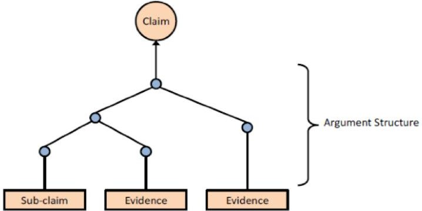
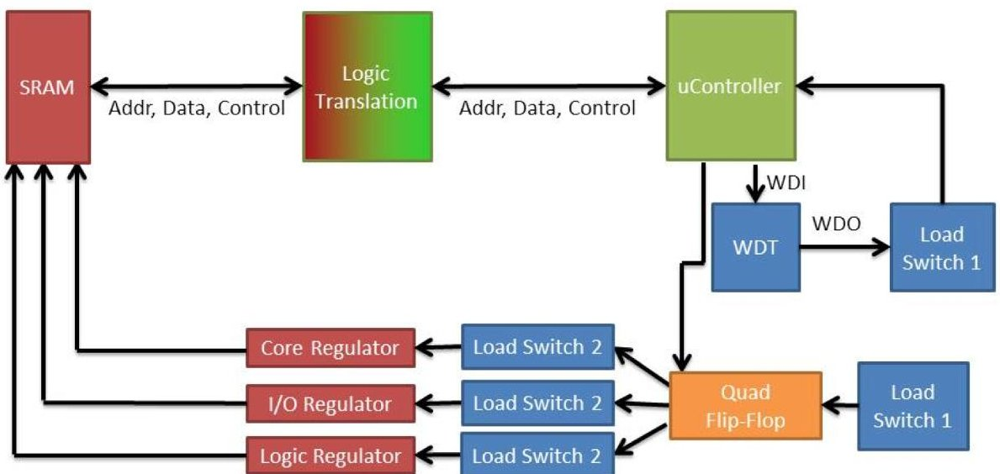
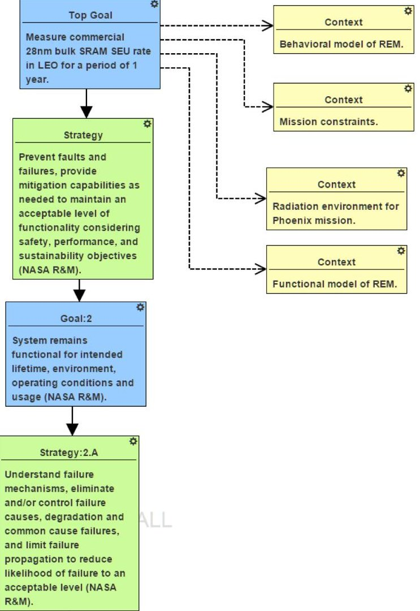
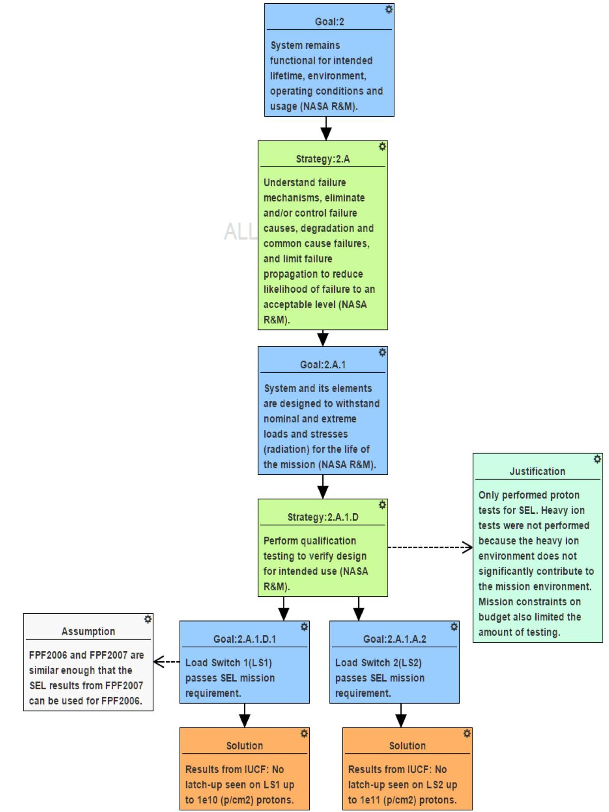

<!-- PDF_PAGE: 1 -->

# Goal Structured Notation in a Radiation Hardening Safety Case for COTS-based Spacecraft

Arthur Witulski, Rebekah Austin, Robert Reed, Gabor Karsai, Nag Mahadevan, Brian Sierawski, John Evans $ ^{1} $ , Ken LaBel $ ^{2} $

Vanderbilt University

Institute for Space and Defense Electronics

1025 $ 1 6^{th} $ Av. S. Nashville TN 37212

arthur.f.witulski@vanderbilt.edu

$ ^{1} $NASA HQ, Office of Safety and

Mission Assurance

$ ^{2} $NASA Goddard Space Flight Center

Bldg 22, Room 050 Code 561

Greenbelt, MD 20771

Abstract: A systematic approach is presented to constructing a radiation assurance case using Goal Structured Notation (GSN) for spacecraft containing COTS parts. The GSN paradigm is applied to an SRAM single-event upset experiment board designed to fly on a CubeSat November 2016. Construction of a radiation assurance case without use of hardened parts or extensive radiation testing is discussed.

Keywords: Goal Structuring Notation, GSN, Assurance Case, COTS Parts, Radiation Hardness, Reliability, Risk.

## I. Introduction

The use of commercial-off-the-shelf (COTS) parts by now has become common in CubeSats or NASA-designated "Sub-Class D" missions [1], which are low cost, short duration, relatively high-risk missions often designed with minimal radiation hardening. This approach to dealing with space radiation hazards is completely different from NASA Class A missions, such as a space telescope, which are high-budget, long-lifetime missions using almost entirely hardened components in an effort to minimize variation of key variables and reduce system risk. However, a minimal assurance standard for Sub-Class D missions is permitted and desirable. Hence it becomes useful and important to construct an assurance case concerning radiation exposure for a Sub-Class D mission such as a Cube Sat. At issue is how to represent a realistic assurance case for reducing the risk of radiation degradation of a Sub-Class D spacecraft without relying on standard, but resource-intensive radiation hardening strategies and components used for mission-critical systems in high-value Class A or B missions.

Radiation effects on electronic components are a significant reliability issue for systems intended for space. Charge deposition from single-events can result in soft errors, such as a temporary bit value change in a memory cell, or damage to an electronic device such as single-event latch up. The goal of this effort is to use GSN as a paradigm to create a safety case to assure the single-event robustness of a Cube Sat test board intended for low earth

orbit (LEO) and composed primarily of COTS components.

## II. Assurance Cases and Goal Structure Notation for Spaceflight

An assurance case provides for a logical structure to show that a system is meeting the necessary reliability and safety objectives to achieve mission success. NASA and other organizations responsible for assurance have recognized that increasing efficiency, flexibility and effectiveness in the assurance realm can be achieved with this approach [2]. This paper reflects these improvements for mission assurance as applied to the development of small spacecraft with COTS parts having to perform in a low Earth orbit radiation environment.

Figure 1. Illustration of Risk-Informed Safety Case Hierarchy in which a claim about the safety of a system must be supported by evidence.

The assurance case emerges from the safety case ideal. NASA's Risk Informed Safety Case (RISC) is "a structured argument, supported by a body of evidence, which provides a compelling, comprehensible, and valid case that a system is or will be adequately safe for a given application in a given environment" [3]. An assurance case extends this concept beyond safety alone.

Figure 1 illustrates some basic elements of the case, in which a claim about the system is supported by detailed technical evidence, design details and analysis. The case is broken down in a hierarchical fashion to greater detail consistent with the desired level of indenture for the

<!-- PDF_PAGE: 2 -->

Figure 2. Simplified block Diagram of REM board architecture showing load disconnect switches for multiple supply voltages. ("WD" is an abbreviation for watch-dog timer.)

system under consideration. The generation of evidence for the top level claim emerges with the design and the safety case evolves through the life cycle. Goal Structured Notation (GSN) supports the development of the assurance case. As reflected in this paper, GSN, developed at York University, utilizes logic-based structures and symbols to drive a hierarchy that is the substance and evidence of the safety or assurance case.

An assurance case may be effectively started for a spacecraft system with a preliminary structure that reflects the necessary considerations and objectives for successful missions. An objectives hierarchy forming the basis of NASAs new Reliability Standard was developed using a modified version of Goal Structure Notation [2]. GSN was used to structure defined objectives and subobjectives, while mapping them with strategies that are used to accomplish the various objectives to create an objectives hierarchy for a successful mission. This hierarchy forms the basis of making claims about the reliability of a spaceflight system and presents the necessary considerations for achieving the top level goal. This provides a starting point for the emergence of a detailed GSN based assurance or safety case as demonstrated below.

This approach is greatly facilitated by the emergence of the Model Based Systems Engineering. System knowledge embodied by the models is drawn on for the assurance or safety case. The case itself can exist as a linked hierarchy facilitating a model centered design environment with a "single source of truth" rather than a document centered environment in which assurance products may lag the design.

## III. GSN Assurance Case for Single Event Latch Up in Low Earth Orbit

The exemplar system for this methodology is an existing research project at Vanderbilt, a Cube Sat-based experiment designed to operate with COTS parts. A

circuit board designated the "Radiation Environment Modelling" (REM) board has been designed to test static random access memory (SRAM) for single-event upsets in LEO. The SRAMs are fabricated in a 28 nm CMOS technology, for which Vanderbilt has plentiful electrical and radiation test data. The Cube Sat is scheduled to launch in August 2016. Working on a radiation hardness assurance case for this CubeSat design serves as a demonstration vehicle to apply the GSN modeling methodology and focus the GSN application on a real system. In this section we present an assurance case for the radiation reliability of this SRAM test board in the Cube Sat using the GSN paradigm.

A simplified block diagram of the REM experiment board is shown in Fig. 2. The SRAM requires different power supply voltages for the memory core, the input/output (I/O) circuitry, and the control logic. Each of these has a separate voltage regulator. Each regulator can potentially experience single-event latch up (SEL), and therefore is controlled by a load switch that can disconnect the regulator from the power bus if an overcurrent is detected. Likewise the microcontroller is a bulk CMOS technology and can experience latch up, so it must send a renewal signal to a watch-dog timer periodically or be reset by its load switch.

While the single-event experiment is being conducted, the SRAM is written with a known data pattern, for example, all ones, or a checkerboard pattern. Periodically the data pattern is checked by the microcontroller and nodes where a bit change has occurred are recorded by the microcontroller as single-event errors. Since the SRAM has a large amount of memory, and is a commercial unhardened device, bit-flips occur often enough to make the number of flips and the failure rate reliably measurable. In space the ion flux is omni-directional, so the test gives a true picture of the performance of the memory in a space environment, as opposed to a particle

<!-- PDF_PAGE: 3 -->

accelerator for which the particle beam is uni-directional. In this paper we mainly consider the effect of single-events on the system performance, although the same reliability methodology could be extended to totalionizing dose or other radiation environments.

Figure 3 shows a general GSN fragment for the goal of measuring the single event upsets (SEU) in a low earth orbit for one year. In standard GSN [4] the functionality of blocks or nodes on the graph is identified through the shape of the box describing the node, in our notation we are using rectangles for all functions, which are colorcoded and labeled by function to make the automatic generation of GSN structures by software easier. This formal GSN architecture is adapted from [2], in which a particular structure of goals and strategies is recommended to meet the requirements of NASA's Reliability and Maintainability (R&M) standards.

In GSN structures, the root or top-level node is a particular goal, which in Fig. 3 is related to the functionality of the experiment, in this case to measure SEUs in a commercial 28 nm CMOS bulk SRAM in LEO for a period of one year. The GSN paradigm allows for the use of context nodes that point the reader to various relevant context facts, such as existing mathematical or software models of the device, specific mission constraints, the radiation environment the device can expect to encounter, design or specification documents, and so forth. Here the context is the behavior of the

Figure 3. Generalized NASA R&M GSN template applied to the REM board latch up assurance case.

experiment, the limitations of the mission, the LEO radiation environment, and the functional model of the experiment board. A typical GSN structure will have an alteration of goals and strategies to meet those goals. The strategies and goals shown in Fig. 3 are the general ones specified by NASA in [2].

Figure 4 shows more specifically how the NASA R&M criteria are applied to the REM board with respect to the reliability issue of single-event latchup. One strategy to meet goal 2.A.1 is to perform qualification testing to verify functionality for intended use. In the context of Sub-Class D missions, limited resources are available for testing. A justification node is added to document the reasoning behind the limited testing chosen in this case. Only proton testing was performed because the heavy-ion contribution to upsets is significantly less than the proton contribution for LEO. Two of the three load switches on the board were tested in the proton beam. The results of the test are documented in "Solution" nodes that form the termination of this particular line of goal/strategy reasoning. In addition the third load switch was not tested but was part of the same parts family and judged to be similar enough to allow the third part based on the existing proton test data, an assumption that is captured in a "Justification" node.

## IV. Discussion of GSN for Assurance Cases

The utility of the application of GSN to the process of building an assurance case can be seen in the foregoing discussion. First, the GSN structure imposes some discipline and rigor on the assurance case development process. Second, the GSN approach surfaces and identifies assumptions that are made during the safety assessment. Third, the GSN safety case makes the main structure of the assurance argument visible and easily understandable to reviewers who are evaluating the validity of the assurance case. This is opposed to a document-centric approach, in which the assurance case is made in text, where assumptions may remain hidden and relationships between goals and strategies may be obscured. Finally, the GSN graph is modular and easily related to functional blocks of the system under discussion, which means it is well-suited to accompany a model-based representation of a system such as might be found in model-based system engineering tools such as the Systems Modeling Language or SysML.

## Acknowledgements

This work was supported under NASA Grant and Cooperative Agreement Number NNX15AV48G.

## References

1. Jara, S., "System Safety & Mission Assurance (SS&MA) for Sub-Class D Missions," NASA Electronic Parts and Packaging Workshop, June 24, 2015.

2. Groen, F.J.; Evans, J.W.; Hall, A.J., "A Vision for Spaceflight Reliability: NASA's Objectives Based

<!-- PDF_PAGE: 4 -->

Strategy," Reliability and Maintainability Symposium (RAMS), 2015 Annual Proceedings, 26-29 Jan. 2015.

3. U.S. National Aeronautics and Space Administration, "NASA System Safety Handbook: Volume 1, System

Safety Framework and Concepts for Implementation," NASA/SP-2010-580, Version 1.0, November 2011.

4. "GSN Community Standard Version 1," www.goalstructuringnotation.info, November 2011.

Figure 4. Completion of GSN argument line showing specific arguments for latch-up tolerance.

