<!-- PDF_PAGE: 1 -->

# Ground-Based 1U CubeSat Robotic Assembly Demonstration

Ezinne Uzo-Okoro, Christian Haughwout, Emily Kiley, Mary Dahl, Kerri Cahoy Massachusetts Institute of Technology 77 Massachusetts Ave. Cambridge, MA 02139, USA (301) 370-6888 ezinne@mit.edu

## ABSTRACT

Key gaps limiting in-space assembly of small satellites are (1) the lack of standardization of electromechanical CubeSat components for compatibility with commercial robotic assembly hardware, and (2) testing and modifying commercial robotic assembly hardware suitable for small satellite assembly for space operation. Working toward gap (1), the lack of standardization of CubeSat components for compatibility with commercial robotic assembly hardware, we have developed a ground-based robotic assembly of a 1U CubeSat using modular components and Commercial-Off-The-Shelf (COTS) robot arms without humans-in-the-loop. Two 16 in x 7 in x 7 in dexterous robot arms, weighing 2 kg each, are shown to work together to grasp and assemble CubeSat components into a 1U CubeSat. Addressing gap (2) in this work, solutions for adapting power-efficient COTS robot arms to assemble highly-capable CubeSats are examined. Lessons learned on thermal and power considerations for overheated motors and positioning errors were also encountered and resolved. We find that COTS robot arms with sustained throughput and processing efficiency have the potential to be cost-effective for future space missions. The two robot arms assembled a 1U CubeSat prototype in less than eight minutes.

## INTRODUCTION

Today, as space becomes more accessible there is a lack of affordable on-demand capability to address multiple government [1] and commercial constellation needs for on-orbit servicing and assembly. The industry's first satellite life extension vehicle, Northrop Grumman's Mission Extension Vehicle-1 (MEV-1), completed its first docking to a client satellite, Intelsat IS-901 on February 25, 2020. MEV-1 is designed to dock to geostationary satellites whose fuel is nearly depleted and does not make use of robot arms for its on-orbit servicing mission [2]. On-orbit robotic assembly to date is costly, as evidenced by prior and current missions [3]. For example, the Defense Advanced Research Projects Agency

(DARPA) Robotic Servicing of Geosynchronous Satellites (RSGS) $400M program aims to demonstrate that a robotic servicing vehicle can perform safe, reliable useful and efficient operations in or near the Geosynchronous Earth Orbit (GEO) environment. RSGS is using the custom-developed and large radiation-hardened Frontend Robotics Enabling Near-term Demonstration (FREND) robot arm, which is a 1.8 m arm from shoulder pitch to wrist pitch weighing 78 kg, with an additional 10 kg for electronics.

The need for low-cost, low-latency and agile space infrastructure, which can reach strategic orbits such as GEO and Low Earth Orbit (LEO) in addition to polar and International Space

<!-- PDF_PAGE: 2 -->

Station (ISS) locations, could be realized using a robotic assembly of modularized components into CubeSats. A standardized modular CubeSat and COTS-based robotic assembly could break the reliance on high-risk, highlatency, high-cost legacy space hardware. Satellite cellularization [4][5][6][7] has made incremental advances in the modularization of small satellite subsystems. However, this thesis explores a new approach to CubeSat production based on the robotic assembly of functional spacecraft components.

response time from a minimum of 30 days to less than 10 hours for a small satellite build and deployment cycle.

This robotic-assembly based mission using propulsive "lockers" could help create a resilient platform capable of rapidly assembling and deploying scalable space systems faster than NASA's documented minimum launch-on-demand response time (35 days) for the International Space Station (ISS) crew rescue [8].

There are four phases necessary to successfully

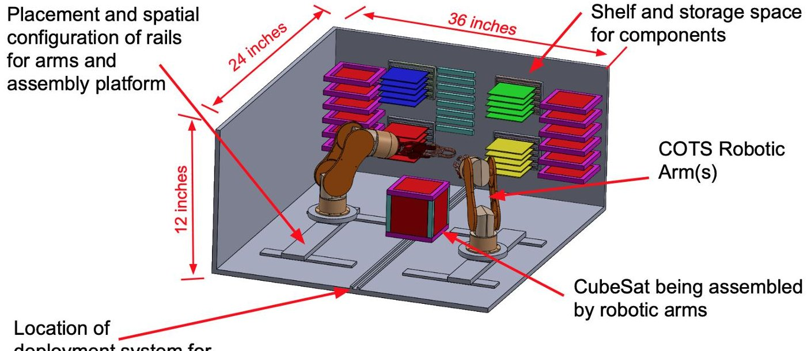

Figure 1. Conceptual system design of the interior of the spacecraft locker.

We envision a new mission in which small COTS robot arms are enclosed in free-flying small spacecraft "lockers" of approximately 24 inches x 36 inches x 12.5 inches for the assembly of a new standard of small satellites. These mini-fridge-sized spacecraft "lockers" with propulsion capability are intended to be orbit-agnostic in order to deploy on-demand robot-assembled CubeSats where needed. The spacecraft locker houses two robotic arms, modular components including sensor and propulsion modules, and payloads for 1U to 3U-sized CubeSats. The mission is expected to deliver an unprecedented improvement in

realize the mission concept. Phase 1 involves the ground-based robotic assembly of a CubeSat prototype using two dexterous arms and electromechanical components in a laboratory environment and assessing different payload and propulsion options to optimize response time and sensing. This paper addresses the feasibility of Phase 1 and characterizes the systems engineering efforts required to develop in-space robotic assembly. Phase 2 involves the development and launch of a flight unit locker with robot arms and CubeSat modular components, including propulsion options for the CubeSats themselves and not just the spacecraft locker. The spacecraft locker would be hosted at the ISS Japanese Experiment Module Exposed

<!-- PDF_PAGE: 3 -->

Facility (JEM-EF) [9][10][11], and house enough components to demonstrate the onorbit assembly of five 1U CubeSats. The first prototype CubeSat would be a CubeSat assembled on earth and deployed first in order to test the deployment system. The four remaining CubeSats - two with Radio Science Experiments (RSE) and magnetometers, two with visible (VIS) sensors - will be robotically assembled on-orbit. The ISS Phase 2 technology demonstration is expected to prove the on-orbit assembly of modular reconfigurable CubeSats, increase Technology Readiness Level (TRL), and assess response time quantitatively.

## Organization

Following a state-of-the-art review of current robot arms in space, a feasibility study on the use of dexterous COTS robot arms in space is analyzed. We summarize the study results toward feasible on-orbit CubeSat robotic assembly.

Next we describe the lab prototype demonstration of the robotic assembly of a 1U CubeSat by two dexterous COTS robot arms. The assembly process uses two COTS robot arms to assemble modularized boards fastened with magnets into a small satellite. The assembly steps use open-loop control and a Python software program. We show that the robotic arm assembly of modularized components is a viable option for a new class of CubeSats.

Lastly, we provide a summary of the work and introduce the next steps for space qualification of the system.

## FEASIBILITY OF ROBOT ARMS IN SPACE

We review the current state-of-the-art of robot arms in space. We assess the feasibility of the on-orbit assembly of small satellites using Commercial-Off-The-Shelf (COTS) hardware without humans-in-the-loop. We select lowcost robot arms, LewanSoul xArm Robots with

six Degrees of Freedom, and minimize on-orbit SmallSat assembly time by using the dexterous robot arms while satisfying the given power consumption and weight requirements at a given orbit. Thus, we employ multidisciplinary design optimization tools and methodologies focusing on the second key gap: testing and modifying commercial robotic assembly hardware suitable for small satellite assembly in space. Given that the search parameters in the Inverse Kinematics task for a robot with many degrees of freedom are constant, the Genetic Algorithm approach in combination with the robot simulation is used. We also describe the technology choices and redundancy levels of the different subsystems in this optimal on-orbit assembly design.

## COTS Robot Arm Flight Heritage

To date, most on-orbit assembly missions are not for small satellite on-orbit assembly, but instead are designed to support ISS experiments, exploration, and servicing (refuel or repair existing satellites) missions [15][16][17][18]. Previous missions include the U.S. Defense Advanced Research Projects Agency's (DARPA) Orbital Express program [19], the DARPA Phoenix Program [20], and the Jet Propulsion Laboratory's (JPL) Mars Insight mission [21]. Robotic manipulators important for scientific experiments and the construction and maintenance of the ISS, have conducted on-orbit robotic assembly. Examples include the Shuttle Remote Manipulator System (SRMS) [22], also known as Canadarm, which is a 16.9-meter, seven degree of freedom (DOF) manipulator with a relocatable base; the National Space Development Agency of Japan's (NASDA) Japanese Experiment Module (JEM) Remote Manipulator System (JEMRMS), which is a 9.91-meter, six DOF manipulator; and lastly, the European Robotic Arm (ERA), which is an 11-meter, seven DOF manipulator [23].

<!-- PDF_PAGE: 4 -->

Table 1. Shows the gaps in select current on-orbit assembly/servicing space missions

servicing. The National Aeronautics and Space Administration (NASA) Goddard Space Flight

<table border="1"><tr><td colspan="2">Select List of Relevant Missions</td><td>COTS Robot Arm</td><td>Standard Modularized Components</td><td>Robotic Assembly / Servicing</td><td>Mass / Volume Savings</td></tr><tr><td colspan="2">JPL Mars InsightCustom arms for Mars mission</td><td>Y</td><td>N</td><td>N</td><td>N</td></tr><tr><td colspan="2">NG MEV-1, RSGS, RESTORE-LRobotic servicing missions</td><td>N</td><td>N</td><td>Y</td><td>N</td></tr><tr><td colspan="2">MIS Archinaut3D printed robotic assembly mission</td><td>Y</td><td>N</td><td>Y</td><td>N</td></tr><tr><td colspan="2">NASA Ames EDSNEight 1.5U CubeSats for Cross-Link Comms</td><td>N</td><td>Y</td><td>N</td><td>Y</td></tr><tr><td colspan="2">This Work</td><td>Y</td><td>Y</td><td>Y</td><td>Y</td></tr></table>

These manipulators employed very large robotic arms to deploy, maneuver, and capture payloads. Hirzinger's patent on a multisensory robot was tested aboard the Columbia shuttle, which successfully worked in autonomous modes, and was teleoperated by astronauts, as well as in different telerobotic ground control modes [24][25]. In the area of autonomy, SPHERES Universal Docking Port (UDP) demonstrates autonomous docking maneuvers using small satellites [26] and AstroBees, the free-flying robots, provide a flexible platform for research on zero-g free-flying robotics [27]. Current missions (on-orbit or in development) include the Northrop Grumman MEV-1 and DARPA Robotic Servicing of Geosynchronous Satellites (RSGS) program [28]. RSGS aims to demonstrate satellite servicing mission operations on operational Geosynchronous Earth Orbit (GEO) satellites.

RSGS uses the FREND project, which developed the state-of-the-art in autonomous rendezvous and docking with satellites not predesigned for servicing, and was the precursor and inspiration for the DARPA RSGS program [29]. The DARPA/Naval Research Lab (NRL) team working on FREND focused on autonomous rendezvous and docking with satellites, which were not designed for

Center's (GSFC) RESTORE-L servicing mission [30], is also a robotic spacecraft equipped with the tools to rendezvous with, grasp, refuel, and relocate satellites to extend their lifespan. Lastly, NASA's Dragonfly has also recently demonstrated a ground-based test of robotic satellite assembly [15][31] and Made In Space (MIS) received a large NASA contract to demonstrate on-orbit assembly using three robot arms to assemble 3-D printed parts in space, called the Archinaut mission [32].

## Benefits and Implications for In-Space Manufacturing

The transferable technology includes a new CubeSat standardization of mechanical, electrical, power, and thermal components, the modularity of key spacecraft elements with different selectable sensors and/or propulsion units and a custom-built spacecraft locker that can be deployed at various orbit-agnostic locations such as in LEO and GEO for asset monitoring and constellation reconstitution. A comparison with the alternative - placing ready-made CubeSats in an on-orbit locker has been designed with a focus on packaging efficiency for launch. We show that a custom-configured locker filled with components for on-orbit assembly is more efficient by 2x. Reusability of CubeSat electrical/mechanical

<!-- PDF_PAGE: 5 -->

components and propulsion systems can help systems evolve to create different form factors. Reusability of CubeSat electrical/mechanical components and propulsion systems can help systems evolve to create different form factors. There have been subsystem-focused spacecraft as part of a swarm, limited by pre-built or pre-integrated spacecraft components. No program currently offers the ability to respond to emerging needs with any of the above configurations, which could result in highperformance target acquisition and unmatched pointing and stabilization accuracy.

For example, if there exists an issue with a LEO asset, and an inspection is required quickly, the spacecraft locker in LEO could robotically assemble a CubeSat with an RF sensor to listen, a radar, or optical capability to respond. There may be a need for two propulsion systems or chemical propulsion to arrive at the LEO location as quickly as possible. The spacecraft locker in LEO - a smart locker with all components at the ready - would require no

The concept of operations for modular CubeSats assembled in space would partition the spacecraft into modules, which would be configurable into a wide variety of applications. Future use cases using different sensors on the spacecraft with variations in communications, sensors, propulsion, etc. would benefit multiple applications including constellation reconstitution and LEO and GEO asset monitoring.

wait-time or launch from the ground. The spacecraft locker could assemble and deploy the needed CubeSat solution within hours for rapid-response. Note that if there exists pre-integrated spacecraft on-the-ground, a launch manifest, with a minimum of 35 days, is still required.

Similarly, for constellation applications, several future cloud networks like DARPA's BlackJack intend to produce using a satellite constellation that makes use of several nodes. If a node goes down, there are two options for recovery. The node needs to be replaced, or the number of satellites on a plane would need to be enlarged to close the link. The spacecraft locker would be available to robotically assemble a CubeSat with provided payload requirements to replace the node within hours.

## Robot Arms for Assembly

Having purchased robot arms in the under $500 range, with damaged servo motors by the first test of the concept, we assessed a list of replacement servo motors (see Table 2). We define low-cost for the lab prototype as under $500 for all robots, boards, and parts. Thus, in order to stay within the bounds of a low-cost system, we selected the HiWonder servo motors, which are used on the LewanSoul xArm robots.

Table 2. Select list of common low-cost motors for robot arm use

<table border="1"><tr><td>#</td><td>Vendor</td><td>Model</td><td>Voltage(V)</td><td>Current(A)</td><td>Condition(Current)</td><td>Max Torque</td><td>Max Torque(N.m)</td><td>Weight(Earth)</td><td>Mass(kg)</td><td>Price(USD)</td></tr><tr><td>1</td><td>LOBOT</td><td>LD-20MG</td><td>7.4</td><td>0.1</td><td>No Load</td><td>20kg.cm</td><td>1.96</td><td>2.24oz</td><td>0.06</td><td>$14.99</td></tr><tr><td></td><td></td><td></td><td></td><td>1</td><td>Max</td><td></td><td></td><td></td><td></td><td></td></tr><tr><td>2</td><td>Hiwonder</td><td>LX-15D</td><td>7.4</td><td>0.1</td><td>No Load</td><td>17kg.cm</td><td>1.76</td><td>4.8oz</td><td>0.14</td><td>$16.99</td></tr><tr><td></td><td></td><td></td><td></td><td>1</td><td>Max</td><td></td><td></td><td></td><td></td><td></td></tr><tr><td>3</td><td>Dynamixel</td><td>DYNAMIXEL XH430-V210-R</td><td>24</td><td>0.036</td><td>No Load</td><td>2.6N.m</td><td>2.6</td><td>82gm</td><td>0.08</td><td>$305.90</td></tr><tr><td></td><td></td><td></td><td></td><td>0.7</td><td>Max</td><td></td><td></td><td></td><td></td><td></td></tr><tr><td>4</td><td>ClearPath</td><td>CPM-SDSK-2310D-RLN</td><td>75</td><td>0.5</td><td>No Load</td><td>0.5Nm</td><td>0.5</td><td>0.6kg</td><td>0.6</td><td>$257.00</td></tr><tr><td></td><td></td><td></td><td></td><td>1.3</td><td>Max</td><td></td><td></td><td></td><td></td><td></td></tr><tr><td>5</td><td>ClearPath</td><td>CPM-SDSK-2321S-RLN</td><td>75</td><td>2.3</td><td>No Load</td><td>3.5Nm</td><td>3.5</td><td>0.9kg</td><td>0.9</td><td>$299.00</td></tr><tr><td></td><td></td><td></td><td></td><td>2.3</td><td>Max</td><td></td><td></td><td></td><td></td><td></td></tr><tr><td>6</td><td>Maxon</td><td>ECX TORQUE 22LØ22mm,brushless,with Hall sensors</td><td>12</td><td>0.224</td><td>No Load</td><td>45.7mNm</td><td>0.05</td><td>110gm</td><td>0.11</td><td>$346.00</td></tr><tr><td></td><td></td><td></td><td></td><td>3.7</td><td>Max</td><td></td><td></td><td></td><td></td><td></td></tr><tr><td>7</td><td>Dynamixel</td><td>XH540-W270-T</td><td>12</td><td>0.04</td><td>No Load</td><td>9.9Nm</td><td>9.9</td><td>0.5lbs</td><td>0.23</td><td>$449.90</td></tr><tr><td></td><td></td><td></td><td></td><td>4.9</td><td>Max</td><td></td><td></td><td></td><td></td><td></td></tr></table>

<!-- PDF_PAGE: 6 -->

Low-cost robotic arms such as the LewanSoul xArm shown in Figure 2 are controlled using servo motors, which lack the power and torque required for space missions.

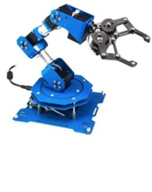

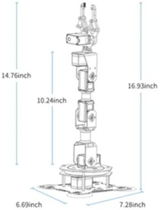

Figure 2. (a) LewanSoul xArm Robot with 6-DOF (b) Robot Arm with dimensions. (Source: LewanSoul)

Given that the robots will be housed in and perform functions in a spacecraft locker, we continue to use the servo motors as an adequate lab prototype test for feasibility. As we progress to space qualification, appropriate motors for space operations will be used. Robotic arms of similar size and weight come in a range of prices. A major difference between the robot arms available off-the-shelf is the use of powerful motors and sophisticated control systems. The more sophisticated robot arms are able to move with greater precision due to these characteristics.

We recognize that these (and similar) COTS robotic arms can be customized by adding additional sensors or swapping particular components such as a motor or link. The software used to control the arms is also usually supplied with customization for controlling system parameters; however, a different control computer and real-time operating system could be used. The interaction between the control parameters and the physical dexterity can be complex due to communication latencies and multi-tasking using the operating system. Thus, we make assumptions and verify using the existing physical prototype. Since most space robot arms used in space tend to be custom-built, we

anticipate we will encounter challenges designing robot arms (and its environment) that would match an existing product and does not require a custom build, given in-space satellite assembly requirements.

To restrict the scope of the design optimization, we first test a model simulation of two degrees of freedom. Figure 3 shows a 2-DOF simulation of the xArm robot arm in PyBullet. We know that the simulation framework (PyBullet) is able to accommodate this level of fidelity in simulations because the framework has precedent [33].

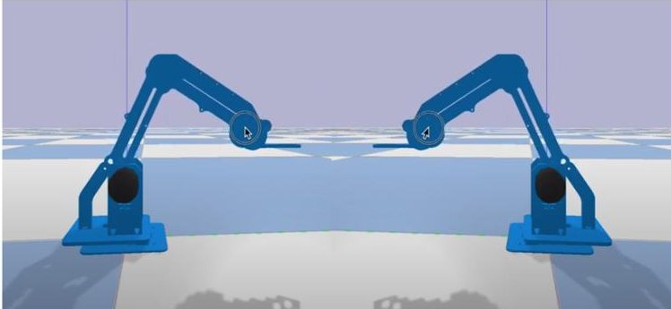

Figure 3. Simulation of two xArm robots in PyBullet with 2 DOF

The model simulation returns 19.09 seconds, from a starting point of 91 seconds. While not optimal, the output value is reasonable because the robot arm requires 5 seconds to grasp and 10 seconds to move an object to a drop-off location, and less than 5 seconds to snap-assemble the part. Therefore, in order to grasp and move an object, the robot arm, which is positioned within 2 mm of the target and drop-off locations, 19 seconds to grasp, move and drop-off an object is correct. However, the global optimal value might be out of reach due to power constraints on the servo motors on the robot arms as PyBullet did not find an optimum.

During simulation with different parameters, we see that using a powerful motor at high proportional gains results in faster (more optimal) time values, but consumes more power. Conversely, using a high gain value with a weak motor results in oscillations that take time to dampen out to within the 2 mm

<!-- PDF_PAGE: 7 -->

tolerance and hence result in longer construction time. This simulation is for a single step in a series of steps that are needed for the full assembly of a satellite. In later iterations, task planning to sequence the assembly steps are added and obtain similar results. Using the AL5D 4-DOF robot arm kit, which resulted in servo burnouts after less than 100 hours of tests, we modeled six degrees of freedom in a second search for low-cost robots. Using six motors instead of two motors resulted in higher power calculations with about the same assembly time. A comparison of power and assembly time is provided in Table 3.

Table 3. Simulation results for 2-DOF and 6-DOF robot performing the same task with the

<table border="1"><tr><td>Robot</td><td>Initial Assembly Time</td><td>Energy Used</td><td>Peak Power Used</td></tr><tr><td>2-DOF</td><td>91 seconds</td><td>220.2 Watt-seconds</td><td>13.0 Watts</td></tr><tr><td>6-DOF</td><td>51 seconds</td><td>451.1 Watt-seconds</td><td>33.5 Watts</td></tr></table>

We discover that the arm with 6-DOF uses more power while performing the same task at the same speed with greater accuracy. These tasks include grasping a part from a shelf and bringing it to the assembly area and snapping two parts together, using some assumptions on force and alignment required for assembling LEGO-like parts together. This leads to the selection of a 6-DOF robot arm for this work. Table 2 lists the resulting robot arm options. The LewanSoul xArm robot arms offered a low-cost option with reliable results (more than 170 hours of tests before burnouts) and less power and thermal considerations.

Human vs Robot Assembly Time—We contrast robotic assembly with CubeSat assembly requiring humans-in-the loop for assembly. CubeSats are usually assembled by a team of people and not robots. Hence, there is little baseline data available to assess how long it might take to assemble a CubeSat using robots.

Table 4. Assembly time of various CubeSats completed by human teams

<table border="1"><tr><td>Satellite</td><td>Assembly time by teams</td><td>Data Source</td></tr><tr><td>NASA MarCo CubeSat</td><td>Several months by a large team</td><td>Email correspondence with JPL</td></tr><tr><td>Interorbital IOS CubeSat 2.0</td><td>2 days by a team of 2 people</td><td>Email correspondence with manufacturer</td></tr><tr><td>Planet Small Satellite</td><td>One spacecraft per day</td><td>Conference Paper[34]</td></tr><tr><td>MakerSat-1</td><td>5 minutes in International Space Station by 1 astronaut</td><td>Conference Paper[35]</td></tr></table>

We begin by estimating how long it takes a human team to assemble a 1U CubeSat as a final integration step. Note that this is the final step after the common components and payload subsystems have been designed, manufactured, and are ready for integration.

From estimates obtained in Table 4, we focus on MakerSat-1, a 1U CubeSat, which is the closest to our concept of using pre-developed subcomponents to rapidly assembly satellites (with or without variant payloads) with minimal human intervention in space using lightweight robotic arms. MakerSat-1 was

<!-- PDF_PAGE: 8 -->

designed with similar intentions for rapid assembly. The first version of MakerSat-1 was released from the International Space Station and was able to collect ionizing radiation particle count in-orbit and experiment on polymer degradation while operating in space for at least nine months [36]. (A video demonstration of assembly under five minutes is available [37]). Thus, we use five minutes as our starting point for CubeSat assembly. To make our simulation similar to the MakerSat-1 assembly, we need at least 2 robot arms: one arm to hold the partly assembled satellite while using the other arm inserts and clicks together parts gathered from a shelf. We allow for further model refinement of robot arm functions as the grippers and different motors in the robotic arm need to be accurately modeled. Most importantly, we use five minutes as a metric for the on-orbit satellite assembly of a 1U CubeSat.

input control onset times along the three axes. The trade study evaluates five sensors (see Table 5) using weighted assessments for the maximum payload the sensor can grasp, degree of freedom offered, and weight of the sensor. Given that a Level 1 requirement includes the movement of a maximum payload of 2 kg, the sensors were rated with the highest weights going to the sensor to meet the 2 kg maximum payload requirement. Having six or more degrees of freedom offered on a COTS robot arm also meets the topological requirements for grasping components. Lastly, since the robot kit is required to weigh less than 3 kg, sensors that weighed the least were given a higher rating. When tallied, the weighted assessment outcome favors brushless motors and force torque (FT) sensors, which are used at the endeffector (gripper).

Table 5. Sensor Study Outcome, where WA is the Weight Assessment of each parameter

<table border="1"><tr><td>Robot Arm Sensor Options</td><td>Payload Max(kg)</td><td>WA*</td><td>DOF</td><td>WA*</td><td>Mass(kg)</td><td>WA*</td><td>Total WA Outcome</td></tr><tr><td>Brushless DC Motors with Position SensorsProvides precise motor control with motor operation feedback</td><td>1.5</td><td>9/10</td><td>5</td><td>9/10</td><td>0.1</td><td>15/15</td><td>33/35</td></tr><tr><td>3D Vision SensorsTri-dimensional vision system(two cameras at different angles) to detect the third dimension</td><td>0.6</td><td>4/10</td><td>5</td><td>8/10</td><td>0.5</td><td>9/15</td><td>21/35</td></tr><tr><td>Force Torque SensorsGives feedback to the robot and can adapt its motion to feel any applied force</td><td>2</td><td>9/10</td><td>6</td><td>9/10</td><td>0.2</td><td>15/15</td><td>33/35</td></tr><tr><td>Linked Position SensorsMeasure the off-drive position with an accuracy of 0.01°</td><td>0.5</td><td>4/10</td><td>4</td><td>5/10</td><td>0.4</td><td>10/15</td><td>19/35</td></tr></table>

## ROBOTIC ASSEMBLY OF A 1U CUBESAT

The efficient use of sensors on dexterous robot arms is critical towards achieving a highperformance sensor/agility combination, particularly for space applications [38]. High performance metrics include a 95% success rate on indicators of task completion times, distance traveled, inverse motion, maximum velocities, amount of multi-axis control, and

Brushless motors are the preferred motors for space operations [39]. Most robotic applications require a multi-axis or six-axis FT sensor to give feedback to the robot about the end-effectors, which can be controlled along six axes (three translations and three rotations) [40]. To measure the effort in all six axes, the FT sensor usually combines information from a minimum of six unitary measuring elements such as strain gauges. Using the geometry of

<!-- PDF_PAGE: 9 -->

the measuring elements, the force and torque are computed along the axes and used in the robot control loop. FT sensors can also be leveraged for sensitive tasks including spiral and linear search, rotational insertion, and path recording [41][42].

RequirementsFor in-space robotic assembly to be feasible, we propose that the robot arms meet the Level 1 requirements in Table 6. All parts are expected to be examined for resilience in a space-relevant environment, by running a thermal vacuum test of all parts. Parts which cannot be space qualified will be swapped out or sealed, where necessary. Sensors and generic servo motors are used for the movement and rotation of the joints. The following include requirements for the sensors and servo motors:

- The system shall include one six-axis wrist force-torque sensor that measures the wrench (three forces and three torques) at the end-effector

- Each of the four joint torque sensors shall include redundant strain gauge bridges that measure the output torque of each of the joints, attached to the output of each of the first four joints of the arm

- The end-effector shall include link strain gauges that measure bending and twist strains for each of the links

- Each servo motor shall have one motor current sensor that measures the motor current of each servo motor of the arm

- Each motor shall be controlled using a motor controller board.

Table 6. Level 1 requirements for this work

<table border="1"><tr><td>Requirements</td><td>Rationale</td></tr><tr><td>The robot arms shall perform CubeSat assembly functions in a spacecraft</td><td>For the “buy and fly” COTS arms to be feasible in space, the arms must be used in a locker with a thermal management system for thermal control</td></tr></table>

<table border="1"><tr><td>The robot arms shall sense, grasp, and assemble CubeSat components</td><td>The objective of the research is to assemble a functional 1U CubeSat using both robot arms</td></tr><tr><td>Six degree-of-freedom (DOF) arms with a kinematic configuration of yaw-pitch-pitch-pitch-yaw-roll</td><td>The selected topology provides sufficient maneuverability forward/backward, up/down, left/right (in three perpendicular axes) combined with rotation about three perpendicular axes with 95% accuracy to satisfy sense and grasp requirements, including partial single-fault tolerance, of 1U components</td></tr><tr><td>The robot arm joints shall be driven by brushless motors, with a 30:1 gear ratio and 256-count magneto-resistant encoders</td><td>Brushless motors present a feasible in-space option without wear and tear associated with Foreign Object Debris (FOD)</td></tr><tr><td>Each robot arm shall weigh a maximum of 3kg</td><td>The mass of the end-effector and inertia required to move a 1U CubeSat</td></tr><tr><td>Each robot arm shall move a maximum mass of 2kg</td><td>The mass of a 1U CubeSat, which is the final assembled object, weighs a maximum of 2kg</td></tr><tr><td>Each robot arm shall have a minimum arm length of 1m and a maximum length of 2m</td><td>The robot arms are expected to be enclosed with components within 1m of reach. The spacecraft locker</td></tr></table>

<!-- PDF_PAGE: 10 -->

<table border="1"><tr><td></td><td>accommodates 2.5m in length</td></tr><tr><td>The robot arms shall use Inverse Kinematics algorithms to sense and reach components</td><td>Inverse Kinematics is used to initialize a rotating angle for each servo. Forward Kinematics is used to compute the current target position. (It should be noted that Forward Kinematics is used to build a position relationship with the base-attached servo and the end-effector, also known as the impactive gripper.)</td></tr><tr><td>The robot arms shall use Velocity Kinematics for target position error correction</td><td>After comparing the current target position and goal position to output an error, Velocity Kinematics is used to calculate the updated rotating angles. Velocity Kinematics is employed as a gradient to minimize error (to a threshold) and output rotating angles for each servo</td></tr><tr><td>The robot arms shall be mounted on a static platform for initial laboratory tests</td><td>The first tests to assemble a CubeSat will be focused on assembly of a functional CubeSat. Further tests for space qualification will assume a dynamic space environment</td></tr><tr><td>The robot arms shall be mounted on a platform for space-qualified applications</td><td>Reaction wheels will be used to control the orientation of the base of the robot arms using a</td></tr></table>

<table border="1"><tr><td></td><td>dynamics equation of motion for the system.</td></tr><tr><td>The robot arms shall sense target position using a camera</td><td>The camera provides the pose of the 1U CubeSat components to the software to steer the capture trajectory and to determine when the component is within the robot arm&#x27;s capture envelope</td></tr></table>

## Approach

Sensing and grasping parts by robot arms have been conducted in space since the 1970s [43][44][45] to aid astronauts with assembly or repair tasks [46]. The recent successful ground demonstration of NASA's Dragonfly mission by Space Systems Loral (SSL) [47] highlights the feasibility of assembly without humans-in-the-loop with a custom-built robot arm. To grasp components, several COTS robot arms with impactive grippers [12][32] are assessed. Flow of Inputs and Outputs—The block diagram in (Figure 4) depicts the data connections from each servo motor to the controller board. The following block diagram depicts the flow of inputs and outputs from the robot arm kit. The FT Sensor is trained to receive software commands from a computer, which are passed to the Servo Controller board. The camera provides the pose of the 1U CubeSat components to the software to steer the capture trajectory and to determine when the component is within the robot arm's capture envelope. The Servo Controller sends a command to the servo motors using amplifiers. The servo motors execute the command on the arm joint (shoulder, elbow or wrist) or sensor head rotation. The encoded action is sent back to the Servo Controller board, through the serial port, to the computer.

<!-- PDF_PAGE: 11 -->

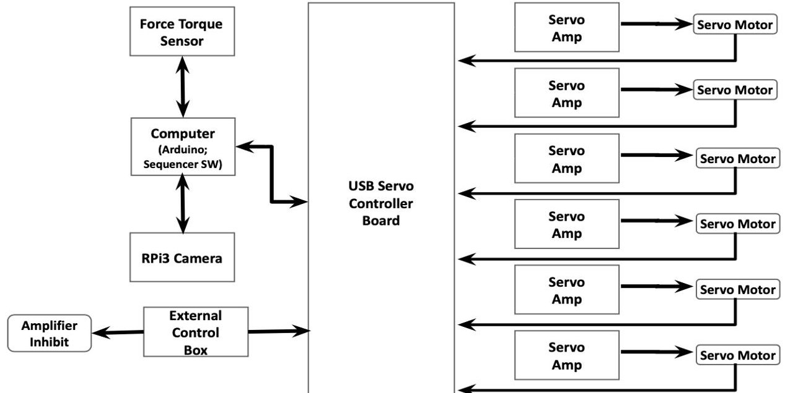

Figure 4. Robot Assembly Block Diagram depicting input and output flow from the system. (All servo motors serve the same function and possess the same characteristics.)

The computer interprets the action and sends additional commands to the FT Sensor. While brushless direct current (DC) motors will be used for the space-qualified test, the LewanSoul pre-packaged kit-provided servo motors are used for the initial laboratory prototype.

## Mechanical Workmanship

Several iterations of structural designs were necessary to align with the capabilities of the robotic arm and the lack of a human-in-the-loop. There were two primary criteria determined for the structural design. First, all pieces had to be large enough for the robot arm grippers to hold. Second, the design could not be held together with mechanical fasteners, such as springs or screws. This was for two reasons. The first is the limitations of the grippers; screws are both too small and require too fine precision to install with the robot arms. The second is the low gravity environment. The limitations on the speed and precision of the robot arm would prevent it from recovering a fastener if it was improperly placed and released in the low gravity environment. This would cause both time delays in assembly and

either a waste of power to reclaim lost fasteners or an excess of fasteners to be stored in the locker.

Two alternative methods of attachment were considered for the structural design, as seen in Figure 5. The first design utilizes latches, or small outcroppings, in the top and bottoms of the rails that can slide into the base and top of the CubeSat but cannot be pulled back out without first applying pressure. This design was ultimately rejected due to lack of space; the size of the latch required to secure the rails in place was infeasible. The second mechanical attachment involves snaps. The panels would be placed into a base and held by buttons that fit into holes in the panels. The rails would then snap into knobs on the outside of the structure. This design was used for the robotic assembly. There were several instances when the low-cost robot could not provide enough torque to place parts into the knobs, so the knobs had to be shaved down by 35%. Additionally, the panels were often not able to be precisely placed into position, so several tests were required to improve precision and a camera, originally used to improve lighting, aided precision.

We used additive manufacturing with a Fused Filament Fabrication (FFF) printer for the design iterations for this work as it is effective for laboratory prototyping purposes. We anticipate the final design will be 3D-printed using a Selective Laser Sintering (SLS) printer,

<!-- PDF_PAGE: 12 -->

as SLS printers have better outgassing properties than FFF printers. 3D-printing provides us with multiple advantages to machining. First, it emphasizes the low-cost and rapid production goals of this mission, as 3D-printing is both faster and cheaper than machined parts. Second, it allows for fine detail and features that would be challenging to be machined.

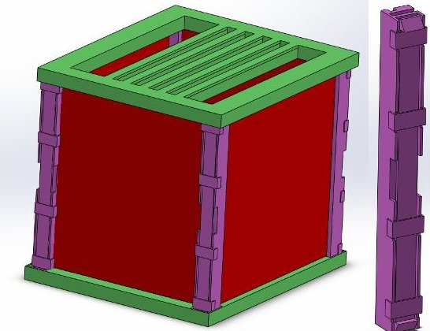

Option 1 with rails and latches

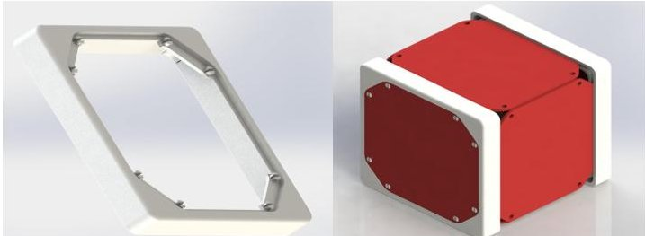

Option 2 without side rails

Figure 5. Two current best structural options

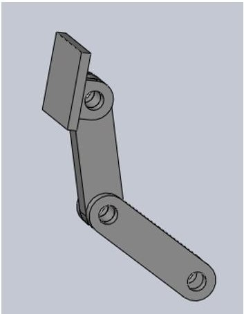

Figure 6. A rendition of the Camera Mount used on a 1.5 ft post to aid robotic assembly

After a feasible structure is selected, we create and use a representation of the assembly workspace (inside a spacecraft locker) to determine feasibility for robotic task execution.

We approximate the assembly workspace and use a discrete model to capture the reachable space of the robot arms' capabilities.

## Implementation

The LewanSoul robots are selected because it is a low-cost COTS option. A Raspberry Pi camera is set atop a 1.5 ft tall post with an Arduino attached behind it. Red prototype boards in front of the two robot arms. The process begins with the Raspberry Pi camera capturing an image of the platform. OpenCV object detection software libraries are used in a Python software program to identify the color-coded boards, calculating the center of the boards for grasp accuracy (by converting pixels to meters). After an image capture of the field, the pixel position of the boards' center is calculated, resulting in two sets of (x, y) points in meters and pixels. The maximum range for the LewanSoul robot arms is +0.15 m to -0.15 m in the y-direction and 0 m to 0.3 m in the x-direction, which determines the placement of each arm and board stacks. Using Inverse Kinematics [26], the location values are detected and converted into a set of six angles. Given that there are six servos on each arm, the Raspberry Pi would send those angles to the Arduino for control of the arm through control of the six servos via the USB serial port. The arm proceeds to perform movements to grasp each board at target locations and begin assembly using specified location values. The process is repeated until a CubeSat has been assembled - see assembly sequence in Figure 7.

<!-- PDF_PAGE: 13 -->

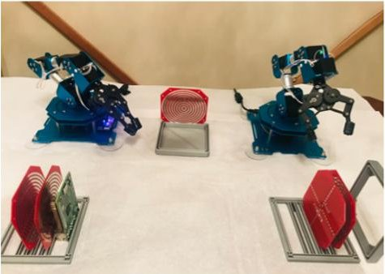

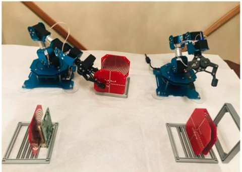

1: Modular board placed by right arm

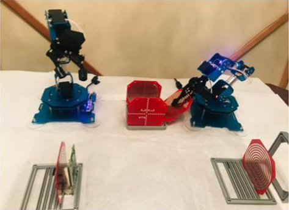

2: Second modular board placed by left arm

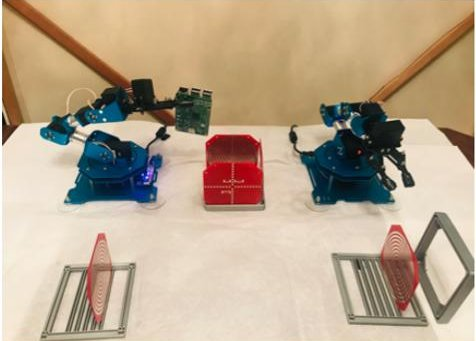

3: Third modular board placed by left arm

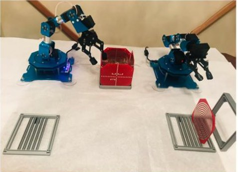

4: Processor board placed by left arm

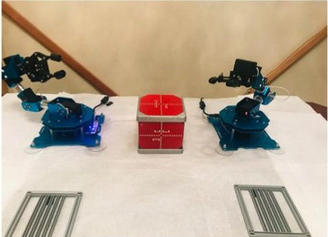

5: Final side panel circuit board is assembled 6: All six modular boards fastened by magnets

Figure 7: Sequence of Robot Arm Assembly of 1U CubeSat in under 8 minutes.

## Robotic Algorithm

To ensure the robot arms reach the target boards with a single calculation, open-loop control, which is faster than closed-loop control, is used. Control operations can be either closed-loop or open-loop. The key difference is feedback. An open-loop control system performs based on the input, and the output has no effect on the control action. Closed-loop control is best used when the measurements are feasible, and the process has a predictable response to an input control. It enables the process to be set on certain points within a given accuracy and automates correction to process disturbances. Yet with open-loop control, outputs rarely change and process disturbances are not the norm. Therefore, we select open-loop control as the better choice because no quantitative measurement is possible, as with an inaccessible or erratic process, and low-cost is a priority.

The Software Serial Port on Arduino is used to control the six different servos, restricting the rotating limits for each servo first. The rotation

range is between 0 and 240 degrees and the minimum increment, or accuracy, for each servo is 13.8 degrees. Using each servo's unique ID number, their rotating duration and rotating position are controlled. In the Arduino code, we pre-defined several functions that move to the vertical initial position, move to target location based on input arguments, and move to bin location move_to_initial(), move_to() and move_to_bin(), respectively. Serial Port is used to make Raspberry Pi 4 (RPi4) communicate with the Arduino. Six values are sent for each target location, one angle for each servo. The Arduino has only one serial port and needs to communicate with both the RPi4 and the six servos, so an additional hardware serial port was set up. A protocol requiring the RPi4 and Arduino to communicate and confirm messages was added to ensure all six values were sent and for use as an error detection mechanism. Once complete, the camera would capture a new image of the boards to be processed.

Coverage Planning FunctionsFor task planning in 2D workspaces, we determine the viewpoints for the entire target surface using a

<!-- PDF_PAGE: 14 -->

randomized sampling. This randomized sampling as defined in the Traveling Salesman Problem (TSP) [13] enables three functions. The functions are the selection of components, assembly of components in required time (<50 seconds), and connect the components using the Genetic Algorithm in Section 3. We assume that path planning between specific goals dominates the runtime cost compared to the computation of approximate solutions to the TSP. It uses a lower bound estimation of the path length between goals to calculate candidate TSP solutions and uses the complete path planner for edges in candidate solutions.

The robotic arm control algorithm [48] finds an appropriate solution to two key problems: path planning and robot arm placement. This is accomplished by using a divide and conquer strategy and optimization heuristic planning approaches to the reachability and the coverage problem. The algorithm shows how we sample points from the target surface and use the points TTarget to estimate the progress of the coverage planning. We store all the points in the solutions in the set Tcoverage, allT and align each pose (from the global set) pA, with reachable target points from the predefined map of reachability. The main loop continues after this phase until R is empty or all target points are covered. Next we find the pose pmax, which includes the largest subset of the rest of the target points. We also use the coverage planner to find a trajectory t in as many points as possible in R(pmax), which are stored in Tcoverage. Constraints like stability requirements are taken into account by the coverage planner. Tcoverage and pmax are removed from R by updating every entry(p',T')R to remove the covered points (p', T'\Tcoverage). Entries with no reachable points are emptied during each timestep, which is 10 ms. Given the multistep required, we use the Python time() function, to measure time and create a function to configure the clock and evaluate the microcontroller at 100 Hz. And for the last

steps in the loop, we update the target points Tcoverage, all by adding the points in Tcoverage and adding (pmax, t) to the list of solutions. Upon completion of the while loop, we find the degree of coverage.

## Observations

The LewanSoul arms assembled structures and six prototype boards in under eight minutes. The robot arms were subjected to 170 hours of tests: all servo motors and rotation angles were tested to determine stability, accuracy, and feasibility of operation. We automated repetitive tests of each servo motor for over 120 hours, while the software for the satellite assembly was being programmed. There were initially errors in assembly as the robot arms kept missing the precise assembly area, structure spaces for board placement, and the correct angle for side boards. Therefore, while the boards were grasped within the first week of programming, we learned after five weeks of errors in placement to slow the speed of the arm movement by a factor of two as the robot arm approached the satellite assembly area. For instance, if the board was picked up by the robot arm moving in 1480 ms, we also move each servo motor (robot arm joint) in 1480 ms as the board approaches its final destination. When the board arrived at the assembly area, the board was lowered carefully into its intended position in 740 ms. Despite this slowdown, the robotic assembly of each component took approximately 22.25 seconds. It took the same amount of time to grasp mechanical structures as it did to grasp boards. Additional issues arose during the assembly process, such as loose grippers. The grippers became loose after over 100 hours of use and were not able to pick up the boards, which were sliding off the gripper pads. The grippers were subsequently tightened. On occasion, electrical tape was used on the gripper pads to retrain the gripper into a gripping position.

<!-- PDF_PAGE: 15 -->

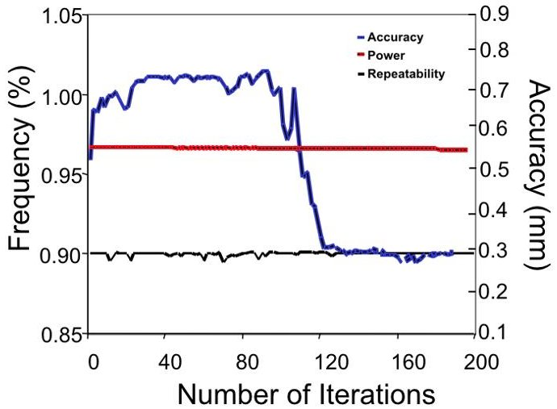

Figure 8. Robot Arm Power Consumption and repeatability of movements are predictable while the accuracy of the robot arms decreases after 120 iterations

The camera lighting control was coded into the Python program; however, PiCam lighting control was used to ensure adequate lighting at all times. Sometimes the LED did not work; tightening the bolts of the LED and camera, then restarting it solved the problem. Ultimately, errors were resolved, and the entire 1U CubeSat was assembled with no humans in-the-loop in seven minutes and 39 seconds.

Using the Inverse Kinematics (IK) approach made for less intensive programming; however, using a robot arm as part of a larger system required a learning curve in robot automation and robotics programming. The Python code resulted in several hundreds of lines of code, which was human-intensive to create. There was a decline in the robot arm 95% accuracy requirement after 120 iterations. We observed the robots become physically shaky and technically imprecise. For instance, although the robot arms were programmed with the correct coordinates, it kept missing the structure by 2 cm when installing a board. We added an error detection to the code and adjusted the distance for assembly in the assembly area to match 92-98% of the specified coordinates. All programming and CAD work was completed on an Apple Mac laptop with access to and use of standard Python libraries.

The standard libraries used are pybullet which includes calculateinversekinematics() pybullet_data, math, time datetime, and numpy.

## Summary

Overall, the robots have shown the capacity to assemble a 1U lab prototype CubeSat in under eight minutes. However, power considerations require improved motors for ISS demonstration as servo motors burnout due to degradation after less than 200 hours of use. The endeffector (gripper) accuracy diminishes with time; therefore, exploration of precision (surgical) robots for flight is a required next step. Two COTS robot arms and servo motors have shown reliability concerns due to mechanical and degradation issues on the ground; therefore, conducting a future trade study on low-cost offerings for reliable motors and arms is key to moving forward.

Standardization of electromechanical CubeSat components for on-orbit assembly requires magnets and snaps for low-cost end-effectors. The potential for decreasing the lead time for CubeSat integration and assembly and savings in cost and schedule serve as justification to continue to refine and implement this work. It is clear that ultimately, the function rests with the robot arms. Available machines to support spacecraft development will foster faster scientific research and discoveries and would reduce schedule and cost (by an estimated 50%) associated with building a small satellite. We find that large custom-built robots are not the only vehicles for in-space robotic assembly. There is utility for precision robot companies to support aerospace robotic applications. As small satellites and constellation missions continue to evolve, demand for precise and rapid CubeSat assembly with no humans-in-the-loop will grow.

<!-- PDF_PAGE: 16 -->

## CONCLUSION AND FUTURE WORK

On-orbit robotic assembly missions typically involve humans-in-the-loop and use large custom-built robotic arms designed to service existing modules. The concept of on-orbit robotic assembly of modularized CubeSat components supports use cases, such as rapidly placing failed nodes within a constellation of satellites and monitoring damaged assets in Low Earth Orbit. This work describes the potential and approach to on-orbit robot assembly of small satellites using low-cost robot arms. We show the feasibility of the robotic assembly of a 1U CubeSat and optimize for robotic assembly time. We demonstrate the laboratory prototype assembly of a 1U CubeSat and analyze the systems engineering process for the on-orbit assembly of small satellites. The ground-based lab prototype has shown that robotic arm assembly of modularized components could be proven as a viable option for a new class of CubeSats. The assembly process used two dexterous COTS robot arms to assemble modular CubeSat boards fastened with magnets into a small satellite. The assembly steps for a 1U satellite, using open-loop control and a Python software program, required approximately five minutes to complete.

## Flight Hardware Selection

Observations and lessons learned from feasibility studies, analyses, and the robot arm demonstration have informed several flight considerations and highlighted the need for several future work efforts, such as investigating improved subsystems. For instance, considering precise (surgical) robot arms in the same form factor as the LewanSoul robot arms to overcome accuracy and precision issues and exploring durable motors for the flight demonstration, with low risk for burnout. We will train these new robot arms to sense, grasp, and assemble CubeSat flight components. We also need to conduct a trade study on low-cost COTS robot arms versus

precision surgical robot arms as the latter is likely to be costly and may negate the low-cost goal of the research. An optimization model, which simulates next-generation design and performance, to ensure energy optimization per CubeSat assembly will be conducted. We also intend to conduct environmental testing of the robot arms and assess the thermal and power budgets for lifetime expectation and self-maintenance. In addition, we use a spacecraft locker with thermal management control to reduce the risk of thermal concerns. Steps to improve the torque of the robot arms will be included in the space qualification requirements. Three activities must be conducted for a flight model. These activities are

1. The modularization of sensor payloads

2. The design and test of the locker, shelving and storage units for component modules including robotic arm accessibility

3. The build and test of FlatSat component modules.

## Future Work

As CubeSat subsystems continue to mature, the project will evaluate relevant components and payloads for robotic assembly testing and analysis. Future work will be focused on three objectives:

1. The introduction of a new CubeSat structural standard. The standard uses modular and reconfigurable electromechanical components, which includes providing propulsion capability, should the CubeSat need to change orbits.

2. The demonstration of space-qualified robotic assembly of a 1U CubeSat. A key step for space qualification involves the calculation of the link budget. The link budget is a theoretical calculation of the end-to-end performance of the communications link.

3. The tailoring of the systems engineering process to robotic small satellite assembly with no humans-in-the-loop.

<!-- PDF_PAGE: 17 -->

## Acknowledgments

We thank Chad Frost and Marcus Murbach (NASA Ames Research Center), Dr. Neil Gershenfeld (MIT Center for Bits and Atoms), Dr. Daniel Hastings (MIT AeroAstro Department) and Joseph Parrish (DARPA) for valuable insights to refine portions of the concept from a back-of-the-envelope idea to a potential relevant mission concept.

## References

1. Doggrell, Les. Operationally responsive space: a vision for the future of military space. AIR UNIV MAXWELL AFB AL AIRPOWER JOURNAL, 2006.

2. Northrop Grumman. "Companies demonstrate groundbreaking satellite life- extension service." [Online]. Available: https://news.northropgrumman.com/news/releases/northrop-grumman-successfully-completes-historic-first-docking-of-mission- extension-vehicle-with-intelsat-901-satellite

3. Flores-Abad, Angel, et al. "A review of space robotics technologies for on-orbit servicing." Progress in Aerospace Sciences 68 (2014): 1-26.

4. Kerzhner, Aleksandr A., et al. "Architecting cellularized space systems using model-based design exploration." AIAA SPACE 2013 Conference and Exposition. 2013.

5. Hill, Lisa, et al. "The Market for Satellite Cellularization: A historical view of the impact of the satlet morphology on the space industry." AIAA SPACE 2013 Conference and Exposition. 2013.

6. Barnhart, David, et al. "Changing satellite morphology through cellularization." AIAA SPACE 2012 Conference & Exposition. 2012.

7. Jaeger, Talbot, and Walter Mirczak. "Satlets-the building blocks of future satellites-and which mold do you use?" AIAA SPACE 2013 Conference and Exposition. 2013

8. Ceccacci, Anthony, Dye, Paul. "Contingency Shuttle Crew Support

(CSCS)/Rescue Flight Resource Book." National Aeronautics and Space Administration (2005): 89.

9. Kawasaki, Kazuyoshi. "Overview of JEM-EF on ISS." Proceedings of the RIKEN Symposium. Saitama. 2008.

10. Steimle, Per C., et al. "Commercial Approach to Research Outside the International Space Station-A Small Size Precursor Service For Future In-Orbit Testing." AIAA SPACE 2014 Conference and Exposition. 2014.

11. Steimle, Christian, and Uwe Pape. "ISS External Payload Platform-a new opportunity for research in the space environment." 40th COSPAR Scientific Assembly. Vol. 40.

12. Sun, Yongjun, et al. "Design and optimization of a novel six-axis force/torque sensor for space robot." Measurement 65 (2015): 135-148.

13. Applegate, David L., et al. The traveling salesman problem: a computational study. Princeton university press, 2006.

14. Sinclair, Doug, and Jonathan Dyer. "Radiation effects and COTS parts in SmallSats." (2013).

15. Piskorz, D. A. N. I. E. L. L. E., and K. Jones. "On-Orbit Assembly of Space Assets: A Path to Affordable and Adaptable Space Infrastructure." The Aerospace Corporation (2018).

16. Katz, Daniel S., and Raphael R. Some. "NASA advances robotic space exploration." Computer 36.1 (2003): 52-61.

17. Putz, Peter. "Space robotics in Europe: A survey." Robotics and Autonomous Systems 23.1-2 (1998): 3-16.

18. Weisbin, Charles R., and Guillermo Rodriguez. "NASA robotics research for planetary surface exploration." IEEE Robotics & Automation Magazine 7.4 (2000): 25-34.

19. Whelan, David A., et al. "Darpa orbital express program: effecting a revolution in space-based systems." Small Payloads in

<!-- PDF_PAGE: 18 -->

Space. Vol. 4136. International Society for Optics and Photonics, 2000.

20. Barnhart, David, et al. "Phoenix program status-2013." AIAA SPACE 2013 conference and exposition. 2013.

21. Smrekar, Sue, and B. Banerdt. "The InSight mission to Mars." The 8th Mars Conference. Vol. 18. 2014.

22. Sallaberger, Christian, Space Plan Task Force, and Canadian Space Agency. "Canadian space robotic activities." Acta astronautica 41.4-10 (1997): 239-246.

23. Laryssa, Patten, et al. "International space station robotics: a comparative study of ERA, JEMRMS and MSS." 7th ESA Workshop on Advanced Space Technologies for Robotics and Automation. 2002.

24. Hirzinger, Gerd, et al. "Sensor-based space robotics-ROTEX and its telerobotic features." IEEE Transactions on robotics and automation 9.5 (1993): 649-663.

25. Hirzinger, G., et al. "Robotics and mechatronics in aerospace." 7th International Workshop on Advanced Motion Control. Proceedings (Cat. No. 02TH8623). IEEE, 2002.

26. Rodgers, Lennon, Simon Nolet, and David W. Miller. "Development of the miniature video docking sensor." Modeling, Simulation, and Verification of Space-based Systems III. Vol. 6221. International Society for Optics and Photonics, 2006.

27. Bualat, Maria, et al. "Astrobee: Developing a free-flying robot for the international space station." AIAA SPACE 2015 Conference and Exposition. 2015.

28. Parrish, J. "Robotic Servicing of Geosynchronous Satellites (RSGS)." Defense Advanced Research Projects Agency (DARPA). [Online]. Available: https://www. darpa. mil/program/robotic-servicing-of geosynchronous-satellites.

29. B.E. Kelm, et al. FREND: Pushing the Envelope of Space Robotics. Space Research and Satellite Technology. 2008 NRL Review.

30. Reed, Benjamin B., et al. "The restoreL servicing mission." AIAA SPACE 2016. 2016. 5478.

31. Lymer, John, et al. "Commercial application of in-space assembly." AIAA SPACE 2016. 2016. 5236.

32. Patane, Simon, John Schomer, and Michael Snyder. "Design Reference Missions for Archinaut: A Roadmap for In-Space Robotic Manufacturing and Assembly." 2018 AIAA SPACE and Astronautics Forum and Exposition. 2018.

33. James, Stephen, et al. "Sim-to-real via sim-to-sim: Data-efficient robotic grasping via randomized-to-canonical adaptation networks." Proceedings of the IEEE Conference on Computer Vision and Pattern Recognition. 2019.

34. Gilmore, Cheser, et al. "Flexible, High Speed, Small Satellite Production." (2019).

35. Grim, Braden, et al. "MakerSat: A CubeSat Designed for In-Space 3D Print and Assembly." (2016). 30th Annual Conference on Small Satellites.

36. Earth Observatory Portal Directory. "MakerSat". [Online]. Available: https://directory.eoportal.org/web/eoportal/satellite-missions/m/makersat

37. NNU. "NNU's MakerSat-1 CubeSat Assembly." [Online]. Available: https://youtu.be/shLPETczsF4

38. Hirzinger, Gerd, et al. "On a new generation of torque controlled light-weight robots." Proceedings 2001 ICRA. IEEE International Conference on Robotics and Automation (Cat. No. 01CH37164). Vol. 4. IEEE, 2001.

39. Murugesan, S. "An overview of electric motors for space applications." IEEE transactions on industrial electronics and control instrumentation 4 (1981): 260-265.

40. Li, Y. F., and X. B. Chen. "On the dynamic behavior of a force/torque sensor for robots." IEEE Transactions on Instrumentation and Measurement 47.1 (1998): 304-308.

<!-- PDF_PAGE: 19 -->

41. Tsujimura, Takeshi, and Tetsuro Yabuta. "Object detection by tactile sensing method employing force/torque information." IEEE Transactions on robotics and Automation 5.4 (1989): 444-450.

42. Liu, Guangjun, et al. "A base force/torque sensor approach to robot manipulator inertial parameter estimation." Proceedings. 1998 IEEE International Conference on Robotics and Automation (Cat. No. 98CH36146). Vol. 4. IEEE, 1998.

43. Watson, Judith J., Timothy J. Collins, and Harold G. Bush. "A history of astronaut construction of large space structures at NASA Langley Research Center."

Proceedings, IEEE Aerospace Conference Vol. 7. IEEE, 2002.

44. Doggett, William. "Robotic assembly of truss structures for space systems and future research plans." Proceedings, IEEE Aerospace Conference. Vol. 7. IEEE, 2002.

45. Bruner, Wesley, Carlos Enriquez, and Sreekumar Thampi. "Mechanism analysis and verification approach for ISS truss assembly." 37th Aerospace Mechanisms Symp. 2004.

46. Hastings, Daniel E., and Carole Joppin. "On-orbit upgrade and repair: The hubble space telescope example." Journal of spacecraft and rockets 43.3 (2006): 614-625.

47. NASA, Tech Demonstration. "NASA's Dragonfly Project Demonstrates Robotic Satellite Assembly Critical to Future Space Infrastructure Development." (2017).

48. Paus, Fabian, et al. "A combined approach for robot placement and coverage path planning for mobile manipulation." 2017 IEEE/RSJ International Conference on Intelligent Robots and Systems (IROS). IEEE, 2017.