<!-- PDF_PAGE: 1 -->

# Guidelines for Verification Strategies to Minimize RISK Based On Mission Environment, -Application and Lifetime (MEAL)

Oscar Gonzalez/NESC Langley Research Center, Hampton, Virginia

Yuan Chen Langley Research Center, Hampton, Virginia

Raymond L. Ladbury Goddard Space Flight Center, Greenbelt, Maryland

Dwayne R. Morgan Wallops Flight Facility, Wallops Island, Virginia

Christopher M. Green Goddard Space Flight Center, Greenbelt, Maryland

Daniel E. Yuchnovicz/NESC Langley Research Center, Hampton, Virginia

<!-- PDF_PAGE: 2 -->

Since its founding, NASA has been dedicated to the advancement of aeronautics and space science. The NASA scientific and technical information (STI) program plays a key part in helping NASA maintain this important role.

The NASA STI program operates under the auspices of the Agency Chief Information Officer. It collects, organizes, provides for archiving, and disseminates NASA's STI. The NASA STI program provides access to the NTRS Registered and its public interface, the NASA Technical Reports Server, thus providing one of the largest collections of aeronautical and space science STI in the world. Results are published in both non-NASA channels and by NASA in the NASA STI Report Series, which includes the following report types:

- TECHNICAL PUBLICATION. Reports of completed research or a major significant phase of research that present the results of NASA Programs and include extensive data or theoretical analysis. Includes compilations of significant scientific and technical data and information deemed to be of continuing reference value. NASA counter-part of peer-reviewed formal professional papers but has less stringent limitations on manuscript length and extent of graphic presentations.

- TECHNICAL MEMORANDUM. Scientific and technical findings that are preliminary or of specialized interest, e.g., quick release reports, working papers, and bibliographies that contain minimal annotation. Does not contain extensive analysis.

- CONFERENCE PUBLICATION. Collected papers from scientific and technical conferences, symposia, seminars, or other meetings sponsored or co-sponsored by NASA.

- CONTRACTOR REPORT. Scientific and technical findings by NASA-sponsored contractors and grantees.

- SPECIAL PUBLICATION. Scientific, technical, or historical information from NASA programs, projects, and missions, often concerned with subjects having substantial public interest.

- TECHNICAL TRANSLATION. English-language translations of foreign scientific and technical material pertinent to NASA's mission.

Specialized services also include organizing and publishing research results, distributing specialized research announcements and feeds, providing information desk and personal search support, and enabling data exchange services.

For more information about the NASA STI program, see the following:

- Access the NASA STI program home page at http://www.sti.nasa.gov

- E-mail your question to help@sti.nasa.gov

- Phone the NASA STI Information Desk at 757-864-9658

- Write to:

NASA STI Information Desk

Mail Stop 148

NASA Langley Research Center

Hampton, VA 23681-2199

<!-- PDF_PAGE: 3 -->

# Guidelines for Verification Strategies to Minimize RISK Based On Mission Environment, -Application and Lifetime (MEAL)

Oscar Gonzalez/NESC Langley Research Center, Hampton, Virginia

Yuan Chen Langley Research Center, Hampton, Virginia

Raymond L. Ladbury Goddard Space Flight Center, Greenbelt, Maryland

Dwayne R. Morgan Wallops Flight Facility, Wallops Island, Virginia

Christopher M. Green Goddard Space Flight Center, Greenbelt, Maryland

Daniel E. Yuchnovicz/NESC Langley Research Center, Hampton, Virginia

National Aeronautics and Space Administration

Langley Research Center Hampton, Virginia 23681-2199

<!-- PDF_PAGE: 4 -->

## Acknowledgments

The team would like to recognize and dedicate this paper in memory of Mr. Robert Kichak. His open-minded nature and objective engineering mentality helped NASA, the space community, and other government agencies negotiate the difficult challenges of ensuring reliable space systems over many decades. His integrity, patience, experience, and deep understanding are a great loss to the community.

The team would like to thank the following for their thorough review of this paper.

Steven Gentz, NESC Chief Engineer, MSFC

Steven Guertin, Parts Radiation, JPL

Timothy Ruffner, Avionics, GRC

Steven Rickman, NASA Technical Fellow for Passive Thermal

Kenneth Johnson, NESC Systems Engineering, MSFC

The use of trademarks or names of manufacturers in the report is for accurate reporting and does not constitute an official endorsement, either expressed or implied, of such products or manufacturers by the National Aeronautics and Space Administration.

Available from:

NASA STI Program / Mail Stop 148

NASA Langley Research Center

Hampton, VA 23681-2199

Fax: 757-864-6500

<!-- PDF_PAGE: 5 -->

NASA Engineering and Safety Center

# Guidelines for Verification Strategies to Minimize RISK Based On Mission Environment, -Application and -Lifetime (MEAL)

April 5,2018

<!-- PDF_PAGE: 6 -->

Report Approval and Revision History

NOTE: This document was approved at the April 5, 2018, NRB. This document was submitted to the NESC Director on April 9, 2018, for configuration control.

<table border="1"><tr><td>Approved:</td><td>Original Signature on File</td><td>4/9/18</td></tr><tr><td></td><td>NESC Director</td><td>Date</td></tr></table>

<table border="1"><tr><td>Version</td><td>Description of Revision</td><td>Office of Primary Responsibility</td><td>Effective Date</td></tr><tr><td>1.0</td><td>Initial Release</td><td>Oscar Gonzalez, NASA Technical Fellow for Avionics, GSFC</td><td>4/5/18</td></tr></table>

<!-- PDF_PAGE: 7 -->

## Table of Contents

Signature Page...5

1.0 Background...6

2.0 Executive Summary...7

3.0 Verification based on MEAL and Risk Posture...10

    3.1 Understanding MEAL...10

    3.2 Understanding Risk and Risk Posture...11

    3.2.1 Risk – Metrics and Matrices...11

    3.2.2 Cost, Schedule and Technical Risks versus Verification Test Level...13

    3.3 Understanding Flight Heritage...14

    3.3.1 MEAL & TRL Concepts to Assess Flight Heritage...15

4.0 Verification Test and Inspection Matrix at Part-, Board- and Box-Level...18

    4.1 Verification Test/Inspection Purposes, Capabilities, Advantages, and Limitations...18

    4.2 Verification Test/Inspection at Part-, Board-, Box/Subsystem- and System-Level...18

    4.2.1 Part-level Verification...18

    4.2.1.1 Introduction...18

    4.2.1.2 Parts Testing: Why and How...19

    4.2.1.3 Screening for Part Infant Mortality and Other Defects...19

    4.2.1.4 Major Advantages and Limitations of Part-level Verification...19

    4.2.2 Board-level Verification...20

    4.2.3 Box-level or Subsystem-level Verification...21

    4.2.4 System-level Verification...21

    4.2.5 Radiation Effects Verification...21

    4.2.5.1 TID, DDD, and SEE...22

    4.2.5.2 Radiation Testing at Different Configuration Levels...22

    4.2.6 Potential Consequences of Skipping Part-level Testing...25

    4.2.7 Thermal Impact on Part-, Board- and Box-level Verification - an Example...25

5.0 Verification of COTS Part, Board, and/or Box...30

    5.1 Background of COTS Use in Spaceflight Programs...30

    5.2 Verification Process for COTS Technology...32

6.0 Example Lessons Learned for Verification Based on MEAL and Risk Posture...33

    6.1 Heritage Misapplication Examples...33

    6.2 Part-level Verification: Enabling Identification of Part Infant Mortality Defects and Failures...36

    6.3 Challenges of Radiation Testing on COTS Parts: Part-to-Part SEE Variability for Some COTS Parts...38

7.0 Definitions...39

8.0 Acronyms List...40

Appendices...41

Appendix A. Matrix for a Set of Common Verification Tests and Inspections: Purposes, Capabilities, Advantages and Limitations of Each Verification Performed at Different Level of Integration...42

Appendix B. Counterfeit Parts...58

Appendix C. Team List/Acknowledgements...61

## List of Figures

Figure 1. NESC Risk Matrix and Related Definitions of the Matrix Element Definitions ...12

Figure 2. Notional Cost and Schedule Impacts when Performing Testing at Part-, Board-, and Box- Level...13

<!-- PDF_PAGE: 8 -->

Figure 3. Notional Ability to Detect Parts Defects and Interaction between Parts when Performing Testing at Part-, Board-, and Box- Level ...14

Figure 4. Simulated strikes of ions (red dots) overlaid on a photomicrograph 60 x 70 $ \mu m^{2} $ section of an Elpida 512 Mbit SDRAM. Left: Recoil Ions due to $ 10^{10} $ Protons/cm $ ^{2} $ . Right: $ 10^{7} $ ions/cm $ ^{2} $ Typical of Heavy ion SEE Test ...24

Figure 5. Transistor Count Scales Roughly as the Inverse Square of the Minimum Feature Size of the Technology ...24

Figure 6. Left: Image of Board #1. Right: Thermal image of the Powered Board #1 ...26

Figure 7. Board #1 Estimated Temperature Profile with Ambient Temperature of $ 71.6^{\circ} \mathrm{C} $ ...26

Figure 8. Left: Image of Board #2; Right: Thermal Image of Powered Board #2 ...27

Figure 9. Board #2 estimated Temperature Profile with Ambient Temperature of $ 103.5^{\circ} \mathrm{C} $ ...27

Figure 10. Estimated Maximum Boards #1 and 2 Temperature Profile when Tested at the Box-I Level ...28

Figure 11. Notional Bathtub Reliability Curve ...30

Figure 12. Comparison between Commercial and Radiation-Hardened CMOS Technologies ...31

Figure 13. Evidence of "No Fly" Zone ...32

Figure 14. Launch Pad 39A Flame Deflector System ...34

Figure 15. Image and Sketch of the Launch Pad 39A Flame Trench (SRB side) Affected Area ...35

## List of Tables

Table 1. Elements of Mission Risk Posture Impact/Consequence Areas...13

Table 2. TRL, Heritage and MEAL Examples...17

Table 3. Comparison of Acceleration Factors between Single-board and Box-level Thermal Tests...29

Table 4. Comparison of Equivalent Time Corresponding to 168 Hour Burn-in Test on the Hottest and Coldest Components on the Example Boards and Boxes...29

<!-- PDF_PAGE: 9 -->

## Signature Page

<table border="1"><tr><td colspan="2">Submitted by:Team Signature Page on File-4/23/18</td></tr><tr><td>Mr. Oscar Gonzalez</td><td>Date</td></tr><tr><td colspan="2">Significant Contributors:</td></tr><tr><td>Dr. Yuan Chen</td><td>Date</td></tr><tr><td>Mr. Dwayne R. Morgan</td><td>Date</td></tr><tr><td>Mr. Daniel E. Yuchnovicz</td><td>Date</td></tr></table>

<table border="1"><tr><td>Dr. Yuan Chen</td><td>Date</td><td>Dr. Raymond L. Ladbury</td><td>Date</td></tr><tr><td>Mr. Dwayne R. Morgan</td><td>Date</td><td>Mr. Christopher M. Green</td><td>Date</td></tr><tr><td>Mr. Daniel E. Yuchnovicz</td><td>Date</td><td></td><td></td></tr></table>

See Appendix C for Team List/Acknowledgements.

<!-- PDF_PAGE: 10 -->

## 1.0 Background

There is a trend of compromising verification testing to address the cost and schedule constraints, which poses a high-risk posture for programs/projects. Current and emerging aerospace scientific and/or human exploration programs continue to pose new technological challenges. These technological challenges combined with finite budgets and truncated schedules are forcing designers, scientists, engineers, and managers to push technologies to their physical limits. In addition, budget and schedule pressures challenge how those technologies/missions are verified.

A clear understanding of the different verification processes is needed to ensure the proper verification of the technology within the mission (i.e., capabilities, advantages, and limitations). The goal of verification is to prove through test, analysis, inspection, and/or demonstration that a product provides its required function while meeting the performance requirements. It is important that verification yield understanding of representative performance under worst-case conditions so that margins to failure can be evaluated for proposed applications. The capabilities, advantages, and limitations of the testing and inspection performed at each level are different, and the risk incurred by omitting a verification step depends on the level of integration as well as Mission, Environment, Application and Lifetime (MEAL).

This paper focuses on verification processes. The goal of the verification process is to ensure the given avionics technology could be safely implemented on the given MEAL consistent with the program/project risk posture.

<!-- PDF_PAGE: 11 -->

## 2.0 Executive Summary

This paper describes selection of the verification processes taking into account MEAL and risk posture. This paper compares common verification tests and inspections by describing the capabilities, advantages, and limitations of the verification depending on the level of integration (i.e., part-, board-, box-level, etc.) being used. When properly implemented, these tests ensure that the given avionics system and technology can be safely used on the given human-rated or robotic program with acceptable risks in safety critical spaceflight applications.

As demands for improved performance in spaceflight programs increase, and budget and schedule pressures remain constrained, the temptation has increased to implement new or previously flown avionics technologies, including COTS technologies, into human-rated and robotic spaceflight programs.

Spaceflight programs are incentivized to use these avionics technologies to reduce design, development, test, and evaluation (DDT&E) costs, to meet programmatic schedules, and increase system performance. However, in some cases, these technologies that have not been fully vetted according to procedures appropriate for operation in a different space environment, or for their intended application, environment and life cycle have been inserted into space hardware, introducing risks to the spaceflight systems. To avoid introducing such risks, it is critical to understand the risk impact on the proposed technology in terms of the Mission definition and its related Environment, Application and Lifetime (MEAL) along with the associated risk posture.

The motivation is to combat common myths or misunderstandings about verification, such as:

1) One size fits all;

2) It is not important to understand the verification process including capabilities advantages and limitation at different integration level;

3) New technologies have sufficient reliability built-in and so require no additional screening or qualification;

4) There is no need to do any further verification beyond the manufacturer's data on COTS technologies;

5) Cost, budget and schedule pressures provide adequate reason for deviating from accepted qualification and screening procedures;

6) Flight heritage allows omission of critical verification steps.

This paper describes a MEAL and risk posture base verification process for selection and verification of avionics technology including COTS parts, board and/or box technologies. The paper presents a set of common verification tests and inspections matrix with comparisons of each verification test or inspection by describing the capabilities, advantages and limitations of the test or inspection depending on the level of integration (i.e., part, board, box, etc.) being used. The paper also uses the concept of technology readiness level (TRL) centered on MEAL to assess flight heritage, providing steps required to qualify any design and to help assess whether the "heritage design" is or not suitable for the given mission.

The paper's strategy focuses on MEAL and verification assurance. When properly implemented, these tests and inspections ensure that the technologies passing these tests can be safely used on the given flight program with acceptable risks even in safety-critical spaceflight applications.

<!-- PDF_PAGE: 12 -->

The goal of this paper is to enhance awareness of the: 1) capabilities, advantages, limitations of verification processes; 2) related impact to risks associated with various part-, board-, and box-level verification testing; and 3) how risks can be managed for selection and verification of parts based on an integrated assurance approach focusing on MEAL and verification assurance.

## Key take away messages are:

## 1. MEAL (mission, mission environment, application and lifetime of the mission or application)

a. The understanding of the MEAL requires a complete picture of how avionics and technologies are to be used effectively. The considerations summarized in the MEAL allow designers to effectively choose parts for their best performance in a given architecture. Emphasizing one of the MEAL elements without understanding the others can compromise the integrity and performance of the parts and the mission success.

## 2. Verification process driven by MEAL and mission risk posture

a. The MEAL suggests appropriate strategies for mission design, development, implementation, and defines end-of-mission conditions. It also informs/bounds the verification approach and processes through all stages. The selected verification processes must ensure the adequacy of the design is commensurate with the risk that is acceptable to the project.

b. Verification processes should show that the end product conforms to its specified requirements at all levels (i.e., part-, board-, box-level, subsystem-level, and system-level).

c. Skipping part-level testing is often done to reduce the cost and schedule of testing. However, cost savings will be realized only if no failures are detected during testing at the higher integration level, assuming this higher integration level testing is sufficient to catch individual parts that could fail during a mission. If there were any failures detected at a higher level, then it would have a negative impact on cost and schedule. Moreover, testing at higher integration levels reduces knowledge of design margin and margin to failures. Vulnerabilities not detected during verification process may lead to adverse consequences ranging from degraded performance to LOM or LOC.

d. In general, the higher the integration, the lower the overall acceleration factor $ ^{1} $ . If tested at the part level, then each individual part could be subjected to maximum stress to achieve the largest possible acceleration factor.

e. The same test conducted at different integration levels yields different information both quantitatively and qualitatively.

<!-- PDF_PAGE: 13 -->

## 3. Heritage assessment by the TRL concept centered on MEAL

a. The use of the TRL concept centered on MEAL to assess flight heritage provides the steps required to qualify any design and could help assess if the "heritage design" is or is not suitable for the given mission.

b. To claim "heritage", the previous mission's characteristics must bound those of the new mission in terms of environment, application, and lifetime. If these bounds are not realized, then the new system would have to regress to the appropriate TRL and be certified/verified to the predicted conditions of new mission.

c. As noted in Government Accounting Office Best Practices reports, "The incorporation of advanced technologies before they are mature has been a major source of cost increases, schedule delays, and performance problems on weapon systems. Demonstrating a high level of maturity before new technologies are incorporated into product development programs puts those programs in a better position to succeed". $ ^{2,3} $

In summary, there is no unique (that is, no one size fits all) solution for the selection and verification of the avionics system and technology, including architecture and parts assurance requirements, that ensures reliable safety and mission success. Understanding MEAL and risks, as well as adopting an attitude of "always verify" (trust but verify), is crucial.

- The MEAL and risk posture based verification process applies to any avionics technology system verification, including COTS part-, board-, and box- technology and previously flown technology.

- A comprehensive verification program bounded by MEAL and risk posture requires a full understanding of the capabilities, advantages, and limitations of verification testing conducted at different levels of integration.

<!-- PDF_PAGE: 14 -->

## 3.0 Verification based on MEAL and Risk Posture

The selection and verification of the avionics system architecture and parts technology in spaceflight programs begin with the mission definition and its related mission, mission environment, application and lifetime of the mission or application (MEAL), along with the accepted risk associated with the mission category and/or payload class. These factors influence the design, development, integration, implementation, end-of-mission conditions, and verification process throughout all these stages.

Improper verification of the avionics system and technology can occur due to lack of understanding the program's MEAL, risk posture, or avionics technology, skipping verification testing at different integration level(s), or taking vendor technical and/or qualification data at face value without sufficient evidence or understanding. This can expose programs to unknown risks arising from the implementation/use of these technologies. At the same time, the more complex the avionics system, the more MEAL-dependent will be the conclusion of the analysis of verification data.

In summary, there is no unique (that is, no one size fits all) solution for the selection and verification of the avionics system and technology, including architecture and parts assurance requirements, that ensures reliable safety and mission success. Understanding MEAL and risks, as well as adopting an attitude of "always verify" (trust but verify), is crucial.

## 3.1 Understanding MEAL

The selection of the avionics system architecture and parts quality assurance requirements in any spaceflight program begins with the mission definition and its related MEAL, along with the accepted risk associated with the mission category and/or payload class.

## MEAL is defined as:

Mission: The ultimate science goal or objective of the overall effort. The "mission" in the MEAL acronym identifies what type/kind of mission. Is this a human or robotic mission? What are the mission category and payload classifications, and what level of risk is the mission willing to take? This often implies different sets of parts requirements, standards, and test criteria. Understanding the mission helps define the requirements associated with the environment(s), defines the applications to meet the mission goals, and defines the expected progression of the mission from development to the end of the mission. The mission helps management define the risk levels NASA is willing to take (i.e., risk posture is the position the mission is willing to take based on the MEAL risks that have been identified. There is no single, uniform standard for risk posture, and depending on the mission, risk posture is often a tailored approach that is based on the mission applications and needs).

Environment: The relevant ambient conditions the system would experience during the life cycle to accomplish the mission (e.g., thermal effects, electromagnetics effects, electrostatic effects, radiation effects, etc.).

The mission environment is critical for parts as it defines the stresses experienced and ensures an understanding of the required operating environment, parts performance thresholds and margins, and non-operating conditions for active and passive parts. Designers must consider the parts environmental performance specifications relative to the mission environment to specify and ensure required design margins.

<!-- PDF_PAGE: 15 -->

Application: Specific function(s) to be executed to meet the goals of the mission. The mission application includes the architecture and its redundancy requirements. This enables the parts to be properly applied/used for an application and/or function. Further, this gives designers an understanding of how parts are to be used in a sub-system or system correctly and effectively. Designers must consider how parts interface and interact with the rest of the electrical circuit and other subsystems over the entire mission.

Lifetime: The total time during which the system must perform its intended functions, including subcomponent manufacturing, systems development, system implementation, system execution/operations, and retiring of the system to accomplish the mission.

The mission lifetime defines the criteria for parts to be selected, applied, and tested for missions, so that premature failures do not affect the mission outcome. This gives designers an understanding of how to size the lifespan of parts and utilize them in a given architecture.

The understanding of the MEAL requires a complete synchronous picture of how avionics and parts technologies are to be used effectively. The considerations summarized in the MEAL allow designers to effectively choose parts for their best performance in a given architecture. Emphasizing one of the MEAL elements without understanding the others can compromise the integrity and performance of the parts and the mission success.

The MEAL suggests appropriate strategies for mission design, development implementation, and defines end-of-mission conditions. It also informs/bounds the verification approach and processes through all stages. The selected verification processes must ensure the adequacy of the design is commensurate with the risk that is acceptable to the project.

## 3.2 Understanding Risk and Risk Posture

For a NASA spaceflight program, the risk matrix is a management tool for communicating how individual issues (e.g., schedule, cost, and technical) related to a given mission are classified and prioritized to one another. The risk matrix main components are: 1) the probability/likelihood of failing to achieve a particular outcome, and 2) the consequence/impact of failing to achieve that outcome. The assessment of risk and its depiction in a risk matrix has been widely accepted by many communities from academia, U.S. government, and industry as a way to show the relative ranking of risks.

## 3.2.1 Risk-Metrics and Matrices

NASA does not have a specific risk matrix for all missions, but has allowed each program to develop their own matrix to fit their given mission requirements based on the respective MEAL.

The NASA Engineering and Safety Center (NESC) defined "Risk" as a measure of the potential inability to achieve overall program objectives within defined constraints. For reference, Figure 1 presents the NESC risk matrix and related definitions of the matrix elements.

<!-- PDF_PAGE: 16 -->

# NESC RISK ASSESSMENT

Purpose: The NESC risk assessment is used to communicate one factor in the initial evaluation of requests for NESC independent assessments and technical support. The NESC risk matrix supports the evaluation and prioritization of Program/project technical risks from an overall Agency perspective.

Risk: Measure of the potential inability to achieve overall program objectives within defined constraints and has two components: (1) the probability/likelihood of failing to achieve a particular outcome, and (2) the consequences/ impacts of failing to achieve that outcome.

RISK DEFINITIONS

Likelihood: Chance of a risk occurring within a stated timeframe.

Consequences: Impacts (typically categorized as negative) to program/project (i.e., hardware and/or science loss, injury, illness, and environmental damage)

Note: A risk scenario can be written as a statement, "given a defined condition, there is a possibility (likelihood) that a consequence(s) will occur." The estimates of likelihood and consequences may have associated uncertainties.

RISK MANAGEMENT: An organized, systematic decision-making process that efficiently identifies risks, assesses or analyzes risks, communicates risks, and effectively reduces or eliminates risks to achieving program goals.

RISK SCORING METHODOLOGY: The NESC focuses on technical risks. Risk scoring is accomplished by numerical value which is reflective of the ordered pair Likelihood (L). Consequence (C). The highest score is represented in the NESC Risk Matrix as a single score value.

<table border="1"><tr><td>Level</td><td>Probability</td><td>Qualitative Guidance(Crewed and Non-Crewed Missions)</td><td>Quantitative Guidance;Crewed Missions</td><td>Quantitative Guidance;Non-Crewed Missions</td></tr><tr><td>5</td><td>Highly Likely</td><td>Likely to occur multiple times.Existing controls have little or no effect or controls are not documented.</td><td>Estimated probability greater than 0.10 (&gt;10%)</td><td>Estimated probability greater than 0.50 (&gt;50%)</td></tr><tr><td>4</td><td>Likely</td><td>Expected to occur.Existing controls have serious uncertainties or limitations or controls are minimally documented.</td><td>Between 0.01 and 0.10(1% - 10%)</td><td>Between 0.25 and 0.50(25% - 50%)</td></tr><tr><td>3</td><td>Moderate</td><td>Significant potential to occur.Existing controls have some uncertainties or limitations or controls are missing some of the documentation.</td><td>Between 0.001 and 0.01(0.1% - 1%)</td><td>Between 0.05 and 0.25(5% - 25%)</td></tr><tr><td>2</td><td>Unlikely</td><td>Unlikely but possible to occur.Existing controls have minor uncertainties or limitations and controls are well documented.</td><td>Between 0.000001 and 0.001(0.0001% - 0.1%)</td><td>Between 0.01 and 0.05(1% - 5%)</td></tr><tr><td>1</td><td>Highly Unlikely</td><td>Not likely to occur.Strong controls are in place and controls are fully documented.</td><td>Less than 0.000001(&lt;0.0001%)</td><td>Less than 1%(&lt;1%)</td></tr></table>

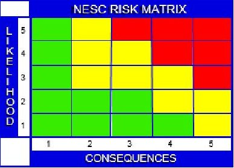

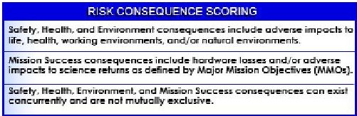

<table border="1"><tr><td>Level</td><td>1</td><td>2</td><td>3</td><td>4</td><td>5</td></tr><tr><td>Safety, Health, &amp; Environment</td><td>Minimal/no safety or health plan violations; Minimal/no environmental impacts</td><td>Could result in injury or illness not resulting in lost work days; Minimal environmental damage</td><td>Could result in injury or illness resulting in one or more lost work days; Mitigatable env. damage</td><td>Could result in permanent partial disability; Reversible environmental damage</td><td>Could result in death or permanent total disability; Irreversible severe environmental damage</td></tr><tr><td>Mission success(Crewed &amp; Non-Crewed Missions)</td><td>Hardware loss&lt;$100K and/orFailure to meet any one Major Mission Objective (MMO)</td><td>Hardware loss$100k-$1M and/orFailure to meet&gt;10% of MMOs</td><td>Hardware loss$1M-$10M and/orFailure to meet&gt;25% of MMOs</td><td>Hardware loss$10M-$50M and/orFailure to meet&gt;50% MMOs</td><td>Hardware loss&gt;550 M and/orFailure to meet all MMOs</td></tr></table>

Updated: July 2016

## Figure 1. NESC Risk Matrix and Related Definitions of the Matrix Element Definitions $ ^{4} $

Risk posture is the position program management is willing to take based on the MEAL and identified risks. There is no standard for risk posture, and depending on the mission, the approach taken is often tailored based on the mission applications and needs (e.g., human-rated versus robotic, launch vehicle versus spacecraft).

The primary risk impact/consequence areas considered in this paper are crew safety and health mission success or technical performance, and programmatic as listed in the Table 1.

Programmatic risk impact/consequence includes cost and schedule for human-rated and robotic explorations. Risk impact/consequence for human exploration missions include loss of crew (LOC) and loss of mission (LOM) in Safety & Health, and Mission Success or Technical Performance, while robotic exploration missions are focused primarily on LOM impact/consequence.

<!-- PDF_PAGE: 17 -->

Table 1. Elements of Mission Risk Posture Impact/Consequence Areas

<table border="1"><tr><td rowspan="2">Mission Type</td><td colspan="3">Risk Impact/Consequence</td></tr><tr><td>Safety &amp; Health</td><td>Mission Success or Technical Performance</td><td>Programmatic</td></tr><tr><td>Human-rated Exploration</td><td>LOC</td><td>LOM</td><td>COST/SCHEDULE</td></tr><tr><td>Robotic Exploration</td><td>LOM</td><td>LOM</td><td>COST/SCHEDULE</td></tr></table>

## 3.2.2 Cost, Schedule and Technical Risks versus Verification Test Level

Appendix A provides a list of common verification tests and inspections performed at different integration levels (i.e., the part-, board- and box-level, along with the purpose, capabilities, advantages, and limitations for each test and inspection).

Based on the limitations identified in Appendix A, testing at a higher level of integration results in reduced ability to detect a part defect. Therefore, skipping tests at earlier integration levels increases the probability of a defect not being detected (e.g., Hubble Space Telescope mirrors). Furthermore, a failure detected at a higher integration level impacts cost and schedule due to the rework required to fix the problem. Finding a part issue at the fully integrated system level is usually expensive, time consuming, and adds risk with the disassembly, replacement or repair, reassembly and re-testing of the refurbished assembly (i.e., collateral damage that occurs while repairing the board and/or wear-out). Notional Figures 2 and 3 illustrate this concept.

Figure 2 shows, in a simplified represenation, the "cost to test" decreases while "cost and schedule impact to fix" increases as a function of performing testing at part-, board- and boxlevel. This is partly because of the number of independent tests required decrease when moving to higher level of testing. The test cost can be lower, but the cost and schedule consequences of experincing a failure increase dramatically. The overall cost is only lower if there is no problem or failure is detected at higher levels of testing.

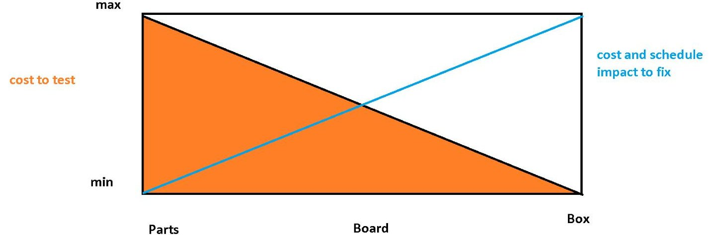

Figure 2. Notional Cost and Schedule Impacts when Performing Testing at Part-, Board-, and Box- Level

Figure 3, in a simplified represenation, shows that testing at lower levels of integration improves ability to detect part defects. Many part defects are masked at higher levels of integration, but identifying these defects will increase system reliability by reducing the likelihood of latent

<!-- PDF_PAGE: 18 -->

failures. Conversely, testing at higher levels of integration is more effective to detecting interactions between parts and assembly workmanship defects, which impact reliability.

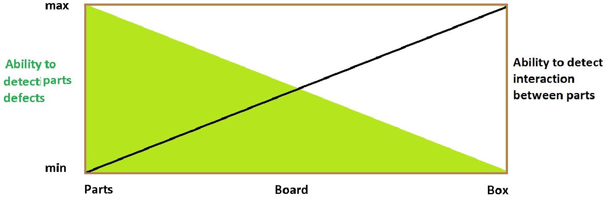

Figure 3. Notional Ability to Detect Parts Defects and Interaction between Parts when Performing Testing at Part-, Board-, and Box- Level

Understanding of the human-rated or robotic mission risk posture, system architecture, and the system effect of part-level errors and failures is critical in selecting the parts for safety critical applications as well as the type of verification required (testing, inspection, screening qualification, etc.). These types of effects may have impacts to safety and health as well as mission success or technical performance.

Appendix A supports the conclusion that considerations of safety and health, mission success, technical performance, and programmatic risk impacts/consequences are optimized by implementing testing as early as possible during the development process.

## 3.3 Understanding Flight Heritage

Heritage as defined in the Merriam-Webster dictionary is "something transmitted by or acquired from a predecessor," similar to legacy as "something transmitted by or received from an ancestor or predecessor or from the past." In the spaceflight environment, flight heritage commonly refers to a successfully flown design or qualified hardware, and/or software systems. Many programs have used claims of flight heritage to argue that their proposed hardware and/or software are at a technology readiness level (TRL) higher than 6 (TRL>6). It is further argued that minimal review is required, which potentially creates a false sense of security for the use of the respective hardware and/or software in their specific mission.

In the past, NASA has experienced failures rooted on the implementation of flight heritage hardware. Two examples of programs that suffered mission failures are: 1) Genesis Spacecraft, and 2) the Kennedy Space Center (KSC) Launch Pad 39A Flame Trench. In these examples to be discussed in Section 6.1, the Mishap Investigation Boards (MIBs) had common findings including the use of "heritage hardware or design" without properly evaluating the environment, application/implementation and life time, lack of appropriate review by design team and review panels, and lack of effective systems engineering. Expanded Guidance for NASA Systems Engineering $ ^{5} $ has provided guidelines for heritage review and reuse of a product.

<!-- PDF_PAGE: 19 -->

As noted in Government Accounting Office Best Practices reports, "The incorporation of advanced technologies before they are mature has been a major source of cost increases, schedule delays, and performance problems on weapon systems. Demonstrating a high level of maturity before new technologies are incorporated into product development programs puts those programs in a better position to succeed". $ ^{6,7} $

In this paper, the team decided to use the TRL concept centered on MEAL to assess heritage since it provides the steps required to qualify any new design and could help assess if the "heritage design" is or is not suitable for the given mission, shown in Table 2.

For any program, the mission characteristics defines MEAL. Thus, to claim "heritage", the previous mission's characteristics must bound those of the new mission in terms of environment, application, and lifetime. If these bounds are not realized, then the new system would have to regress to the appropriate TRL and be certified/verified to the predicted conditions of new mission.

For example, a part in one application may experience different utilization and stress from that in another application, or the radiation environment may be different due to a change in orbit or mission duration. In addition, to say "it flew with no observed anomalies" may be misleading since some anomalies may be hard to detect at system level unless specific monitoring was employed, or because the previous mission duration was insufficient for a latent weakness to surface. In many cases, for complex parts (e.g., field programmable gate arrays (FPGAs)), logical errors are masked and never become apparent to mission operators. Whether the error is detected depends on the state of the device/mission when the error occurs. The same error, occurring at a different time or under different conditions in the mission could have different consequences.

## 3.3.1 MEAL & TRL Concepts to Assess Flight Heritage

The following two notional scenarios illustrate the use of TRL and the MEAL concepts to assess heritage (i.e. successfully flown technologies achieved TRL >6). Each figure represents the respective MEAL boundaries.

- Scenario 1: The Blue Round Mission was successfully flown. The Orange Star Mission wants to use the same technology.

<!-- PDF_PAGE: 20 -->

Environment

Application

Lifetime

Since the Orange Star Mission characteristics (i.e., Environment, Application and Lifetime) are bounded within the Blue Round mission, the technology would be considered at TRL 6 or higher.

- Scenario 2: The Grey Square Mission was successfully flown. The Purple Triangle Mission wants to use the same technology.

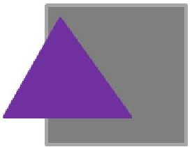

Environment

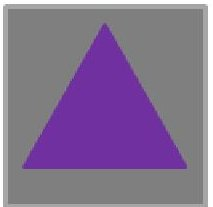

Application

Lifetime

Although the Application and expected Lifetime characteristics of the Purple Triangle Mission are bounded within the Gray Square Mission, the Environment is not. Therefore, for the Purple Triangle Program, the technology would revert to the appropriate TRL.

As shown in Table 2, although heritage is often taken to apply to any previous successful flight experience, in reality the environment, application, and lifetime of the heritage mission must be equivalent or exceed the mission severity under consideration (i.e., Table 2 TRL, Heritage and MEAL Example (b)).

In the event that the application and lifetime are bounding, but the new mission is in a more severe environment, the assumed TRL is 4 because the technology has not been established at the prototype or breadboard/experimental level (i.e., Table 2 TRL, Heritage and MEAL Example (c)).

If the environment and application are bounding, but the mission life is longer for the new mission, then the assumed TRL is 4 because while the technology is validated in principle, the success of the technology for the new cumulative stresses and failure probabilities have not been (This scenario is not included in Table 2).

If the new application is more severe than that for the heritage mission, then the assumed TRL is 3 because while the mission represents proof of concept, the technology requires validation for the intended application (i.e., Table 2 TRL, Heritage and MEAL Example (d)).

If the environment, application, and mission life of the new mission exceed those of the heritage mission, then the assumed TRL is 1 (i.e., Table 2 TRL, Heritage and MEAL Example (e)).

<!-- PDF_PAGE: 21 -->

Table 2. TRL, Heritage and MEAL Examples

<table border="1"><tr><td rowspan="3" colspan="2"></td><td colspan="7">Mission Examples</td></tr><tr><td>(a)</td><td>EnvironmentApplication(b)Lifetime</td><td>EnvironmentApplication(c)Lifetime</td><td>EnvironmentApplication(d)Lifetime</td><td>EnvironmentApplication(e)Lifetime</td><td>EnvironmentApplication(e)Lifetime</td><td>EnvironmentApplication(e)Lifetime</td></tr><tr><td>New Technology</td><td>Proposed New Mission MEAL(mission environment, application and expected lifetime) is equal or a subset of the previously flown mission MEAL, including identical concept, form fit, design, interfaces, etc.</td><td>Proposed New Mission application and expected lifetime is equal or a subset of the previously flown mission, including identical concept, form fit, design, interfaces, etc., but with an environment outside the previously flown mission</td><td>Proposed New Mission MEAL is equal or a subset of the previously flown mission MEAL, but with different application implementation(i.e. different design outside the previously flown like mechanical, thermal&amp;or electrical)</td><td colspan="3">Design previously flown but different application, environment and lifetime(where the original application does not envelope the new application)</td></tr><tr><td>TRL #</td><td>Description as stated on 7120.5C</td><td></td><td></td><td></td><td></td><td></td><td></td><td></td></tr><tr><td rowspan="3">Concept</td><td>1</td><td>Basic principles observed and reported</td><td>V&amp;V</td><td>Previous Data Available</td><td>Previous Data Available</td><td>Previous Data Available</td><td>Previous Data Available</td><td>Previous Data Available</td></tr><tr><td>2</td><td>Technology concept and/or application formulated</td><td>V&amp;V</td><td>Previous Data Available</td><td>Previous Data Available</td><td>Previous Data Available</td><td>V&amp;V</td><td>V&amp;V</td></tr><tr><td>3</td><td>Analytical and experimental critical function and/or characteristic proof-of-concept</td><td>V&amp;V</td><td>Previous Data Available</td><td>Previous Data Available</td><td>Previous Data Available</td><td>V&amp;V</td><td>V&amp;V</td></tr><tr><td rowspan="6">Implementation</td><td>4</td><td>Component and/or breadboard validation in laboratory environment</td><td>V&amp;V</td><td>Previous Data Available</td><td>Previous Data Available</td><td>V&amp;V</td><td>V&amp;V</td><td>V&amp;V</td></tr><tr><td>5</td><td>Component and/or breadboard validation in relevant environment</td><td>V&amp;V</td><td>Previous Data Available</td><td>V&amp;V</td><td>V&amp;V</td><td>V&amp;V</td><td>V&amp;V</td></tr><tr><td>6</td><td>System/subsystem model or prototype demonstration in a relevant environment</td><td>V&amp;V</td><td>Previous Data Available</td><td>V&amp;V</td><td>V&amp;V</td><td>V&amp;V</td><td>V&amp;V</td></tr><tr><td>7</td><td>System prototype demonstration in the real environment</td><td>V&amp;V</td><td>V&amp;V</td><td>V&amp;V</td><td>V&amp;V</td><td>V&amp;V</td><td>V&amp;V</td></tr><tr><td>8</td><td>Actual system completed and "flight qualified" through test and demonstration</td><td>V&amp;V</td><td>V&amp;V</td><td>V&amp;V</td><td>V&amp;V</td><td>V&amp;V</td><td>V&amp;V</td></tr><tr><td>9</td><td>Actual system "flight proven" through successful mission operations</td><td>V&amp;V</td><td>V&amp;V</td><td>V&amp;V</td><td>V&amp;V</td><td>V&amp;V</td><td>V&amp;V</td></tr><tr><td colspan="2"></td><td>Comments:</td><td>Must undergo through the entire TRL process</td><td>Must verify system/subsystem under relevant environment(acceptance verification test)</td><td>Must validate component&amp;/or Breadboard under relevant environment.</td><td>Must validate component&amp;/or Breadboard under laboratory environment.</td><td colspan="2">Must be treated as the new technology</td></tr></table>

<table border="1"><tr><td>V&amp;V</td><td>Must be validated and verified as per TRL Definitions and descriptions.</td></tr><tr><td>Previous Data Available</td><td>Validation data available from previously flown/validated system. Requires Verification at all levels of implementation.</td></tr></table>

<!-- PDF_PAGE: 22 -->

## 4.0 Verification Test and Inspection Matrix at Part-, Board- and Box-Level

The purpose of verification is to show by analysis, demonstration, inspection, and/or test $ ^{8} $ the satisfactory performance of hardware in the expected MEAL and that minimum workmanship standards have been met in accordance with the program risk posture.

4. 1 Verification Test/Inspection Purposes, Capabilities, Advantages, and Limitations The matrix in Appendix A lists common verification tests and inspections, along with the purpose of the procedures, capabilities, advantages, and limitations if performed at part-, board-, and box-level.

1. "Purpose" is the reason(s) for which the given test or inspection is performed.

2. "Capabilities" describe the ability of the test or inspection to address the elements listed under the purpose if performed at part-, board- and box-level, respectively.

3. "Advantages" highlight additional tangible and/or intangible benefits of the given test or inspection.

4. "Limitations" describe the shortcomings of the test or inspection to realize the elements of the purpose and any incurred risks associated with the execution of the test or inspection at a given level of testing.

4. 2 Verification Test/Inspection at Part-, Board-, Box/Subsystem- and System-Level

Verification processes should show that the end product conforms to its specified requirements at all levels (i.e., part-, board-, box-level, subsystem-level, and systemlevel).

The main threat the verification process seeks to avoid is a cluster of failures escaping prelaunch testing that disables a critical function before achieving mission objectives $ ^{9} $ . Non-random part failures correlated to a cause introduced by infant mortality and/or unexpected environmental impacts through workmanship or handling can introduce common cause failures and defeat redundancy. Redundancy is only effective when failure modes of the redundant components are not subject to failures due to a shared cause, known as common-cause failures (CCF). When redundant systems are alike, they will share the same flaws in design, manufacturing, and quality processes, inviting CCFs. Verification at various levels addresses the threats that can introduce CCFs and therefore removes some threats to mission success. The following sections provide an overview of verification testing at the various levels.

## 4.2.1 Part-level Verification

## 4.2.1.1 Introduction

Even with modern mass production manufacturing processes, Weibull distribution and a bathtub curve apply when identifying part failure rates. The bathtub curve plots the number of device

<!-- PDF_PAGE: 23 -->

failures in a production lot occurring over a period of time. Initially, there will be a relatively high failure rate (i.e., infant mortality) due to manufacturing defects and non-compliant parts. After a period of time, the failure rate drops to a low level and remains consistent for a long time (i.e., usable life regime). Eventually, at the other end of the bathtub curve, the failure rate begins to increase as materials degrade (i.e., end-of-life wear-out regime).

## 4.2.1.2 Parts Testing: Why and How

Part-level testing is applied in two modes, screening and qualification, which ensure the flight parts from the testing are in the usable life regime.

Screening tests are designed to apply an above normal amount of operating stresses on the parts, to accelerate the period where infant mortality occurs, and eliminate early failures from the lot. It is expected there may be some failures during screening tests, but the surviving parts may be considered to be past the infant mortality stage and into the usable life to achieve the lowest failure rates during mission lifetime.

Parts-level qualification testing is applied to a sample of parts from a production lot that has passed screening. The goal of qualification is to simulate long-term operation through the usable life stage and ensure the parts will not reach the wear-out stage before the end of mission. Many of the tests applied during qualification are similar to screening tests, but are applied at higher acceleration factors or for longer durations. Although it is expected that samples from a "good" lot of parts will pass and be functional after qualification tests, the highly accelerated nature of the test consumes a significant portion of those samples usable life, and are generally considered unsuitable for flight. Inspection type tests such as destructive physical analysis (DPA) can be used to compare pre- and post-qualification samples to identify degradation mechanisms in parts.

The program/project should procure sufficient quantity of parts to meet its needs including spares even after attrition due to screening and provision of qualification samples.

## 4.2.1.3 Screening for Part Infant Mortality and Other Defects

It is important to note that both screening and qualification tests are much more useful when the applied stresses can be increased to achieve an acceleration factor. Under these accelerated conditions, infant mortality failures may occur within 160 hours for example, whereas under normal operating conditions such as at the board- or box-level they may not occur until several months of operation or testing. Part failures that occur during board- or box-testing can have much more drastic impacts than they would if removed during part-level screening. Despite advances in manufacturing automation and mass production, defects still occur and the need to eliminate infant mortality remains.

## 4.2.1.4 Major Advantages and Limitations of Part-level Verification

Part-level testing is the lowest level of integration where part specifications and workmanship can be verified. Testing at the part level is the most effective method to identify part defects from manufacturing and, through screening test such as burn-in, to eliminate infant mortality failures and nonconforming parts from a lot. Part-level testing can be optimized to reveal particular failure mode(s) and has the distinct advantage of allowing the highest acceleration factors possible by tailoring the individual test conditions and stresses (e.g., electrical and environmental) to the limitations of each part. Accelerated test conditions allow for rapid testing and the high stress conditions necessary to force infant mortality failures during early

<!-- PDF_PAGE: 24 -->

operation. Reduced stress diminishes the test's ability to fully drive the infant mortals out of the population.

Additionally, testing at the part-level offers the highest level of perceptibility to measure full electrical parameters to detect parametric shifts, which can indicate part degradation. At higher levels of integration, many individual electrical parameters become masked by the overall system operation, and subtle shifts that are important may not be detected until they become so severe the system fails. Part-level testing also increases understanding of the individual part and provides insight into the possible failure mechanisms. For example, there is better understanding of the part's construction quality and susceptibility to environmental conditions when performing part-level testing. Part-level testing increases understanding of the individual part and provides insight into the possible failure mechanisms. For example, there is better understanding of the parts construction quality and susceptibility to environmental conditions when performing part-level testing. Part-level testing also helps the designer understand the circuit design margins and allows "cherry pick" part to maximize performance and reliability.

However, limitations exist. Part-level testing may not verify interactions between parts on a board or in a system/subsystem, and involves more handling of parts, increasing the likelihood they will be damaged.

## 4.2.2 Board-level Verification

Board-level testing is the next lowest level of integration where the functional performance and the workmanship of a circuit (consisting of multiple parts) can be verified.

Board-level testing can be useful for identifying part defects and infant mortality failures, but the capability and perceptivity is significantly reduced compared to part-level testing. To avoid overstressing some parts on the board, environmental stresses need to be limited to the weakest or least capable part or material on the board, and knowing or finding the least capable part a priori may be difficult. Additionally, electrical stresses placed on the individual parts within the board usually cannot be adjusted, and remain at nominal operation levels. This means the overall applied stress and life acceleration factor achieved is significantly less than would be possible at each individual part level. The reduced acceleration factor requires a much longer duration test than would be required at the part level.

As mentioned above, once integrated to the board-level, there is limited perceptivity to detect individual part electrical parameters and shifts, which could be indicators of degradation that could lead to a latent failure. Interactions between parts on the board can be verified, but one may not be able to identify a degraded or damaged part. Even if a part degrades to the point where its parametric values are outside of specifications, this could go undetected if the circuit continues to operate. Continued degradation over time could introduce a latent circuit failure late in the verification process.

Another significant disadvantage of moving testing to higher levels of integration is that a failure has increased consequences at this level. At the board-level, the root cause of the failure must be determined, the failed parts must be removed from the board, replaced, and additional testing added to verify the new part performs as required at the board level, all of which augment risks to the rest of the board and may introduce schedule delays. In addition, it is often difficult to determine whether a board/function failure is related to a part failure versus a design issue versus a board manufacturing issue.

<!-- PDF_PAGE: 25 -->

Board-level testing does offer selected advantages. Overall testing costs are typically reduced as compared to part level because multiple parts can be tested simultaneously. Additionally, some complex or high-speed parts require significant biasing and support circuitry, and frequency-tuned board characteristics to operate. These conditions are often not feasible to implement with the temporary test fixturing and biasing available for part-level tests. Board-level testing is often the only feasible option for parts such as radio frequency (RF) devices, high-speed analog devices, or complex microprocessors, and FPGAs. An additional benefit of testing at the boardlevel is that it tests the board assembly workmanship, mechanical and thermal design, and compatibility of materials chosen for assembly, such as solder, epoxy, staking, etc.

## 4.2.3 Box-level or Subsystem-level Verification

Box-level or subsystem-level testing is done to verify the functional performance and the workmanship of a box or subsystem consisting of multiple circuits. Boards' interactions within the box can be verified and many box-level tests can be performed using consolidated autonomous test configurations.

Compared to part- and board-level testing, box-level testing offers even lower perceptivity for detecting part defects and infant mortality, and it has the highest consequences if a failure is observed of any of the configurations considered in this paper. At the box-level, low stress levels can be applied to the parts, both environmentally and electrically, to ensure the weakest parts are not overstressed. Additionally, box-level testing requires larger and more expensive environmental chambers.

Box-level testing offers the lowest ability to measure parameters for individual parts as test points and board traces become inaccessible for probing. Parts failures discovered at box-level integration result in significant de-integration rework and retesting and this in turn results in significant risks and schedule delays. Failures at box-level are also more difficult to diagnose. Was the failure caused by the part, the design, or workmanship? Identifying root cause becomes more problematic. Finally, circuit design margins cannot be determined due to the lack of access to test points to obtain part- and circuit-level timing and voltage measurements.

## 4.2.4 System-level Verification

The purpose of a full-system verification is to test and verify the entire payload under conditions that simulate the flight operations and environment as realistically as practical. Appendix A focuses only at part-, board-, and box-level testing.

## 4.2.5 Radiation Effects Verification

Threats that the space radiation environment poses to semiconductor devices in space missions can be divided into two broad categories:

1. Dose effects (i.e., TID and displacement damage dose (DDD)) result from cumulative exposure to the space radiation environment. As such, they behave like wear-out effects with failure rate increasing as the dose increases.

2. In contrast, single-event effects (SEE) are the parts' prompt responses to the passage of a single ionizing particle through a volume in the part sensitive to that SEE mode.

The following subsections describe common types of radiation testing applied to parts.

<!-- PDF_PAGE: 26 -->

## 4.2.5.1 TID, DDD, and SEE

Radiation tests for TID, DDD, and SEE are all at least potentially destructive. Therefore, such testing is done during qualification testing on a sample of parts representative of the flight parts. For TID and DDD, this usually means the test parts must belong to the same wafer diffusion lot as the flight parts. For SEE, lot-to-lot differences in performance are not usually as significant as those for TID or DDD. As long as the test parts are fabricated in the same process and with the same mask set as the flight parts, the test is likely to be valid. Note that in some cases, lot-to-lot and even part-to-part variation is significant for SEE and these situations require a greater level of fidelity between test and flight parts.

Radiation testing for SEE has different goals than that for TID or DDD. TID and DDD are cumulative effects, and failures are usually preceded by gradual parametric and functional degradation. Thus, the goals of TID and DDD testing are to determine which parameters/ functions degrade and the part-to-part variation in that degradation at each dose step. If parts are tested to failure (either parametric or functional), then the part-to-part variation in the failure dose is also of interest. Mitigation of TID and DDD involves adding shielding or taking other steps (e.g., selecting operating conditions) to ensure that the dose on the part remains low enough where the probability of failure or degradation affecting the part's ability meet requirements is negligible.

In contrast, SEE can occur at any time in the device with equal probability (per ion). As such, the primary goal of SEE testing is to identify all the SEE modes to which the part may be susceptible. Thus, independent of whether the radiation environment is severe or benign, the test will irradiate the part to ion fluences much higher than will be seen during the mission. SEE test methods are specifically tailored to include conditions where a given SEE mode is likely to occur if the device under test is susceptible. For example, if the device under test includes CMOS (which can be susceptible to single event latch-up SEL), some test runs will be performed with high fluences (i.e., greater than $ 1 0^{7} $ ions per $ cm^{2} $ ) of highly ionizing (i.e., high-linear energy transfer (LET)) ions. These runs would be performed with the worst-case conditions for causing SEL in the DUT. Once this susceptibility is detected, then it is measured for a variety of ion species, energies, LETs, and angles of incidence. These data are used to estimate the probability of each SEE mode occurring in the mission radiation environment.

## 4.2.5.2 Radiation Testing at Different Configuration Levels

Whether parts are tested at the part-, board-, or box-level affects the extent to which the goals outlined in the previous section can be met by testing. First, board- and box-level studies are often performed with a single sample of the board or box. This makes it impossible to assess how part-to-part variation would affect flight board/box performance unless there is high confidence part-to-part variation is negligible for all parts on the board. Even if multiple test units are irradiated, the interactions between parts with different variability on the boards makes it difficult to interpret the results and bound flight unit performance.

Radiation at higher-level assemblies also precludes optimizing the test to detect particular susceptibilities in any given technology. Moreover, parts on a board may only be susceptible to some failures for a fraction of the boards' operating conditions. For example, if any part on a test board is bipolar, it is potentially susceptible to enhanced low dose rate sensitivity, in which parts degrade more severely at low dose rates (e.g., in space) than at high dose rates (e.g., in an accelerated TID test). This means that the entire test must be conducted at a low dose rate.

<!-- PDF_PAGE: 27 -->

Similarly, increasing board temperature and voltage may not be possible, and SEL testing would likely have to be done for realistic missions rather than bounding conditions. Test conditions and levels will be driven by the weakest parts in the test unit rather than by the level of hardness designers desire for the system.

Nondestructive SEE modes and parametric degradation may also remain hidden in tests at the board- and box-level. While it can be argued that such modes are not significant at the system level, they could have consequences if the hardware is in another logical or operating state when they occur. In general, the more complicated the test unit (be it a part or a system), the less likely it is that the tester will be able to cover the full state space of operations in an accelerated test.

Not every radiation tests can be performed at all integration levels. TID tests with gamma rays could be performed even for complex boxes as long as the beam is large enough to expose the entire test unit. X-rays have less penetrating power than gamma rays, but are similarly suitable for part-, board- and box-level testing as long as the penetrating range of the radiation is much longer than the system size. A concern for multi-board systems is that a gamma ray or X-ray beam can be degraded as it passes through the forward boards, resulting in higher doses for the rear boards than the forward boards. Proton TID, DDD, and SEE tests can also be performed on integrated systems although the range of the protons must be considered (the range of a 200 MeV is about 13.7 cm in Si).

Heavy-ion SEE testing at levels of integration higher than the part-level is problematic. Preparing parts on the board to ensure ions from conventional accelerators reach device sensitive volumes can compromise their structural integrity, making them unreliable and vulnerable to mechanical failures. In principle, a sufficiently broad, high-energy heavy-ion beam (e.g., like that at the NASA Space Radiation Laboratory (NSRL)) could effectively test parts at the board-level without modification, albeit with significant amounts of analysis required to account for beam degradation as it traverses various parts. However, heavy-ion SEE testing at the multi-board or box-level is generally not feasible due to limited penetration ranges of the ions and the difficulty of modeling transport of the ions through complicated structures in the test unit.

Board- and box-level tests must be designed around the limitations of the weakest part(s) in the system, which creates challenges for radiation testing. This is especially true for board-level SEE tests, which are usually performed with high-energy protons due to their greater penetrating range, eliminating the difficulties with board preparation for heavy ion tests. Such a proton test cannot detect SEE modes caused only by moderately to highly ionizing particles (Z>14). However, even for low LET modes, only 1 of ~289000 protons creates a recoil ion (i.e., the secondary particle capable of causing the SEE) while every proton contributes to TID. To avoid board- or box-level failures due to TID-susceptible parts, the test will often need to be restricted to a low proton fluence (e.g., $ 1 0^{1 0} $ to $ 1 0^{1 1} \mathrm{c m}^{-2} $ ). Such low-fluence tests usually fail to reveal all, or even representative sample, of the SEE susceptibilities in the system under test and on-orbit experience can differ dramatically from the test results, as seen in Figure 4.

<!-- PDF_PAGE: 28 -->

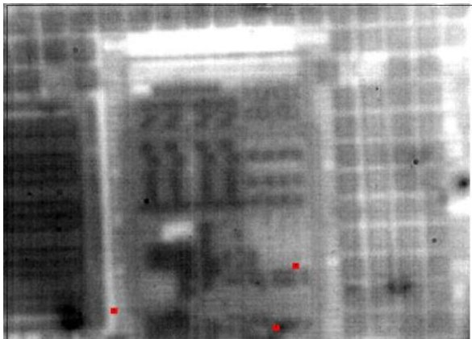

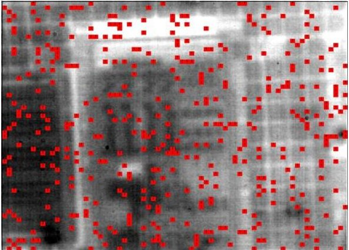

Figure 4. Simulated strikes of ions (red dots) overlaid on a photomicrograph 60 x 70 $ \mu m^{2} $ section of an Elpida 512 Mbit SDRAM. Left: Recoil Ions due to $ 10^{10} $ Protons/cm $ ^{2} $ . Right: $ 10^{7} $ ions/cm $ ^{2} $ typical of heavy ion SEE test.

Often, the softest parts to TID in the test unit that drive the low fluence requirements are linear bipolar components fabricated in large-dimension, older technologies. These simple parts do not usually require high ion fluences to characterize their SEE response. In contrast, complex parts that require high fluences for SEE characterization are fabricated in more advanced microelectronic technologies that are much more tolerant to TID and remain functional at the high proton fluences required to provide adequate coverage of SEE modes.

In general, the fluence required to adequately test a device scales with its complexity and the transistor count is often a good guide to device complexity. Transistor count scales roughly as the inverse square of the minimum feature size of the technology, as shown in Figure 5.

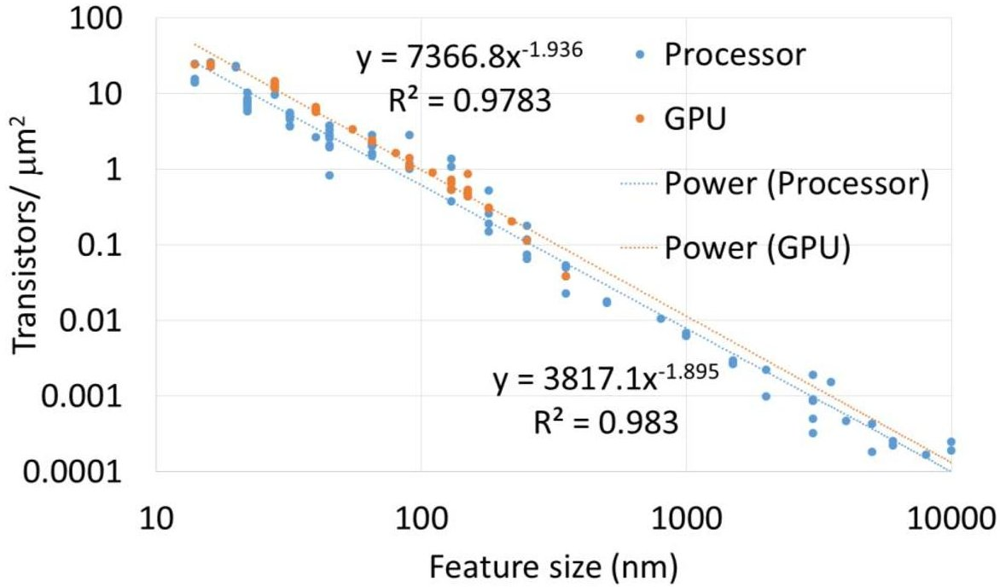

Figure 5. Transistor Count Scales Roughly as the Inverse Square of the Minimum Feature Size of the Technology

However, there are other factors to consider (e.g., number of functions or operating modes). A quad core processor with a given transistor count is likely less complicated than a single processor with the same transistor count. Similarly, a static random access memory (SRAM) may be fabricated in an advanced CMOS process with high transistor density, but its architecture will be highly repetitive and, as such, it will not require as high a fluence to characterize its SEE response as would a less repetitive part with similar transistor count. In contrast, although the

<!-- PDF_PAGE: 29 -->

memory array of a synchronous dynamic random-access memory (SDRAM) is highly repetitive, the part exhibits complex SEE behavior as a result of upsets in its control logic.

Even if the testing is performed with ultra-high-energy heavy ions rather than protons, differential performance in the parts on the board (box-level testing is not possible with heavy ions currently available at any accelerator) can still complicate the task of thoroughly characterizing the board. If one or more of the components on the board is susceptible to destructive or highly disruptive SEE modes, it may prevent the test from accumulating sufficient fluence or probing all of the full state space of the test unit.

## 4.2.6 Potential Consequences of Skipping Part-level Testing

At board- or box-level or higher integration levels (e.g., subsystems and system levels), the capability to identify counterfeit parts, infant mortals, and other defects is diminished allowing such problem parts to manifest at higher levels of assembly and integration. Furthermore, if there is significant variability in degradation or failure distributions of parts in the test unit, then flight units may be susceptible to failure modes not revealed during testing at a higher level of integration. In this case, the only way to detect and mitigate the risk is to test at the part level and fully understand the MEAL.

Skipping part-level testing is often done to reduce the cost and schedule of testing. However, cost savings will be realized only if no failures are detected during testing at the higher integration level, assuming this higher integration level testing is sufficient to catch individual parts that could fail during a mission. If there were any failures detected at a higher level, then it would have a negative impact on cost and schedule. Moreover, testing at higher integration levels reduces knowledge of design margin and margin to failures. Vulnerabilities not detected during verification process may lead to adverse consequences ranging from degraded performance to LOM or LOC.

## 4.2.7 Thermal Impact on Part-, Board- and Box-level Verification - an Example

Thermal tests (e.g., thermal cycling, thermal vacuum, extreme temperature, etc.) are generally performed for four reasons:

1. To ensure performance and margin of the device under extreme temperature environment (i.e., hot and cold).

2. To weed out infant mortality and other defects (e.g., manufacturing, handling, etc.)

3. To ensure performance and margin of the integrated system under extreme temperature environment (i.e., hot and cold)

4. To weed out workmanship related defects at the assembly level.

Items 1 and 2 are best answered using parts-level testing, and items 3 and 4 relate to board- or box-level testing. Depending on the complexity of the design, some engineers/managers may opt to do thermal tests at higher system integration levels (i.e., board and/or box) to avoid the cost and schedule impact of bounding risk due to items 1 and 2. Moreover, they may take the action without understanding the stress levels imposed and the risk such an omission carries for not detecting a latent defect.

The following examples illustrate the temperature profiles of two independent board assemblies and the effect when attempting to use the board- and box-level thermal test to weed out part

<!-- PDF_PAGE: 30 -->

infant mortality. For a simple comparison, the team considered only the thermal acceleration factor, which is based on the difference between the nominal operating temperature and the maximum allowed operating temperature. Acceleration means that operating a unit at higher stress (i.e., higher temperature, voltage, humidity, or duty cycle, etc.) produces the same failures that would occur at lower stresses except that they happen much quicker. An acceleration factor is the constant multiplier between the two stress levels $ ^{10} $

Example 1: Single-Board Testing

- Single board #1 operating at room temperature

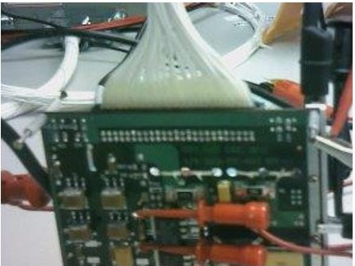

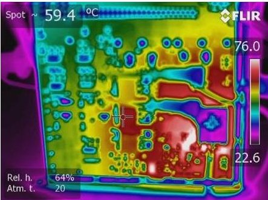

Figure 6. Left: Image of Board #1. Right: Thermal Image of the Powered Board #1

As shown in Figure 6, while board #1 is powered ON at room temperature (22.6 $ ^{\circ} $ C), it exhibits a thermal profile with a delta of approximately $ 40^{\circ} \mathrm{C} $ , from the coldest to the hottest part(s) on the board $ (76^{\circ} \mathrm{C}) $ . It should be noted the test was done in air and thus there is additional thermal convection with the air, not available in space vacuum. (Typically, for exact temperatures of the board components it is recommended to add external temperature sensors on selected areas since the temperatures you observe using the IR camera depend on the infrared emissivity of what you are looking at. So "shiny metal" parts will tend to have low infrared emissivity while the casings of other components will likely have much higher emissivity. So caution must be exercised when basing temperatures on the infrared image.)

For illustration and comparison purpose, the team considered the case surface temperature of $ 1 2 5^{\circ} \mathrm{C} $ would bring the junction temperature of the components to their maximum allowed level. Depending on the device, this surface temperature may vary. For example, to raise the hottest part(s) temperature to a target accelerated test temperature of $ 1 2 5^{\circ} \mathrm{C} $ (case surface temperature), the ambient temperature on the board has to be increased from $ 2 2. 6^{\circ} \mathrm{C} $ to $ 7 1. 6^{\circ} \mathrm{C} $ , or a delta of $ 4 9^{\circ} \mathrm{C} $ , as shown in Figure 7.

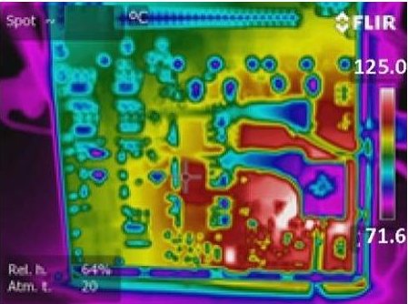

Figure 7. Board #1 Estimated Temperature Profile with Ambient Temperature of $ 71.6^{\circ} \mathrm{C} $

<!-- PDF_PAGE: 31 -->

The maximum ambient temperature of board #1 is limited by the hottest part(s) on the board which is assumed at $ 1 2 5^{\circ} \mathrm{C} $ . It is important the designer remember the maximum allowed operating temperatures of all parts within the design and ensure that these limits are not exceeded. Some designs contain parts with different technologies, each with potentially different maximum operating temperatures. These combinations may further limit the maximum allowed operating temperature of the board and/or box, with the limiting operating temperature depending not just on the design, but also on the part(s) with the lowest allowed maximum operating temperature. The fact that many parts will not be tested at their maximum temperature rating shows why part-level testing is important to address the first two of the four reasons above.

- Single board #2 operating at room temperature

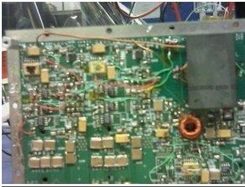

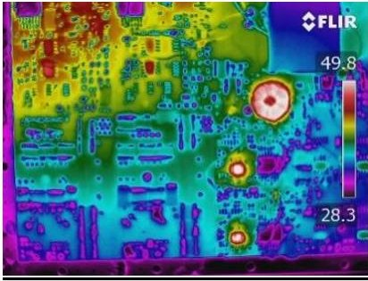

Figure 8. Left: Image of Board #2; Right: Thermal Image of Powered Board #2

Similarly, as shown in Figure 8, while board #2 is powered ON at room temperature, it exhibits a thermal profile with a delta of approximately $ 2 0^{\circ} \mathrm{C} $ from the coldest to the hottest part(s) on the board. Similarly to board #1, Figure 9 shows that to raise the board hottest part(s) temperature to $ 1 2 5^{\circ} \mathrm{C} $ , the ambient temperature has to increase from $ 2 8. 3^{\circ} \mathrm{C} $ to $ 1 0 3. 5^{\circ} \mathrm{C} $ or a delta of $ 7 5. 2^{\circ} \mathrm{C} $

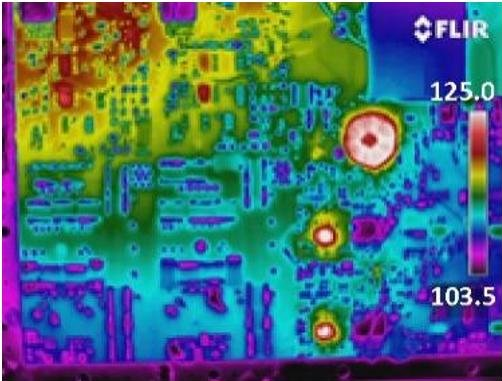

Figure 9. Board #2 estimated Temperature Profile with Ambient Temperature of $ 1 0 3. 5^{\circ} \mathrm{C} $

Again, the maximum ambient temperature of board #2 is limited by the hottest part(s) on the board, assumed to be $ 1 2 5^{\circ} \mathrm{C} $ . It is important the designer remember the maximum allowed operating temperatures of all parts within the design and ensure that under no circumstances these limits would be exceeded as discussed.

## Example 2: Box-level testing with boards #1 and #2.

At box-level, when combining board #1 and board #2 in the same box, raising the ambient temperature to achieve maximum temperature of the parts within the board assemblies, would be limited to the first part that reaches the $ 1 2 5^{\circ} \mathrm{C} $ . Furthermore, it is understood that testing at the box level can introduce thermal interactions between multiple boards, which can include thermal radiation, reduction or elimination of buoyancy driven convection (when tested in a gaseous

<!-- PDF_PAGE: 32 -->

environment), and conduction depending on the internal physical configuration and the external thermal interfaces.

Although board-to-board interactions complicate determination of parts temperatures this does not affect the conclusion that while some parts have reached their maximum temperature others would remain much cooler. For simplicity, we neglected board-to-board interactions, since they do not alter the limitations imposed by testing at box or higher levels of integration.

Based on the above, and assuming both boards share the same ambient temperature, board #1 would reach the $ 1 2 5^{\circ} \mathrm{C} $ in some of its parts at an ambient temperature of $ 7 1. 6^{\circ} \mathrm{C} $ , but board #2 maximum temperature would be $ 9 3. 1^{\circ} \mathrm{C} $ , as shown Figure 10.

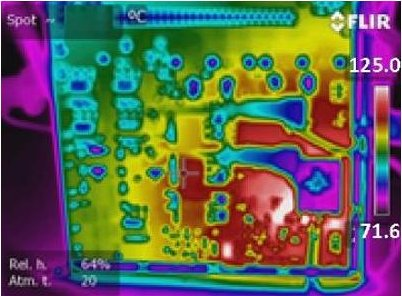

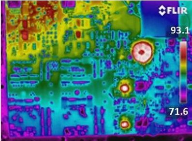

Figure 10. Estimated Maximum Boards #1 and 2 Temperature Profile when Tested at the Box-1 Level. Notice that the ambient temperature is shared by both boards.

The power dissipation of the board varies with respect to the circuit design and the individual parts. This implies that the operating temperature of the board and individual parts are not evenly distributed as seen on the board and box examples thermal images.

Table 3 compares the acceleration factors between single-board and box-level thermal tests. It shows the maximum and minimum achieved thermal acceleration factor for each test configuration, assuming an activation energy of 0.7eV, as shown in the last column in Table 3. Different failure mechanisms have different activation energy and therefore the acceleration factors are different for different failure mechanisms. Table 3 highlights the limitation of the achievable thermal acceleration factor at board- and box-level compared to part-level using the activation energy of 0.7eV as an example. Using a different activation energy will change the thermal acceleration factor values, but the observation shown in the Table 3 will remain the same.

<!-- PDF_PAGE: 33 -->

Table 3. Comparison of Acceleration Factors between Single-board and Box-level Thermal Tests

<table border="1"><tr><td rowspan="2">Test Article Configuration</td><td rowspan="2">Board #</td><td colspan="2">Temperature(℃)</td><td colspan="2">Acceleration FactorAF</td><td>Operating Temperature(℃)</td><td>Activation Energy(eV)</td></tr><tr><td>T2 Max(hottest part temperature)</td><td>T2 Min(coldest part&amp;ambient temperature)</td><td>Max</td><td>Min</td><td>T1</td><td>Ea</td></tr><tr><td rowspan="2">Individual Board temperatures at ambient(actual)</td><td>1</td><td>76</td><td>22.6</td><td>34</td><td>0.5</td><td>30</td><td>0.7</td></tr><tr><td>2</td><td>49.8</td><td>28.3</td><td>5</td><td>0.9</td><td>30</td><td>0.7</td></tr><tr><td rowspan="2">Individual Board temperatures estimates at elevated ambient(limited by hottest part)</td><td>1</td><td>125</td><td>71.6</td><td>601</td><td>25</td><td>30</td><td>0.7</td></tr><tr><td>2</td><td>125</td><td>103.5</td><td>601</td><td>188</td><td>30</td><td>0.7</td></tr><tr><td rowspan="2">Box Level board temperatures at elevated ambient(i.e. two boards together;limited by hottest part)</td><td>1</td><td>125</td><td>71.6</td><td>601</td><td>25</td><td>30</td><td>0.7</td></tr><tr><td>2</td><td>93.1</td><td>71.6</td><td>102</td><td>25</td><td>30</td><td>0.7</td></tr></table>

$$
A F = e ^ {\left(E a * \left(\frac {1}{T 1 + 2 7 3} - \frac {1}{T 2 + 2 7 3}\right) / K\right)}
$$

<table border="1"><tr><td>K(eV/kelvin)</td><td>T max℃</td></tr><tr><td>0.00008617</td><td>125</td></tr></table>

Table 3 shows that, in general, the higher the integration, the lower the acceleration factor. If tested at the part-level, then each individual part could be stressed at the maximum temperature to achieve the largest possible acceleration factor.

The large difference of the thermal acceleration shown in Table 3 means parts on the boards and boxes are consuming dramatically different lengths of their useful lifetime when they are subjected to board- or box-level testing. This could lead to parts operating in the different regimes on the bathtub curve and some parts may be operating with failure rates higher than their optimal values due to their infant mortality or wear-out.

The examples shown consider only thermal acceleration factor with a single activation energy. Reality is more complex, with electrical bias differences as well as various failure mechanisms and their interactions also contributing to overall failure rates.

For example, assume that the boxes in the example are tested for 168-hour at their maximum allowed temperature based on their respective hottest part(s). Table 4 calculates the equivalent times corresponding to a 168-hour burn-in test on the hottest and coldest part(s) on these boards and boxes assuming 0.7eV activation energy. The equivalent times are roughly an order of magnitude different so that the hottest and coldest part(s) could be on different regimes of the bathtub curve shown notionally in Figure 11. The top two plots are for boards #1 and #2, while the bottom plots for the box with boards #1 and #2. With the same amount of testing duration, the left plots show that parts could be potentially in infant mortal and constant failure rate regimes while the right plots show that hottest parts could be in wear-out regime if additional test hours were performed.

Table 4. Comparison of Equivalent Time Corresponding to 168 Hour Burn-in Test on the Hottest and Coldest Components on the Example Boards and Boxes

<table border="1"><tr><td rowspan="2">Test Article Configuration</td><td rowspan="2">Board #</td><td rowspan="2">Burn-in Test Time(hrs)</td><td colspan="2">Equivalent BI Accelerated time(yrs)</td><td rowspan="2">Additional Test time to eliminate infant mortals of coldest component(hrs)</td><td colspan="2">Equivalent BI Accelerated time(yrs)</td></tr><tr><td>Hottest component on the board</td><td>Hottest component on the board</td><td>Coldest component on the board</td></tr><tr><td rowspan="2">Individual Board temperatures at ambient(actual)</td><td>1</td><td rowspan="2"></td><td rowspan="2"></td><td rowspan="2"></td><td rowspan="2">3971.3</td><td rowspan="2">272.7</td><td rowspan="2">11.5</td></tr><tr><td>2</td></tr><tr><td rowspan="2">Individual Board temperatures estimates at elevated ambient(limited by hottest part)</td><td>1</td><td>168</td><td>11.5</td><td>0.5</td><td>3971.3</td><td>37.0</td><td>11.5</td></tr><tr><td>2</td><td>168</td><td>11.5</td><td>3.6</td><td>538.9</td><td>37.0</td><td>11.5</td></tr><tr><td rowspan="2">Box Level board temperatures at elevated ambient(i.e. two boards together; limited by hottest part)</td><td>1</td><td>168</td><td>11.5</td><td>0.5</td><td>3971.3</td><td>272.7</td><td>11.5</td></tr><tr><td>2</td><td>168</td><td>1.9</td><td>0.5</td><td>3971.3</td><td>46.1</td><td>11.5</td></tr></table>

<!-- PDF_PAGE: 34 -->

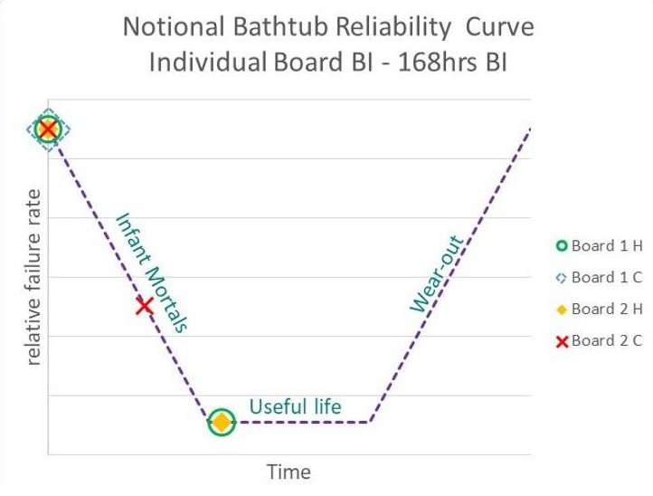

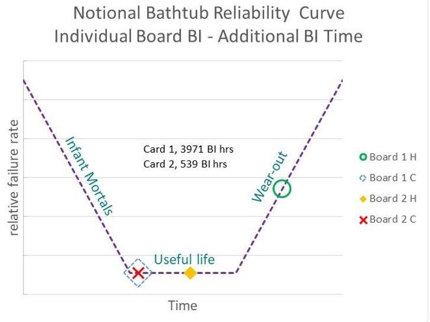

Notional Bathtub Reliability Curve Box Level I - 168hrs BI

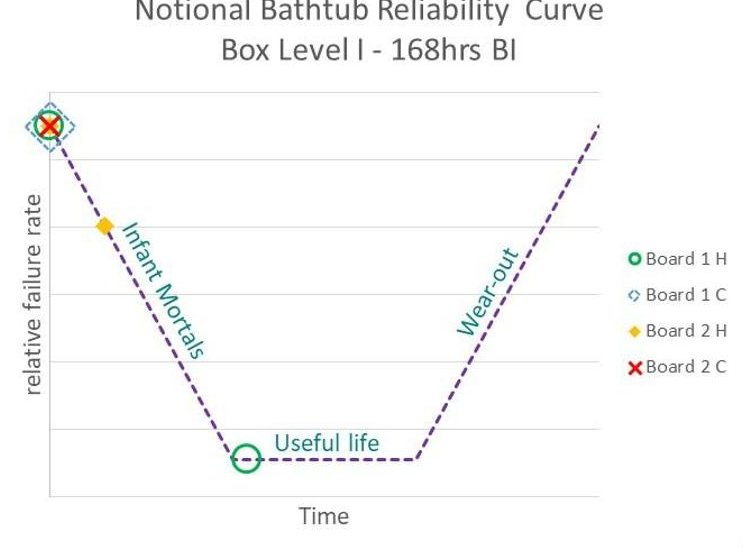

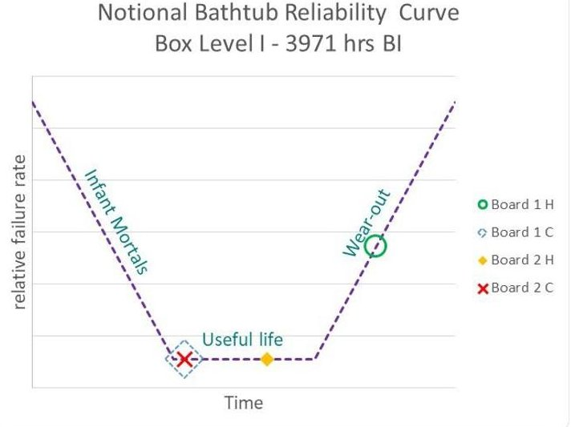

Figure 11. Notional Bathtub Reliability Curve

## 5.0 Verification of COTS Part, Board, and/or Box

The MEAL and risk posture based verification process applies to any avionics technology system verification, including COTS part-, board-, and box- technology and previously flown technology.

## 5.1 Background of COTS Use in Spaceflight Programs

As demands for improved performance in spaceflight programs increase, and budget and schedule pressures remain constrained, the temptation has increased to implement new or previously flown avionics technologies, including COTS technologies, into human-rated and robotic spaceflight programs.

It is likely that the pressures will increase as the differential performance (e.g., speed, density power, etc.) between CMOS (complementary metal-oxide-semiconductor) COTS parts and radiation-hardened parts continues to expand, shown in Figure 12.

<!-- PDF_PAGE: 35 -->

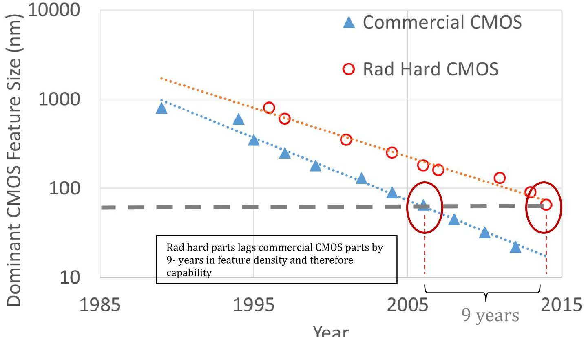

Figure 12. Comparison between Commercial and Radiation-Hardened CMOS Technologies $ ^{11} $

As shown in Figure 12, evolution of both COTS CMOS and radiation hardened CMOS show exponential trends with time $ ( R^{2}>0.98 $ for an exponential fit - dotted lines - to both series). However, commercial CMOS doubles in density roughly every 18 months while radiation hardened CMOS doubles in density every 24 months. This means that radiation-hardened CMOS performance lags even further behind commercial technology, dropping another generation behind roughly every decade.

While state-of-the-art COTS parts can increase system performance and capabilities, they also can dramatically increase system complexity to the point where characterization of the part, let alone the system, for all logical and operating states become practically impossible. The system state space complexity increases exponentially with the part complexity, and access to information about individual part performance and margins to failure decreases. This makes full characterization for board- or box-level testing with complex parts a daunting problem.

Commercial parts pose significant challenges when it comes to ensuring test parts are representative of flight parts and for commercial boards and boxes/systems, the challenges are even greater. Commercial parts have limited manufacturing traceability. This makes the task of ensuring part performance over time and purchase lots complicated since processes, packaging, and part technology may change with little or no warning to the end users. For commercial boards and boxes/systems, there is no guarantee that vendors are even using the same parts from one board to the next. As long as the boards yield similar performance in their intended (terrestrial) environment and meet the vendor's specifications, vendors can use any parts they wish. Inferring behavior of flight systems from test systems without a thorough understanding of

<!-- PDF_PAGE: 36 -->

the vendor's configuration controls is likely to be an exercise in futility as well as a significant source of risk to mission success.

Spaceflight programs are incentivized to use COTS avionics technologies to reduce design, development, test, and evaluation (DDT&E) costs, to meet programmatic schedules, and increase system performance. However, in some cases, COTS technologies that have not been fully vetted according to procedures appropriate for operation in a space environment, or for their intended application, environment and lifecycle have been inserted into space hardware, introducing risks to the spaceflight systems. Meanwhile, the continued pressure to minimize DDT&E costs and the trend toward more complex spaceflight mission designs and interfaces (i.e., advanced architectures and more complicated parts), the potential for increased/unrecognized risk increases.

## 5.2 Verification Process for COTS Technology

The Aerospace Corporation reviewed several dozen missions and found evidence $ ^{12} $ a “No Fly” zone, characterized by increased failure rates, exists when pressures to reduce DDT&E cost and programmatic schedule meet increased system complexity, as shown in Figure 13.

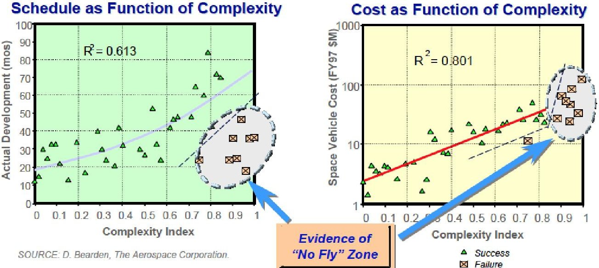

Figure 13. Evidence of "No Fly" Zone $ ^{1 3} $

The Aerospace team developed a "complexity index" based on considerations of mission characteristics, spacecraft size, power consumption, number of payloads, GN&C demands and data processing and throughput. This normalized index correlated with mission success and failure, giving strong indications of a no-fly zone where complexity drove mission cost and schedule and where attempts to drive down these constraints tended to lead to mission failures $ ^{14} $

Limited understanding of COTS technology and how they perform in the mission environment over the design lifetime may lead to incomplete verification processes. For example, designers may improperly contend that because a part-, board-, or box- technology had flown in a spaceflight application, it has proven heritage and does not need to be requalified. Alternatively, designers may incorrectly argue that because the technology is an automotive COTS part, it is

<!-- PDF_PAGE: 37 -->

more reliable than a non-automotive COTS parts. These assertions could lead programs to select incomplete verification process and a false sense of security.

NASA has successfully used COTS parts in mission critical applications throughout the Agency's history. This has been achieved by careful selection, qualification, and screening of the parts to meet the missions' requirements. The level of part verification required to assure they will work successfully is highly dependent on the mission, environment, application, and lifetime (MEAL), the avionics architecture, and the part technology $ ^{15} $ .

The MEAL and risk posture based verification process applies to any avionics technology system verification, including COTS part-, board-, and box- technology and previously flown technology.

There is no "one size fits all" solution for the selection and verification of the avionics system and technology, including architecture and parts assurance requirements, to ensure safety and mission success. Understanding MEAL and risks, as well as adopting an attitude of "trust but verify", is critical.

The understanding of the MEAL requires a complete synchronous picture of how avionics and parts technologies are to be used effectively. The considerations summarized in the MEAL allow designers to effectively choose parts for their best performance in a given architecture. Emphasizing one of the MEAL elements without understanding the others can compromise the integrity and performance of the parts and the mission success.

The MEAL suggests appropriate strategies for mission design, development, implementation, and defines end-of-mission conditions. It also informs/bounds the verification approach and processes through all stages. The selected verification processes must ensure the adequacy of the design is commensurate with the risk that is acceptable to the project.

## 6.0 Example Lessons Learned for Verification Based on MEAL and Risk Posture

In this section, a number of examples and/or lessons learned are provided, including heritage misapplication, part level, and radiation verification.

## 6.1 Heritage Misapplication Examples

## Example 1: Genesis Spacecraft Crash (ref. Genesis Mishap Report, November 30, 2005)

Genesis was one of NASA's Discovery missions and its purpose was to collect samples of solar wind and return them to Earth. Launched on August 8, 2001, Genesis was to provide fundamental data to help scientists understand the formation of the solar system. On September 8, 2004, the Genesis sample return capsule drogue parachute did not deploy during entry, descent, and landing operations over the Utah Test and Training Range. After the point of expected drogue deployment, the sample return capsule began to tumble and crashed on the Test Range at 9:58:52 MDT. On September 10, 2004, the Associate Administrator for the Science Mission Directorate established a Type-A MIB as defined by NASA Procedural Requirements

<!-- PDF_PAGE: 38 -->

8621. 1A, "NASA Procedural Requirements for Mishap Reporting, Investigating, and Recordkeeping", to determine the cause and potential lessons from the incident. The Mishap Investigation Board determined the cause of the mishap to be that the G-switch sensors were in an inverted orientation, per an erroneous application implementation, and were unable to sense the return capsule deceleration during atmospheric entry and initiate parachute deployments.

It is clear that the failure of the G-switch was not related to the lifetime or environment, but due to the application implementation of the G-switch. The switch's erroneous implementation pointed to the lack of comprehensive knowledge of the heritage application including verification, but most important the review teams failed to identify the design implementation error. Furthermore, the verification process did not detect the design implementation error and the program red team review process did not uncover the failure of the verification process. In addition, the MIB found inadequate project systems engineering management and processes. The MIB also highlighted the "unfounded Confidence in Heritage Designs" as a major contributor that resulted in the erroneous implementation (i.e., the inversion of the G-switch sensors and the failures to detect it).

## Example 2: Launch Pad 39A Flame Trench

The KSC Launch Pad 39A was originally designed and built in the 1960s to support the Saturn V and Saturn 1B launches to the Moon and to the Skylab, respectively. It was later used to support the Space Transportation System (STS) or the Space Shuttle Program (SSP). Launch Pad 39A's flame trench was originally designed to deflect/divert and protect the vehicle and launch pad structures from the exhaust heat and acoustic shock waves of the Saturn liquid oxygen/hydrogen fueled engines.

The flame trench design (Figure 14)consisted of a concrete and refractory brick, wedge-type flame deflector similar to those used on KSC Launch Pads 34 and 37.

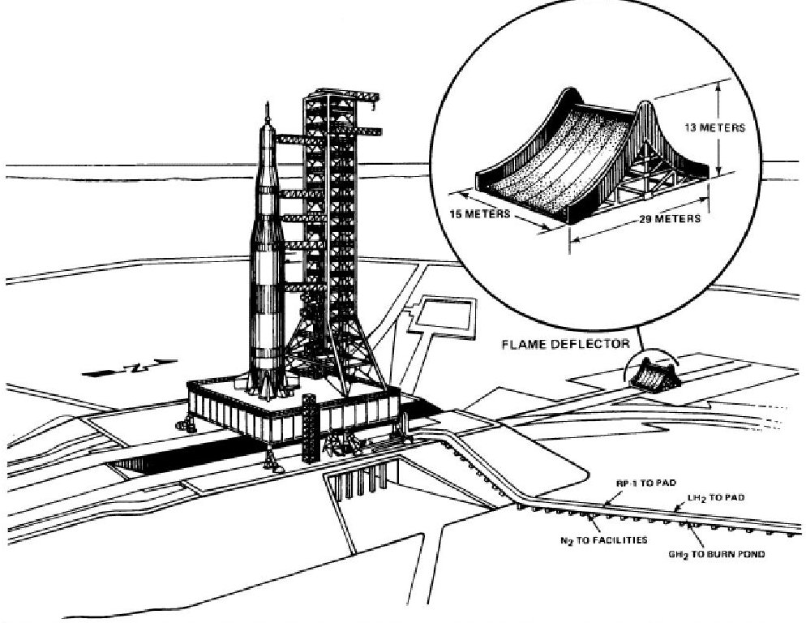

Figure 14. Launch Pad 39A Flame Deflector System

<!-- PDF_PAGE: 39 -->

## Example 2a:

After the Apollo Program, the Launch Pad 39A underwent modifications to support the space shuttle launches. Although the acoustic shock waves from the liquid engines and solid rocket boosters (SRBs) were similar to the Saturn V launches, the risk on the Apollo spacecraft was less. The space shuttle was about half the height of the Saturn V, resulting in the crew cabin and payload bay being much closer to the platform, and much more vulnerable to the acoustic energy. NASA's predicted acoustic shock wave levels produced by the shuttle engines were underestimated, falling outside the expected environment and damaging many of the protective tiles on Columbia's first shuttle launch (STS-1) (i.e., failure to properly assess the acoustic environment). To mitigate the acoustic environment, a water acoustic suppression system was installed on the mobile launch platform to dampen vibrations. The acoustical suppression system protected the orbiter and its payloads from being damaged by muffling acoustical energy that could crack and damage surfaces during liftoff. Water stored in a 300,000-gallon elevated tank was released just prior to main engine ignition and flowed to the launch platform outlets, flooding the launch area at the crucial moments surrounding ignition, and serving two purposes: keeping flames from spreading and preventing damage caused by sound waves.

## Example 2b:

On May 31, 2008, during the launch of the space shuttle Discovery (STS-124), the KSC Launch Pad 39A flame trench suffered extensive damage. The propulsion system exhaust from Discovery's liftoff breached the flame trench wall at the base of the pad allowing hot gases to penetrate the trench lining system. This affected a section of heat-resistant brick and concrete blocks about 75 feet by 20 feet in size (Figure 15, solid rocket booster (SRB) side), blasting over 3,000 refractory bricks into and beyond the flame trench.

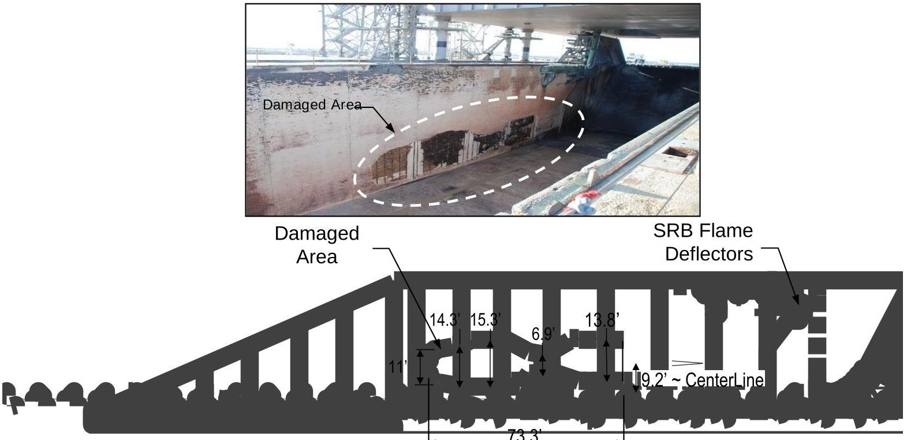

Figure 15. Image and Sketch of the Launch Pad 39A Flame Trench (SRB side) Affected Area

<!-- PDF_PAGE: 40 -->

The Mishap Investigation Board (MIB) found the failure was the result of damage/weakening of the refractory brick epoxy bonding by carbonation and corrosion of steel anchors, which held the refractory bricks in the trench in place. The SRB exhaust by-products (i.e., $ \mathrm{A l C I}_{3} $ and HCl), the SRB ignition over-pressure and acoustics, as well as the aging of the system (i.e., failure to identify and consider Environment and Lifetime exposure to those conditions) exacerbated the brick bonding and anchor corrosion.

These examples illustrate what could happen when using heritage hardware or design without a clear understanding of their original intended MEAL, thereby by failing to properly assess the suitability of the heritage design for the new intended mission.

## 6.2 Part-level Verification: Enabling Identification of Part Infant Mortality Defects and Failures

Part-, board-, and box-level testing have distinct advantages in certain areas. All have continued to prove to be valuable tests for flight missions. Many defects or issues are captured during partlevel testing. However, some are only discovered at the higher levels of integration (e.g., board- or box-level testing). The following examples illustrate the importance of appropriate testing at multiple levels of integration.

1. During the Express Logistics Carrier (ELC) Project, a part radiation susceptibility issue was discovered during part-level total ionizing dose (TID) testing. A COTS metal-oxide- semiconductor field-effect transistor (MOSFET) APT50M38 was tested for TID. Although the MOSFETs passed screening tests, TID testing required screened samples and therefore had to wait until screening was completed. The TID test found that the parts failed at low doses and were unsuitable for flight. By the time the TID was completed, the boards were already assembled and being tested. The part had to be replaced with a parallel configuration of radiation hardened power MOSFETs, but the "RDSon" (on resistance between source and drain of the power MOSFET) increased, reducing the efficiency. This incurred redesign effort, and posed challenges with regard to fitting the new configuration within the envelope of the original parts. The benefit associated with the redesign, although costly, far outweighed the consequences of a part failure if the TID test had not been performed. Failure to do TID testing at part-level resulted in a lengthy and difficult redesign, and it was fortunate that the parallel MOSFET solution fit the same footprint as the original device. The issue is the programmatic decision to assembly at risk while waiting for an expected positive TID testing result. If the serial testing had been completed before board were populated, the consequences would have been different.

2. The ELC Project experienced another anomaly with a part that was not observed until full system-level integration. It was discovered that a polarized capacitor was inadvertently installed onto the flight boards with reverse polarity. This reverse bias operation was slowly damaging the capacitor, especially under heavy power loading conditions. However, due to the slow rate of damage, the part failure was not observed during board- or box-level testing. This was realized after launch by operational testing of the ground unit, which was identical to the flight unit. Operational parameters of the mission had to be adjusted to minimize stress to those components. Space Technology 5 (ST-5) experienced a similar failure, which was discovered during the board-level testing.

3. The Swift spacecraft's Burst Alert Telescope (BAT) provides examples of part anomalies discovered during various levels of integration testing. One example was related to the

<!-- PDF_PAGE: 41 -->

power-up sequencing of an FPGA. Such problems often cannot be discovered during part-level testing, because they depend on the interaction of multiple parts within the circuit and flight-like impedance characteristics. In this instance, the board failed to start up in the proper configuration during board-level testing. The root cause was incorrectly attributed to the ground support equipment harnessing used to perform the board test, with the assumption that the final flight harnessing would have better impedance matches, resolving the issue. The startup configuration issue proceeded through board- and box-level testing. At final system-level testing, with the flight harness installed, the issue persisted and it was realized that the root cause was the power-up sequencing programmed into the FPGA, which was corrected to resolve the issue. Similar power-up sequencing issues led to a complete failure of the Wide-Field Infrared Explorer mission.

4. Swift/BAT instrument encountered radiation susceptibilities during single-event burnout (SEB) testing. After part-level screening, a COTS MOSFET IRF640 was tested for SEB and discovered to be susceptible to burnout at 22% of its rated voltage. Since this was discovered early in the project, the part was designed out and replaced with a radiation hard MOSFET. Additionally, an operational amplifier, OP296, was found to have low TID susceptibility, failing parametrically at less than 1 krad (Si) and functionally at less than 2 krad (Si). This susceptibility was confirmed with board-level testing. Under exposure to radiation, the overall board performance was observed to degrade until it failed to meet specifications. The part was designed out and replaced with a TID tolerant Op-Amp.

5. Swift/BAT instrument experienced several anomalies relating to the AD590 temperature sensors used on loop heat pipes. These COTS style sensors made it through parts-level testing successfully with a typical infant mortality fallout rate. However, once parts were integrated at the subsystem level, a handling issue occurred where an operator failed to wear electrostatic discharge (ESD) protection when working near the temperature sensors. As a result, several of the sensors failed at the subsystem level and had to be replaced. Only the sensors that had failed were replaced even though all of the sensors had been potentially exposed to ESD. The event was documented and carried as a programmatic residual risk. The remaining sensors on the loop heat pipe survived subsystem-level testing until a latent failure occurred during spacecraft level testing. At this point, all accessible temperature sensors were removed and replaced. Failure analysis and DPA of the removed sensors showed ESD damage. Unfortunately, not all sensors were accessible at this stage of integration and some could not be replaced. The project was forced to carry the risk of latent failure on those replaced sensors into launch and operation. During flight operation, the affected loop heat pipe system failed and the root cause was attributed to the suspect sensors that were not replaced.

6. The Neutron star, Interior Composition Explorer, experienced an infant mortality part failure during board-level screening. Due to its class D mission classification, short lifetime, and redundant detector systems, the project was able to justify board-level screening tests over parts-level tests. During the board-level burn-in testing, an infant mortality failure of a ceramic capacitor was discovered. The failed capacitor had received some initial part-level burn-in screening. However, the testing was not stressful enough to induce the infant mortality failures. Failure analysis and cross-sectioning were performed and the failure site was identified. Root cause was established as a void in the dielectric during manufacturing,

<!-- PDF_PAGE: 42 -->

which allowed electro-migration of electrode metal into the void, causing a resistive short across the capacitor.

7. Increased leakage current in a ceramic capacitor is a potential sign of pending failure. Even microamp increases in leakage current could indicate a part defect that will degrade into a dead short. These parameters would be observed during part-level testing and the defective parts would be removed from the lot. However, at the board- or box-level, microamp increases in current draw would likely never be observed until the part exhibits high leakage current/lower insulation resistance or a dead-short failure.

8. NESC performed DPA, environmental stress testing, and radiation testing on some selected automotive and non-automotive COTS parts. The environmental stress testing regimen was a partial set of the qualification criteria contained in the Automotive Executive Council (AEC) Qualification test standards, AEC Q100, Q101, and Q200, as applicable. Seven part types (i.e., six automotive and one non-automotive) were subjected to reflow simulation, highly accelerated stress testing, life testing, and thermal cycling. Electrical measurements made after each test identified two part types (i.e., one automotive and one non-automotive part) that did not meet datasheet parameters. Six additional COTS parts (i.e., three automotive and three non-automotive) were subjected to thermal cycling of 1000 cycles, with pre- and post-electrical test measurements and DPA. While all six part types passed electrical test measurements after thermal cycling, one non-automotive part type exhibited rejectable physical degradation in DPA. The defects and failures seen in this limited evaluation for the automotive and non-automotive COTS parts during environmental stress testing were higher than expected.

## 6.3 Challenges of Radiation Testing on COTS Parts: Part-to-Part SEE Variability for Some COTS Parts

COTS parts may exhibit higher part-to-part variability in their radiation responses than traditional space-qualified parts. Since existing military standards and industrial standards either do not have sample size recommendations or use small quantities (e.g., three or five samples in testing, the small sample size may be inadequate when evaluating commercial parts. An example of this is documented in a 2016 study on commercial power MOSFET SEE response $ ^{16} $.

The 2016 study discusses heavy ion SEE testing on five different part types of next generation, commercial trench power MOSFETs with sample size greater than 50 per part type. Some MOSFETs showed large part-to-part variation in onset voltage for SEB. This suggests that SEE testing of commercial power MOSFETs using a small test sample size may fail to consistently capture the full extent of part-to-part variability. This could have serious consequences for space qualification if a small sample test is widely leveraged, especially where a SEB mechanism is dominant. The results show that part-to-part variation may challenge traditional MOSFET SEE qualification methods, which are typically done with small sample sizes. It may not be feasible to use 50+ sample size in most tests, but even an expansion from small samples (3 to 6 parts) to moderately large samples (10 to 20 parts) significantly improves assessment of sample variation.

The study also showed that burn-in greatly reduced the part-to-part variability in one power MOSFET type. Therefore, SEE testing performed on non-burned-in power MOSFETs may yield

<!-- PDF_PAGE: 43 -->

an incorrect safe operating area because the test parts distribution is not representative of the screened flight parts. In the study, a three-sample test of non-burned-in power MOSFET devices risks overestimating robustness since 78% of the non-burned-in devices exceeded the mean of the burned-in sample set. This means it would produce an artificially large safe operating area).

## 7.0 Definitions

The following definitions are from NESC-RP-12-00759 Version: 1.2 "Use of Commercial-Off The-Shelf (COTS) Electronic Components in Safety- Critical Human-Rated (Commercial Crew) Space Avionics Systems."

Board/Assembly/System Qualification: Tests intended to demonstrate the test item will function within performance specifications under simulated conditions demonstrating margin to the environments bounding those expected from ground handling, launch, and flight operations. Their purpose is to uncover deficiencies in design and method of manufacture. They are not intended to exceed design safety margins or to introduce unrealistic modes of failure. The design qualification tests may be to either "prototype" or "proto-flight" test levels. These tests are performed at levels well below those at the EEE piece parts level.

COTS: An assembly or part designed for commercial applications for which the item manufacturer or vendor solely establishes and controls the specifications for performance, configuration and reliability, including design, materials, processes, and testing without additional requirements imposed by users and external organizations. For example, this would include any type of assembly or part from a catalog without any additional parts level testing after delivery of the part from the manufacturer.

DPA: Destructive Physical Analysis, a sample test, based on GSFC S-311-M-70 and MIL-STD 1580. DPA is an independent (not performed by manufacturer/supplier) assessment of the lot quality proposed for flight use. Deconstruction of the part may identify part issues or possible failure modes not visible externally, or by electrical inspection. Some of these "invisible" failure modes may include use of pure tin solder, trapped particles, ionic contamination, corrosion, poor wire bonding, inconsistent wire bonding, lack of strain relief in wire bonds, intermetallic growth, cracked or damaged dice, counterfeit parts, defective materials, inadequate soldering, inadequate die attach, etc.

Lot Qualification: A qualification regime performed on a subsample of a homogeneous group or lot of parts such that the results of the qualification regime demonstrate with high confidence that an acceptably large proportion of the parts in the lot will meet qualification requirements. Lot qualification is performed when the qualification regime is destructive to the test parts and when inter-lot variability is much larger than intra-lot variability. Often a model will be assumed or prescribed allowing test results to be extrapolated into general statements about lot performance. Parts used for qualification shall have passed screening to ensure that qualification is performed on a sample representative of flight parts. Some qualification tests may be destructive.

MIL-Spec Part: Part qualified to either a performance specification (MIL-PRF-XXXX) or a detail specification (MIL-DTL-XXXX) (e.g., MIL-PRF-38534 Performance Specification for hybrid microcircuits, MIL-DTL-38999 for circular connector).

Parts Burn-in: A test in which a part is applied with an electrical load (voltage or current) at an elevated temperature at piece parts level for a specified number of hours. It is an accelerated aging process in an attempt to stress the part at maximum rated or elevated operating conditions

<!-- PDF_PAGE: 44 -->

in order to reveal thermally and electrically activated time-dependent failure modes and/or defects which cause early or extrinsic failures.

Parts Characterization: Process of testing a sample of components over a range of environmental and application conditions to determine the ranges of key electrical parameter values that can be expected of all produced components of the type tested. Parts characterization results are often used as a basis to establish lot qualification tests.

Parts Qualification: Sample based mechanical, electrical, and environmental tests at part-level intended to verify that materials, design, performance, and long-term reliability of the part on the same production line are consistent with the specification and intended application until a major process change.

Parts Screening: A series of tests and inspections at part-level intended to remove

nonconforming and/or infant mortal parts (parts with defects that are likely to result in early and/or cluster failures) and thus increase confidence in the reliability of the parts selected for use.

Prototype hardware: Hardware of a new design; it is subject to a design qualification test program; it is not intended for flight.

Proto-flight hardware: Flight hardware of a new design it is subject to a qualification test program that combines elements of prototype and flight acceptance verification, that is, application of design qualification test levels and flight acceptance test duration.

Traceability: An identifiable association between hardware items or processes, such as between a requirement and the source of the requirement or between a verification method and its base requirement.

## 8.0 Acronyms List

<table border="1"><tr><td>AEC</td><td>Automotive Electronics Council</td></tr><tr><td>AICI3</td><td>Aluminum Chloride</td></tr><tr><td>ASIC</td><td>Application-Specific Integrated Circuit</td></tr><tr><td>BAT</td><td>Burst Alert Telescope</td></tr><tr><td>CCF</td><td>Common-Cause Failures</td></tr><tr><td>CMOS</td><td>Complementary Metal-Oxide-Semiconductor</td></tr><tr><td>COTS</td><td>Commercial-Off-The-Shelf</td></tr><tr><td>DARPA</td><td>Defense Advance Research Project Agency</td></tr><tr><td>DDD</td><td>Displacement Damage Dose</td></tr><tr><td>DPA</td><td>Destructive Physical Analysis</td></tr><tr><td>EEE</td><td>Electrical, Electronic, Electro-mechanical</td></tr><tr><td>ELC</td><td>Express Logistics Carrier</td></tr><tr><td>ESD</td><td>Electrostatic Discharge</td></tr><tr><td>eV</td><td>Electron-Volt</td></tr><tr><td>FPGA</td><td>Field Programmable Gate Array</td></tr><tr><td>HCI</td><td>Hydrogen Chloride</td></tr><tr><td>LET</td><td>Linear Energy Transfer</td></tr><tr><td>LOC</td><td>Loss of Crew</td></tr><tr><td>LOM</td><td>Loss of Mission</td></tr><tr><td>MEAL</td><td>Mission Environment, Applications and Lifetime</td></tr><tr><td>MIB</td><td>Mishap Investigation Board</td></tr><tr><td>MOSFET</td><td>Metal-Oxide-Semiconductor Field-Effect Transist</td></tr></table>

<!-- PDF_PAGE: 45 -->

NESC NASA Engineering and Safety Center

NSRL NASA Space Radiation Laboratory

OEM Original Equipment Manufacturer

OM Original Manufacturer

PLD Programmable Logic Device

RF Radio Frequency

SEB Single-Event Burnout

SEE Single-Event Effect

SEL Single Event Latch-up

SLS Space Launch System

SOTA State-of-the-Art

SDRAM Synchronous Dynamic Random-Access Memory

SRAM Static Random Access Memory

SRB Solid Rocket Booster

SSP Space Shuttle Program

STS Space Transportation System

TID Total Ionizing Dose

TRL Test Readiness Level

UVT Ultraviolet

## Appendices

A. Matrix for a Set of Common Verification Tests and Inspections: Purposes, Capabilities, Advantages and Limitations of Each Verification Performed at Different Level of Integration

B. Counterfeit Parts

C. Team List

<!-- PDF_PAGE: 46 -->

# Appendix A. Matrix for a Set of Common Verification Tests and Inspections: Purposes, Capabilities, Advantages and Limitations of Each Verification Performed at Different Level of Integration

## A.1 Matrix header definitions

Purpose: Reason(s) for which the given test or inspection is performed. The test or inspection addresses each condition (elements) listed under the purpose.

Configuration Levels: Describes part-level, board-level, and box-level.

Capabilities: Describes the ability of the test or inspection to address the elements listed under the purpose, for a given configuration level.

Advantages: Highlights the additional tangible and/or intangible benefits of the given test or inspection when performed under the given configuration level.

Limitations: Describes the shortcomings of the test or inspection (when performed under the given configuration level) to fully exercise the elements of the purpose and/or, any incurred risks (technical, cost, or schedule) associated with the execution of the test or inspection.

## A.2 Matrix

<!-- PDF_PAGE: 47 -->

<table border="1"><tr><td></td><td></td><td></td><td colspan="8">Level of Integration</td></tr><tr><td rowspan="2">Test</td><td rowspan="2">Purpose</td><td colspan="3">Part-level testing and screening</td><td colspan="3">Board-level testing</td><td colspan="3">Box-level testing</td></tr><tr><td>Capability</td><td>Advantages</td><td>Limitations</td><td>Capability</td><td>Advantages</td><td>Limitations</td><td>Capability</td><td>Advantages</td><td>Limitations</td></tr><tr><td>All tests in general</td><td>To verify that the flight units meet their intended functions throughout the development, test and operations throughout life of the mission.</td><td>1) Lowest level of integration where the parts specifications can be verified.</td><td>1) All parts specifications can typically be verified at this level.
2) Parts could be stressed to limit conditions (manufacturer specifications).
3) Test can be optimized to reveal particular failure mode(s).</td><td>1) May not be able to verify parts interactions with other parts in a system/subsystem.
2) May lead to parts damages (over testing, workmanship).</td><td>1) Next lowest level of integration where the functional performance of a circuit (consisting of multiple parts on a board) can be verified.
2) May verify quality of workmanship.</td><td>1) All circuit functionality can typically be verified at this level, including part interactions.
2) May have selected access to some in-circuit functions through test points.</td><td>1) Environmental and/or voltage/current load conditions limited by the weakest part within the circuit and/or the hottest element within the board (thus not able to verify all parts manufacturer specifications).
2) May lead to parts damages (over testing, workmanship).
3) May not be able to verify external circuit interactions with other circuits in a system/subsystem.
4) May not be able to identify degraded/damaged part. Access to input/output of all parts may be limited and may be affected by other parts within the circuit.</td><td>1) Next Lowest level of integration of a system (i.e., subsystem/box) where the functional performance of a multiple circuits (each circuit consisting of multiple components on a board) can be verified.
2) May verify quality of workmanship.</td><td>1) Most circuit functionality can typically be verified at this level, including board-to-board interactions.
2) May have selected access to some in-circuit functions through test points.
3) Could utilize consolidated autonomous test configurations developed for the box-level testing.</td><td>1) Environmental and/or voltage/current load conditions limited by the weakest part within the subsystem and/or the hottest element within the box.
2) May lead to parts damages (external stresses, workmanship).
3) May not be able to verify box interactions with other boxes in a subsystem/system.
4) Difficult to troubleshoot thus may not be able to identify degraded or defective part. Access to input/output of all parts may be limited and may be affected by other parts.</td></tr></table>

<!-- PDF_PAGE: 48 -->

<table border="1"><tr><td></td><td></td><td></td><td colspan="8">Level of Integration</td></tr><tr><td rowspan="2" colspan="2">Test</td><td rowspan="2">Purpose</td><td colspan="3">Part-level testing and screening</td><td colspan="3">Board-level testing</td><td colspan="3">Box-level testing</td></tr><tr><td>Capability</td><td>Advantages</td><td>Limitations</td><td>Capability</td><td>Advantages</td><td>Limitations</td><td>Capability</td><td>Advantages</td><td>Limitations</td></tr><tr><td>Radiation Test</td><td>Total Ionizing Dose (TID) Test</td><td>To detect test units that may not meet manufacturer specifications due to degradation caused by cumulative exposure to ionizing radiation.</td><td>2) Identifies parametric and functional degradation likely to impact performance due to TID.</td><td>3) Allows appropriate test conditions(temperature,bias,dose rate,etc.);ensures ELDRS susceptible parts tested at low dose rate and accelerated testing of CMOS technologies.4) Sample size can be selected to allow bounding of worst-case degradation for the population.5) Allows determination of design margins and design of spot shielding and other mitigations.</td><td>3) Is a destructive test and typically used for sample based qualification.4) Cost and schedule impact for testing every part.5) Parts tested cannot be used for flight since it is a destructive test.6) May be difficult or impossible to exercise part in flight-like conditions.7) May have to shield active parts of test hardware.</td><td>3) Identifies TID failures likely to impact board-level operations.</td><td>3) Replaces several part-level tests with a single board-level test,saving cost and schedule.4) Observed failures are relevant with little circuit or other analysis required.</td><td>5) Failure detected at this level may have a negative impact on cost and schedule due to level of integration as compared to part-level test.6) Is a destructive test and typically used for sample based qualification.7) Boards tested cannot be used for flight since it is a destructive test.8) Test sample limited only to parts on board and may not be representative of flight parts.9) If any ELDRS susceptible technologies are present, testing will have to be at low dose rate.10) Conditions are limited to "flight-like".11) TID levels limited by the weakest part,and so cannot establish margins for other parts on board,i.e.,masking other parts susceptibilities to TID.12) Would not detect parts degradation thus could not establishes parts margins to failure.</td><td>4) Replaces several part- or board-level tests with a single box-level test,saving cost and schedule.5) Observed failures are relevant with little circuit or other analysis required.</td><td>5) Failure detected at this level may have a negative impact on cost and schedule due to level of integration as compared to part- or board-level test.6) Is a destructive test and typically used for sample based qualification.7) Boxes tested cannot be used for flight since it is a destructive test.8) Test sample limited only to parts on box and may not be representative of flight parts.9) If any ELDRS susceptible technologies are present, testing will have to be at low dose rate.10) Conditions are limited to "flight-like".11) TID levels limited by the weakest part,and so cannot establish margins for other parts on box,i.e.,masking other parts susceptibilities to TID.12) Would not detect parts degradation thus could not establishes parts margins to failure.</td></tr></table>

<!-- PDF_PAGE: 49 -->

<table border="1"><tr><td></td><td></td><td></td><td colspan="9">Level of Integration</td></tr><tr><td rowspan="2" colspan="2">Test</td><td rowspan="2">Purpose</td><td colspan="3">Part-level testing and screening</td><td colspan="3">Board-level testing</td><td colspan="3">Box-level testing</td></tr><tr><td>Capability</td><td>Advantages</td><td>Limitations</td><td>Capability</td><td>Advantages</td><td>Limitations</td><td>Capability</td><td>Advantages</td><td>Limitations</td></tr><tr><td>Radiation Test</td><td>Displacement Damage(DD)</td><td>To detect test units that may not meet requirements due to degradation caused by disruption of the semiconductor lattice due to radiation.</td><td>2) Identifies parametric and functional degradation likely to impact performance due to DD.</td><td>3) Sample size can be selected to allow bounding of worst-case degradation for the parts population.</td><td>3) Testing every part may be time-consuming, impacting cost and schedule.
4) Parts tested cannot be used for flight since it is a destructive test and used for sample based qualification.</td><td>3) May detect DD failures likely to impact board level operations.
4) Establishes margins for weakest part(s) on board.</td><td>3) Replaces several part-level tests with a single board-level test, saving cost and schedule.
4) Observed failures are relevant with little circuit or other analysis required.</td><td>5) Failure detected at this level may have a negative impact on cost and schedule due to level of integration as compared to part-level test.
6) Is a destructive test and typically used for sample based qualification.
7) Boards tested cannot be used for flight since it is a destructive test.
8) Test sample limited only to parts on board and may not be representative of parts LOT due to part-to-part variations.
9) Conditions are limited to "flight-like".
10) DD limited by the weakest part, and so cannot establish margins for other parts on the board (i.e., masking other parts susceptibilities to DD).
11) If multiple technologies present, DD may have different energy dependence for each.
12) Would not detect parts degradation thus could not establish parts margins to failure.</td><td>3) May identify DD failures likely to impact box-level operations; establishes margins for weakest part(s) in box.</td><td>4) Replaces several part-level and board-level tests with a single box-level test, saving cost and schedule.
5) Observed failures are relevant with little circuit or other analysis required.</td><td>5) Failure detected at this level may have a negative impact on cost and schedule due to level of integration as compared to part-level test.
6) Is a destructive test and typically used for sample based qualification.
7) Boxes tested cannot be used for flight since it is a destructive test.
8) Test sample limited only to parts on board and may not be representative of parts LOT.
9) Conditions are limited to "flight-like".
10) DD limited by the weakest part, so cannot establish margins for other parts in system (i.e., masking other parts susceptibilities to DD).
11) If multiple technologies present, DD may have different energy dependence for each.
12) Would not detect parts degradation thus could not establish parts margins to failure.</td></tr></table>

<!-- PDF_PAGE: 50 -->

<table border="1"><tr><td></td><td></td><td></td><td colspan="8">Level of Integration</td></tr><tr><td rowspan="2" colspan="2">Test</td><td rowspan="2">Purpose</td><td colspan="3">Part-level testing and screening</td><td colspan="3">Board-level testing</td><td colspan="3">Box-level testing</td></tr><tr><td>Capability</td><td>Advantages</td><td>Limitations</td><td>Capability</td><td>Advantages</td><td>Limitations</td><td>Capability</td><td>Advantages</td><td>Limitations</td></tr><tr><td>Radiation Test</td><td>Heavy-ion Single Event Effects (SEE) testing (SEU, SET, SEL, SEB, SEGR, etc.)</td><td>To identify susceptibility of the test units to SEE modes which are caused by ions from the radiation environment.
1) SEE can occur at any time during the mission, it is critical that an SEE test reveal as many of the part&#x27;s SEE susceptibilities as possible so their consequences can be assessed and mitigated.
2) Merely reproducing the mission environment is unlikely to accomplish this goal. This is a SEE susceptibility test and should not be interpreted as a test to reproduce the mission environment.</td><td>2) Identifies destructive and nondestructive SEE susceptibilities of the test part that may occur in the radiation environment.</td><td>3) Ion characteristics and test conditions can be controlled to maximize probability of revealing SEE susceptibilities.
4) Allows understanding of SEE mechanisms.
5) Information about SEE consequences can be used to develop mitigation;
6) Test data can be used to estimate SEE rates for any environment.
7) Can also yield conservative bounding rates for proton SEE.
8) Test data are used to characterize SEE consequences and probabilities of occurrence.</td><td>3) Cost and schedule impact for testing every part.
4) Is a destructive test and typically used for sample based qualification.
5) Parts tested cannot be used for flight since it is a destructive test.
6) Test facilities have limited time available and are expensive.
7) Many parts require extensive modification or use of expensive ultra-high energy ion accelerator for ions to reach part sensitive volumes.</td><td>3) Identifies destructive and nondestructive SEE susceptibilities of the overall circuit that may occur in the radiation environment.
4) Rarely done at board level. May reveal some destructive and nondestructive SEE susceptibilities.
(Note: The methodology for board-level heavy-ion testing is immature. See limitations.)</td><td>3) May save cost and schedule over part-level testing; Replaces several part-level tests with a single board-level test saving cost and schedule.
4) May reveal some destructive and nondestructive SEE susceptibilities.
5) failures observed are relevant with little circuit or other analysis required;</td><td>5) Rarely done at board level. Failure detected at this level may have a negative impact on cost and schedule due to level of integration as compared to part-level.
6) Is a destructive test and typically used for sample based qualification.
7) The methodology for board-level heavy-ion testing is immature.
8) Boards tested cannot be used for flight since it is a destructive test.
9) Methodology for board-level heavy-ion testing is not well developed; Requires expensive ultrahigh energy ion beam and detailed information about part materials and construction for rate estimation.
10) Impact due to SEE may depend on state of the board when it occurs;
11) Different parts may have different worst-case ion and application conditions.
12) May be difficult to identify which part caused a board-level failure.</td><td>N/A</td><td>N/A</td><td>N/A</td></tr></table>

<!-- PDF_PAGE: 51 -->

<table border="1"><tr><td></td><td></td><td></td><td colspan="9">Level of Integration</td></tr><tr><td rowspan="2" colspan="2">Test</td><td rowspan="2">Purpose</td><td colspan="3">Part-level testing and screening</td><td colspan="3">Board-level testing</td><td colspan="3">Box-level testing</td></tr><tr><td>Capability</td><td>Advantages</td><td>Limitations</td><td>Capability</td><td>Advantages</td><td>Limitations</td><td>Capability</td><td>Advantages</td><td>Limitations</td></tr><tr><td>Radiation Test</td><td>Proton SEE testing</td><td>To identify susceptibility of the test units to SEE modes caused by proton induced recoil ions and bound proton rates for the environment.
1) SEE can occur at any time during the mission, it is critical that an SEE test reveal as many of the part&#x27;s SEE susceptibilities as possible so their consequences can be assessed and mitigated.
2) Merely reproducing the mission environment is unlikely to accomplish this goal. This is a SEE susceptibility test and should not be interpreted as a test to reproduce the mission environment.</td><td>2) Identifies proton induced nondestructive and some limited destructive SEE susceptibilities of the part that can be caused by proton-induced recoil ions in the mission environment.
3) Bound SEE rates due to protons in the mission environment.
4) Is a destructive test and typically used for sample based qualification.</td><td>4) Test can be conducted for worst-case application conditions.
5) Protons are highly penetrating and they will reach the device Sensitive Volume, thus parts do not need to be modified.
6) SEE consequences can be used to develop mitigation and data can be used to estimate proton rates.</td><td>3) Cost and schedule impact for testing every part.
4) Parts tested cannot be used for flight since it is a destructive test.
5) Will require fluence of 3E12 to be comparable to HI testing, potentially degrading parts due to TID.
6) Proton recoil ion characteristics cannot be controlled to maximize probability of revealing particular SEE susceptibilities.
7) Lack of control of proton recoil ion characteristics does not facilitate understanding of SEE mechanisms.</td><td>3) Identifies proton induced nondestructive and destructive SEE susceptibilities of parts that can be caused by protons induced recoil ions in the mission environment and that affect board-level function.
4) Bound SEE rates due to protons in the mission environment.</td><td>3) Typical proton beam covers large area of the board thus multiple parts can be tested all at once.
4) Protons are highly penetrating, thus testing does not require modification of parts on board.
5) Errors observed will be important at the board level.
6) Test can be conducted for more-or-less realistic flight-like conditions.</td><td>5) Failure detected at this level may have a negative impact on cost and schedule due to level of integration as compared to part level.
6) Is a destructive test and typically used for sample based qualification.
7) Boards tested cannot be used for flight since it is a destructive test.
8) Failure of a part may prevent seeing other board susceptibilities.
9) May miss some destructive SEE.
10) Errors may depend on the on state of board at when error occurs; an undetected error mode might have more severe consequences if it occurred when the board was in another state.
11) Proton recoil ion characteristics cannot be controlled to maximize probability of revealing particular SEE susceptibilities.
12) Will require fluence of 3E12 to be comparable to HI testing, potentially degrading parts due to TID.
13) May not be able to identify degraded/damaged component/part, since access to input/output of all parts may be limited and may be affected by other</td><td>2) Identifies proton induced nondestructive and destructive SEE susceptibilities of parts that can be caused by protons induced recoil ions in the mission environment and that affect board-level function.
3) Bound SEE rates due to protons in the mission environment.</td><td>4) Protons are highly penetrating, thus testing does not require modification of parts on board.
5) Errors observed will be important at the box level.
6) Test can be conducted for more-or-less realistic flight-like conditions.</td><td>5) Failure of a part may prevent seeing other box level susceptibilities.
6) Failure detected at this level may have a negative impact on cost and schedule due to level of integration as compared to part level.
7) Is a destructive test and typically used for sample based qualification.
8) Boxes tested cannot be used for flight since it is a destructive test.
9) May miss some destructive SEE.
10) Errors may depend on the on state of box at when error occurs; an undetected error mode might have more severe consequences if it occurred when the box was in another state.
11) Proton recoil ion characteristics cannot be controlled to maximize probability of revealing particular SEE susceptibilities.
12) Will require fluence of 3E12 to be comparable to HI testing, potentially degrading parts due to TID.
13) May not be able to identify degraded/damaged component/part, since access to input/output of all parts may be limited and may be affected by other parts.</td></tr></table>

<!-- PDF_PAGE: 52 -->

<table border="1"><tr><td></td><td></td><td></td><td colspan="8">Level of Integration</td></tr><tr><td rowspan="2">Test</td><td rowspan="2">Purpose</td><td colspan="3">Part-level testing and screening</td><td colspan="3">Board-level testing</td><td colspan="3">Box-level testing</td></tr><tr><td>Capability</td><td>Advantages</td><td>Limitations</td><td>Capability</td><td>Advantages</td><td>Limitations</td><td>Capability</td><td>Advantages</td><td>Limitations</td></tr><tr><td></td><td></td><td></td><td></td><td></td><td></td><td></td><td>parts.
14) Lack of control of proton recoil ion characteristics does not facilitate understanding of SEE mechanisms.</td><td></td><td></td><td>14) Lack of control of proton recoil ion characteristics does not facilitate understanding of SEE mechanisms.</td></tr></table>

<!-- PDF_PAGE: 53 -->

<table border="1"><tr><td></td><td></td><td></td><td colspan="8">Level of Integration</td></tr><tr><td rowspan="2">Test</td><td rowspan="2">Purpose</td><td colspan="3">Part-level testing and screening</td><td colspan="3">Board-level testing</td><td colspan="3">Box-level testing</td></tr><tr><td>Capability</td><td>Advantages</td><td>Limitations</td><td>Capability</td><td>Advantages</td><td>Limitations</td><td>Capability</td><td>Advantages</td><td>Limitations</td></tr><tr><td>Radiation Test</td><td>Laser SEE testing</td><td>To identify susceptibilities of test units to SEE modes, and to identify the features on the die responsible for those modes.</td><td>2) Identifies destructive and nondestructive SEE susceptibilities of the test part that may occur in the radiation environment.
3) Identifies features responsible for each SEE mode -- useful for SEE hardening of part design.
4) Yields some information on rate (SEE at lower laser energy will be more common in space).</td><td>4) Identifies SEE susceptibilities in part.
5) Identifies features responsible for each SEE mode.
6) Yields some limited information about cross section and onset LET.
7) Laser does not contribute to TID, so TID/SEE synergies do not affect test results.
8) Laser time cheaper than proton or heavy-ion beam time.
9) Yields information complementary to broad-beam heavy-ion testing and very useful for first look, hardening studies or very complex parts.</td><td>3) Cannot penetrate metals or thick overlayers, so may not identify all SEE susceptibilities.
4) Resolution limited by laser beam spot size.
5) No direct relationship between laser intensity and LET.
6) Results highly sensitive to surface imperfections and overlayers.</td><td>Not possible at higher levels of integration.</td><td>N/A</td><td>N/A</td><td>Not possible at higher levels of integration.</td><td>N/A</td><td>N/A</td></tr></table>

<!-- PDF_PAGE: 54 -->

<table border="1"><tr><td></td><td></td><td></td><td colspan="8">Level of Integration</td></tr><tr><td rowspan="2" colspan="2">Test</td><td rowspan="2">Purpose</td><td colspan="3">Part-level testing and screening</td><td colspan="3">Board-level testing</td><td colspan="3">Box-level testing</td></tr><tr><td>Capability</td><td>Advantages</td><td>Limitations</td><td>Capability</td><td>Advantages</td><td>Limitations</td><td>Capability</td><td>Advantages</td><td>Limitations</td></tr><tr><td>Radiation Test</td><td>Proton SEE testing as Proxy for Heavy Ion SEE</td><td>To identify susceptibility of the test units to SEE modes caused by high-energy ions in the space environment and bound Heavy-ion rates for the environment.1) SEE can occur at any time during the mission, it is critical that an SEE test reveal as many of the part&#x27;s SEE susceptibilities as possible so their consequences can be assessed and mitigated.2) Merely reproducing the mission environment is unlikely to accomplish this goal.</td><td>2) Places limited constraints on heavy-ion nondestructive SEE susceptibility for benign mission radiation environments.3) Highly penetrating proton beams ensure some recoil ions generated in some SV of parts without extensive modification needed for most heavy-ion testing provided proton fluence is high enough.</td><td>4) Allows testing of complicated parts without extensive modification or access to an expensive, high-energy heavy-ion accelerator.</td><td>3) Is a destructive test and typically used for sample based qualification.4) Low energy of proton recoils mean that technique cannot reliably bound rates for all technologies or all SEE modes.5) Low recoil-ion production rate means TID limits fluence that can be used.6) Parts tested cannot be used for flight since it is a destructive test.</td><td>3) Places limited constraints on heavy-ion nondestructive SEE susceptibility for benign mission radiation environments.4) Highly penetrating proton beams ensure some recoil ions generated in some SV of parts without extensive modification needed for most heavy-ion testing provided proton fluence is high enough.</td><td>3) Long proton ranges ensure exposure of some SV to recoil ions with no modification needed to board or parts and with parts on the board operating in&quot;flight-like&quot; manner.4) Allows testing of complicated parts without extensive modification or access to an expensive, high-energy heavy-ion accelerator.</td><td>5) Is a destructive test and typically used for sample based qualification.6) Low energy of proton recoils mean that technique cannot reliably bound rates for all technologies or all SEE modes.7) Different SV depths of parts on board mean that effect of limited range varies from part to part; each part experiences a different equivalent heavy-ion environment.8) Low recoil-ion production rate means TID limits fluence that can be used.9) Weakest part to TID degradation limits proton fluence for entire board.10) Limited ability to optimize application conditions for each part to detect SEE modes associated with its technology.11) Whether a SEE mode is detected at the board level may depend on the board&#x27;s state when it occurs; the mode might have more severe consequences if it occurred when the board was in another state.12) Boards tested cannot be used for flight since it is a destructive test.</td><td>3) Places limited constraints on heavy-ion nondestructive SEE susceptibility for benign mission environments.4) Long proton ranges ensure exposure of some SV in all parts in the system to recoil ions with no modification needed to board or parts and with parts in the box operating in&quot;flight-like&quot; manner.4) Long proton ranges ensure exposure of some SV in all parts in the system to recoil ions with no modification needed to board or parts and with parts in the box operating in&quot;flight-like&quot; manner.5) Same as for board-level testing, except fluence now limited by weakest part in box and ability to tailored application conditions to best reveal SEE susceptibilities is even more limited.6) Is a destructive test and typically used for sample based qualification.</td></tr></table>

<!-- PDF_PAGE: 55 -->

<table border="1"><tr><td></td><td></td><td colspan="8">Level of Integration</td></tr><tr><td rowspan="2">Test</td><td rowspan="2">Purpose</td><td colspan="3">Part-level testing and screening</td><td colspan="3">Board-level testing</td><td colspan="3">Box-level testing</td></tr><tr><td>Capability</td><td>Advantages</td><td>Limitations</td><td>Capability</td><td>Advantages</td><td>Limitations</td><td>Capability</td><td>Advantages</td><td>Limitations</td></tr><tr><td>Electrical, Parametric, and Functional at Room and Operating at Extreme Temperatures</td><td>To verify electrical performance of the test unit and determine design margins.</td><td>2) Establish health check by functional testing.
3) Test the following parameters:
a) Output source load capability
b) input load sink capability
c) rise/fall time
d) input/output leakage
e) input/output impedance
f) memory access time
g) propagation delays
h) Others</td><td>4) Is a non-destructive test and typically used for qual and 100% screening.
5) Helps establishing and understanding of the margin, trending performance, and proximity to failure.
6) Allows Verification of parametric at part level.
7) Establishes robustness of part. Ability to eliminate outliers regarding performance.
8) Allows detection of some counterfeit products.
9) Detects part-to-part and lot to lot variability.</td><td>3) Cost and schedule impact for testing every part.
4) Potential damage due to handling.
5) Complex parts require additional circuitry for testing.
6) May miss some counterfeit parts.</td><td>3) Verifies board performance against mission requirements or board manufacturer specs at early assembly verification stages.</td><td>3) Is a non-destructive test and typically used for qual and 100% screening.
4) Verifies board functionality, impedance interactions, voltages, signal reflections, timing margin, common mode noise, and source overload, to meet its expected design requirements.</td><td>5) Failure detected at this level may have a negative impact on cost and schedule due to level of integration as compared to part level.
6) Handling of the board may lead to damage.
7) Accidental test exceedances may lead to parts damages.
8) Board(s) with regulated power will be limited to the regulated voltage and current.
9) Limited to no insight into component parametric or margins.</td><td>3) Verifies box performance against mission requirements or box manufacturer specs prior to system integration and system verification.</td><td>3) Is a non-destructive test and typically used for qual and 100% screening.
4) Verifies box functionality, impedance interactions, voltages, signal reflections, timing margin, common mode noise, and source overload.
5) Tests performed at box level to verify the performance of the integrated box assembly meets its expected design requirements.
6) Assesses interactions between boards within the box.</td><td>5) Failure detected at this level may have a negative impact on cost and schedule due to level of integration as compared to part and board level.
6) Handling of the box may lead to damage.
7) Accidental test exceedances may lead to parts damages.
8) Test limited to box temperature and voltage specs and associated derating. Not all parts tested to their spec limit.
Box(s) with regulated power will be limited to the regulated voltage and current.
9) Limited to no insight into individual boards component parametric or margins within the box.</td></tr><tr><td>Thermal</td><td>To verify performance of the test unit under thermal stress to ensure the test unit meets thermal mission requirements.</td><td>2) Measures electrical characteristics at maximum rated thermal extremes (included in part qualification).
3) Detects workmanship issues, performance and material issues (done in conjunction with parametric testing).</td><td>4) Is a non-destructive test and typically used for sample based qual and 100% screening.
5) Allows maximum rated thermal extremes to be tested
6) Eliminates parts that do not meet spec (e.g., material/CTE, workmanship, performance, infant mortals).
7) Accelerated lifecycle test (done in conjunction with parametric testing).</td><td>3) Cost and schedule impact for testing every part.
4) Handling of the parts may lead to damage.
5) Accidental test exceedances may lead to parts damages.
6) Can use a portion of the life (done in conjunction with parametric testing).</td><td>3) Tests powered board to detect workmanship, performance and material issues when testing at temperature at the board design temperature and voltage limits (typically lower than component limits).</td><td>3) Is a non-destructive test and typically used for sample based qual and 100% screening.
4) Verifies board performance, workmanship and material against the board design limits based on the mission requirements.
5) Verifies board thermal model.</td><td>5) Failure detected at this level may have a negative impact on cost and schedule due to level of integration as compared to part level.
6) Handling of the board may lead to damage.
7) Accidental test exceedances may lead to parts damages.
8) Can use a portion of the life.
9) No insight into component parametric or margins.</td><td>3) Tests powered box to detect workmanship, performance and material issues when testing at temperature at the box design temperature and voltage limits (typically lower than component limits).</td><td>4) Is a non-destructive test and typically used for sample based qual and 100% screening.
5) Verifies box performance, workmanship and material against the box design limits based on the mission requirements.
6) Verifies box thermal model.</td><td>5) Failure detected at this level may have a negative impact on cost and schedule due to level of integration as compared to part and board level.
6) Handling of the box may lead to damage.
7) Accidental test exceedances may lead to parts damages.
8) Can use a portion of the life.
9) No insight into component</td></tr></table>

<!-- PDF_PAGE: 56 -->

<table border="1"><tr><td></td><td></td><td></td><td colspan="8">Level of Integration</td></tr><tr><td rowspan="2">Test</td><td rowspan="2">Purpose</td><td colspan="3">Part-level testing and screening</td><td colspan="3">Board-level testing</td><td colspan="3">Box-level testing</td></tr><tr><td>Capability</td><td>Advantages</td><td>Limitations</td><td>Capability</td><td>Advantages</td><td>Limitations</td><td>Capability</td><td>Advantages</td><td>Limitations</td></tr><tr><td></td><td></td><td></td><td></td><td></td><td></td><td></td><td></td><td></td><td></td><td></td><td>parametric or margins.</td></tr><tr><td>Thermal Cycling</td><td>To verify the test unit performance over the rated operating temperature range, and after repeated exposure to operating and non-operating temperature limits.</td><td>2) Test unpowered/powered parts at maximum rated thermal extremes, detect workmanship, performance and material issues.3) Not intended as a destructive test and typically used in a sample based qualification test and 100% screening.</td><td>4) Allows parts to be tested at maximum rated thermal extremes.5) Eliminates parts that do not meet spec (e.g., material/CTE, workmanship, performance).6) Allows for accelerated test to eliminate infant mortals.</td><td>3) Cost and schedule impact for testing every part.4) Handling of the parts may lead to damage.5) Accidental test exceedances may lead to parts damages.6) Can use a portion of the life.</td><td>3) Tests unpowered/powered board to detect workmanship, performance and material issues when testing at temperature extremes.4) Not intended as a destructive test and typically used in a sample based qualification test and 100% screening.</td><td>3) May detect board level workmanship issues at an early stage of assembly.</td><td>5) Failure detected at this level may have a negative impact on cost and schedule due to level of integration as compared to part level.6) Handling of the board may lead to damage.7) Accidental test exceedances may lead to parts damages.8) Can use a portion of the life.9) Limited by the design spec.</td><td>3) Test unpowered/powered box to detect workmanship, performance and material issues when testing at temperature extremes.4) Not intended as a destructive test and typically used in a sample based qualification test and 100% screening.</td><td>3) May detect box level workmanship issues.</td><td>5) Failure detected at this level may have a negative impact on cost and schedule due to level of integration as compared to part and board level.6) Handling of the box may lead to damage.7) Accidental test exceedances may lead to parts damages.8) Can use a portion of the life.9) Limited by the design spec.</td></tr><tr><td>Thermal Vacuum</td><td>To verify performance of the test unit under thermal stress in a vacuum condition to ensure the test unit meets thermal mission requirements in vacuum.</td><td>2) Typically not performed at part level.3) Not intended as a destructive test and typically used for qual or acceptance.</td><td>N/A</td><td>N/A</td><td>3) Typically not performed at board level.4) Not intended as a destructive test and typically used for qual or acceptance.</td><td>N/A</td><td>N/A</td><td>2) Verifies the box's thermal-electrical and mechanical performance under vacuum conditions.3) Not intended as a destructive test and typically used for qual or acceptance.</td><td>3) Verifies circuit electrical performance.4) Validates the subsystem thermal-mechanical model.5) Identifies workmanship issues.</td><td>5) Sometimes requires large-scale TVAC chamber and test facilities.6) Failure detected at this level may have a negative impact on cost and schedule due to level of integration as compared to part level.</td></tr></table>

<!-- PDF_PAGE: 57 -->

<table border="1"><tr><td></td><td></td><td colspan="8">Level of Integration</td></tr><tr><td rowspan="2">Test</td><td rowspan="2">Purpose</td><td colspan="3">Part-level testing and screening</td><td colspan="3">Board-level testing</td><td colspan="3">Box-level testing</td></tr><tr><td>Capability</td><td>Advantages</td><td>Limitations</td><td>Capability</td><td>Advantages</td><td>Limitations</td><td>Capability</td><td>Advantages</td><td>Limitations</td></tr><tr><td>Vibration/Shock/Constant Acceleration</td><td>To verify the ability of the test unit to withstand applicable vibration environments including launch, landing, stage separation, etc.</td><td>2) Typically performed on specific or vibration/shock sensitive part types (magnetics, wet tantalum caps, large ferrite or ceramic components, hybrid circuits, etc.)3) Typically used as a sample based lot qualification test. For 100% screening test, constant acceleration test is typically chosen instead of vibration/shock test.</td><td>4) Early detection and design mitigation to accommodate vibration/shock environment.</td><td>3) Cost and schedule impact for testing every part.4) Handling of the parts may lead to damage.</td><td>3) Typically performed at box level and/or higher integration testing.4) Identifies (i.e., design and/or workmanship) board susceptibility to vibration/shock.</td><td>3) Can detect and mitigate mechanical workmanship and design issues at the board level, allowing early redesign or corrective actions as needed prior to box level integrations.4) Allows visual and electrical inspection/verification (e.g., Solder joints, wire and harness defects, bonding strength of large mechanical components, etc.).</td><td>5) Failure detected at this level may have a negative impact on cost and schedule due to level of integration as compared to part level.6) Potential damage from handling.7) Requires proper fixturing to avoid damage and impart realistic vibration loads.8) May not represent actual mechanical or respective vibration/shock environment.</td><td>2) Used to identify some mechanical workmanship defects at the box level.3) Used to verify the mechanical integrity of the box.</td><td>3) Can detect and mitigate some mechanical workmanship and design issues, allowing redesign or corrective actions as needed, prior to system integration.</td><td>5) Failure detected at this level may have a negative impact on cost and schedule due to level of integration as compared to part and board level.6) Potential damage from handling.7) Requires proper fixturing to avoid damage and impart realistic vibration loads.8) Limited to no visual inspection thus may miss some work workmanship issues such as cracked solder joints, etc., or other design issues.9) Hard to inspect for internal electro-mechanical damages.10) May not represent actual mechanical or respective vibration environment.</td></tr><tr><td>Humidity</td><td>To verify the test units&#x27; sensitivity to damage from moisture.</td><td>2) Identifies parts susceptible to moisture damage.3) Not intended as a destructive test and typically used for sample based qual.</td><td>4) Eliminates unsuitable part lots early before higher-level design &amp; integration.</td><td>3) Cost and schedule impact for testing every part.4) Is a destructive test.5) Typically applied to parts with potential moisture sensitivity (PEMS, ceramic caps, epoxy based seals, solid tantalum chip caps, etc...).</td><td>N/A</td><td>N/A</td><td>N/A</td><td></td><td></td><td></td></tr></table>

<!-- PDF_PAGE: 58 -->

<table border="1"><tr><td></td><td></td><td></td><td colspan="8">Level of Integration</td></tr><tr><td rowspan="2">Test</td><td rowspan="2">Purpose</td><td colspan="3">Part-level testing and screening</td><td colspan="3">Board-level testing</td><td colspan="3">Box-level testing</td></tr><tr><td>Capability</td><td>Advantages</td><td>Limitations</td><td>Capability</td><td>Advantages</td><td>Limitations</td><td>Capability</td><td>Advantages</td><td>Limitations</td></tr><tr><td>EMI/EMC</td><td>To verify that the design and workmanship of the test units will be compatible with its expected/predicted electromagnetic environments, self-induced/generated, and external due to natural sources or non-natural sources.</td><td>2) Not typically performed at the part level.</td><td>N/A</td><td>N/A</td><td>2) At this level of integration, the test is used to check for conducted emissions and susceptibilities, although some radiation emissions and susceptibilities may be characterized.</td><td>3) Can detect and mitigate conducted susceptibilities and/or emissions of boards with internal power supplies at early stages.
4) Conducted susceptibilities and/or emissions could be performed outside EMI chamber on a lab bench.</td><td>5) Mostly Limited to conducted susceptibilities and conducted emissions of an individual board.
6) No interactions of an integrated box (i.e., multiple boards) or system.
7) Test performance may not represent the box or entire system performance.
8) Typically performed at the box levels of assembly, followed by EMI/EMC testing at the payload/system, spacecraft, and observatory levels, but can be performed for boards with internal power supplies to detect conducted susceptibilities and conducted emissions.</td><td>3) Verifies potential electrical susceptibilities caused when the box is exposed to conducted or radiated electromagnetic emissions, and verifies potential interferences (radiated and/or conducted emissions) generated from the box.</td><td>3) Can detect and develop mitigations for conducted and radiated susceptibilities and/or emissions of box at early box verification stages.
4) Check for potential electrical interferences caused by Electromagnetic (EMI) energy which interrupts, obstructs, or otherwise degrades or limits the effective performance of electrical equipment.
5) Check for Electromagnetic Compatibility (EMC) when various electronic devices within the box are performing their functions according to design in a common electromagnetic environment.
6) Check for Electromagnetic Susceptibility that may lead to undesired response by a box, or system when exposed to conducted or radiated electromagnetic emissions.</td><td>5) Failure detected at this level may have a negative impact on cost and schedule due to level of integration as compared to board level.
6) Accidental test exceedances may lead to parts damages.
7) Requires EMI/EMC Facility.
8) No interactions of a fully integrated system assembly, i.e., multiple subsystems (boxes).</td></tr></table>

<!-- PDF_PAGE: 59 -->

<table border="1"><tr><td></td><td></td><td></td><td colspan="8">Level of Integration</td></tr><tr><td rowspan="2">Test</td><td rowspan="2">Purpose</td><td colspan="3">Part-level testing and screening</td><td colspan="3">Board-level testing</td><td colspan="3">Box-level testing</td></tr><tr><td>Capability</td><td>Advantages</td><td>Limitations</td><td>Capability</td><td>Advantages</td><td>Limitations</td><td>Capability</td><td>Advantages</td><td>Limitations</td></tr><tr><td>PIND(Particle Impact Noise Detection) Test</td><td>To detect loose particles and debris inside cavity device package that could cause mechanical damage or electrical shorting.</td><td>2)Not intended as a destructive test and typically used for qual and 100% screening.
3)Detects loose particles and/or debris inside cavity devises.
4)Is an indicator of manufacturer workmanship.</td><td>4)Allows early removal of parts with foreign object debris(FOD) contamination.
5)Can be used in failure analysis to capture particle and determine contamination source to qualify or disqualify a lot.
6)Detects some workmanship issues within part.
7)Is a quick and inexpensive test.Negligible cost and schedule impact for testing every part.</td><td>3)Handling of the parts may lead to damage.
4)Test imparts a significant shock load on the part,and may not be appropriate for overly shock sensitive parts.
5)Cannot be performed on potted or PEMs devices.</td><td>N/A</td><td>N/A</td><td>N/A</td><td>N/A</td><td>N/A</td><td>N/A</td><td>N/A</td></tr><tr><td>Leak Test</td><td>To verify hermetic parts are properly sealed.</td><td>2)Not intended as a destructive test and typically used for qual and 100% screening to identify lid seal or hermeticity defective parts.
3)Tests for Fine and Gross leak rates.</td><td>4)Early removal of parts with defective seals that could cause moisture intrusion,corrosion and latent failures.
5)Is a quick and inexpensive test.Negligible cost and schedule impact for testing every part</td><td>3)Handling of the parts may lead to damage.
4)Requires piece parts and special fixturing to detect leak rates.
5)Cannot apply to non-hermetic parts.</td><td>N/A</td><td>N/A</td><td>N/A</td><td>N/A</td><td>N/A</td><td>N/A</td><td>N/A</td></tr><tr><td>Bond Pull Test</td><td>To verify internal wire bond workmanship. Typically performed during DPA for assembled units or in process by manufacturer.</td><td>3)Verifies strength and quality of wire bonding,and provides insight into plasma etching and cleaning,intermetallic formation,contamination and corrosion.</td><td>4)Verifies wire bond process consistency.
5)Verifies the strength of material and bond.
6)Early elimination of parts with poor bonding.</td><td>3)Cost and schedule impact for testing sample parts.
4)Handling of the parts may lead to damage.
5)Is a destructive test and typically used for sample based qualification.Inline manufacturing non-destructive bond pull test returns limited data.Certain part types(RF)may not be appropriate for even non-destruct bond pull.
6)Only able to be performed at the part level.</td><td>N/A</td><td>N/A</td><td>N/A</td><td>N/A</td><td>N/A</td><td>N/A</td><td>N/A</td></tr></table>

<!-- PDF_PAGE: 60 -->

<table border="1"><tr><td></td><td></td><td colspan="8">Level of Integration</td></tr><tr><td rowspan="2">Test</td><td rowspan="2">Purpose</td><td colspan="3">Part-level testing and screening</td><td colspan="3">Board-level testing</td><td colspan="3">Box-level testing</td></tr><tr><td>Capability</td><td>Advantages</td><td>Limitations</td><td>Capability</td><td>Advantages</td><td>Limitations</td><td>Capability</td><td>Advantages</td><td>Limitations</td></tr><tr><td>Burn-in</td><td>To accelerate infant mortality failures through elevated stresses over what would be experienced in the early lifecycle of a test unit.</td><td>2) Not intended as a destructive test for majority of the parts but destructive for defective parts.
3) Used for parts qual and 100% screening.
4) Removes infant mortals of the given parts manufacturing lot, including functional failure and parametric degradation, by accelerating the life of the parts outside the infant mortal area using maximum allowable temperature and voltage/current stresses.</td><td>4) Removes weak parts before higher-level integration.
5) Higher acceleration levels appropriate for the part.
6) Gives confidence in the life cycle of the part.
7) Eliminates bad/defective part lots.</td><td>3) Cost and schedule impact for testing every part.
4) Handling of the parts may lead to damage.
5) Accidental test exceedances may lead to parts damages.
6) Some parts may require additional complex circuitry to support the test.</td><td>3) May remove some board containing infant mortal parts.
4) Able to trend the overall circuit performance of the board at elevated condition.</td><td>3) Less schedule impact vs. part level burn in, if there is no failure.
4) Lower aggregated cost per part. Can test multiple parts types at one time.
5) Allows complex parts burn-in without sophisticated test fixture.
6) Reduces chance of over testing condition.</td><td>5) Temperature stress is limited by the part with the lowest maximum temperature of any part on the board. Voltage stress acceleration is limited by nominal board operating voltage, which is typically derated. Both voltage and temperature conditions will lead to much lower acceleration factors than the part level.
6) Parametric characteristics of the parts are limited to input/output interfaces of the board.
7) Failure detected at this level may have a negative impact on cost and schedule due to level of integration as compared to part-level test.</td><td>3) May remove some boxes with infant mortal parts.
4) Able to trend the overall circuit performance of the box at elevated condition.</td><td></td><td>5) Temperature stress is limited by the part with the lowest maximum temperature of any part on the box. Voltage stress acceleration is limited by nominal box operating voltage which is typically derated. Both voltage and temperature conditions will lead to much lower acceleration factors than the part and board level.
6) Parametric characteristics of the parts are limited to input/output interfaces of the box.
7) Failure detected at this level may have a negative impact on cost and schedule due to level of integration as compared to part-level and board-level test.</td></tr><tr><td>X-ray</td><td>To verify the lack of defects in sealed test units.</td><td>2) Ability to measure die attach coverage, and detect damaged or misplaced wire bonds, and voiding or lid seal defects.
3) Allows detection of counterfeit parts and lot homogeneity.</td><td>4) Is a nondestructive screening test.
5) Is the only nondestructive way to provide the internal visual inspection of the part.
6) Assesses lot homogeneity to provide assurance that sampled based tests (radiation, life, humidity, etc.) are using a valid representation of the population.</td><td>3) Cost and schedule impact by testing every part.
4) Handling of the parts may lead to damage.
5) Aluminum wire bonds are harder to see, certain materials may not be visible, and may not be able to detect cracks.</td><td>3) Used to inspect highly integrated devices post assembly (i.e., high-density solder joints on CGAs and other devices).
4) Used to debug some problems/failures on a board.</td><td>3) Is a nondestructive evaluation.
4) Allows inspection without board disassembly.
5) Allows troubleshooting without disturbing potential failure areas.</td><td>4) Requires larger X-ray machine, will get limited insight into internal parts issues, and stack up of boards and other parts interference can obstruct image.
5) May be limited by the configuration of the boards.
6) Can contribute to TID.</td><td>3) Typically not done at box level.</td><td>N/A</td><td>N/A</td></tr></table>

<!-- PDF_PAGE: 61 -->

<table border="1"><tr><td></td><td></td><td colspan="8">Level of Integration</td></tr><tr><td rowspan="2">Test</td><td rowspan="2">Purpose</td><td colspan="3">Part-level testing and screening</td><td colspan="3">Board-level testing</td><td colspan="3">Box-level testing</td></tr><tr><td>Capability</td><td>Advantages</td><td>Limitations</td><td>Capability</td><td>Advantages</td><td>Limitations</td><td>Capability</td><td>Advantages</td><td>Limitations</td></tr><tr><td>Destructive Physical Analysis (DPA)/Internal Visual Inspection</td><td>To verify integrity of the parts.</td><td>2) Identifies internal physical workmanship defects, proper part physical specifications(i.e., configuration, material, die, wire and/or ball grid array bonding, contamination.)</td><td>4) Can discover reliability issues(not visible externally) that impact part operation and potential life limiters.
5) Can identify counterfeit parts and malware.
6) Done in parallel with other qual tests.</td><td>3) Is a destructive test and typically used for sample based qualification.
4) For expensive parts,the decision to perform the test must balance application criticality,risk and cost of the samples.</td><td>N/A</td><td>N/A</td><td>N/A</td><td>N/A</td><td>N/A</td><td>N/A</td></tr><tr><td>External Visual Inspection</td><td>To identify and inspect the test units to ensure no visible damage.</td><td>2) Identifies external physical workmanship defects and handling damages, proper part marking, physical specifications(dimensions,configuration,material,etc.),counterfeits,tin whiskers,etc.</td><td>4) Is a non-destructive test and typically used for sample based qualification and 100% screening.
5) Best visibility for inspection.
6) Identifies/eliminates counterfeit parts.</td><td>3) Cost and schedule impact for testing every part.
4) Handling of the parts may lead to damage.</td><td>3) Identifies board&#x27;s external physical workmanship defects and handling damages, proper board marking&amp;part installation,physical specifications(dimensions,configuration,material,etc.),some counterfeits,tin whiskers,as well as solder and assembly defects.</td><td>3) Is a non-destructive test and typically used for 100% screening.
4) Better visibility for inspection.
5) Can detect board assembly defects(solder defects,wrong parts,incorrect polarity installation,potential assembly interferences,etc.)at early stages before power is applied to the board.</td><td>5) Handling of the board may lead to damage.
6) Can only see what is not covered by the parts.
7) Limited capability to detect counterfeits.</td><td>4) Ensures no external workmanship issues or defects or damages.</td><td>5) Cannot identify part and board workmanship issues internal to box,e.g.,counterfeits,Tin whiskers,part/board specifications,solder defects,wrong parts,incorrect polarity installation,potential assembly interferences,etc.</td></tr></table>

<!-- PDF_PAGE: 62 -->

The continuous growth of the electronics industry has made it extremely attractive for unscrupulous people to take advantage of the industry's success for their own personal gain by copying and reproducing/faking the industry's intellectual property. Unscrupulous gains range from monetary to embedding of malicious code or malware within microelectronics. Thus, counterfeiters can profit by strategies far more insidious that merely copying intellectual property, including addition of malicious (Trojan) malware (code or circuitry), which can harm the end user and/or the industry reputation. In some other cases, parts that have been scavenged from other circuits (under unknown conditions) or discarded by the manufacturer as not meeting the respective specifications, have found their way into the supply chain.

## B.1 Common Distributors' Definitions

Distributor or Independent Distributor

A company, agent, or entity who buys, warehouses and resells goods to retailers and other businesses that sell to end users. The distributor does not have any ownership or relationship with the original manufacturer.

Authorized or Franchise Distributors

A distributor who has legal contractual agreements with the original manufacturer, which give the right to market or sell goods or services under the trademarked name, or patented process. It meets the requirements from the original manufacturer to represent, buy, store, and sell/distribute their product to the end users.

## B.2 Myths and Misconceptions of Counterfeit Parts

There are many myths and misconceptions that could lead NASA programs to not detect counterfeit parts and become affected by the inadvertent introduction of these parts as well as other parts (e.g., nuts, screws, washers, etc.). The following summarizes some myths and misconceptions extracted from "The Role of Hardware Security in Product Reliability" by Kerry Bernstein of the Defense Advance Research Project Agency (DARPA) and "Ruminations, Myths and Unreliable Facts," by Henry Livingston of BAE Systems. Also included are statements from "To Buy or Not to Buy from Independent Distributors" by James Carbourne.

- Authorized distributors:

Myth: "Authorized Distributors perform inspection / verification of "returns for convenience" that will detect counterfeits,"

Myth: "Counterfeits do not find their way into the supply chain via Original Equipment Manufacturer (OEM) "excess inventory,"

Myth: "Counterfeits do not find their way into the supply chain via authorized distributors."

Myth: "Only bad distributors sell counterfeit components."

- Fact: Most counterfeit parts sold to contractors come from independent distributors lacking effective screening techniques

- Fact: Independent Distributors say that from 0.5% to 35% of their incoming product is suspected counterfeit.

- Fact: Counterfeit parts have made their way to the supply chain through customer returns to authorized distributors.

- Fact: "While "OEM" companies may buy the bulk of the components that they need for production directly from semiconductor and other component manufacturers, they also purchase some parts from distributors, both authorized and independent, especially if parts are in short supply."17

- Typical Counterfeited Parts:

Myth: "Only expensive components are counterfeited."

<!-- PDF_PAGE: 63 -->

- Fact: Department of Commerce reports that over 60% of counterfeit parts have a sale value of $10 or less.

Myth: Only obsolete and hard-to-find parts are counterfeit.

- Fact: Todays counterfeiters can reproduce from simple components to complex electronics designs.

Myth: "Counterfeit components are a 1-in-1,000,000 risk."

- Fact: Independent Distributors say that from 0.5% to 35% of their incoming product is suspected counterfeit.

- Screening/Testing for Counterfeit Parts:

Myth: DPA is not necessary to reveal counterfeits.

- Fact: Counterfeit parts may be reversed engineered devices and therefore present a potential opportunity for its creator to add unwanted features, which may not be detectable by electrical tests.

Myth: Simple electrical tests will detect counterfeits.

- Fact: More than half of all counterfeit parts have the correct (or equivalent) die

- Fact: Counterfeit parts may be identical in function and work in the application, but their quality and reliability is unknown (without extensive testing and screening).

Myth: Counterfeits can be detected by testing the next higher assembly or system.

- Fact: Counterfeit parts may be identical in function and work in the application, but their quality and reliability is unknown.

- Fact: Counterfeit parts may include reversed engineered parts and, therefore, present a potential opportunity for its creator to add unwanted or even malicious features.

- Fact: Counterfeit parts may be very close in function, but fail performance parameters that may not be detected until the equipment containing the part is used in the field.

## B.3 Counterfeit Parts Detection

Detecting counterfeit parts cannot be accomplished with a single test but rather requires the combination of several tests. Moreover, the acquisition of the parts directly from authorized distributors reduces the probability of introducing counterfeit part, but does not eliminate it. OEM that acquire some of their components from non-authorized distributors are vulnerable to counterfeits being introduced into their product line. Tests used in the detection of counterfeit parts are the same tests typically used to test/screen part for defects. Although many of these tests can be performed at different integration levels, the respective tests have limitations at higher levels of integration and these limitations reduce their effectiveness for detecting counterfeit parts at those levels of integration. Some typical tests include electrical parametric tests, external and internal (i.e., destructive) visual inspections, material verification, X-ray examinations, etc.

## For example:

1) Visual inspection could identify manufacturing workmanship damages, handling damages, and irregularities in date codes, manufacturer logo, etc.

2) X-ray examination could identify misplaced or wrongly shaped die, internal contamination, potential embedded malware, etc.

3) Electrical parametric testing could verify the electrical specifications and functionality of the device;

4) Internal visual inspection could identify internal workmanship defects, malware, die positioning, legitimate and non-legitimate die, internal contamination, etc.

5) Material examination could detect contaminants, prohibited material, etc.

As stated, it is the combination of the information obtained during the screening and qualification tests the users could use to identify potential counterfeit parts. Examples of some tests used in the detection of parts at different integration levels are described in Section B.4. The capabilities, advantages, and limitations of each test at the parts-, board-, and box-level of integration are described in the matrix in Appendix A.

<!-- PDF_PAGE: 64 -->

## B.4 Counterfeit Parts Identification Examples at Each Level of Integration

1. Testing at the parts level for identification of counterfeit. The most effective counterfeit detection is performed at the part level. Product assurance actions include review of data deliverables, verification of purchase order quality clause compliance, visual inspection, electrical measurements, nondestructive evaluation (e.g., X-ray, hermeticity, marking permanency), and destructive testing (e.g., DPA, thermal cycling, and construction analysis) $ ^{18} $ . Review of data deliverables and verification of purchase quality clause compliance would ensure the parts are traceable to the original component manufacturer (OCM). Visual inspection identifies external physical workmanship defects and handling damages, proper part marking, physical specifications (e.g., dimensions, configuration, material, etc.), tin whiskers, and other external defects. Electrical measurements verify part electrical parametric characteristics. Nondestructive evaluation confirms lot homogeneity and detects lead finish anomalies, damaged or misplaced wire bonds, die features (e.g., size, location, number of die), seal defects, and other part anomalies. Construction analysis and DPA reveal internal physical workmanship defects and confirm proper part physical specifications (i.e., configuration, material, die, wire size and material composition, and/or ball grid array material and bonding, contamination). Construction analysis/DPA and electrical testing can be used to detect evidence of Trojan malware.

2. Testing at the board-level for identification of counterfeits. Testing at this level offers limited information in the detection of counterfeits parts. For example, if no malfunction is apparent on the integrated circuit board, visual inspection is limited to the exposed surfaces of the parts. Visual inspection is used to identify board physical workmanship defects, assembly defects, handling damages, tin whiskers, and solder defects. In addition, it is used to verify physical specifications (e.g., dimensions, configuration, and materials), proper board marking, and part installation. Electrical tests are used to verify board performance against mission requirements or board manufacturer's specifications. Testing would be limited to the general functional performance of the circuit board and may not identify any marginal part due to its parametric degradation or other defects caused by the counterfeiting process. Such parts could lead to a board malfunction. Nondestructive testing such as X-ray inspection would be limited by the physical construction of the assembled board. Construction analysis and DPA are not possible at this level of integration and therefore no internal information of the parts is obtainable; Trojan malware and/or substandard parts quality and reliability may not be detected.

3. Testing at the box-level for identification of counterfeits. At this level of integration, testing for counterfeit parts would be extremely limited. A visual inspection would help identify external box workmanship issues and electrical testing (environmental conditions) would only provide performance information at the box-level. Suspect counterfeit parts may be identical in function to the non-counterfeit part and perform nominally in the application; however, their quality and reliability would be unknown. Electrical testing will most likely not identify malware within reversed engineered counterfeit parts, presenting a potential opportunity for the creator of the malware to add unwanted features and control.

<!-- PDF_PAGE: 65 -->

Appendix C. Team List/Acknowledgements

<table border="1"><tr><td>Name</td><td>Discipline</td><td>Organization</td></tr><tr><td colspan="3">Core Team Members</td></tr><tr><td>Oscar Gonzalez</td><td>Lead,NASA Technical Fellow for Avionics</td><td>NESC</td></tr><tr><td>Yuan Chen</td><td>Parts Engineering/Reliability</td><td>LaRC</td></tr><tr><td>Robert Kichak</td><td>Team Deputy Lead</td><td>AS&amp;D</td></tr><tr><td>Christopher Green</td><td>Parts Engineering</td><td>GSFC</td></tr><tr><td>Raymond Ladbury</td><td>Radiation</td><td>GSFC</td></tr><tr><td>Dwayne Morgan</td><td>Avionics Architecture</td><td>WFF</td></tr><tr><td>Daniel Yuchnovicz</td><td>NESC Systems Engineering</td><td>LaRC</td></tr><tr><td colspan="3">Consultants</td></tr><tr><td>Kusum Sahu</td><td>Parts Engineering</td><td>GSFC</td></tr><tr><td>Kelly Stanford</td><td>Parts Engineering</td><td>JPL</td></tr><tr><td>Bruce Meinhold</td><td>Parts Engineering</td><td>AS&amp;D</td></tr><tr><td>George Jackson</td><td>NESC Chief Engineer</td><td>GSFC</td></tr><tr><td>Lloyd Keith</td><td>NESC Chief Engineer</td><td>JPL(retired)</td></tr><tr><td colspan="3">Business Management</td></tr><tr><td>Tricia Johnson</td><td>Program Analyst</td><td>MTSO</td></tr><tr><td colspan="3">Administrative Support</td></tr><tr><td>Erin Moran</td><td>Technical Writer</td><td>LaRC</td></tr><tr><td>Melinda Meredith</td><td>Project Coordinator</td><td>LaRC</td></tr></table>

## Acknowledgements

The team would like to recognize and dedicate this paper in memory of Mr. Robert Kichak. His openminded nature and objective engineering mentality helped NASA, the space community, and other government agencies negotiate the difficult challenges of ensuring reliable space systems over many decades. His integrity, patience, experience, and deep understanding are a great loss to the community.

The team would like to thank the following for their thorough review of this paper.

Steven Gentz, NESC Chief Engineer, MSFC

Steven Guertin, Parts Radiation, JPL

Timothy Ruffner, Avionics, GRC

Steven Rickman, NASA Technical Fellow for Passive Thermal

Kenneth Johnson, NESC Systems Engineering, MSFC

<!-- PDF_PAGE: 66 -->

<table border="1"><tr><td colspan="4">REPORT DOCUMENTATION PAGE</td><td>Form Approved
OMB No. 0704-0188</td></tr><tr><td colspan="5">The public reporting burden for this collection of information is estimated to average 1 hour per response, including the time for reviewing instructions, searching existing data sources, gathering and maintaining the data needed, and completing and reviewing the collection of information. Send comments regarding this burden estimate or any other aspect of this collection of information, including suggestions for reducing the burden, to Department of Defense, Washington Headquarters Services, Directorate for Information Operations and Reports (0704-0188), 1215 Jefferson Davis Highway, Suite 1204, Arlington, VA 22202-4302. Respondents should be aware that notwithstanding any other provision of law, no person shall be subject to any penalty for failing to comply with a collection of information if it does not display a currently valid OMB control number.PLEASE DO NOT RETURN YOUR FORM TO THE ABOVE ADDRESS.</td></tr><tr><td>1. REPORT DATE(DD-MM-YYYY)</td><td colspan="3">2. REPORT TYPETechnical Memorandum</td><td>3. DATES COVERED(From-To)</td></tr><tr><td rowspan="4">4. TITLE AND SUBTITLEGuidelines for Verification Strategies to Minimize RISK Based On Mission Environment,-Application and-Lifetime(MEAL)</td><td rowspan="4"></td><td colspan="3">5a. CONTRACT NUMBER</td></tr><tr><td colspan="3">5b. GRANT NUMBER</td></tr><tr><td colspan="3">5c. PROGRAM ELEMENT NUMBER</td></tr><tr><td colspan="3">5d. PROJECT NUMBER</td></tr><tr><td rowspan="3">6. AUTHOR(S)Gonzalez,Oscar;Chen,Yuan;Ladbury,RaymondL.;Morgan,DwayneR.;Green,ChristopherM.;Yuchnovicz,DanielE.</td><td rowspan="3"></td><td colspan="3">5e. TASK NUMBER</td></tr><tr><td colspan="3">5f. WORK UNIT NUMBER869021.03.07.01.09</td></tr><tr><td colspan="3">8. PERFORMING ORGANIZATION REPORT NUMBERL-20941NESC-RP-16-01117</td></tr><tr><td rowspan="2">9. SPONSORING/MONITORING AGENCY NAME(S) AND ADDRESS(ES)National Aeronautics and Space AdministrationWashington,DC20546-0001</td><td rowspan="2"></td><td colspan="3">10. SPONSOR/MONITOR'S ACRONYM(S)NASA</td></tr><tr><td colspan="3">11. SPONSOR/MONITOR'S REPORT NUMBER(NASA/TM-2018-220074)</td></tr><tr><td colspan="5">12. DISTRIBUTION/AVAILABILITY STATEMENTUnclassified-UnlimitedSubject Category16-Space Transportation and SafetyAvailability:NASA STI Program(757)864-9658</td></tr><tr><td colspan="5">13. SUPPLEMENTARY NOTES</td></tr><tr><td colspan="5">14. ABSTRACTThis paper describes selection of the verification processes taking into account Mission, Environment, Application and Lifetime and risk posture.This paper compares common verification tests and inspections by describing the capabilities, advantages, and limitations of the verification depending on the level of integration(i.e.,part-,board-,box-level,etc.) being used.When properly implemented,these tests ensure that the given avionics system and technology can be safely used on the given human-rated or robotic program with acceptable risks in safety critical spaceflight applications.</td></tr><tr><td colspan="5">15. SUBJECT TERMSMission, Environment, Application and Lifetime;Design, Development, Test,and Evaluation;Commercial-Off-The-Shelf;NASA Engineering and Safety Center</td></tr><tr><td colspan="2">16. SECURITY CLASSIFICATION OF:a. REPORTU</td><td rowspan="2">17. LIMITATION OF ABSTRACTUU</td><td rowspan="2">18. NUMBER OF PAGES66</td><td colspan="2">19a. NAME OF RESPONSIBLE PERSONSTI Help Desk(email:help@sti.nasa.gov)</td></tr><tr><td colspan="2">b. ABSTRACTUU</td><td colspan="2">19b. TELEPHONE NUMBER(Include area code)(443)757-5802</td></tr></table>

Standard Form 298 (Rev. 8/98) Prescribed by ANSI Std. Z39.18