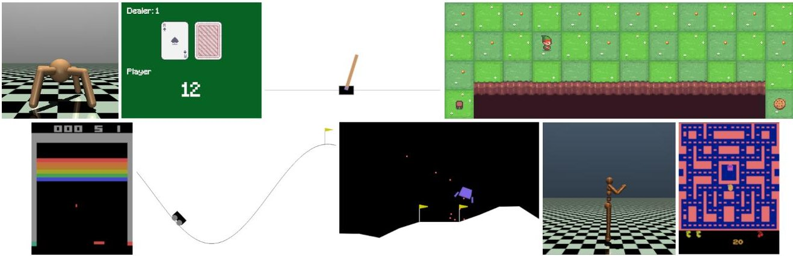

<!-- PDF_PAGE: 1 -->

<div align="center">

# Gymnasium: A Standard Interface for Reinforcement Learning Environments

</div>

Mark Towers $ ^{\dagger} $ University of Southampton & Farama Foundation mt5g17@soton.ac.uk

Ariel Kwiatkowski $ ^{\dagger} $

Farama Foundation

akwiatkowski@farama.org

Jordan Terry $ ^{\dagger} $

Farama Foundation

jkterry@farama.org

John U. Balis $ ^{*} $ Independent Researcher

Gianluca De Cola * Farama Foundation

Tristan Deleu $ ^{*} $ Mila, Université de Montréal

Manuel Goulão $ ^{*} $ NeuralShift

Andreas Kallinteris $ ^{*} $ Electrical and Computer Engineering Technical University of Crete Chania, Greece

Markus Krimmel $ ^{*} $ Farama Foundation

Arjun KG * Rodrigo Perez-Vicente * Andrea Pierré * Sander Schulhoff * EarthBrain Farama Foundation Brown University University of Maryland

Jun Jet Tai $ ^{*} $ Coventry University Hannah Tan $ ^{*} $ Independent Researcher Omar G. Younis $ ^{*} $ University of Bologna

## Abstract

Gymnasium is an open-source library providing an API for reinforcement learning environments. Its main contribution is a central abstraction for wide interoperability between benchmark environments and training algorithms. Gymnasium comes with various built-in environments and utilities to simplify researchers' work along with being supported by most training libraries. This paper outlines the main design decisions for Gymnasium, its key features, and the differences to alternative APIs.

## 1 Introduction

With the publication of a Deep Q-Networks (DQN) [Mnih et al., 2013], Reinforcement Learning (RL) was awoken from its Artificial Intelligence (AI) winter, showing that a general neural network-based algorithm can achieve expert-level performance across a range of complex tasks. In later years, deep neural network-based RL led to agents defeating professionals in Go Silver et al. [2017], DoTA 2 Berner et al. [2019], Starcraft 2 [Vinyals et al., 2019] along with many more. As a result, public interest in RL research has grown significantly recently, both within academia and industry. At the same time, OpenAI Gym [Brockman et al., 2016] emerged as the first widely adopted common API. Gymnasium is a maintained fork of Gym, bringing many improvements and API updates to enable its continued usage for open-source RL research.

<!-- PDF_PAGE: 2 -->

In Listing 1, we provide a simple program demonstrating a typical way that a researcher can use a Gymnasium environment. Full API documentation, release notes and in-depth tutorials are available at https://gymnasium.farama.org.

```python

import gymnasium as gym

env = gym.make("LunarLander-v3", render_mode="human")

observation, info = env.reset(seed=42)

for _ in range(1000):

    action = env.action_space.sample()  # insert your policy here

    observation, reward, terminated, truncated, info = env.step(action)

    if terminated or truncated:

        observation, info = env.reset()

env.close()

```

Listing 1: Example script for taking 1000 random actions within Lunar Lander environment with a human rendering

In the remainder of this paper, we describe the structure and development of Gymnasium. In Sections 2 and 3, we outline the design decisions for the project and the environment API specification, respectively. In Section 4 we list the environments provided in Gymnasium by default, as well as some notable third-party projects compatible with it. Finally, in Section 5, we provide an overview of other tools and approaches for building RL environments.

## 2 Design Decisions

As Gymnasium has evolved with new features, bug fixes, and feedback from the community, we prioritized the following aspects of its design:

Environment Focused API Gymnasium keeps its focus entirely on the environment side of RL research, abstracting away the aspect of agent design and implementation. The only restriction on the agent is that it must produce a valid action as specified by the environment's action space. Furthermore, Gymnasium's environment interface is agnostic to the internal implementation of the environment logic, enabling if desired the use of external programs, game engines, network connections, etc. The only requirement is that the environment subclass's gym. Env and two core functions (Env.reset and Env.step) are implemented. Therefore, Gymnasium provides numerous tools for interacting with environments and their implementation.

Reproducibility In academia, it is crucial that any experimental results are reliably reproducible. Gymnasium has several features with this goal in mind:

- Environment versioning - Creating an environment requires the specification of the version created, e.g., gym.make("CarRacing-v2"). This versioning enables fair comparisons between agents for the same environment and easy referencing for academic papers. Importantly, version numbers allow bug fixes and incremental feature changes over time. $ ^{*} $ For example, the robotics environments were updated from v2 to v3 with feature changes, then v4 to use an improved physics engine, and finally to v5 that makes them more consistent with new features and bug fixes.

- Recreating environments - Gymnasium makes it possible to save the specification of a concrete environment instantiation, and subsequently recreate an environment with the same specification.

<!-- PDF_PAGE: 3 -->

- Episodic seeding - Randomness is a common feature of RL environments, particularly when generating the initial conditions. Gymnasium automatically handles seeding the random number generator and maintaining its state behind the scenes. The user can simply specify the seed through env.reset(seed=seed) to manage the seed across episodes and separate initializations.

Easy customization via Wrappers It is often useful to modify an environment's external interface whether it is its inputs (actions) or outputs (observations, rewards, termination). To this end, Gymnasium provides a suite of wrappers that can be easily applied to an existing environment, along with an interface that allows users to implement their own wrappers. This significantly simplifies many pre- and post-processing steps useful in research.

Environment vectorization Vectorization is common practice in RL research, where multiple copies of the same environments are run concurrently, making it possible to batch the policy inference and improve effective sampling performance. In Gymnasium, we support an explicit gym. VectorEnv base class which includes some environment-agnostic vectorization implementations, but also makes it possible for users to implement arbitrary vectorization schemes, preserving compatibility with the rest of the Gymnasium ecosystem. Vectorized environments also have their own versions of wrappers allowing for a similar level of consistent customization as regular environments.

## 3 Environment Specification

In this section, we describe the structure of a valid Gymnasium environment. A more detailed API specification is available on the Env documentation page.

## 3.1 Observation & Action Spaces

In Gymnasium, every environment has an associated observation and action space defining the sets of valid observations and actions, respectively. This data is the interaction point between the environment and the agent so the space helps specify what information is available to the agent and what it can do. Gymnasium's built-in spaces can be split into two main categories: fundamental (Box, Discrete, MultiDiscrete, MultiBinary, Text) and composite (Tuple, Dict, Sequence, Graph, OneOf) that are made up of one or more subspaces. These spaces allows for continuous or discrete actions or observations that can be arbitrarily nested to combine data. Finally, Gymnasium provides functions to flatten and batch spaces to simplify their usage along with concatenate and iterate functions of samples.

## 3.2 Starting an episode

Before an agent can start taking actions in an environment, an initial observation must be generated through env.reset(seed, options). This function has two arguments: seed for reseeding the environment's random number generator (see Section 2), and options that enable customizing the initial conditions of the environment. The function returns the initial observation (an element of the observation space), as well as a dictionary with arbitrary keys that holds useful metadata about the initialization.

## 3.3 Stepping through an episode

The main mode of interacting with an environment is through the env. step(action) function. As input, it takes an action belonging to the environment's action space used to update the environment's internal state. As output, it returns the resultant observation, the reward obtained in this transition, two flags indicating whether the environment reached a terminal state or if the episode has truncated due to exceeding the time limit, and a dictionary holding additional metadata about the step.

## 3.4 Rendering an environment

It is often useful to visualize the environment to gain deeper insights into an agent's behaviour. In Gymnasium, the render mode must be defined during initialization:

<!-- PDF_PAGE: 4 -->

gym.make(env_id, render_mode="..."). Then, whenever env.render() is called, the visualization will be updated, either returning the rendered result without displaying anything on the screen for faster updates or displaying it on screen with the "human" rendering mode.

## 3.5 Metadata, environment spec

In addition to observation and action spaces, environments are described by env.metadata and env.spec. The former specifies various static details about the environment: supported rendering modes, recommended rendering framerate, and potentially other environment-specific information. The latter contains a complete specification of the environment initialization, making it possible to easily create an identically initialized copy of the environment via gym.make(env.spec).

## 4 Built-in Environments

For ease of use by researchers, Gymnasium includes a suite of implemented, extensively tested, and researched environments such as CartPole, Lunar Lander, and MuJoCo-based environments. In this section, we describe the provided environments, each of which has a dedicated web page detailing its structure, as well as some popular third-party environments compatible with Gymnasium.





<div align="center">

Figure 1: Example renderings from Environments within Gymnasium.

</div>

- Classic control and Toy text - Common tasks/problems from the literature that test the basic limits of an agent including CartPole, Mountain Car and Blackjack. These environments are helpful for easily testing the implementation of an algorithm before scaling to more complex domains.

- Box2d - A suite of 2D control problems using the Box2D game engine including Lunar Lander, Car Racing and Bipedal Walker. These are a mixture of image-based observation, continuous actions and generally more complex environments than classic control.

- 2D and 3D Robotics - Robotic control tasks using MuJoCo [Todorov et al., 2012], a physicsbased simulator including Half-cheetah, Humanoid, Ant and more. These provide a relative challenge for robotics using continuous observations and actions. For a project with more diverse robotics tasks, see Gymnasium Robotics [de Lazcano et al., 2023].

- Third party - Arcade Learning Environments [Bellemare et al., 2013] for playing Atari 2600 ROMs, Safety Gymnasium [Ji et al., 2023] for testing safe RL algorithms in robotics environments, HighwayEnv [Leurent, 2018] for simulating various driving situations and PyFlyt [Tai et al., 2023] for drone flying simulation. For a more complete list, see the third party environment page.

## 5 Related Work

While Gym gained significant popularity following its release, there are other competing environment APIs, though significantly less common. Notably, DmEnv [Muldal et al., 2019] provides a similar interface as Gymnasium, and is often used in projects by Google DeepMind. PettingZoo [Terry et al.,

<!-- PDF_PAGE: 5 -->

2021] provides an API for multiagent environments, and MO-Gymnasium [Felten et al., 2023] for multi-objective environments. Both of these libraries are fully compatible with Gymnasium.

As the complexity and capabilities of RL algorithms grow, it is often useful to improve the performance of RL environments. To this end, projects such as EnvPool [Weng et al., 2022] and Sample Factory [Petrenko et al., 2020] implement C++ environments that enable highly performant and parallelized sampling. Other projects, such as Gymnax [Lange, 2022], Jumanji [Bonnet et al., 2023], Brax [Freeman et al., 2021] and PGX [Koyamada et al., 2023] use Jax [Bradbury et al., 2018] to enable high parallelization and hardware acceleration of environment updates.

Finally, various dedicated training libraries exist, many of them being compatible with Gymnasium. This includes CleanRL [Huang et al., 2022] with simple, single-file implementations; Stable Baselines 3 [Raffin et al., 2021] with a wide range of supported workflows; RLLib [Liang et al., 2018] with highly performant and parallelizable algorithms; and many more.

## 6 Conclusion

Gymnasium serves as a robust and versatile platform for RL research, offering a unified API that enables compatibility across a wide range of environments and training algorithms. By focusing on key aspects such as reproducibility, easy customization through wrappers, and environment vectorization, Gymnasium ensures a streamlined and efficient workflow for researchers. The future of Gymnasium will be shaped by its active community, hopefully continuing to serve as a centrepiece of the open-source RL research community for many years to come.

## References

M. G. Bellemare, Y. Naddaf, J. Veness, and M. Bowling. The arcade learning environment: An evaluation platform for general agents. Journal of Artificial Intelligence Research, 47:253-279, jun 2013.

C. Berner, G. Brockman, B. Chan, V. Cheung, P. Debiak, C. Dennison, D. Farhi, Q. Fischer, S. Hashme, C. Hesse, et al. Dota 2 with large scale deep reinforcement learning. arXiv preprint arXiv:1912.06680, 2019.

C. Bonnet, D. Luo, D. Byrne, S. Surana, V. Coyette, P. Duckworth, L. I. Midgley, T. Kalloniatis, S. Abramowitz, C. N. Waters, A. P. Smit, N. Grinsztajn, U. A. M. Sob, O. Mahjoub, E. Tegegn, M. A. Mimouni, R. Boige, R. de Kock, D. Furelos-Blanco, V. Le, A. Pretorius, and A. Laterre. Jumanji: a diverse suite of scalable reinforcement learning environments in jax, 2023. URL https://arxiv.org/abs/2306.09884.

J. Bradbury, R. Frostig, P. Hawkins, M. J. Johnson, C. Leary, D. Maclaurin, G. Necula, A. Paszke, J. VanderPlas, S. Wanderman-Milne, and Q. Zhang. JAX: composable transformations of Python+NumPy programs, 2018. URL http://github.com/google/jax.

G. Brockman, V. Cheung, L. Pettersson, J. Schneider, J. Schulman, J. Tang, and W. Zaremba. Openai gym. arXiv preprint arXiv:1606.01540, 2016.

R. de Lazcano, K. Andreas, J. J. Tai, S. R. Lee, and J. Terry. Gymnasium robotics, 2023. URL http://github.com/Farama-Foundation/Gymnasium-Robotics.

F. Felten, L. N. Alegre, A. Nowé, A. L. C. Bazzan, E. G. Talbi, G. Danoy, and B. C. da. Silva. A toolkit for reliable benchmarking and research in multi-objective reinforcement learning. In Proceedings of the 37th Conference on Neural Information Processing Systems (NeurIPS 2023), 2023.

C. D. Freeman, E. Frey, A. Raichuk, S. Girgin, I. Mordatch, and O. Bachem. Brax - a differentiable physics engine for large scale rigid body simulation, 2021. URL http://github.com/google/ brax.

S. Huang, R. F. J. Dossa, C. Ye, J. Braga, D. Chakraborty, K. Mehta, and J. G. Araújo. Cleanrl: High-quality single-file implementations of deep reinforcement learning algorithms. Journal of Machine Learning Research, 23(274):1-18, 2022. URL http://jmlr.org/papers/v23/ 21-1342.html.

<!-- PDF_PAGE: 6 -->

J. Ji, B. Zhang, J. Zhou, X. Pan, W. Huang, R. Sun, Y. Geng, Y. Zhong, J. Dai, and Y. Yang. Safety gymnasium: A unified safe reinforcement learning benchmark. In Thirty-seventh Conference on Neural Information Processing Systems Datasets and Benchmarks Track, 2023. URL https://openreview.net/forum?id=WZmlxIuIGR.

S. Koyamada, S. Okano, S. Nishimori, Y. Murata, K. Habara, H. Kita, and S. Ishii. Pgx: Hardware accelerated parallel game simulators for reinforcement learning. In Advances in Neural Information Processing Systems, 2023.

R. T. Lange. gymnax: A JAX-based reinforcement learning environment library, 2022. URL http://github.com/RobertTLange/gymnax.

E. Leurent. An environment for autonomous driving decision-making. https://github.com/ eleurent/highway-env, 2018.

E. Liang, R. Liaw, R. Nishihara, P. Moritz, R. Fox, K. Goldberg, J. Gonzalez, M. Jordan, and I. Stoica Rllib: Abstractions for distributed reinforcement learning. In International conference on machine learning, pages 3053-3062. PMLR, 2018.

V. Mnih, K. Kavukcuoglu, D. Silver, A. Graves, I. Antonoglou, D. Wierstra, and M. Riedmiller. Playing atari with deep reinforcement learning. arXiv preprint arXiv:1312.5602, 2013.

A. Muldal, Y. Doron, J. Aslanides, T. Harley, T. Ward, and S. Liu. dm_env: A python interface for reinforcement learning environments, 2019. URL http://github.com/deepmind/dm_env.

A. Petrenko, Z. Huang, T. Kumar, G. S. Sukhatme, and V. Koltun. Sample factory: Egocentric 3d control from pixels at 100000 FPS with asynchronous reinforcement learning. In Proceedings of the 37th International Conference on Machine Learning, ICML 2020, 13-18 July 2020, Virtual Event, volume 119 of Proceedings of Machine Learning Research, pages 7652-7662. PMLR, 2020. URL http://proceedings.mlr.press/v119/petrenko20a.html.

A. Raffin, A. Hill, A. Gleave, A. Kanervisto, M. Ernestus, and N. Dormann. Stable-baselines3: Reliable reinforcement learning implementations. Journal of Machine Learning Research, 22 (268):1-8, 2021. URL http://jmlr.org/papers/v22/20-1364.html.

D. Silver, J. Schrittwieser, K. Simonyan, I. Antonoglou, A. Huang, A. Guez, T. Hubert, L. Baker, M. Lai, A. Bolton, et al. Mastering the game of go without human knowledge. nature, 550(7676): 354-359, 2017.

J. J. Tai, J. Wong, M. Innocente, N. Horri, J. Brusey, and S. K. Phang. Pyflyt-uav simulation environments for reinforcement learning research. arXiv preprint arXiv:2304.01305, 2023.

J. Terry, B. Black, N. Grammel, M. Jayakumar, A. Hari, R. Sullivan, L. S. Santos, C. Dieffendahl, C. Horsch, R. Perez-Vicente, et al. Pettingzoo: Gym for multi-agent reinforcement learning. Advances in Neural Information Processing Systems, 34:15032-15043, 2021.

E. Todorov, T. Erez, and Y. Tassa. Mujoco: A physics engine for model-based control. In 2012 IEEE/RSJ International Conference on Intelligent Robots and Systems, pages 5026-5033. IEEE, 2012. doi: 10.1109/IROS.2012.6386109.

O. Vinyals, I. Babuschkin, W. M. Czarnecki, M. Mathieu, A. Dudzik, J. Chung, D. H. Choi, R. Powell, T. Ewalds, P. Georgiev, et al. Grandmaster level in starcraft ii using multi-agent reinforcement learning. Nature, 575(7782):350-354, 2019.

J. Weng, M. Lin, S. Huang, B. Liu, D. Makoviichuk, V. Makoviychuk, Z. Liu, Y. Song, T. Luo, Y. Jiang, Z. Xu, and S. Yan. EnvPool: A highly parallel reinforcement learning environment execution engine. In S. Koyejo, S. Mohamed, A. Agarwal, D. Belgrave, K. Cho, and A. Oh, editors, Advances in Neural Information Processing Systems, volume 35, pages 22409-22421. Curran Associates, Inc., 2022. URL https://proceedings.neurips.cc/paper_files/paper/2022/file/8caaf08e49ddbad6694fae067442ee21-Paper-Datasets_and_Benchmarks.pdf.