<!-- PDF_PAGE: 1 -->

# Hardware and Software Design of Onboard Computer of ISRASAT1 CubeSat

Duaa A. M. Osman $ ^{1} $ , Sondos W. A. Mohamed $ ^{2} $

Applied Programming Department, Institute of Space Research and Aerospace (ISRA)

Khartoum, Sudan

$ ^{1} $duaa.abdo@isra.sd

$ ^{2} \underline{\mathrm{sondos}@\mathrm{isra.sd}} $

Abstract—The On-Board computer (OBC) in CubeSat is the subsystem which acts as a bridge that connects the other subsystems with each other. It supervises many of the tasks that are done by the different subsystems of satellite and performs housekeeping and monitoring to ensure the health and status of those subsystems. The hardware and software design of the OBC mainly depends on the mission of the CubeSat. ISRASAT1 is a research project at the Institute of Space Research and Aerospace (ISRA) in order to develop a CubeSat that sends image, beacon and telemetry data to the ground station.

## Keywords—OBC; Cubesat; housekeeping

## I. INTRODUCTION

CubeSat is a nano-satellite which has a light weight (the mass of one unit cubeSat should not exceeded 1.33 kg and the volume is $ 1 0 \times1 0 \times1 0 $ cm)[1]. Cubesat widely developed at research centers and universities for the purposes of education and research. Cubesats have the advantages over big satellites in minimum cost and short development time. However the limitations of mass and size requires design simplicity and low power consumption [2].

The Institute of the Space Research and Aerospace (ISRA) is a research institute which is affiliated with the National Center for Research under the Ministry of Higher Education and Scientific Research, Sudan. ISRA has established a research project that aims to develop a prototype of 1U cubeSat to send image, beacon and telemetry data to the ground station. ISRASAT1 composes of five subsystems, which are the Onboard Computer (OBC), Electrical Power System (EPS), Communication System, Mission or Payload System and Attitude Determination and Control System (ADCS). ISRASAT1 main mission is to examine its location and take a VGA resolution image for Khartoum area. Otherwise ISRASAT1 will collect the ADCS and housekeeping data and store it in shared memory to be transmitted to the ground station. The OBC subsystem in ISRASAT1 synchronizes the communication between other subsystems and coordinates the mission and bus systems activities.

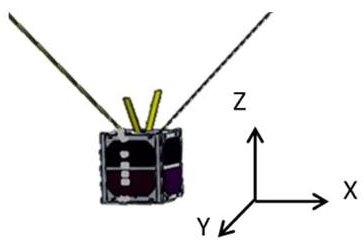

Fig.1. ISRASAT1 Preliminary CAD Model [3]

## II. OBC OPERATION MODES

OBC operates according to two operation modes: Normal Mode and Interrupt Mode.

## A. Normal Mode

- OBC switches off the payload subsystem.

- OBC allows the ADCS to write data into shared memory between it and the OBC.

- OBC reads and saves the temperature and time data into memory every minute.

- OBC repeats the pervious steps until ISRASAT1 reaches Khartoum.

## B. Interrupt Mode

- OBC turns on/off the payload subsystem.

- OBC allows the payload to write data into shared memory between it and the OBC.

- OBC reads the temperature and time from OBC memory and send them to the transceiver.

- OBC reads the ADCS data from memory allocated between the OBC and ADCS and send the data to the transceiver.

- OBC reads image data from CAM memory and transmit it through the transceiver.

OBC operates in the interrupt mode when ISARASAT1 is at Khartoum state; otherwise, it operates in the normal mode. It receives two types of interrupts from the ADCS subsystem. The first indicates that ISRASAT1 reached Khartoum state, and the other indicates the cubsat left Khartoum state [4].

<!-- PDF_PAGE: 2 -->

## III. HARDWARE AND SOFTWARE SELECTION PHASE

## A. Selection Criteria

According to the role of the OBC and the design constrains specified by the cubeSat standards and ISRASAT1 requirements, the OBC must:

- Be in one board of 10x10x10cm.

- Be designed to operate with low power consumption.

- Be designed to operate in wide temperature range.

- Use flexible software design.

- Have high reliability.

- Have commercial off-the-shelf (COTS) components [5].

Table.1 illustrates the OBC hardware components.

TABLE I. OBC HARDWARE COMPONENTS [4]

<table border="1"><tr><td>Component</td><td>Function</td><td>Specification</td></tr><tr><td>Atmega32</td><td>Works as the brain of OBC. It synchronizes the shared memories between OBC and other subsystems and sends the OBC&#x27;s data and other subsystems&#x27;s data to transceiver.</td><td>Operating voltage: 4.5-5.5V
Operating Temp.:-55℃-+125℃
Flash: 32KB
SRAM: 2KB
EEPROM: 512Bytes
Support: I2C, TWI, SPI, UART, 1WIRE</td></tr><tr><td>LM35</td><td>Measures the internal temperature of OBC.</td><td>Operating voltage: 4-5.5V
Operating Temp.:-40℃-+110℃</td></tr><tr><td>DS1307</td><td>Provides the real time.</td><td>Operating voltage: 4.5-5.5V
Operating Temp.:40℃-+85℃</td></tr><tr><td>AT24C64</td><td>Saves temperature sensor data and RTC dat</td><td>Operating voltage:2.7-5.5V
Operating Temp.:-55℃-+125℃</td></tr></table>

Table.2 indicates the software that selected to be used in the design of OBC subsystem.

TABLE II. SOFTWARE THAT USED IN THE DESIGN OF OBC SUBSYSTEM [4]

<table border="1"><tr><td>Software</td><td>Version</td><td>Function</td></tr><tr><td>codevision</td><td>3.12</td><td>Integrated development environment(IDE) to write the OBC code.</td></tr><tr><td>proteus</td><td>7.10</td><td>Simulates the OBC circuit.</td></tr></table>

## IV. OBC DESIGN PHASE

## A. OBC Block Diagram

Fig. 2 illustrates the OBC Block diagram which indicates the internal and the external interfaces between OBC components and between the OBC and other subsystems.

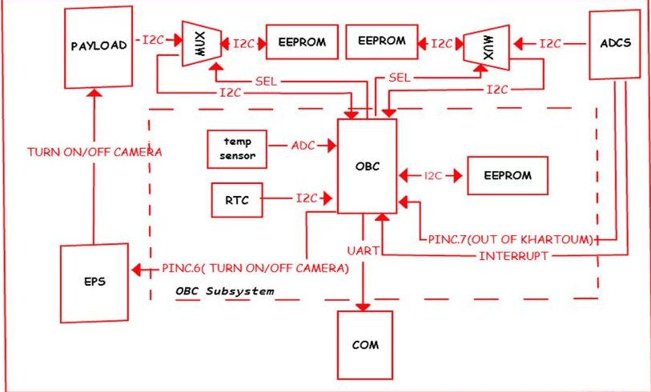

Fig. 2. OBC Block Diagram [4]

## B. Software algorithm

Fig. 3 shows the OBC flowchart which explains the OBC algorithm.

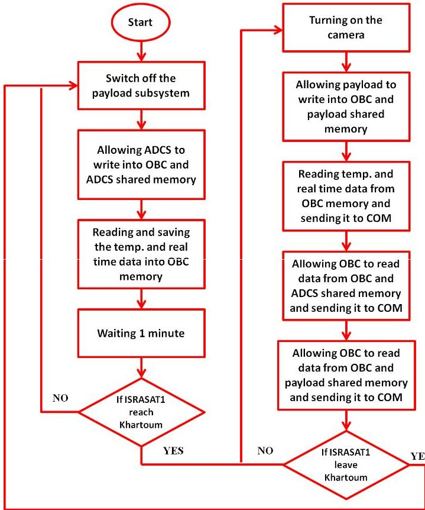

Fig. 3. Software Algorithm Flow Chart [4]

## C. OBC Circuit Diagram

Fig. 4 shows the schematic and simulation of the OBC and the data lines of ISRASAT1. The operation and algorithm of OBC software was tested using Proteus software.

<!-- PDF_PAGE: 3 -->

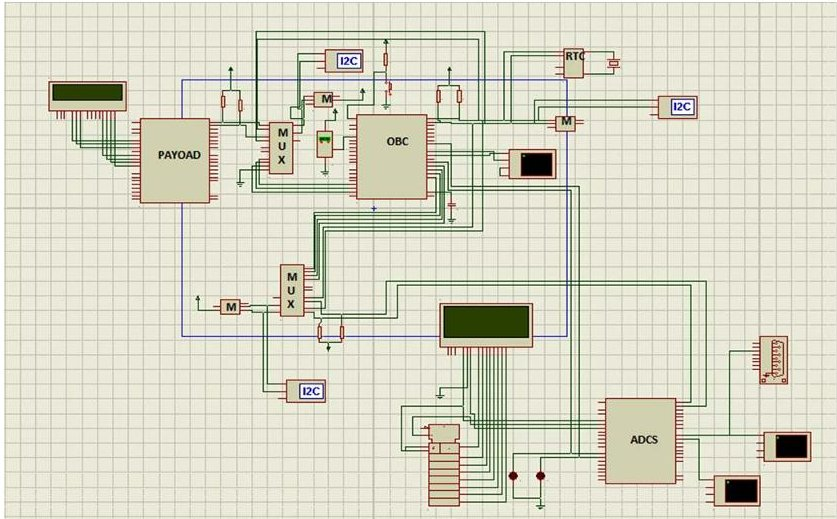

Fig. 4. OBC Circuit Diagram [4]

Proteus software was used to verify if the functionality of OBC meets the requirement of the system which it is a part of ISRASAT1. GPS emulator software was used to provide certain longitudes and latitudes. To test the normal mode, any longitude and latitude were entered. And to test the interrupt mode, the longitude and latitude of Khartoum were entered. The virtual terminal in proteus was used to show a message that indicates which operation mode OBC was run. Fig. 5 and fig. 6 indicate the operation modes of OBC were achieved.

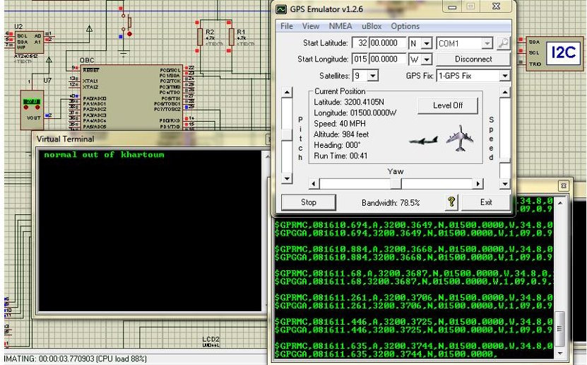

Fig. 5. Normal mode in proteus

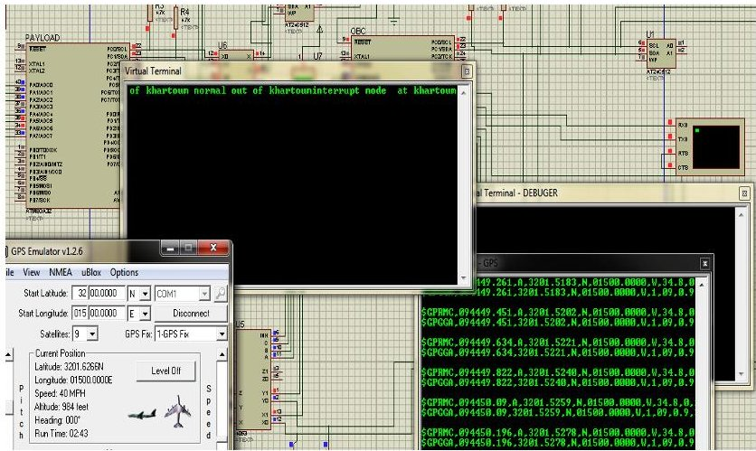

Fig. 6. Interrupt mode in proteus

Fig. 7 illustrates the transmission of data to the communication subsystem in the virtual terminal.

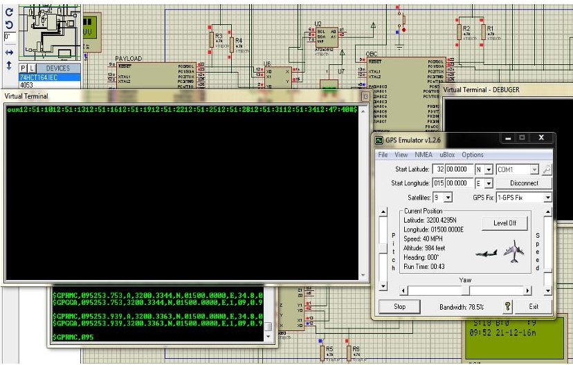

Fig. 7. Data transmission in interrupt mode in proteus

## D. OBC Printed Circuit Board

According to the structure design of ISRASAT1, the size of the PCB was selected as 9.4 cm $ \times $ 9.1 cm and the height of the OBC layer as 12mm. The mass of OBC is 31.9g approximately [3] [4]. Fig. 8 illustrates the PCB of OBC.

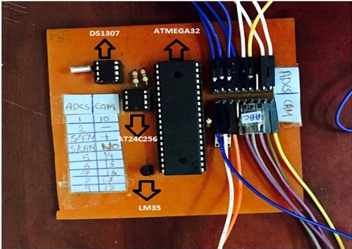

Fig. 8. PCB of OBC in ISRASAT1 Prototype [4]

## V. OBC TESTING PHASE IN ISRASAT1 PROTOTYPE

Fig. 9 shows the table test of ISRASAT1. In this test, the OBC team tested all OBC functions and verified successful integration between the OBC and other subsystems.

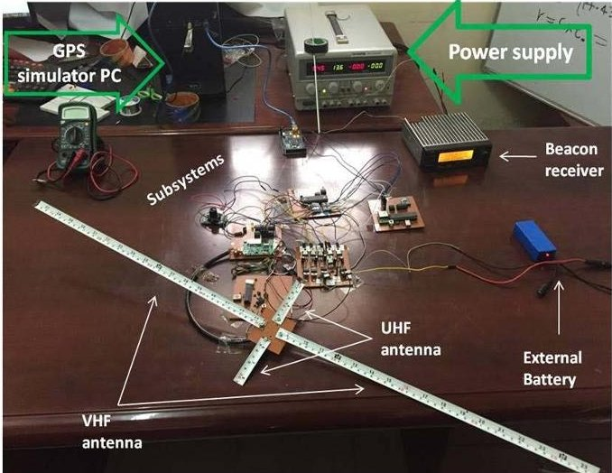

Fig. 9. Table Test Between OBC and Other Subsystems [3]

<!-- PDF_PAGE: 4 -->

Fig. 10 presents the test of the OBC operation modes; it shows OBC working in the normal mode, when ISRASAT1 is out of Khartoum, and when ISRASAT1 is assumed above Khartoum working in the interrupt mode.

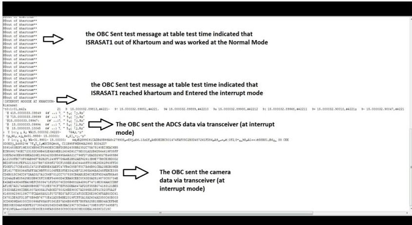

Fig. 10. OBC Operations Modes [3]

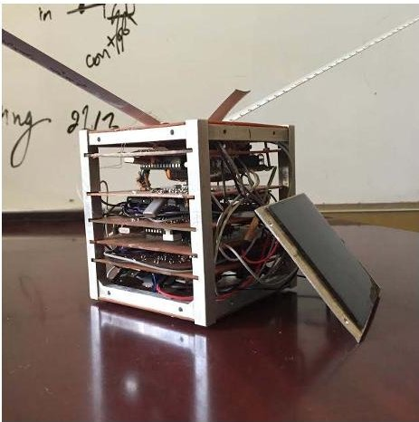

Fig. 11. OBC inserted inside ISRASAT1 Prototype [3]

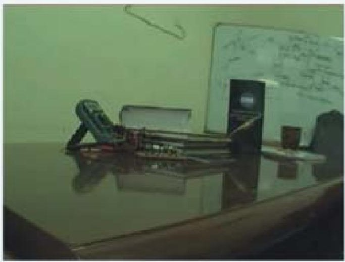

Fig. 12. Image Captured by ISRASAT1 Prototype [3]

## VI. CONCLUSION

OBC subsystem has successfully managed the communication between ISRASAT1 subsystems by synchronizing the memories and the data lines allocations. It has successfully changed its operation modes according to locations data which was sent by the ADCS. It has successfully read and sent its data, the ADCS data and the payload data to communication subsystem.

## VII. FUTURE WORK

- Developing OBC backup to increase reliability.

- Upgrading the OBC to be able to operate in uplink side.

- Improving OBC to be able to implement additional functionality such as housekeeping algorithms in all subsystems to increase the reliability.

## ACKNOWLEDGEMENT

Authors acknowledge the efforts done by Eng. Mayada Elsir (pervious project manager), Sahar kamil, Isra Eltayeb and also the project manager Eng. Hala Mohammed Osman Elmubark for guiding toward achieving the mission. Dr. Moutman Mirghani the Director of Institute of Space Research and Aerospace ISRA, and Dr. Sarah Saad (National Centre for Research NCR) for supporting.

## REFERENCES

[1] "CubeSats - ISIS - innovative solutions in space," ISIS - Innovative Solutions in Space,2015.[Online]. Available: https://www.isispace.nl/cubesats/. Accessed: Nov. 15, 2016.

[2] L. T. Lumbwe, "Development of an onboard computer (OBC) for a CubeSat", M.S. thesis, Dept.Engineering, at the Cape Peninsula University of Technology Univ., cape town, south africa, May 2013.

[3] H. Almubarak, "ISRASAT1 Prototype Report," Institute of Space Research and Aerospace, khartoum, Aug. 01, 2016.

[4] S. Mohamed and D. Osman, "ISRASAT1 OBC Subsystem Report," Institute of Space Research and Aerospace, khartoum, Jul. 12, 2016.

[5] D. Osman, I. Eltayeb, M. Elsir, S. kamil, and S. Wasfi, "Selection of Microcontroller for Onboard Computer(OBC) in ISRASAT1 Satellite," the 10th Scientific Conference of the National Center for Research, khartoum, Dec. 3, 2015.