<!-- PDF_PAGE: 1 -->

Research Article

# High-Resolution Image and Video CubeSat (HiREV): Development of Space Technology Test Platform Using a Low-Cost CubeSat Platform

Dong-Hyun Cho ID, Won-Sub Choi, Min-Ki Kim, Jin-Hyung Kim, Eunsup Sim, and Hae-Dong Kim ID

KARI, Republic of Korea

Correspondence should be addressed to Hae-Dong Kim; haedkim@kari.re.kr

Received 14 February 2018; Accepted 28 March 2019; Published 23 May 2019

Academic Editor: Jeremy Straub

Copyright © 2019 Dong-Hyun Cho et al. This is an open access article distributed under the Creative Commons Attribution License, which permits unrestricted use, distribution, and reproduction in any medium, provided the original work is properly cited.

In this paper, we present high-resolution image and video CubeSat (HiREV), the first constructed 6 U platform to reach the space technology test bed stage, developed by the Korea Aerospace Research Institute (KARI). The CubeSat system is a low-cost platform that has been widely applied to various space missions, from missions involving earth observation to deep space. Despite the emergence of the CubeSat technology worldwide, the CubeSat market in Korea is still in the beginning stages, and a standard testing platform is also in demand. For this reason, KARI is starting to develop a 6 U CubeSat platform, which includes a less than 3 U bus system and greater than 3 U payload space. HiREV has been developed with locally manufactured parts, creating a domestic commercial off-the-shelf infrastructure for CubeSat and 3 m resolution camera payload development. Core flight software has also been applied as an on-board flight software system. Presently, we have developed the main system, while HiREV is under space environmental testing.

## 1. Introduction

Generally, a satellite is categorized by its mass, in which a satellite over 1,000kg is considered a large satellite, 500 1000kg is a medium satellite, 100-500kg is a mini-satellite, and 1-100kg is a micro- or nanosatellite [1]. Particularly for micro- and nanosatellites, research and commercialization are rapidly growing owing to the low cost and miniaturization of the exceptionally developed MEMS technology. The CubeSat is a very important component of the market for these types of miniaturized satellites. CubeSat development projects initiated by Cal Poly University and Stanford University in 1999 have been recently vitalized [2]. These CubeSats were developed for a standard size (10 cubic centimeters for 1 U (unit) with a mass up to approximately 1.5 kg) [2]. Furthermore, the low launch development cost and the accelerated development schedule encourage the participation of many students, industries, and governments.

In the early days of the CubeSat development, it served as an educational tool to provide university students with experience in satellite development. For this reason, the size of the CubeSat during this period was usually less than 3 U. However, the market has recently expanded to include the production and launch of CubeSats, as various missions involving CubeSats have emerged, along with a number of related companies to support these missions. The number of CubeSats launched since 2000 is about 1116 as of January 2019, and the number of launches has risen sharply since 2013 [3]. This is because the development period has shortened owing to the standardization of the CubeSat and the use of a commercial subsystem. Furthermore, the launch opportunity has increased because of the growth of the private launch market, propelled by companies such as SpaceX. This trend is expected to continue, as shown in Figure 1. In particular, the number of CubeSats that have been launched for commercial purposes accounts for 50.9% as shown in

<!-- PDF_PAGE: 2 -->

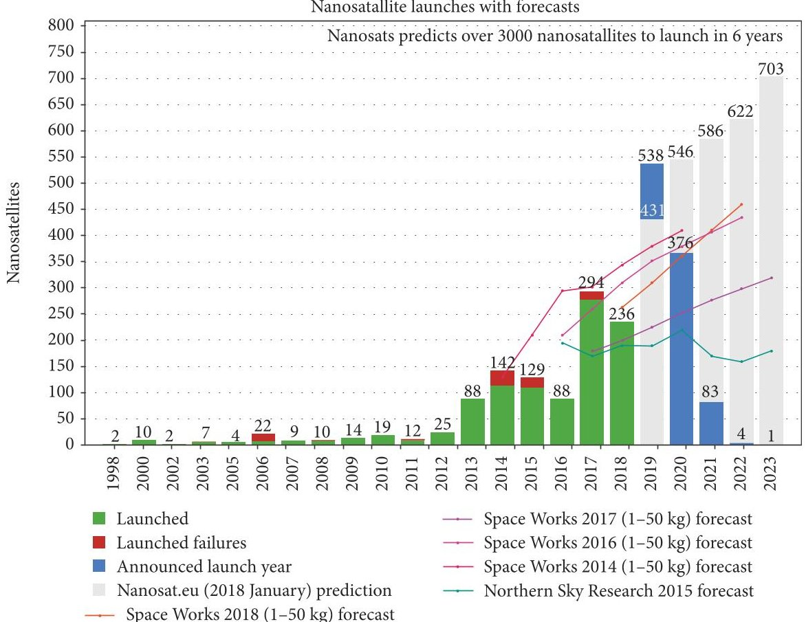

FIGURE 1: Number of announced nanosatellite launches [3].

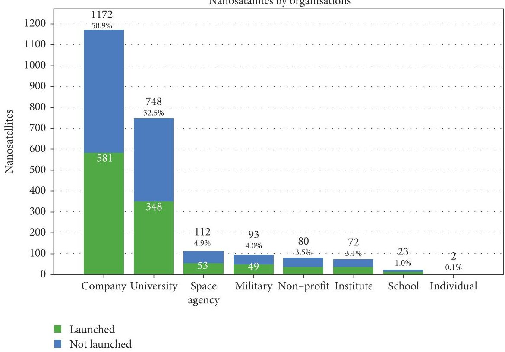

FIGURE 2: Nanosatellites by organization type [3].

Figure 2 [3]. As a representative example, Planet, which is a U.S. start-up company, currently has more than 100 3 U CubeSats in operation to provide earth observation images in near real time.

However, CubeSats are generally limited in space, electrical power, and cost. Meanwhile, developmental systems suitable for CubeSats have not been established. For this reason,

errors remain at the time of launching and operation of these satellites, causing low reliability. This characteristic can be expressed by the mission success rate, shown in Figure 3, with a launch success rate of 16.1% and an operational success rate of 22.9%. In addition, CubeSat technologies are not yet mature; thus, the technology will improve as the rate of missed launches and satellite loss decreases.

<!-- PDF_PAGE: 3 -->

CubeSat mission status, 2000-present, no constellations

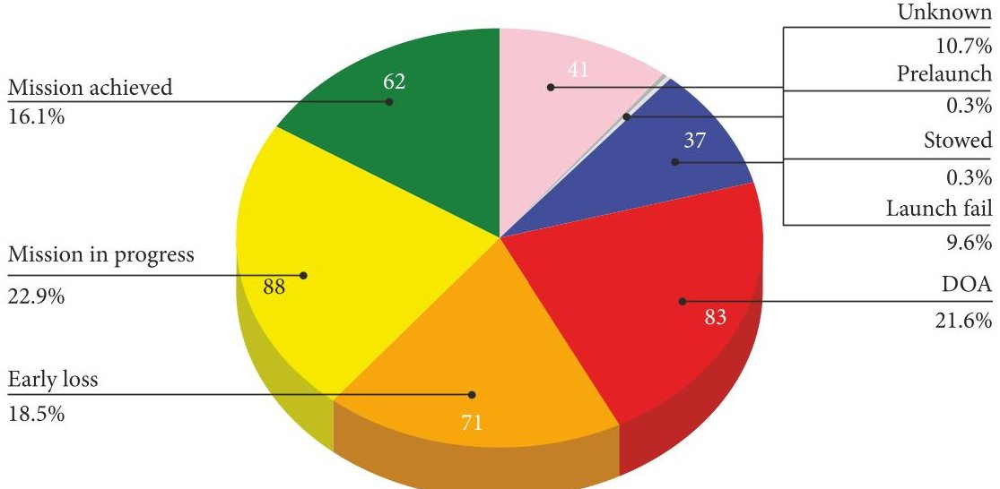

FIGURE 3: CubeSat mission status [4].

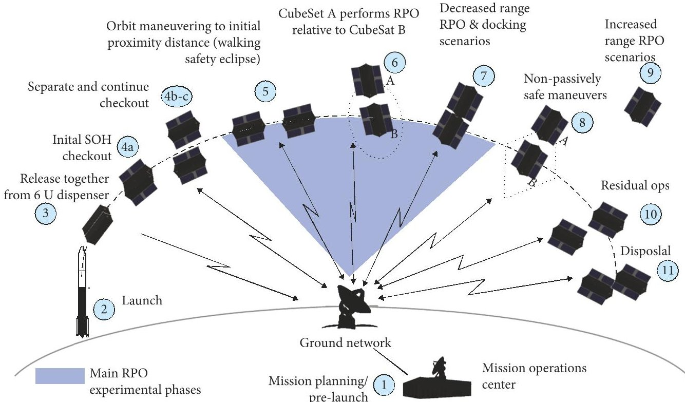

FIGURE 4: CubeSat mission for rendezvous and docking [9].

CubeSats have begun to be used for educational purposes, but recently they have been applied to various missions based on that possibility, and the application field is expanding. A typical application of CubeSats is earth observation. In the past, large-sized satellites were equipped with highresolution optical cameras to acquire earth images. However, in recent years, there have been an increasing number of cases of providing commercial services involving the acquisition of earth images in real time with a large number of CubeSats. Research has been conducted seeking to overcome the limitation of image resolution of existing CubeSats and obtain high-resolution images [5]. To obtain a highresolution image field, base technologies such as high-speed data communication technology for CubeSats [6] and high-

power solar panel development technology are being developed together [7]. In addition, much progress has been made in the field of multisatellite operation, and formation flying and constellation technologies have also been studied to increase the efficiency of information acquisition using a large number of CubeSats [8]. Using these multisatellite operation techniques, CubeSats have been used as a base platform for rendezvous, docking, and orbital services, as shown in Figure 4 [9,10]. It has also been actively applied to the development of a space debris removal system, as shown in Figure 5 [11].

In this way, the development of space technology using CubeSats has expanded the field from Earth to space and has opened the door to deep space exploration. For example,

<!-- PDF_PAGE: 4 -->

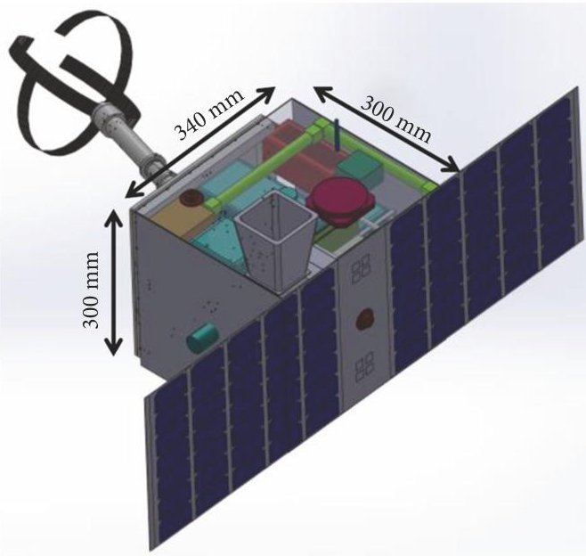

FIGURE 5: CleanSpace One configuration [11].

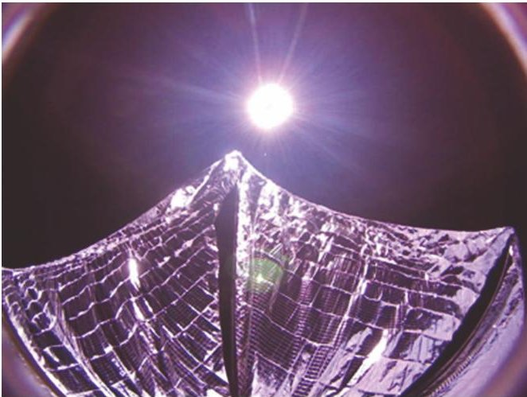

FIGURE 6: Solar sail deployment test of LightSail 1 [12].

LightSail 1, launched in 2015 to develop solar sail technology completed solar sail deployment testing with a 3 U-size CubeSat shown in Figure 6. Furthermore, LightSail 2 will be launched for this mission in 2019 [12, 13]. In addition, NASA Jet Propulsion Laboratory (JPL) recently launched the Mars Cube One (MarCO) spacecraft, a 6 U-class CubeSat for Mars exploration, as the first deep space exploration CubeSat project, illustrated in Figure 7. The satellite is being sent to Mars with the Insight satellite, which was launched in 2018, and will eventually pass Mars, serving as a communication link between Mars and Earth [14].

Compared with these CubeSat development programs, the Korea CubeSat market is at the entry stage. Since the early 2000s, CubeSats have been developed in many universities in Korea. In the early 2000s, HAUAT-1 and HAUAT-2 from the Korea Aerospace University and KHUSAT-01 and KHUSAT-02 (CINEMA 2, 3) from Kyung Hee University were independently developed by the university [15-17]. However, these CubeSats did not undergo normal space operations. Since 2012, nine CubeSats have been produced and launched through the CubeSat contest, supervised by Korea Aerospace Research Institute (KARI) and hosted by

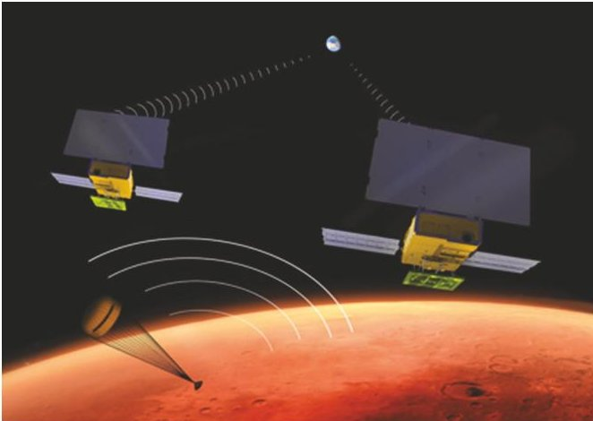

FIGURE 7: MarCO (Mars CubeSat One) mission [14].

the Ministry of Science and ICT. Through this CubeSat program, seven CubeSats were launched at 2017 and 2018.

In Korea, there have been many attempts to develop the CubeSats and educate students using this system. In addition, there are continuing efforts to develop space technologies based on the possibility of using CubeSats. One of these current efforts involves the development of a 6 U CubeSat by KARI to use as a low-cost test bed for the development of key technologies in the preparation of future space exploration missions. For the first CubeSat platform test bed for space technologies, KARI suggested a 6 U CubeSat platform, including a 3 U bus system and 3 U payload system, and high-resolution image & video CubeSat (HiREV) is the first CubeSat developed by KARI with a 3 m resolution commercial off-the-shelf (COTS) camera payload.

Therefore, in this paper, we describe the development status of HiREV. The reminder of this paper is organized as follows. First, the mission of HiREV is described in Section 2, and the subsystem is explained in Section 3. In Section 4, the payload of HiREV based on COTS is introduced, and the space environmental test is introduced in Section 5. Finally, Section 6 concludes the paper.

## 2. Mission for HiREV

2. 1. Mission Overview. As mentioned in the previous section, a standard CubeSat platform is required to develop the key technologies for a space mission and demonstrate it in orbit. For this reason, KARI has also developed HiREV, the first 6 U CubeSat in Korea since 2015, and the main mission of HiREV is to obtain a 5 m color (3 m monochromatic) image and high-definition (HD) movie. Actually, this image resolution is dependent on the orbital altitude. However, generally, the CubeSat is not the main payload of the launcher, and the CubeSat has a similar orbit as the main satellite. There are many CubeSats deployed from the International Space Station (ISS), but they have a relatively short orbital lifetime. In Figure 8, the previous orbit information of the CubeSat is displayed. For this reason, we did not fix the target orbit for our mission. However, we assume that the orbital condition of HiREV is sun-synchronous orbit (SSO) with a very low altitude, such as 500 km.

For this standard platform, a 6 U CubeSat was designed consisting of the main bus systems in 3 U and the payload

<!-- PDF_PAGE: 5 -->

Nanosatallites approximate orbits after launch

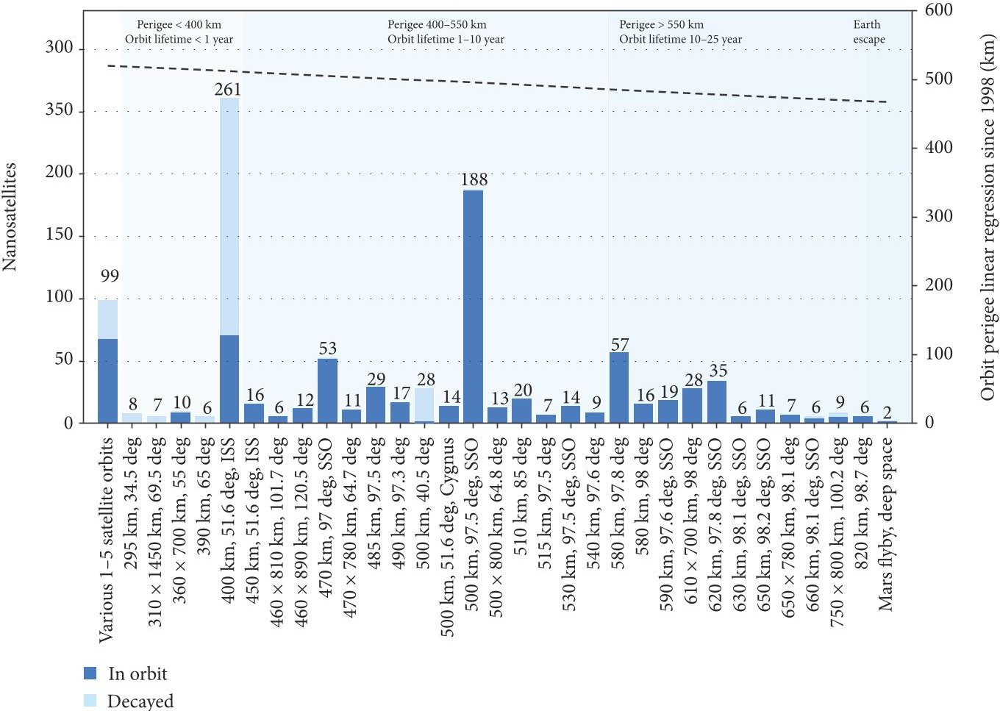

FIGURE 8: CubeSat orbits [3].

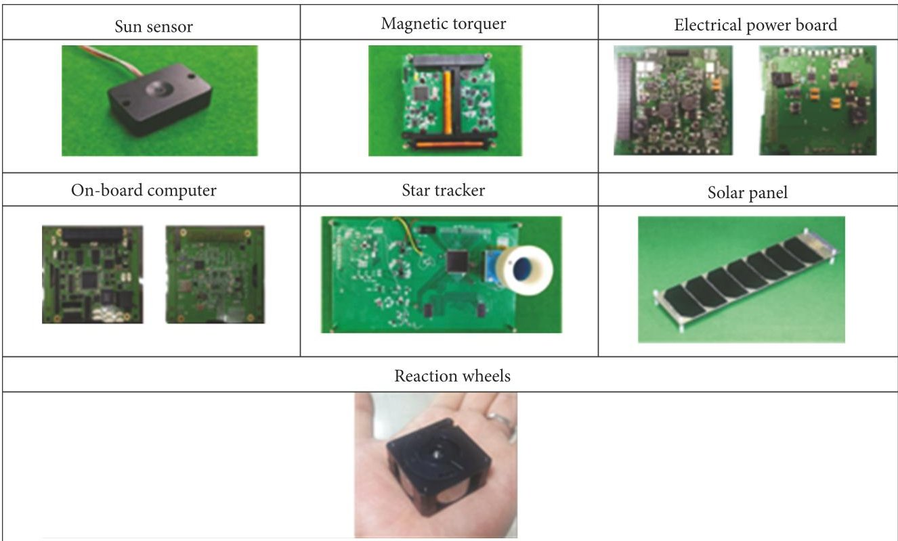

FIGURE 9: Domestic developed part of HiREV.

systems such as camera module in 3 U. To utilize the same bus system to carry out various missions in the future, a maximum of 3 U is allocated for the payload, and the remaining subsystems including the thrust system are arranged in 3 U. Through this standard platform design, we tried to minimize

the design period and cost in the task development, using a 6 U class miniature satellite. For this reason, the on-board computing performance and electrical power system in the design of the HiREV satellite exceeded the requirement for an earth observation mission, which is its main mission.

<!-- PDF_PAGE: 6 -->

<table border="1"><tr><td>Al absorber thickness(mm)</td><td>Total</td><td>Trapped electrons</td><td>Brems-strehlung</td><td>Trapped protons</td><td>Solar protons</td></tr><tr><td>0.05</td><td>3.70E+05</td><td>3.16E+05</td><td>6.06E+02</td><td>1.51E+04</td><td>3.82E+04</td></tr><tr><td>0.1</td><td>1.95E+05</td><td>1.65E+05</td><td>3.65E+02</td><td>7.28E+03</td><td>2.23E+04</td></tr><tr><td>0.5</td><td>2.98E+04</td><td>2.37E+04</td><td>7.71E+01</td><td>7.28E+02</td><td>5.28E+03</td></tr><tr><td>0.6</td><td>2.23E+04</td><td>1.72E+04</td><td>6.16E+01</td><td>5.41E+02</td><td>4.44E+03</td></tr><tr><td>1</td><td>9.19E+03</td><td>6.34E+03</td><td>3.21E+01</td><td>2.31E+02</td><td>2.59E+03</td></tr><tr><td>1.5</td><td>4.40E+03</td><td>2.57E+03</td><td>1.89E+01</td><td>1.33E+02</td><td>1.68E+03</td></tr><tr><td>2</td><td>2.51E+03</td><td>1.20E+03</td><td>1.31E+01</td><td>9.49E+01</td><td>1.20E+03</td></tr><tr><td>3</td><td>1.12E+03</td><td>2.95E+02</td><td>8.07E+00</td><td>6.40E+01</td><td>7.49E+02</td></tr><tr><td>5</td><td>4.71E+02</td><td>3.26E+01</td><td>4.89E+00</td><td>4.20E+01</td><td>3.91E+02</td></tr><tr><td>10</td><td>1.84E+01</td><td>4.45E-01</td><td>2.79E+00</td><td>2.48E+01</td><td>1.56E+02</td></tr></table>

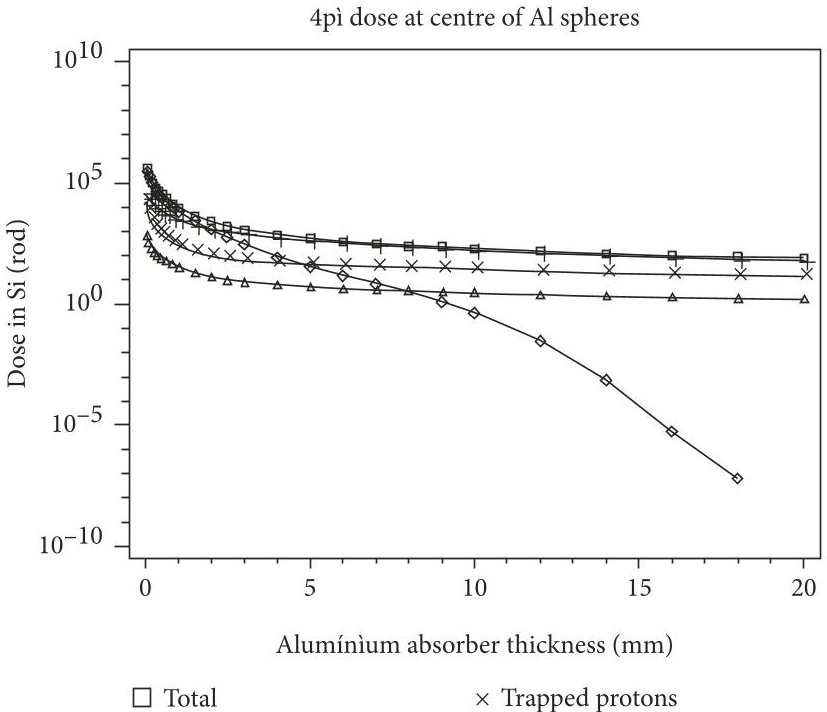

(a)

(b)

FIGURE 10: Total ionizing dose (TID) of the internal subsystem with a range of aluminum shield thicknesses.

For this project, KARI constructed a COTS-based design to validate the applicability of relatively low-cost and high-performance commercial components. Thus, we tried to develop a high-performance on-board computer based on commercial-grade products such as the Xilinx Zynq-7000 with ARM9 core. In addition, the main payload for earth observation is also constructed by commercial-grade products for high performance.

Therefore, the main objectives related to this are as follows.

(i) 6 U class CubeSat standard model design

(ii) Capture 5m high-resolution color image and video

(iii) Large-capacity image and video storage, reception and processing using low-cost commercial image devices

(iv) Development of a high-performance computer for CubeSat

2. 2. Local Manufacturing for CubeSat Parts. HiREV satellites have been developed for localization and high performance of subsystems for the purpose of developing a standard bus platform that can be used for low-cost space exploration missions. As a result, localized components are developed, such as an on-board computer, sun sensor, magnetic torquer, reaction wheel, EPS (electrical power system) board, star sensor, and solar panel with domestic CubeSat industries, and these items are displayed in Figure 9 [18].

For example, the on-board computer (OBC) is equipped with an 866 MHz processor such as ARM $ ^{\circledR} $ Cortex $ ^{\mathrm{TM}} $ -A9 MPCore and Xilinx Zynq-7020-400, which exhibits higher performance than the 400 MHz class processor, which is

widely used in the CubeSat market. In addition, a commercial OBC is also installed for processing large amounts of image data from the optical payload.

## 3. Bus System

3. 1. Structure and Thermal. A structural and thermal subsystem is implemented to support and protect the other subsystem from launch vibration and the hazardous space environment. The basic design concept is based on the 6 U configuration of commercial CubeSat structures. However, because the commercial design cannot contain the optical payload, we have redesigned the original one to carry the subsystem in collaboration with SatByul [19]. The main material of the structure is aluminum 7075, which is stronger than 6061. Therefore, a higher structural safety factor and margin of safety are guaranteed.

HiREV adopts passive thermal control, so the structural subsystem is engaged to the thermal radiator to emit heat energy from the electric components. Furthermore, the internal and external faces of the main structure and radiation shields are anodized to be black. Because black anodized faces are good heat absorbers and thermal emitters, they exchange the radiated heat from the internal subsystems to space. Moreover, anodized surfaces prevent cold welding between CubeSat rails and deployer rails.

Space radiation should be blocked to protect the satellite and enhance the mission lifetime. HiREV has radiation shields of 1 mm thickness. In this design, the total ionizing dose (TID) of the internal subsystem is approximately 9.2 krad analyzed by SHIELDOSE-2 in SPENVIS [20]. Figure 10 shows the TID results of the internal subsystems for a range of aluminum shield thicknesses.

<!-- PDF_PAGE: 7 -->

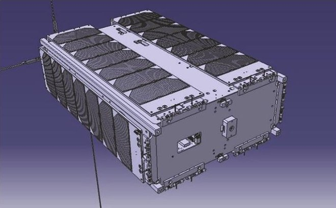

(a)

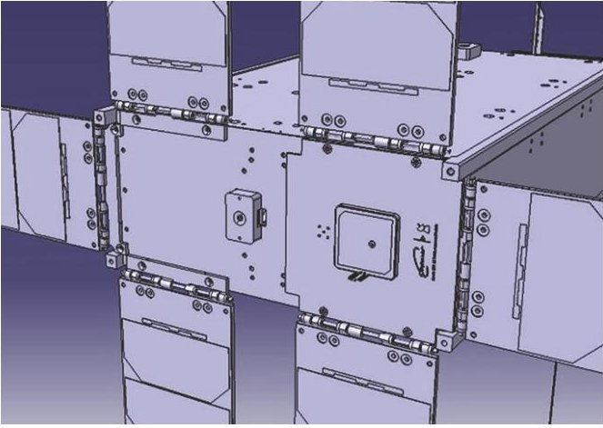

(b)

FIGURE 11: Stowed (a) and deployed (b) solar panels.

HiREV contains six deployable solar panels to supply sufficient power during the mission lifetime. Shown in Figures 11 and 12, the length and width of each solar panel are approximately 3 U and 1 U, respectively, and can be applied to a 3 U CubeSat. The solar panel consists of three layers-enhancement panel, PCB, and solar cell. The enhancement panel is made by laminating ten numbers of carbon fiber-reinforced polymer (CFRP) layers to enhance the longitudinal bending stiffness. The first flexural stiffness of the solar panel is analyzed to be 110 Hz, which is sufficiently larger than the CubeSat stiffness requirements of 90-100 Hz commonly used.

Shown in Figure 12, a nylon wire is used to stow the solar panel, and a nichrome heating device has been developed to release by melting the wire. The hinge module has a torsion spring and locker mechanism to deploy the solar panel automatically after it is released.

Figures 13 and 14 show the locations of the HiREV internal subsystems. Communication subsystems are clustered at the opposite side from the sun to reduce thermal noise and shorten the signal path. The main OBC and payload OBC and the camera module are power-consuming units, centered with electrical power systems to minimize the power transmission distance. The payload OBC and camera are COTS products, and they have their own operating system; thus, the data between them and the main OBC is transferred through an Ethernet switchboard. A star tracker is located at a position such as to not be shaded by the solar panel. Similarly, three sun sensors are placed at the position in which they have maximum field of view (FOV). An umbilical

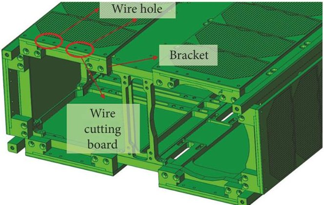

FIGURE 12: Holding and release mechanism for a solar panel.

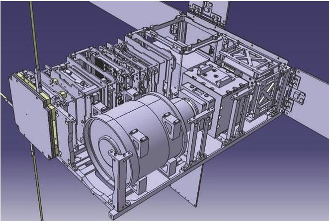

FIGURE 13: Internal subsystems of HiREV.

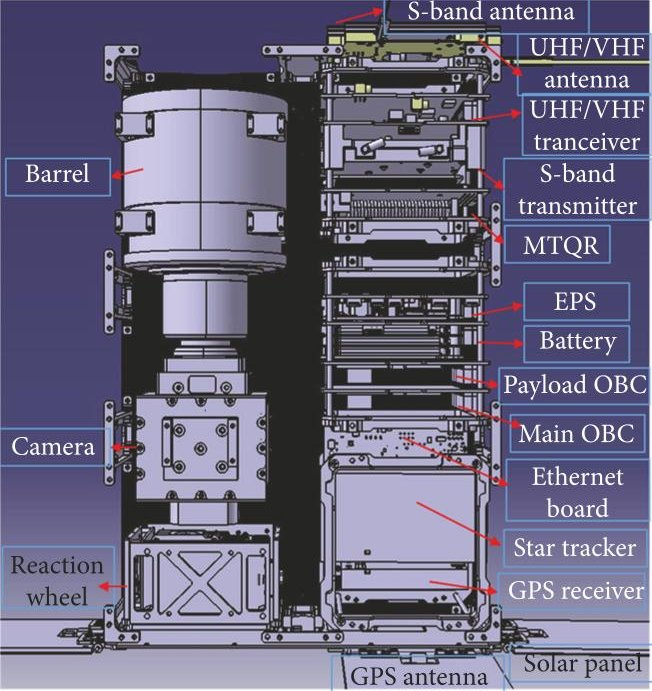

FIGURE 14: Location of the HiREV subsystem.

port is installed to recharge the battery and be employed in functional testing.

To predict the worst-case hot and cold temperatures, orbital thermal analysis was conducted by Thermal Desktop software, and the results are presented in Table 1. The

<!-- PDF_PAGE: 8 -->

TABLE 1: Worst hot/cold temperatures of orbital thermal analysis.

<table border="1"><tr><td rowspan="2">Type</td><td rowspan="2">Subsystem</td><td colspan="2">Operating temperature</td><td colspan="3">Worst-case temperatures</td></tr><tr><td>Min</td><td>Max</td><td>Cold(safe)</td><td>Cold</td><td>Hot</td></tr><tr><td>CDHS</td><td>Main OBC</td><td>-40</td><td>85</td><td>17</td><td>25</td><td>44</td></tr><tr><td rowspan="2">EPS</td><td>EPS board</td><td>-40</td><td>85</td><td>0</td><td>10</td><td>28</td></tr><tr><td>Battery</td><td>-10</td><td>50</td><td>0</td><td>9</td><td>21</td></tr><tr><td rowspan="2">COMM</td><td>UHF/VHF transceiver</td><td>-20</td><td>60</td><td>-22</td><td>-15</td><td>-0.5</td></tr><tr><td>S band transmitter</td><td>-40</td><td>50</td><td>-22</td><td>-15</td><td>-3.5</td></tr><tr><td rowspan="4">ADCS</td><td>Reaction wheel</td><td>-20</td><td>60</td><td>-11</td><td>8</td><td>22</td></tr><tr><td>Star tracker</td><td>-25</td><td>50</td><td>-11</td><td>18</td><td>19</td></tr><tr><td>GPS receiver</td><td>-40</td><td>85</td><td>-9</td><td>9</td><td>19</td></tr><tr><td>Magnetic torquer</td><td>-40</td><td>70</td><td>-22</td><td>-14</td><td>2.5</td></tr><tr><td rowspan="4">Payload</td><td>Lens</td><td>-</td><td>-</td><td>-29</td><td>-22</td><td>-3.5</td></tr><tr><td>Camera</td><td>-40</td><td>85</td><td>-21</td><td>-10</td><td>0</td></tr><tr><td>Payload OBC</td><td>-40</td><td>85</td><td>-5</td><td>6</td><td>32</td></tr><tr><td>Ethernet switch</td><td>-40</td><td>85</td><td>-15</td><td>-1</td><td>40</td></tr><tr><td>Solar panel</td><td></td><td>-</td><td>-</td><td>-70</td><td>-70</td><td>95</td></tr></table>

worst-case temperatures for all electric subsystems in normal operations are within the operating temperature range represented in Table 1. This includes the coldest case in safe hold mode, in which the main OBC and EPS are expected to operate properly.

3. 2. Flight Software (Including CD&H). Flight software (FSW) refers to software that runs on an on-board computer. Its main functions are processing commands from the ground station, providing an environment for the execution of the ADCS algorithm, and processing telemetry and mission data. The FSW of HiREV is based on the core flight system (CFS), which is an open-source flight software framework developed by NASA's Goddard Space Flight Center [21, 22]. The CFS was developed to achieve the following goals: (a) reduce time to deploy high-quality flight software, (b) reduce project schedule and cost uncertainty, (c) enable collaboration across organizations, (d) simplify sustaining engineering, (e) establish common standards and tools across FSW projects and NASA-wide, (f) establish the use of a single platform for advanced concepts and prototyping, and (g) directly facilitate formalized software reuse [23]. The development of reliable FSW requires a great deal of time and effort. However, by using CFS, we were able to save such time and effort. In addition, CFS provides many of the features needed for FSW, allowing them to be reused. Table 2 shows the basic functions of our FSW and CFS modules for implementing these functions.

As shown in Figure 15, there are core Flight Executive (cFE) core services and CFS applications for basic functions in the FSW. We only changed the configuration of each module in accordance with our system and used them as they are. In addition to these modules, we developed mission-specific modules such as command ingest, telemetry output, system manager, and many other I/O modules. Each module is executed on a CFS framework and has no dependency on others. They just need to share data with others

TABLE 2: Basic functions of the FSW and CFS modules for implementing these functions.

<table border="1"><tr><td>Basic functions of the FSW</td><td>CFS modules</td></tr><tr><td>Command scheduling</td><td>Stored command, table service, CFDP</td></tr><tr><td>System monitoring</td><td>Health &amp; safety</td></tr><tr><td>Telemetry/event logging</td><td>Event service, data storage</td></tr><tr><td>File upload/download</td><td>CFDP</td></tr><tr><td>On-orbit parameter update</td><td>Table service, CFDP</td></tr><tr><td>On-orbit reprogramming</td><td>Executive service, CFDP</td></tr><tr><td>Command checksum</td><td>Checksum</td></tr></table>

for cooperation. The CFS framework provides standardized interfaces called software bus for data communication between each module. This feature allows developers of each module to develop independently and facilitate collaboration.

The CFS supports several platforms such as Linux on PC, RTEMS on Axiom 5232 BCC, and VxWorks on PPC (MCP 750, RAD750). To use the CFS on another platform, additional studies should be conducted on OSAL (operating system abstraction layer) and BSP (board support package). Our OBC uses a Xilinx Zynq-7000 series CPU. We ported the Linux kernel to this system, and we run the CFS on this platform by just changing a few of the configurations of PC Linux.

3. 3. Power. The electrical power system (EPS) consists of the EPS board, battery, and solar panels as usual cases of CubeSats. We utilize products from Clyde Space for the EPS board and battery. The FlexU EPS board supplies various voltages such as 3.3V, 5V, and 12V and an unregulated battery voltage, which is about 8.4V in a fully charged state. FluxU also supplies 10 switchable power sources, which can be used for switching subsystems according to the mission states. The battery module has lithium-polymer battery cells and a circuit to protect the battery cells from harmful effects such

<!-- PDF_PAGE: 9 -->

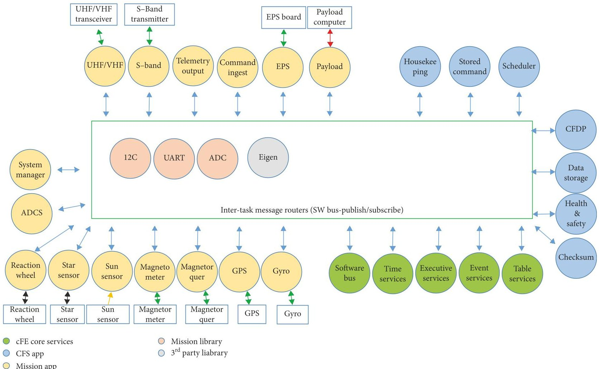

FIGURE 15: Software modules and virtual software bus in FSW.

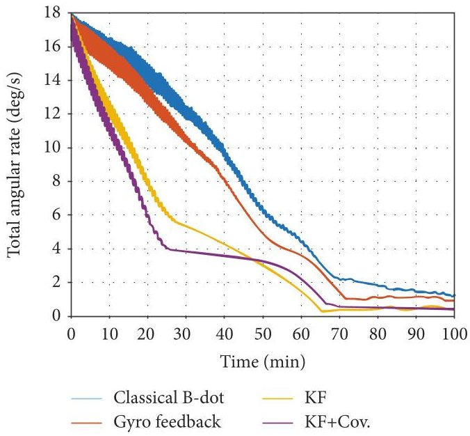

(a)

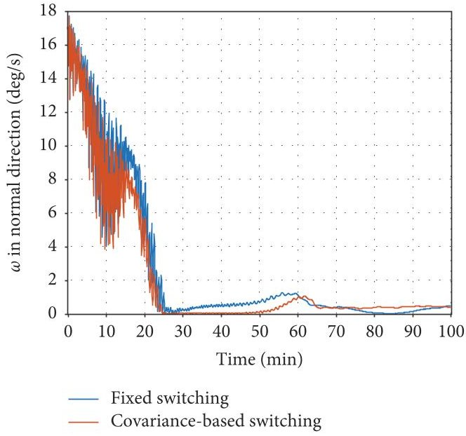

(b)

FIGURE 16: Simulation result for the suggested new detumbling control [24].

as overcurrent. The battery module also has a heating system to maintain its temperature above 0 $ ^{\circ} \mathrm{C} $ . The system needs a 40 Wh battery to maintain a depth of discharge of 30% or less during the mission lifetime. Solar panels consist of six deployable solar arrays, which have seven triple junction GsAs solar cells from AZUR SPACE Solar Power GmbH. The maximum power generation will be expected to be about 41 W by the end of lifetime.

3. 4. Attitude Determination and Control. The attitude determination and control system (ADCS) consists of the MEMS magnetometer, MEMS gyroscope, analogue sun sensor, and star tracker as the attitude sensor and 3-axis magnetic torquers and 3-axis reaction wheels as the actuator.

In this system, MEMS sensors such as a magnetometer and gyroscope are implemented, and these sensors are integrated into the OBC. For this reason, these sensors are always

<!-- PDF_PAGE: 10 -->

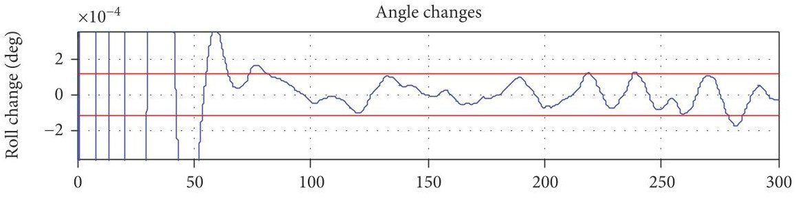

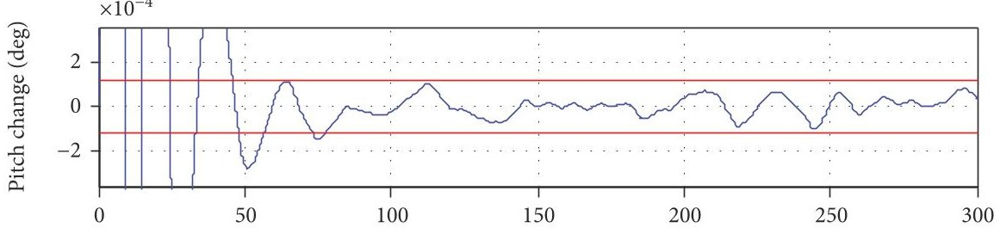

FIGURE 17: Simulation results of the control stability for fixed-image acquisition mode.

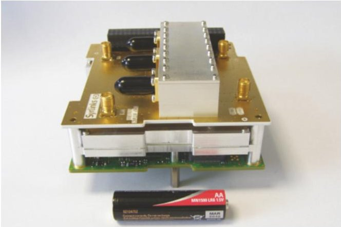

(a)

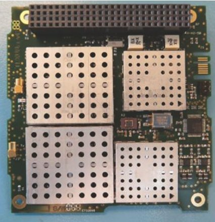

(b)

FIGURE 18: S-band transceiver (a) and VHF/UHF transceiver (b).

turned on during flight, making data measurement possible. Thus, it is possible to use the angular velocity data from a gyroscope directly during the detumbling mode, and the improved detumbling control can be applied based on the geomagnetic estimator and gyroscope feedback control [24]. By using this new algorithm, we expect to reduce the tumbling period at the initial stage, as shown in Figure 16.

In this mission, this image sensor and the COTS-based image payload are equipped with 2-dimensional image capability. For this reason, the image acquisition mechanism is different from that of the commercial medium satellites, which have line image sensors. Thus, the control stability is more important than the control accuracy during the fixed image mode, and the simulated result for this requirement is illustrated in Figure 17 with a 4 Hz star tracker and reaction wheels. ADCS also supports the video acquisition mode to aim at a specific target position during the flight.

3. 5. Communications. HiREV utilizes two subsystems to support the command uplink, telemetry downlink, and mission data downlink. A VHF/UHF radio subsystem is used for the command/telemetry, with carrier frequencies of 145.9 MHz and 436.5 MHz and communication speeds of 1200 bps and 9600 bps, respectively. The S-band transmitter

TABLE 3: Specifications of industrial digital camera.

<table border="1"><tr><td>Item</td><td>Value</td></tr><tr><td>Model name</td><td>Imperx B3412</td></tr><tr><td>Power consumption</td><td>Maximum 5.1W</td></tr><tr><td>Input voltage</td><td>12V(10-15V)</td></tr><tr><td>Image sensor</td><td>ICX814 EXview HAD CCD II(Sony)</td></tr><tr><td>Pixel size</td><td>3.69μm</td></tr><tr><td>Pixel resolution</td><td>3388×2712</td></tr><tr><td>Form factor</td><td>46×46×77.5(mm)</td></tr><tr><td>Mass</td><td>398g</td></tr><tr><td>Data interface</td><td>GigE</td></tr><tr><td>Minimum SNR</td><td>60dB</td></tr><tr><td>Vibration, shock</td><td>100g(20-200)HZ XYZ,1000g</td></tr><tr><td>Temperature</td><td>-40to85℃</td></tr></table>

is used for the mission data and data-intensive telemetry. The carrier frequency is 2280 MHz with communication speeds up to 2 Mbps. Commercial products are used for the communication, UHF/VHF transceiver of ISIS, and EWC31 S-band transceiver of Syrlinks (Figure 18).

<!-- PDF_PAGE: 11 -->

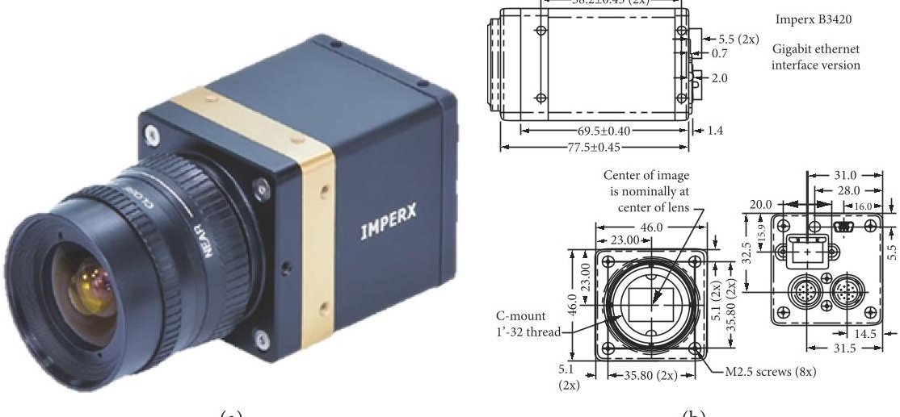

(b)

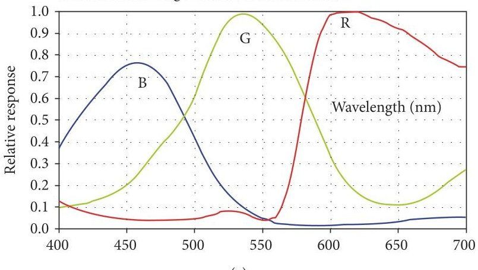

(c)

FIGURE 19: The external appearance of the camera and sensitivity of each microlens [25].

## 4. Optical Payload

4. 1. Payload Design Requirements. The payload has the function of acquiring color images of the earth using a digital camera and a small reflecting telescope. We aim to acquire high-resolution still images and videos with a high precision of 5 m GSD (ground sample distance) at 400 km altitude using COTS parts. The payload should fit in 3 U $ \sim 3 0 \mathrm{c m} \times1 0 \mathrm{c m} \times $ 10 cm).

4. 2. Payload Development. The optical payload has been developed in collaboration with SatByul. The payload consists of an industrial digital camera for image acquisition, commercial reflective telescope, separate mounting computer for digital video signal processing and camera control, and GigE switch. Each component uses commercial (COTS) products, and the appropriate improvements have been made for use in space.

4. 2.1. Industrial Digital Camera. The camera necessary for image acquisition was chosen to be the B3412 [25], one of Imperx's Bobcat series, considering its weight, pixel resolution, available temperature range, and power. The details of the camera are shown in Table 3, and it is advantageous that the captured image can be transmitted quickly onto the on-board computer without any conversion because it uses the GigE interface. The external appearance of this camera

TABLE 4: Specifications of the telescope.

<table border="1"><tr><td>Item</td><td>Value</td></tr><tr><td>Model name</td><td>SY Optics 500mm F/6.3DX Mirror</td></tr><tr><td>Focal length</td><td>500mm</td></tr><tr><td>Aperture</td><td>F/6.3fixedmirror lens</td></tr><tr><td>Optical construction</td><td>7elementsin6groups</td></tr><tr><td>FOV</td><td>5°</td></tr><tr><td>EffectiveFOV</td><td>1.83°</td></tr><tr><td>Length</td><td>Max.119.5mm</td></tr><tr><td>Max.diameter</td><td>98mm</td></tr><tr><td>Mass</td><td>651g</td></tr><tr><td>Mount</td><td>T-mount</td></tr></table>

and sensitivity of each microlens covering each pixel are shown in Figure 19.

4. 2.2. Commercial Reflecting Telescope. We selected the Samyang Optics 500 mm F/5.3 DX Mirror Lens [26], which is a commercial lens with a length less than 2 U, a diameter less than 100 mm, a weight that meets the mass budget, and a theoretically smaller diffraction limit than the pixel size. This camera was selected to collect the observed ground light on the camera sensor. The lens is a Schmidt-Cassegrain reflective telephoto lens, which was selected because it is

<!-- PDF_PAGE: 12 -->

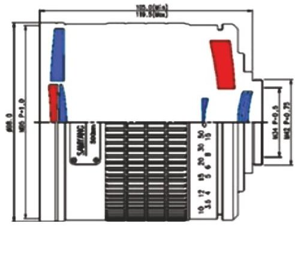

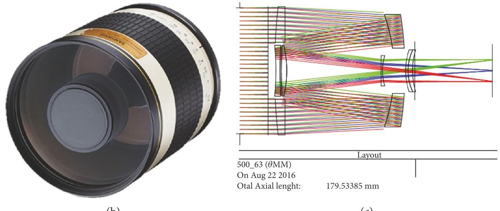

(b)

(c)

FIGURE 20: SY Optics 500 mm F/6.3 DX Mirror Lens and optomechanical design [26].

TABLE 5: Specifications of Payload OBC.

<table border="1"><tr><td>Item</td><td>Value</td></tr><tr><td>Model name</td><td>RTD PCM3363Z2-1GS6A1E</td></tr><tr><td>CPU</td><td>Intel Atom E3800 dual-core 1.46GHz</td></tr><tr><td>RAM</td><td>4GB DDR3 SDRAM(surface-mounted,ECC)</td></tr><tr><td>Storage</td><td>32GB standard surface-mountedindustrial-gradeSATAflash drive</td></tr><tr><td>I/O interface</td><td>GigE,USB2.0,RS-232,RS-422/485,SATA2,8-bitGPIO</td></tr><tr><td>Input voltage</td><td>5V</td></tr><tr><td>Power consumption</td><td>5W(idle)</td></tr><tr><td>Form factor</td><td>95.89×90.17×20(mm)</td></tr><tr><td>Mass</td><td>160g</td></tr><tr><td>Temperature</td><td>-40to85℃</td></tr></table>

lighter than the Maksutov-Cassegrain-type lens and has higher resolution. The detailed specifications are listed in Table 4. The appearance and optical system design drawing of the selected telescope are shown in Figure 20.

4. 2.3. Payload OBC. The Payload on-board computer is configured separately from the main OBC for high-resolution image processing and is responsible for camera control and communication with the main OBC. The computer selected was the RTD PCM3363Z2-1GS6A1E [27], considering its power consumption, temperature range of the available environment, weight, form factor, and electrical interface with camera. We installed Linux Ubuntu 16.04 LTS as the operating system. Table 5 shows the detailed specifications.

4. 2.4. Gigabit Ethernet Switch. The payload system uses an Ethernet switch for network configuration between the main OBC, the on-board computer, and the mounted camera. The MPL MAGBES-21HP [28], a model supporting Gigabit Ethernet, was chosen to smoothly transfer images captured by the camera, considering the power and operating temperature range, and the form factor, considering the stack frame. Table 6 shows the specifications.

4. 2.5. Rework of the COTS Component. Basically, the use of COTS components have not been considered in the space

TABLE 6: Specifications of the GigE switch.

<table border="1"><tr><td>Item</td><td>Value</td></tr><tr><td>Model name</td><td>MPL MAGBES-21HP</td></tr><tr><td>Port</td><td>5 GigE ports</td></tr><tr><td>Port spec.</td><td>Copper port with locking headers (iGrid)</td></tr><tr><td>Temperature</td><td>-40 to 85℃</td></tr><tr><td>Input voltage</td><td>5V(PC104),5-36V(4-pin power connector)</td></tr><tr><td>Power</td><td>4W(typical)</td></tr><tr><td>Form factor</td><td>95.9×90.2×13.8(mm)</td></tr><tr><td>Mass</td><td>90g</td></tr></table>

environment. Therefore, some improvement is required for use in an orbit environment. We redesigned the COTS telescope for space usage. All plastic parts were redesigned and replaced by stronger aluminum parts. The mounting structure was changed to a C-mount and designed as a single part to make it vibration-proof. All grease was removed, and the lens was readjusted for fixed infinity focus. In addition, the industrial camera Imperx B3420 has been reworked. The case was fully redesigned for strength and vibration and heat dissipation in vacuum and to facilitate mounting to the satellite. Nonvibration-proof connectors were changed to a soldering cable with specified Molex 5016461000 female connectors. The internal volume of the camera was also cleaned and filled with a silicone thermal-conductive compound. These changes are shown in Figure 21.

4. 3. Optical System Quality Analysis. The diffraction limit is the minimum wavelength at which light can diffract through two objects apart from each other [29]. This means that a distance between two objects smaller than half the wavelength of the visible light ray used by the optical system cannot be identified. This distance is represented by the Airy disc [30], which is the minimum size of the image to be distinguished. The Airy disc is obtained using equation (1).

$$
r _ {\mathrm {A i r y}} = \frac {1 . 2 2 \times \lambda \times f _ {\mathrm {e}}}{D _ {\mathrm {a p e r t u r e}}},
$$

where $ r_{\mathrm{Airy}} $ is the radius of the Airy disc, which is a diffraction spot with 85% energy inside, $ \lambda $ denotes wavelength, $ f_{\mathrm{e}} $

<!-- PDF_PAGE: 13 -->

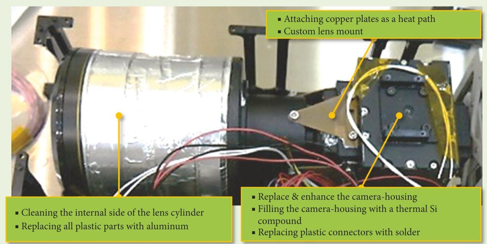

FIGURE 21: Rework of the COTS component.

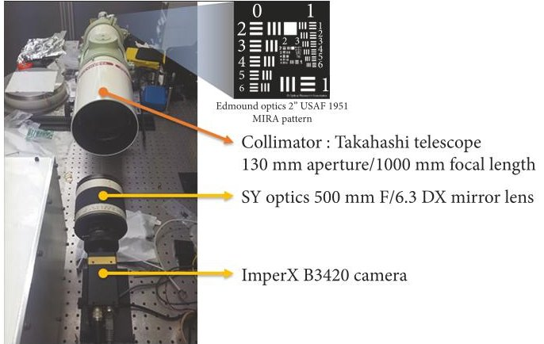

FIGURE 22: Spatial resolution measurement test environment.

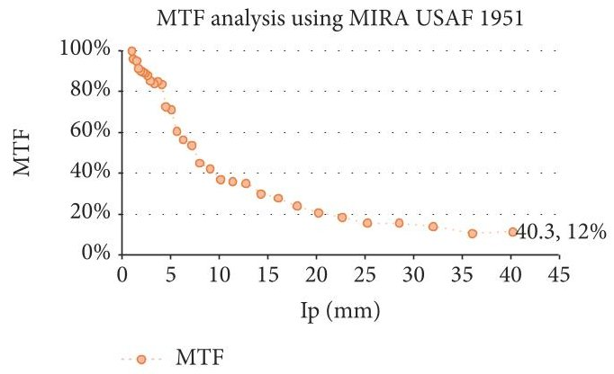

FIGURE 23: MTF analysis of the payload system.

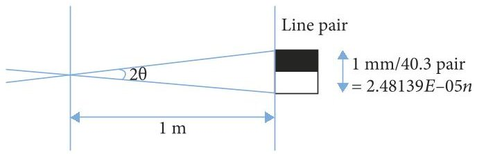

FIGURE 24: Angular resolution calculation process.

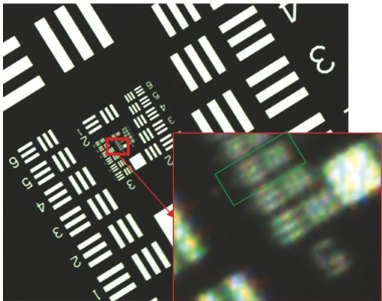

Group #5 Element #3: 40.3 lp/mm

FIGURE 25: Image of the MIRA pattern.

denotes effective optical focal length, and $ D_{\mathrm{aperture}} $ is the diameter of the aperture. Using an altitude of 400 km, an effective focal length of 500 mm, and a lens aperture of 90 mm, the distance between two points on the ground that can theoretically be distinguished can be calculated by

$$
d _ {\mathrm {g r o u n d}} = \frac {h _ {\mathrm {a l t i t u d e}} \times r _ {\mathrm {A i r y}}}{f _ {\mathrm {e}}},
$$

where $ h_{\mathrm{altitude}} $ is the orbital height and $ d_{\mathrm{ground}} $ is the spatial resolution on the ground. The calculated distances between two distances from the ground according to the theoretical diffraction limit are calculated to be 2.98 m in the 550 nm wavelength band of the green band, and the radius of the Airy disc is 3.73 $ \mu $ m. When the color information is not used, the GSD is the same as above, but since the selected camera is a CCD with a Bayer pattern, the GSD for the color image doubles to 5.96 m, compared to the single gradation image. The swath area of the ground that the computed GSD covers is 10,100 m $ \times $ 8,090 m.

<!-- PDF_PAGE: 14 -->

TABLE 7: Specifications and procedure of vibration test.

(a)

<table border="1"><tr><td></td><td colspan="2">Test procedure</td></tr><tr><td>Test type</td><td></td><td>Remarks</td></tr><tr><td>(1)1st low-level sine sweep test</td><td></td><td>Modal survey</td></tr><tr><td>(2)Sine burst test</td><td></td><td>Quasi static acceleration load test</td></tr><tr><td>(3)2nd low-level sine sweep test</td><td></td><td>Modal survey</td></tr><tr><td>(4)Random vibration test</td><td></td><td></td></tr><tr><td>(5)3rd low-level sine sweep test</td><td></td><td>Modal survey</td></tr></table>

(b)

<table border="1"><tr><td></td><td colspan="3">Sine burst test</td></tr><tr><td></td><td>Qualification</td><td>Acceptance</td><td>Protoflight</td></tr><tr><td>Direction</td><td>X,Y,Z</td><td>—</td><td>X,Y,Z</td></tr><tr><td>Acceleration(G)</td><td>18.75</td><td>—</td><td>18.75</td></tr><tr><td>Duration(#cycles at full level)</td><td>5</td><td>—</td><td>5</td></tr><tr><td>Frequency(Hz)</td><td>25</td><td></td><td>25</td></tr></table>

(c)

<table border="1"><tr><td></td><td colspan="3">Low-level sine sweep test</td></tr><tr><td></td><td>Qualification</td><td>Acceptance</td><td>Protoflight</td></tr><tr><td>Direction</td><td>X,Y,Z</td><td>X,Y,Z</td><td>X,Y,Z</td></tr><tr><td>Type</td><td>Harmonic</td><td>Harmonic</td><td>Harmonic</td></tr><tr><td>Amplitude(G)</td><td>0.15</td><td>0.1</td><td>0.1</td></tr><tr><td>Frequency(Hz)</td><td>5-2000</td><td>5-2000</td><td>5-2000</td></tr><tr><td>Sweep rate(oct/sec)</td><td>2</td><td>2</td><td>2</td></tr></table>

(d)

<table border="1"><tr><td></td><td></td><td colspan="3">Random vibration test</td></tr><tr><td></td><td></td><td>Qualification</td><td>Acceptance</td><td>Protoflight</td></tr><tr><td>Direction</td><td></td><td>X,Y,Z</td><td>X,Y,Z</td><td>X,Y,Z</td></tr><tr><td></td><td>Frequency(Hz)</td><td></td><td>Amplitude(G2/Hz)</td><td></td></tr><tr><td></td><td>20</td><td>0.026</td><td>0.13</td><td>0.026</td></tr><tr><td>Profile</td><td>50</td><td>0.16</td><td>0.08</td><td>0.16</td></tr><tr><td></td><td>800</td><td>0.16</td><td>0.08</td><td>0.16</td></tr><tr><td></td><td>2000</td><td>0.026</td><td>0.013</td><td>0.026</td></tr><tr><td>RMS acceleration(G)</td><td></td><td>14.1</td><td>10.0</td><td>14.1</td></tr><tr><td>Duration(sec/axis)</td><td></td><td>180</td><td>60</td><td>60</td></tr></table>

To measure the spatial resolution in an actual payload system, we used the 2-in USAF MIRA pattern glass and Takahashi telescope, which has a focal length of 1000 mm and a lens aperture of 130 mm, as a collimator. The test environment is shown in Figure 22. The MIRA pattern used is composed of nine groups/six elements of a black-and-white three-line pattern and is designed to measure the modulation transfer function (MTF) from 0.25 to 646lp/mm.

Experiments were performed to obtain the visual resolution of the optical payload indirectly using the focal length of the collimator and the correct lp/mm of the image. The MTF

at each resolution was measured as shown in Figure 23. When a still image of the MIRA pattern was captured with the correct focus, the maximum lp/mm pattern that can be distinguished by the eye was a pattern of 40.3 lp/mm with the third element of the fifth group.

From the MTF analysis, we obtained an angular resolution of 0.124 $ \mu $ rad. Assuming a distance over 400 km, the visual resolution of the ground is calculated as 4.96 m. Figure 24 conceptually shows the inversion process of a given resolution using experimental results. Figure 25 shows the image of the MIRA pattern.

<!-- PDF_PAGE: 15 -->

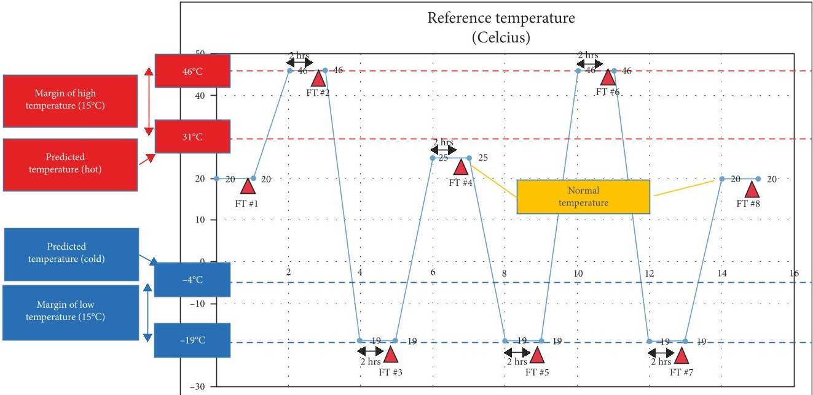

FIGURE 26: Temperature profile of TVT.

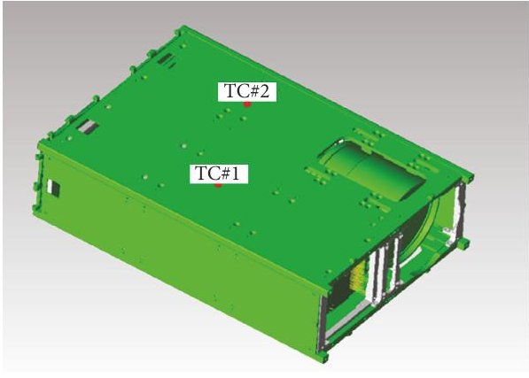

(a)

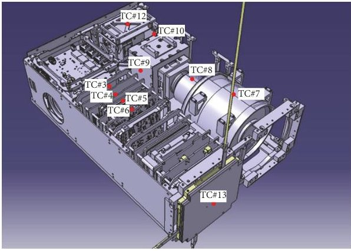

(b)

FIGURE 27: Positions of temperature sensors.

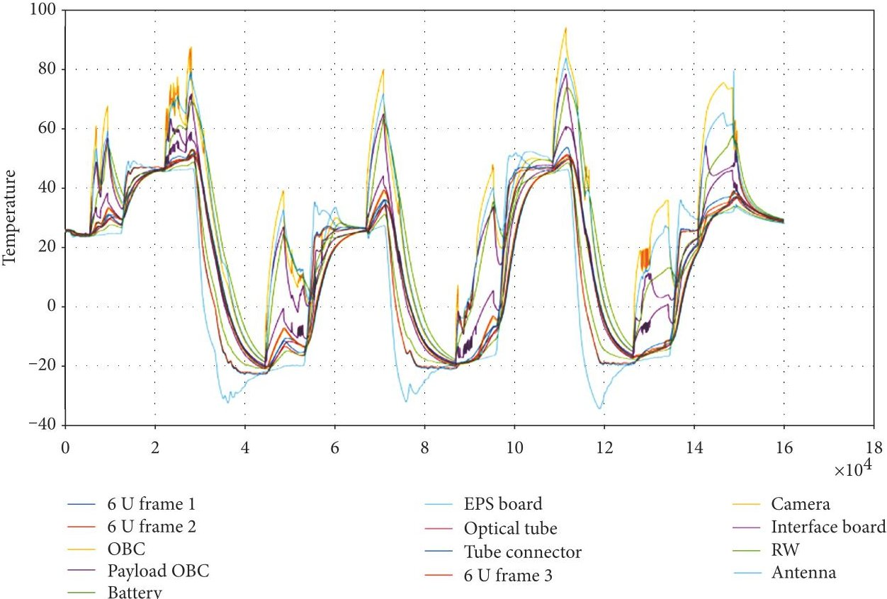

FIGURE 28: Measured temperature for the thermal vacuum test.

<!-- PDF_PAGE: 16 -->

## 5. Environment Test

5. 1. Vibration Test. A vibration test was conducted to verify the mechanical safety and proper functional operation after leaving the launch environment. Similar to the launch environment, the satellite was contained in a deployer, and the test was performed. The specifications and procedure of the vibration test described in Table 7 is based on data provided by ISL [31, 32], which provides a launch service.

Three kinds of tests were considered. The low-level sine sweep test identifies natural frequencies and detects physical changes in the system during the testing procedure. The sine burst test applies a quasistatic acceleration load to the specimen by oscillating it with a lower frequency than one-third of its first natural frequency. The random vibration test excites the satellite with a random vibration profile given by the launch service provider.

5. 2. Thermal Vacuum Test. A thermal vacuum test was conducted to verify the proper operation under the worst-case hot and cold scenarios in the orbit. We obtained the temperature profile shown in Figure 26 with a $ 1 5^{\circ} \mathrm{C} $ margin by simplified thermal analysis with a box-shaped simple model. Temperature sensors were installed as represented in Figure 27. The shroud in the test was controlled as the reference temperature, the sensor attached on the structure, to be hot or cold, as presented in Figure 26.

Temperatures measured are shown in Figure 28. For the hot case, the main OBC, EPS, and battery recorded extremely high temperatures above 70 $ ^{\circ} \mathrm{C} $ . In particular, the temperature of the processor in the main OBC reached 95 $ ^{\circ} \mathrm{C} $ . Even though higher temperatures had been expected, all subsystems worked normally. On the other hand, there were problems with the EPS and main OBC for the cold case. The battery was not charged normally, and the main OBC was rebooted several times for an unknown reason. We are trying to determine the reason for the functional defects, and we have the test plan that includes a thermal balancing test to obtain the thermooptical properties of the subsystems.

## 6. Conclusions

In this paper, we introduced the development status of HiREV, which is the 6U standard platform for the space technology testbed. For this CubeSat, COTS-based components were applied, including the optical payload, by using the industrial camera and COTS lens for high-resolution earth observation images. Many parts used in the CubeSat were developed in Korea through this project to encourage various space missions in the future. Furthermore, we want to also apply some new technologies to this testbed such as CFS and control algorithms.

At this time, HiREV is under space environment testing, and we are improving and stabilizing this system. In the near future, we hope to launch and operate it successfully.

The data used to support the findings of this study are available from the corresponding author upon request.

## Data Availability

## Conflicts of Interest

The authors declare that there is no conflict of interest regarding the publication of this article.

## Acknowledgments

This research was supported by the "Development of RVD Technology demonstration Nanosatellite based on AI" funded by the Korea Aerospace Research Institute (KARI). We would like to thank KARI for their support.

## References

[1] T. K. Alex, Y. K. Jain, R. A. Ganage, and K. K. Kurian, "Remote-sensing payload for a small Indian satellite," in Advanced Remote Sensing, pp. 82-87, San Diego, CA, USA, August 1983.

[2] 6U CubeSat Design Specification REV. PROVISIONAL California Polytechnic State University, 2016.

[3] "Nanosatellite & CubeSat Database," http://www.nanosats.eu.

[3] "Nanosatellite & CubeSat Database," http://www.nanosats.eu.

[4] "CubeSat Database," https://sites.google.com/a/slu.edu/swartwout/ home/CubeSat-database.

[5] C. G. Turner, NPS TINYSCOPE Program, [M.S. Thesis], Naval Postgraduated School, 2010.

[6] A. H. Lokman, P. J. Soh, S. N. Azemi et al., "A review of antennas for picosatellite applications," International Journal of Antennas and Propagation, vol. 2017, Article ID 4940656, 17 pages, 2017.

[7] A. W. Rief, V. Hoang, and A. E. Kalman, "High-power solar arrays for NanoSats," in Proceedings of GAINSTAM Workshop, 2010.

[8] S. Bandyopadhyay, G. P. Subramanian, R. Foust, D. Morgan, S.-J. Chung, and F. Hadaegh, "A review of impending small satellite formation flying missions," in 53rd AIAA Aerospace Sciences Meeting, Kissimmee, FL, USA, January 2015.

[9] J. Bowen, M. Villa, and A. Williams, "CubeSat proximity operations demonstration (CPOD) mission update," in 2015 IEEE Aerospace Conference, pp. 1-8, Big Sky, MT, March 2015.

[10] F. J. Franquiz, B. Udrea, L. A. Sánchez, and S. T. Stebler, "Attitude control system design for multi-mode proximity operations and imaging with a 6U CubeSat," in Proceedings of AAS GNC Conference, 2015.

[11] M. Richard, L. G. Kronig, F. Belloni et al., "Uncooperative rendezvous and docking for MicroSats," in 6th International Conference on Recent Advances in Space Technologies, RAST 2013, Istanbul, Turkey, June 2013.

[12] R. W. Ridenoure, R. Munakata, S. D. Wong et al., "Testing the LightSail program: advancing solar sailing technology using a CubeSat platform," Journal of Small Satellites, vol. 5, no. 2, pp. 531-550, 2016.

[13] J. Davis, "Meet LightSail 2, the Planetary Society's new solar sailing CubeSat," The Planetary Society, 2016.

[14] "JPL MarCO Mission Website," https://www.jpl.nasa.gov/ CubeSat/missions/marco.php.

[15] K.-L. Hwang, M.-I. Min, B.-Y. Moon, and Y.-K. Chang, "Mechanical system design and development of the HAUSAT-1 picosatellite," Journal of The Korean Society for Aeronautical & Space Sciences, vol. 32, no. 9, pp. 103113, 2004.

<!-- PDF_PAGE: 17 -->

[16] B.-Y. Moon, B.-H. Lee, and Y.-K. Chang, "Low-cost small satellite research and development as an education tool," Journal of The Korean Society for Aeronautical & Space Sciences, vol. 34, no. 10, pp. 80-91, 2006.

[17] "CubeSat Development Team Website of KHUSAT," http://khusat.khu.ac.kr.

[18] "DreamSpaceWorld Co.," http://www.dreamspaceworld.com.

[19] "SatByul Co.," http://www.satbyul.com.

[20] "SPENVIS Website," https://www.spenvis.oma.be.

[21] J. Wilmot, "A core flight software system," in CODES+ISSS '05 Proceedings of the 3rd IEEE/ACM/IFIP international conference on Hardware/software codesign and system synthesis, pp. 13-14, Jersey City, NJ, USA, September 2005.

[22] W.-S. Choi, J.-H. Kim, and H.-D. Kim, "A study on developing flight software for nano-satellite based on NASA CFS," Journal of The Korean Society for Aeronautical & Space Sciences, vol. 44, no. 11, pp. 997-1005, 2016.

[23] D. Genesan, M. Lindvall, C. Ackermann, D. MaComas, and M. Bartholomew, "Verifying architecture design rule of the flight software product line," in SPLC '09 Proceedings of the 13th International Software Product Line Conference, pp. 161-170, San Francisco, CA, USA, August 2009.

[24] D.-H. Cho, D.-H. Lee, and H.-D. Kim, "Improved detumbling control for CubeSat by using MEMS Gyro," in AAS/AIAA Astrodynamics Specialist Conference, 2017.

[25] "ImperX's Website," http://www.imperx.com.

[26] "Samyang Optics' Website," http://www.samyanglensglobal .com.

[27] "RTD's Website," http://www.rtd.com.

[28] "MPL's Website," http://www.mplag.de.

[29] M. Born and E. Wolf, Principles of Optics: Electromagnetic Theory of Propagation, Interference and Diffraction of Light, Elsevier, 2013.

[30] G. B. Airy, "On the diffraction of an object-glass with circular aperture," Transactions of the Cambridge Philosophical Society, vol. 5, pp. 283-291, 1835.

[31] "Innovative Space Logistics," https://www.isispace.nl/launch services/.

[32] Document No. (ISL.ISILaunch09.EL -Environment Levels Auxiliary Payloads ISILaunch09).