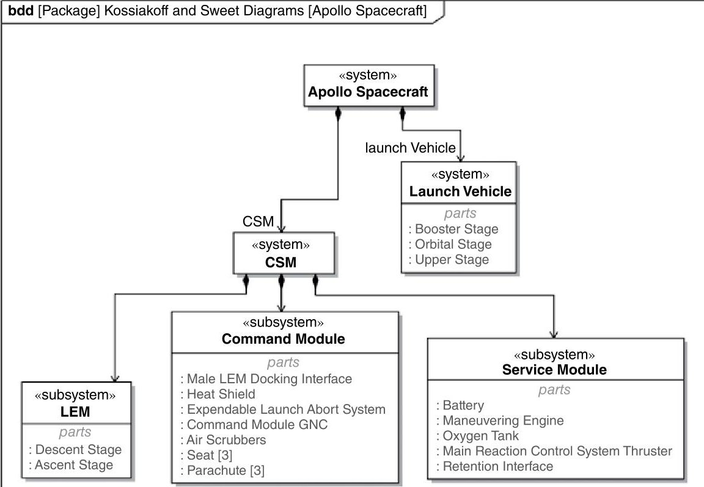
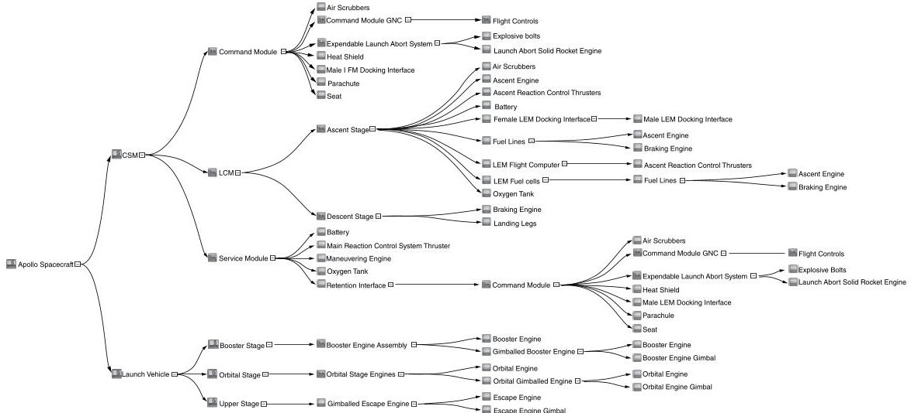
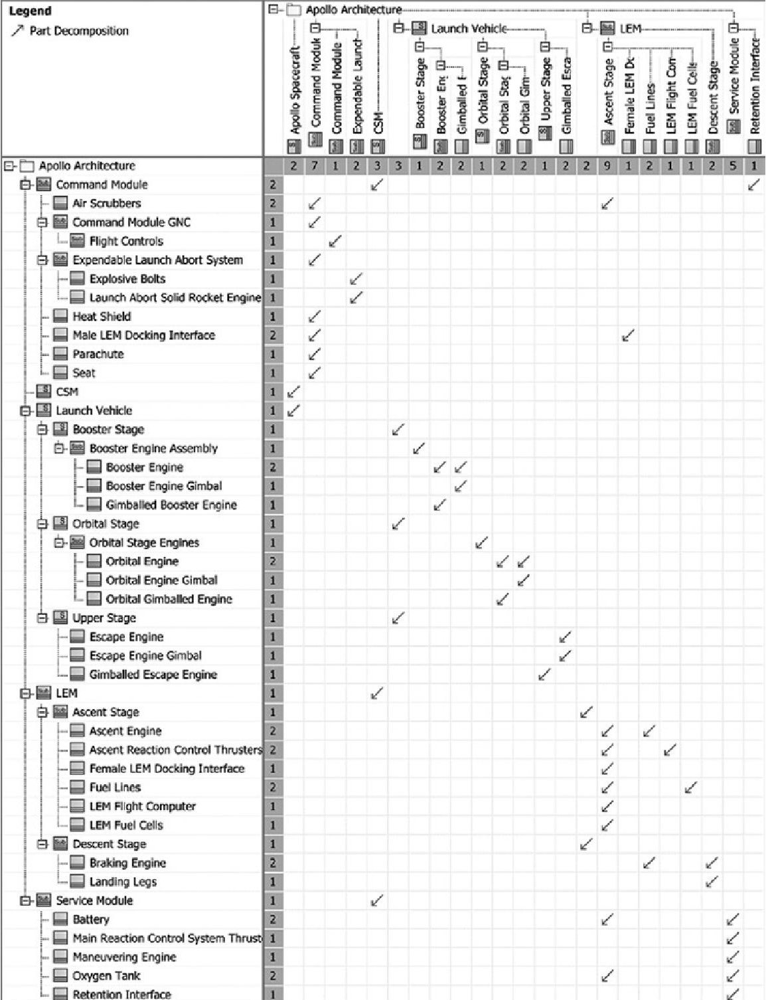
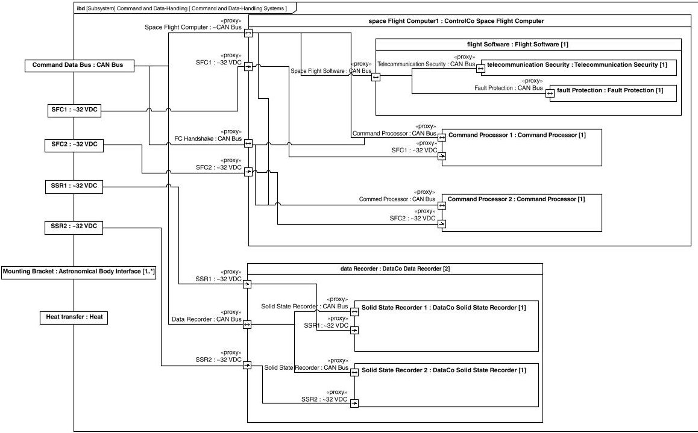
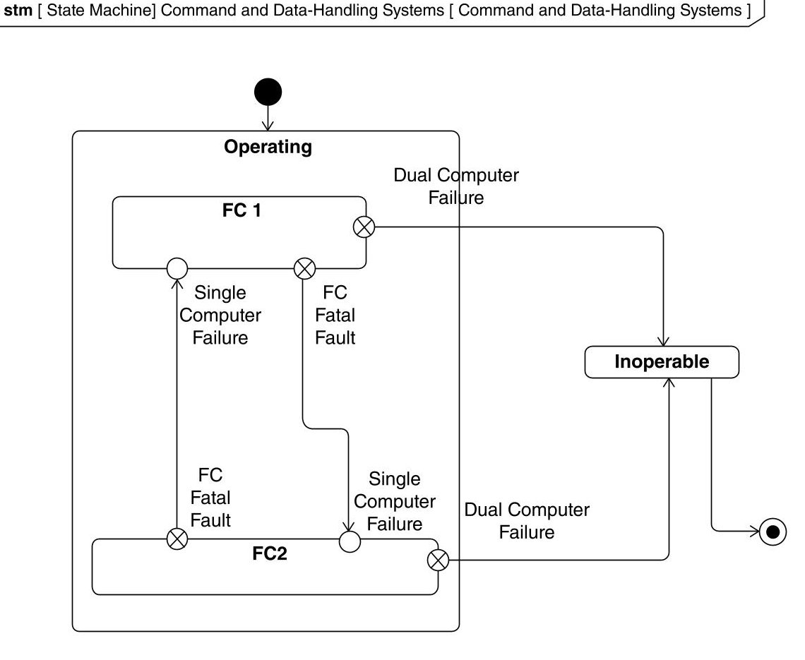
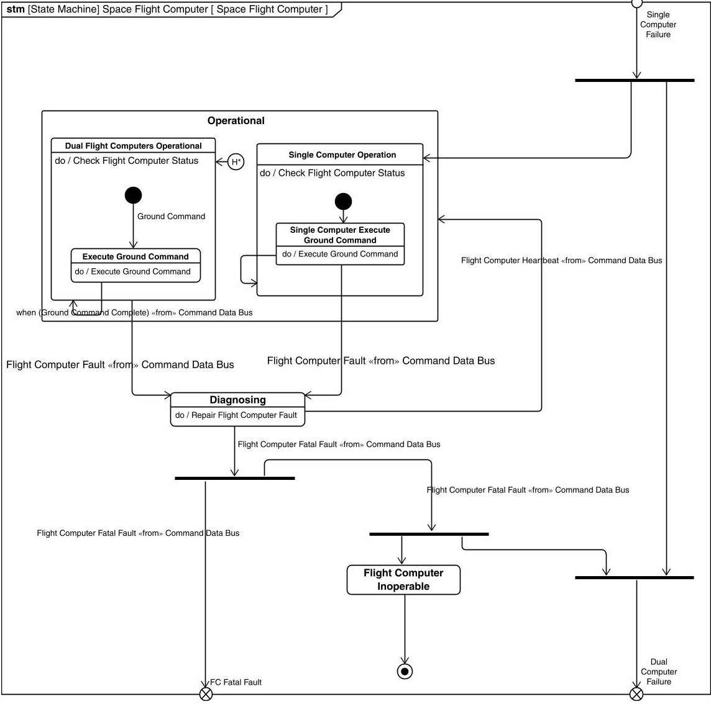
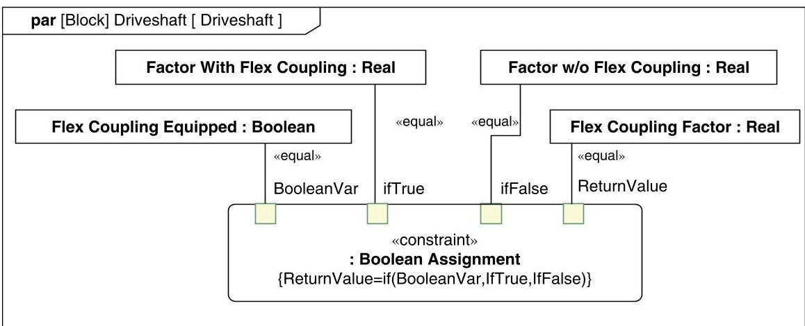
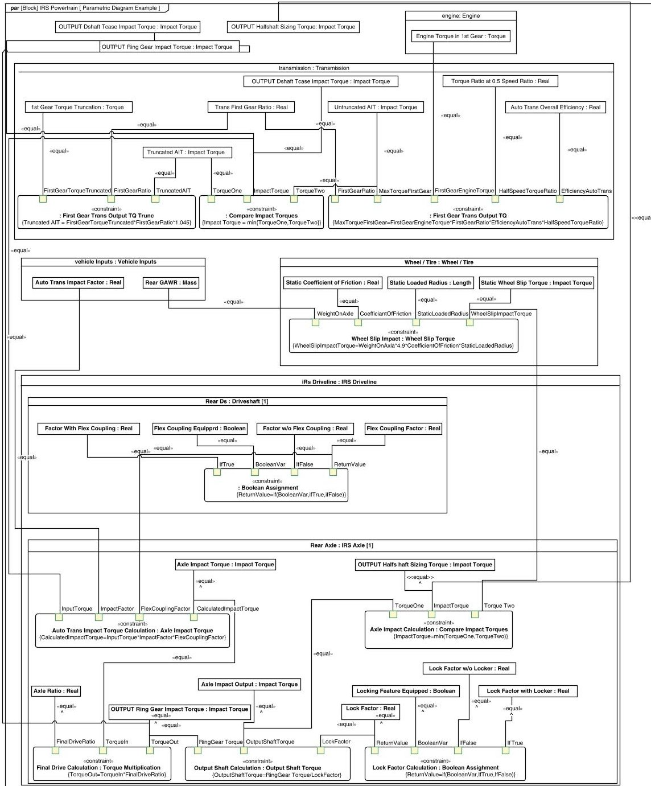

<!-- PDF_PAGE: 1 -->

# MODEL-BASED SYSTEMS ENGINEERING (MBSE)

## 10.1 MBSE INTRODUCTION

"Model Based Systems Engineering (MBSE) is an emerging new paradigm for improving the efficiency and effectiveness of systems engineering through the pervasive use of integrated descriptive representations of the system to capture knowledge about the system for the benefit of all stakeholders" (Noguchi 2016). As MBSE becomes the typical way to execute systems engineering, systems engineers will be increasingly expected to develop proficiency in system modeling tools, languages, and methods. MBSE does not replace sound systems engineering principles; it increases their impact through by its inherent rigor, consistency, and fidelity.

With the advent of formal modeling languages, such as the Unified Modeling Language (UML) and the Systems Modeling Language (SysML), and system architecture frameworks, such as the Unified Architecture Framework (UAF), Department of Defense Architecture Framework (DoDAF), and The Open Group Architecture Framework (TOGAF), the ability of systems engineers to create highfidelity representations of system requirements, behaviors, and structures has never been greater. The exploration and definition of system concepts have now been formalized

<!-- PDF_PAGE: 2 -->

and a subset of systems engineering, systems architecting, has risen to greater significance. In broad terms, the system architecture can be thought of as a descriptive model of the system or the system concept.

After the first formal version of UML was released, The Object Management Group (OMG) provided the first version of the model-driven architecture (MDA). This architecture recognized the shift from a code-centric software development paradigm to an object-centric paradigm, enabled by the then-de facto standard for software engineering model languages - UML. The MDA presented a set of standard principles, concepts, and model definitions that allowed for consistency in defining object models across the software community.

The MDA delineated between the "real" system and its representation by a set of models. These models, in turn, conform to a metamodel definition, which would, in turn, conform to a meta-metamodel definition. Several concepts, processes, and techniques were presented in the literature using this concept, although the names differed: model-driven development, model-driven system design, and model-driven engineering. They all were based on focusing on a model and its metamodel to represent the system from the early stages of development through deployment and operation.

With attempts to merge software and systems engineering processes and principles underway, model-driven development was applied to systems development in various forms. In 2001, the International Council on Systems Engineering (INCOSE) established a Model-Driven Systems Design workgroup to customize UML for systems engineering. By 2006, INCOSE and the OMG adopted OMG SysML.

## Need for MBSE

Modern systems are increasingly complicated and complex, with emergent behavior driven by the interaction of hardware, electronics, software, and users. Systems designs are often developed across multiple organizations who need to collaborate and easily exchange data. Traditional document-intensive systems engineering (DISE) approaches depend upon the readers of disconnected documents to mentally integrate them. They also rely on inherently human-readable text to convey intent instead of a purpose-built language with crisp semantics. "What distinguishes MBSE from traditional implementations of systems engineering (SE) is that the process of progressively developing the requirements baseline, functional architecture, and physical architecture is structured around the incremental refinement of an integrated set of increasingly detailed descriptive models. These models become the principal means of knowledge capture and communication about a system over its lifetime, replacing the large number of discrete documents that become inconsistent as each independently evolves over time" (Noguchi 2016).

In 2018, the United States Department of Defense released its Digital Engineering Strategy; this strategy is intended to reform defense acquisition to allow military systems to be released at the "speed of relevance." The traditional waterfall approach to create thousands of requirements and the years-long development cycle may soon

<!-- PDF_PAGE: 3 -->

give way to an MBSE-supported, concept-to-Preliminary Design Review (PDR) (Cohen 2019). The Digital Engineering Strategy has five goals:

- Formalize the development, integration, and use of models to inform enterprise and program decision making.

- Provide an enduring, authoritative source of truth.

- Incorporate technological innovation to improve the engineering practice.

- Establish a supporting infrastructure and environment to perform activities, collaborate, and communicate across stakeholders.

- Transform the culture and workforce to adopt and support digital engineering across the life cycle.

## MBSE Use in the SE Life Cycle

MBSE adds value wherever it is used within a life cycle; errors and inconsistencies between disconnected source documents and artifacts can be readily identified as a model is constructed and matured. The greatest value is typically gained when MBSE is applied from project inception; this allows all relevant data to be modeled as they are created (rather than reformatted and refactored later). It also permits the development team to see early value (as inconsistencies are identified and the inherent rigor of the modeling effort structures the team's efforts). The lead systems engineer has an added responsibility to define where modeling fits into the project development plans and architecture. By having the model as a resource throughout the development journey, teams gain a sense of ownership rather than a feeling that an external framework is being imposed on their work.

If MBSE is implemented later in the life cycle, there are diminishing returns for the effort. However, just as converting engineering drawings to CAD can provide benefits for the sustainment and maintenance of legacy systems, a late-stage MBSE effort can add significant value in reverse-engineering or upgrading a legacy system to extend its life.

Ancillary tools for analysis and management facilitate the unification of the descriptive system model with product line engineering (PLE), product lifecycle management (PLM), and product data management (PDM) to provide the ability to share as-conceived, as-designed, as-built, as-maintained, and as-disposed information about a system. This has significant implications for improving long-term maintenance and logistical support of consumer goods (such as automobiles) in addition to aerospace, health, network, and defense systems.

## Differences Between MBSE and Traditional Document-Intensive SE

The basic notion behind MBSE is that a model of the system is developed early in the process and grows organically over the system development life cycle until the model becomes the build-to baseline. Early in the life cycle, the models have low levels of

<!-- PDF_PAGE: 4 -->

fidelity and are used primarily for decision making. As the system is developed, the level of fidelity increases until the models fully represent the architecture. "Architecting defines what to design, while design defines what to build" (Sillitto 2014).

Although this approach may appear similar to the traditional systems engineering approach, several significant differences exist between the two; the foremost difference is the products created by each approach. In traditional systems engineering (including either of the structured analysis or object-oriented approaches), the primary products early in the system development life cycle are static representations of the system in hardcopy or softcopy format. In MBSE, the primary products are models: integrated collections of information (elements, attributes, and relationships), which can be queried, displayed, error-checked, and executed. Reviewing a model-driven system design (at any point in the life cycle) involves interrogating a set of models or reviewing an automatically generated set of derived work products (such as tables, matrices, or diagrams).

Additional process improvements are also possible; because the traditional, textbased requirement was formerly the primary method of communicating design intent, large numbers of requirements were created. This directly contributed to administrative challenges; change control and "wordsmithing" of requirements that did not directly add intellectual content to the development effort. The number of text-based requirements may be reduced if stakeholders are able to consume model content directly; this inherently reduces the resource drain associated with stewarding the requirements. Just as there is no reason to translate a circuit diagram or construction blueprint into text stating how to wire a resistor or where to place a window, property-based descriptions or well-formed model elements (such as a state machine) can clearly communicate design intent and engineering direction. A relatively small set of user needs, goals, measures of effectiveness (MoEs), and key performance parameters (KPPs) can be used to shape the system model; detailed authoring of system, subsystem, and component requirements can be deferred until the relevant portions of the model are suitably mature. This defers and reduces the significant overhead of requirements management and permits the system model to be used to rapidly facilitate analysis and communication of intent between stakeholders. In addition, automated comparison of value-based requirements with analysis results can immediately highlight shortfalls and deviations. Requirements that simply duplicate model content in textual form could be eliminated if stakeholders accept and understand the equivalent model representations and products.

Because SysML models are essentially graph databases of elements, attributes, and relationships, they are machine-readable and can be used to "drive" analyses and may be subjected to automated analysis. For example, the use of validation tools can error-check models either automatically or on-demand. By incorporating rules based on desired modeling conventions (an organization's "style guide"), these validation tools can provide immediate feedback to modelers about errors and gaps. Some errors can be eliminated completely by careful customization of the modeling language. For example, power usage relationships may be created to connect power scenarios with part properties that are consuming power during a given scenario. By customizing the

<!-- PDF_PAGE: 5 -->

language so that the only legal source of a power usage relationship is a power scenario and the only legal target is a part property, a modeler effectively prohibits the creation of illegal relationships. In addition, on-demand queries can be created to answer key program or systems engineering questions and enable stakeholders to gain insights about the system being modeled.

## Systems Modeling and Elegance

The creation of an authoritative system model provides opportunities to improve the development process. A competently executed model should represent a given element of information once and reference it throughout the rest of the model as needed; this elimination of redundancy avoids potential conflict and improves efficiency.

Madni (2012) discusses elegance in modeling and its applicability to designs; it is a term typically applied to solutions that are simple but effective. He proposes 12 key metrics for elegance:

1. Purposivity (accomplishes purpose or goal with minimum side effects/negative consequences, given priorities)

2. Parsimony (accomplishes intended purpose with a minimum number of components, resources, and interventions in routine/contingency situations)

3. Transparency (inspectable system behavior during operation or use)

4. Scalability (design scales linearly with increase in complexity)

5. Sustainability (endure cost-effectively in the face of anticipated and unanticipated change)

6. Bonding (visceral/emotional connection with users/operators)

7. Efficiency (accomplish desired outcome with minimum resources, effort, and waste)

8. Evolveability (adapt/extend seamlessly to meet new market/operational demands)

9. Affordability (total costs within customer's acceptance threshold)

10. Usability (ease of use with negligible errors and error rate)

11. Utility/Impact (monetary/non-monetary net positive effect achieved for investment made)

12. Predictability (system behavior can be determined in a variety of future contexts and scenarios)

Well-formed system models support design elegance; metrics can be developed for a given model to directly assess its parsimony and efficiency. In addition, behaviors can be broken down and the interconnectivity of these functions can then be analyzed (by design structure matrices or other methods) and they can be partitioned using a variety of algorithms. This allows the system model to directly support nonarbitrary segmentation and allocation of functions to individual components.

<!-- PDF_PAGE: 6 -->

## The Elegance Equation

Following Madni's (2012) work, Vinarcik, M. (2018) proposed that:

Every modeling effort has several factors that may be used to describe it:

$ \eta=\mathrm{Efficiency factor}=\mathrm{output/input} ( 0<\eta<1) $

$ \varepsilon=\mathrm{Effectiveness factor}=\mathrm{ability to accomplish intended outcome} ( 0<\varepsilon<1) $

$ \varphi=\mathrm{Elegance value} ( 0<\varphi<1) $

$ \eta\ \varepsilon=\varphi $

Language, tool, and method each have their own contributions to this equation:

$$
\eta_ {\mathrm {l a n g u a g e}} \varepsilon_ {\mathrm {l a n g u a g e}} \eta_ {\mathrm {t o o l}} \varepsilon_ {\mathrm {t o o l}} \eta_ {\mathrm {m e t h o d}} \varepsilon_ {\mathrm {m e t h o d}} = \varphi
$$

Once the tool and language are selected, those terms are effectively constant, so a modeler is only able to directly influence $ \eta_{\mathrm{method}} $ $ \varepsilon_{\mathrm{method}}. $

Therefore, productivity, effectiveness, and elegance depend heavily upon the methods used to construct the descriptive system model. Every model element has a cost associated with its elicitation, creation, definition, and maintenance. Therefore, if a system can be described rigorously and completely with n elements, each n+i, where i>0, element adds no value and only increases cost. (Vinarcik, M. 2018)

Therefore, organizations must carefully construct their modeling methods and style guides to ensure their modeling efforts result in efficient, effective, well-organized models that support the development of the systems of interest.

## MBSE Adoption

Many stakeholders and engineers may find it difficult to separate the information about a system from the means used to present it. If they have a document-centric or diagram-centric mindset, presenting them with model-driven work products may result in culture shock. It is important for any MBSE effort to focus on outcomes and show stakeholders that relevant information may be presented in different forms while retaining its relevance and rigor. For example, instead of using a large-format diagram to show connectivity between components, a model-generated table can present the same information in a format amenable to filtering, sorting, and other manipulation. A model-generated matrix can also be used to compactly present the interfaces and connections. Although the large-format diagram may have advantages in allowing a quick overview of system topology, it is inferior in allowing error-free analysis of connections.

Another challenge facing MBSE efforts is the learning curve associated with modeling tools and languages. By having subject matter experts (SMEs) own model content and having a team of modelers own the transformation of that content into the model, teams can lower the barrier to modeling success. SMEs tend to accept system modeling transformation more readily if they are expected to contribute to the model and consume model products but are not expected to master all the complexities of the modeling

<!-- PDF_PAGE: 7 -->

language and tools. Arguably the most important skill for modelers is the ability to listen effectively; this allows them to grasp key concepts from the SMEs, construct the model, and create model-derived work products that support analysis and other engineering tasks.

It is particularly important that a modeling effort develops early demonstrations of value (such as error-checking or increasing fidelity of team communications and information representations). For example, absorbing a separate hazard analysis database into the system model and demonstrating the traceability between functions, hazardous outcomes, and mitigation strategies ensures synchronization between the analysis and the architecture. Reliability analyses can also be easily integrated into a system model with relatively straightforward parametric analyses; automatically calculating cost and reserves from allocated and actual values is also of immediate demonstrable value. Many organizations use spreadsheets to calculate this information; this can lead to undetected analysis failures due to formula errors (models avoid this by applying parametrics uniformly to appropriate model elements). System modelers can seek opportunities such as these to reduce non-modeler workload, improve information fidelity, and reduce redundancy; this helps to reduce friction and resistance to change within the development effort.

Although INCOSE's vision is that eventually MBSE will be a standard way of executing systems engineering, in the near term, it may not be appropriate for all projects. Project management should consider the nature of the project, the team's culture, and the availability of modelers when determining if MBSE is suitable for the project.

## Modeling Craftsmanship

Effective modeling requires a new set of proficiencies that must be integrated into traditional systems engineering skills. It is important for the modeler to think like a systems engineer, maintaining a holistic view of the system as well as understanding the modeling language, tools, and methods. It is also important to view the model as an integrated construct and not just a collection of diagrams and work products. Learning and networking from more skilled modelers are important parts of developing modeling skill; experts can explain and demonstrate best practices that would take novices significant time and effort to discover on their own. System modeling is still a new field and it is important to stay abreast of advancements in techniques and approaches. Dedicated modelers on the system team may be required to manage large models and enforce guidelines for completeness, compliance, and reusability.

## 10.2 MBSE LANGUAGES

The most widely used MBSE language is SysML; it has been developed by OMG in partnership with INCOSE. Its strengths are its usefulness at multiple levels of abstraction (from high-level concept modeling to the extreme detail required to model pinouts in a physical architecture), customizability, and significant tool vendor support (both

<!-- PDF_PAGE: 8 -->

open source and commercial, with noteworthy products from Dassault Systèmes, IBM, PTC, and others). It is a collaborative standard stewarded by a thriving worldwide community of expert modelers, systems scientists, ontologists, and tool vendors. Detailed discussion of the language is outside the scope of this book; interested students are directed to SysML Distilled (Delligatti 2013) or A Practical Guide to SysML: The Systems Modeling Language (Friedenthal, Moore, and Steiner 2014).

If a higher-level architecture framework is needed, the UAF is recommended because it is based on UML and SysML. This compatibility allows a single tool to be used to model a system at the enterprise level with the ability to expand it with relevant UML and SysML constructs as needed.

There are several other, possibly "simpler" modeling languages that have been proposed as alternatives to SysML. These tend to have limited utility and lack support within the broader system modeling community. Modeling of complicated and complex systems requires a precise, customizable, and non-simple language. It is impossible to model complicated and complex systems without a language of suitable complexity. SysML 2.0 is adding significant features to resolve problems and limitations that have surfaced over the past decade of using the 1.x version of the language in multiple domains.

## 10.3 MBSE TOOLS

Some advantages of using MBSE tools include their inherent configuration control (usually achieved through a server that enables multiuser collaboration). MBSE tools automatically make changes to other parts of the system model when one part is changed/updated/modified/deleted, which eliminates the workload of manually examining every diagram, table, and matrix in the system model to implement the changes. Models can be transferred between organizations working on the same project and can be aggregated (this is of value in the development of a complex system by multiple vendors; aggregation and connection ensure interface consistency).

Validation tools (verifying user-specified modeling rules) and built-in error checking (e.g. prohibiting the connection of incompatible ports) serve to provide immediate model quality checks. Competent use of the tools provides increased fidelity and rigor at nearly zero cost and at the same tempo as the development effort. This eliminates the need for some types of reviews and contributes to the overall efficiency of the development effort. Systems engineers must work to ensure that the model is trustworthy, with each element, attribute, and relationship deliberately created in accordance with sound systems engineering practices. This allows the queries and analyses based on the model to be trusted.

The increased capability of system modeling tools obviates the need for dedicated requirement management tools; version control, connections to architectural elements and source documents, and document generation are all possible within modeling toolchains. Elimination of requirements management tools eliminates the need to synchronize multiple tools and reduces the cost of the systems engineering effort. For example,

<!-- PDF_PAGE: 9 -->

many modeling tools allow the embedding of element names into requirements text; this automatically updates the requirement if the element name changes (eliminating the need to adjudicate such a change in a requirements change control meeting).

## MBSE Adoption Challenges

When an MBSE effort is initiated, infrastructure and personnel costs must be identified and stakeholders must be willing to bear them to reap the manifold benefits of adopting MBSE. Experiences with previous, failed MBSE attempts can also create barriers to the transformation. Other challenges may include convincing stakeholders that MBSE can provide the same, if not additional, insight and utility into their problem and design spaces. Transformation may require the involvement of partnering organizations and subcontractors working on the design, integration, testing, and operations phases to fully realize the benefits.

Once the initial shift to an MBSE approach is complete, there may be additional updates to the MBSE software. These upgrades often result in ongoing licensing costs, as well as the need for architects and modelers to maintain tool proficiency as their duties and positions change. It should be noted that because MBSE is still in the stage of relative infancy, the feature improvements and bug fixes typically included in tool updates make them compelling enough to warrant the effort and cost. Other stakeholders may have different tool preferences, so the systems modelers and systems architects must be willing to learn new tools and foster interoperability and compatibility.

## Common MBSE Tool Attributes

The system engineering and modeling communities continue to grow in parallel with MBSE tools. Some vendors have evolved their products to include a growing ecosystem of federated tools to reach a greater audience. Cloud-based tools that do not rely on a specific computer operating system are also becoming more popular. There are also hybrid solutions in which "heavy" client applications are used by the primary system modelers but most stakeholders interact with (and may even selectively edit) the models using web-based interfaces.

Other key features commonly available are embedded tutorials to show novice architects how to develop artifacts, export them for further use, or how to integrate them with other tools and work products. User communities have also formed to showcase the use of the tools and numerous companies hold annual conferences to highlight the best practices of users and previews of future product updates.

Academia enjoys a unique relationship with some of the MBSE companies, who offer special pricing or discounts to enable a time or capability-limited version of the tool in order to enable students' access to these tools and learn systems engineering as well as artifact development during their course. They also typically support researchers exploring novel applications of MBSE tools and analyses.

Most tools also offer the ability to export data in tabular form (ready for analysis in a spreadsheet) or XML files; many also offer support for representational state

<!-- PDF_PAGE: 10 -->

transfer Application Programming Interface (APIs) and other data interchange formats (such as Open Services for Lifecycle Collaboration). To support the long-term DoD Digital Engineering vision, tools exist to exchange information (rather than complete files or databases). The fruits of these interoperability efforts will be ongoing improvements in usability and data quality for everyday engineering tasks.

## 10.4 MBSE USED IN THE SE LIFE CYCLE

System models may be used throughout the life cycle of a system. In the earliest phases of a project, a descriptive system model can be used to capture capabilities, objectives, and the overall system context. The INCOSE Model-Based Conceptual Design Working Group is developing best practices and methods to maximize the value and downstream usefulness of models created in this phase of the system life cycle. Typical modeling efforts during this phase include use case and user story capture and analysis, the identification of the elements in the system context and their interfaces, and the development of the initial architecture and requirements. Quality checks that enforce documentation of elements and traceability improve the fidelity of the model as they expose gaps.

Following the systems engineering process, once the architecture is developed and parametric relationships are identified, automated trade studies, requirements compliance, and derived work products are developed using the model. As it continues to grow, relevant details are added, requirements are created, and verification methods are identified. It is essential that the systems model be tested and verifiable. Sections of the model can be shared with other program partners for further development. The master integration model federates these sub-models and ensures interface integrity. Access rights, security, and intellectual property protection are required with distributed modeling.

Once the architecture is developed and parametric relationships are identified, automated trade studies, requirements compliance, and derived work products are developed using the model. As it continues to grow organically, relevant details are added, requirements are created, and verification methods are identified. The system model is synchronized with PLM/PLE solutions (synchronizing the product structure and properties) and other tools (such as Jira, to provide developers with tasks and associated information). Sections of the model can be shared with vendors or other development partners for further development. The master integration model federates these sub-models and ensures interface integrity. Access rights, security, and intellectual property protection are concerns that are being addressed as tool vendors and practitioners gain experience with distributed modeling. Many tools are compliant with standards such as the Automotive Open System Architecture (AUTOSAR) and Functional Mockup Interface (FMI); these facilitate data interchange and co-simulation in ways never previously possible. It is likely that entirely new methods to derive additional value from these models will emerge while this edition is in print.

Test architectures can be modeled, in parallel with requirements development, to ensure that test procedures are well defined, the test infrastructure is understood with the same rigor as the system of interest, and what clearly defines a "compliant" verdict

<!-- PDF_PAGE: 11 -->

for each requirement. This also enables impact analysis (e.g. if a test fails, what requirements, functions, and capabilities are at risk?) and efficiency gains (e.g. using information about instrument, personnel, or resource requirements to inform development and test scheduling). Synchronization of test results with requirements in the model also allows authoritative generation of requirements compliance matrices and reports.

In operations and maintenance, system models can provide authoritative information about requirements, test results, interfaces, properties, and other aspects of the architecture. Instead of having to sift through entire requirements documents or other information sources, users will be presented with relevant content directly related to their concern. Tool vendors and standards bodies are developing ways to exchange atomic information (rather than entire models/files) to respond to queries of this sort. End users will be able to consume this data without needing knowledge of the system model or its language; information will be presented to them in relevant, comfortable formats.

Finally, system models will facilitate retirement and disposal of systems. Identification of components with hazardous materials, those that require secure disposal (e.g. contained classified or protected information), or any other necessary criteria can be completed by querying and analyzing the architecture. Failure and warranty analysis can be conducted with an entire life cycle of information to identify new design rules and guidelines for future products. At the end of a product's life, its model and related information may be archived for later reference; this will require some effort to ensure documentation and instructions for later assessment and reuse are provided.

## 10.5 EXAMPLES

This section will provide examples of how a system may be represented in SysML.

Figure 10.1 is a SysML block definition diagram showing the structure of the Apollo spacecraft; it uses compartment notation to display interfaces (such as telemetry). Other features, such as part properties, functions (operations), or constraints, could also be displayed (Vinarcik, N. 2018).

Figure 10.2 shows the structural information from the Apollo model in a relation map (this is a tool-specific representation, not one specified by the SysML standard). Figure 10.3 shows the same information in a matrix. This is an example of how model information may be extracted and displayed in a variety of formats to meet user needs and expectations (Vinarcik, N. 2018).

Tabular representations of model information are particularly useful; they may be exported to Microsoft Excel or other spreadsheets for further analysis. Figure 10.4 shows a summary of the part properties that make up the launch vehicle; any updates to the model would be immediately reflected when this table is reopened/refreshed. Modifications made to the information in the table, such as changing the multiplicity or type of a part property, immediately cascade throughout the model (Vinarcik, N. 2018).

The interfaces between model elements may be represented via SysML internal block diagrams (IBDs). Figure 10.5 shows the connections between elements of a

<!-- PDF_PAGE: 12 -->

Figure 10.1. SysML block definition diagram of NASA's Apollo spacecraft.

notional satellite's command and data-handling subsystem. Port types (such as "CAN Bus") are defined once and reused throughout the model to ensure consistency.

Figure 10.6 is the SysML state machine diagram machine for a satellite's flight control subsystem and Figure 10.7 is the SysML state machine for each of the redundant flight computers (Amador 2018). The state machine diagrams express the various states in which the subsystem and computer may operate and the behaviors and transitions associated with each state. Each transition is rigorously described (what triggers it, what behaviors occur during the transition, and what conditions must be met to initiate the transition). All the information in this diagram may be summarized in tabular form; this is useful for many analyses. For example, safety analysis may require detailed review of allowable transitions into and out of a potentially hazardous state. Tabular information (which can be sorted and filtered) eliminates the need to manually trace lines on a diagram.

The relatively simple parametric diagram represented in Figure 10.8 shows how values in a model may be related via reusable constraint block elements. These diagrams permit a graphical representation of the related variables, their source, and the equations that relate them. Figure 10.9 shows a more complex diagram that relates properties describing a vehicle driveline (Kraus, Papaioannou, and Sivan 2015).

<!-- PDF_PAGE: 13 -->

Figure 10.2. Relation map of NASA's Apollo spacecraft.

<!-- PDF_PAGE: 14 -->

Figure 10.3. Apollo part decomposition matrix.

<!-- PDF_PAGE: 15 -->

<table border="1"><tr><td>#</td><td>Name</td><td>Type</td><td>Owner</td></tr><tr><td>1</td><td>P</td><td>Booster Engine Assembly</td><td>Booster Stage</td></tr><tr><td>2</td><td>P</td><td>Booster Stage</td><td>Launch Vehicle</td></tr><tr><td>3</td><td>P</td><td>Escape Engine</td><td>Gimballed Escape Engine</td></tr><tr><td>4</td><td>P</td><td>Escape Engine Gimbal</td><td>Gimballed Escape Engine</td></tr><tr><td>5</td><td>P</td><td>Gimballed Escape Engine</td><td>Upper Stage</td></tr><tr><td>6</td><td>P</td><td>Orbital Engine</td><td>Orbital Gimballed Engine</td></tr><tr><td>7</td><td>P</td><td>Orbital Engine Gimbal</td><td>Orbital Gimballed Engine</td></tr><tr><td>8</td><td>P</td><td>Orbital Stage</td><td>Launch Vehicle</td></tr><tr><td>9</td><td>P</td><td>Orbital Stage Engines</td><td>Orbital Stage</td></tr><tr><td>10</td><td>P</td><td>Upper Stage</td><td>Launch Vehicle</td></tr><tr><td>11</td><td>P1</td><td>Gimballed Booster Engine</td><td>Booster Engine Assembly</td></tr><tr><td>12</td><td>P1</td><td>Orbital Gimballed Engine</td><td>Orbital Stage Engines</td></tr><tr><td>13</td><td>P2</td><td>Gimballed Booster Engine</td><td>Booster Engine Assembly</td></tr><tr><td>14</td><td>P2</td><td>Orbital Gimballed Engine</td><td>Orbital Stage Engines</td></tr><tr><td>15</td><td>P3</td><td>Gimballed Booster Engine</td><td>Booster Engine Assembly</td></tr><tr><td>16</td><td>P3</td><td>Orbital Gimballed Engine</td><td>Orbital Stage Engines</td></tr><tr><td>17</td><td>P4</td><td>Gimballed Booster Engine</td><td>Booster Engine Assembly</td></tr><tr><td>18</td><td>P4</td><td>Orbital Gimballed Engine</td><td>Orbital Stage Engines</td></tr><tr><td>19</td><td>P5</td><td>Booster Engine</td><td>Booster Engine Assembly</td></tr><tr><td>20</td><td>P5</td><td>Orbital Engine</td><td>Orbital Stage Engines</td></tr><tr><td>21</td><td>engine</td><td>Booster Engine</td><td>Gimballed Booster Engine</td></tr><tr><td>22</td><td>gimbal</td><td>Booster Engine Gimbal</td><td>Gimballed Booster Engine</td></tr></table>

Figure 10.4. Apollo launch vehicle part properties.

## 10.6 SUMMARY

## MBSE Introduction

The continuing growth in system complexity is driving the practice of systems engineering from a document-intensive approach to a model-based discipline. This enables the exchange of engineering information via a descriptive system model and related information, either directly or using derived work products. Because information exists in a single, authoritative data store, stakeholders and the engineering team access an integrated, synchronized description of system intent instead of disconnected documents

<!-- PDF_PAGE: 16 -->

Figure 10.5. Internal block diagram.

<!-- PDF_PAGE: 17 -->

Figure 10.6. Satellite command and data-handling state machine diagram.

that grow out of alignment over time. Systems engineers need to become knowledgeable of MBSE to appropriately include modeling tools in system development.

## MBSE Languages

Various system modeling languages have been created to facilitate the development of models and related artifacts. SysML is the current modeling language used to develop products for system development in a model-based approach. SysML borrows heavily from UML and adds unique diagrams to address system-unique needs, such as the requirements diagram, block definition diagram, and parametric diagram.

## MBSE Tools

The systems engineer must have some proficiency in the tools used to develop the MBSE products. There are different advantages and disadvantages to learning and using the tools for MBSE purposes. Advantages include ease of product exchange, configuration

<!-- PDF_PAGE: 18 -->

Figure 10.7. Flight computer SysML state machine.

Figure 10.8. SysML parametric diagram.

<!-- PDF_PAGE: 19 -->

Figure 10.9. Driveline parametric diagram.

control, and interoperability of design information between the systems engineering team members. Disadvantages may include the initial cost to gain tool proficiency, time and cost to maintain tool proficiency, and need to have stakeholders and partners accept the MBSE approach.

<!-- PDF_PAGE: 20 -->

## MBSE Used in the SE Life Cycle

System models may be used throughout the life cycle of a system.

- Early phase: capabilities, objectives, and the overall system context can be captured.

- Architecture development phase: automated trade studies, requirements compliance, and derived work products are developed.

- Testing phase: architectures, test procedures, and test infrastructure can be modeled.

- Operations and maintenance phase: requirements, test results, interfaces, and properties can be represented.

- Retirement/disposal phase: identification of components that require secure disposal, failure, and warranty analysis.

## PROBLEMS

10. 1 The United States Department of Defense has enumerated five goals as part of its Digital Engineering Strategy. Which of these do you think is the most critical? Which is the hardest to achieve? Why?

10. 2 Execution of Document-Intensive Systems Engineering (DISE) is made more difficult because documents are not inherently synchronized; over time, the relevant artifacts associated with a program may "drift" and become inconsistent. What are some potential negative consequences of this?

10. 3 MBSE holds the promise of simplifying reviews and enabling more rapid assessment of model quality. What implications does this have for team structure, cost, and program timing?

10. 4 Test plans are one of the DISE artifacts that risk becoming disconnected from the system architecture and requirements; what benefits result from modeling the test architecture in concert with the system architecture?

10. 5 Not all system elements must be modeled with the same level of detail; more effort can be spent on novel or high-risk elements to fully characterize them (and lower-fidelity elements may be revisited if analysis indicates the effort is warranted). What elements would you model at lower fidelity in an autonomous automobile? A satellite? An e-commerce system?

10. 6 Madni (2012) proposed 12 elegance metrics. Choose a system with which you are familiar and assess it in terms of those metrics.

10. 7 A craftsman approach has been proposed as a method for developing competent system modelers (with senior modelers mentoring and training junior modelers). Why is this approach a viable alternative? How does it compare with other methods (e.g. lectures, self-directed exercises)?

<!-- PDF_PAGE: 21 -->

10. 8 Why are tables, matrices, and other visualizations emphasized in MBSE? How does their use compare with the review of documents in DISE?

10. 9 Research three different MBSE tools. What functions do they have in common? What differentiates them? What modeling languages do they support? How do they support effective collaboration?

10. 10 Why is there a growing emphasis on atomic exchange of model information? How will this capability enhance management of information across a system life cycle?

10. 11 Research two successful MBSE transformation efforts (or papers that describe a transformation framework). What do they have in common? What aspects were different? How successful were they?

## REFERENCES

Amador, L., Castaneda, J.M., Ebner, K. et al. (2018). Next Generation Mars Orbiter Hypermodel. National Defense Industrial Association (NDIA).

Cohen, D. (2019). SE transformation: "Shaping our Future...". NASA Jet Propulsion Laboratory MBSE Symposium, Torrance (23-25 January 2019).

Delligatti, L. (2013). SysML Distilled: A Brief Guide to the Modeling Language. Addison-Wesley Professional.

Friedenthal, S., Moore, A., and Steiner, R. (2014). A Practical Guide to SysML: The systems Modeling Language. Morgan Kaufmann.

Kraus, R., Papaioannou, G., and Sivan, A. (2015). Application of Model Based System Engineering (MBSE) Principles to an Automotive Driveline Sub-System Architecture. NASA.

Madni, A.M. (2012). Elegant systems design: creative fusion of simplicity and power. Systems Engineering 15 (3): 347-354.

Noguchi, R.A. (2016). Lessons Learned and Recommended Best Practices from Model-Based Systems Engineering (MBSE) Pilot Projects. ATR-2016-02309, Aerospace Corporation (14 June 2016).

Sillitto, H. (2014). Architecting Systems: Concepts, Principles and Practice. College Publications.

Vinarcik, M.J. (2018). The NeMO orbiter: a demonstration hypermodel. Ground Vehicle Systems Engineering and Technology Symposium, Novi, Michigan (7-9 August 2018).

Vinarcik, N.J. (2018). Apollo System Model.

## FURTHER READING

Office of the Deputy Assistant Secretary of Defense for Systems Engineering (2018). Department of Defense Digital Engineering Strategy, Department of Defense, Washington.