<!-- PDF_PAGE: 1 -->

# How Is Your Satellite Doing? Battery Kinetics with Recharging and Uncertainty $ ^{*} $

Holger Hermanns $ ^{1} $ , Jan Krčal $ ^{2} $ , and Gilles Nies $ ^{3} $

1 Saarland University, Saarland Informatics Campus, Saarbrücken, Germany http://orcid.org/0000-0002-2766-9615 hermanns@cs.uni-saarland.de

2 Saarland University, Saarland Informatics Campus, Saarbrücken, Germany http://orcid.org/0000-0002-3799-039X krcal@cs.uni-saarland.de

3 Saarland University, Saarland Informatics Campus, Saarbrücken, Germany http://orcid.org/0000-0002-2535-1590 nies@cs.uni-saarland.de

## Abstract

The kinetic battery model is a popular model of the dynamic behaviour of a conventional battery, useful to predict or optimize the time until battery depletion. The model however lacks certain obvious aspects of batteries in-the-wild, especially with respect to the effects of random influences and the behaviour when charging up to capacity limits.

This paper considers the kinetic battery model with limited capacity in the context of piecewise

constant yet random charging and discharging. We provide exact representations of the battery behaviour wherever possible, and otherwise develop safe approximations that bound the probability distribution of the battery state from above and below. The resulting model enables the time-dependent evaluation of the risk of battery depletion. This is demonstrated in an extensive dependability study of a nano satellite currently orbiting the earth.

2012 ACM Subject Classification Batteries, Stochastic processes, Reliability Keywords and Phrases battery power, depletion risk, bounded charging and discharging, stochastic load, distribution bounds Digital Object Identifier 10.4230/LITES-v004-i001-a004 Received 2016-01-09 Accepted 2016-12-05 Published 2016-12-23

Special Issue Editors Javier Campos, Martin Fränzle, and Boudewijn Haverkort Special Issue Quantitative Evaluation of Systems

## Introduction

A rechargeable battery is a physical object storing energy. Charging and discharging induces or is the result of chemical reactions inside the battery. Lithium chemistry is the technology of choice and has made rechargeable batteries become the backbone of our modern digital life. Yet, batteries are safety-critical. Wrong usage may imply injuries due to overheating, gas formation or spontaneous combustion. In addition, batteries are an obvious bottleneck for device operation, restricting performance and longevity of wireless operations, as well as journeys of electric vehicles. To understand and manage battery-run operations requires an adequate model of battery state

<!-- PDF_PAGE: 2 -->

## 04:2 How Is Your Satellite Doing? Battery Kinetics with Recharging and Uncertainty

<table border="1"><tr><td colspan="2">reality</td></tr><tr><td>electro-chemical model</td><td>(&gt;50 parameters)[13]</td></tr><tr><td>diffusion model</td><td>(3 parameters)[31]</td></tr><tr><td>kinetic model</td><td>(3 parameters)[28,33]</td></tr><tr><td>Peukert model</td><td>(3 parameters)[30]</td></tr><tr><td>linear model</td><td>(1 parameter)</td></tr><tr><td>observables</td><td>(voltage,temperature)</td></tr></table>

Figure 1 Battery model overview (left) and visualisation of the kinetic battery model (right).

and battery behaviour. Different modelling approaches for predicting battery performance have been proposed [32, 6] based on a model landscape summarised on the left of Figure 1, where each model is known to be an abstraction of its upper neighbour [25, 23].

Detailed explanations of the various models will be given in Section 2. Intuitively, the linear model corresponds to a simple well holding liquid, the charge. This is is the view typically displayed to smart phones users, in the form of a percentage value. The diffusion model treats the distribution of electrical charge between cathode and anode as a continuum, while its first-order approximation, the kinetic battery model, KiBaM, separates the charge in two parts, available charge and bound charge. The latter can be visualised as two wells interconnected by a pipe, as depicted on the right of Figure 1, where only the available charge may be consumed instantaneously, while bound charge is converted into available charge as time passes. Given a constant load, the KiBaM represents the battery state-of-charge (SoC) by two coupled differential equations, one for each well. Unlike the linear model (and the Peukert model), the KiBaM can capture two important real phenomena; the rate capacity effect and the recovery effect. The former effect describes the fact that if continuously discharged, a high discharge rate will cause the battery to provide less energy before depletion than a lower discharge rate. Thus a battery's effective capacity depends on the rate at which it is discharged. The latter effect stands for the battery recovers to some extent during periods of no or little discharge. Both effects are decisive operational phenomena known across electro-chemical batteries, rooted in their physical layout where the chemical reactions related to charging and discharging span between cathode and anode, and are dis-equilibrating the chemical substrate balance. Indeed, empirical evaluations show that this model provides a good approximation of the battery SoC across various battery types [25, 23].

Our contribution. The original KiBaM does not take capacity limits into consideration, it can thus be interpreted as assuming infinite capacity. Reality is unfortunately different. When studying the KiBaM operating with capacity limits, it becomes apparent that charging and discharging are not dual to each other, simply because a full battery keeps operating, in contrast to an empty one. However, opposite to the discharging process, the charging process near capacity limits has not received dedicated attention in the literature. That problem is attacked in the present paper.

Although directly expressible as a function of time, the behaviour at capacity limits cannot be computed exactly. For this scenario we therefore resort to under- and over-approximating state of charge (SoC) evolutions, that serve as upper and lower bounds of the exact SoC evolution.

Furthermore, statistical results obtained by experimenting with real of-the-shelf batteries suggest considerable variances in actual performance [7], likely rooted in manufacturing and wear differences. This observation asks for a stochastic re-interpretation of the classical KiBaM to take the statistically observed SoC spread into account on the model level, and this is what the present paper develops - in a setting with capacity limits, charging and discharging. It views the KiBaM as a transformer of the continuous probability distribution describing the SoC at any real time

<!-- PDF_PAGE: 3 -->

point, thereby also supporting uncertainty and noise in the load process.

The stochastic re-interpretation and the extension by capacity limits in combination, allow us to derive SoC distributions that bound the actual distribution of the SoC from above and below in a safe way. These bounding distributions can be used to determine an interval enclosing the cumulative risk of battery depletion for any given time point.

We apply this approach to an in-depth case study of the Danish nano satellite GomX-1 currently orbiting the earth in low orbit [20]. From the satellite's hardware specification and extensive in-flight telemetry logs provided by its manufacturer GomSpace, a probabilistic workload model is derived and superposed with a periodic deterministic charging load, representing the infeed from on-board solar panels. Our technique then enables us to perform an effective quantitative analysis of the satellite's power budget, with a particular focus on the battery depletion risk over large mission times. The interplay of the resulting battery model and the imposed load can be viewed as a particular stochastic hybrid system [1, 3, 4, 8, 12, 37], developed here without discretising time. We have found that general purpose tools for this problem domain [36, 17, 43] are at present not capable to provide such answers, as we will explain.

The genuine contributions of the paper are:

(i) The interpretation of the KiBaM as a transformer of SoC distributions,

(ii) developed without discretising time,

(iii) considering both charging and discharging in the context of capacity limits,

(iv) using under- and over-approximations where needed to get correctness guarantees,

(v) applied in the power budget analysis of a low-earth orbiting nano satellite.

Related work. Haverkort and Jongerden [23] review broad research on various battery models of different natures, ranging from electro-chemical models, electrical circuit models, stochastic models to analytical models. The conclusion is very plain: The most accurate models are the electrochemical ones, although their usage requires expert knowledge about batteries. For integration with a workload model to carry out performance analysis, analytical models are best suited as they allow for analytical expressions of the battery lifetimes under a load process, while still capturing the most important non-linear effects of real batteries.

They particularly discuss stochastic battery models [33, 10] which view the KiBaM for a given load as a stochastic process, unlike our (more accurate) view as a deterministic transformer of the randomized initial conditions of the battery. Furthermore, in this survey, the problem of charging up to capacity limits does not get dedicated attention.

Battery capacity has been addressed only by Boker et al. [5]. They considered a discretized, unbounded KiBaM together with a possibly non-deterministic and cyclic load process, synthesizing initial capacity requirements to power the process safely. Hence, capacity is here understood as an over-dimensioned initial condition and not as a truly limiting charging bound.

Random loads on a battery, generated by a continuous-time Markov chain, have been previously studied by Cloth et al. [10]. Their setting cannot be easily extended by charging since they view the available and bound charge levels as two types of accumulated reward in a reward-inhomogeneous continuous time Markov chain.

An extension of the KiBaM to scheduling has been considered by Jongerden et al. [24]. They compute optimal schedules for multiple batteries in a discretized setting with only discharging. This has been taken up and improved using techniques from the planning domain [14].

Organisation of the paper. Section 2 introduces the original (deterministic, unlimited) kinetic battery model. In Section 3 we view this unlimited KiBaM as a transformer of probability density functions, resulting in a stochastic, unlimited model. Section 4 considers lower and upper capacity

<!-- PDF_PAGE: 4 -->

limits for the deterministic model. This development is lifted to the stochastic interpretation in Section 5, arriving at a stochastic and limited model. Section 6 introduces a probabilistic workload model together with algorithms to compute the SoC of a stochastic limited KiBaM under such a workload. In Section 7 we present a discretisation algorithm that allows for efficient and tight approximations of a SoC distribution after being subject to a workload for a certain amount of time. Finally, in Section 8, we demonstrate the efficiency and relevance of our findings by analysing the power budget of a Danish nano satellite currently orbiting the planet.

This paper is a substantially enhanced and extended version of paper [22]. Apart from a more extensive exposition, the enhancements comprise all developments and results concerning over-approximations, a connection to synchronous data flow models, as well as a thorough and detailed description of the nano satellite case.

## 2 The Kinetic Battery Model

As discussed in Section 1, batteries in-the-wild exhibit two non-linear effects widely considered to be the most important ones to capture: the rate capacity effect and the recovery effect. In the sequel we introduce the kinetic battery model KiBaM as the simplest model capturing these effects, and place it in the context of other candidates to model a battery, summarized in Figure 1.

The linear model. Also called the ideal battery, this model views a battery as one well of capacity cap that is decreased proportionally to a load I that is imposed on the battery. Thus, the lifetime of a full battery under load I can naturally be expressed by cap/ I . While easy to handle, the linear battery model neither captures the recovery of batteries nor the rate capacity effect.

Peukert model. An extension of the ideal battery is provided by Peukert's law. In this, parameters a and b characterise the lifetime of a full battery under load I as $ a/I^{b} $ . For a = cap and b=1, this corresponds to an ideal battery, although parameters fitted through experiments generally result in a being a bit smaller than cap and b being slightly larger than 1. Peukert's law captures the rate capacity effect, but neglects the recovery effect.

The electrochemical-model. Together with its accompanying simulation tool DUALFOIL [29], the highly parametrisable electro-chemical battery model is, in its own right, widely considered as the reference "reality" to check the faithfulness and accuracy of other models.

The diffusion model. The diffusion model of Rakhmatov and Vrudhula [25] describes the ion concentration along the width of a battery as a continuous quantity. A full battery exhibits equal concentration along the battery, while a discharge causes a decrease of the concentration near the discharging electrode. This, in turn, causes a gradient that makes the ions diffuse towards the electrode. Thus during periods of rest the ion concentration tends to equalise over the width of a battery, inducing a recovery. During periods of high discharge, the diffusion cannot keep up causing premature depletion; the rate capacity effect. The model allows for analytical expressions for the battery lifetime as well and exhibits a very high degree of precision against the electro-chemical model.

The kinetic battery model. The kinetic battery model (KiBaM) can be viewed as a discretised diffusion model by dividing the stored charge into two parts, the available charge and the bound charge and can actually be proven to be a first-order approximation of the diffusion model. When the battery is strained only the available charge is consumed instantly, while the bound charge is slowly converted to available charge by diffusion. This diffusion between available and bound charge can take place in either direction depending on the amount of both types of energy stored in the battery. Both non-linear effects are captured for the exact same reason as for the diffusion model: the relatively slow conversion of bound charge into available

<!-- PDF_PAGE: 5 -->

charge or vice versa. Due to its simplicity and accuracy relative to the more complex diffusion model [23] and therefore also relative to the DUALFOIL electro-chemical model simulator, we focus on the kinetic battery model in this paper.

Example 1. We illustrate the evolution of the state of charge of the KiBaM as time passes under the assumption of symmetry of charging and discharging below.

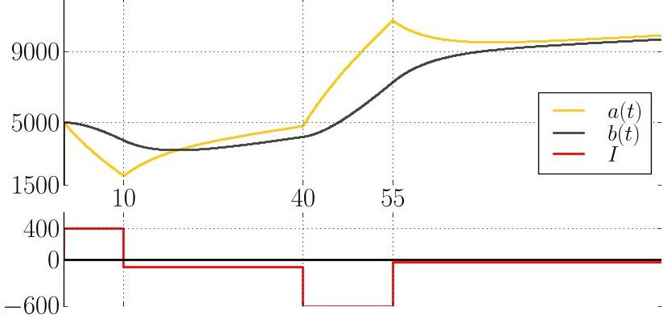

The initially available charge decreases heavily due to the load 400 but the restricted diffusion makes the bound charge decrease only slowly up to time 10; after that the battery undergoes a mild recharge, and so on. At all times the bound charge approaches the available charge by a speed proportional to the difference of the two values.

Coupled differential equations. The KiBaM can be visualized as two wells holding liquid, interconnected by a pipe that represents the diffusion of the two types of charge, as depicted on the right of Figure 1. The available charge well is exposed directly to the load I and connected to the bound charge well by a pipe of width p. Formally, the KiBaM is characterized by two coupled differential equations

$$
\dot {a} (t) = - I + p \left(\frac {b (t)}{1 - c} - \frac {a (t)}{c}\right), \quad \dot {b} (t) = p \left(\frac {a (t)}{c} - \frac {b (t)}{1 - c}\right).
$$

Here, the functions a(t) and b(t) describe the available and bound charge at time t respectively, $ \dot{a} (t) $ and $ \dot{b} (t) $ their time derivatives, I is a load on the battery. We refer to the parameter p as the diffusion rate between both wells, while parameter c $ \in [0,1] $ corresponds to the width of the available charge well, and 1-c is the width of the bound charge well. Intuitively, $ a(t)/c $ and $ b(t)/(1-c) $ are the level of the fluid stored in the available charge well and the bound charge well, respectively. In the following, we take a closer look at the properties of this concrete form of a dynamical system. In the end, this allows us to obtain tailor-made efficient analysis algorithms.

It is possible to derive a solution of the ODEs at time t when applying load I, for instance by using Laplace transforms. We can express it as a vector valued linear mapping $ \mathbf{K}_{t,I} $ taking the initial available and bound charge $ a_{0} $ and $ b_{0} $ as argument:

$$
\mathbf {K} _ {t, I} \left[ \begin{array}{l} a _ {0} \\ b _ {0} \end{array} \right] = \left[ \begin{array}{l l l} \mathrm {q} _ {a} & \mathrm {r} _ {a} & \mathrm {s} _ {a} \\ \mathrm {q} _ {b} & \mathrm {r} _ {b} & \mathrm {s} _ {b} \end{array} \right] \cdot \left[ \begin{array}{l} a _ {0} \\ b _ {0} \\ I \end{array} \right] \quad \text {w h e r e} \quad \begin{array}{l} \mathrm {q} _ {a} = (1 - c) \mathrm {e} ^ {- k t} + c, \\ \mathrm {r} _ {a} = - c \mathrm {e} ^ {- k t} + c, \\ \mathrm {s} _ {a} = \frac {(1 - c) \left(\mathrm {e} ^ {- k t} - 1\right)}{k} - t \cdot c \end{array}
$$

and $ \mathrm{q}_{b}=1-\mathrm{q}_{a}, $ $ \mathrm{r}_{b}=1-\mathrm{r}_{a}, $ $ \mathrm{s}_{b}=-t-\mathrm{s}_{a} $ and finally $ k=p/c(1-c). $ The coefficients $ \mathrm{s}_{a} $ and $ \mathrm{s}_{b} $ of I do not sum to 1, because the non-zero load I makes the total power in the battery change. The above definition of $ \mathbf{K}_{t,I} $ is a vector valued reformulation of equations found in [28].

As all vectors appearing in this paper are column vectors, we also denote them by semicolon notation $ [ a; b ] $ . Furthermore, whenever we compare two vectors, e.g., $ [ a; b ] \leq[ a^{\prime}; b^{\prime} ] $ , we interpret

<!-- PDF_PAGE: 6 -->

## 04:6 How Is Your Satellite Doing? Battery Kinetics with Recharging and Uncertainty

the order component-wise. When $ [ a_{0}; b_{0} ] $ and I are clear from context, we denote the SoC $ \mathbf{K}_{t, I} [ a_{0}; b_{0} ] $ at time t also simply by $ [ a_{t}; b_{t} ] $

Example 2. We can use the function K to obtain the final SoC for our example (for $ k=1/100 $ $ c=1/2 $ , and $ \circ $ denoting function composition) by

$$
\mathbf {K} _ {4 5, - 3 5} \circ \mathbf {K} _ {1 5, - 6 0 0} \circ \mathbf {K} _ {3 0, - 1 0 0} \circ \mathbf {K} _ {1 0, 4 0 0} [ 5 0 0 0; 5 0 0 0 ] \approx \mathbf {K} _ {4 5, - 3 5} [ 1 0 7 3 2; 7 2 6 8 ],
$$

and with the last step in more details (denoting $ \mathrm{e}^{- \frac{4 4}{1 0 0}} $ by E),

$$
= \left[ \begin{array}{c c c} \frac {1}{2} E + \frac {1}{2} & - \frac {1}{2} E + \frac {1}{2} & 5 0 E - 5 0 - \frac {4 4}{2} \\ - \frac {1}{2} E + \frac {1}{2} & \frac {1}{2} E + \frac {1}{2} & 5 0 - 5 0 E - \frac {4 4}{2} \end{array} \right] \cdot \left[ \begin{array}{c} 1 0 7 3 2 \\ 7 2 6 8 \\ - 3 5 \end{array} \right] = \left[ \begin{array}{c} - 1 8 E + 6 4 8 0 \\ 1 8 E + 8 0 2 0 \end{array} \right] \approx \left[ \begin{array}{c} 9 8 8 1 \\ 9 6 5 9 \end{array} \right].
$$

The first summands on the last line (with E) stand for the spread of the values before the recovery effect converges (as $ E\rightarrow0 $ for $ t\rightarrow\infty $ ). The second summands are different due to non-zero load I causing $ b_{t}-a_{t} $ to converge to I/k (for $ c=1/2 $ ).

Powering a task. A standard problem in battery modelling and evaluation is to find out whether a task can be performed with a given positive state of charge without depleting the battery, where positive is to be understood componentwise. A task is a pair (T, I) with T being the task execution time, and I representing the load, imposed for duration T.

Definition 3 (K-powering a task). For an execution time T and a load I, we say that a battery with a positive SoC $ [ a_{0}; b_{0} ] $ K-powers a task (T, I) iff $ \forall 0 < t \leq T : a_{t} > 0. $

Let us stress that the SoC of the battery evolves in negative numbers in the same way as in positive numbers because the differential equations do not have any explicit bounds. Furthermore, it is not monotonic with respect to time in the conventional sense.

Example 4. In our example, the bound charge is not monotonic on the interval [10,40], the available charge is not monotonic on [55,100]. However, for instance, on [40,55], available charge is the first to get above the value 9000 (and never crosses the boundary back down again).

We observe that the KiBaM is monotonic with respect to crossing a boundary $ \kappa $ when both wells start beyond this boundary.

Lemma 5. For any I $ \in $ R, $ \kappa\in $ R, $ \triangleright\in\{<,> \} $ $ [a_{0};b_{0}]\triangleright[c\kappa;(1-c)\kappa] $ and for t $ \in $ R $ > 0 $ such that $ a_{t}=c\kappa $ we have

$$
b _ {t} \triangleright (1 - c) \kappa
$$

(available charge is always the first to cross a boundary);

(available charge never crosses back for a given load).

$$
a _ {T} \nvdash c \kappa f o r a l l T > t
$$

Intuitively speaking, the first property states that the available charge is always the first to cross a boundary, the second property states that when the available charge crosses a boundary it never returns back (for a given load).

As a direct consequence of Lemma 5, we can easily find out whether the battery K-powers a task $ ( T, I ) $ by just observing the SoC at time point $ T $

Lemma 6. A battery with a positive SoC $ [a_{0};b_{0} ] $ K-powers a task (T,I) iff $ [a_{T};b_{T} ] > [0;0] $

<!-- PDF_PAGE: 7 -->

## 3 Random KiBaM

In order to consider the KiBaM as a stochastic object, it appears natural to consider the vector $ [ a_{0}; b_{0}; I] $ as being random. This reflects the perturbations of the load and of the initial SoC of the batteries. The latter is a real phenomenon, rooted in wear and manufacturing variances [9]. We thus assume the initial SoC to be random variables $ A_{0}, B_{0} $ jointly distributed according to a density function $ f_{0} $ , while the load on the battery is a random variable I independent of the SoC, endowed with a probability density function g.

Example 7. Instead of a single (Dirac) SoC, we now consider that the joint density $ f_{0} $ of the charge is, say, uniform over the area $ [4,6.5]\times[4,6.5] $ as depicted below.

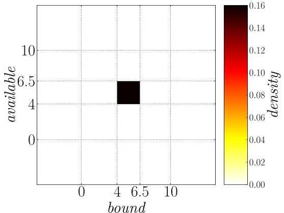

Here the values of the two-dimensional density are expressed using colours. Using similar plots, we shall illustrate how the SoC distribution evolves as the time passes on this particular example.

Evolution over time. We are interested in the random vector expressing the SoC after some time T for a constant (but random) load I. This is given by

$$
[ A _ {T}; B _ {T} ] := \mathbf {K} _ {T, I} [ A _ {0}; B _ {0} ].
$$

The core tool for studying the joint density of $ [ A_{T}; B_{T} ] $ is the transformation law for random variables, which enables the construction of unknown density functions from known ones if given the relation between the corresponding random variables. Formally, for every d-dimensional random vector $ \mathbf{X} $ and every injective and continuously differentiable function $ g : \mathsf{R}^{d}\rightarrow \mathsf{R}^{d} $ , we can express the density function of $ \mathbf{Y}\coloneqq g(\mathbf{X}) $ at value y in the range of g as

$$
f _ {\mathbf {Y}} (y) = f _ {\mathbf {X}} \left(g ^ {- 1} (y)\right) \cdot \left| \det \left(J _ {g ^ {- 1}} (y)\right) \right|
$$

where $ J_{g^{-1}}(y) $ denotes the Jacobian of $ g^{-1} $ evaluated at y. However, the mapping (2) is not invertible, thus we cannot directly apply the transformation law. Instead, we express the joint density conditioned by the random load I attaining some arbitrary but fixed value i. For this fixed i, we can exploit the specific structure of the KiBaM to express the transformation using an invertible linear mapping

$$
\mathbf {K} _ {T, i} \left[ \begin{array}{l} A _ {0} \\ B _ {0} \end{array} \right] = \left[ \begin{array}{l l} \mathrm {q} _ {a} & \mathrm {r} _ {a} \\ \mathrm {q} _ {b} & \mathrm {r} _ {b} \end{array} \right] \cdot \left[ \begin{array}{l} A _ {0} \\ B _ {0} \end{array} \right] + \left[ \begin{array}{l} \mathrm {s} _ {a} \\ \mathrm {s} _ {b} \end{array} \right] \cdot i.
$$

A straightforward inversion of the mapping results in

$$
\mathbf {K} _ {T, i} ^ {- 1} \left[ \begin{array}{l} a \\ b \end{array} \right] = \mathrm {e} ^ {k T} \left[ \begin{array}{c c c} \mathrm {r} _ {b} & - \mathrm {r} _ {a} & \mathrm {r} _ {a} \mathrm {s} _ {b} - \mathrm {r} _ {b} \mathrm {s} _ {a} \\ - \mathrm {q} _ {b} & \mathrm {q} _ {a} & \mathrm {q} _ {b} \mathrm {s} _ {a} - \mathrm {q} _ {a} \mathrm {s} _ {b} \end{array} \right] \cdot \left[ \begin{array}{l} a \\ b \\ i \end{array} \right].
$$

<!-- PDF_PAGE: 8 -->

## 04:8 How Is Your Satellite Doing? Battery Kinetics with Recharging and Uncertainty

Applying (3) we arrive at the joint density of $ [ A_{T}; B_{T} ] $ conditioned by $ I=i $

$$
f _ {T} (a, b \mid i) = f _ {0} \left(\mathbf {K} _ {T, i} ^ {- 1} [ a; b ]\right) \cdot \left| \mathrm {e} ^ {k T} \right|
$$

where $ \mathrm{e}^{k T} $ is the determinant of the Jacobian of $ \mathbf{K}_{T,i}^{-1}. $ Interestingly, it is constant in a, b and i, it only depends on T. It is also non-negative for $ T\geq0 $ as $ k>0 $ . Finally we get rid of the conditional $ I=i $ by marginalizing the variable $ [A_{T};B_{T}]. $ Intuitively, this averages the conditional densities over the distribution g of I, obtaining thus the following.

Lemma 8. Let T be execution time and g be load density. For an initial SoC $ f_{0} $ over $ [A_{0};B_{0}]$ and task (T,g), the joint distribution of $ [A_{T};B_{T}]$ is absolutely continuous with density $ f_{T} $ given by

$$
f _ {T} (a, b) = \mathrm {e} ^ {k T} \int_ {\mathrm {R}} f _ {0} \left(\mathbf {K} _ {T, i} ^ {- 1} [ a; b ]\right) \cdot g (i) \mathrm {d} i.
$$

Example 9. We return to our example assuming the density g of the load being uniform between $ [-0.1,0.1] $ . We can compute the SoC of the battery after task (20,g), displayed on the left, and (60,g), displayed on the right. Here, we arbitrarily chose the parameters c=0.5 and p=0.002.

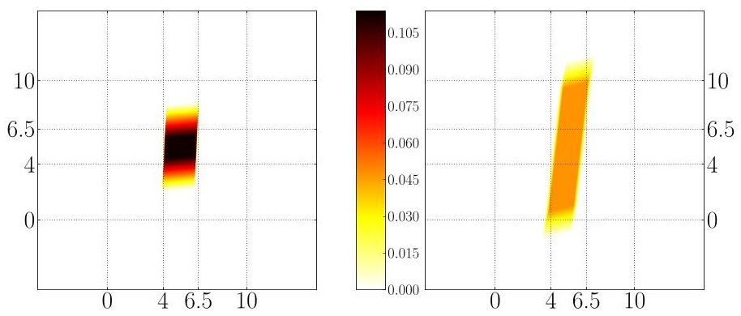

Probability of powering a task. We are now in the position to transfer the problem of powering a task to the stochastic setting. We say that a density $ f_{0} $ is positive if it supports only positive SoCs, i.e. for any a,b such that either a $ \leq0 $ or b $ \leq0 $ we have $ f_{0} ( a,b)=0. $

Definition 10 (Probability of K-powering a task). For an execution time $ T > 0 $ and a load density g, we say that the battery (with positive initial SoC $ f_{0} $ ）K-powers a task $ (T,g) $ with probability (at least) p>0 if

$$
\Pr [ \forall 0 \leq t \leq T: A _ {t} > 0 ] \geq p.
$$

Due to the monotonicity of KiBaM in the sense of Lemma 5, this is equivalent to observing the probability of depletion only at time T. From Lemma 8 we obtain the following.

Lemma 11. A battery with SoC $ f_{0} $ K-powers with probability $ p > 0 $ a task (T,g) if and only if

$$
\iint_ {\mathrm {R} _ {> 0} ^ {2}} f _ {T} (a, b) \mathrm {d} a \mathrm {d} b \geq p.
$$

Example 12. Thanks to the lemma, it suffices to perform the integration on the densities displayed in the previous plots in this running example. The probability to power the tasks (20,g) is 1, for the task (60,g) it is just $ \approx $ 0.968.

<!-- PDF_PAGE: 9 -->

## 4 Deterministic Limited KiBaM With Recharging

Both charging and discharging are well supported by the theory developed so far, as charging has occurred in our examples in the form of negative loads. What is not treated in the theory yet is a capacity limit. This however is an obvious real constraint in applications employing rechargeable batteries. To the best of our knowledge, charging in KiBaM while respecting its capacity restrictions has not been addressed even in the deterministic case. Thus, we dedicate this section to developing the deterministic setting first. In the next section, we extend the theory to the randomized setting.

We assume that the battery has capacity cap divided into capacity $ a_{\mathrm{m a x}}=c\cdot \mathrm{c a p} $ of the available charge well and capacity $ b_{\mathrm{m a x}}=(1-c)\cdot \mathrm{c a p} $ of the bound charge well. Charging and discharging are not fully symmetric: A battery with empty available charge can no longer power its task, contrary to a battery with full available charge that continues to operate. We thus need to consider its further charging behaviour.

When the available charge is at its capacity $ a_{\mathrm{max}}=c\cdot\mathrm{c a p} $ and is still further charged by a sufficiently high charging current, its value stays constant and only the bound charge increases due to diffusion. Hence, for any $ t\geq0 $ we have $ a(t)=c\cdot\mathrm{c a p} $ and thus $ \dot{a}(t)=0 $ . The equation for the bound charge from (1) is modified to an ODE

$$
\dot {b} (t) = p \left(\mathrm {c a p} - \frac {b (t)}{1 - c}\right).
$$

Staying at the upper limit. The differential equation above describes the behaviour of the battery at time t only if the incoming current to available charge well is sufficient to compensate the diffusion, i.e. $ - I \geq \dot{b} (t) $ . Since I is constant and the diffusion is decreasing over time, the charging current is sufficient at all times if and only if it is sufficient at time 0, i.e. $ - I \geq \dot{b} (0). $

For an initial bound charge $ b_{0} $ we define the condition whether the charging current is sufficient by

$$
I \leq \bar {I} \left(b _ {0}\right) := p \left(\frac {b _ {0}}{1 - c} - \mathrm {c a p}\right)
$$

which requires the initial bound charge to be close enough to its capacity so that the charging current overcomes the diffusion.

By solving the ODE (1) and using Inequation (4), we obtain the following result.

Lemma 13. Let $ T > 0 $ and $ b_{0} $ such that $ I \leq \bar{I} (b_{0}) $ . A battery with a SoC $ [a_{\mathrm{max}};b_{0}]$ reaches after the task (T, I) the state of charge $ [a_{\mathrm{max}};\bar{b}_{T}(b_{0})]$ where

$$
\bar {b} _ {T} \left(b _ {0}\right) = \mathrm {e} ^ {- c k T} b _ {0} + \left(1 - \mathrm {e} ^ {- c k T}\right) \cdot b _ {\max }
$$

and k again stands for p/ (c·(1-c)).

We notice that the resulting bound charge evolution $ \bar{b}_{T}(b_{0}) $ does not further depend on I, i.e. one cannot make the battery charge faster by increasing the charging current. Furthermore, for a fixed $ b_{0} $ , the curve of $ t\mapsto\bar{b}_{t}(b_{0}) $ is a negative exponential starting from the point $ b_{0} $ with the full capacity $ b_{\mathrm{max}} $ of the bound charge being its limit. Thus, Lemma 13 also reveals that the bound charge in finite time never reaches its capacity and there is no need to describe this situation separately. Finally, we denote analogously by $ \bar{\mathbf{K}}_{T}[a_{0};b_{0} ]=\left[ a_{0};\bar{b}_{T}(b_{0}) \right] $ the linear mapping describing the behaviour at the upper limit.

<!-- PDF_PAGE: 10 -->

## 04:10 How Is Your Satellite Doing? Battery Kinetics with Recharging and Uncertainty

Hitting the upper limit. When charging with a given constant load I, we have two modes of behaviour of the battery:

(i) before the available charge hits $ a_{\mathrm{max}} $ and

(ii) after it hits (and stays at) $ a_{\mathrm{max}}. $

The remaining question is when it hits that capacity limit. For a given initial state $ [ a_{0}; b_{0} ]<[ a_{\mathrm{max}}; b_{\mathrm{max}} ] $ and a load I, this amounts to finding $ \bar{t}\in\mathsf{R}_{>0} $ such that $ a_{\bar{t}}=a_{\mathrm{max}} $ . This induces that the following equation can be derived from $ \mathbf{K}_{\bar{t},I}[a_{0}; b_{0}], $

$$
u \cdot \mathrm {e} ^ {- k \bar {t}} + v \cdot \bar {t} + w = a _ {\mathrm {m a x}}
$$

where $ u=a_{0} \left( 1-c\right)-b_{0} c+\left( c+1\right) \cdot I / k $ , $ v=-I c $ , and $ w=a_{\mathrm{max}}-a_{0} c-b_{0} c-\left( 1-c\right) \cdot I / k $ . In this equation, $ \bar{t} $ appears in an exponential as well as in a linear term. This is characteristic for a non-elementary function $ \mathcal{W} $ called product logarithm which can express the solution as

$$
\bar {t} = - \mathcal {W} \left(\frac {u}{v} \cdot \mathrm {e} ^ {- \frac {w}{v}}\right) - \frac {w}{v}.
$$

The product log function can approximated by numerical methods [11].

Integrating the two modes of behaviour. All the previous building blocks allow us to express easily the SoC of a deterministic KiBaM after powering a given task (T,I) when considering capacity limits. We define it as

$$
\mathbf {K} _ {T, I} ^ {\square} \left[ a _ {0}; b _ {0} \right] := \left\{ \begin{array}{l l} \mathbf {K} _ {T, I} \left[ a _ {0}; b _ {0} \right] & \text {i f} a _ {0} > 0 \wedge 0 < a _ {T} \leq a _ {\max }, \\ \bar {\mathbf {K}} _ {t} \circ \mathbf {K} _ {\bar {t}, I} \left[ a _ {0}; b _ {0} \right] & \text {i f} a _ {0} > 0 \wedge a _ {T} > a _ {\max }, \\ [ 0; 0 ] & \text {i f} a _ {0} = 0 \vee 0 \geq a _ {T} \end{array} \right.
$$

where $ \bar{t} $ is the largest solution of (6) and $ t=T-\bar{t}. $

The first two cases in $ \mathbf{K}_{T,I}^{\Box} $ match the behaviour explained earlier thanks to Lemma 5. Whenever the upper limit is hit, it will never be crossed back with the given I and thus also I is sufficient according to (4).

Example 14. If we put a limit of 9000 to the previous scenario, the battery ends up with a slightly smaller charge at time 100. The computation of the final SoC changes only in the interval [40,55]. Here, instead of $ \mathbf{K}_{1 5,-6 0 0} $ , we apply $ \mathbf{K}_{\bar{t},-6 0 0} $ for the first $ \bar{t}\approx 7. 8 $ time units, followed by $ \bar{\mathbf{K}}_{1 5-\bar{t}}. $

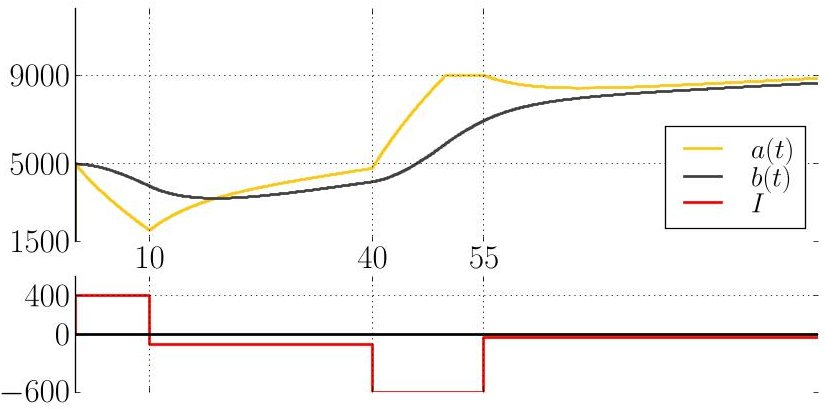

Similarly to Section 2, we establish the notion of $ \mathbf{K}^{\Box} $ -powering a task.

$ \triangleright $ Definition 15 ( $ \mathbf{K}^{\Box} $ -Powering a task). A battery with a positive SoC $ [a_{0};b_{0}]$ $ \mathbf{K}^{\Box} $ -powers a task (T, I) if $ \forall 0<t\leq T: a_{t}>0 $ where each $ [a_{t};b_{t}]$ denotes $ \mathbf{K}_{t,I}^{\Box}[a_{0};b_{0}]. $

Lemma 16. A battery with a positive SoC $ [ a_{0}; b_{0} ] $ $ \mathbf{K}^{\Box} $ -powers a task (T, I) if and only if $ \mathbf{K}_{T, I}^{\Box} [ a_{0}; b_{0} ] > [ 0; 0 ] $ .

<!-- PDF_PAGE: 11 -->

Computing $ \mathbf{K}^{\Box} $ efficiently. The problematic part in computing $ \mathbf{K}^{\Box} $ is the case $ a_{t} > a_{\mathrm{max}} $ when the upper limit is reached at time $ \bar{t} < t $ ; we cannot express such time $ \bar{t} $ exactly. This case also disallows exact closed-form expressions in the next section where we address the limited KiBaM with randomness. For these reasons we introduce under- and over-approximations of the SoC using simple closed-form expressions. These approximations are employed in Sections 5 to 7 to obtain elegant expressions and also efficient algorithms.

Over-approximation: We circumvent the computation of the time point $ \bar{t} $ by moving it to time 0, i.e. to the beginning of the time interval. We assume that the available charge attains $ a_{\mathrm{max}} $ during the whole time interval and the bound charge evolves all the time as captured by $ \bar{\mathbf{K}}_{t}. $

Under-approximation: Dually, we move the time point $ \bar{t} $ to time $ T $ , i.e. to the end of the time interval. We assume that the charging current has such value $ I^{\rightarrow} $ (which is a weaker charging current than I) that causes the available charge to reach $ a_{\mathrm{max}} $ exactly at the end of the interval. The battery thus evolves all the time as captured by $ \mathbf{K}_{t,I^{\rightarrow}} $ . Expressing $ I^{\rightarrow} $ is discussed below.

Example 17. Let us illustrate both approximations on the same situation as in Example 14. For the under-approximation (on the left), in the interval [40,55], we apply $ I^{\rightarrow} \approx-4 3 2. 5 $ instead of $ I=-6 0 0 $ so that the available charge reaches 9000 exactly at $ t=5 5 $ . From here on, the SoC is in both components lower than the SoC from the previous figure.

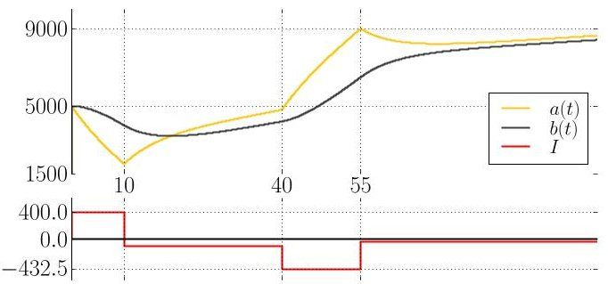

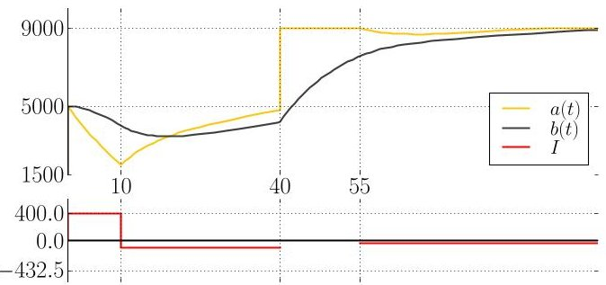

For the over-approximation (on the right), in the interval [40,55], we intuitively apply a load $ I \rightarrow -\infty $ so that the available charge reaches 9000 exactly at $ t=40 $ . Since the diffusion is finite, the available charge stays at its limit until $ t=55 $ while the bound charge evolves according to $ \bar{\mathbf{K}} $ From this point on, the SoC is in both components higher than the SoC from the previous figure.

Finally, we need a closed-form solution to the following problem: From an initial SoC $ [a; b] $ , we want to reach using K a certain target level of available charge $ \bar{a} $ exactly at time T; which current I achieves this? (For the under-approximation above, we instantiate the problem with $ \bar{a}=a_{\mathrm{max}}. $ )

Formally, we need to find I such that the first component of $ \mathbf{K}_{T,I}[a;b] $ equals $ \bar{a} $ . The resulting current will be denoted by $ I_{\bar{a}}^{\rightarrow}[a;b] $ . Later, we also need the solution of the same problem for $ \mathbf{K} $ 's inverse operator $ \mathbf{K}^{-1} $ . In this case the question is: From an initial available charge level $ \bar{a} $ , which current I is necessary to exactly reach a SoC $ [a;b] $ at time T? More precisely, find I such that the first component of $ \mathbf{K}_{T,I}^{-1}[a;b] $ equals $ \bar{a} $ . We denote the current that solves this problem by $ I_{\bar{a}}^{\leftarrow}[a;b] $ From the above equalities we can derive that these currents are indeed unique, and given by

$$
\begin{array}{l} I _ {\bar {a}} ^ {\rightarrow} [ a; b ] = - \frac {\mathrm {q} _ {a}}{\mathrm {s} _ {a}} \cdot a - \frac {\mathrm {r} _ {a}}{\mathrm {s} _ {a}} \cdot b + \frac {\bar {a}}{\mathrm {s} _ {a}}, \\ I _ {\bar {a}} ^ {\leftarrow} [ a; b ] = \frac {- \mathrm {r} _ {b} \cdot a + \mathrm {r} _ {a} \cdot b + \left(\mathrm {q} _ {a} \mathrm {r} _ {b} - \mathrm {r} _ {a} \mathrm {q} _ {b}\right) \cdot \bar {a}}{\mathrm {r} _ {a} \mathrm {s} _ {b} - \mathrm {s} _ {a} \mathrm {r} _ {b}}. \\ \end{array}
$$

The bound charge attained under $ \mathbf{K}_{T, I_{\vec{a}}^{\rightarrow}} $ and $ \mathbf{K}_{T, I_{\vec{a}}^{\leftarrow}}^{-1} $ is denoted by $ B_{\vec{a}}^{\rightarrow}[a; b] $ and $ B_{\vec{a}}^{\leftarrow}[a; b] $ , respectively. In the operators $ I_{\vec{a}}^{\rightarrow}, I_{\vec{a}}^{\leftarrow}, B_{\vec{a}}^{\rightarrow}, B_{\vec{a}}^{\leftarrow} $ , we omit the initial SoC $ [a; b] $ , if clear from context.

<!-- PDF_PAGE: 12 -->

## 04:12 How Is Your Satellite Doing? Battery Kinetics with Recharging and Uncertainty

It is now straight-forward to provide operators $ \underline{\mathbf{K}}_{t,i}^{\Box} $ and $ \overline{\mathbf{K}}_{t,i}^{\Box} $ that formally characterize the under- and over-approximations from above.

$$
\underline {{\mathbf {K}}} _ {t, i} ^ {\square} \left[ a _ {0}; b _ {0} \right] := \left\{ \begin{array}{l l} \mathbf {K} _ {t, i} \left[ a _ {0}; b _ {0} \right] & \text {i f} a _ {0}, a _ {t} > 0 \wedge a _ {t} \leq a _ {\max }, \\ \mathbf {K} _ {t, I _ {\overrightarrow {a} _ {\max}}} \left[ a _ {0}; b _ {0} \right] & \text {i f} a _ {0}, a _ {t} > 0 \wedge a _ {t} > a _ {\max }, \\ [ 0; 0 ] & \text {i f} a _ {0} \leq 0 \vee a _ {t} \leq 0. \end{array} \right.
$$

$$
\bar {\mathbf {K}} _ {t, i} ^ {\square} \left[ a _ {0}; b _ {0} \right] := \left\{ \begin{array}{l l} \mathbf {K} _ {t, i} \left[ a _ {0}; b _ {0} \right] & \text {i f} a _ {0}, a _ {t} > 0 \wedge a _ {t} \leq a _ {\max }, \\ \bar {\mathbf {K}} _ {t} \left[ a _ {\max }; b _ {0} \right] & \text {i f} a _ {0}, a _ {t} > 0 \wedge a _ {t} > a _ {\max }, \\ [ 0; 0 ] & \text {i f} a _ {0} \leq 0 \vee a _ {t} \leq 0. \end{array} \right.
$$

$ \underline{\mathbf{K}}_{t,i}^{\Box} $ and $ \overline{\mathbf{K}}_{t,i}^{\Box} $ are indeed under- and over-approximation of the exact SoC evolution $ \mathbf{K}^{\Box} $ in the following sense.

Lemma 18. For any SoCs [a;b] and T>0 and I>0, we have

$$
\underline {{\mathbf {K}}} _ {T, I} ^ {\square} [ a; b ] \leq \mathbf {K} _ {T, I} ^ {\square} [ a; b ] \leq \overline {{\mathbf {K}}} _ {T, I} ^ {\square} [ a; b ].
$$

## 5 Random Limited KiBaM With Recharging

We now return our attention to the challenge of random KiBaM, enriched by capacity limits. We thus assume that the random variables $ A_{t} $ and $ B_{t} $ evolve according to $ \mathbf{K}_{t,I}^{\Box} $ developed in Section 4. By overloading notation we change (2) to

$$
[ A _ {t}; B _ {t} ] := \mathbf {K} _ {t, I} ^ {\square} [ A _ {0}; B _ {0} ].
$$

We first observe that the joint distribution of $ [ A_{T}; B_{T} ] $ may not be absolutely continuous, because positive probability may accumulate in the point [0;0] where the battery is empty and on the line $ \{[ a_{\mathrm{max}}; b ] \mid 0 < b < b_{\mathrm{max}} \} $ where the available charge is full. We need a more complex representation of the distribution.

Definition 19. A SoC distribution is a triple $ \langle f,\bar{f},z\rangle $ where

$f$ is a joint density over $]0,a_{\max}[ \times ]0,b_{\max}[,$ (the distribution in the "inner" area)

$ \bar{f} $ is a density over $ \{a_{\max}\} \times ]0,b_{\max}[,$ (bound charge distribution along the capacity limit)

$ z \in[0,1]. $ (the cumulative probability of depletion)

We say that a SoC distribution $ \langle f_{t},\bar{f}_{t},z_{t}\rangle $ represents random variables $ [A_{t};B_{t}]$ if for any measurable $ X\subseteq\mathsf{R}\times\mathsf{R} $ we have

$$
\Pr \left[ \left[ A _ {t}; B _ {t} \right] \in X \right] = \iint_ {[ a; b ] \in X} f _ {t} (a, b) \mathrm {d} a \mathrm {d} b + \iint_ {[ a _ {\max }; b ] \in X} \bar {f} _ {t} (b) \mathrm {d} b + z _ {t} \mathbf {1} _ {[ 0; 0 ] \in X}
$$

where $ \mathbf{1}_{\varphi} $ denotes the indicator function of a condition $ \varphi. $

Similarly to Section 3, we assume random load I described by a probability density function g. For random initial SoC $ [ A_{0}; B_{0} ] $ represented by a SoC distribution $ \langle f_{0},\bar{f}_{0},z_{0}\rangle $ and a given task $ (T,g) $ we aim at expressing the resulting SoC $ [ A_{T}; B_{T} ] $ using a SoC distribution $ \langle f_{T},\bar{f}_{T},z_{T}\rangle. $

To be able to express the distribution as integrals over simple closed-form expressions, we resort to under- and over-approximations of the SoC. We will work with $ \lfloor d \rfloor $ and $ \lceil d \rceil $ as notations for upper, respectively lower bounding SoC distributions, where d abbreviates the three components of the triple $ \langle f_{T},\bar{f}_{T},z_{T}\rangle $ (i.e. $ \lfloor f_{T},\bar{f}_{T},z_{T}\rfloor $ and $ \lceil f_{T},\bar{f}_{T},z_{T}\rceil $ ). To arrive there, we define

$$
[ \underline {{A}} _ {T}; \underline {{B}} _ {T} ] := \underline {{\mathbf {K}}} _ {T, I} ^ {\square} [ A _ {0}; B _ {0} ] \qquad \mathrm {a n d} \qquad [ \overline {{A}} _ {T}; \overline {{B}} _ {T} ] := \overline {{\mathbf {K}}} _ {T, I} ^ {\square} [ A _ {0}; B _ {0} ]
$$

respectively, that under-approximate and over-approximate $ [ A_{T}; B_{T} ] $ in the following sense.

<!-- PDF_PAGE: 13 -->

Definition 20. We say that $ [\underline{A}_{T};\underline{B}_{T} ] $ under-approximates $ [A_{T};B_{T} ] $ at the upper limit if

$$
\begin{array}{l} \Pr \left[ \left[ A _ {T}; B _ {T} \right] \geq [ a; b ] \right] = \Pr \left[ \left[ \underline {{A}} _ {T}; \underline {{B}} _ {T} \right] \geq [ a; b ] \right] \quad \text {f o r a n y} [ a; b ] < \left[ a _ {\max }; b _ {\max } \right], \\ \Pr \left[ \left[ A _ {T}; B _ {T} \right] \geq \left[ a _ {\max }; b \right] \right] \geq \Pr \left[ \left[ \underline {{A}} _ {T}; \underline {{B}} _ {T} \right] \geq \left[ a _ {\max }; b \right] \right] \quad \text {f o r a n y} 0 \leq b \leq b _ {\max }. \\ \end{array}
$$

Analogously, $ \left[ \overline{A}_{T};\overline{B}_{T}\right] $ over-approximates $ [A_{T};B_{T}]$ at the upper limit if

$$
\begin{array}{l} \Pr \left[ \left[ A _ {T}; B _ {T} \right] \geq [ a; b ] \right] = \Pr \left[ \left[ \bar {A} _ {T}; \bar {B} _ {T} \right] \geq [ a; b ] \right] \quad \text {f o r a n y} [ a; b ] < \left[ a _ {\max }; b _ {\max } \right], \\ \Pr \left[ \left[ A _ {T}; B _ {T} \right] \geq \left[ a _ {\max }; b \right] \right] \leq \Pr \left[ \left[ \bar {A} _ {T}; \bar {B} _ {T} \right] \geq \left[ a _ {\max }; b \right] \right] \quad \text {f o r a n y} 0 \leq b \leq b _ {\max }. \\ \end{array}
$$

This approach, detailed in the rest of this section, provides upper and lower bounds on the risk of battery depletion due to the monotonicity established in Lemma 28.

Behaviour below the upper limit (defining $ f_{T} $ and $ z_{T} $ ). We first define a joint density $ \underline{f}_{T} $ over $ ]-\infty, a_{\max}[\times ]-\infty, b_{\max}[$ that exactly describes the behaviour below the upper limit while ignoring the lower limit. This allows us to define

$$
f _ {T} (a, b) := \underline {{f}} _ {T} (a, b), \quad \text {a n d} \quad z _ {T} := \iint_ {\mathrm {R} _ {\leqslant 0} ^ {2}} \underline {{f}} _ {T} (a, b) \mathrm {d} a \mathrm {d} b.
$$

Note that for this case both, under- and over-approximation, behave equally, as indicated in Definition 20.

The intricate part in expressing $ \underline{f}_{T} $ is to describe how the SoC evolves away from the upper limit to the area below the upper limit when the level of available charge is decreasing. For each SoC $ [a^{\prime};b^{\prime}]$ below the upper limit we need to find out what SoC of the form $ [a_{\mathrm{max}};b] $ under what load i (such that i> $ \bar{I} (b) $ ) would evolve in time T exactly into $ [a^{\prime};b^{\prime}]$ , i.e $ \mathbf{K}_{T,i}^{-1}[a^{\prime};b^{\prime}]=[a_{\mathrm{max}};b] $ By definition, this is the case when using load $ I_{a_{\mathrm{max}}}^{\leftarrow}[a^{\prime};b^{\prime}] $ which results in a bound charge $ b=B_{a_{\mathrm{max}}}^{\leftarrow}[a^{\prime};b^{\prime}] $ . The Jacobian determinant of the map $ [a;b]\mapsto\left[B_{a_{\mathrm{max}}}^{\leftarrow};I_{a_{\mathrm{max}}}^{\leftarrow}\right] $ is easily derived to be $ 1 / (\mathrm{r}_{a}\mathrm{s}_{b}-\mathrm{s}_{a}\mathrm{r}_{b}) $ and is constant in the SoC and the load.

Finally, we can express the joint density $ f_{T} $ for any $ a < a_{\mathrm{max}} $ and $ b < b_{\mathrm{max}} $ as

$$
\underline {{f}} _ {T} (a, b) = \bar {f} _ {0} \left(B _ {a _ {\max }} ^ {\leftarrow}\right) \cdot \frac {1}{\left| \mathrm {r} _ {a} \mathrm {s} _ {b} - \mathrm {s} _ {a} \mathrm {r} _ {b} \right|} \cdot g \left(I _ {a _ {\max }} ^ {\leftarrow}\right) + \mathrm {e} ^ {k T} \int_ {- \infty} ^ {I _ {a _ {\max }} ^ {\leftarrow}} f _ {0} \left(\mathbf {K} _ {T, i} ^ {- 1} [ a; b ]\right) \cdot g (i) \mathrm {d} i.
$$

The second summand in (9) comes from the density $ f_{0} $ of the inner area by the standard unlimited KiBaM. Ranging over all loads i, it integrates the density $ f_{0} $ of such points $ [a_{i};b_{i}]$ that satisfy $ \mathbf{K}_{T,i}[a_{i};b_{i}]=[a;b] $ , i.e. $ [a_{i};b_{i}]=\mathbf{K}_{T,i}^{-1}[a;b] $ . Lemma 5 again guarantees that no limits are crossed in the meantime. The first summand comes from $ \bar{f}_{0} $ , due to discharging the battery down from the capacity limit as discussed above.

Behaviour on the upper limit (defining $ \bar{f}_{T} $ ). As indicated in Definition 20, we resort for the upper limit to approximations of the charge.

Under-approximation: We define the under-approximation of the density for $ 0\leq b\leq b_{\mathrm{max}} $ by

$$
\bar {f} _ {T} (b) = \bar {f} _ {0} \left(\bar {b} ^ {- 1}\right) \cdot G \left(\bar {I} \left(\bar {b} ^ {- 1}\right)\right) \cdot \mathrm {e} ^ {c k T}
$$

$$
+ \bar {f} _ {0} \left(B _ {a _ {\max }} ^ {\leftarrow}\right) \cdot \left[ G \left(I _ {a _ {\max }} ^ {\leftarrow}\right) - G \left(\bar {I} \left(B _ {a _ {\max }} ^ {\leftarrow}\right)\right) \right] \cdot \left| \frac {- \mathrm {s} _ {a}}{\mathrm {r} _ {a} \mathrm {s} _ {b} - \mathrm {s} _ {a} \mathrm {r} _ {b}} \right|
$$

$$
+ \int_ {- \infty} ^ {\infty} f _ {0} \left(a, B _ {a} ^ {\leftarrow}\right) \cdot G \left(I _ {a} ^ {\leftarrow}\right) \mathrm {d} a \cdot \left| \frac {- \mathrm {s} _ {a}}{\mathrm {r} _ {a} \mathrm {s} _ {b} - \mathrm {s} _ {a} \mathrm {r} _ {b}} \right|
$$

<!-- PDF_PAGE: 14 -->

Let us go through this expression line by line.

In the first summand (10), $ \bar{b}^{-1} $ is such that $ \bar{\mathbf{K}}_{T}\left[a_{\mathrm{max}}; \bar{b}^{-1}\right]=\left[a_{\mathrm{max}}; b\right] $ . Thus $ \bar{b}^{-1}\coloneqq \bar{b}_{T}^{-1}(b)=\mathrm{e}^{ckT}\cdot b-\left(\mathrm{e}^{ckT}+1\right)\cdot b_{\mathrm{max}} $ where the function $ \bar{b}_{T} $ is defined in Definition 5. This summand is taken into account only for charging currents that cover the diffusion (i.e. $ i\leq \bar{I}\left(\bar{b}^{-1}\right) $ ) so that the battery evolves along the capacity limit as expressed by Lemma 13. The integration over this range of loads can be directly expressed using the cumulative density function (cdf) G of the load. Technically, we again apply the transformation law for random variables.

By the second summand (11), we address the case where the diffusion in the state $ [ a_{\mathrm{max}}; b ] $ is stronger than the charging current. The available charge thus leaves its limit in the beginning. Let us assume that before time T it again hits the upper capacity in some state $ [ a_{\mathrm{max}}; b^{\prime} ] $ . We are not able to express b using a closed-form expression over $ b^{\prime} $ as discussed in Section 4. As a result, we cannot "move" the density from b to $ b^{\prime} $ . We thus under-approximate the bound charge by assuming that the available charge hits its upper limit again exactly at time T by charging the battery with $ I_{a_{\mathrm{max}}}^{\rightarrow} $ instead, just as shown in Example 17. Let us shortly outline the derivation. The mapping for the transformation law is $ b \mapsto B_{a_{\mathrm{max}}}^{\rightarrow} [ a_{\mathrm{max}}; b ] $ . Its inverse is simply $ b \mapsto B_{a_{\mathrm{max}}}^{\leftarrow} [ a_{\mathrm{max}}; b ] $ with Jacobian determinant $ -\mathrm{s}_{a} / \left(\mathrm{r}_{a}\mathrm{s}_{b}-\mathrm{s}_{a}\mathrm{r}_{b}\right) $ . The transformation law yields a density at time T of

$$
\bar {f} _ {0} \left(B _ {a _ {\max }} ^ {\leftarrow} \left[ a _ {\max }; b \right]\right) \cdot | - \mathrm {s} _ {a} / \left(\mathrm {r} _ {a} \mathrm {s} _ {b} - \mathrm {s} _ {a} \mathrm {r} _ {b}\right) |.
$$

Then we integrate over all charging currents i that are powerful enough to reach the limit $ ( i \leq I_{a_{\max}}^{\leftarrow}[a_{\max};b] ) $ yet not too powerful to leave the upper limit in the meantime, i.e. $ i > $ $ \bar{I}\left(B_{a_{\max}}^{\leftarrow}[a_{\max};b]\right). $ The integral over the resulting range equals $ G\left(I_{a_{\max}}^{\leftarrow}\right)-G\left(\bar{I}\left(B_{a_{\max}}^{\leftarrow}\right)\right). $

The third summand (12) comes from the density $ f_{0} $ of the inner area and under-approximates the bound charge similarly to the second summand. If the available charge of the battery reaches its capacity limit before time T, we assume that it reaches it exactly at time T by underestimating the charging current with $ I_{a_{\max}}^{\rightarrow} $ . For the derivation, we define a map $ \mathcal{K}_{T}: $ $ [a;b;i]\mapsto\left[a;B_{a_{\max}}^{\rightarrow}[a;b];i\right] $ (it is an identity in the first and the third component to be injective) and apply the transformation law of random variables. The inverse $ \mathcal{K}_{T}^{-1} $ and its Jacobian determinant is

$$
\mathcal {K} _ {T} ^ {- 1}: [ a; b; i ] \mapsto [ a; B _ {a} ^ {\leftarrow} [ a _ {\max }; b ]; i ] \qquad \mathrm {a n d} \qquad \mathbf {d e t} J _ {\mathcal {K} _ {T} ^ {- 1}} = - \mathrm {s} _ {a} / \left(\mathrm {r} _ {a} \mathrm {s} _ {b} - \mathrm {s} _ {a} \mathrm {r} _ {b}\right).
$$

The density $ h_{T} $ over the co-domain of $ \mathcal{K}_{T} $ is obtained by the transformation law as

$$
h _ {T} [ a; b; i ] = h _ {0} \left(\mathcal {K} _ {T} ^ {- 1} [ a; b; i ]\right) \cdot \left| \frac {- \mathrm {s} _ {a}}{\mathrm {r} _ {a} \mathrm {s} _ {b} - \mathrm {s} _ {a} \mathrm {r} _ {b}} \right| = f _ {0} \left(a, B _ {a} ^ {\leftarrow} \left[ a _ {\max } ; b \right]\right) \cdot g (i) \cdot \left| \frac {- \mathrm {s} _ {a}}{\mathrm {r} _ {a} \mathrm {s} _ {b} - \mathrm {s} _ {a} \mathrm {r} _ {b}} \right|
$$

where the density $ h_{0} $ equals a product of the densities $ f_{0} $ and g because of independence of SoC $ [a;b] $ and load i. Marginalizing away a and i (using $ G(I_{a}^{\leftarrow}} $ ) to integrate over all currents necessary to reach the upper limit) gives us the subdensity from the third summand.

Over-approximation: The over-approximation bases on similar building blocks and equals:

$$
\bar {f} _ {T} (b) = \bar {f} _ {0} \left(\bar {b} ^ {- 1}\right) \cdot G \left(I _ {a _ {\max }} ^ {\rightarrow}\right) \cdot \mathrm {e} ^ {c k T} + \int_ {- \infty} ^ {\infty} f _ {0} \left(a, \bar {b} ^ {- 1}\right) \cdot G \left(I _ {a _ {\max }} ^ {\rightarrow}\right) \mathrm {d} a \cdot \mathrm {e} ^ {c k T}
$$

The first summand in (13) treats the contribution of the density $ \bar{f}_{0} $ from the point $ \bar{b}^{-1} $ as defined above. We assume the density evolves as indicated by $ \bar{\mathbf{K}} $ whenever $ \mathbf{K} $ would result in $ a_{T}\geq a_{\mathrm{max}} $ (i.e. if the current is stronger than $ I_{a_{\mathrm{max}}}^{\rightarrow}\left[a_{\mathrm{max}}; \bar{b}^{-1}\right] $ ). This is an over-approximation for the charging currents such that $ \bar{I}\left(\bar{b}^{-1}\right)<i<I_{a_{\mathrm{max}}}^{\rightarrow}\left[a_{\mathrm{max}}; \bar{b}^{-1}\right] $ , i.e. for charging currents that are not strong enough to stay at $ a_{\mathrm{max}} $ for the whole time but that are stronger than what is needed for $ \mathbf{K} $ to return to $ a_{\mathrm{max}} $ at time $ T $ .

<!-- PDF_PAGE: 15 -->

The second summand in (13) comes from the density $ f_{0} $ of the inner area. Again, whenever $ \mathbf{K} $ would result in $ a_{T}>a_{\mathrm{max}} $ (i.e. when the charging current is stronger than $ I_{a_{\mathrm{max}}}^{\rightarrow}\left[ a; \bar{b}^{-1}\right] $ ), we assume that the upper limit is reached immediately and further evolves by $ \bar{\mathbf{K}} $ , thus justifying the argument $ I_{a_{\mathrm{max}}}^{\rightarrow} $ to appear in the integral. This results in an over-approximation for any such SoC.

The derivation of both summands in principle uses the mapping $ [a; b; i] \mapsto[a; \bar{b}_{T}(b); i]$ (for the first summand, think of a being the constant $ a_{\mathrm{max}} $ ). The transformation law and marginalizing away a (for the second summand) and i (integration over the corresponding range is again expressed using the cdf G) as in the derivations for the under-approximation provide the result.

We finally obtain the following result.

Lemma 21. Let (T,g) be a task, $ \langle f_{0},\bar{f}_{0},z_{0}\rangle $ represent $ [A_{0};B_{0}]$ and the induced SoC distributions $ \left[f_{T},\bar{f}_{T},z_{T}\right] $ and $ \left[f_{T},\bar{f}_{T},z_{T}\right] $ represent $ [\underline{A}_{T};\underline{B}_{T}]$ and $ [\overline{A}_{T};\overline{B}_{T}]. $ Then $ [\underline{A}_{T};\underline{B}_{T}]$ underapproximates $ [A_{T};B_{T}]$ and $ [\overline{A}_{T};\overline{B}_{T}]$ over-approximates $ [A_{T};B_{T}]$ at the upper limit.

Example 22. Based on Lemma 21, we can under-approximate the SoC of the random battery from our second running example for battery limits [0,10]. We consider the same tasks, (20,g) on the left and (60,g) on the right.

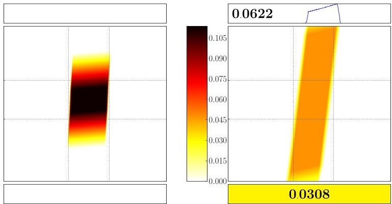

The bounded area of the joint density $ f_{T} $ is depicted by the largest box. In the small box above we display the density $ \bar{f}_{T} $ at the capacity limit $ a_{\mathrm{max}} $ . The numbers above and below are the probabilities of available charge being full and empty, respectively (the color below corresponds to the probability).

Lemma 23 (Probability of $ K^{\Box} $ -powering a task). A battery with SoC distribution $ \langle f_{0},\bar{f}_{0},z_{0}\rangle $ $ K^{\Box} $ -powers with probability $ p>0 $ a task (T,g) if and only if $ z_{T}<p. $

## 6 Markov Task Process

So far, we have only discussed execution of one task with fixed duration and random load. In this section, we give a discrete-time Markov model that randomly generates tasks that we call a Markov task process (MTP). The formalism is closely inspired by stochastic task graph models [34] or data-flow formalisms such as SDF [26] or SADF [38]. In SDF, task durations are deterministic, and thus directly supported in our framework. In SADF, durations are in general governed by discrete probability distributions, which can be translated into our framework at the price of a larger state space. We will briefly explain informally how to translate timed versions of SDF as well as SADF to MTPs, after formally introducing the latter.

Definition 24. A Markov task process (MTP) is a tuple $ \mathcal{M}=(S,P,\pi ,\Delta ,\mathbf{g}) $ where S is a finite set of tasks, P: $ S\times S\rightarrow[0,1] $ is a transition probability matrix, $ \pi $ is an initial probability distribution over S, $ \Delta :S\rightarrow\mathbf{N}\smallsetminus\{0\} $ assigns to each task an positive integer time duration, and $ \mathbf{g} $ assigns to each task a probability density function of the load.

<!-- PDF_PAGE: 16 -->

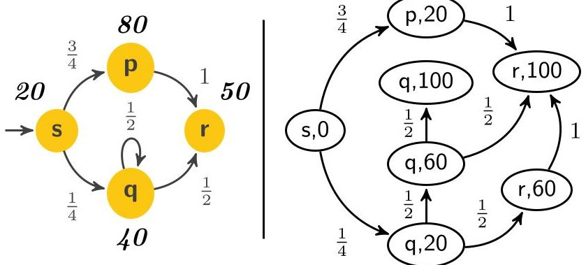

Figure 2 An MTP model on the left (with $ \Delta $ depicted next to states) and its induced graph for $ T=100 $ on the right.

An example of an MTP is depicted in Figure 2. Intuitively, a Markov task process $ \mathcal{M} $ together with an initial distribution of the SoC given by $ \left\langle f_{0},\bar{f}_{0},z_{0}\right\rangle $ behaves as follows. First, an initial SoC $ [a_{0};b_{0}] $ of the battery and an initial task $ s_{0}\in S $ are chosen independently at random according to $ \left\langle f_{0},\bar{f}_{0},z_{0}\right\rangle $ , and $ \pi $ , respectively. Then, the load $ i_{0} $ in task $ s_{0} $ is picked randomly according to $ \mathbf{g}(s_{0}) $ . After the battery is strained by the load $ i_{0} $ for $ \Delta(s_{0}) $ time units, the process moves into a random successor task $ s_{1} $ (where any $ s_{1} $ is chosen with probability $ P(s_{0},s_{1})) $ . Here, the load $ i_{1} $ is randomly chosen and so on.

Formally, $ \mathcal{M} $ and $ \langle f_{0},\bar{f}_{0},z_{0}\rangle $ induce a probability measure $ \mathbf{Pr} $ over samples of the form $ \omega=\left[ \left[ a_{0};b_{0}\right];\left(s_{k},i_{k}\right)_{k=0}^{\infty}\right] $ where the first component is the initial SoC of the battery and the second component describes an infinite execution of $ \mathcal{M} $ . Here, each $ s_{j} $ is the j-th task and $ i_{j} $ is the load that is put on the battery for $ \Delta(s_{j}) $ time units while performing $ s_{j} $ . For a given $ T\in\mathsf{R}_{\geqslant0} $ , the SoC of the battery at time T is expressed by random variables $ A_{T},B_{T} $ that are for any $ \omega=\left[ \left[ a_{0};b_{0}\right];\left(s_{k},i_{k}\right)_{k=0}^{\infty}\right] $ defined as

$$
\left[ \begin{array}{l} A _ {T} (\omega) \\ B _ {T} (\omega) \end{array} \right] := \mathbf {K} _ {\Delta^ {\prime}, i _ {n}} ^ {\square} \circ \mathbf {K} _ {\Delta_ {n - 1}, i _ {n - 1}} ^ {\square} \circ \dots \circ \mathbf {K} _ {\Delta_ {0}, i _ {0}} ^ {\square} \left[ \begin{array}{l} a _ {0} \\ b _ {0} \end{array} \right]
$$

where each $ \Delta_{j} $ stands for $ \Delta(s_{j}) $ , and n is the minimal number such that the n-th task is not finished before T, i.e. $ \Delta_{n}>\Delta^{\prime} $ where $ \Delta^{\prime}\coloneqq T-\sum_{j=0}^{n-1}\Delta_{j}. $

Definition 25. We say that a battery with a SoC $ \langle f_{0},\bar{f}_{0},z_{0}\rangle $ powers with probability p>0 a system $ \mathcal{M} $ for time T if

$$
\Pr [ A _ {T} > 0 ] \geq p.
$$

In order to under-approximate the probability that $ \mathcal{M} $ is powered for a given time, we need to symbolically express the distribution of

$$
\left[ \begin{array}{l} \underline {{A}} _ {T} (\omega) \\ \underline {{B}} _ {T} (\omega) \end{array} \right] := \underline {{\mathbf {K}}} _ {\Delta^ {\prime}, i _ {n}} ^ {\square} \circ \underline {{\mathbf {K}}} _ {\Delta_ {n - 1}, i _ {n - 1}} ^ {\square} \circ \dots \circ \underline {{\mathbf {K}}} _ {\Delta_ {0}, i _ {0}} ^ {\square} \left[ \begin{array}{l} A _ {0} \\ B _ {0} \end{array} \right]
$$

where we just replace $ \mathbf{K}^{\Box} $ with $ \underline{\mathbf{K}}^{\Box} $ . Analogously, for an over-approximation we use $ \overline{\mathbf{K}}^{\Box} $ instead.

$$
\left[ \begin{array}{l} \overline {{A}} _ {T} (\omega) \\ \overline {{B}} _ {T} (\omega) \end{array} \right] := \overline {{\mathbf {K}}} _ {\Delta^ {\prime}, i _ {n}} ^ {\square} \circ \overline {{\mathbf {K}}} _ {\Delta_ {n - 1}, i _ {n - 1}} ^ {\square} \dots \circ \overline {{\mathbf {K}}} _ {\Delta_ {0}, i _ {0}} ^ {\square} \left[ \begin{array}{l} A _ {0} \\ B _ {0} \end{array} \right].
$$

We present an algorithm that builds upon the previous results.

<!-- PDF_PAGE: 17 -->

Expressing the distribution of $ [\underline{A}_{T};\underline{B}_{T} ] $ and $ [\overline{A}_{T};\overline{B}_{T} ] $ . Let us fix an input MTP $ \mathcal{M}= ( S,P,\pi,\Delta,\mathbf{g}) $ , SoC distribution $ \langle f_{0},\bar{f}_{0},z_{0}\rangle $ that represents $ [A_{0};B_{0}] $ , and time $ T>0 $ . We consider the joint distribution of under-/ over-approximation of the SoC and the MTP. Intuitively, we split the SoC distribution into under- and over-approximating subdistributions and move them along the paths of $ \mathcal{M} $ according to the probabilistic branching of the MTP. We notice that we do not need to explore all exponentially many paths; when two paths visit the same state at the same moment, we can again merge the two subdistributions. This process is formalized by the following graph and a procedure how to propagate the distribution through the graph.

For a given MTP $ \mathcal{M} $ we define a directed acyclic graph $ (V,E) $ over $ V=S\times\{0,1,\dots,\lfloor T\rfloor,T\} $ such that there is an edge from a vertex $ (s,t) $ to a vertex $ (s^{\prime},t^{\prime}) $ if $ P(s,s^{\prime})>0 $ $ t<t^{\prime} $ , and $ t^{\prime}=\min\{t+\Delta(s),T\} $ . Further, let $ (V^{\prime},E^{\prime}) $ be the graph obtained from $ (V,E) $ by removing vertices that are not reachable from any $ (s,0) $ with $ \pi(s)>0 $ (see Figure 2).

1. We label each vertex of the form (s,0) where $ \pi(s)>0 $ by the pair of equal initial subdistributions

$$
\left\lfloor f, \bar {f}, z \right\rfloor := \left\langle f _ {0}, \bar {f} _ {0}, z _ {0} \right\rangle \cdot \pi (s) \quad \text {a n d} \quad \left\lceil f, \bar {f}, z \right\rceil := \left\langle f _ {0}, \bar {f} _ {0}, z _ {0} \right\rangle \cdot \pi (s)
$$

where the multiplication is to be understood componentwise.

2. We repeat the following steps as long as possible.

a. For each vertex (s,t) labeled by $ \lfloor f,\bar{f},z\rfloor $ and $ \lceil f,\bar{f},z\rceil $ , we obtain $ \lfloor f_{\Delta},\bar{f}_{\Delta},z_{\Delta}\rfloor $ and $ \lceil f_{\Delta},\bar{f}_{\Delta},z_{\Delta}\rceil $ by Lemma 21 for a task $ (\Delta ,\mathbf{g}(s)) $ where $ \Delta\coloneqq\min\{\Delta(s),T-t\} $ . Then we label i-th outgoing edge of (s,t) leading to some $ (s^{\prime},t^{\prime}) $ by

$$
\left\lfloor f ^ {i}, \bar {f} ^ {i}, z ^ {i} \right\rfloor := \left\lfloor f _ {\Delta}, \bar {f} _ {\Delta}, z _ {\Delta} \right\rfloor \cdot P \left(s, s ^ {\prime}\right) \quad \text {a n d} \quad \left\lceil f ^ {i}, \bar {f} ^ {i}, z ^ {i} \right\rceil := \left\lceil f _ {\Delta}, \bar {f} _ {\Delta}, z _ {\Delta} \right\rceil \cdot P \left(s, s ^ {\prime}\right).
$$

b. For each vertex $ ( s,t) $ such that its k ingoing edges are labelled by $ \left\lfloor f^{i},\bar{f}^{i},z^{i}\right\rfloor $ and $ \left\lceil f^{i},\bar{f}^{i},z^{i}\right\rceil $ for $ i=1,\dots,k $ , we label $ ( s,t) $ by

$$
\lfloor f, \bar {f}, z \rfloor := \sum_ {i = 1} ^ {k} \lfloor f ^ {i}, \bar {f} ^ {i}, z ^ {i} \rfloor \quad \text {a n d} \quad \lceil f, \bar {f}, z \rceil := \sum_ {i = 1} ^ {k} \lceil f ^ {i}, \bar {f} ^ {i}, z ^ {i} \rceil
$$

where the summation is again to be interpreted componentwise.

Finally, let i-th of all n vertices of the form $ (s,T)\in V^{\prime} $ be labelled by $ \left\lfloor f,\bar{f},z\right\rfloor_{i} $ and $ \left\lceil f,\bar{f},z\right\rceil_{i}. $ The output distributions that represent $ [\underline{A}_{T};\underline{B}_{T}] $ and $ [\overline{A}_{T};\overline{B}_{T}] $ respectively are

$$
\left\lfloor f _ {T}, \bar {f} _ {T}, z _ {T} \right\rfloor := \sum_ {i = 1} ^ {n} \left\lfloor f, \bar {f}, z \right\rfloor_ {i} \quad \text {a n d} \quad \left\lceil f _ {T}, \bar {f} _ {T}, z _ {T} \right\rceil := \sum_ {i = 1} ^ {n} \left\lceil f, \bar {f}, z \right\rceil_ {i}.
$$

We naturally arrive at the following theorem.

Theorem 26. A battery with SoC distribution $ \langle f_{0},\bar{f}_{0},z_{0}\rangle $ $ \mathbf{K}^{\square} $ -powers a system $ \mathcal{M} $ for time T with probability at least $ 1-\underline{z}_{T} $ and at most $ 1-\overline{z}_{T} $ , where $ \underline{z}_{T} $ and $ \overline{z}_{T} $ are the depletion probabilities of the densities representing $ [\underline{A}_{T};\underline{B}_{T}]$ and $ [\overline{A}_{T};\overline{B}_{T}]$ , respectively.

This theorem relies on the simple observation that an underapproximation of the SoC is an overapproximation of the depletion probability.

Remark (on complexity). As indicated in the beginning of this section, we do not need to track all exponentially many paths through the MTP up to time T. In fact, in the algorithm above, once we have computed the subdistributions on the left hand side, we can discard the subdistribution on the right hand side of the assignments. Since the task durations $ \Delta $ are natural numbers, the amount of subdistributions we need to track simultaneously is bounded by $ |S| \cdot D $ where D is the smallest common multiple of all the task durations. D always exists since all task durations are strictly positive.

<!-- PDF_PAGE: 18 -->

Translating timed SDF graphs to equivalent MTPs. As mentioned above, some well known formalisms can be translated to MTPs, among them the timed version of Synchronous Data Flow (SDF) [26] and some Scenario-Aware Data Flow (SADF) [38] flavors. We will demonstrate informally how to translate a timed SDF graph (SDFG) to an equivalent MTP.

SDF is a widely used formalism for modelling and analysing networks of deterministic sequential processes along with their resource budget. Processes, called actors communicate via consuming and producing tokens (data elements) from their incoming and to their outgoing unbounded channels. Whenever an actor is activated it spawns a new active instance. The number of tokens an instance consumes and eventually produces is fixed a priori. The timed version additionally annotates each actor a with a constant execution time $ e ( a ) \in \mathbb{N} \setminus \{0\} $ , representing how much time passes between consumption and production of tokens. We furthermore associate a distribution $ L ( a ) $ over loads with each actor a to reason about energy consumption.

The semantics of an SDFG execution is a finite Labelled Transition System (LTS) over its configurations, which can be extended to an MTP on the same state space of configurations with Dirac transitions and additional annotations concerning load and sojourn times.

An SDF configuration records

(i) a vector $ v $ representing the number of tokens in each channel,

(ii) a set $ \mathcal{A} $ collecting active actor instances $ a_{i} $ of any actor a and

(iii) the residual execution time of each running instance as a map $ r $

Transitions between states are of three natures:

start a: A new instance $ a_{i} $ of actor a with $ r(a_{i})=e(a) $ is added to $ \mathcal{A} $ , provided the input channels contain enough tokens, which are thereby consumed;

end a: An actor instance $ a_{i} $ is removed from $ \mathcal{A} $ when its residual execution time $ r(a_{i}) $ is 0. Thereby output tokens are produced according to a's output channels;

me t: Under the precondition that no start or end transitions are possible, an amount of time t passes corresponding to the minimum of the residual times, thereby decreasing the residual execution times of every active actor instance accordingly.

The precondition of time-type transitions implies that the LTS is free of nondeterminism between time and start/end transitions. The nondeterminism among start/end transitions is irrelevant thanks to the diamond property. This means that for each state s there is a unique final state $ s^{\prime} $ such that each maximal sequence of start/end transitions from s ends up in $ s^{\prime} $ . On each such diamond (set of states reachable from s) no time passes, thus it has no effect on the battery. As the first step in defining the MTP, we transform the LTS by collapsing each diamond into its final state. As a result, the LTS becomes deterministic with only time transitions remaining. If the starting state was part of a diamond collapsed to a state $ s^{\prime} $ , this state becomes the initial state of the transformed LTS.

The reachable part of the LTS induces an MTP $ \mathcal{M} = (S,P,\pi ,\Delta ,\mathbf{g}) $ as follows:

The state space S is defined as the reachable states of the LTS,

The initial probability distribution $ \pi $ is Dirac in the initial state of the SDFG,

- $ \Delta(s) $ for $ s \in S $ is the residual time according to the transition of type time leaving s.

- $ \mathbf{g} ( s ) $ for $ s=(v,\mathcal{A},r)\in S $ is the convolution of the $ L ( a ) $ for each $ a_{i}\in\mathcal{A} $

P(s, s') is 1 if there is a time transition from s to $ s^{\prime} $ , and 0, otherwise.

SADF extends SDF to discrete execution time distributions and scenarios (with subscenarios probabilistically chosen through discrete-time Markov Chains). An extension of the above is relatively intuitive, but technically involved. However, since the semantics of such SADF graphs under self-timed executions are Timed Probabilistic Systems (TPS) with the diamond property for actions [39], an analogous approach to the above can be formulated.

<!-- PDF_PAGE: 19 -->

## 7 Approximating Random Limited KiBaM With Recharging

After approaching the problems from the theoretical side, we take the practical view in this section. We want to be able to compute the probability to power a system $ \mathcal{M} $ for a given time T in practice. As this is only possible approximatively, we want to obtain provably correct lower and upper bounds on this probability.

The crucial step in the symbolic algorithm from Section 6 is the following: for a fixed initial SoC distribution $ \langle f_{0},\bar{f}_{0},z_{0}\rangle $ , compute the SoC distribution $ \langle f_{T},\bar{f}_{T},z_{T}\rangle $ after powering a task (T,g). First, we implemented the symbolic continuous solution developed in Sections 3 and 5 in a high-level computational language Octave. This way, we performed numerical integration only over the resulting complete expression describing the SoC distribution at time T. This showed up to be practical only up to sequences of a handful of tasks. Thus, we targeted discretisation of the SoC space and of the load distributions. In contrast to general approaches [35], we are able to give much tighter (a posteriori) error bounds.

The discretisation algorithm. We need to assume that each load distribution g is supported only on a bounded interval. This is no real restriction due to the obvious physical limits of battery load.

The idea is simple. We approximate each SoC distribution over $ [0,a_{\mathrm{max}}] \times[0,b_{\mathrm{max}}] $ by a discrete distribution $ \mu $ over a regular grid $ [0,\delta,2\delta,\dots,a_{\mathrm{max}}] \times[0,\delta,2\delta,\dots,b_{\mathrm{max}}] $ , for any fixed $ \delta >0 $ that divides the maximum capacities $ a_{\mathrm{max}} $ and $ b_{\mathrm{max}} $ into $ K\coloneqq a_{\mathrm{max}} / \delta $ and $ L\coloneqq b_{\mathrm{max}} / \delta $ steps. $ ^{1} $

For a fixed initial SoC distribution $ \mu $ and task $ (T,g) $ , we define an under-approximated target distribution $ \mu $ and an over-approximated target distribution $ \overline{\mu} $ for each point $ [k\delta;l\delta] $ as follows. We first over-approximate and under-approximate the density g by discrete distributions $ \overline{g} $ and $ \underline{g} $ supported on multiples of $ \delta_{g} > 0.^{2} $ Then we set

$$
\begin{array}{l} \underline {{\mu}} [ k \delta ; l \delta ] := \sum_ {i} \bar {g} (i \delta_ {g}) \cdot \sum \left\{\mu [ k ^ {\prime} \delta ; l ^ {\prime} \delta ] \mid \underline {{\mathbf {K}}} _ {t, i} ^ {\square} [ k ^ {\prime} \delta ; l ^ {\prime} \delta ] \in [ k \delta , (k + 1) \delta [ \times [ l \delta , (l + 1) \delta ] \right\}, \\ \bar {\mu} [ k \delta ; l \delta ] := \sum_ {i} \underline {{g}} (i \delta_ {g}) \cdot \sum \left\{\mu [ k ^ {\prime} \delta ; l ^ {\prime} \delta ] \mid \overline {{\mathbf {K}}} _ {t, i} ^ {\square} [ k ^ {\prime} \delta ; l ^ {\prime} \delta ] \in ] (k - 1) \delta , k \delta ] \times ] (l - 1) \delta , l \delta ] \right\}. \\ \end{array}
$$

Intuitively, in the definition above we apply the deterministic KiBaM operator $ \mathbf{K}^{\Box} $ to each possible load and round the result to the closest multiples of $ \delta $ . The results are weighted by the approximation of the load distribution. The direction of the approximation determines the direction of the approximation of g, the direction of approximation of the function $ \mathbf{K}_{t,i}^{\Box} $ , and the direction of rounding the result.

Correctness of the approximations. When plugging the under- and over-approximation of each step for given $ \delta $ to the algorithm in Section 6, we obtain the overall algorithm to compute under- and over-approximations $ \mu_{T} $ and $ \overline{\mu}_{T} $ of the SoC distribution after powering a given system $ \mathcal{M} $ for a given time horizon $ T > 0 $ . Let $ \left[ \underline{A}_{T}^{\delta};\underline{B}_{T}^{\delta}\right] $ and $ \left[ \overline{A}_{T}^{\delta};\overline{B}_{T}^{\delta}\right] $ denote random variables distributed according to $ \mu_{T} $ and $ \overline{\mu}_{T}. $

<!-- PDF_PAGE: 20 -->

## 04:20 How Is Your Satellite Doing? Battery Kinetics with Recharging and Uncertainty

Theorem 27. Let $ [ A_{0}; B_{0} ] $ be the initial SoC, represented by $ \langle f_{0},\bar{f}_{0},z_{0}\rangle $ $ \delta > 0 $ $ \mathcal{M} $ be an MTP and $ T > 0 $ be a time horizon. For any SoC $ [ a; b] $ on the grid (i.e. equal to some $ [ k\delta ;\ell\delta] $ ) we have

$$
\Pr \left[ \left[ \underline {{A}} _ {T} ^ {\delta}; \underline {{B}} _ {T} ^ {\delta} \right] \geq [ a; b ] \right] \leq \Pr \left[ \left[ A _ {T}; B _ {T} \right] \geq [ a; b ] \right] \leq \Pr \left[ \left[ \overline {{A}} _ {T} ^ {\delta}; \overline {{B}} _ {T} ^ {\delta} \right] \geq [ a; b ] \right].
$$

The theorem relies on Lemma 18 and one additional observation. The KiBaM evolution has one fundamental property: for any fixed time and load, it is monotonic with respect to starting SoC.

Lemma 28. For any two SoCs [a;b], $ [a^{\prime};b^{\prime} ] $ as well as T>0 and I>0, we have

$$
[ a; b ] \leq \left[ a ^ {\prime}; b ^ {\prime} \right] \Longrightarrow \mathbf {K} _ {T, I} ^ {\square} [ a; b ] \leq \mathbf {K} _ {T, I} ^ {\square} \left[ a ^ {\prime}; b ^ {\prime} \right].
$$

This property is crucial for correctness and not found in general systems studied in [35]. It implies that a sequence of under-approximations is still an under-approximation, and dually for over-approximations.

## 8 The Random KiBaM In Practice

In this section, we apply the results established in the previous sections in a concrete scenario. The problem is inspired by experiments currently being carried out with an earth orbiting nano satellite, the GomX-1 [20].

Satellite. GomX-1 [20] is a Danish two-unit CubeSat mission launched in November 2013 to perform research and experimentation in space related to Software Defined Radio (SDR) with emphasis on receiving ADS-B signals from commercial aircraft over oceanic areas. As a secondary payload the satellite flies a NanoCam C1U color camera for earth observation experimentation. Five sides are covered with NanoPower P110 solar panels, and the power system NanoPower P31u holds a 7.4V Li-Ion battery of capacity 5000 mAh. GomX-1 uses a radio amateur frequency for transmitting telemetry data, making it possible to receive the satellite data with low-cost infrastructure anywhere on earth. The mission is developed in collaboration between GomSpace ApS, DSE Airport Solutions and Aalborg University, financially supported by the Danish National Advanced Technology Foundation. The empirical studies carried out with GomX-1 serve as a source for parameter values and motivate the scenario described in the remainder of the paper. We use the following data collected from extensive in-flight telemetry logs.

One orbit takes 99 minutes and is nearly polar;

The battery capacity is cap = 5000 mAh;

During 4 to 7 out of on average 15 orbits per day, communication with the base station takes place. The load induced by communication is roughly 400 mA. The length of the communication depends on the distance of the pass of the satellite to the base station and varies between 5 and 15 minutes;

In each communication, the satellite can receive instructions on what activities to perform next. This influences the subsequent background load. Three levels of background load dominate the logs, with average loads at 250 mA, 190 mA, and 90 mA. These background loads subsume the power needed for operating the respective activities, together with basic tasks such as sending beacons every 10 seconds;

Charging happens periodically, and spans around 2/3rd of the orbiting time. Average charge power is 400 mA.

The above empirical observations determine the base line of our modelling efforts, which interprets the statistical data as being of stochastic nature. We make the following assumptions:

<!-- PDF_PAGE: 21 -->

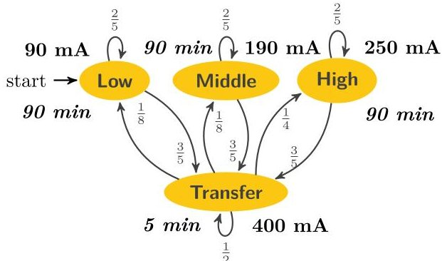

Figure 3 Markov task process of the load on the satellite. All load distributions are normal with mean depicted next to the states and with standard deviation 5. This load is superposed with a strictly periodic load modelling charge by solar power infeed.

We assume constant battery temperature. The factual temperature of the orbiting battery oscillates between -8 and 25 degree Celsius on its outside. There is the (currently unused) on-board option to heat the battery to nearly constant temperature. Using an on-off controller, this would lead to another likely nearly periodic load on the battery, well in the scope of what our model supports.

A constant charge from the solar panels is assumed when exposed to the sun. The factual observed charge slowly decays. This is likely caused by the fact that solar panels operate better at lower temperature (opposite to batteries), but heat up quickly when coming out of eclipse.

We assume a strictly periodic charging behavior. The factual charging follows a more complicated pattern determined by the relative position of sun, earth and satellite. There is no fundamental obstacle to calculate and incorporate that pattern.

We assume a uniform initial charge between 70% and 90% of full capacity with identical bound and available charge. Since the satellite needs to be switched off for transportation into space, assuming an equilibrated battery is valid. Being a single experiment, the GOMX-1 had a particular initial charge (though unknown). The charge of the orbiting battery can only be observed indirectly, by the voltage sustained.

We assume that the relative distance to a base station is a random quantity, and thus interpret several of the above statistics probabilistically. In reality, the position of the base station for GOMX-1 is at a particular fixed location (Aalborg, Denmark). Our approach can either be viewed as a kind of probabilistic abstraction of the relative satellite position and uncertainty of signal transmission, or it can be seen as reflecting that base stations are scattered around the planet. This especially would be a realistic in scenarios where satellite-to-satellite communication is used.

We assume that the satellite has no protection against battery depletion. In reality, the satellite has 2 levels of software protection, activated at voltage levels 7.2 and 6.5, respectively, backed up by a hardware protection activated at 6 V. In these protection modes, various non-mission-critical functionality is switched-off. Despite omitting such power-saving modes, we still obtain conservative guarantees on the probability that the battery powers the satellite.

Satellite model. According to the above discussion, the load on the satellite is the superposition of two piecewise constant loads.

A probabilistic load reflecting the different operation modes, modeled by a Markov task process $ \mathcal{M} $ as depicted in Figure 3.

A strictly periodic charge load alternating between 66 minutes at $ - 4 0 0 $ mA, and the remaining 33 minutes at 0 mA.

<!-- PDF_PAGE: 22 -->

## 04:22 How Is Your Satellite Doing? Battery Kinetics with Recharging and Uncertainty

One can easily express the charging load as another independent Markov task process (where all probabilities are 1) and consider the sum load generated by these two processes in parallel (methods in Section 6 adapt straightforwardly to this setting).

The KiBaM in our model has following parameters:

The ratio of the available charge $ c=1/2 $ (artificially chosen value as parameters fitted by experiments on similar batteries strongly vary [42, 25]);

The diffusion rate $ p=0.0006 $ per minute (we decreased the value reported by experiments [25] by a factor of 4 because of the low average temperature in orbit, $ 3.5^{\circ}\mathrm{C} $ , and the influence of the Arrhenius equation [27]).

Implementation aspects. Our implementation is done in C++. We used K=1200,600,300 and 150 for the experiments with the batteries of capacity 5000 mAh, 2500 mAh, 1250 mAh and 625 mAh, respectively to guarantee equal relative precision. All the experiments have been performed on a machine equipped with an Intel Core i5-2520M CPU @ 2.50GHz and 4GB RAM. All values occuring are represented and calculated with standard IEEE 754 double-precision binary floating-point format except for the values related to the battery being depleted where we use arbitrary precision arithmetic (as this number keeps accumulating grid values that are of much lower order of magnitude). The number of subdistributions that must be kept track of simultaneously, turned out to be no larger than 54.

Model evaluation. We performed various experiments with this model, to explore the random KiBaM technology. We here report on five distinct evaluations, demonstrating that valuable insight into the model can be obtained.

1. The 5000 mAh battery in the real satellite is known to be over-dimensioned. Our aim was to find out how much. Hence, we performed a sequence of experiments, decreasing the size of the battery exponentially. The results (of the safe under-approximation) are displayed and explained in Figure 4. We found out that 1/4 of the capacity still provides sufficient guarantees (since the depletion risk calculated is in the order of $ 1 0^{-1 0} $ ) to power the satellite for 1 year while 1/8 of the capacity, 625 mAh, does not. The following table compares the under- and over-approximations.

<table border="1"><tr><td>capacity(mAh)</td><td>5000</td><td>2500</td><td>1250</td><td>625</td></tr><tr><td>under-approximation ofPr[depletion]</td><td>9.61×10-96</td><td>4.69×10-43</td><td>1.01×10-15</td><td>0.00122</td></tr><tr><td>over-approximation ofPr[depletion]</td><td>1.66×10-63</td><td>6.58×10-31</td><td>1.73×10-10</td><td>0.03653</td></tr></table>

The approximations thus compute the real probability of depletion up to very small absolute errors ranging from $ 1 0^{-6 3} $ for the 5000 mAh battery to 0.03531 for the 625 mAh battery.

2. We compared our results with a simple linear battery model of the same capacity. $ ^{3} $ This linear model is not uncommon in the satellite domain, it has for instance been used in the Envisat and CryoSat missions [18]. We obtain the following probabilities for battery depletion:

<table border="1"><tr><td></td><td colspan="2">linear battery model</td><td colspan="2">KiBaM</td></tr><tr><td>capacity(mAh)</td><td>5000</td><td>625</td><td>5000</td><td>625</td></tr><tr><td>under-approximation ofPr[depletion]</td><td>$1.76\cdot10^{-144}$</td><td>$8.53\cdot10^{-16}$</td><td>$9.61\cdot10^{-96}$</td><td>0.00122</td></tr><tr><td>over-approximation ofPr[depletion]</td><td>$1.86\cdot10^{-84}$</td><td>$2.94\cdot10^{-8}$</td><td>$1.7\cdot10^{-63}$</td><td>0.03653</td></tr></table>

<!-- PDF_PAGE: 23 -->

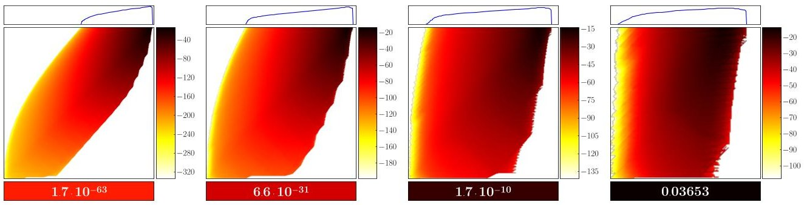

Figure 4 SoC under-approximation for different sizes of the satellite's battery after 1 year $ ^{a} $ . The leftmost SoC is with the original battery capacity, 5000 mAh. In each further plot, the battery capacity is halved, i.e. 2500 mAh, 1250 mAh, and 625 mAh. Note that all the densities are depicted on the logarithmic scale (ticks in the colorbar stand for the order of magnitude). We observe that only the smallest battery does not give sufficient guarantees. Its probability of depletion after 1 year is 0.0365; the probability decreases to $ 1. 7 \cdot1 0^{-1 0} $ already for the 1250 mAh battery. The smaller the battery, the more crucial is the distinction of available and bound charge as a larger area of the plots is filled with non-trivial density.

$ ^{a} $ Actually it is after 364 days, as this is in the middle of the charging phase. After 365 days the satellite is in eclipse and no density is exhibited along the upper limit.

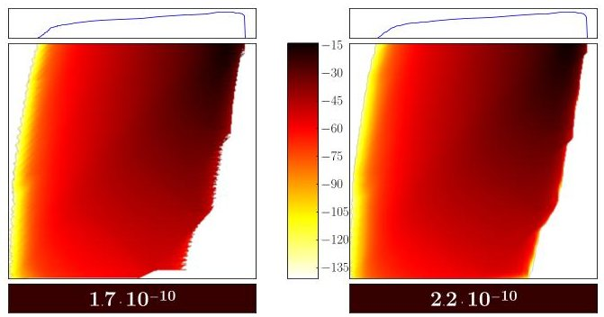

Figure 5 Load noise. SoC under-approximation of the 1 year run using the 1250 mAh battery with Dirac loads (left) and with noisy loads (right). We used Gaussian noise with standard deviation 5.

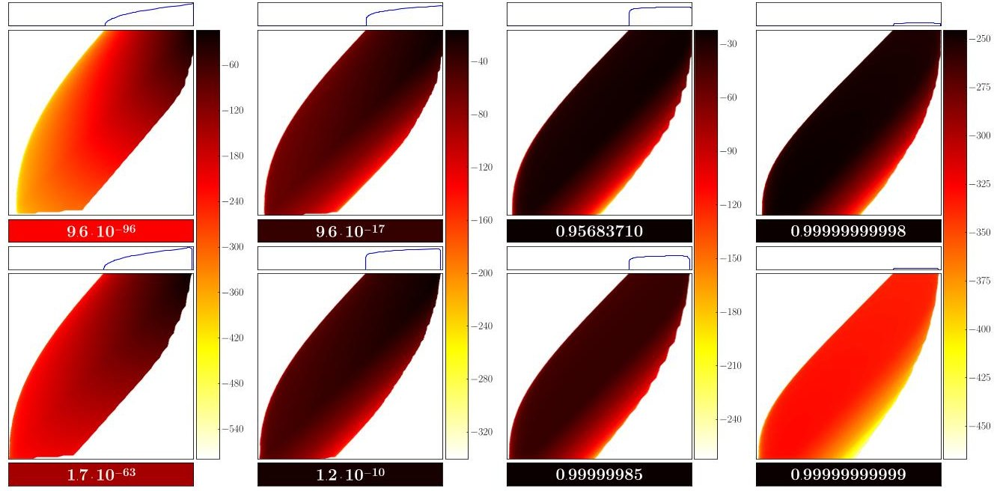

Figure 6 Number of solar panels. Top: The over-approximation of the full 5000 mAh battery with 9,8,7 and 6 solar panels. Bottom: The respective under-approximations on the same colorscale. Again, the ticks of the colorscale represent the order of magnitude of the densities.

<!-- PDF_PAGE: 24 -->

## 04:24 How Is Your Satellite Doing? Battery Kinetics with Recharging and Uncertainty

The linear model turns out to be surprisingly (and likely unjustifiably) optimistic, especially for the 625 mAh battery.

3. We (computationally) simplified the two experiments above by assuming Dirac loads. To analyze the effect of the white noise, we compared the Dirac loads with the noisy loads, explained earlier, on the 625 mAh battery. As expected, the noise (a) smoothes out the distribution a little and (b) pushes a bit more of the distribution to full and empty states, see Figure 5.

4. Our reference satellite is a two-unit satellite, i.e. is built from two cubes, each 10 cm per side. In the current design, 9 of the 10 external sides are covered by solar panels, the remaining one is used for both radio antenna and camera. We thus conducted a robustness analysis with respect to solar infeed, by assuming that 1,2 and 3 solar panels break down. Figure 6 displays that the satellite can easily deal with 1 defective solar panel. If additional panels fail, the system runs out of energy rapidly with high probability.

5. The random KiBaM does not incorporate battery aging. In general, the degradation of a battery over time depends on many factors, most prominently how the battery was stored, which loads it was subjected to, how deeply it was discharged and at which temperatures it was used. We are not aware of a consensus method of how to model degradation of a Li-ion battery which is influenced by all of these factors. A measurable quantity related to battery age for our case study is the voltage drop when in eclipse. In-orbit measurements show that this voltage drop has worsened by 3% after one year of operation. For comparison purposes, we thus pessimistically assumed a battery with a capacity of only 4850 mAh (97% of 5000 mAh) from the beginning. Compared to the 5000 mAh battery the depletion probabilities are only slightly higher:

<table border="1"><tr><td>capacity(mAh)</td><td>5000</td><td>4850</td></tr><tr><td>under-approximation ofPr[depletion]</td><td>9.61$\cdot$10-96</td><td>1.73$\cdot$10-92</td></tr><tr><td>over-approximation ofPr[depletion]</td><td>1.66$\cdot$10-63</td><td>5.58$\cdot$10-61</td></tr></table>

## 9 Alternative Approaches

The results reported above are obtained from a discretized abstraction of the stochastic process induced by the MTP and the battery, solved numerically and with high-precision arithmetic where needed.

One could instead consider estimating the probability $ z_{t} $ of the battery depletion using ordinary simulation techniques [19]. Considering a battery of capacity 5000 mAh, this would mean that about $ 10^{63} $ simulations traces are needed on average to observe the rare event of a depleted battery at least once. This seems prohibitive, also if resorting to massively parallel simulation, which may reduce the exponent by a small constant at most. A possible way out of this might lie in the use of rare event simulation techniques to speed up simulation [40].

The behaviour of KiBaM with capacity limits can be expressed as a relatively simple hybrid automaton model [21]. Similarly, the random KiBaM with capacity limits can be regarded as an instance of a stochastic hybrid system (SHS) [1, 3, 4, 8, 12, 37]. This observation opens some further evaluation avenues, since there are multiple tools available publicly for checking reachability properties of SHS. In particular, $ \mathrm{F a u s t}^{2} $ [36], $ \mathrm{S i S a t} $ [17] and $ \mathrm{P r o H V e r} $ [43, 16] appear adequate at first sight. However the random KiBaM system cannot be evaluated with $ \mathrm{F a u s t}^{2} $ , basically due to a model mismatch: The tool thus far assumes stochasticity in all dimensions, because it operates on stochastic kernels, while our model is non-stochastic in the bound charge dimension. The existing general theory about computing reach-avoid probabilities of so called partially degenerate stochastic processes [35] is not yet built into $ \mathrm{F a u s t}^{2} $ . The guarantees provided using these methods

<!-- PDF_PAGE: 25 -->

are computed a priori on the basis of Lipschitz constants and do not scale well to the small absolute errors and large time horizons that are required for the satellite model. In our approach they are computed a posteriori (as the difference between under- and over-approximation). SiSAT provides principal support for encoding all model aspects needed, yet the time horizon and precision needed seem unsurmountable [15]. Our PROHVER experiments failed for a similar reason, namely the sheer size of the problem. An extension of the stochastic network calculus to deal with energy [41] can in principle be employed to calculate depletion risks, by modelling the cumulative energy supply and energy demand as the arrival and service process of a queue, so as to capture the Fraction of Time Energy Not-Served (FTNS). Different from ours, that work assumes a linear battery behaviour and discretised time. Using a linear battery model causes underestimation of the depletion risk, as discussed in Section 8. All the above tools have not been optimized for dealing with very low probabilities as they appear in high dependability scenarios like the satellite case. The orders of magnitude difference between the smallest time step (5 minutes) and the time horizon (1 year) appear as another serious obstacle, but not for our approach.

## 10 Conclusion

Inspired by the needs of an earth-orbiting satellite mission, we extended in this paper the theory of kinetic battery models in two independent dimensions. First, we addressed battery charging up to full capacity. Second, we extended the theory of the KiBaM differential equations to a stochastic setting. We provided a symbolic solution for random initial SoC and a sequence of piecewise-constant random loads.

These sequences can be generated by a stochastic process representing an abstract and averaged behavioural model of a nano satellite operating in earth orbit, superposed with a deterministic representation of the solar infeed in orbit. We illustrated the approach by several experiments performed on the model, especially varying the size of the battery, but also the number of solar panels.

ESA is running a large educational program [2] for launching missions akin to GOMX-1. The satellites are designed by student teams, have the form of standardized 1 unit cube with maximum mass of 1 kg, and target mission times of up to four years. The random KiBaM presented here is of obvious high relevance for any participating team. It can help quantify the risk of premature depletion for the various battery dimensions at hand, and thereby enable an optimal use of the available weight and space budget. Our experiments show that using the simpler linear battery model instead is far too optimistic in this respect.

For a fixed setup, one can also use the technology offered by us for optimal task scheduling: In the same way as we can follow a single SoC distribution, we can also branch into several distributions and determine which of them is best according to some metric. Taking inspiration from [42], this can be combined with statistical model checking so as to find the optimal task schedule of a given set of tasks.

Several extensions can and should be integrated in the model. Among them, temperature dependencies are of particular interest. A temperature change has namely opposing physical effects in solar panels and in the battery, having intriguing consequences such as piecewise exponential decay in the charging process. An extension that is particularly important for long lasting missions, is incorporating a model of battery wearout. So far we assume the battery capacity to be constant along the mission time. Notably, our contribution is the first to consider capacity limits in operation at all, as far as we are aware. As of now, our battery model is itself considered lossless, while in reality one never gets out as much energy as one has put in before. We are so far putting this phenomenon as a burden on the modeller side, namely to scale down the real charging current

<!-- PDF_PAGE: 26 -->

to an effective charging current, that factors in the loss only while charging the battery. We are looking into ways to instead make these losses a genuine part of the KiBaM model.

Acknowledgements. The authors are grateful for inspiring discussions with Peter Bak, Morten Bisgaard, David Gerhardt and Jesper A. Larsen (GomSpace ApS), Erik R. Wognsen (Aalborg University), and other members of the SENSATION consortium, as well as with Pascal Gilles (ESA Centre for Earth Observation), Xavier Bossoreille (Deutsches Zentrum für Luft- und Raumfahrt) and Marc Bouissou (Électricité de France S.A., École Centrale Paris - LGI).

## References

1 Alessandro Abate, Maria Prandini, John Lygeros, and Shankar Sastry. Probabilistic reachability and safety for controlled discrete time stochastic hybrid systems. Automatica, 44(11):2724-2734, 2008. doi:10.1016/j.automatica.2008.03.027.

2 European Space Agency. ESA Cubesat program, October 2014. URL: http://www.esa.int/ Education/CubeSats.

3 Eitan Altman and Vladimir Gaitsgory. Asymptotic optimization of a nonlinear hybrid system governed by a markov decision process. SIAM Journal on Control and Optimization, 35(6):2070-2085, 1997. doi:10.1137/S0363012995279985.

4 Henk A.P. Blom and John Lygeros, editors. Stochastic Hybrid systems: Ttheory and Safety Critical Applications, volume 337 of Lecture Notes in Control and Information Science. Springer Heidelberg, 2006. doi:10.1007/11587392.

5 Udi Boker, Thomas A. Henzinger, and Arjun Radhakrishna. Battery transition systems. In Suresh Jagannathan and Peter Sewell, editors, The 41st Annual ACM SIGPLAN-SIGACT Symposium on Principles of Programming Languages, POPL'14, San Diego, CA, USA, January 20-21, 2014, pages 595-606. ACM, 2014. doi:10.1145/ 2535838.2535875.

6 M. Brandl, H. Gall, M. Wenger, V. Lorentz, M. Giegerich, Federico Baronti, Gabriele Fantechi, Luca Fanucci, Roberto Roncella, Roberto Saletti, Sergio Saponara, Alexander Thaler, Martin Cifrain, and W. Prochazka. Batteries and battery management systems for electric vehicles. In Wolfgang Rosenstiel and Lothar Thiele, editors, 2012 Design, Automation &amp; Test in Europe Conference &amp; Exhibition, DATE 2012, Dresden, Germany, March 12-16, 2012, pages 971-976. IEEE, 2012. doi:10.1109/DATE. 2012.6176637.

7 Isidor Buchmann. Batteries in a portable world. Cadex Electronics Richmond, 2001.

8 Manuela L. Bujorianu, John Lygeros, and Marius C. Bujorianu. Bisimulation for general stochastic hybrid systems. In Manfred Morari and Lothar Thiele, editors, Hybrid Systems: Computation and Control, 8th International Workshop, HSCC 2005, Zurich, Switzerland, March 9-11, 2005, Proceedings, volume 3414 of Lecture Notes in Computer Science, pages 198-214. Springer, 2005. doi:10.1007/978-3-540-31954-2_13.

9 J. Cao, N. Schofield, and A. Emadi. Battery balancing methods: A comprehensive review. In

Vehicle Power and Propulsion Conference, 2008. VPPC'08. IEEE, pages 1-6, Sept 2008. doi:10. 1109/VPPC.2008.4677669.

10 Lucia Cloth, Marijn R. Jongerden, and Boudewijn R. Haverkort. Computing battery lifetime distributions. In The 37th Annual IEEE/IFIP International Conference on Dependable Systems and Networks, DSN 2007, 25-28 June 2007, Edinburgh, UK, Proceedings, pages 780-789. IEEE Computer Society, 2007. doi:10.1109/DSN.2007.26.

11 Robert M. Corless, Gaston H. Gonnet, D.E.G. Hare, David J. Jeffrey, and Donald E. Knuth. On the Lambert W function. Adv. Comput. Math., 5(1):329-359, 1996. doi:10.1007/BF02124750.

12 Mark H. A. Davis. Piecewise-deterministic markov processes: A general class of non-diffusion stochastic models. Journal of the Royal Statistical Society. Series B (Methodological), pages 353- 388, 1984. URL: http://www.jstor.org/stable/ 2345677.

13 Marc Doyle, Thomas F. Fuller, and John Newman. Modeling of galvanostatic charge and discharge of the lithium/polymer/insertion cell. Journal of The Electrochemical Society, 140(6):1526-1533, 1993. doi:10.1149/1.2221597.

14 Maria Fox, Derek Long, and Daniele Magazzeni. Automatic construction of efficient multiple battery usage policies. In Toby Walsh, editor, IJCAI 2011, Proceedings of the 22nd International Joint Conference on Artificial Intelligence, Barcelona, Catalonia, Spain, July 16-22, 2011, pages 2620-2625. IJCAI/AAAI, 2011. doi:10.5591/978-1-57735-516-8/IJCAI11-436.

15 Martin Fränzle. Personal communication. 2015.

16 Martin Fränzle, Ernst Moritz Hahn, Holger Hermanns, Nicolas Wolovick, and Lijun Zhang. Measurability and safety verification for stochastic hybrid systems. In Marco Caccamo, Emilio Frazzoli, and Radu Grosu, editors, Proceedings of the 14th ACM International Conference on Hybrid Systems: Computation and Control, HSCC 2011, Chicago, IL, USA, April 12-14, 2011, pages 43-52. ACM, 2011. doi:10.1145/1967701.1967710.

17 Martin Fränzle, Holger Hermanns, and Tino Teige. Stochastic satisfiability modulo theory: A novel technique for the analysis of probabilistic hybrid systems. In Magnus Egerstedt and Bud Mishra, editors, Hybrid Systems: Computation and Control, 11th International Workshop, HSCC 2008, St. Louis, MO, USA, April 22-24, 2008. Proceedings,

<!-- PDF_PAGE: 27 -->

volume 4981 of Lecture Notes in Computer Science, pages 172-186. Springer, 2008. doi:10.1007/978-3-540-78929-1_13.

18 Pascal Gilles. Private communication. 2014.

19 Daniel T. Gillespie. A general method for numerically simulating the stochastic time evolution of coupled chemical reactions. Journal of Computational Physics, 22(4):403-434, 1976. doi:10.1016/0021-9991(76)90041-3.

20 GomSpace. Gomspace gomx-1, October 2014. URL: http://gomspace.com/?p=gomx1.

21 Thomas A. Henzinger. Verification of Digital and Hybrid Systems, chapter The Theory of Hybrid Automata, pages 265-292. Springer Berlin Heidelberg, Berlin, Heidelberg, 2000. doi:10.1007/978-3-642-59615-5_13.

22 Holger Hermanns, Jan Krcal, and Gilles Nies. Recharging probably keeps batteries alive. In Christian Berger and Mohammad Reza Mousavi editors, Cyber Physical Systems. Design, Modeling, and Evaluation - 5th International Workshop, CyPhy 2015, Amsterdam, The Netherlands, October 8, 2015, Proceedings, volume 9361 of Lecture Notes in Computer Science, pages 83-98. Springer, 2015. doi:10.1007/978-3-319-25141-7_7.

23 Marijn R. Jongerden and Boudewijn R. Haverkort. Which battery model to use? IET Software, 3(6):445-457, 2009. doi:10.1049/iet-sen.2009.0001.

24 Marijn R. Jongerden, Boudewijn R. Haverkort, Henrik C. Bohnenkamp, and Joost-Pieter Katoen. Maximizing system lifetime by battery scheduling. In Proceedings of the 2009 IEEE/IFIP International Conference on Dependable Systems and Networks, DSN 2009, Estoril, Lisbon, Portugal, June 29 - July 2, 2009, pages 63-72. IEEE Computer Society, 2009. doi:10.1109/DSN.2009.5270351.

25 Mariijn Remco Jongerden. Model-based energy analysis of battery powered systems. PhD thesis, University of Twente, Enschede, December 2010. URL: http://doc.utwente.nl/75079/.

26 Edward A. Lee and David G. Messerschmitt. Synchronous data flow. Proceedings of the IEEE, 75(9):1235-1245, 1987. doi:10.1109/PROC.1987. 13876.

27 Bor Yann Liaw, E. Peter Roth, Rudolph G. Jungst, Ganesan Nagasubramanian, Herbert L. Case, and Daniel H. Doughty. Correlation of arrhenius behaviors in power and capacity fades with cell impedance and heat generation in cylindrical lithium-ion cells. Journal of power sources, 119:874-886, 2003. doi:10.1016/S0378-7753(03)00196-4.

28 James F. Manwell and Jon G. McGowan. Lead acid battery storage model for hybrid energy systems. Solar Energy, 50(5):399-405, 1993. doi: 10.1016/0038-092X(93)90060-2.

29 John Newman. Fortran programs for the simulation of electrochemical systems. URL: http://www. cchem.berkeley.edu/jsngrp/fortran.html.

30 Wilhelm Peukert. Uber die Abhängigkeit der Kapazität von der Entladestromstärke bei Bleiakkumulatoren. Elektrotechnische Zeitschrift, 20:20-21, 1897.

31 Daler N. Rakhmatov and Sarma B.K. Vrudhula. An analytical high-level battery model for use

in energy management of portable electronic systems. In Rolf Ernst, editor, Proceedings of the 2001 IEEE/ACM International Conference on Computer-Aided Design, ICCAD 2001, San Jose, CA, USA, November 4-8, 2001, pages 488493. IEEE Computer Society, 2001. doi:10.1109/ ICCAD.2001.968687.

32 Venkatasailanathan Ramadesigan, Paul W.C. Northrop, Sumitava De, Shriram Santhanagopalan, Richard D. Braatz, and Venkat R. Subramanian. Modeling and simulation of lithiumion batteries from a systems engineering perspective. Journal of The Electrochemical Society, 159(3):R31-R45, 2012. doi:10.1149/2.018203jes.

33 Venkat Rao, Gaurav Singhal, Anshul Kumar, and Nicolas Navet. Battery model for embedded systems. In 18th International Conference on VLSI Design (VLSI Design 2005), with the 4th International Conference on Embedded Systems Design, 3-7 January 2005, Kolkata, India, pages 105-110. IEEE Computer Society, 2005. doi:10.1109/ICVD.2005.61.

34 Robin A. Sahner and Kishor S. Trivedi. Performance and reliability analysis using directed acyclic graphs. IEEE Trans. Software Eng., 13(10):11051114, 1987. doi:10.1109/TSE.1987.232852.

35 Sadegh Esmaeil Zadeh Soudjani and Alessandro Abate. Probabilistic reach-avoid computation for partially degenerate stochastic processes. IEEE Trans. Automat. Contr., 59(2):528-534, 2014. doi: 10.1109/TAC.2013.2273300.

36 Sadegh Esmaeil Zadeh Soudjani, Caspar Gevaerts, and Alessandro Abate. Faust $ ^{2} $ : Formal abstractions of uncountable-state stochastic processes. CoRR, abs/1403.3286, 2014. URL: http://arxiv.org/abs/1403.3286.

37 Jeremy Sproston. Decidable model checking of probabilistic hybrid automata. In Mathai Joseph, editor, Formal Techniques in Real-Time and Fault-Tolerant Systems, 6th International Symposium, FTRTFT 2000, Pune, India, September 20-22, 2000, Proceedings, volume 1926 of Lecture Notes in Computer Science, pages 31-45. Springer, 2000. doi:10.1007/3-540-45352-0_5.

38 Bart D. Theelen, Marc Geilen, Twan Basten, Jeroen Voeten, Stefan Valentin Gheorghita, and Sander Stuijk. A scenario-aware data flow model for combined long-run average and worst-case performance analysis. In 4th ACM &amp; IEEE International Conference on Formal Methods and Models for Co-Design (MEMOCODE 2006), 27-29 July 2006, Embassy Suites, Napa, California, USA, pages 185-194. IEEE Computer Society, 2006. doi:10.1109/MEMCOD.2006.1695924.

39 Bart D. Theelen, Marc C.W. Geilen, Sander Stuijk, Stefan V. Gheorghita, Twan Basten, Jeroen P.M. Voeten, and Amir H. Ghamarian. Scenarioaware dataflow. Technical report, Eindhoven University of Technology, 2008. Technical Report ESR 2008-08. URL: http://www.es.ele.tue.nl/sadf/publications/TGSGBVG08.pdf.

40 Manuel Villén-Altamirano and José Villén-Altamirano. Restart: a straightforward method for fast simulation of rare events. In Deborah A. Sadowski, Andrew F. Seila, Mani S. Manivannan, and Jeffrey D. Tew, editors, Proceedings of the

<!-- PDF_PAGE: 28 -->

26th conference on Winter simulation, WSC 1994, Lake Buena Vista, FL, USA, December 11-14, 1994, pages 282-289. ACM, 1994. doi:10.1109/WSC.1994.717150.

41 Kai Wang, Florin Ciucu, Chuang Lin, and Steven H. Low. A stochastic power network calculus for integrating renewable energy sources into the power grid. IEEE Journal on Selected Areas in Communications, 30(6):1037-1048, 2012. doi: 10.1109/JSAC.2012.120703.

42 Erik Ramsgaard Wognsen, René Rydhof Hansen, and Kim Guldstrand Larsen. Battery-aware scheduling of mixed criticality systems. In Tiziana Margaria and Bernhard Steffen, editors, Leveraging Applications of Formal Methods, Verification and Validation. Specialized Techniques

and Applications - 6th International Symposium, ISoLA 2014, Imperial, Corfu, Greece, October 811, 2014, Proceedings, Part II, volume 8803 of Lecture Notes in Computer Science, pages 208-222. Springer, 2014. doi:10.1007/978-3-662-45231-8_15.

43 Lijun Zhang, Zhikun She, Stefan Ratschan, Holger Hermanns, and Ernst Moritz Hahn. Safety verification for probabilistic hybrid systems. In Tayssir Touili, Byron Cook, and Paul B. Jackson, editors, Computer Aided Verification, 22nd International Conference, CAV 2010, Edinburgh, UK, July 15-19, 2010. Proceedings, volume 6174 of Lecture Notes in Computer Science, pages 196-211. Springer, 2010. doi:10.1007/978-3-642-14295-6_21.