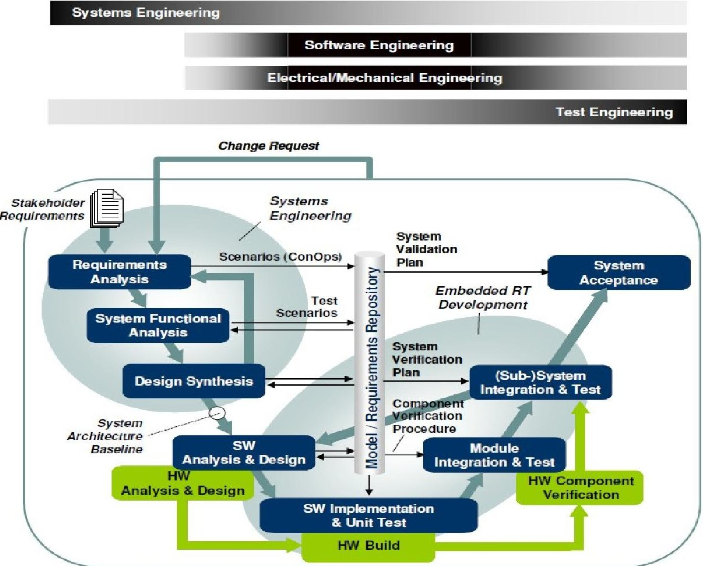
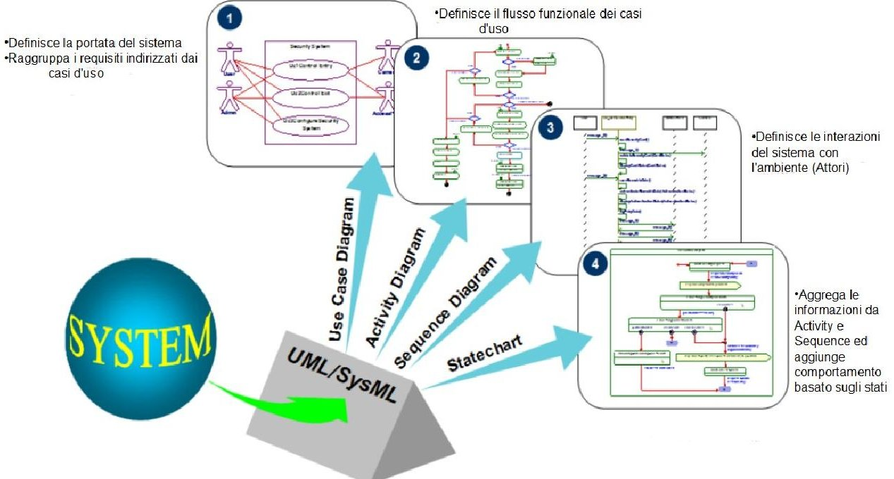
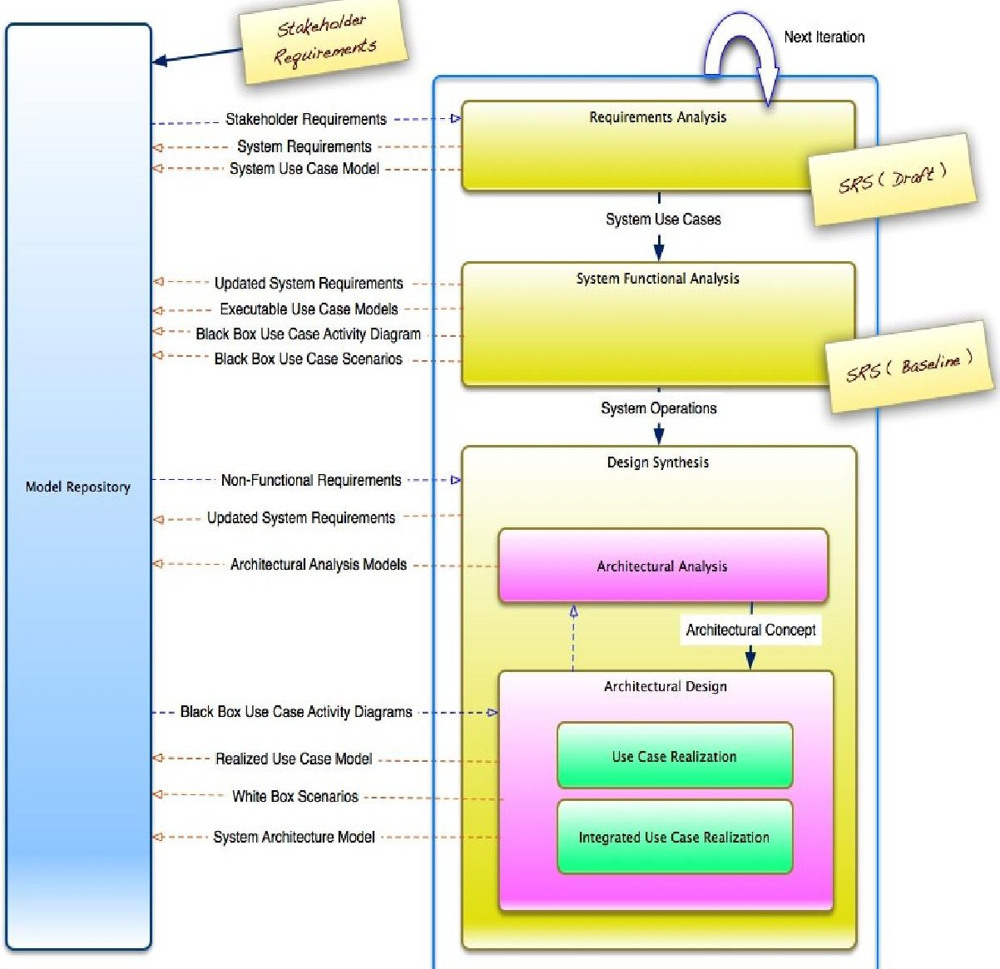
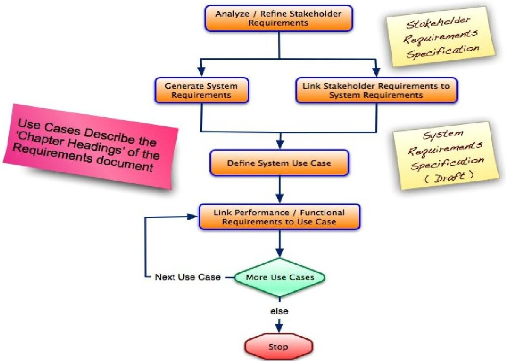
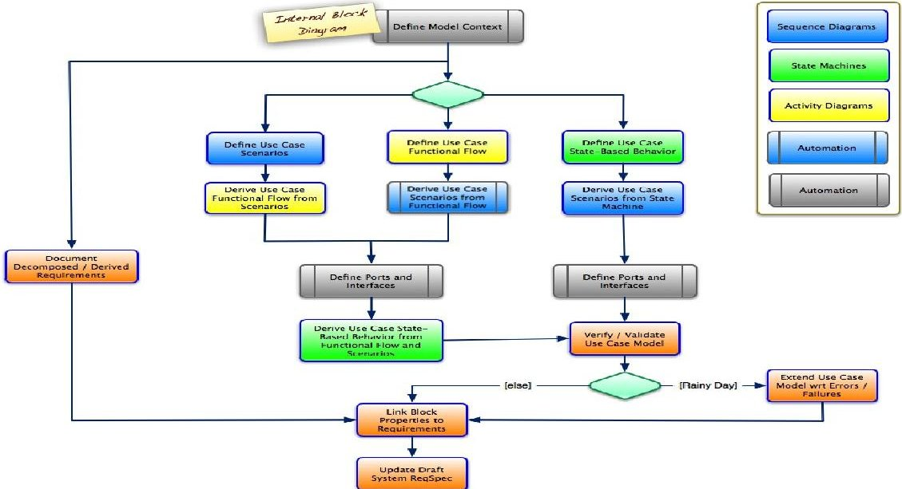
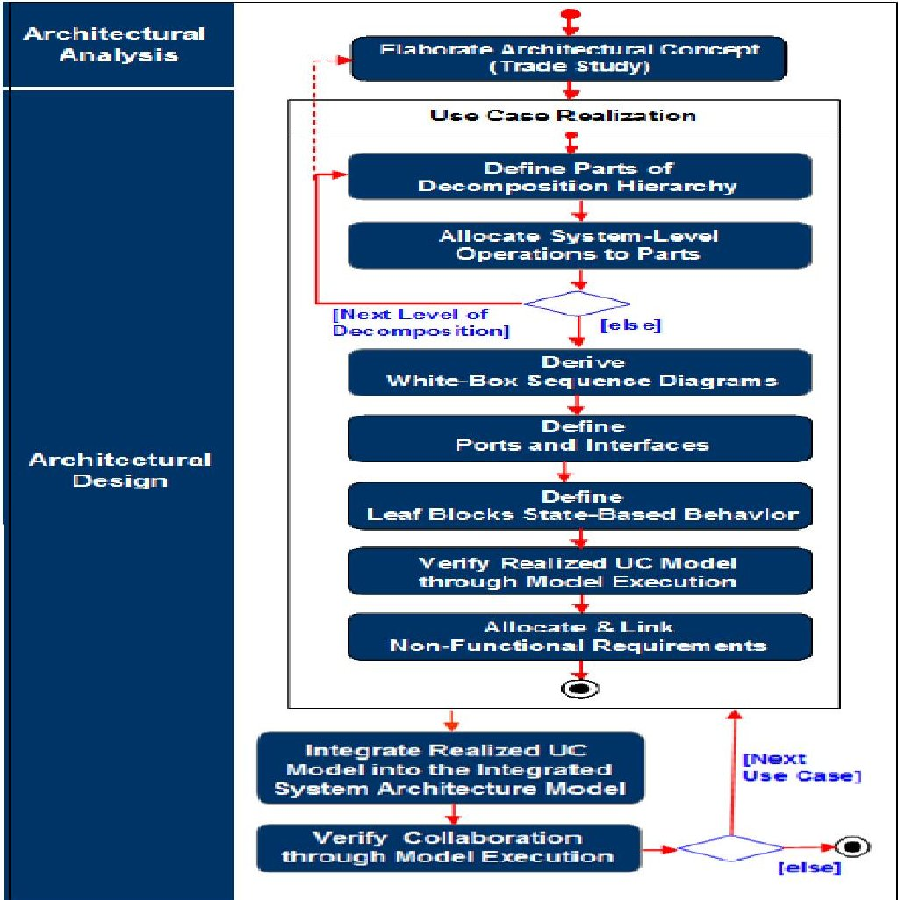

<!-- PDF_PAGE: 1 -->

# How Model Based Systems Engineering streamlines the development of complex systems

Enrico Mancin

IBM

Corso Orbassano 367, Torino

enrico.mancin@it.ibm.com

Copyright $ \textcircled{c} $ held by the authors.

Abstract. The challenges of a market affected by an economic climate in stagnation, if not exactly in a real recession crisis like the one today, require systems construction times extremely short even with innovative and complex products. In addition, engineering teams can only rely on limited budgets to ensuring the right level of quality of manufactured product. The Systems Engineering discipline should not be considered as a mere technical activity in the systems development life-cycle, rather as an approach capable to determine the economic-industrial sustainability of the entire project; today, innovators leverage Model-Based Systems Engineering for addressing these challenges. This article describes the Best Practices for the implementation of the Model Based Systems Engineering as a result of the experience and its application in the complex system's design. These Best Practices, using UML/SysML as an independent modeling language paradigm, support analysis, design, development, verification, and validation phases through the implementation of executable models. However SysML modeling alone doesn't represent a definitive solution. SysML is commonly perceived as a complex language by Systems Engineering communities, with many semantic elements which if used all together can lead to an entropic effect of not manageable relations, instead of providing an effective synthesis. The key for a correct adoption of MBSE paradigm is the definition of a reference workflow that will serve as a guideline through a set of essential language elements. It allows Systems Engineers to focus on the definition of specifications and architecture to be delivered to engineering specialists for hardware, software and testing. This article describes an example of a workflow for requirements analysis, functional analysis and design phases including main activities to be performed, artifacts to be produced and Best Practices supported. Collaborative aspects of Systems Engineering life cycle emerging from requirements and change management process areas are addressed too.

## Introduction

Systems Engineering should always cover the overall context of the system development life cycle. Figure 1 "IBM Harmony Integrated System/Software development lifecycle" shows the integrated cycle of system and embedded software development included in a classical "V" scheme of development. The left leg clearly describes the top-down design flow, while the right leg shows the phases of bottom-up integration from the unit test up to the acceptance of realized system. Exactly as a state-chart diagram notation, the impact of a request for a change on the entire

<!-- PDF_PAGE: 2 -->

workflow is shown as an high level "interrupt". Whenever there is a request to change, the process will restart with the requirements analysis phase.

Figure 1. IBM Harmony Integrated System/Software development lifecycle

In this case, the Systems Engineering workflow is iterative with incremental cycles passing through three macro phases, Requirements Analysis, System Functional Analysis and Design Synthesis. The increments are based on the development of identified use cases. The next software development workflow is also characterized by iterative incremental cycles from analysis and design phases, through implementation up to respective levels of integration and test. Activities of implementation and testing, following each iteration, are performed in order to obtain proven results for validating system behavior in accordance with requirements. Then requirements related test scenarios are created and reused along the descent of the left leg of "V" design, from top to bottom. These scenarios can be reused to assist the development team in the bottom-up covering of the right leg, during the integration, testing, and acceptance stages of realized system. It is interesting to note that IBM Harmony integrated System/Software lifecycle also supports the Model Driven Development (MDD) methodology setting the model as a key artifact from which all activities get started for analysis, design and implementation stages. Specific evolving models are created during each of the three phases of the Systems Engineering workflow according to an incremental approach. Figure 2 highlights the suggested essential SysML diagrams to focus on in order to capture and formalize system behavior following an incremental approach which gradually add details to the model.

<!-- PDF_PAGE: 3 -->

# INCOSE Italian Chapter Conference on Systems Engineering (CIISE2014) Rome, Italy, November 24-25, 2014

Figure 2: Essential SysML Diagrams for capturing system behavior according to an incremental approach

Specifically, during Requirements Analysis phase, models strictly linked to requirements are developed describing the System Context via use cases and actors. Requirements taxonomy in relation to the system use cases is displayed by means of grouped functional requirements traced from System Use Cases. During the System Functional Analysis phase, the focus is on the translation of functional requirements into a coherent description of system functions (operations). Each use case is converted into an executable model and the underlying system requirements model verified through the execution of the use case model. Then, there are two types of executable models that support the Design Synthesis phase:

- Architectural Analysis model

- System Architecture model

The purpose of Architectural Analysis model is to develop a concept of architecture for the implementation of identified operations, eventually through a parametric analysis. The System Architecture model sets the allocation of the operations of the system on the selected architecture as a result of previous Architectural Analysis phase. The correctness and completeness of the System Architecture model is verified by running the developed executable model. Once this model is verified and validated, Safety requirements may be analyzed too. The analysis can then continue with the analysis of the failure mode effects (Failure Mode Effects Analysis FMEA) and with the analysis of risk or Hazard Analysis. The baselined System Architecture model constitutes the artifact from which all the subsequent HW/SW development activities get started.

<!-- PDF_PAGE: 4 -->

## Model Based Systems Engineering Workflow

Figure 3: Model Based Systems Engineering workflow

The main objectives of the Model Based Systems Engineering workflow are:

- Identification and derivation of the necessary system functionality

- Identification of the states associated to the system and the corresponding modes of operation

- Allocation of functionality of the system to the parties of its architecture, including non functional aspects.

Regarding the effects that these objectives have on modeling workflow, these lead to a top-down approach looking at a high level of abstraction. The emphasis is on the recognition and the allocation of functionality needed as well as on the identification of system state-based behavior, rather than on functional details. Figure 3 shows an overview of the MBSE workflow for each of the stages part of the IBM Harmony approach, highlighting the essential contribution in terms of processed input and output. The following paragraphs illustrate the flow of work and outline the requirements management and traceability associated concepts.

## Requirements Analysis

The purpose of the Requirements Analysis phase is to provide the necessary input data to MBSE process through the analysis of requirements, of requests, of vision

<!-- PDF_PAGE: 5 -->

and business goals and of the rest of pertaining project documents. Stakeholder requirements are translated into system requirements that define the system or product to be produced (functional requirements) with its intrinsic required quality of service. Essential requirements analysis workflow steps are shown in Figure 4.

Figure 4: Essential Requirements Analysis phase artifacts and steps

It starts with the analysis of available data and with any possible description improvement of stakeholder requests and requirements. The processed output of this phase is the specification of Stakeholder Requirements. In essence, Stakeholder Requirements are mainly focused on so-called Capabilities, i.e. those capabilities necessary to meet the declared needs, in short what would solve problem domain demanding. In the next step, these Capabilities are transformed into necessary system features ( what in Requirements Engineering literature is normally described by actions characterized by the verb "shall" - e.g. : "The system shall be able to display the ground speed expressed in both MPH and KPH" ). This requirement set is typically documented in the System Requirements Specification document. For traceability, the identified System Requirements must be "linked" to the corresponding Stakeholders Requirement.

The next step in Requirements Analysis phase is the identification and definition of System Use Cases. To ensure all functional and non-functional requirements are covered by use cases, a respective traceability link must be established. Once System Use Cases are defined and correspondent complete coverage of functional and non-functional requirements is ensured, use cases have to be ranked according to established priority criteria to determine the order they will be take under consideration for the definition of the System Architecture. This order establishes the incremental sequence of the information will be injected into the model according to an iterative approach. Of course, at the end of each iteration the previously established order might be revised. Considering possible parallel development, each use case can be assigned to an individual or to a team who proceed to develop it in isolation.

<!-- PDF_PAGE: 6 -->

With a simplified SysML language adoption in mind, it is recommended to solely focus on Use Case diagram for Requirements Analysis phase. Any high importance requirement can be shown in the use case diagram to highlight which of them are traced from use cases. In this case the typical dependency type is stereotyped as <<trace >>, a weaker link type with respect to the <<satisfy>> one, which is typically used during the next Functional Analysis phase. Requirements Diagrams can potentially increase the intrinsic entropy level, therefore it is recommended a limited use of these diagrams. Complex systems are characterized by a huge number of requirements making Requirements Diagrams loosing any positive visualization effect. This peculiarity also leads to wasting time in managing several levels of traceability. For this purpose tables and matrices are much more productive and effective to manage links in the model; Systems Engineers have to demand for tables and matrices features included in modeling tools. However, keep in mind Requirements Management tasks require features that are typically available in traditional requirement management tools (IBM DOORS/IBM DOORS NG for example) to allow management of requirement related information (e.g. attributes associated to specific requirement types as a priority, unique identifier, approval status and so on... ) and consequent formal documentation production according to internal standards or regulations you must comply with.

## System Functional Analysis

The System Functional Analysis phase main characteristic is to transform system functional requirements into a coherent description of system services (operations). The analysis is based on use cases previously identified in Requirements Analysis phase and every system use case is translated into an executable model. Model and related requirements are then verified through model execution.

Figure 5: Essential System Functional Analysis phase artifacts and steps

Figures 5 shows the workflow in the System Functional Analysis phase. First of all, the the use case model context is defined in a SysML Block Definition Diagram (BDD). Elements of this diagram are the use cases and the relevant associated actors. The next step in the modeling workflow is the definition of the behavior of the block that represents the use case. This behavior is captured by means of three SysML diagrams:

- Activity Diagram

<!-- PDF_PAGE: 7 -->

- Sequence Diagram

- Statechart Diagram

Each chart has a specific role in the processing of the behavior of the block representing the use case. The Activity Diagram, which in this step is a Use-Case Black-Box Activity Diagram, describes the overall use case functional flow (or storyboard). In fact it groups the functional requirements into actions and shows how these actions are connected to each other. The Sequence Diagram, which in this step is the Use-Case Black-Box Sequence Diagram, describes a specific path along the actions performed following a specific use case sequence flow (or scenario). It translates these actions into operations and defines the interactions (messages) between operations and actors. The Statechart Diagram aggregates information from the Activity Diagram (functional flow) and the Sequence Diagram (interactions with the actors). It puts this information in a context of system states and adds the behavior of the system as actions caused by external stimuli with different priorities. There is no specific prescription on what order should be considered for generating these diagrams, but for productivity, efficiency and effectiveness reasons, it is recommended to consider first the degree of automation that your SysML tool provides. For example, in Figure 5 it is highlighted the automatic process generation supported by IBM Rhapsody through its Systems Engineering Toolkit. In this case, the most typical order is driven by the exploitation of automatic information derivation mechanisms that, normally, starts considering the "big picture" of requirements. Once the entire use case functional flow of actions is defined, scenarios described by the Sequence Diagrams are automatically derived from the previously developed Activity Diagram. Then, Use Case Block ports and interfaces are automatically created by previously generated Sequence Diagrams. Finally, system behavior is described in a statechart diagram.

It should be noted that, regardless of the chosen order, the more important diagram in the functional analysis workflow is the use case block Statechart Diagram. It includes information from both Black Box Activity Diagram and Black Box Sequence Diagram. The use case model is analyzed through the implementation of black-box scenarios and it is used as the basis on which external stimuli are brought. It may be noted that, as already mentioned, in this case the primary goal is the verification of exchanged messages as modeled in the sequence diagrams rather than the validation of the underlying functionality. Once the use case model has been verified together with the underlying functional requirements, you can proceed to analyze the so-called Rainy Day scenarios. that are alternative scenarios with respect to a regular flow of execution. This analysis focuses on the identification of system errors and failures that are not covered by initial requirements list.

The activity flow ends with traceability management by connecting the use case block properties with more relevant system requirements. If new, decomposed or derived requirements were identified during the functional analysis modeling process, the draft SRS (System Requirement Specification) document must be updated accordingly. It will be definitely released once all use cases will be analyzed and all required modifications incorporated. Therefore, the Functional Analysis phase ends with the version 1.0 of the SRS document and version 1.0 of the System Level ICD (Interface Control Document). In the latter document logical black-box interfaces between the system and its actors are reported. System ad actors are represented by correspondent blocks. The System Level ICD document constitutes the basis for the definition of system level Black-Box testing.

<!-- PDF_PAGE: 8 -->

## Design Synthesis

The focus of Design Synthesis phase is on the development of a physical architecture, that is a set of products or systems made by hardware and software, capable of performing the required functions within the level of prescribed performance and constraints. Design Synthesis phase follows a top-down approach like the other described phases. Figure 6 shows the related activities and main actions.

Figure 6: Essential Design Synthesis phase steps split in two ways, Architectural Analysis and Architectural Design

The Design Synthesis phase consists of two sub-phases, Architectural Analysis and Architectural Design. Purpose of the Architectural Analysis sub-phase is to identify a solution architecture suitable for the system under development. Since there are several possible options as well as multiple HW/SW alternatives which could hypothetically meet the set of functional and non-functional requirements included in SRS (System Requirement Specification) document, an architecture concept that best fits a set of MOE (Measure of Effectiveness) criteria shall be developed. MOEs have a given a weight proportional to the importance of the policy they are reflecting.

Examples of these criteria are the precision of the device, the cost of maintenance, the purchase price, the level of security, the resistance and so on, criteria that are assessed during the Trade Study activity. Once you are done with the selection of the optimal architecture, then you can go through the Architectural Design sub-phase, where the main objective is the allocation of functional and non-functional requirements on the structure parts of the selected architecture. The activity of allocation proceeds with incremental refinements with the support and collaboration

<!-- PDF_PAGE: 9 -->

of domain experts. The whole Architectural Design sub-phase is carried out according to an iterative incremental approach, taking in consideration each system use case, passing from the Black-Box view to the White-Box view. This is also called Use Case Realization process.

So, the Design Synthesis phase begins with the identification of a solution architecture and proceeds with the decomposition of use case blocks into coherent parts of the selected architecture. The resulting structure is shown by SysML BDD (Block Definition Diagram) and IBD (Internal Block Diagram) for gaining a view, respectively, from outside and inside the block. Subsequently, the system-level operations represented by the use case are allocated to the coherent parts of the architecture (parts that we conventionally call sub-systems). The allocation takes place by exploiting the black-box activity diagram associated with the use case block in which are placed the swim lanes representing sub-systems and then by placing actions in the swim lanes they belong to. Thus this activity produces the white-box activity diagram associated with the use case block. In essence, this new activity diagram starts as copy of the corresponding black-box activity diagram, but now it is divided by operations allocated to the architecture. An essential requirement to carry out this assignment is that control flow links between the actions are kept. If an action in black-box activity diagram may not be assigned to a single block, this must be further decomposed. In this case, the child actions must keep a link with the parent action for establishing a mutual dependence and for ensuring a full requirement traceability. An action may also be assigned to more than one block, for example, in order to meet fault tolerance requirements (architectural redundancy). In this case, the corresponding action is copied in the respective swim lane block and is integrated into the functional flow.

The White-Box Activity Diagram offers at this point a reliable estimate of communication message load between the subsystems, through a visual assessment of the "cutting" of control flows on swim lanes. Of course, this assessment can be carried out on different levels of abstraction, i.e. on the various levels of architecture decomposition like systems, subsystems, equipment, components, and so on. This further decomposition helps to specify what will be implemented in terms of hardware and what will be implemented in terms of software. From the final White-Box activity diagram will be derived the White-Box sequence diagrams for the realization of operations. As already mentioned above, sequence diagrams are the basis from which to derive blocks ports and interfaces, now at the lowest level of abstraction of the system architecture. Once system operations are allocated to the respective blocks at the lowest level of architectural decomposition and interfaces have been defined, each block of the lowest level of abstraction (leaf level) will represent its behavior through a statechart diagram. Then the realized use case as well as sub-systems collaboration including the behavior of each block at the lowest level of abstraction may be verified through model execution.

The last step in use cases realization is constituted by the allocation of nonfunctional requirements to parties and major operations of the system, establishing traceability links to ensure all requirements are properly considered. Requirements related to plans, budget, costs, resources, environment and all design constraints must be linked to well specify the quality of the system. The final task in the Design Synthesis phase is the creation of a final integration model merging all Use Case

<!-- PDF_PAGE: 10 -->

Architectural Design models. This work product is usually called Integration Architecture model. The verification of the collaborating realized use cases as well as the correctness and completeness of the architectural model of the integrated system can thus be performed by the execution of this final model. In addition, this model can also be analyzed in respect of safety and security requirements, for example through FMEA (Failure Mode Effect Analysis) and Mission Criticality Information Analysis.

## Systems Engineering Hand-Off

The final Integration Architecture model constitutes the key artifact for handing-off the produced work products to the next development stages. It is truly a repository from which you generate specification documents (requirements specification for HW/SW, ICD, etc...). The scope depends on project characteristics and how Systems Engineering works in the specific organization. For example, if complex system under development corresponds to a software configuration item (SWCI or CSCI) the workflow may be limited to the System Functional Analysis phase and the hand-off is constituted by executable use cases models. In this case no need to produce Integration Architecture model. From an organizational point of view, if there is a separation between systems engineering and sub-systems engineering, the first can stop at the first level of architectural decomposition. In this case, the hand-off will be made by executable sub-system models. In any case, the hand-off will be made up of executable models which will include:

- the definition of operations allocated to selected architecture, including functional and non-functional requirement links

- the definition of state-based behavior formalized using the statechat diagram

- the definition of ports and interfaces

- test scenarios derived from system level use case scenarios

## MBSE approach deployment

Experiences show that, in order to successfully implement MBSE paradigm, some precautions are needed. First of all, Systems Engineering scope and responsibilities should be well defined within business organizations in order to provide clear indications of where Systems Engineer work starts and ends with respect to the other engineering groups. This determines activities to focus on, information to produce and artifacts to deliver. Another important criterion to consider is the use of SysML modeling language. SysML defines the standard language "dictionary" for Model Based Systems Engineering. Systems Engineering, as a multidisciplinary approach, should be strongly characterized by the ability to communicate and collaborate with several stakeholders like electrical, electronic, mechanical, computer and test engineers without forgetting customers, product owners and business managers. In such heterogeneous environment it is essential to ensure the simplest domain independent language. Therefore, for a successful application of the MBSE, your aim is to minimize the amount of elements of the common use language.

The fewer elements corresponds to a better ability to conform to chosen standard engineering language. It is crucial for a successful adoption of model-based systems engineering to internally standardize the use of SysML by selecting a limited set of language elements. The IBM Rational Harmony Systems Engineering Deskbook provides an overview of SysML artifacts that are considered essential to the modelbased systems engineering. The flow shown in this work follows these guidelines.

<!-- PDF_PAGE: 11 -->

Another important topic for a successful MBSE adoption is to take in jointly consideration modeling and process aspects when planning activities. Experiences show that often teams spend too much time in early stages, in the identification of use cases and subsequent architecture decomposition into hierarchical levels. Instead, it is important to identify good level 0 (system level) features and proceed to Level 1 (subsystem level). At this point you may stop or proceed to Level 2 (equipment level). Level 2 should be considered the maximum level of decomposition from the point of view of the Systems Engineer.

## Conclusions

By using UML/SysML notation, IBM Rational Best Practices for Systems Engineering enable teams to develop and verify/validate system requirements and architecture through model execution. In addition, using UML/SysML as an independent modeling language, these Best Practices provide an optimum transition from Systems Engineering, which is function-driven, to object-oriented and not software development. The workflow shown is tool independent. However, it should be noted that many of the described procedures can be automated using IBM DOORS $ \textcircled{*} $ /Rhapsody $ \textcircled{*} $ tool suite.

<!-- PDF_PAGE: 12 -->

## References

[1] OMG SysML Specification 1.3. June 2012 http://www,sysml.org/ specs

[2] Hans-Peter Hoffmann. "Systems Engineering Best Practices with the Rational Solution for Systems and Software Engineering Deskbook". Release 4.1. IBM Rational Feb 2014

[3] Sanford Friedenthal, Alan Moore, Rick Steiner A Practical Guide to SysML: The Systems Modeling Language ISBN: 978-0-12-385206-9 2012

[4] Bruce Powel Douglass Real-Time Agility - The Harmony Method for Real-Time and Embedded Systems Development ISBN: 978-0321545497 2009

[5] Tim Weilkiens Systems Engineering with SysMl/UML-Modeling Analysis, Design ISBN: 978-0123742742 2006

[6]A. Garro, J. Groß, M. Riestenpatt Gen. Richter, and A. Tundis, Reliability Analysis of an Attitude Determination and Control System (ADCS) through the RAMSAS method, Journal of Computational Science, DOI, http://dx.doi.org/10.1016/j.jocs.2013.06.003, Elsevier B.V., Amsterdam, The Netherlands, 2013.

<!-- PDF_PAGE: 13 -->

## Biography

Enrico Mancin is the Tiger Team Europe Rational Solution for Systems Engineering for IBM Rational. He is a former Business Solution Professional engineer first in the Industrial and then in the Public Sector of IBM Italy, where he was the lead systems engineer for some of IBM's development projects. On behalf of IBM, he has led client engagements in aerospace and defense, system development and IT enterprise architecture, helping clients transform their engineering organizations using IBM technologies, methods and tools.

He has been a practitioner, consultant, author and speaker on systems engineering and software development methods for 25 years. While an engineer, project manager, chief architect in important Italian companies, his experience spans in project management, systems engineering, architectural modeling and requirements analysis. His current specialization includes modeldriven system development, enterprise architecture, estimation methods and solution architecture.

