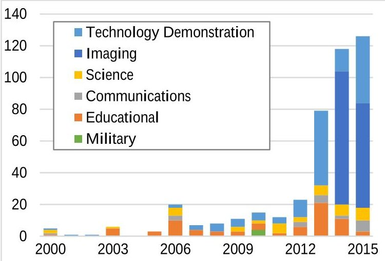
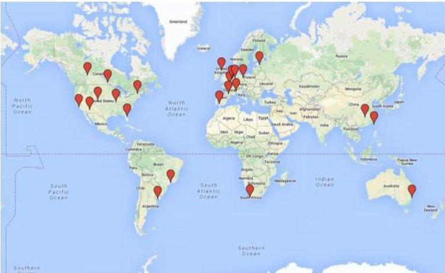
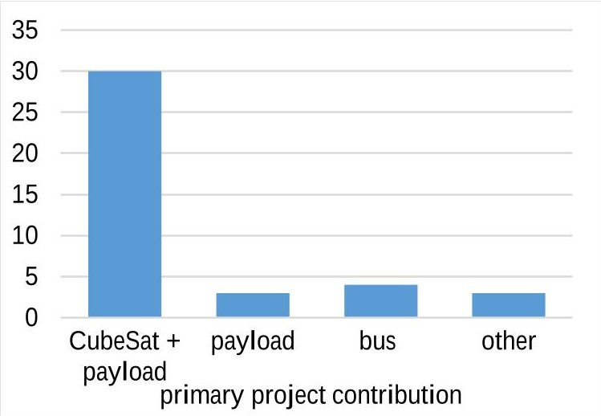
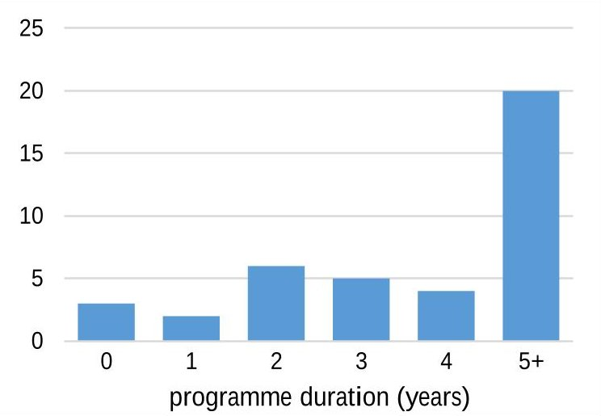
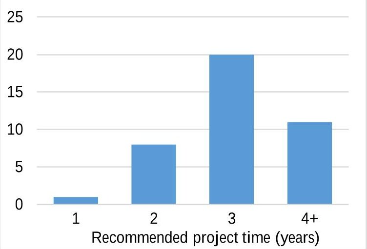
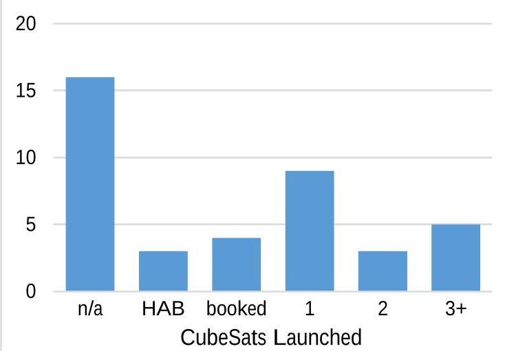
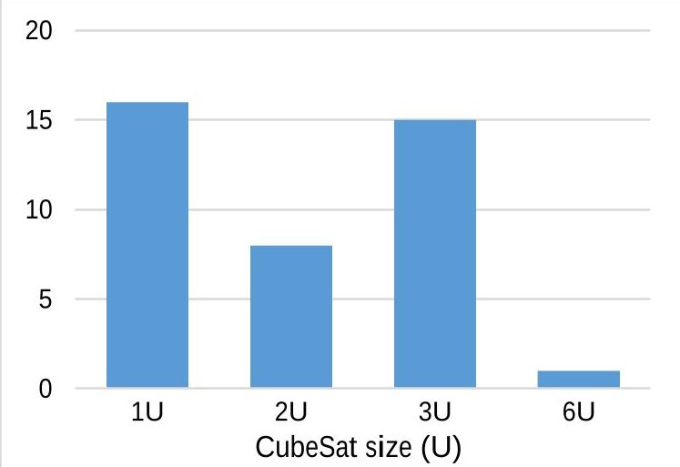
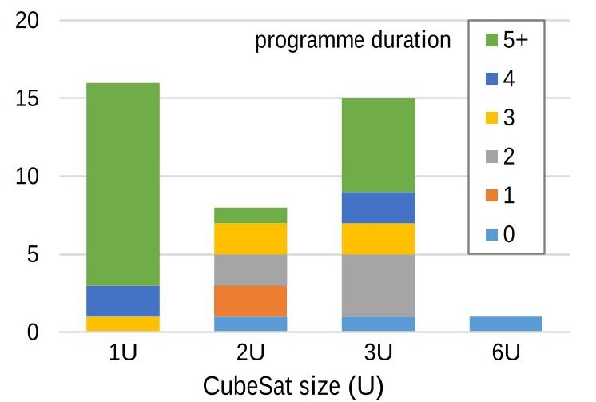
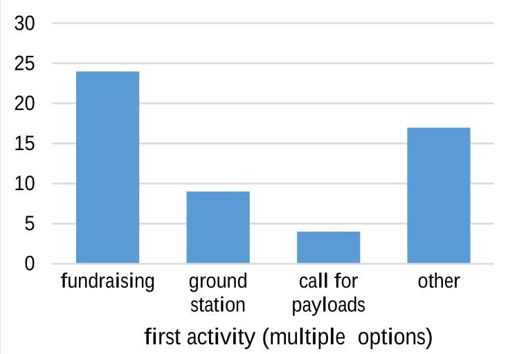
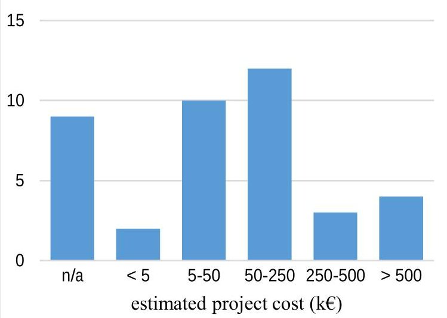

<!-- PDF_PAGE: 1 -->

# How to set up a CubeSat Project - Preliminary Survey Results

Lucinda Berthoud, Mark Schenk Aerospace Engineering Department, University of Bristol Queen's Building, University Walk, Bristol BS8 1TR, UK; +44 117 331 5550 lucy.berthoud@bristol.ac.uk

## ABSTRACT

CubeSats have been developed by many different institutions since they were introduced by California Polytechnic State University and Stanford University in 1999. A number of papers give lessons learned for individual satellites, some from a technical perspective and other from an educational point of view. However, there is no existing overview of how to set up a CubeSat project. The aim of this paper is to fill this gap, in order to offer those wishing to start a CubeSat programme some ideas of where to start, what equipment is needed and some lessons learned in terms of management.

This information was gathered via a survey which was publicised via conferences, mailing lists and LinkedIn groups. At time of writing, 40 groups have completed the survey, including universities, agencies and companies. The respondents came from the US, Europe, Canada, Taiwan, Korea, China, Africa, Australia and South America. The majority of the groups were building 1U or 3U CubeSats with Technology Demonstrator or Science Experiment payloads. The groups were asked a series of questions relating to the characteristics of their projects, including the duration of the project, costs and on what they spent their money. They were also asked what first steps they took in setting up their programme, what equipment and facilities were necessary and how they managed and scheduled the project across multiple cohorts of students. This was identified as challenging by many groups and a variety of ideas and solutions were proposed. Lessons learned covered many aspects of the project with some common themes emerging: planning, learning from other groups, student continuity, documentation, integrating the project within the curriculum, mentoring, software development, simplicity and testing. The groups were asked for their advice to future programme leaders and this is summarised in the paper.

## Keywords

CubeSat, Project Management, Higher Education, Lessons Learned.

<!-- PDF_PAGE: 2 -->

## INTRODUCTION

CubeSats were introduced by Robert Twiggs from Stanford and Jordi Puig-Suari from California Polytechnic as an educational project for engineering students $ ^{1} $ . The aim was to give students a practical experience of designing, building and testing a real satellite. The CubeSat standard has since spread around the world and is now used not only by Universities, but by Space agencies and industry as well. The latter can draw upon funding, full time staff and standard industry project management techniques. Developing a CubeSat in an educational context, however, means working outside of these support structures. Despite more than 465 CubeSats being launched (at the time of writing) $ ^{2} $ very little has been written on the subject of how to set up a CubeSat project within an academic context. This study was initiated in order to provide those starting out on the University CubeSat journey with some trends and lessons learned from those who have already been through the experience. The key questions were:

- What are the most significant lessons learned?

- What kind of CubeSat do groups start with?

- In order to answer these questions, the University of Bristol carried out a survey among CubeSat groups between September 2015 and March 2016, together with a review of 'lessons learned' CubeSat papers. This information was used to illustrate trends of initial University CubeSat projects.

- How can the project best be managed?

The background section provides a brief literature review, and the methodology section describes how the survey was carried out. The results section is split into each of the major question areas, and particularly focuses on identifying the more challenging parts of running a CubeSat project. The conclusions summarise the key points and lessons learned.

## BACKGROUND

CubeSats now have a sufficiently long history to be able to classify and review their various aspects. Missions have been classified according to size, origin, mission lifetime and on-orbit performance $ ^{3} $ . Several surveys of CubeSat applications and subsystem technologies have been performed $ ^{4,5} $ . Other work has examined potential limitations of CubeSats and their implications for different Earth observation payload technologies $ ^{6} $ Reviews of launched satellites have shown the change in trends of payloads from many early education and technology demonstration payloads to increasing numbers of science experiments and Earth observation

instruments as commercial interests and space agencies move in to the sector $ ^{3} $

Figure 1. CubeSat payloads with year launched. $ ^{2} $

It has almost become a rite of passage to write a 'lessons learned' paper on a University CubeSat mission. Most cover technical aspects, and some also include project management and lessons learned $ ^{7-10} $ . For example, a review of small satellite trends 2009-2013 found that University satellites take an average of 3.8 years to develop (compared to 1.7 years for commercial entities $ ^{11} $ ). Some detailed advice on less frequently covered topics such as integration can also be found $ ^{7,12} $ Other advice to future CubeSat programme leaders includes: aiming for a short flight duration (< 90 days), leaving sufficient mass and power margins and performing rigorous functional and environmental testing as well as pre-flight demonstrations $ ^{3} $

A summary of the educational reasons why CubeSats are interesting to Universities includes: the opportunities to innovate, to experiment, to collaborate and to get practical experience of building spacecraft $ ^{13} $ . Several Universities who are already using 'Problem-Based Learning' philosophies have adopted CubeSats as a project which equips students with technical skills, develops their ability to collaborate and their programme management skills $ ^{14-16} $ . Other Universities use a CubeSat concept to introduce new concepts like circuit design, in an exciting, practical way $ ^{17} $ . Other work has involved looking at knowledge building, communication and cultural aspects, and challenges faced by students building a CubeSat ground station $ ^{18} $ . The value of a CubeSat programme has been assessed quantitatively in terms of improvement related to five key learning objectives $ ^{19} $ . Research in tandem with industry has established that CubeSat projects provide students with the experience of challenging schedules, managing subcontracts, motivating a team and interacting with a

<!-- PDF_PAGE: 3 -->

customer which prepares them for work in the aerospace industry $ ^{20} $

However, there has been little work on programme management and how to set up a University CubeSat project for those starting out. In this work, the aim was to answer some of the basic questions for programme leaders initiating their own CubeSat project.

## METHODOLOGY

A questionnaire was created, based on what the authors thought that groups starting a CubeSat project might find useful; the questions are listed in Appendix A. There were twenty questions, of which twelve required the selection of a number of options. No more than six proposed options were provided in each case. Eight questions were open-ended and required free-form text answers. The survey was designed to take ten minutes to answer and respondents verified that this was the case. To capture the maximum amount of respondents, the survey was promoted at the Interplanetary CubeSat Workshop in London 2015, the European CubeSat Conference in Liège 2015, on the CubeSat forum mailing list, the CubeSat LinkedIn Group and on STEMN.com (a network connecting the International Space community). All of these are useful places for networking for those starting up a CubeSat project.

Answers were provided by respondents between 15th September 2015 and 8th March 2016. Answers came from forty groups around the world (see Figure 2). Those participants who requested to be recognized for their contribution are listed in the acknowledgements section. It is worth noting that some of the projects represented collaborations between space agencies and Universities and represented a nation's first spacecraft.

The main aim of the study was to aid those starting projects in academic settings. Of the 40 groups, 37 were from Universities. Several institutions had multiple entries. Where this represented the experience from one satellite, the multiple entries were amalgamated, while ensuring that comments and advice from all participants were preserved. Two of the institutions collaborated on one project, but as one of the participants described this joint project and the other described a different project, the data was not combined. The aim was to minimize any alteration of the data whilst safeguarding its validity. It was explained in the rubric that the survey should preferably be completed by project managers or systems engineers, as these were considered most likely to have the information to be able to complete the survey.

Figure 2: Geographical distribution of survey respondents (those in acknowledgements section).

## RESULTS

The results are divided into answers to the multiple choice factual questions, and the three free-form open questions. The answers to the latter were combined into themes.

## Disciplines

The survey participants were asked which department was leading the CubeSat development in their University (Q4 in Appendix A). The majority of projects were led by either the Aerospace or Electrical Engineering departments, with a smaller number being led by Physics departments. A few were led by a team of departments or as part of General Engineering (it was assumed this meant 'multi-disciplinary'). A satellite is also a multidisciplinary system and thus has a need for aerospace, mechanical, electrical/electronic engineers, computer scientists and physicists. According to the authors' experience, in the satellite industry, the subsystems would typically be split along the following lines, although there is frequently overlap.

Table 1: Subsystem discipline allocations in Satellite Industry

<table border="1"><tr><td>System/Sub-system</td><td>Discipline</td></tr><tr><td>Mission Analysis</td><td>Aerospace Engineering, Physics, Maths</td></tr><tr><td>Systems design</td><td>Aerospace/Electrical, Physics</td></tr><tr><td>AOCS</td><td>Aerospace/Mechanical</td></tr><tr><td>Power</td><td>Electrical</td></tr><tr><td>Communications</td><td>Electrical</td></tr><tr><td>OBDH</td><td>Electrical/Computer Science</td></tr><tr><td>Software</td><td>Computer Science</td></tr><tr><td>Structure</td><td>Mechanical</td></tr><tr><td>Propulsion</td><td>Aerospace/Mechanical</td></tr><tr><td>Thermal</td><td>Aerospace/Mechanical</td></tr></table>

<!-- PDF_PAGE: 4 -->

## Type of CubeSat input

Several outside experts had recommended that the authors start their CubeSat programme with a more limited project such as developing a payload or a satellite bus. It was therefore considered useful to ask what elements of a CubeSat the groups were developing (Q5 in Appendix A). The majority (30 out of 40 groups) were building an entire CubeSat, including payload. Seven groups out of forty were building either a bus or payload, and collaborating with other entities. This is regularly done in industry, but if the two entities are located in different geographical locations, travelling for meetings, testing, and integration becomes challenging. Many of the groups mentioned collaboration with local industry. Those groups selecting 'other' were doing slight variations on the entire satellite or the payload, e.g. "Payload plus ground software, AIT, operation and data archive and distribution".

Figure 3: Number of groups vs Primary project contribution

## Experience

Survey respondents had a wide variation in length of experience in building CubeSats, according to the answers to Question 6 in Appendix A: "How long has your programme been going?" This ranged from three groups in their first year, to 20 groups who had been running projects for five or more years. The value of '0' in Figure 4 represents "First year this year".

When asked to recommend a duration for developing a first CubeSat (from start to launch), 20 groups recommended 3 years, 11 groups 4+ years and 8 groups 2 years (see Figure 5). It was interesting to note that those with 2 years' experience mostly recommended 3 years, those with 3-4 years mostly recommended 4+ years, while the most experienced groups (5+ years) generally recommended a 3-year duration.

Figure 4. Number of groups vs programme duration From this it is surmised that once a programme is established and a knowledge base built up by staff and students, it becomes possible to compress the programme duration down to a length, such as three years, which is compatible with undergraduate and Master's course durations. The initial programme may take a year or two longer.

Figure 5. Number of groups vs Recommended project duration.

The groups were asked whether any of their satellites had been launched (Question 8). The results in Figure 6 show that 17 groups out of 40 groups have launched one or more satellites, whereas the rest have not yet launched on a full scale rocket. This may be because they are not ready for launch, because they do not have funding for launch or because of other reasons. There is an increasing need for low cost launch opportunities for University satellites. For example, NASA's Educational Launch of Nanosatellites offers a limited number of opportunities to those selected by competition. High altitude balloons, drones and sounding rockets are a way of gaining experience for a CubeSat programme and Universities make use of opportunities such as the European Space Agency's (ESA) REXUS/BEXUS

<!-- PDF_PAGE: 5 -->

programmes. These offer a structured route through an Agency-mentored process to a launch.

Figure 6. Number of groups vs CubeSats launched

## Size of Satellites

The participants were asked (Question 7) about the size of satellite with which they started their CubeSat programme. The majority started with either a 1U or a 3U CubeSat (see Figure 7).

Figure 7: Number of groups vs CubeSat size

The emergence of larger CubeSats in recent years was evidenced by increasing numbers of groups starting their projects with a 3U CubeSat, and one group working on a 6U CubeSat. This is more evidence for the overall trend towards larger CubeSats shown in the data collected by Swartwout $ ^{2} $ . A correlation between size of first CubeSat and programme duration can be seen in Figure 8. Experienced groups who have a programme which has been running for 5+ years, frequently started with a 1U CubeSat, whereas groups who have started in the past 3 years were more likely to select any of 1-3U as their first satellite. Overall it appears that 1U and 3U are the most popular sizes with which to start a programme.

Figure 8. Number of groups vs CubeSat size with programme duration

## Type of payload

In Question 9 the participants were asked for the type of payload on their CubeSat (multiple payloads could be selected by respondents). 19 of the groups had an educational and outreach payload, 30 of the groups had a technology demonstration payload and 26 groups a science experiment. Other alternatives included communications and Earth observation payloads. There was no apparent correlation between size of CubeSat and number or type of payload.

The payloads will in part drive the mission duration, but no data was gathered about the intended duration of the missions. Previous studies based on picosatellites before 2010 found that the average intended CubeSat mission duration is 8 months $ ^{5} $

## Subsystems bought from suppliers

Question 10 asked whether groups mainly bought subsystems from suppliers or built their own CubeSats. It appeared that most groups buy a few subsystems from suppliers as well as designing some of their own subsystems. In response to asking which items were bought from suppliers, the Electrical Power System (6 groups) and On-Board Computer and bus (7 groups) were most frequently mentioned.

## Initial Activities

The groups were asked for the first steps in setting up their CubeSat programme (Question 11), and were given the choice between: raising funds; building a ground station; opening a call for payloads and other'. Note that more than one answer could be selected. The results are shown in Figure 9. The other category answers stated by participants included: planning the infrastructure (design, prototyping and testing spaces), defining payload and seeking partners, performing feasibility studies, participating in competitions, creating a

<!-- PDF_PAGE: 6 -->

dedicated CubeSat project course or club for students, building a ground-based prototype and high altitude balloon and sounding rocket experiments.

Figure 9: Number of groups vs first activities

## Facilities required

When asked which facilities were required, those listed in Table 2 were cited most frequently by the groups. Note that 'Access' in Table 2 meant that groups recommended either having the facilities on site or access to them. Several groups said that a cleanroom was not strictly necessary (depending on payload and mission), but one commented: "... it is a huge PR boost to set up a "Clean Room" - especially if it is in a conspicuous place. Our Clean Room had glass walls, and became a fixture on campus tours of the engineering buildings. We attracted a lot of students with that room, even though our mission did not strictly need that level of cleanliness."

Table 2: CubeSat equipment needed

<table border="1"><tr><td>Equipment</td><td>Necessary</td></tr><tr><td>Laboratory with bench, microscope, solder station, computers, oscilloscope, spectrum analyser, etc.</td><td>Y</td></tr><tr><td>Machine shop</td><td>Access</td></tr><tr><td>Cleanroom for final system assembly, integration</td><td>Optional</td></tr><tr><td>Ground station</td><td>Y</td></tr><tr><td>Vibration test</td><td>Access</td></tr><tr><td>Thermal vacuum test</td><td>Access</td></tr><tr><td>Radiation test</td><td>Access</td></tr><tr><td>Electrostatic load test</td><td>Access</td></tr></table>

## Project Spending

The cost of a CubeSat may initially be considered a barrier for those groups starting a project. Given that many respondents have suggested that one of the first activities is to raise funds, it is useful to find out how much should be raised. When asked how much was spent on design, integration and testing (not including launch

and labour) during their project, the results showed a real variation in spending between less than 5 k€ and over 500 k€ (see Figure 10). Whilst the majority of groups spent 50-250 k€, some managed to spend less than 5 k€. It was thought that those spending over 500 k€ would be the three non-University groups, but this was only the case for one of the groups.

Figure 10. Number of groups vs Project cost in k€

The two groups who spent less than 5 k€ were experienced (5+ years programmes) and had launched their CubeSats on a balloon or sounding rocket. This indicates that a low-budget way in to a CubeSat programme is to build mostly in-house and launch via these cheaper methods.

## Lessons Learned

Questions 16, 18 and 19 were concerned with lessons learned, advice that the groups would give to those starting out and how to manage the project across multiple cohorts of students. The responses to these questions have been combined as they overlapped and fell into several main themes:

## 1. Planning

Several respondents emphasized the importance of planning: "Spend a lot of time in the planning stage. Lay out your team and communication structure, your management methods, resources, budget, schedule and risk". One suggested having a big picture roadmap from start to finish and to securing support of administrators and department chairs early. "Find or develop a vision/goal for the project. Why start building CubeSats?" was one of the recommendations to those starting a project. Another reminded those starting out to define responsibilities between project partners in a written form "to avoid bad surprises" and another respondent wrote: "Do not hesitate to spend one or two years on mission analysis...and careful feasibility studies before talking about design and COTS

<!-- PDF_PAGE: 7 -->

subsystems". The general theme was to take plenty of time over the planning and settling the objectives and requirements at the beginning of the project. This must be balanced against the need to maintain motivation and enthusiasm. In contrast, Alminde et al. recommend to "Start launch negotiations from the start of the project as this provides the project with needed realism. It makes the students (and managers) believe in the project" $ ^{14} $

## 2. Learning from other groups

Several respondents suggested talking to those who have already built a CubeSat and learning from their experience, which is one of the aims of this article. One commented: "Try to gain insight from teams that have done it already. Arrange meetings with other developers or ty to obtain documentation that outlines their designs in detail." Another participant expressed frustration that there was not enough open information related to CubeSat design. Several projects have been initiated to address this, including LibreCube $ ^{21} $ and OOSDI $ ^{22} $ Several others proposed working with an established institution, which has flown successful missions in the past.

## 3. Student continuity

When asked how the project was managed across multiple cohorts of students, responses were: "difficult"; "poorly"; "not very well". This is a major challenge as the projects often last longer than individual students' involvement, so there needs to be continuity and passing on of knowledge.

Several teams suggested that post-graduate students were a good solution to providing continuity over the duration of the project. These students often led or became the experts on the project due to their accumulated knowledge over its history: "Having a grad student assigned to the project at all times is a good idea". Similarly, " [It is] Critical to get one student who will be there long term. They end up being the resident expert on the project. ... This is essential to maintain progress as other team members come and go". The alternative proposed was to run a shorter programme and have a core of dedicated members. Other ideas proposed by Alminde et al. were to use workshops which gathered together as many as possible of the students at one time, e.g. over a weekend, and to use summer internships to provide continuity and testing over the summer period $ ^{14} $

As stated by Klumpar $ ^{10} $ : "Managing a student workforce requires a more tolerant and forgiving approach than managing paid professional employees". One contributor summed up many comments: "Student volunteers can be capricious and unreliable but some

can be incredibly tenacious and make your project possible".

## 4. Documentation / Project Management

Most groups used documentation as a way of managing the handover between the student participants: [It is necessary to have] "good documentation of requirements, work done and work to do." Some provided ideas of how best to do this: "I developed a continuity document ... basically a structured letter from the student lead of each subsystem for that semester to the new lead of the subsystem next semester". Another suggested to "Provide a quick start guide to your project of do's and don'ts and whereabouts for new students". A common documentation approach appeared to be the use of a Wiki (mentioned by several teams). Praks et al. started out with a Wiki initially, but the requirement for simultaneous work led them to select Google Docs/Drive as the final method of documentation $ ^{23} $ . They also suggested multidisciplinary working requires special attention to be paid to systems engineering and information exchange and that this aspect was frequently overlooked by students.

Many groups stated the need for regular team meetings between subsystem leads and faculty, and work sessions for students to complete the tasks. Some respondents have used a full AGILE management approach $ ^{24} $

## 5. Integration into the curriculum

One topic the authors have particularly struggled with is how to embed a multi-disciplinary design project into the teaching curriculum. What is more, a CubeSat is primarily a design-build-test project and therefore less suited to the style of final-year projects favoured by research-led Universities. On the other hand, several Universities have demonstrated this can be successfully achieved, e.g. resulting in 12 master and 15 bachelor theses on CubeSat-related topics $ ^{23} $ . A detailed explanation of the choices of different levels of engagement available at one University from unpaid intern to Master's research projects is given by Klumpar $ ^{10} $ . Proposed ways of encouraging participation in CubeSat projects, both in the literature and mentioned by respondents, include:

- Running the project as an extra-curricular activity through a student led society/club;

- Developing a dedicated Bachelor/Master course or module to facilitate the project;

- Multi-disciplinary project in a multi-disciplinary course;

- Running the project as a capstone team design project with help from local industry.

<!-- PDF_PAGE: 8 -->

Several respondents advocate for the CubeSat project to be optional, as it requires extra work.

## 6. Mentoring

Several groups mentioned the importance of mentoring by external experts and more experienced student team members. External experts can help by performing critical reviews $ ^{25} $ . "Finding and setting up relationships with people with expertise and knowledge in different aspects of the project is very important." From another respondent: "We kept a core of engineers and researchers from Institution X advising the students for each subsystem." The SwissCube project describes a system of reviews by external experts: "it forced the team to converge on design solutions and take system-level decisions" $ ^{7} $ . Shiroma et al. described an arrangement where 'seniors' using CubeSat as their capstone design project served as team leaders for the various subsystems. Younger students taking CubeSat for their freshman, sophomore, and junior projects were mentored by seniors and served as apprentices $ ^{26} $ . In this case, it is the students who are serving as the experts and providing the mentoring.

## 7. Software development

In the recommendations, five groups emphasised paying special attention to software due to its challenging nature. One respondent wrote: "Don't neglect software development - this is arguably more important than hardware development which is often favoured by young engineers". Another confirmed this with: "Software is the biggest time sink". One group recommended specific software: "Use SPARK/Ada as the software is most complicated part of the project". The software development is not necessarily the first topic to be planned at the beginning of a project. However, the message from the survey was clear: software should be considered from the outset of the project and accorded equal importance with the hardware.

## 8. Simplicity

Several respondents suggested to "Simplify, simplify, simplify. ESPECIALLY for your first CubeSat. The simpler everything is, the more comprehensive your testing can be, which equates to confidence in the success of your mission... You can introduce more complexity with each successive mission." Other contributors emphasized this message: "Don't be overambitious", urged one participant, and "Focus on a single payload" suggested another. "Keep things simple and use flight proven critical components as primary subsystems", recommended a third.

## 9. Testing

A majority of groups mentioned the importance of testing. A typical comment was: "Testing, testing and again testing, is fundamental!" Others urged: "Nothing ever works the first time you try to put it together. You absolutely must push your students into early, integrated demonstrations of key parts of the hardware." and "As soon as you start getting hardware, start testing. Finish an EPS board? Test the heck out of it and iterate it as necessary. Don't wait for the battery board, solar panels etc. to come in." The purpose of extensive testing was succinctly explained by one respondent: "We caught several issues during testing that would've been mission- ending".

A suggestion was to use a 'Flat-Sat' early in the project. This is a modular engineering model of the satellite to test each subsystem separately and enables the subsystems to be removed for repairs and development. It also allows end-to-end 'hardware in the loop' testing. Several organisations (including ESA and the UK's Satellite Catapult) are beginning to provide Flatsats for groups to access.

Some groups emphasized the importance of doing this end-to-end testing: "End-to-end testing (from the operational ground station) is crucial to ensure mission success. The satellite should be tested with the ground station in the loop long before the actual delivery for launch." To this advice, another group adds: "Never fly if not all the tests have been passed". Although this advice may be considered obvious, for many groups, it is not until launch is imminent that some of the system testing is done. One experienced group pointed out the importance of leaving enough time for in-orbit checks and testing: "Even with "off the shelf" components, it took weeks longer than expected to merely send "hello, world" from ground station to spacecraft and get a response... You need at least 30 days of uninterrupted space operations to catch your software problems and unexpected interference between components."

In the literature, there is a useful description of necessary ground campaign tests including sun simulator, vibration, radiation, vacuum and launcher integration checks $ ^{8} $

## DISCUSSION

These results have been based on responses to a survey questionnaire, as well as points made in the existing literature on CubeSats. As the survey was voluntary, the participants were self-selecting. The opinions expressed by them were subjective and were not questioned by the authors, but simply reported. It is possible that others in the same project might have expressed different opinions

<!-- PDF_PAGE: 9 -->

and offered different lessons learned. There was some evidence of this, as three institutions had multiple contributors. Their factual answers were generally consistent and were amalgamated, but there was some variation in the lessons learned: possibly partly due to the role of the participant and to personality. Also, some survey results came from students who had been the lead/systems engineer and others came from staff who had been leading the projects (often for many years). This may also create a wider variety of data due to the different viewpoints.

The respondents had different amounts of experience varying from a few months to more than ten years. Whilst this would clearly produce different messages for the lessons learned, it was felt by the authors that all experience was valuable, whether a few months or many years. It could even be argued that those who commenced their first CubeSat project more than five years ago may not recollect the detail of the initial difficulties that they had, or equally that this experience is less relevant, as so much has changed in the CubeSat industry in the last five years.

It was considered whether the inclusion of three non-University respondents could have distorted the data. None of these were companies with commercial interests, but it was considered important that they did not direct the themes away from academic challenges. However, the results from these participants were very comparable with the academic participants and the lessons learned were indistinguishable from the other contributors.

## CONCLUSIONS

In this work, a survey of 40 University and other CubeSat groups has been performed in order to provide data for those starting out on the CubeSat journey. The groups were asked a series of questions relating to the characteristics of their projects, including the duration of the project, costs and what they spent their money on and what equipment and facilities were necessary. They were also asked about how they managed and scheduled the project across multiple cohorts of students.

approximately three years and the CubeSat will be a 1U or 3U costing between 50 and 250 k€.

Is it possible to describe a typical University CubeSat project? A picture does emerge: based on the results of this survey, a typical University first CubeSat project will be run from Aerospace or Electrical Engineering departments, it will have started with fundraising and planning, will consist of the group building both CubeSat and payload, with a payload consisting of a technology demonstration and/or science experiment. The satellite will consist of a mix of mainly in-house subsystems with a few provided by suppliers. The project duration will be

Lessons learned covered many aspects of the project with some common themes emerging: planning, learning from other groups, student continuity, documentation and project management, integrating the project within the curriculum, mentoring, software development, simplicity and testing. Experience shows that at the beginning of a project, time needs to be spent on the planning and setting of objectives and requirements. This has to be balanced against maintaining motivation and enthusiasm in the students. Continuity with a transient unpaid workforce is a challenge, with groups using graduate students or keeping the programme to two years in duration as solutions, as well as documentation and innovative project management techniques such as spiral and AGILE models used in the software industry. Given the level of challenge posed by these issues, there is clearly scope for further exploration of these and other new management models.

Mentoring both by more experienced students and by external industry experts provide support and motivation. The latter are often asked to contribute to major technical reviews-a proven systems approach to ensuring design quality and consistency. Groups can learn much from others, partnering with a more experienced institution and/or from projects who make their materials open source. Two technical areas often underestimated by groups initially are software development and testing, both of which need more time than predicted. The importance of simplicity when embarking on a first satellite was emphasized by the groups.

## FURTHER WORK

The authors plan to reopen the survey in the future and wish to encourage more respondents to participate. In order to fill out gaps in the data and to gain a more representative sample, they wish to especially encourage participation from developing countries and countries not hitherto represented in the survey. They would also wish to encourage established programmes who have been going for a number of years to participate, if they have not already, as these provide many years of valuable lessons learned.

<!-- PDF_PAGE: 10 -->

## ACKNOWLEDGEMENTS

The authors would like to acknowledge the help of the 40 Universities and other institutions who completed this survey. These included: Arizona State University (USA); Cal Poly State University (USA); Delft University of Technology (Netherlands); INPE National Institute for Space Research (Brazil); ISAE - SUPAERO (France); National Cheng Kung University (Taiwan); National University of Defense Technology (China); Paris Diderot (France); Paris Sciences & Lettres, Paris Observatory (France); Politecnico di Torino (Italy); Saint Louis University (USA); Seoul National University (Korea); Technische Universität Berlin (Germany); Universidad de la República (Uruguay); University of Alaska Fairbanks (USA); University of Alberta (Canada); University of Central Florida (USA); University of Colorado, Boulder (USA); University of Manitoba (Canada); University of Seville (Spain); University of Stellenbosch (South Africa); University of Strathclyde (UK); University of Sydney (Australia); University of Tartu (Estonia); University of Twente (Netherlands); Vermont Technical College (USA)

## REFERENCES

1. Heidt, H., Puig-Suari, J., Moore, A. S., Nakasuka, S. & Twiggs, R. J. CubeSat: A new Generation of Picosatellite for Education and Industry Low-Cost Space Experimentation. AIAA/USU Conf. Small Satell. 1-19 (2000).

2. Swartwout, M. CubeSat Database. at <https://sites.google.com/a/slu.edu/swartwout/home/cubesat-database> Accessed 13/06/2016.

3. Swartwout, M. The First One Hundred CubeSats: A Statistical Look. J. Small Satell. 2, 213-233 (2013).

4. Woellert, K., Ehrenfreund, P., Ricco, A. J. & Hertzfeld, H. Cubesats: Cost-effective science and technology platforms for emerging and developing nations. Adv. Sp. Res. 47, 663-684 (2011).

5. Bouwmeester, J. & Guo, J. Survey of worldwide pico- and nanosatellite missions, distributions and subsystem technology. Acta Astronaut. 67, 854-862 (2010).

6. Selva, D. & Krejci, D. A survey and assessment of the capabilities of Cubesats for Earth observation. Acta Astronaut. 74, 50-68 (2012).

7. Noca, M. et al. Lessons Learned from the First

Swiss Pico-Satellite: SwissCube. 23rd Annu. AIAA/USU Conf. Small Satell. Small Satell. (2009).

8. Graziani, F., Piergentili, F. & Santoni, F. A space standards application to university-class microsatellites: The UNISAT experience. Acta Astronaut. 66, 1534-1543 (2010).

9. Guo, J., Bouwmeester, J. & Gill, E. In-orbit results of Delfi-n3Xt: Lessons learned and move forward. Acta Astronaut. 121, 39-50 (2016).

10. Klumpar, D. M. CubeSat Lessons Learned: Two Launch Failures Followed by One Mission Success (Subtitle: What can go wrong will go wrong). in AIAA/USU Conference on Small Satellites SSC12-11-4 (2012).

11. Richardson, G., Schmitt, K., Covert, M. & Rogers, C. Small Satellite Trends 2009-2013. Proc. AIAA/USU Conf. Small Satell. SSC15- VII-3 (2015).

12. Slavinskis, A., Pajusalu, M., Kuuste, H. & Ilbis, E. ESTCube-1 student satellite in-orbit experience and lessons learned. IEEE A&E Syst. Mag. 12-22 (2015).

13. Twiggs, R., Malphrus, B. & Muylaert, J. SSC10- XII-3 The QB50 Program , the first CubeSat Constellations doing Science. in 24th AIAA/USU Conference on Small Satellites 12, (2010).

14. Alminde, L., Bisgaard, M. & Bhanderi, D. Experience and Methodology gained from 4 years of Student Satellite Projects. in Proc. 2nd Int. Conf on Recent Advances in Space Technologies 94-99 (2005).

15. Rodriguez, J. et al. Project Based Learning experiences in the space engineering education at Technical University of Madrid. Adv. Sp. Res. 56, 1319-1330 (2015).

16. Smith, M. W., Miller, D. W. & Seager, S. Enhancing undergraduate education in aerospace engineering and planetary sciences at MIT through the development of a CubeSat mission. Proc. SPIE 8146, (2011).

17. Holman, T. et al. The small satellite (CubeSat) program as a pedagogical framework for the undergraduate EE curriculum. in 121st ASEE Annual Conference and Exposition, Conference Proceedings (2014).

<!-- PDF_PAGE: 11 -->

18. Nielsen, J. D., Du, X. Y. & Kolmos, A. Innovative application of a new PBL model to interdisciplinary and intercultural projects. Int. J. Electr. Eng. Educ. 47, 174-188 (2010).

19. Straub, J. & Whalen, D. An Assessment of Educational Benefits from the OpenOrbiter Space Program. Educ. Sci. 3, 259-278 (2013).

20. Hevers, T., Daehler, E. & Peck, M. Applying University Small Satellite Program lessons to a career in the aerospace industry. in Small Satellite Conference SSC13-IX-6 (2013).

21. Scholz, A. & Juang, J. N. Toward open source CubeSat design. Acta Astronaut. 115, 384-392 (2015).

22. Straub, J. et al. OpenOrbiter: A Low-Cost, Educational Prototype CubeSat Mission Architecture. Machines 1, 1-32 (2013).

23. Praks, J. et al. AALTO-1 earth observation cubesat mission — Educational outcomes. in 2015 IEEE International Geoscience and Remote Sensing Symposium (IGARSS) 13401343 (2015). doi:10.1109/IGARSS.2015.7326023

24. Segret, B. et al. The Paving Stones: initial feedback on an attempt to apply the AGILE principles for the development of a CubeSat space mission to Mars. in Proc. SPIE 9150, Modeling, Systems Engineering, and Project Management for Astronomy VI. International Society for Optics and Photonics. (2014).

25. Praks, J., Tikka, T. & Kestila, A. Online documentation approach for assisted system engineering and assessment in student projects. IEEE Glob. Eng. Educ. Conf. EDUCON 608611 (2015).

26. Shiroma, W., Ohta, A. & Tamamoto, M. The University of Hawaii CubeSat: a multidisciplinary undergraduate engineering project. 3rd ASEE/IEEE Front. Educ. Conf. (2003).

## APPENDIX A

Survey Questionnaire

Q1. What is your name? e.g. Title, First name, Surname

Q1a. (Optional) Please add your email, if you don't mind being contacted by the authors of the survey.

Q2. What is the name of your University?

Q3. In which country is your University based?

Q4. Which department is leading the CubeSat program in your University? More than one answer is possible.

Options: [Aerospace Engineering], [Mechanical Engineering], [Electrical Engineering], [General Engineering], [Physics], [Computer Science], [Other].

Q4a. If you selected "Other", please specify.

Q5. Which of the following describes your University's input to your first CubeSat project? Please select one.

Options: [CubeSat including payload/s], [Payload only], [CubeSat bus only], [Other]

Q5a. If you selected "Other", please specify.

Q6. How long has your programme been going? Please select one.

Options: [First year this year], [1 year], [2 years], [3 years], [4 years], [5+ years]

Q7. What size CubeSat did you start with? Please select one.

Options: [1U], [2U], [3U], [Other]

Q7a. If you selected "Other", please specify:

Q8. Have you launched any of your satellites? Please select one.

Options: [Not yet], [We have launched on a high altitude balloon or sounding rocket already], [We have a launch booked for our first satellite], [We have launched 1 satellite and are working on the next], [We have launched 2 satellites and are working on the 3rd], [We have launched 3+ satellites]

Q9. Which of the following describe the payload(s) on your first satellite? More than one answer is possible.

Options: [Educational and Outreach] [Communications] [Science Experiment] [Technology Demonstration] [Other]

<!-- PDF_PAGE: 12 -->

Q9a. If you selected "Other", please specify:

Q10. Which of the following describe your first CubeSat? Please select one.

Options: [We built some items and bought others from suppliers], [We mostly integrated subsystems from CubeSat suppliers, e.g.: Pumpkin, ISIS, ClydeSpace], [We mostly built the CubeSat ourselves], [Other].

Q10a. (Optional): If you selected either first or second options, please list the main items you bought from suppliers.

Q11. What did you do first in setting up your programme? You can select more than one answer.

Options: [Raise funds], [Set up a ground station], [Call for payloads], [Other]

Q11a. If you selected "Other", please specify.

Q12. In your view, which facilities and equipment (which might require funding) are essential for running the project?

Q13. If you have completed a satellite, how much do you estimate you have spent on design, integration and test (not including launch and labour)? Please select last option if you would rather not say.

Options: [< 5k Euro], [5-50k Euro], [50-250k Euro], [> 500k Euro]

Q14. Where have you spent the bulk of your funding? (not including launch). Multiple answers are possible.

Options: [CubeSat components], [Equipment], [Testing], [Travel for meetings/testing], [Facilities], [Other]

14a If you selected "Other", please specify:

Q15.If you were giving advice to another University how long would you suggest they allow for designing integrating and testing their first satellite (from start to launch)? Please select one.

Options: [1 year], [2 years], [3 years], [4+ years]

Q18. What have been the biggest lessons learned from your programme so far?

Q16. How have you managed and scheduled the project across multiple cohorts of students?

Q17. How many students were/are involved with your first CubeSat project and were/are they undergraduate or postgraduate?

Q19. What advice would you give to those starting out on a CubeSat project?

Q20. Would you prefer anonymity or acknowledgement when the results are published?

Options: [Please keep this information anonymous], [Please acknowledge my institution in the acknowledgements section of anything you publish]