<!-- PDF_PAGE: 1 -->

Advanced Engineering Informatics, Volume 60, April 2024, Article 102405

# Hybrid digital twin for satellite temperature field perception and attitude control

Yang Xie; Wen Yao; Xingchen Li; Ning Wang; Xiaohu Zheng; Xiaoqian Chen https://doi.org/10.1016/j.aei.2024.102405

## Abstract

Digital twin has become a critical technical solution for satellite in-orbit service and maintenance. The majority of existing research in this field has focused on constructing system-level digital twins, with various typical applications that primarily describe the operating condition of satellite subsystems. However, achieving a more meticulous portrayal of in-orbit satellites necessitates the inclusion of physical field information, e.g., the temperature field serves as a fundamental basis for characterizing the thermodynamic state and plays a crucial role in precise thermal management of a satellite. The main challenge for realizing thorough state detection and real-time response lies in the cross-level model fusion of system simulation and physical field calculation. To overcome this problem, this paper proposes a Hybrid Digital Twin (HDT) framework that seamlessly integrates the digital twin at the system-level with its physical field-level counterpart, enabling a comprehensive and detailed representation of modeling objects. Specifically, at the physical field-level, deep learning methods are utilized to construct an accurate surrogate model, offering a lightweight, computationally efficient and accelerated execution alternative to the Finite Element Analysis models. At the system-level, multi-domain unified modeling technology is employed to ensure both efficiency and accuracy of coupling simulation. Moreover, a co-simulation approach is developed on the basis of the Functional Mock-up Interface, overcoming the bottleneck of cross-level information interaction and computing time synchronization. The practical utility of the proposed framework is verified by a real-world engineering problem, i.e., satellite temperature field perception and attitude control in the context of the harsh space environment. Whole process engineering experiments demonstrate the effectiveness of the HDT, with mean absolute errors below 1 K for temperature field reconstruction and within $ 1^{\circ} $ for attitude control.

## Keywords

Hybrid digital twin; Deep learning; Modelica language; Temperature field perception; Attitude control system

< Previous article in this issue

Next article in this issue

## 1. Introduction

Satellites play a prominent role in safeguarding resources, preventing disasters, as well as in facilitating social management. With the steady improvement of satellite service capabilities, the complexity of the system has also undergone a qualitative leap, leading to a vast quantity of uncertainties [1],[2]. Furthermore, contrary to

<!-- PDF_PAGE: 2 -->

the prevailing notion of space as a vacuum, it actually repletes with many constituents, e.g., variable thermal environment, particle radiation, and photons [3], which can adversely affect satellites, resulting in decreased performance and even complete failure [4],[5]. The escalating complexity of satellite systems, along with the hostile working environment, necessitates the pressing need for new prognostics and health management (PHM) [6] approaches to effectively respond to catastrophic space climate events.

The digital twin [7], [8], [9], a concept that seeks to establish a real-time mapping between physical space and digital space, shows tremendous potential for realizing timely perception and intelligent control. As a virtual copy of the physical entity, the digital twin can reflect the behavior and control the physical system under operating conditions throughout its life cycle [10], [11], [12], which meets the need of solving the increasingly complex equipment health maintenance. In 2010, NASA inherited and developed this concept in their comprehensive technology roadmap [13] and described it as a multi-scale, multi-physics simulation of an asset, integrating high-fidelity modeling and situational awareness in a timely manner [14], [15]. Digital twin has evolved from a conceptual idea to various practical applications since then.

The aerospace industry has been at the forefront of digitization for a long time. In the past few years, many attempts have been made to implement digital twin technology in this field, such as life prediction [16], fast evaluation [17], and damage sensing [18]. However, the previous research mainly centered around system-level models, with little consideration given to the physical field-level information. According to the corresponding real-world entities, digital twin can be classified into system-level and physical field-level digital twin, with the primary distinction lying in the type of governing equations to be solved. The system-level digital twin primarily establishes functional and performance models for system, subsystem, and individual component, encompassing multi-domain models such as control system, power system, and hydraulic system, etc. This approach offers a depiction of system composition, coupling relationships, and operational processes. However, each unit model is typically a simplified representation, mainly described by ordinary differential equations (ODE), which may have limited capability to capture fine-grained physical characteristics. In fact, physical fields can provide in-depth descriptions of the equipment state [19]. The physical field-level digital twin focuses on constructing detailed models of physical quantities and fields that account for both internal and external environmental factors, including temperature, stress, and electromagnetic fields, etc. Such models primarily described using partial differential equations (PDE) enable a precise portrayal of specific physical properties and operational characteristics [20]. Nevertheless, solving PDE often requires discretization techniques, presenting a significant challenge in achieving computational accuracy and efficiency simultaneously.

Although the current system-level and physical field-level digital twin technologies have made some progress in their respective fields, the integration of the two is still in its nascent stage, limited by modeling methodologies and technical bottlenecks. It is becoming increasingly apparent that a hybrid digital twin technology, combining these two aspects, is the inevitable trend for the advancement of aerospace digitalization. Taking the satellite as an example, the internal and external physical field changes during orbital flight exert a crucial influence on satellite performance. Variations in the combustion temperature field inside the attitude and orbit control engine directly influence engine thrust performance. Additionally, alterations in the stress field resulting from flight overload significantly impact structural strength safety. By leveraging synergies of the hybrid solution, a more comprehensive and detailed representation of aerospace systems can be achieved, enabling better understanding, analysis, and optimization of their performance.

<!-- PDF_PAGE: 3 -->

The chief obstacle in HDT technology lies in the discrepancy of computing time between system-level and physical field-level digital twins. The calculations performed by the system digital twins are relatively coarse yet executed in real-time. On the contrary, the analysis of various physical fields heavily relies on resource intensive finite element numerical simulations or physical experiments, leading to high computational costs. Bridging the gap of efficient cross-level model interaction is crucial for achieving a synchronized and harmonized HDT. To the best of our knowledge, there is a paucity of research on this particular area, only a few high-tech companies have made the attempt. Microsoft Project Bonsai partnered with Ansys to integrate Ansys Twin Builder with the Bonsai platform. They created an example of aircraft environmental control system (ECS) to demonstrate the integration of air conditioning control system model with cabin temperature and pressure field models [21]. It is evident from this reference case that there exists a mismatch of calculation granularity and interactive interface between system-level and physical field-level digital twins, hindering their seamless integration and joint simulation. This incongruity impedes the collaboration of these models, warranting further exploration and development of techniques that facilitate a more unified approach to system analysis and physical field simulation.

Different from existing work, this paper adopts deep learning techniques to construct a high-fidelity surrogate model for physical field-level models, thereby tackling the challenge of disparate calculation times. Then, we establish a connection to system-level models within the simulation platform by leveraging the standardized interface, Functional Mock-up Interface (FMI), which enables the co-simulation of models characterized by varying granularity. To validate our technical route, this study focus on the integration of system-level digital twin with physical field-level digital twin in the context of satellites in-orbit maneuvers in complex space environments. As cosmic rays and high-energy particles have become real risks threatening the safe operation of satellites, traditional thermal management can no longer effectively deal with the heat concentration caused by catastrophic space climate events. In this case, satellites must perform practical attitude adjustments to avert local overheating and make the heating surface even. Accordingly, it is essential to establish an HDT for satellite attitude control system incorporating real-time temperature field perception, which will allow for the reliability and safety of various scenarios.

With regard to temperature field perception, available approaches are classified into two categories. The first one directly employs numerical methods to calculate the temperature of points or domains [22], [23]. The other utilizes surrogate model based methods, such as radial basis functions [24], Kriging [25], support vector regression [26], and deep neural network (DNN) [27], to substitute the repetitive and expensive physical simulations and map input-output relationship of the concerned system. The deep learning-based surrogate model has gained popularity in recent research due to its competence in solving high-dimensional and nonlinear problems compared with traditional surrogate models. For physical problems, deep learning can be applied to derive the relationships between physical phenomena, particularly when the actual physical model is intricate or even unknown. Chen et al. [28] constructed four types of deep learning surrogate models to transform the temperature field reconstruction of heat source systems into discrete mapping forms. Zheng et al. [29] proposed a physics-informed deep Monte Carlo quantile regression method based on U-net [30] to accurately reconstruct the temperature field without using labeled data and quantify the aleatoric uncertainty by constructing a quantile level image. As a powerful universal approximator, DNN has been widely applied in the reconstruction of various physical fields from limited sensors [31], [32]. However, there is a dearth of

<!-- PDF_PAGE: 4 -->

studies focused on the application of these methods to physical field-level digital twins and their integration with system modeling.

In terms of attitude control systems, the existing modeling methods generally fall into the following two types. One approach is to simulate the mechanical structure, control strategy, kinematics and dynamics by using mainstream software such as Ansys, Adams, Amesim, Simulink, and STK, respectively [33], [34]. The second is to construct a multi-domain unified model based on the Modelica language [35]. At present, the modeling and simulation (M&S) technologies for a single field have achieved a considerable level of maturity, and the simulation software mentioned above has made great contributions in their respective domains. However, the attitude control system is a typical cross-field and cross-disciplinary system with electronics, mechanics, and control coupling. Achieving joint simulation between different simulation software in diverse domains is complicated. Conversely, Modelica language can depict the behavior of multi-domain elements through unified mathematical equations and analyze the comprehensive performance of the whole system, which makes it widely used in aerospace. Shangguan et al. [36] presented a new physical-virtual convergence approach for satellite fault diagnosis and health monitoring based on Modelica and applied it to a satellite power system. Liu et al. [37] utilized Modelica to establish a satellite constellation system model and proposed a PHM framework. From the literature reviewed above, Modelica modeling language has demonstrated the powerful capability of building the system-level digital twin. However, owing to its late start, the systematic use of this modeling language for the study of satellite guidance, navigation, and control (GNC) system is still underdeveloped. A deficiency in standardized aerospace model libraries is evident, and limited research has been conducted on the feedback control of satellites in complex space environments utilizing Modelica language.

In order to address the aforementioned challenges, we develop a methodology for constructing HDT and give an example of implementing the framework to a Formation Control Testbed (FCT). To summarize, the novel contributions of this paper are as follows.

(1) An HDT framework is developed that integrates deep learning methods for reconstructing physical fields and the Modelica language for establishing unified multi-domain system models.

(2) Co-simulation without time delay between the digital twins at physical field-level and systemlevel is realized by adopting the surrogate model and building the information interchange channel based on adaptive transformation of the existing mature data interface.

(3) The HDT framework is applied to engineering problems, and multiple experiments corresponding to the background of this paper are conducted to verify its feasibility and effectiveness, showing robust support for satellite state detection and in-orbit operation.

The remainder of this paper is organized as follows. Section 2 introduces the related theories, including deep learning and Modelica language. Section 3 presents the specific technical process for constructing satellite HDT, which comprises the temperature field digital twin, attitude control system digital twin, and the combination method of the two. In Section 4, the proposed HDT framework is applied to aerospace equipment and the overall workflow is described in detail. The results and analyses for illustrating the validity are discussed in Section 5. Finally, we conclude the paper and provide directions for future work in Section 6.

<!-- PDF_PAGE: 5 -->

## 2. Related theory

## 2.1. Deep learning and neural networks

Deep learning is a subset of machine learning based on artificial neural networks, a biologically-inspired programming paradigm that is capable of learning complex representations of data, allowing machines to recognize patterns and make predictions with high accuracy. The depth of the learning process arises from the intricate structure of artificial neural networks, comprising multiple inputs, outputs, and hidden layers. Within each layer, neurons transform input data into information, enabling the subsequent layer to perform specific tasks.

DNN has different types of architectures that are tailored for specific applications, and the most common types include multilayer perceptron (MLP) [38], convolutional neural network (CNN) [39], and recurrent neural network (RNN) [40], etc. Fig.1 shows the structure of MLP, which is one of the most classical and extensively used DNNs. In an MLP, information exclusively flows in one direction from the input layer to the output layer. Every hidden layer is made up of a set of neurons and each layer is fully connected to all neurons in the layer before. Generally, MLP can effectively handle the curse of dimensionality through the utilization of multiple nonlinear activation functions. The relationship between the output and the input of a neuron can be expressed by the activation function $ \sigma $ (e.g., GELU, ReLU, etc.):

$$
y _ {j} ^ {k} = \sigma \left(\sum_ {i = 1} ^ {n _ {k - 1}} w _ {i j} \times h _ {i} ^ {k - 1} + b _ {j}\right),
$$

where $ y_{j}^{k} $ denotes the output of jth neuron in kth hidden layer, $ h_{i}^{k-1} $ is the input from ith neuron in the previous layer, $ w_{ij} $ and $ b_{j} $ respectively represent the weight coefficient and bias value for the ith neuron, and $ n_{k-1} $ is the number of neurons in （k-1)th hidden layer.

DNN is often used for supervised learning tasks, where a labeled dataset is used to train the network to make predictions on unseen data [41]. During the training process, forward and backward propagation algorithms are employed, and the weights of the connections between the neurons are adjusted to minimize the error between predictions and labels, which is quantified by loss functions. In other words, the training objective is to find the optimal parameters $ \left( w^{*}, b^{*} \right) $ that minimize the loss function $ \mathcal{L} $ across all training examples:

$$
\boldsymbol {w} ^ {*}, \boldsymbol {b} ^ {*} = \underset {\boldsymbol {w}, \boldsymbol {b}} {\operatorname {a r g m i n}} \mathcal {L} (\boldsymbol {w}, \boldsymbol {b}).
$$

<!-- PDF_PAGE: 6 -->

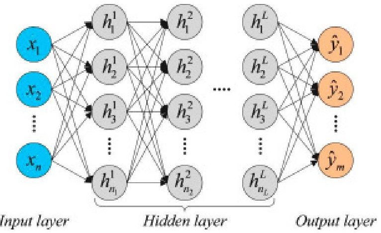

Download: Download high-res image (271KB)

Download: Download full-size image

Fig. 1. The architecture of the multilayer perceptron.

## 2.2. Modelica modeling language

The Modelica is a declarative language for modeling cyber-physical systems, supporting the acausal connection of components governed by mathematical equations, which facilitates modeling from first principles [42]. Compared with the widespread simulation languages available today, it provides object-oriented constructs that promote the reuse of components in different physics domains and can be used conveniently for modeling large, complex, and heterogeneous systems containing, e.g., mechanical, control, thermal, magnetic, hydraulic, electrical or process-oriented subcomponents.

Differential, algebraic and discrete equations mathematically describe models in Modelica. The language can abstract the concepts of potential variables and flow variables in different fields and implement unified mathematical expressions complied with the generalized Kirchhoff's law and energy conservation [43]. Thus, it is suited for multi-domain modeling, for example, mechatronic models in aerospace, automotive and robotics applications.

The Modelica semantics is defined by translating classes, instances, and connections into a flat set of constants, variables and equations [44]. A class is the fundamental structuring unit of modeling in Modelica, providing the structure for objects. All data objects in Modelica are instantiated from classes, including the basic data types and enumeration types. Connections between objects are established by connect-equations in the equation part of a class or just by drawing lines between objects picked from a class library. The Modelica modeling is based on the combination of equations and objects, which are defined using a set of classes. These classes can be used to create custom components, such as mechanical structure, electrical circuits, and control systems. Modelica also provides a rich standard library from thermodynamics to dynamics, which can be utilized as building blocks for larger systems or customized to fit specific needs.

## 3. The realization process of satellite hybrid digital twin

This section presents a detailed description of the realization process of HDT. Firstly, the definition of HDT is given. Subsequently, the implementation methods for the physical field-level digital twin, system-level digital

<!-- PDF_PAGE: 7 -->

twin, and HDT are introduced in a sequential manner, specifically focusing on their application in solving satellite temperature field reconstruction and attitude control problems.

## 3.1. Definition of the proposed HDT

In this study, our definition of "hybrid" encompasses two aspects: one is the integration of different level models, and the other is the integration of physics-based models with data-driven models. Specifically, the aim is to establish cross-level interaction between the physical field-level digital twin with the system-level digital twin and combine the merits of physics simulation and data modeling. Fig. 2 illustrates the components of the HDT.

The exploration of using digital twin for satellite temperature field monitoring and attitude adjustment to mitigate the impact of heat concentration results in generating models of varying granularity. However, constructing a multi-disciplinary digital twin that accurately captures the real system's temporal dynamics through multi-level joint simulation is highly challenging, given the extensive computational volume and long computation time required for physical field-level simulation, as well as the complex coupling relationships of system-level modeling. Consequently, a crucial issue in constructing an HDT of satellite temperature field perception and attitude control is determining how to convert sparse observations of temperature sensors into the target maneuvering Euler angle, i.e., utilize anomalous data derived from temperature field reconstruction as input to the attitude control system, enabling real-time maneuvering during catastrophic space climate events.

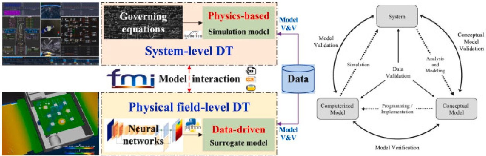

Download: Download high-res image (587KB)

Download: Download full-size image

Fig. 2. The architecture process of the hybrid digital twin, where DT is the abbreviation of digital twin.

## 3.2. Physical field-level digital twin: temperature field reconstruction

## 3.2.1. Task definition

The heat concentration caused by the space environment mainly affects the satellite cabin plate. Considering the satellite's compact size, it is reasonable to assume that heat concentration typically originates from a single position from a probabilistic perspective. Hence, by disregarding the internal heat condition of the satellite, the

<!-- PDF_PAGE: 8 -->

research problem addressed in this paper can be simplified to the localization of an abnormally high single heat concentration point within a two-dimensional plane.

The temperature field reconstruction seeks to reconstruct the whole temperature field from limited temperature sensors. Based on the complete temperature information, a comprehensive risk assessment can be conducted. For simplicity but without loss of generality, the volume-to-boundary (VB) heat conduction problem [45], [46] is taken as an example for the validation of the proposed methodology. As shown in Fig. 3, the cabin plate is modeled as a two-dimensional square domain and thermal conduction occurs along this field. A heat-source system with one component (namely heat concentration point) with a specific power distribution $ \phi(x,y) $ is given, where $ O_{m} $ denotes the measurement from mth temperature sensor. The temperature field reconstruction task can be mathematically formulated as

$$
\vartheta^ {*} = \arg \min _ {\vartheta} \left(| T - f _ {\vartheta} (O) |\right),
$$

where T means the real temperature field, $ f_{\vartheta}(\cdot) $ stands for the mapping model, O represents observed value from all temperature sensors, $ \vartheta $ is the model parameter to be learned.

For two-dimensional VB problems, the steady-state temperature field satisfies the Poisson's equation, which can be expressed as follows:

$$
\frac {\partial}{\partial x} \left(\lambda \frac {\partial T}{\partial x}\right) + \frac {\partial}{\partial y} \left(\lambda \frac {\partial T}{\partial y}\right) + \phi (x, y) = 0,
$$

with the boundary conditions:

$$
T = T _ {0} \mathrm {o r} \lambda \frac {\partial T}{\partial \mathbf {n}} = 0 \mathrm {o r} \lambda \frac {\partial T}{\partial \mathbf {n}} = h \left(T - T _ {0}\right).
$$

The three boundaries are known as Dirichlet boundary conditions, where $ T_{0} $ represents the isothermal boundary temperature value; Neumann boundary conditions, where constant $ \lambda $ is the thermal conductivity of the domain, and zero heat flux is exchanged; Robin boundary conditions, combining the first two boundary conditions, where $ T_{0} $ denotes the surrounding temperature value and h is the convective heat transfer coefficient. The investigated heat conduction problem in this paper is constrained by the Robin boundary conditions. Given the above, the temperature field reconstruction task can be transformed as the optimization Eq. (3) subject to Eqs. (4), (5).

<!-- PDF_PAGE: 9 -->

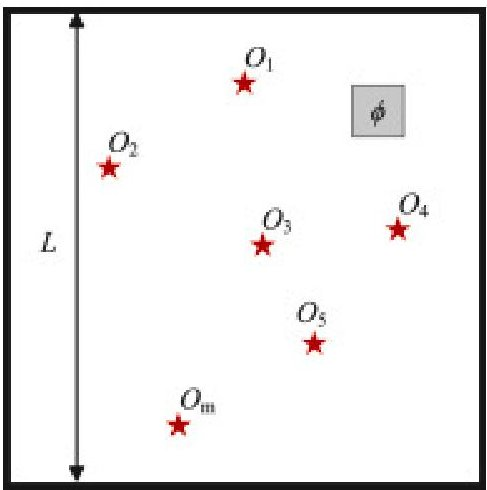

Download: Download high-res image (105KB)

Download: Download full-size image

Fig. 3. The illustration of the volume-to-boundary problem with one heat source and m temperature sensors in a square domain.

## 3.2.2. Construction of temperature field reconstruction surrogate model

As the location of the heat concentration is random, the solution of the mathematical model demands solving Poisson's equation exhaustively and iteratively to obtain the temperature distribution over the entire domain. Even though numerical simulation methods, such as the finite element method (FEM) and the finite difference method (FDM), can provide authentic temperature field information, they are generally time-consuming. To cope with this problem, using the DNN surrogate model as an alternative to physics simulation becomes a practicable option for achieving an end-to-end and real-time temperature field reconstruction.

Data preparation. The satellite cabin plate is discretized into a $ 1 0 0 \times1 0 0 $ grid with a side length of L=1 m. A square heat source with dimensions of 0.01 m $ \times $ 0.01 m is placed on the cabin plate utilizing the Latin hypercube sampling method with the power intensity $ \phi(x,y) $ ranging from 20000 to 23000 W/m $ ^{2} $ , producing an average temperature of 1509k to simulate heat concentration. The heat source is restricted to move by a minimum distance of one grid length, which is equal to 1/100 of L. The area within a certain grid is presupposed to share a constant temperature, and 12 temperature sensors are deployed throughout the grid, with their specific deployment locations illustrated in Fig. 4, to provide temperature observations for each cell. The satellite cabin plate is made of aluminum, with the thermal conductivity value of $ \lambda=2 7 $ W/（m $ \mathrm{K} $ ). For boundary conditions, the ambient temperature is set at a constant value of $ T_{0}=2 9 3. 1 5 $ K, with the convective heat transfer coefficient $ h=1 0 $ W/（ $ \mathrm{m}^{2} $ $ \mathrm{K} $ ). Subsequently, we utilize COMSOL Multiphysics, a commercial software based on the conventional algorithm FEM, to generate the thermal simulation results deemed as the ground-truth temperature field. In the training process, we select 16000 snapshots, with 75% designated for training and 25% for validation, while the other 4000 snapshots are incorporated in the test set.

DNN configuration. Several studies have demonstrated that DNN built entirely upon MLP can perform as well as the existing state-of-the-art models like CNNs and Transformers [47] in vision and language applications [48], [49], [50]. Moreover, MLP offers numerous advantages over other models, including the ability to approximate arbitrary nonlinear functions, ease of implementation, and tolerance of missing or noisy input data. Given the focus of this paper on achieving fast inference speed in the online stage, we select MLP as the

<!-- PDF_PAGE: 10 -->

preferred deep learning surrogate model after a comprehensive comparison for vector-based modeling [28]. Since deep networks can capture more complex patterns and be more robust, an MLP consisting of five hidden layers is adopted with the activation function GELU to learn the mapping between the sensor values (vector form) and the temperature field (image form). The number of neurons in each hidden layer is 128, 512, 1024, 2048, and 4096, respectively.

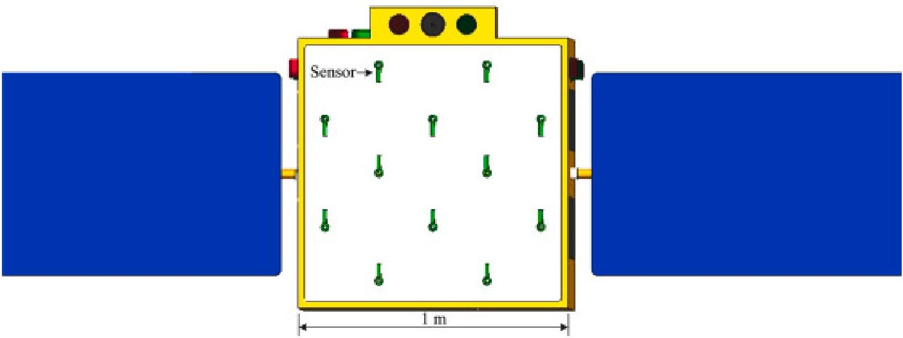

Download: Download high-res image (180KB)

Download: Download full-size image

Fig. 4. The arrangement of temperature sensors in this paper.

Loss function and evaluation metrics. Mean absolute error (MAE) and mean squared error (MSE) are commonly used in deep learning algorithms to evaluate model parameters for regression problems, which can be expressed as follows:

$$
\mathrm {M A E} \left(T, \widehat {T}\right) = \frac {1}{N ^ {2}} \sum_ {i = 1} ^ {N} \sum_ {j = 1} ^ {N} \left| T _ {i j} - \widehat {T} _ {i j} \right|,
$$

$$
\mathrm {M S E} \left(T, \widehat {T}\right) = \frac {1}{N ^ {2}} \sum_ {i = 1} ^ {N} \sum_ {j = 1} ^ {N} \left| T _ {i j} - \widehat {T} _ {i j} \right| ^ {2},
$$

where $ \widehat{T} $ describes the reconstructed temperature field by the mapping model from $ O_{k} $ （ $ k=1,2,\ldots,m $ ）, N denotes the mesh size and is a constant in our study, i.e., N=100. According to the research background of this paper, the center temperature of the heat concentration position is significantly higher than the temperature at other locations on the cabin plate. As MSE loss is more sensitive to outliers in the data, this paper choose it as the basic loss function to train the MLP model. Apart from the above two criteria, the maximum absolute error (MaxAE) concerning the maximum error of the prediction across the entire temperature field is introduced, which is formulated as

$$
\operatorname {M a x A E} \left(T, \widehat {T}\right) = \max \left| T _ {i j} - \widehat {T} _ {i j} \right|.
$$

<!-- PDF_PAGE: 11 -->

Improvement on reconstruction accuracy. As indicated before, the temperature generated by the heat source exceed 1000K during the simulation process. However, the initial temperature at the other positions on the satellite cabin plate is equivalent to the ambient temperature, implying that a significant temperature difference exists on the cabin plate's surface with heat concentration. The MaxAE invariably occurs at the heat source location. Due to the complex boundary conditions and underlying mechanisms, the large gradient is an intractable characteristic for heat transfer. Regrettably, deep learning-based methods are hard to estimate regions with large gradients precisely.

We adopt three methods to alleviate this issue progressively. Firstly, the self-attention mechanism [47] is introduced into the architecture of MLP. This integration effectively enhances the network's capacity for local information perception and improves its feature extraction ability. The self-attention module enables the MLP to weigh the significance of different regions and allocate more attention to the heat source, thus allowing the neural network to learn better.

Secondly, a new training method based on partition modeling [51] is developed. A mask with a certain side length is utilized to dynamically divide input labels into two distinct regions: the heat source surrounding region and the remaining region. The centroid of the mask is in the heat source position. This segmentation separates the maximum temperature area from the rest of the image, allowing for the use of independent loss functions for training, e.g., MSE loss for the first region and MAE loss for the second. Partitioning has the potential to enhance model accuracy while simultaneously improving the efficiency of loss function optimization, as the smaller partitions are able to learn more complex patterns that would be difficult for the whole field to capture. This approach ensures that our model is optimized for diverse input scenarios and can handle varying degrees of temperature fluctuation.

Thirdly, pre-training and fine-tuning techniques are employed, coupled with loss function redesign. The model undergoes pre-training via the two methods previously mentioned, and further, the MaxAE loss function [52] is included as a new penalty term for fine-tuning. This targeted approach efficiently mitigates prediction errors exclusively at the location of the highest temperature point. The new loss function can be formulated as

$$
\mathcal {L} = \mathcal {L} _ {\mathrm {M S E}} + \alpha \cdot \mathcal {L} _ {\mathrm {M a x A E}},
$$

where $ \alpha $ is the loss weight and can be learned adaptively [53], [54], [55] or set empirically.

Improvement on response speed. When executing computations on the Graphics Processing Unit (GPU), the MLP surrogate model can provide quasi-real-time inversion results indeed. Nevertheless, its computational speed will inevitably be reduced once it is encapsulated into the entire digital twin, subjecting to various constraints, such as the limited satellite onboard computing resources. Considering the tradeoff between reconstruction accuracy and computing time required for physical field-level digital twin online inference, we apply Reduced Order Models (ROM) to create lighter-weight and faster-running models that still maintaining a high level of fidelity. ROM aims to reduce computational complexity while sacrificing minimal accuracy by identifying the most critical variables in the original model and employing them to construct a reduced model with fewer degrees of freedom. Various techniques have been developed for ROM [56], such as Proper Orthogonal Decomposition (POD), Dynamic Mode Decomposition (DMD), and Galerkin projection. Inspired by Refs. [57], a data-driven deep learning ROM is developed in this paper. We take the most notable and prevailing

<!-- PDF_PAGE: 12 -->

ROM method, POD, to extract a reduced set of vectors in the orthogonal basis to capture the spatial distribution modes of the temperature field. Another MLP is trained to reflect the implicit nonlinear mapping between the sensor values and feature coefficients. The output dimension is reduced from 10,000 to a few tens of dimensions. Fig. 5 summarizes the entire implementation process of the MLP-POD-ROM. This improvement will give a viable reference for the physical field-level digital twin of online monitoring.

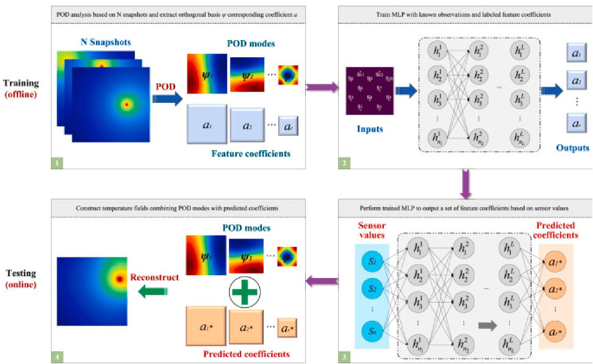

Download: Download high-res image (813KB)

Download: Download full-size image

Fig. 5. Framework of the MLP-POD-ROM.

## 3.3. System-level digital twin: multi-domain integrated attitude control system

## 3.3.1. Task definition

The angles of roll, pitch, and yaw are denoted by $ \varphi, \theta $ , and $ \psi $ , respectively, and t represents time. The initial and final state of the attitude control problem can be described as (10)

$$
t = t _ {0}, \varphi = \varphi_ {0}, \theta = \theta_ {0}, \psi = \psi_ {0}, \dot {\varphi} = \dot {\theta} = \dot {\psi} = 0,
$$

$$
t = t _ {f}, \varphi = \varphi_ {f}, \theta = \theta_ {f}, \psi = \psi_ {f}, \dot {\varphi} = \dot {\theta} = \dot {\psi} = 0.
$$

This refers to the process of achieving the target Euler angle within a specified time frame. Accordingly, the

<!-- PDF_PAGE: 13 -->

primary task is to calculate the desired rotation using the control algorithm via state variables (attitude angle, angular velocity, and angular acceleration) collected by sensors and push the results to the execution mechanisms for output.

The satellite can be modeled as a rigid body with actuators to provide torques along three mutually perpendicular axes that define a body-fixed frame $ \mathcal{B} $ . The coordinate origin is located at the center of mass of the satellite. The kinetics and kinematics in terms of the quaternion can be expressed as follows:

$$
J \dot {\omega} = - \omega^ {\times} J \omega + \tau + d,
$$

$$
\dot {q} _ {v} = \frac {1}{2} \left(q _ {v} ^ {\times} + q _ {0} I _ {3}\right) \omega ,
$$

$$
\dot {q} _ {0} = - \frac {1}{2} q _ {v} ^ {T} \omega ,
$$

where $ J=J^{T}\in \mathbb{R}^{3\times 3} $ denotes the inertia matrix of the satellite, $ \tau\in\mathbb{R}^{3\times 3} $ and $ d\in\mathbb{R}^{3\times 3} $ are the control torque and the external disturbances, respectively, $ Q=[q_{v}^{T},q_{0}]^{T}\in\mathbb{R}^{3}\times\mathbb{R} $ represents the unit quaternion describing the attitude orientation of the body frame $ \mathcal{B} $ with respect to the inertial frame $ \mathcal{I} $ , satisfying $ q_{v}^{T}q_{v}+q_{0}^{2}=1, $ $ I_{3} $ is the $ 3\times 3 $ identity matrix, $ \omega\in\mathbb{R}^{3} $ is the angular velocity of the satellite and the notation $ \omega^{\times} $ denotes a skewsymmetric matrix expressed as

$$
\boldsymbol {\omega} ^ {\times} = \left[ \begin{array}{c c c} 0 & - \omega_ {3} & \omega_ {2} \\ \omega_ {3} & 0 & - \omega_ {1} \\ - \omega_ {2} & \omega_ {1} & 0 \end{array} \right].
$$

The objective of attitude tracking control is to drive the attitude matrix and angular velocity towards the desired trajectory in an energy-efficient manner, ideally optimizing the control strategy.

To address this problem, the attitude tracking error $ Q_{e}=\left[ q_{e}^{T}, q_{e0}\right]^{T} $ is defined as the relative orientation between the body frame $ \mathcal{B} $ and the desired frame $ \mathcal{D} $ with orientation $ Q_{d}=\left[ q_{d}^{T}, q_{d0}\right]^{T} $ , which can be calculated by the quaternion multiplication rule as

$$
\begin{array}{l} \boldsymbol {q} _ {e} = q _ {d 0} \boldsymbol {q} _ {v} - q _ {0} \boldsymbol {q} _ {d} + \boldsymbol {q} _ {v} ^ {\times} \boldsymbol {q} _ {d}, \\ q _ {e 0} = q _ {d 0} q _ {0} + \boldsymbol {q} _ {d} ^ {T} \boldsymbol {q} _ {v}. \\ \end{array}
$$

The corresponding rotation matrix can be solved by the following formula:

$$
\boldsymbol {C} \left(\boldsymbol {Q} _ {e}\right) = \left(q _ {e 0} ^ {2} - \boldsymbol {q} _ {e} ^ {T} \boldsymbol {q} _ {e}\right) \boldsymbol {I} _ {3} + 2 \boldsymbol {q} _ {e} \boldsymbol {q} _ {e} ^ {T} - 2 q _ {e 0} \boldsymbol {q} _ {e} ^ {\times}.
$$

Note that $ \| C\|=1 $ and $ \dot{C}=-\omega_{e}^{\times} C $ , where $ \omega_{e}=\omega-C\omega_{d} $ is the relative angular velocity, and $ \omega_{d} $ is the angular velocity of $ \mathcal{D}. $

<!-- PDF_PAGE: 14 -->

## 3.3.2. Construction of attitude control system models

Attitude control systems involve the coupling of different fields. In this study, we introduce a new methodology for modeling satellites' GNC systems using MWorks, a powerful integrated development environment of Modelica, which provides a general framework for verifying satellite control strategies. Under the principle of structural hierarchy, extensibility, and reusability, the satellite is decomposed into several subsystems, including the satellite cabin, actuators, sensors, controller, etc. On this basis, the whole system can be modeled by assembling each sub-model to access state parameter changes responding to different heat concentration positions.

Satellite cabin. In accordance with the satellite's actual physical topology, the model of the satellite cabin can be built by the Modelica standard library of basic components, particularly the multi-body dynamics library that is renowned for its accurate and comprehensive physical theories described in great detail. The relevant parameters of the cabin, such as mass, moment of inertia, and centroid position, can be conveniently specified on the multi-body's parameter list.

Reaction wheels. The reaction wheel has become the preferred actuator for precision attitude control in three-axis stabilized micro-satellites. To achieve complete control of satellite attitude in space, a minimum of three reaction wheels with non-coplanar axes of rotation are required. Practical satellite attitude control systems may utilize four or more reaction wheels, such as a pyramid configuration with four reaction wheels. The torque $ u_{i} $ generated by each reaction wheels can be written as

$$
u _ {i} = J _ {w} \Omega_ {i}, \quad i = 1, \dots , n,
$$

where $ J_{w} $ and $ \varOmega_{i} $ denote the moment of inertia and angular velocity of the $ i $ th reaction wheel, respectively. The total control torque $ \tau_{1} $ can be obtained:

$$
\boldsymbol {\tau} _ {1} = \left[ \tau_ {x}, \tau_ {y}, \tau_ {z} \right] ^ {T} = M \left[ u _ {1}, \dots , u _ {n} \right] ^ {T},
$$

where $ M\in\mathbb{R}^{3\times n} $ is the reaction wheels distribution matrix of which the columns represent the direction cosine of the rotation axis in body frame $ \mathcal{B} $ . The influence of dead zone, limiting, and bearing friction is necessary to be taken into account when modeling, and the model parameters such as time constant for the inertia section, maximum output torque, moment of inertia, maximum speed and friction coefficient could be adjustable. Based on the mathematical models given above and the Modelica model library, both textual and graphical modeling approaches are used to develop the simulation model of the reaction wheel. The established model is shown in Fig. 6.

Cold-gas thrusters. The thruster is another critical actuator that serves as a propulsion system for adjusting the orientation and ensuring the stability of satellites in space. Any control torque vector can be induced using only four thrusters, which provide the necessary force to alter a satellite's angular velocity, allowing it to maintain the desired posture and react to environmental changes. Some of the initial control algorithms developed for "on-off" actuators were founded on the principles of Lyapunov stability theory, whereby the activation and deactivation of thrusters were chosen to minimize the derivative of a Lyapunov function. The control objective

<!-- PDF_PAGE: 15 -->

is to develop a feedback control law $ u_{0/1} $ resulting in the torque

$$
\boldsymbol {\tau} _ {2} = \boldsymbol {W} \cdot \boldsymbol {u} _ {0 / 1} \cdot v,
$$

where W represents the thrusters configuration matrix, $ u_{0/1} $ is a boolean vector used to denote the activation status of thrusters in the control system, v denotes torque generated by a single thruster. Specifically, a value of 1 indicates that the thruster is activated, whereas a value of 0 indicates that it is deactivated. The cold-gas thruster is a typical type of thrusters, designed with a relatively simple structure consisting of a high-pressure vessel, a regulator, and a nozzle. The high-pressure vessel stores the gas, typically nitrogen or compressed air, at high pressure. The regulator controls the gas release from the vessel, while the nozzle directs the gas flow to generate thrust. Fig. 7 presents the Modelica model of a single cold-gas thruster, which can be used to integrate the thrusters system.

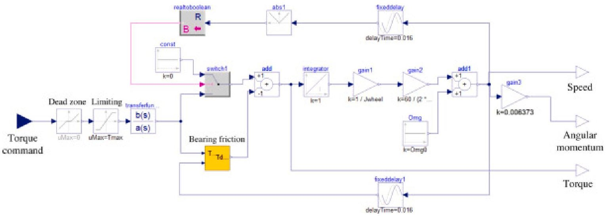

Download: Download high-res image (296KB)

Download: Download full-size image

Fig. 6. Modelica model of reaction wheel.

Sensors. The role of the sensors is to capture the actual angle and angular velocity during the simulation. Sensor models can be composed from the standard library through drag-and-drop modeling. The provided sensor models for retrieving satellite states rely on conversion functions to accurately compute kinematic relationships and required parameters.

<!-- PDF_PAGE: 16 -->

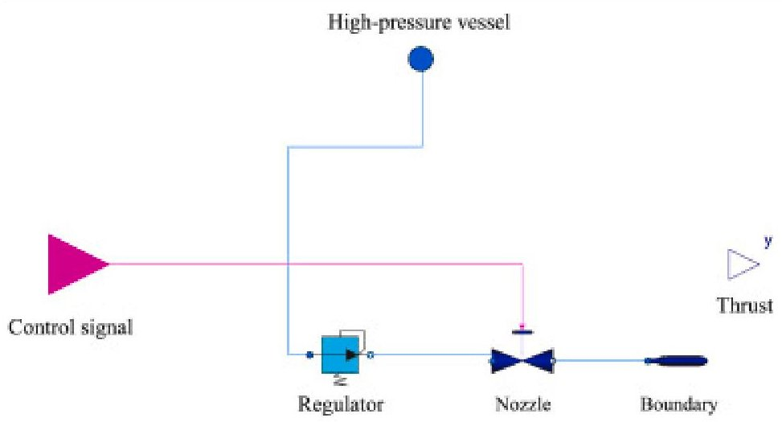

Download: Download high-res image (145KB)

Download: Download full-size image

Fig. 7. Modelica model of cold-gas thruster.

Attitude control and management unit. The attitude control and management unit serves as a pivotal component of attitude control systems. It comprises several key elements, including a controller, control signal converter, etc. Together, these components enable the unit to generate precise and effective attitude maneuver control voltage signals based on the target command and the input of the sensors' information. To avoid the singularity problem arising from large-angle maneuvers, a Modelica model of controller is constructed in this paper based on the PID control law and error quaternion. The specifically designed control algorithm will be presented in Section 4.2, tailored to the actual actuator configuration and control capabilities of the experimental subject.

Visualization module. Digital twin presents significant advantages in enhancing visualization capabilities. By creating a virtual replica of a physical system, the digital twin enables the visualization of complex processes in a way that would be otherwise challenging. Additionally, the digital twin's virtual simulation functionality allows for the pre-verification of results in the virtual world, thus enabling adjustment of the physical object based on orders derived from the model. Through the employment of MWorks, pertinent information can be automatically extracted from three-dimensional (3D) assembly models of the physical components and integrated into Modelica multi-body models, providing direct animated views of the simulation process.

Environment. In this paper, the gravity model of space is obtained by invoking the world object in MWorks.

## 3.4. Hybrid digital twin: combining physical field models and system models

## 3.4.1. FMI-based multi level co-simulation methods

The functionality of digital twin primarily relies on models that capture the holistic behavior of the entire system. In the case of multi-level M&S, achieving this necessitates the extensive utilization of models from different technical disciplines, which are constructed from individual component models that collectively represent the system's various domains. The FMI forms a solid foundation for solving this problem [58]. FMI is a standard for model exchange and co-simulation that allows users to integrate models from different modeling tools and simulate them collectively. The fundamental principle underlying FMI involves

<!-- PDF_PAGE: 17 -->

encapsulating a model with a standardized interface through a combination of XML files, binaries, and C code, all packaged together as a ZIP file known as a Functional Mock-up Unit (FMU) [59]. FMI is becoming an essential building block in the efficient creation of interdisciplinary, multi-level digital twins. It is supported by more than 170 tools and maintained as a project of Modelica Association [60].

The FMI standard specifies two different kinds of FMUs: model exchange (ME) and co-simulation (CS) [61]. The difference between the two is whether the model solver is included or not. In ME mode, the model is exported as a function that can be called by other modeling and simulation environments. While, in CS mode, the model is exported as a black-box with their own numerical solver that can be executed by an external simulation tool, allowing the tool to simulate the model alongside other models and control the simulation time. This paper uses the second mode to transform the deep learning surrogate model to an FMU and then import it to the Modelica simulation platform for joint simulation studies.

## 3.4.2. Build a bridge: target Euler angle conversion module

The real-time dynamic interaction between physical field input and control system feedback is realized by the target Euler angle conversion module, which determines the rotational angle required for maneuver avoidance from the coordinates of heat concentration and target position, subsequently providing the resulting target angle as output to the attitude control and management unit. The primary objective of maneuver avoidance is to achieve uniform heating across the surface and prevent the satellite cabin from sustaining heat damage by ensuring that the location of heat concentration varies within the plane. Consequently, the coordinate of the heat concentration needs to undergo constant changes. There exist countless trajectories for this point, but the specific problem of path planning is not addressed in this paper. As in realistic scenarios, cosmic ray irradiation lasts for a relatively short duration, usually within tens of seconds. To simplify the analysis, the target position coordinate can be artificially set to the center of the plane. Hence, our goal is to shift the initial coordinate of the heat concentration towards the target coordinate for a specific time period.

We define the coordinate system depicted in Fig. 8, keeping consistent with the motion capture system, which will be introduced in the next section. The coordinate system, denoted as OXYZ, represents the satellite's body frame, where O is the center of mass of the satellite, X-axis indicates the forward direction, Z-axis points towards the nadir or downwards direction, and Y-axis completes the right-handed Cartesian frame. The coordinates of the incident point and target point are respectively represented as $ A=(X_{1},Y_{1},Z_{1}) $ and $ B=(X_{2},Y_{2},Z_{2}) $ . According to the Euler equation, there exists the following relationship between A and B:

$$
\begin{array}{l} \boldsymbol {B} = \boldsymbol {X} (\varphi) \boldsymbol {Z} (\psi) \boldsymbol {Y} (\theta) \boldsymbol {A} = \left[ \begin{array}{c c c} 1 & 0 & 0 \\ 0 & \cos \varphi & - \sin \varphi \\ 0 & \sin \varphi & \cos \varphi \end{array} \right] \cdot \left[ \begin{array}{c c c} \cos \psi & - \sin \psi & 0 \\ \sin \psi & \cos \psi & 0 \\ 0 & 0 & 1 \end{array} \right] \\ \cdot \left[ \begin{array}{c c c} \cos \theta & 0 & \sin \theta \\ 0 & 1 & 0 \\ - \sin \theta & 0 & \cos \theta \end{array} \right] \cdot \boldsymbol {A}. \\ \end{array}
$$

In this paper, we utilize a cube satellite with a side length of 1 meter as the case study, so the coordinate of the target point is denoted as $ B=(0,0,0.5) $ . The plane coordinate value $ X_{1} $ and $ Y_{1} $ of the heat concentration can be obtained via DNN surrogate model inversion. When the cosmic rays are vertical incidence, according to the

<!-- PDF_PAGE: 18 -->

$$
Z _ {1} = \sqrt {\left(X _ {2} ^ {2} + Y _ {2} ^ {2} + Z _ {2} ^ {2}\right) - \left(X _ {1} ^ {2} + Y _ {1} ^ {2}\right)}.
$$

Given the above consideration, the target Euler angle can be solved.

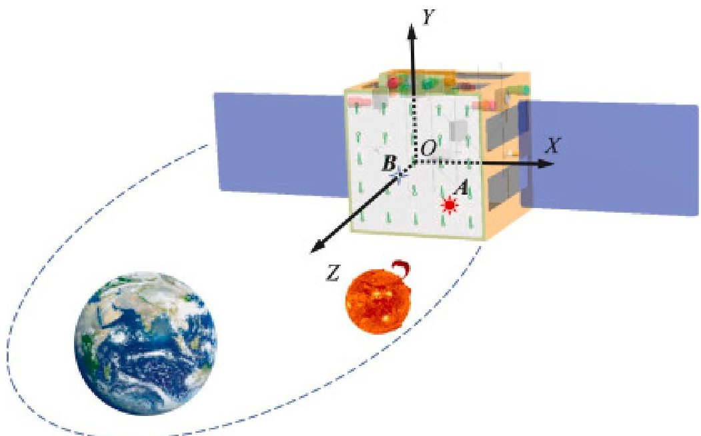

Download: Download high-res image (273KB)

Download: Download full-size image

Fig. 8. Definition of the coordinate system.

## 4. An illustrative example: HDT of the Formation Control Testbed

This section presents a practical engineering application of HDT. The proposed framework is applied to aerospace equipment, and subsequent experiments are conducted on the physical entity. The experimental object FCT, which serves as an equivalent substitute for the real satellite, is first introduced. Then, the digital twin of the experimental object is constructed in the digital space, integrating models from two levels. Additionally, comprehensive details regarding the experimental setup are provided. Finally, the model verification and validation (V&V) method is outlined, and the model parameters are calibrated to further improve the accuracy and confidence level of the digital twin model.

## 4.1. Overall workflow of the HDT

The FCT is a critical device for imitating space conditions and simulating the attitude control and orbit maneuver of satellites on the ground [62]. It is a full-physical simulation method that is distinctive to satellite development processes. Unlike mathematical simulations, it directly establishes connections by hardware, enabling crucial validation of actual control systems' functionality and performance.

As shown in Fig. 9, our FCT is a five-degree-of-freedom (three rotational and two translational), system-level testbed with flight-like hardware and software, which contains an attitude platform supported on a spherical air-bearing and a translation platform floated on three air-bearing feet providing very low friction and

<!-- PDF_PAGE: 19 -->

approximating 0-g environment in a ground-based laboratory. This FCT, also known as the five degrees of freedom air-bearing spacecraft simulator, is operated to serve as spacecraft and demonstrate autonomous formation GNC algorithms. The whole process engineering experiments conducted in this paper to verify the effectiveness of the proposed HDT modeling approach utilize this testbed, which is physically representative of an actual satellite platform [63].

The HDT possesses the ability to simulate the intelligent control concept, while the FCT offers a hardware proof-of-concept for interaction between physical field input and control system feedback. By applying the HDT control strategy to FCT, the HDT can be utilized to predict the performance of FCT. Comparing simulation results from the HDT with actual data obtained from the FCT, the HDT will be validated.

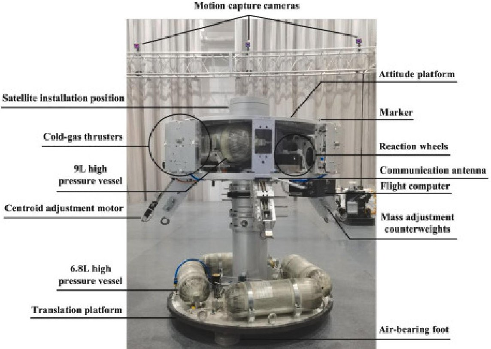

Fig. 9. Major components of the Formation Control Testbed studied in this paper.

The initial conceptualization of the digital twin involved the integration of three distinct components: (1) the physical entity, (2) the virtual entity, and (3) the interconnections between the two [7]. Following this classification, the proposed HDT framework is structured into three key parts, as depicted in Fig. 10. The upper segment of the figure is the digital space, while the lower segment is the physical space.

First, according to limited temperature observations, the spatial location of the heat concentration is inferred using the temperature field reconstruction FMU. The target Euler angle conversion module then outputs the desired rotation matrix and transmits it directly to the attitude control system model in the simulation platform.

<!-- PDF_PAGE: 20 -->

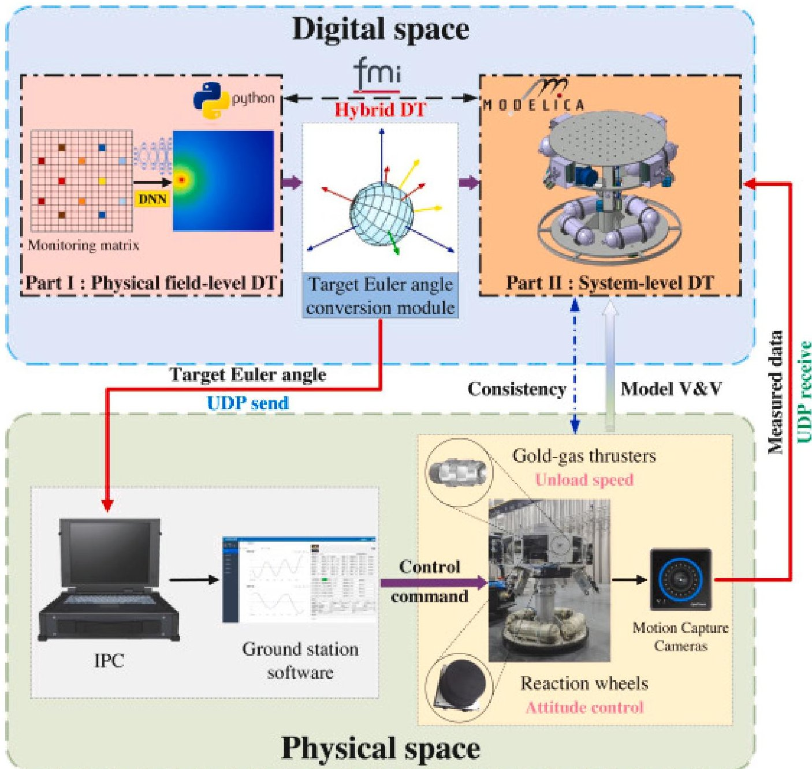

Download: Download high-res image (902KB)

Download: Download full-size image

Fig. 10. The framework of implementing the hybrid digital twin of Formation Control Testbed.

Second, data interaction channels are established, and the UDP communication protocol is employed to transfer the target Euler angle to the industrial personal computer (IPC) of FCT in the physical space. With the received target state, the ground station software generates the on/off commands for three reaction wheels and twelve attitude control thrusters to achieve precise control over the attitude and angular velocity of the FCT. The digital space attitude control and management unit adheres to the same control law as the FCT control module. Ideally, both systems should exhibit identical motion curves. However, practical deviations inevitably arise due to various external disturbances, including gravity moment, aerodynamic force, friction effect, etc.

Third, real-time interaction between the mechanism model and measured data is realized by transmitting information such as the actual Euler angles and angular velocities collected by the motion capture system back to the HDT for data comparison and model calibration, which enables digital accompanying flight of FCT. The specific method of calibrating the model with real data will be introduced and illustrated in Section 4.4.

<!-- PDF_PAGE: 21 -->

Fourth, the high-precision digital twin is leveraged to achieve consistency between digital and physical space, performing intelligent control algorithm verification. The HDT invokes the deep learning surrogate model with sensor data as input, displaying the attitude maneuver process in real-time or predicting the attitude control avoidance effect in super real-time.

## 4.2. Consolidating two level models

The FCT attitude platform comprises various components, including reaction wheels, cold-gas thrusters, gyros, motion capture system, and ground-to-robot communication antenna. Fig.11 illustrates the distribution and configuration of its actuators. To ensure accurate control torques for attitude platform control, three reaction wheels with orthogonal axes of rotation serve as the primary actuators. Meanwhile, twelve symmetrically arranged cold-gas thrusters generate torques to unload wheel speeds when they reach maximum values, and further acceleration becomes unfeasible. The actuators model, demonstrated in Fig.12, is assembled from the previously established basic component models. Based on the actual condition of FCT, the pseudo-code of the control algorithm is shown in the following Algorithm. The attitude control algorithm can be encapsulated as the attitude control and management unit Modelica model.

Input: Reaction wheels distribution matrix $M$, target Euler angle $ \Phi_{t} $ , measured Euler angle $ \Phi_{m} $ , angular velocity $ \omega $ , reaction wheels actual speed $ V_{a} $ , moment of inertia of reaction wheels $ J_{w} $ , maximum reaction wheels speed increment $ MAX_{rpm} $ , control period $ CON_{per} $ PID parameters $ K_{p} $ and $ K_{d} $ .

Output: Reaction wheels target speed $ V_{t} $ , control moment $ \tau $ , cold-gas thrusters switching parameters $ S $ .

1 Convert $ \Phi_{t} $ and $ \Phi_{m} $ to target quaternion $ Q_{d} $ and measured quaternion $ Q $ ;

2 Solve quaternion difference $ Q_{e} $ by $ (Q_{d},Q) $ ;

3 Calculate angular momentum: $ H=V_{a}\cdot J_{w} $ ;

4 Obtain control moment $ \tau $ by $ Q_{e},\omega,H,K_{p},K_{d} $ ;

5 Calculate reaction wheels speed increment: $ \Delta ws=-\tau/J_{w} $ ;

6 Reaction wheels speed limiting: $ \Delta ws=\min(\Delta ws,MAX_{rpm}) $ ;

7 Transform reaction wheels speed increment to body frame $ B $ according to $ M $ and $ CON_{per} $ ;

8 Judge reasonability and unload reaction wheels speed: $ (V_{t},\tau)\leftarrow f(V_{a},\Delta ws) $ ;

9 if $ V_{t}>5000 $ then

10 Cold-gas thrusters working;

11 Obtain the action time $ t $ and direction $ \vec{d} $ of the thrusters through the expected unloading torque $ (T_{x},T_{y},T_{z}) $ ;

12 Update switching parameters through the action time and direction of thrusters: $ S\leftarrow(t,\vec{d}) $ ;

13 else if $ 4000\leq V_{t}\leq 5000 $ then

14 $ S=S $ ;

15 else if $ V_{t}<4000 $ then

16 $ S=0 $ ;

17 end

18 return $ V_{t},\tau,S $

Download: Download high-res image (801KB)

Download: Download full-size image

Gyros and motion capture system provide real-time angle and angular velocity measurements for attitude maneuver control, with these information transmitted back to the IPC on the ground via ground-to-robot

<!-- PDF_PAGE: 22 -->

communication antenna. These two parts correspond to the sensors model. Furthermore, to facilitate an intuitive 3D visual display, we construct a visualization cabin model of FCT, as shown in Fig.13, incorporating parameters such as the moment of inertia and importing its computer aided design (CAD) model.

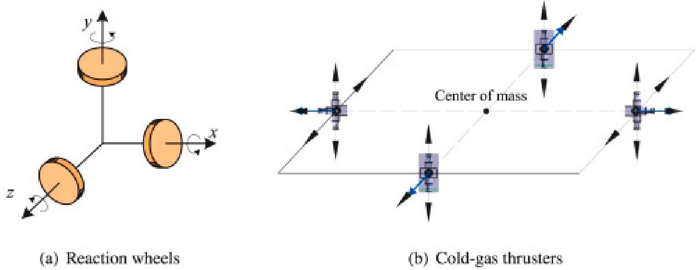

Download: Download high-res image (195KB)

Download: Download full-size image

Fig. 11. Distribution and configuration of the actuators.

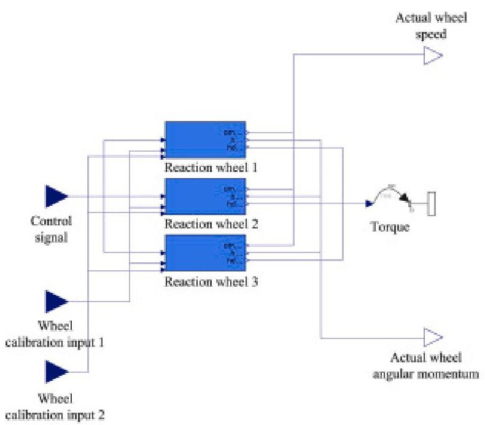

(a) Reaction wheel system

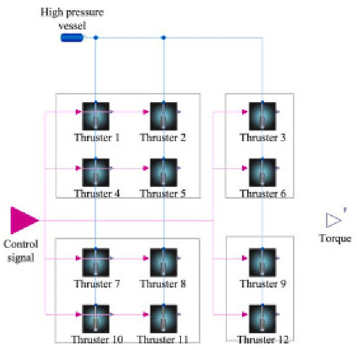

(b) Thruster system

Download: Download high-res image (384KB)

Download: Download full-size image

Fig. 12. Actuators model of Formation Control Testbed.

For the purpose of cross-level model fusion, the FMU of the surrogate model is directly and conveniently connected to the Modelica model of the FCT within the simulation platform, along with the target Euler angle conversion module. The comprehensive model is presented in Fig.14.

<!-- PDF_PAGE: 23 -->

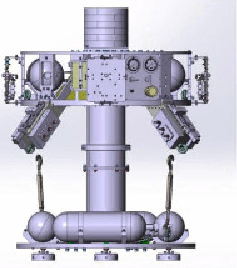

(a) CAD model

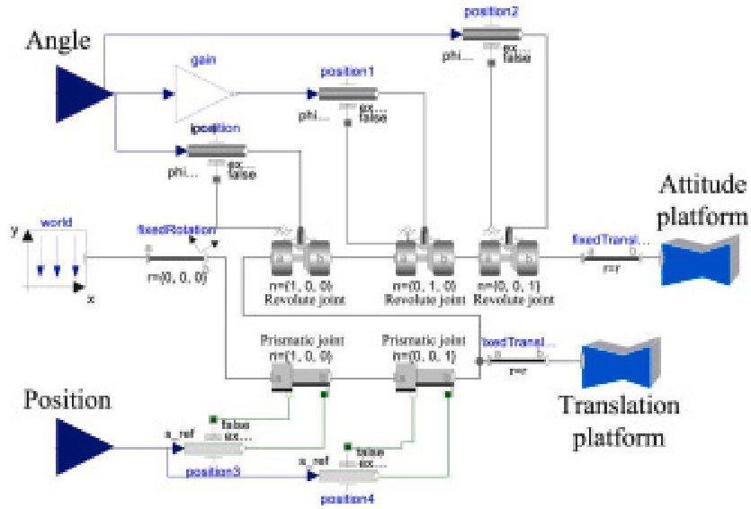

(b) Cabin Modelica model

Download: Download high-res image (436KB)

Download: Download full-size image

Fig. 13. Visualization module of Formation Control Testbed.

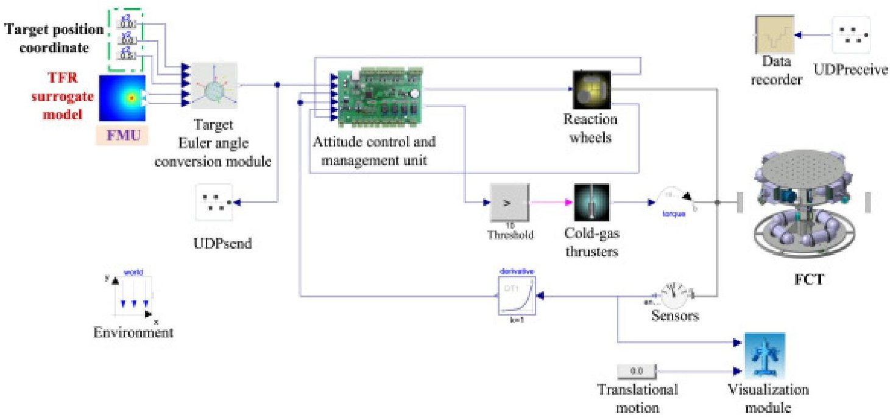

Download: Download high-res image (315KB)

Download: Download full-size image

Fig. 14. The comprehensive model of Formation Control Testbed.

## 4.3. Experimental setups

Physical space. Neglecting the influence of higher-order small quantities, the inertia tensor of FCT is measured with the approximate values:

$$
I = \left[ \begin{array}{c c c} I _ {x x} & 0 & 0 \\ 0 & I _ {y y} & 0 \\ 0 & 0 & I _ {z z} \end{array} \right] = \left[ \begin{array}{c c c} 1 0. 8 2 9 & 0 & 0 \\ 0 & 1 1. 4 0 5 & 0 \\ 0 & 0 & 1 5. 0 6 9 \end{array} \right] \mathrm {k g} \quad \mathrm {m} ^ {2}.
$$

<!-- PDF_PAGE: 24 -->

Each reaction wheel's moment of inertia and maximum output torque has the same rated values of $ J_{w}= $ 0.006373 kg $ m^{2} $ and $ u_{max}=0.06 $ N m, capable of delivering a maximum angular momentum of 4 N ms. The cold-gas thrusters' solenoid valve has a minimum on-time of 10.5 ms and a specific impulse of 500 m/s. The high-pressure gas is supplied to the thrusters after first stage pressure reduction and buffering at a total pressure of 0.6 MPa, corresponding to a flow rate of 50 L/min, which generates a thrust of 0.5 N. When the reaction wheel speed reaches 5000 rpm, the thrusters in the matching direction eject compressed air, creating counterforce to unload the speed. Conversely, when the speed falls below 4000 rpm, the thrusters cease operation. The FCT's attitude control module utilizes a PID controller to achieve subarcsecond pointing accuracy and stability. The controller is set with proportional gain $ K_{p}=300 $ and derivative gain $ K_{d}=1200. $ The spherical air bearing allows complete rotation of the attitude platform about the axis normal to the flat floor, with a range of $ \pm 40 $ degrees. This capability is comparable to spacecraft attitude motion limitations of payload sun-avoidance constraints, for example, $ \pm 20 $ degrees for the Spitzer Space Telescope [64].

Digital space. The temperature field reconstruction model is implemented using PyTorch [65] deep learning framework on a computer with the GPU NVIDIA Tesla V100S and the CPU Intel Xeon Processor. For offline training, we set the maximum training epoch to 5000, and the batch size to 32. Adam [66] is chosen as the optimizer with an initial learning rate of $ 3 \times1 0^{-4} $ . To mitigate the impact of learning rate on model performance and achieve better convergence, we apply the CosineAnnealingLR learning rate scheduler, which gradually reduces the learning rate to $ 1 \times1 0^{-6} $ . The multi-domain integrated attitude control system is established in the unified modeling software MWorks. The Dassl simulation algorithm is employed, with a solution accuracy of $ 1 \times1 0^{-4} $ and 0.002 s step size. The remaining initial simulation values are determined by the simulation software. Given the practical attitude control ability of FCT, a duration of 200 s is designated for achieving the desired rotation to the target Euler angle.

## 4.4. Virtual-real interaction model verification and validation

The ideal digital twin should be the mirror reflection of the physical model. However, all models are the approximations of real physical processes. During the modeling, assumptions and simplifications are inevitably introduced, resulting in deviations and uncertainties in the form of the models [67], [68]. Before applying the high-fidelity model, the accuracy and confidence level of the model must first be evaluated, i.e., model verification and validation.

In the course of engineering experiments, an important finding is that the mass center is difficult to coincide with the rotation center due to the irregular structure and elastic deformation of FCT. With the existence of gravity torque, actuators need to provide additional torque to overcome the disturbance, leading to a large deviation of the reaction wheel speed between simulations and observations. Besides, some technical parameters of the reaction wheel may also deviate from their rated values during usage period. As a result, the model predictions have little reference value. The accurate simulation of the reaction wheel instantaneous speed has long been a challenging problem to solve in the satellite digital twin. Motivated by the insights offered in Refs. [69], [70], we adopt their methodology to explore the virtual-real interaction model V&V. A Bayesian calibration based on Takagi-Sugeno fuzzy model (BC-TS) is applied to identify the exactly parameters of the FCT's reaction wheel model in this subsection.

<!-- PDF_PAGE: 25 -->

The relation between real observations $ y_{k}^{e} $ and their corresponding simulations $ y^{s}\left(\boldsymbol{x}_{k}^{e},\boldsymbol{\theta}^{*}\right) $ can be expressed as:

$$
y _ {k} ^ {e} = y ^ {s} \left(\boldsymbol {x} _ {k} ^ {e}, \boldsymbol {\theta} ^ {*}\right) + \delta \left(\boldsymbol {x} _ {k} ^ {e}\right) + \varepsilon_ {k},
$$

where $ x_{k}^{e} $ and $ \theta^{*} $ are the input variables and calibration parameters, respectively, k=1,...,N is the index of observations, $ \delta \left( x_{k}^{e} \right) $ represents the model discrepancy function, and $ \varepsilon_{k} $ denotes the measurement error. The goal of model calibration is to identify the optimal calibration parameters $ \theta^{*} $ , such that the model simulations $ y^{s}\left( x_{k}^{e},\theta^{*} \right) $ calculated at the experimental input sites $ x_{k}^{e} $ align with the corresponding observations $ y_{k}^{e}. $ The unknown parameters of Eq. (23) include the calibration parameters $ \theta^{*} $ , parameters of the model discrepancy function $ \beta $ , and the deviation $ \sigma_{\varepsilon}^{2} $ of measurement errors.

For reaction wheels, there are two parameters need to be calibrated. One is the moment of inertia and the other is the maximum output torque. In our control scheme, the input is command torque and the output is actual reaction wheel speed. We first assign the prior distributions to unknown parameters $ \varPsi=\left\{\theta^{*},\beta,\sigma_{e}^{2}\right\} $ according to expert knowledge as shown in Table 1. Then, multiple invocations of the Modelica model are performed to obtain a certain amount of input-output simulation data sampling within the input space, Subsequently, a mapping from $ \theta^{*} $ to $ y^{s}\left(x_{k}^{e},\theta^{*}\right) $ is established based on the Kriging method. Fig. 15 illustrates the prediction performance of the constructed surrogate model on the test set. The R-squared value is 0.986, indicating near perfect fitting ability $ (R^{2}=1) $ of our surrogate model. After that, model discrepancy function modeling and Bayesian inference procedure are implemented by comparing the historical experimental data with simulation predictions. The model discrepancy function is formulated as a 0-order Takagi-Sugeno fuzzy model and the Markov Chain Monte Carlo sampling algorithm is applied to obtain the posterior distributions of unknown parameters. The calibration results are shown in Table 2.

As the measured data of physical space during the attitude control process is transmitted back to the digital space in real-time, we can compare the difference between the measured data and simulation predictions at each moment. Experiments are carried out with the calibrated parameters, and the fitting results of the reaction wheel speed are presented in Fig. 16. It can be observed that the simulation predictions not only exhibit the same trend as the measured data but also demonstrate a high degree of consistency with the measured data in certain time period. Admittedly, the BC-TS method has significantly improved the accuracy of the digital twin model and is highly appropriate for the model V&V problem in this paper. If not otherwise specified, the calibrated parameters will be used as the default value in the subsequent analysis.

Table 1. The prior distributions of unknown parameters.

<table border="1"><tr><td rowspan="2">Parameters</td><td colspan="2">$\theta^{*}$</td><td rowspan="2">$\beta$</td><td rowspan="2">$\sigma_{\varepsilon}^{2}$</td></tr><tr><td>$J_{w}$</td><td>$u_{max}$</td></tr><tr><td>Prior distribution</td><td>(0.0001,0.2)</td><td>(0.02,0.1)</td><td>(-1000,1000)</td><td>$(100,500)^{2}$</td></tr></table>

<!-- PDF_PAGE: 26 -->

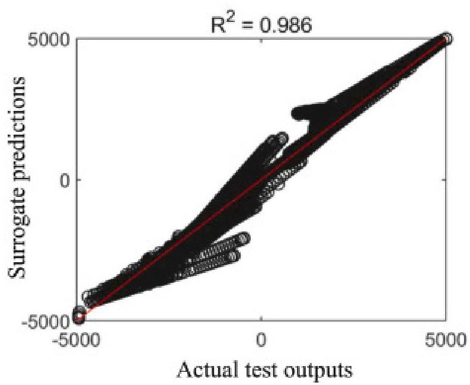

Download: Download high-res image (212KB)

Download: Download full-size image

Fig. 15. Validation results of the Kriging surrogate model. $ R^{2} $ is a metric commonly utilized in the field of regression analysis to assess the quality of fit of a regression model. The $ R^{2} $ value ranges from 0 to 1, with a value closer to 1 indicating a higher degree of fit between the regression model and the observed data.

Table 2. Posterior means and 90% credible intervals for calibration parameters.

<table border="1"><tr><td rowspan="2">Calibration parameters</td><td colspan="2">$\theta^{*}$</td></tr><tr><td>$J_{w}$</td><td>$u_{max}$</td></tr><tr><td>Posterior means</td><td>0.0111</td><td>0.0213</td></tr><tr><td>90% credible intervals</td><td>(0.0101,0.121)</td><td>(0.0201,0.0237)</td></tr></table>

<!-- PDF_PAGE: 27 -->

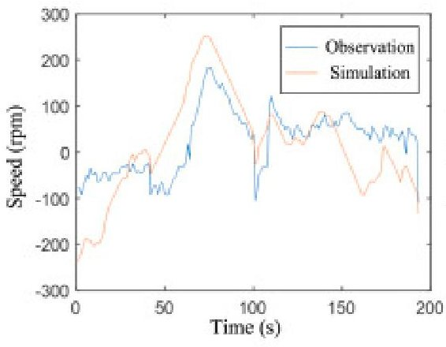

(a) Roll

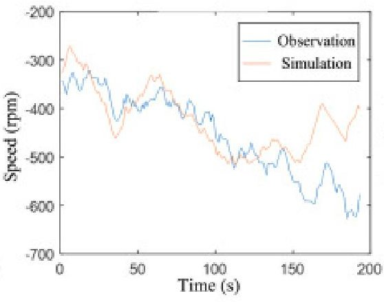

(b) Pitch

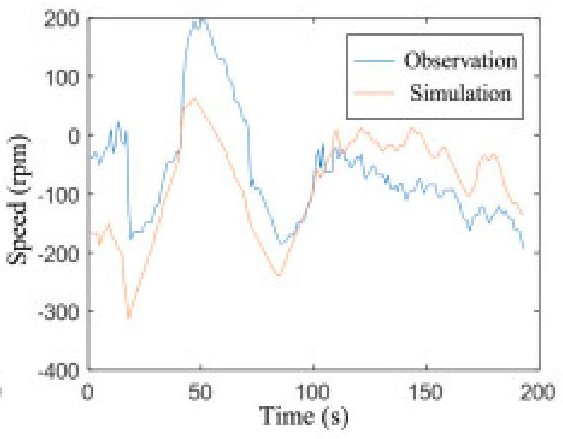

(c) Yaw

Download: Download high-res image (368KB)

Download: Download full-size image

Fig. 16. Comparison of reaction wheel speed between measured data and simulation predictions in a period of time.

## 5. Results and discussion

This section demonstrates several numerical and experimental results to evaluate the proposed HDT framework from the perspectives of the physical field-level digital twin's reconstruction performance, the system-level digital twin's control precision, and the hybrid digital twin's co-simulation results. Firstly, the accuracy of the surrogate model based on MLP is validated by the commercial software COMSOL Multiphysics. Then, the performance of the calibrated Modelica models is analyzed through the simulation results. Finally, the results of the whole process engineering experiments are discussed.

## 5.1. Reconstruction performance analysis

We conduct a series of ablation experiments to study the effect of the training strategy, loss function, and reduced order model on our base network and summarize our preliminary exploratory studies. Table 3, Table 4 illustrate the mean MAE, MSE, MaxAE, and prediction time using the MLP-based surrogate model over our test set for temperature field reconstruction. As for reconstruction accuracy, our training strategies are divided into three categories: standard, partition training, and pre-training and fine-tuning. The loss functions could be different combinations of MAE, MSE and MaxAE loss. Due to the primary task of temperature field reconstruction in this study is identifying the highest temperature region, the MaxAE metric is considered the most significant evaluation criterion, representing the ability of DNN to handle steep temperature gradient problems. As shown in Table 3, the best performance is achieved using the partition pre-trained MLP with selfattention module, which is fine-tuned via the introduction of MaxAE loss, achieving a MaxAE of 46.6482 K, while resulting in a maximum mean relative error (MRE) of 3.09% at the heat source location. This proves that our efforts to improve the reconstruction accuracy are practical. Besides, our ablation studies have also investigated the effects of two hyperparameters. These include:

(1) For partition training, the mask side length determines the area ratio of the two parts.

According to the area of the heat source surrounding region of the real temperature field, we

<!-- PDF_PAGE: 28 -->

set the mask side length to 10,15,20,and 25 cm,respectively,and conduct several sets of experiments. The results are presented in Fig.17. It is appropriate to select this hyperparameter as 20. On the basis of this,we further found that the reconstruction accuracy achieved by using MSE loss in both two parts is much higher than other combinations. The quantitative results can be seen in Table 5.

(2) For pre-training and fine-tuning, the loss weight parameter $ \alpha $ assigns the weight of MaxAE during the training. We make an attempt to automatically update the weight in each epoch by self-adaptive loss balancing method, which obtains the solution for $ \alpha $ as $ 1.4 2 2 \times1 0^{-6} $ . An interesting finding is shown in Fig.18 that the results of adaptive weight in this paper are worse than our artificially given value. Nevertheless, the advantage of the self-adaptive loss balancing method lies in significantly reducing the manual parameter tuning time, which holds substantial practical value.

As for reconstruction speed, it should also be noted that MLP-POD-ROM does reduce the inversion time by an order of magnitude. Even though the overall accuracy has decreased, this has a negligible impact on the positioning ability from an engineering standpoint. Fig. 19 presents two cases randomly sampled from the test set, along with the corresponding temperature fields reconstructed by the pre-trained and fine-tuned MLP with self-attention and MLP-POD-ROM with 100 modes, the most accurate and fastest method in Table 3, Table 4, respectively. The first method achieves 100% accuracy in inverting the coordinates of the heat concentration, whereas the maximum error for the second method is 1 cm.

Table 3. Comparison of MAE, MSE, MaxAE and prediction time of MLP-based networks with different training strategies and loss functions in the test set. SA denotes self-attention. Pt & Ft represents pre-training and fine-tuning.

<table border="1"><tr><td>Networks</td><td>Training strategy</td><td>Loss function</td><td>MAE</td><td>MSE</td><td>MaxAE</td><td>Prediction time(s)</td></tr><tr><td>MLP</td><td>Standard</td><td>MSE loss</td><td>0.3225</td><td>1.2702</td><td>55.7801</td><td>0.00209</td></tr><tr><td>MLP+SA</td><td>Standard</td><td>MSE loss</td><td>0.4173</td><td>2.2939</td><td>50.1674</td><td>0.00307</td></tr><tr><td>MLP+SA</td><td>Partitiona</td><td>MSE+MSE loss</td><td>0.4287</td><td>2.4811</td><td>48.1502</td><td>0.00368</td></tr><tr><td>MLP+SA</td><td>Pt&amp;Ftb</td><td>MSE+αMaxAE lossc</td><td>0.4406</td><td>2.4542</td><td>46.6482</td><td>0.00411</td></tr></table>

Mask side length = 20 cm.

b

Pre-trained by partition on MLP with self-attention and fine-tuning learning rate to 0.00001.

C

$ \alpha=5\times 10^{-6} $ is the optimal parameter set empirically through extensive experiments.

<!-- PDF_PAGE: 29 -->

Table 4. Comparison of MAE, MSE, MaxAE and prediction time of MLP-POD-ROM with different POD modes in the test set.

<table border="1"><tr><td>POD modes</td><td>DNN Structure</td><td>Loss function</td><td>MAE</td><td>MSE</td><td>MaxAE</td><td>Prediction time(s)</td></tr><tr><td>100</td><td>12-64-128-300-100</td><td>MAE loss</td><td>2.5914</td><td>38.8617</td><td>239.3579</td><td>0.00049</td></tr><tr><td>200</td><td>12-128-256-512-200</td><td>MAE loss</td><td>1.9156</td><td>20.3423</td><td>198.3893</td><td>0.00063</td></tr><tr><td>500</td><td>12-128-256-512-500</td><td>MAE loss</td><td>2.3563</td><td>15.7051</td><td>145.1035</td><td>0.00071</td></tr></table>

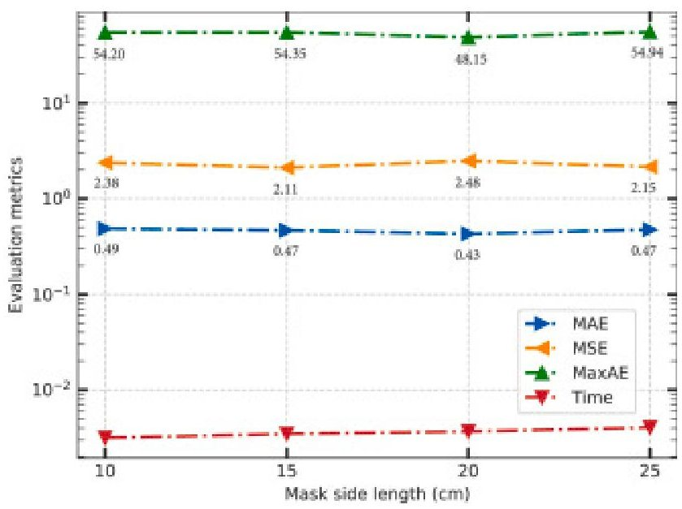

Download: Download high-res image (247KB)

Download: Download full-size image

Fig. 17. Results of partition training with varying mask side length.

Table 5. Results of partition training with different combinations of loss function.

<table border="1"><tr><td rowspan="2">Networks</td><td colspan="2">Loss function</td><td rowspan="2">MAE</td><td rowspan="2">MSE</td><td rowspan="2">MaxAE</td><td rowspan="2">Prediction time(s)</td></tr><tr><td>Heat source surrounding region</td><td>Remaining region</td></tr><tr><td>MLP</td><td>MSE loss</td><td>MAE loss</td><td>0.3751</td><td>7.4683</td><td>151.7703</td><td>0.00318</td></tr><tr><td>MLP</td><td>MAE loss</td><td>MSE loss</td><td>0.5764</td><td>4.2160</td><td>133.1231</td><td>0.00334</td></tr><tr><td>MLP</td><td>MAE loss</td><td>MAE loss</td><td>0.1898</td><td>9.5465</td><td>181.5985</td><td>0.00349</td></tr><tr><td>MLP</td><td>MSE loss</td><td>MSE loss</td><td>0.3341</td><td>1.2451</td><td>60.7735</td><td>0.00392</td></tr></table>

<!-- PDF_PAGE: 30 -->

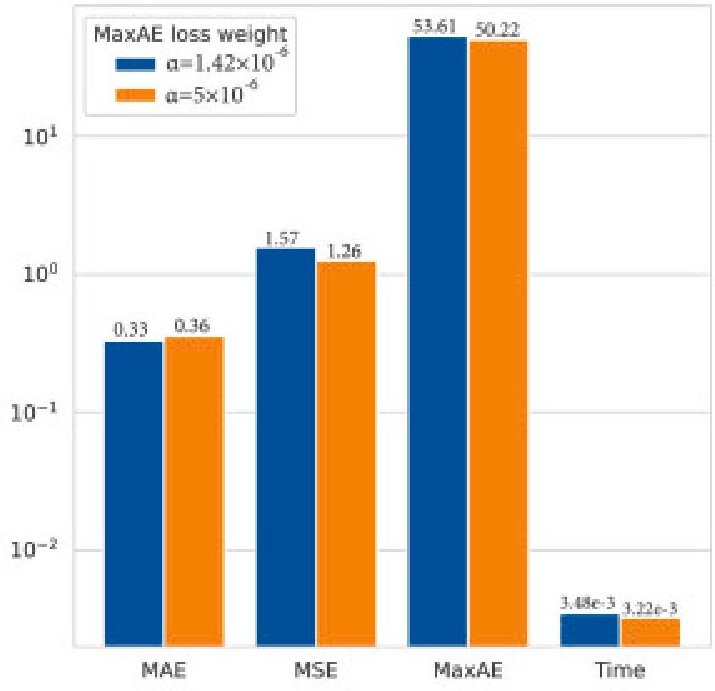

Download: Download high-res image (177KB)

Download: Download full-size image

Fig. 18. Comparisons of adaptively learned and empirically set hyperparameter $ \alpha $

<!-- PDF_PAGE: 31 -->

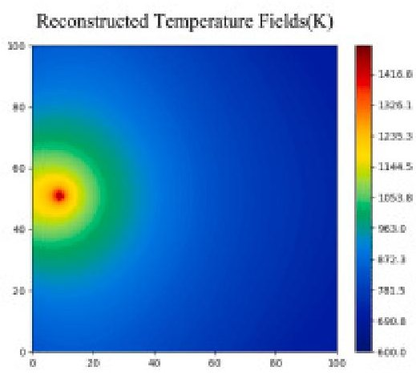

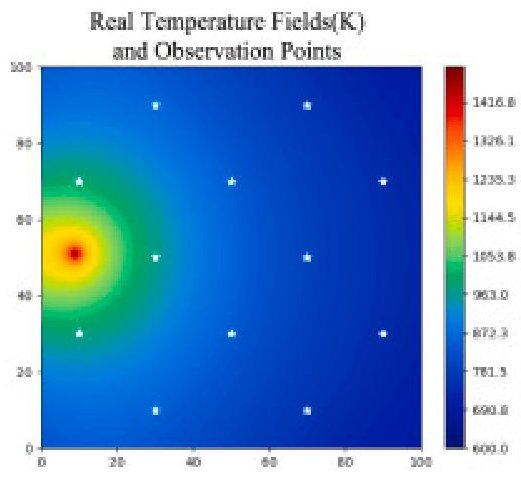

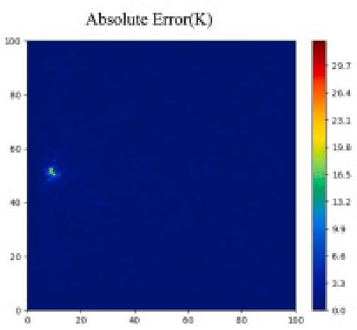

(a) Case 1, reconstructed by partition pre-trained and fine-tuned MLP with self-attention

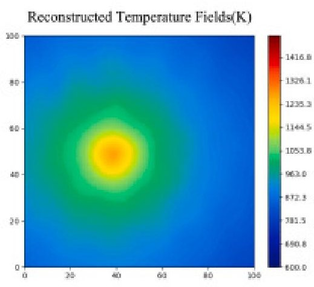

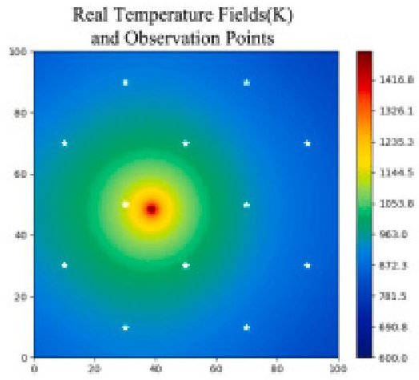

(b) Case 2, reconstructed by MLP-POD-ROM, with 100 modes

Download: Download high-res image (775KB)

Download: Download full-size image

Fig. 19. Example of reconstruction results by two different surrogate models. The white pentagrams in the middle represent the locations of temperature sensors in this paper.

## 5.2. Attitude control precision analysis

To verify the functionality and ability of the multi-domain integrated attitude control system, satellite attitude control simulations under various conditions are carried out. Two scenarios are considered where satellite tracks the rotation around one single axis or around three axes simultaneously. We set the target Euler angle and then compare the actual angle of the simulation results. In this set of experiments, we increased the simulation time to 500 s allowing for a more detailed observation of the subtle changes in the two scenarios over an extended time scale. Furthermore, a smooth function [71] is introduced as the reference signal to mitigate any abrupt changes in the output signal, as demonstrated below:

$$
\gamma (t) = \xi_ {T A} \left(1 0 \left(\frac {t}{T _ {s}}\right) ^ {3} - 1 5 \left(\frac {t}{T _ {s}}\right) ^ {4} + 6 \left(\frac {t}{T _ {s}}\right) ^ {5}\right),
$$

where $ \gamma(t) $ denotes the target signal at each moment, $ \xi_{TA} $ and $ T_{s} $ represent the specified target angle and rotation time, respectively. The target Euler angle, actual Euler angle, and tracking error, by using our

<!-- PDF_PAGE: 32 -->

developed controller, are shown in Fig. 20, Fig. 21. It is observed that all state tracking errors converge to the neighborhood of zero. Fig. 22 gives the variation curve of angular velocity errors of the second scenario. It can be seen that the attitude velocity errors converge to a small bound. The steady control accuracy of the relative attitude velocity is on the order of $ 1 0^{-4} $ rad/s, confirming that the actual attitude velocity is consistent with the expected result.

The simulation results of single-axis control and multi-degree-of-freedom simultaneous control unequivocally demonstrate the efficacy of the proposed control scheme and validate the feasibility of utilizing Modelica multi-domain unified modeling technology to simulate the processes involved in satellite GNC systems.

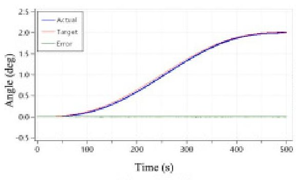

(a) Roll $ = 2^{\circ} $

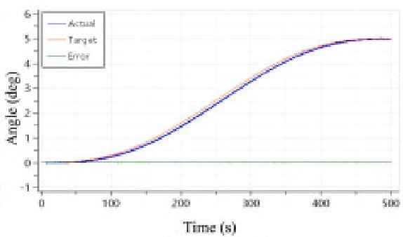

(b) Pitch $ = 5^{\circ} $

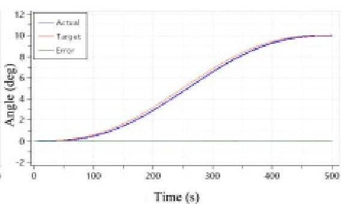

(c) $ \mathrm{Y a w}=1 0^{\circ} $

Download: Download high-res image (383KB)

Download: Download full-size image

Fig. 20. Example of attitude control simulation rotating around one single axis.

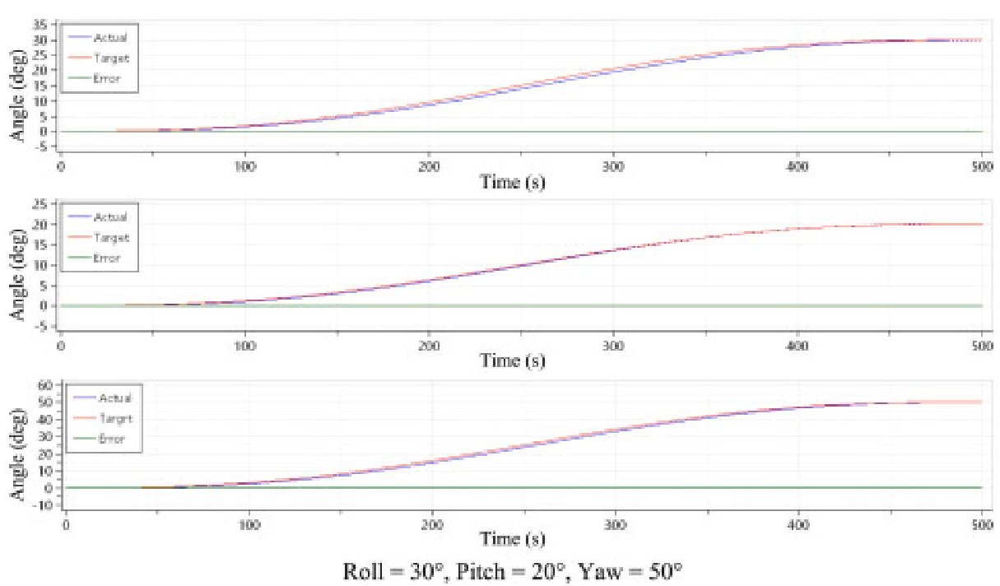

Download: Download high-res image (456KB)

Download: Download full-size image

Fig. 21. Example of attitude control simulation rotating around three axes simultaneously.

<!-- PDF_PAGE: 33 -->

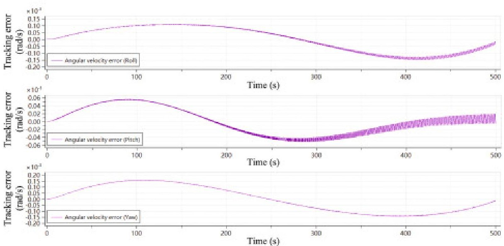

Download: Download high-res image (545KB)

Download: Download full-size image

Fig. 22. Attitude velocity errors of rotating to $ [ 3 0, 2 0, 5 0]^{T} $ deg Euler angle.

## 5.3. Co-simulation results of the hybrid digital twin

In this subsection, whole process engineering experiments are conducted to evaluate the perception and control ability of the proposed method. The feasibility of the pipeline from discrete temperature sensor values to temperature field and then to attitude maneuver angle is confirmed. Multi-group of temperature sensor values are provided, whereby the consistency of the HDT with the actual response of physical world entity is verified. Different temperature sensor values correspond to distinct heat concentration points, which are then utilized by the target Euler angle conversion module to solve various maneuver angles. It is important to note that the current temperature sensor values, derived from the simulation method, are fundamentally equivalent to real temperature sensors at the method verification stage. The simulation data can reflect main characteristics of the real data to a certain extent, and the neural network can be effectively transferred after the real data is available.

Here, we present an example of attitude angle process curves observed during a set of working condition experiment, as depicted in Fig. 23. Additionally, detailed analyses of the heat concentration location and attitude control precision are included in Table 6.

Both qualitative and quantitative analyses have confirmed the effectiveness of our method. First, the temperature field reconstruction surrogate model can instantaneously and accurately predict the coordinate of heat concentration point, completely consistent with the coordinate of the real placed heat source in the simulation. Second, the attitude control simulation results exhibit strong convergence with the measured data of attitude angles and maintain maximum absolute errors of $ 0.301^{\circ}, $ $ 0.645^{\circ}, $ and $ 0.431^{\circ} $ in roll, pitch, and yaw axis, respectively. Third, the HDT can simulate the FCT entity's attitude control process in just 54.94 s, which is significantly faster than the 200 s required in reality. The time synchronization can also be set during the simulation process. Notably, the digital space and physical space display a high degree of consistency. The attitude of the physical entity and the digital twin 3D visualization cabin model at a specific time during the experiment is illustrated in Fig. 24.

<!-- PDF_PAGE: 34 -->

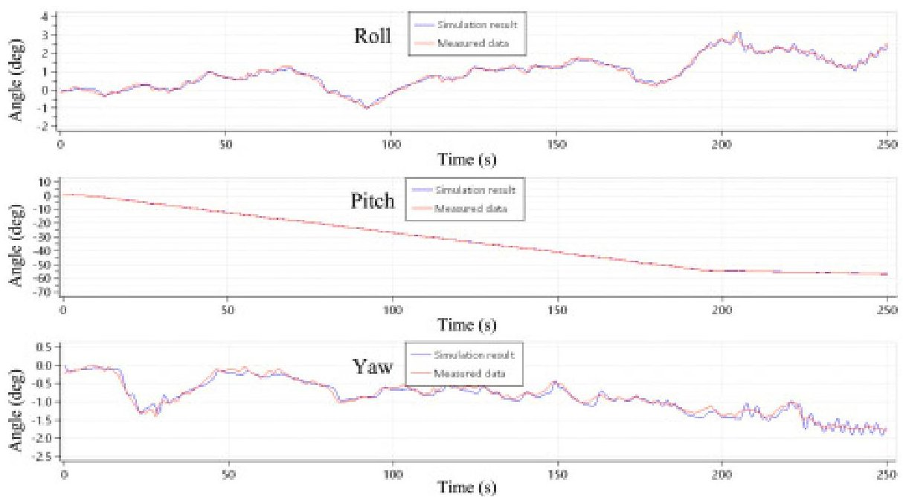

Download: Download high-res image (528KB)

Download: Download full-size image

Fig. 23. Attitude angles of digital space and physical space during the whole process engineering experiment. The theoretical rotation matrix solved by the target Euler angle conversion module is $ [ 2.34,-55.12,-1.64]^{T} $ deg.

Table 6. The performances of the whole process engineering experiment example. Similarly, MAE, MSE, and MaxAE are used as the evaluation metrics of attitude angle deviation. The temperature vector of monitoring points in this sample is [ 853.42,758.82,983.32,841.94,738.66,966.41,792.59,993.5,844.14,739.18,859.36,760. 19 ] (K).

<table border="1"><tr><td></td><td colspan="2">Temperature field reconstruction</td><td colspan="3">Attitude control</td><td rowspan="2">Simulation time</td></tr><tr><td></td><td>Predicted coordinate</td><td>Real coordinate</td><td>MAE</td><td>MSE</td><td>MaxAE</td></tr><tr><td>Hybrid DT</td><td>(-0.41,0)</td><td>(-0.41,0)</td><td>0.1022</td><td>0.0180</td><td>0.4593</td><td>54.94s</td></tr></table>

<!-- PDF_PAGE: 35 -->

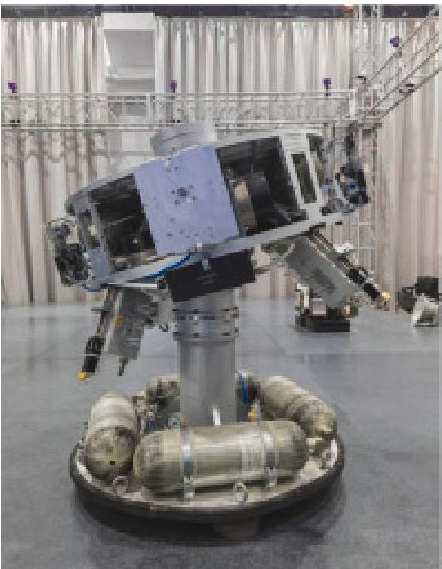

(a) Physical space

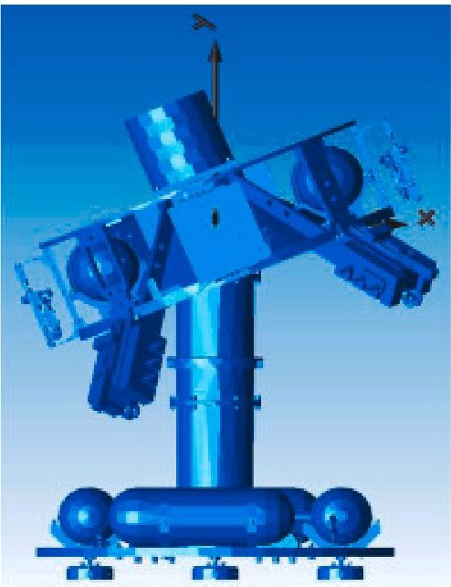

(b) Digital space

Download: Download high-res image (556KB)

Download: Download full-size image

Fig. 24. The attitude of Formation Control Testbed in both physical space and digital space at a given moment.

## 5.4. Discussion on the present framework

From the above experimental outcomes, it can be concluded that the digital twin enables the realization of high-precision and high-efficiency simulation and analysis of the physical system. Moreover, the HDT framework provides a basis for evaluating the rationality and feasibility of the implemented control scheme. Deep learning methods have been successfully employed to the temperature field digital twin of satellites, facilitating the transition from scientific problem investigation to engineering problem-solving. Meanwhile, the M&S process of the satellite attitude control system provides further evidence for the benefits of utilizing a unified multi-domain modeling language in the construction of system-level digital twins. The adoption of FMI-based model interaction technique enables the realization of multi-physical fields information transmitting into the system-level models of multi-domains, achieving standardized fusion and effective integration of cross-level models. This framework represents a breakthrough in the key technology of constructing HDT for satellite in-orbit fault detection and control strategy optimization.

## 6. Conclusion

This paper proposes a hybrid digital twin framework for satellite temperature field perception and attitude control, effectively combining physical field-level digital twin with system-level digital twin and leveraging the strengths of data-driven and physics-based modeling. The temperature field reconstruction surrogate model and attitude control system model are constructed using deep learning and Modelica modeling language, respectively. The deep neural network, combined with various proposed methods of improving accuracy and speed, enables the rapid reconstruction of the temperature field, thereby meeting the real-time capability of the coupling with the attitude control system. Numerical experiments demonstrate precise and real-time temperature-aware, with an MAE of 0.4406 K and a rapid inversion time of 0.00049 s. In addition, The attitude

<!-- PDF_PAGE: 36 -->

control system Modelica model exhibits a simulation error in the order of $ 1 0^{-4} $ . A co-simulation method based on the FMI standard ensures successful full-digital co-simulation without time delay. On this basis, the HDT of FCT is realized, and engineering experiments are conducted to verify the efficiency and accuracy. The temperature field digital twin successfully inverses the coordinates of heat concentration position, while the attitude control system digital twin achieves an average maximum control error of less than $ 1^{\circ} $ . Results demonstrate high consistency between digital and physical space. The proposed HDT framework can be seen as a general paradigm for many other applications, which enriches the concept of digital twin.

There is still room for further explorations to enhance HDT. Future work involves migrating the state-of-the-art neural operators (e.g., DeepONet [72] and Fourier Neural Operator [73]) into the temperature field digital twin to alleviate the large gradient problem. We are actively developing a physical entity satellite that can subsequently provide real temperature sensor values to fine-tune the neural network model parameters and further verify the accuracy of the temperature field digital twin. Additionally, optimal path planning for attitude control and maneuver avoidance is also a meaningful research area.

## CRediT authorship contribution statement

Yang Xie: Conceptualization, Data curation, Formal analysis, Investigation, Methodology, Validation, Visualization, Writing - original draft, Writing - review & editing. Wen Yao: Project administration, Resources, Software, Supervision, Writing - review & editing. Xingchen Li: Funding acquisition, Resources. Ning Wang: Methodology, Validation, Writing - review & editing. Xiaohu Zheng: Project administration, Visualization, Writing - review & editing. Xiaoqian Chen: Conceptualization, Resources, Supervision.

## Declaration of competing interest

The authors declare that they have no known competing financial interests or personal relationships that could have appeared to influence the work reported in this paper.

## Acknowledgments

This work was supported by the National Natural Science Foundation of China (92371206) and Young Elite Scientists Sponsorship Program by CAST (2021QNRC001). We would like to thank the Beijing Institute of Astronautical Systems Engineering, affiliated with China Academy of Launch Vehicle Technology for providing the Formation Control Testbed and other experimental equipment of this work.

## Data availability

Data will be made available on request.

## References

<!-- PDF_PAGE: 37 -->

Modularity, reconfigurability, and autonomy for the future in spacecraft: A review Chin. J. Aeronaut., 36 (7) (2023), pp. 282-315

[2] Yao W., Chen X., Luo W., van Tooren M., Guo J. Review of uncertainty-based multidisciplinary design optimization methods for aerospace vehicles Prog. Aerosp. Sci., 47 (2011), pp. 450-479

[3] Pisacane V.L. The Space Environment and its Effects on Space Systems (second ed.) (2016)

[4] Wang Z., Wang S. Formation and evolution mechanism of metal whiskers in extreme aerospace environments: A review Chin. J. Aeronaut., 36 (9) (2023), pp. 1-13

[5] Seo H.-S., Rhee J., Han E.-S., Kim I.-S. Thermal failure of the LM117 regulator under harsh space thermal environments Aerosp. Sci. Technol., 27 (2013), pp. 49-56

[6] Yucesan Y.A., Dourado A.D.P., Viana F.A.C. A survey of modeling for prognosis and health management of industrial equipment Adv. Eng. Inform., 50 (2021), Article 101404

[7] Grieves M. Digital twin: Manufacturing excellence through virtual factory replication (2015)

[8] Liu X., Jiang D., Tao B., Xiang F., Jiang G., Sun Y., Kong J., Li G. A systematic review of digital twin about physical entities, virtual models, twin data, and applications Adv. Eng. Inform., 55 (2023), Article 101876

[9] Yuan G., Liu X., Zhu C., Wang C., Zhu M., Sun Y. Multi-objective coupling optimization of electrical cable intelligent production line driven by digital twin Robot. Comput.-Integr. Manuf., 86 (2024), Article 102682

<!-- PDF_PAGE: 38 -->

[10] Ye Y., Yang Q., Yang F., Huo Y., Meng S. Digital twin for the structural health management of reusable spacecraft: A case study Eng. Fract. Mech., 234 (2020), Article 107076

[11] Xiaonan L., Wang S., Zhenggang G., Zhang C., Sun W., Song X. Designing a shape-performance integrated digital twin based on multiple models and dynamic data: A boom crane example J. Mech. Des., 143 (7) (2021), Article 071703

[12] Yuan G., Liu X., Zhang C., Pham D.T., Li Z. A new heuristic algorithm based on multi-criteria resilience assessment of human-robot collaboration disassembly for supporting spent lithium-ion battery recycling Eng. Appl. Artif. Intell., 126 (2023), Article 106878

[13] Shafto M., Conroy M., Doyle R., Glaessgen E., Wang L. Modeling, simulation, information technology and processing roadmap (2010)

[14] E.H. Glaessgen, D. Stargel, The Digital Twin Paradigm for Future NASA and U.S. Air Force Vehicles, in: AIAA/ASME/ASCE/AHS/ASC Structures, Structural Dynamics & Materials Conference, 2012.

[15] Tao F., Zhang H., Liu A., Nee A.Y.C. Digital twin in industry: State-of-the-art IEEE Trans. Ind. Inform., 15 (2019), pp. 2405-2415

[16] Tuegel E.J., Ingraffea A.R., Eason T., Spottswood S.M. Reengineering aircraft structural life prediction using a digital twin Int. J. Aerosp. Eng., 2011 (2011), pp. 1-14

[17] Kapteyn M.G., Knezevic D.J., Huynh D.B.P., Tran M., Willcox K.E. Data-driven physics-based digital twins via a library of component-based reduced-order models Internat. J. Numer. Methods Engrg., 123 (2020), pp. 2986-3003

[18] Hochalter J.D., Leser W.P., Newman J.A., Glaessgen E.H., Gupta V.K., Yamakov V.I. Coupling damage-sensing particles to the digital twin concept (2014)

[19] Lu C., wei Fei C., Liu H., Li H., An L.

<!-- PDF_PAGE: 39 -->

Moving extremum surrogate modeling strategy for dynamic reliability estimation of turbine blisk with multi-physics fields Aerosp. Sci. Technol., 106 (2020), Article 106112

[20] Wang X., Si C., Wang Z., Yunlong L. Displacement field reconstruction of structures under thermal and mechanical loading environment Aerosp. Sci. Technol., 117 (2021), Article 106914

[21] ANSYS X.

Teaching AI Brains Using Digital Twins with Microsoft

Ansys Blog (2021)

URL https://www.ansys.com/zh-cn/blog/teaching-ai-brains-using-digital-twins-with- microsoft

[22] Duda P. A method for transient thermal load estimation and its application to identification of aerodynamic heating on atmospheric reentry capsule Aerosp. Sci. Technol., 51 (2016), pp. 26-33

[23] Duda P., Nakamura T. Identification of the transient temperature and stress distribution in an atmospheric reentry capsule assuming temperature-dependent material properties Aerosp. Sci. Technol., 67 (2017), pp. 265-272

[24] T. Ma, Y. Liu, C. Cao, J. Zhou, N. Wu, X. Wang, 3D reconstruction of temperature field using Gaussian Radial Basis Functions (GRBF), in: 2015 IEEE International Conference on Information and Automation, 2015, pp. 2246-2251.

[25] Dammak K., Hami A.E. Thermal reliability-based design optimization using Kriging model of PCM based pin fin heat sink Int. J. Heat Mass Transfer, 166 (2021), Article 120745

[26] Ciccazzo A., Pillo G.D., Latorre V. Support vector machines for surrogate modeling of electronic circuits Neural Comput. Appl., 24 (2013), pp. 69-76

[27] Chen X., Zhao X., Gong Z., Zhang J., Zhou W., Chen X., Yao W.

<!-- PDF_PAGE: 40 -->

A deep neural network surrogate modeling benchmark for temperature field prediction of heat source layout Sci. China Phys. Mech. Astron., 64 (2021), p.1

[28] Chen X., Gong Z., Zhao X., Zhou W., Yao W. A machine learning surrogate modeling benchmark for temperature field reconstruction of heat-source systems Sci. China Inf. Sci., 66 (2021), pp. 1-20

[29] Zheng X., Yao W., Zhang Y., Zhang X., Gong Z. Physics-informed deep Monte Carlo quantile regression method for interval multilevel Bayesian network-based satellite circuit board reliability analysis Appl. Math. Model., 123 (2023), pp. 747-775

[30] Ronneberger O., Fischer P., Brox T. U-Net: Convolutional networks for biomedical image segmentation Medical Image Computing and Computer-Assisted Intervention - MICCAI 2015 (2015)

[31] Morimoto M., Fukami K., Zhang K., Fukagata K. Generalization techniques of neural networks for fluid flow estimation Neural Comput. Appl., 34 (2020), pp. 3647-3669

[32] Raissi M., Yazdani A., Karniadakis G.E. Hidden fluid mechanics: Learning velocity and pressure fields from flow visualizations Science, 367 (2020), pp. 1026-1030

[33] Stolfi A., Gasbarri P., Sabatini M. A parametric analysis of a controlled deployable space manipulator for capturing a non-cooperative flexible satellite Acta Astronaut., 148 (2018), pp. 317-326

[34] Baghi B.G., Kabganian M., Nadafi R., Arabi E. Three-axis attitude stabilization of a flexible satellite using non-linear PD controller Trans. Inst. Meas. Control, 40 (2018), pp. 591-605

[35] H. Elmqvist, S.E. Mattsson, M. Otter, Modelica-a language for physical system modeling, visualization and interaction, in: Proceedings of the 1999 IEEE International Symposium on Computer Aided Control System Design, 1999.

[36] Shangguan D., Chen L., Ding J.

<!-- PDF_PAGE: 41 -->

A digital twin-based approach for the fault diagnosis and health monitoring of a complex satellite system Symmetry, 12 (2020), p. 1307

[37] Liu C., Chen L., Ding J., Shangguan D. Modeling of satellite constellation in modelica and a PHM system framework driven by model data hybrid Electronics, 11 (2022), p. 2155

[38] Rumelhart D.E., Hinton G.E., Williams R.J. Learning representations by back-propagating errors Nature, 323 (1986), pp. 533-536

[39] LeCun Y., Bottou L., Bengio Y., Haffner P. Gradient-based learning applied to document recognition Proc. IEEE, 86 (1998), pp. 2278-2324

[40] Elman J.L. Finding structure in time Cogn. Sci., 14 (1990), pp. 179-211

[41] LeCun Y., Bengio Y., Hinton G. Deep learning Nature, 521 (2015), pp. 436-444

[42] Mattsson S.E., Elmqvist H., Otter M. Physical system modeling with Modelica Control Eng. Pract., 6 (1998), pp. 501-510

[43] P.A. Fritzson, V. Engelson, Modelica - A Unified Object-Oriented Language for System Modelling and Simulation, in: European Conference on Object-Oriented Programming, 1998.

[44] Tiller M. Introduction to Physical Modeling with Modelica Springer Science & Business Media (2001), p. 368

[45] Chen K., Wang S., Song M. Optimization of heat source distribution for two-dimensional heat conduction using bionic method Int. J. Heat Mass Transfer, 93 (2016), pp. 108-117

[46] Aslan Y., Puskely J., Yarovoy A.

<!-- PDF_PAGE: 42 -->

# Heat source layout optimization for two-dimensional heat conduction using iterative reweighted L1-norm convex minimization Int. J. Heat Mass Transfer, 122 (2018), pp. 432-441

[47] Vaswani A., Shazeer N.M., Parmar N., Uszkoreit J., Jones L., Gomez A.N., Kaiser L., Polosukhin I. Attention is all you need Neural Information Processing Systems (2017)

[48] Liu H., Dai Z., So D.R., Le Q.V. Pay attention to MLPs Neural Information Processing Systems (2021)

[49] Tolstikhin I.O., Houlsby N., Kolesnikov A., Beyer L., Zhai X., Unterthiner T., Yung J., Keysers D., Uszkoreit J., Lucic M., Dosovitskiy A.

MLP-mixer: An all-MLP architecture for vision

Neural Information Processing Systems (2021)

[50] X. Ding, H. Chen, X. Zhang, J. Han, G. Ding, RepMLPNet: Hierarchical Vision MLP with Re-parameterized Locality, in: 2022 IEEE/CVF Conference on Computer Vision and Pattern Recognition, CVPR, 2021.

[51] Peng X., Li X., Gong Z., Zhao X., Yao W. A deep learning method based on partition modeling for reconstructing temperature field Int. J. Therm. Sci., 182 (2022), Article 107802

[52] Wang C., Li S., He D., Wang L. Is L2 physics-informed loss always suitable for training physics-informed neural network? Adv. Neural Inf. Process. Syst., 35 (2022), pp. 8278-8290

[53] Kendall A., Gal Y., Cipolla R. Multi-task learning using uncertainty to weigh losses for scene geometry and semantics 2018 IEEE/CVF Conference on Computer Vision and Pattern Recognition (2018)

[54] Z. Chen, V. Badrinarayanan, C.-Y. Lee, A. Rabinovich, GradNorm: Gradient Normalization for Adaptive Loss Balancing in Deep Multitask Networks, in: International Conference on Machine Learning, 2017.

[55] Xiang Z., Peng W., Liu X., Yao W. Self-adaptive loss balanced physics-informed neural networks

<!-- PDF_PAGE: 43 -->

Neurocomputing, 496 (2021), pp. 11-34

[56] Rowley C.W., Dawson S.T.M. Model reduction for flow analysis and control Annu. Rev. Fluid Mech., 49 (2017), pp. 387-417

[57] Jiang G., Kang M., Cai Z., Liu Y., Wang W. Data-driven temperature estimation of non-contact solids using deep-learning reduced-order models Int. J. Heat Mass Transfer, 185 (2022), Article 122383

[58] M. Wiens, T. Meyer, P. Thomas, The potential of FMI for the development of digital twins for large modular multi-domain systems, in: Proceedings of the 14th International Modelica Conference, 2021.

[59] T. Blochwitz, M. Otter, M. Arnold, C. Bausch, C. Clauß, H. Elmqvist, A. Junghanns, J. Mauss, M. Monteiro, T. Neidhold, et al., The functional mockup interface for tool independent exchange of simulation models, in: Proceedings of the 8th International Modelica Conference, 2011.

[60] A. Junghanns, C. Gomes, C. Schulze, K. Schuch, R. Pierre, M. Blaesken, I. Zacharias, A. Pillekeit, K. Wernersson, T. Sommer, et al., The functional mock-up interface 3.0-new features enabling new applications, in: Proceedings of the 14th International Modelica Conference, 2021.

[61] P. Balda, Real-time simulator of component models based on Functional Mock-up Interface 2.0, in: 2017 21st International Conference on Process Control, PC, 2017.

[62] M.W. Regehr, A.B. Acikmese, A. Ahmed, M.M. Aung, K. Clark, P.D. Macneal, J. Shields, G. Singh, R. Bailey, C. Bushnell, A. Hicke, B. Lytle, R.E. Rasmussen, The formation control testbed, in: 2004 IEEE Aerospace Conference Proceedings, 2004.

[63] Scharf D.P., Keim J.A., Hadaegh F.Y. Flight-like ground demonstrations of precision maneuvers for spacecraft formations—Part I IEEE Syst. J., 4 (2010), pp. 84-95

[64] Bayard D.S. Advances in precision pointing control for the NASA Spitzer space telescope (2004)

[65] Paszke A., Gross S., Massa F., Lerer A., Bradbury J., Chanan G., Killeen T., Lin Z., Gimelshein N., Antiga L., Desmaison A., Köpf A., Yang E., DeVito Z., Raison M., Tejani A., Chilamkurthy S.,

<!-- PDF_PAGE: 44 -->

Steiner B., Fang L., Bai J., Chintala S. PyTorch: An imperative style, high-performance deep learning library Neural Information Processing Systems (2019)

[66] D.P. Kingma, J. Ba, Adam: A Method for Stochastic Optimization, in: 3rd International Conference on Learning Representations, 2015.

[67] Zheng X., Yao W., Zhang Y., Zhang X. Consistency regularization-based deep polynomial chaos neural network method for reliability analysis Reliab. Eng. Syst. Saf., 227 (2022), Article 108732

[68] Yao W., Zheng X., Zhang J., Wang N., Tang G. Deep adaptive arbitrary polynomial chaos expansion: A mini-data-driven semi-supervised method for uncertainty quantification Reliab. Eng. Syst. Saf., 229 (2021), Article 108813

[69] Wang N., Yao W., Zhao Y., Chen X.

Bayesian calibration of computer models based on Takagi-Sugeno fuzzy models

Comput. Methods Appl. Mech. Engrg., 378 (2021), Article 113724

[70] Wang N., Pedrycz W., Yao W., Chen X., Zhao Y. Disjunctive fuzzy neural networks: A new splitting-based approach to designing a T-S Fuzzy Model IEEE Trans. Fuzzy Syst., 30 (2022), pp. 370-381

[71] Jin H., Schuster M., Beitelschmidt M.

Trajektorienoptimierung von Multikoptern mit einem hybriden vollund unteraktuierten Ansteuerungkonzept

(Master's thesis)

Dynamics and Mechanism Design, Technische Universität Dresden (2021)

[72] Lu L., Jin P., Pang G., Zhang Z., Karniadakis G.E. Learning nonlinear operators via DeepONet based on the universal approximation theorem of operators Nat. Mach. Intell., 3 (2019), pp. 218-229

[73] Z. Li, N.B. Kovachki, K. Azizzadenesheli, B. Liu, K. Bhattacharya, A.M. Stuart, A. Anandkumar, Fourier Neural Operator for Parametric Partial Differential Equations, in: 9th International Conference on Learning Representations, 2021.