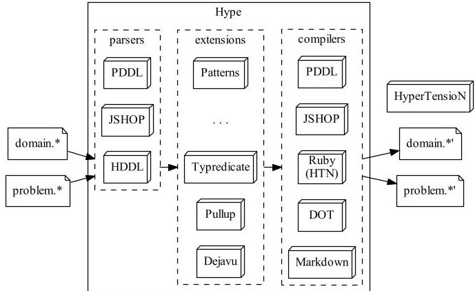
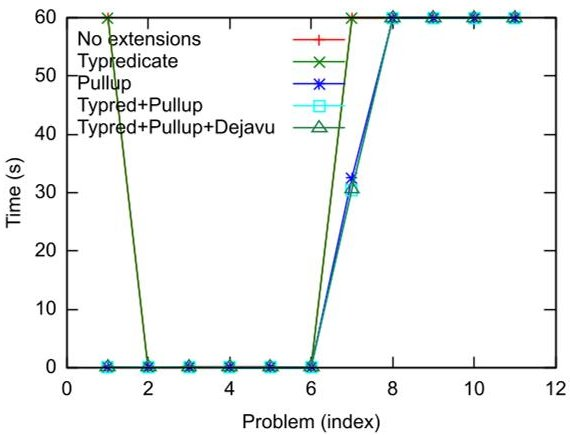
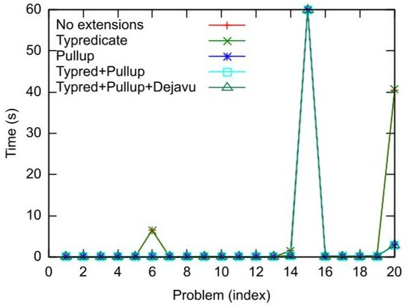
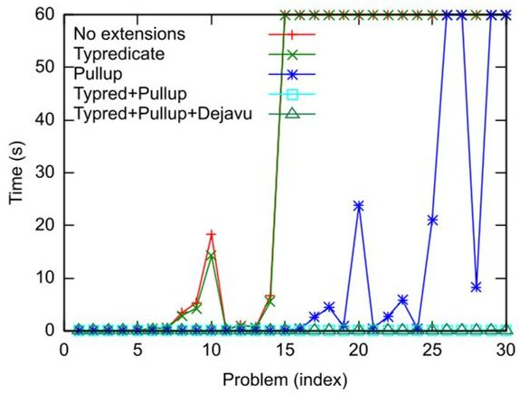
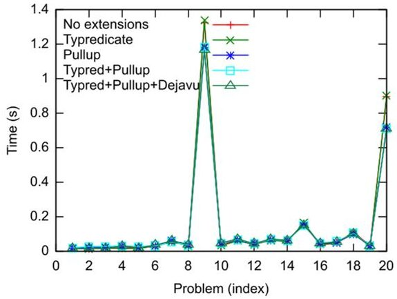

<!-- PDF_PAGE: 1 -->

# HyperTensioN A three-stage compiler for planning

Maurício Cecilio Magnaguagno $ ^{1} $ , Felipe Meneguzzi $ ^{2} $ and Lavindra de Silva $ ^{3} $

$сIndependent researcher

$ ^{2} $School of Technology, Pontifical Catholic University of Rio Grande do Sul (PUCRS), Porto Alegre, Brazil $ ^{3} $Department of Engineering, University of Cambridge, Cambridge, UK maumagnaguagno@gmail.com felipe.meneguzzi@pucrs.br lavindra.desilva@eng.cam.ac.uk

## Abstract

Hierarchical Task Networks (HTN) planners generate plans using a decomposition process with extra domain knowledge to guide search towards a planning task. While many HTN domain descriptions are made by experts, they may repeatedly describe the same preconditions, or methods that are rarely used or possible to be decomposed. By leveraging a three-stage compiler design we can easily support more language descriptions and preprocessing optimizations that when chained can greatly improve runtime efficiency in such domains. In this paper we present the HyperTensioN HTN planner, as it was submitted to the HTN IPC 2020.

## Introduction \mathrm{Introduc tion} $

Hierarchical planning was originally developed as a means to allow planning algorithms to incorporate domain knowledge into the search engine using an intuitive formalism (Ghallab, Nau, and Traverso 2004). Hierarchical Task Network (HTN) is the most widely used formalism for hierarchical planning, having been implemented in a variety of systems rendered in different (though conceptually similar) input languages (de Silva, Lallement, and Alami 2015; Nau et al. 2003; Ilghami and Nau 2003). Recent research has re-energized work on HTN planning formalisms and search procedures, leading to a new generation of HTN planners (Bercher et al. 2017; Holler et al. 2018; Holler et al. 2020a; Holler et al. 2020b). In this paper, we outline key design elements, features, and optimizations of the HyperTensioN planner, as submitted to the 2020 International Planning Competition (IPC) $ ^{1} $ . Specifically, we focus on the compilation of HTN instances into Ruby programs, as well as the optimizations based on transformation of HTN domains and problems to minimize backtracking.

## Three-stage design architecture

HyperTensioN was originally developed to automatically convert classical planning instances to hierarchical planning instances (Magnaguagno and Meneguzzi 2017). This required at least a PDDL (McDermott et al. 1998) parser (front-end) and a (J)SHOP (Ilghami and Nau 2003) description compiler (back-end). By keeping front-end and backend separate it was also possible to add a Ruby compiler to generate code compatible with our implementation of a lifted Total Forward Decomposition (TFD) (Ghallab, Nau, and Traverso 2004, chapter 11) planner. This compilation approach is very similar to that in JSHOP (Ilghami and Nau 2003). Parser and compiler modules share an Intermediate Representation (IR) that represents the planning instance data, which middle-end extensions can further process. Extensions fill gaps between description languages, analyze or optimize descriptions, independent of the target planner/output language.

Figure Figure 1: Hype acts as a three-stage compiler before linking Ruby outputs with the HyperTensioN planner.

This level of flexibility facilitates developing support for new languages, while remaining compatible with the already available extensions. For example the DOT (Ellson et al. 2001) compiler for debugging and the HDDL (Höller et al. 2020a) parser for the IPC. As the project grew, the three stage compiler and the TFD planner modules split in two, as shown in Fig. 1. The Hype tool controls module execution at each stage, allowing multiple middle-ends to run, even repeatedly, before compilation into the target representation. The HyperTensioN TFD planner completes the Ruby (HTN) compiler output to finish this pipeline with the plan output. Eventually, we extended the core HyperTensioN search procedure to a variety of other planning tasks, including search on hybrid symbolic-numeric domains (Magnaguagno and Meneguzzi 2020).

<!-- PDF_PAGE: 2 -->

## Domain transformation

To improve planning speed the compiler was optimized to compress the state structure by removing rigid predicates and treating them as "constant information". More importantly, we developed extensions to improve the IR to support: (1) better unification exploiting type information; (2) early testing of rigid parts of method/action preconditions during decomposition; and (3) a cycle detection mechanism.

## Typredicate

This extension involves constraining the substitutions attempted on variables occurring in predicates, by making better use of constant/parameter types (if the domain expert has not already done so). For example, suppose the predicate (at ?obj - object ?pos - position) is defined in the domain, which is used in the action (move ?obj - vehicle ?pos - position) to both check and update a vehicle's position. Suppose also that we are given the following type hierarchy: "person vehicle position - object". Then, though the move action will never require nor modify the position of a person, the ?obj variable occurring in the precondition of the action may still be substituted by constants of type person, as ?obj is defined in the predicate to be of the parent type object. Since constants of type person and vehicle are mutually exclusive by virtue of being subtypes of the same parent type, we preclude such substitutions by specializing (at ?obj - object ?pos - position) into predicates (at-vehicle ?obj - vehicle ?pos - position) and (at-person ?obj - person ?pos - position), and replacing occurrences of (at ?obj ?pos) with the appropriate specialized predicates in the domain, initial state and goal. Typredicate currently only specializes predicates to the leaves of the type hierarchy, but it can be straightforwardly extended to specialize to intermediate levels. Typredicate is not limited to typed domains, as it can infer types based on unary rigid predicates contained in preconditions, e.g. (person ?obj). By specializing predicates we make planning more efficient, as unification uses smaller (disjoint) sets of objects, i.e., without extraneous objects, while also making the Pullup extension more "complete".

## Pullup

The Pullup extension implements the main optimization technique that underpins HyperTensioN's performance by "pulling up" preconditions in the hierarchy. A literal in the precondition (which is a conjunction/set of literals) of an action occurring in a method is added (after variable substitutions) to the precondition of the method if the literal is not possibly brought about by an earlier step in the method, i.e., any solution for the method will require the literal to hold at the start; a literal is deemed to be possibly brought about (cf. "mentioned" (de Silva, Sardina, and Padgham 2016)) by a step if there is a literal asserted by an action yielded by the step s.t. the two literals have the same predicate symbol. $ ^{2} $ We pull up method preconditions as follows. A (possibly pulled up) literal in the precondition of a method is deemed to be part of the precondition of the task that is accomplished by

the method if the literal is "locally rigid", i.e., shared by all method preconditions related to the same task. Given a planning problem, each iteration of the algorithm pulls up literals by one level, starting from preconditions of actions, and the algorithm terminates when it reaches a fixed point-when no literals "moved" in the previous iteration.

A literal that is always pulled up from an action/method precondition is removed from it, as the literal will be tested earlier in the decomposition. Moreover, using the planning problem, literals that are always true (w.r.t. the problem) are removed from preconditions based on the unifications that are possible, and actions/methods that contain contradictions in preconditions are removed together with their associated "branches". Interestingly, branch removal may enable pulling up additional literals by exposing "hidden" (see de Silva, Sardina, and Padgham 2016)) rigid literals.

## Dejavu

Some domains may have methods with direct recursion, where a method includes the same task that it decomposes, or indirect recursion, requiring further decomposition before the (same) task is encountered. Without "visited" predicates used by a domain expert to mark (register) and query visited partial states, such domains can induce an infinite loop for a TFD (Ghallab, Nau, and Traverso 2004) search procedure. Dejavu transforms the domain by adding "unobservable" primitive tasks (that are not part of valid plans) to mark and unmark the fact that a particular non-primitive task is being decomposed, and predicates to detect when the task is being recursively (re)attempted. Information relating to such cycles is stored across decomposition branches using an external cache structure, as the state loses the marked information upon backtracking. The cache saves which methods and unifications have been explored in previous branches to avoid repeating decompositions that previously led to failure. Domains with cyclic tasks without parameters lack the required information to cache the task signature, which contains the variable bindings for the method decomposing the task. In such domains we fallback to a full state comparison with previously visited states at each cyclic task. HyperTensioN can still detect stack overflows, and safely backtrack in case the cycle detection mechanism fails. Dejavu, while limited, proved critical for HyperTensioN's performance, as it allows TFD to efficiently drive search, while avoiding its key limitation in recursive domains. $ ^{3} $

## Comparison

We now compare the improvements obtained by the above extensions w.r.t. some sample (pre-competition) and accepted IPC 2020 domains. We selected 4 domains in which the improvements were more visible. The experiments were run on Windows 7, on an Intel E5500 2.8GHz CPU with 3.25GB of RAM, using a 60s time-out.

<!-- PDF_PAGE: 3 -->

## Woodworking

Woodworking (Bercher, Keen, and Biundo 2014) is based on a benchmark from earlier IPCs. It describes tasks for working with wood, such as cutting, polishing and finishing. With Pullup, two extra problems were solved within our time limit, with one of them taking less than a second as shown in Fig. 2. Many problems in this domain seemed to require selecting the right values among many available objects before continuing exploration, as otherwise too much time was spent on backtracking, causing time-out.

Figure 2: Time in seconds to solve Woodworking problems.

## Rover

Rover involves robots navigating a planet, collecting information and sending it to a lander. The HTN domain was developed for SHOP (Nau et al. 1999) based on problem instances from earlier IPCs. Pullup improves the results for Rover, although most instances are solvable even without extensions; only one reaches the time-out as shown in Fig. 3.

Figure 3: Time in seconds to solve Rover problems.

## Transport

Transport (Behnke, Holller, and Biundo 2018) describes a domain where delivery trucks with limited capacity must pick and drop packages at specific cities connected by a road network. Transport is one of the few domains where each extension shows an impact on planning time, as shown in Fig. 4. Typredicate is able to specialize the "at" predicate, avoiding some unifications with non-vehicle objects. Pullup is able to move important constraints only defined in the

leaves of the HTN structure, e.g. the need for a road between two cities in order to drive between them. Note that this domain does not contain method preconditions. With Typredicate and Pullup combined the Transport instances are solvable in less than 0.2s.

Figure 4: Time in seconds to solve Transport problems.

## Snake

In Snake, $ ^{4} $ one or more snakes need to move to clear locations or strike nearby mice in a grid/graph-based world. The domain benefits from Dejavu, i.e., the planner avoids unifications that recursively expands the same task, which may start an infinite loop. Since Dejavu's direct recursion detection is always used, its effect is not visible in the graph, but required to avoid reaching the same positions repeatedly. Observe from Fig. 5 that Pullup shows a bigger improvement in planning time in the most complex instances.

Figure 5: Time in seconds to solve Snake problems.

The IPC release of HyperTensioN was not able to parse the Entertainment and Monroe domains correctly. With the parser fixed, new results were obtained on the same machine, which matched the IPC samples' timings. The first 5 of 12 Entertainment instances were solved in under 1s, the sixth in 42s, the seventh in 740s, and the eighth in 235s; others exceeded the IPC time limit (1800s). All Monroe-Fully-Observable instances were solvable, most in a few seconds and the last two in 32s. The Monroe-Partially-Observable instances were not solvable within the time limit. The results

<!-- PDF_PAGE: 4 -->

Table 1: HyperTensioN's (Hype) fixed and IPC results.

<table border="1"><tr><td>Domain(instances)</td><td>Fixed</td><td>Hype</td><td>Lilotane</td><td>PDDL4J-TO</td></tr><tr><td>AssemblyHierarchical(30)</td><td>3</td><td>3</td><td>5</td><td>2</td></tr><tr><td>Barman-BDI(20)</td><td>20</td><td>20</td><td>16</td><td>11</td></tr><tr><td>Blocksworld-GTOHP(30)</td><td>16</td><td>16</td><td>22.1</td><td>16</td></tr><tr><td>Blocksworld-HPDDL(30)</td><td>30</td><td>30</td><td>1</td><td>0</td></tr><tr><td>Childsnack(30)</td><td>30</td><td>30</td><td>29</td><td>20.9</td></tr><tr><td>Depots(30)</td><td>24</td><td>24</td><td>23.4</td><td>23</td></tr><tr><td>Elevator-Learned(147)</td><td>147</td><td>147</td><td>147</td><td>2</td></tr><tr><td>Entertainment(12)</td><td>~5.9</td><td>0</td><td>4.6</td><td>4.6</td></tr><tr><td>Factories-simple(20)</td><td>3</td><td>3</td><td>4</td><td>0</td></tr><tr><td>Freecell-Learned(60)</td><td>0</td><td>0</td><td>7.7</td><td>0</td></tr><tr><td>Hiking(30)</td><td>25</td><td>25</td><td>21.3</td><td>17</td></tr><tr><td>Logistics-Learned(80)</td><td>22</td><td>22</td><td>43.2</td><td>0</td></tr><tr><td>Minecraft-Player(20)</td><td>5</td><td>5</td><td>1</td><td>1</td></tr><tr><td>Minecraft-Regular(59)</td><td>57.1</td><td>57.1</td><td>29.2</td><td>23</td></tr><tr><td>Monroe-FO(20)</td><td>~17.7</td><td>0</td><td>20</td><td>20</td></tr><tr><td>Monroe-PO(20)</td><td>0</td><td>0</td><td>20</td><td>1</td></tr><tr><td>Multiarm-Blocksworld(74)</td><td>8</td><td>8</td><td>4</td><td>0</td></tr><tr><td>Robot(20)</td><td>20</td><td>20</td><td>11</td><td>6</td></tr><tr><td>Rover-GTOHP(30)</td><td>30</td><td>30</td><td>21.3</td><td>27.5</td></tr><tr><td>Satellite-GTOHP(20)</td><td>20</td><td>20</td><td>15</td><td>20</td></tr><tr><td>Snake(20)</td><td>20</td><td>20</td><td>17.1</td><td>20</td></tr><tr><td>Towers(20)</td><td>17</td><td>17</td><td>10</td><td>16</td></tr><tr><td>Transport(40)</td><td>40</td><td>40</td><td>35</td><td>33.2</td></tr><tr><td>Woodworking(30)</td><td>7</td><td>7</td><td>30</td><td>6</td></tr><tr><td>Total(892)</td><td>~567.7</td><td>544.1</td><td>537.9</td><td>270.2</td></tr><tr><td>Normalized(24)</td><td>~14.88</td><td>13.50</td><td>11.60</td><td>7.47</td></tr></table>

are shown in Table 1 with the highest values (sometimes obtained by two participants) in bold. Only participants who obtained the highest value at least once were included.

## Conclusion

This paper presented HyperTensioN, an approach to planning using a three-stage compiler designed to support optimizations in multiple domain description languages. The flexibility introduced by the front and back-end modules makes it easy to support new domain description languages, while the middle-end pipeline opens the door for multiple transformation and analysis tools to be executed before planning. The key to its performance in the IPC is a set of domain transformation techniques that replicates domain-knowledge optimizations commonly used to speed up search in previous HTN planners such as JSHOP2 (Ilghami and Nau 2003), as well as the optimizations often used by agent interpreters, e.g. (Thangarajah, Padgham, and Winikoff 2003). With our domain transformations it was possible to not only improve the HTN structure for SHOPlike (blind Depth First-Search) planners using Typredicate and Pullup, but also to avoid recomputing parts of complex combinatoric domains such as Transport and Snake using Dejavu. Future work includes stronger tree modifications/specializations, support for more complex domain descriptions, and a compilation to a low-level language to obtain a native planner executable.

Acknowledgements: Felipe Meneguzzi acknowledges support from CNPq with projects 407058/2018-4 (Universal) and 302773/2019-3 (PQ Fellowship).

## References

Behnke, G.; Höller, D.; and Biundo, S. 2018. totSAT Totally-Ordered Hierarchical Planning Through SAT. In AAAI, 6110-6118.

Bercher, P.; Behnke, G.; Höller, D.; and Biundo, S. 2017. An Admissible HTN Planning Heuristic. In IJCAI, 4384-4390. IJCAI.

Bercher, P.; Keen, S.; and Biundo, S. 2014. Hybrid planning heuristics based on task decomposition graphs. In SoCS.

de Silva, L.; Lallement, R.; and Alami, R. 2015. The HATP hierarchical planner: Formalisation and an initial study of its usability and practicality. In IROS, 6465-6472.

de Silva, L.; Sardina, S.; and Padgham, L. 2016. Summary information for reasoning about hierarchical plans. In ECAI, 1300-1308.

Ellson, J.; Gansner, E.; Koutsofios, L.; North, S. C.; and Woodhull, G. 2001. Graphviz—open source graph drawing tools. In GD, 483-484. Springer.

Ghallab, M.; Nau, D.; and Traverso, P. 2004. Automated planning: theory & practice. Elsevier.

Höller, D.; Bercher, P.; Behnke, G.; and Biundo, S. 2018. A Generic Method to Guide HTN Progression Search with Classical Heuristics. In ICAPS.

Höller, D.; Behnke, G.; Bercher, P.; Biundo, S.; Fiorino, H.; Pellier, D.; and Alford, R. 2020a. HDDL: An Extension to PDDL for Expressing Hierarchical Planning Problems. In AAAI, 9883-9891. AAAI Press.

Höller, D.; Bercher, P.; Behnke, G.; and Biundo, S. 2020b. HTN Planning as Heuristic Progression Search. JAIR 67:835-880.

Ilghami, O., and Nau, D. S. 2003. A General Approach to Synthesize Problem-Specific Planners. Technical Report CS-TR-4597, Maryland University, Dept of Computer Science, College Park, Maryland.

Magnaguagno, M. C., and Meneguzzi, F. 2017. Method composition through operator pattern identification. KEPS 2017 54.

Magnaguagno, M. C., and Meneguzzi, F. 2020. HTN Planning with Semantic Attachments. In AAAI. AAAI Press.

McDermott, D.; Ghallab, M.; Howe, A.; Knoblock, C.; Ram, A.; Veloso, M.; Weld, D.; and Wilkins, D. 1998. PDDLthe planning domain definition language. Technical Report CVC TR-98-003/DCS TR-1165, Yale Center for Computational Vision and Control.

Nau, D.; Cao, Y.; Lotem, A.; and Muñoz-Avila, H. 1999. SHOP: Simple hierarchical ordered planner. In IJCAI, 968- 973.

Nau, D. S.; Au, T.-C.; Ilghami, O.; Kuter, U.; Murdock, J. W.; Wu, D.; and Yaman, F. 2003. SHOP2: An HTN planning system. JAIR 20:379-404.

Thangarajah, J.; Padgham, L.; and Winikoff, M. 2003. Detecting & Avoiding Interference Between Goals in Intelligent Agents. In IJCAI, 721-726.