<!-- PDF_PAGE: 1 -->

# ICARUS - Virtual Reality based training for Assembly, Integration and Testing

Daniel Twigt

SCN Avatar, ATG-Europe

Noordwijk, The Netherlands

daniel.twigt@atg-europe.com

Laurens Mathot

ATG-Europe

Noordwijk, The Netherlands

laurens.mathot@atg-europe.com

Emiel den Exter

ATG-Europe

Noordwijk, The Netherlands

emiel.denexter@atg-europe.com

Manav Lakhwani Daswani

ATG-Europe

Barcelona, Spain

manav.lakhwani@atg-europe.com

Stefan Brouwer

ISISpace

Delft, The Netherlands

s.brouwer@isispace.nl

Coen Vos

ISISpace

Delft, The Netherlands

c.vos@isispace.nl

Simone Caso Royal Netherlands Aerospace Centre Amsterdam, The Netherlands simone.caso@nlr.nl

Petra ten Hove Royal Netherlands Aerospace Centre Amsterdam, The Netherlands petra.ten.hove@nlr.nl

Satellite Assembly, Integration, and Testing (AIT) is a critical phase in satellite manufacturing, ensuring the functionality and reliability of space-bound assets. AIT engineering demands a diverse skill set encompassing system knowledge, procedural expertise, tool proficiency, and safety awareness, among others. However, the high costs and limited availability of required hardware often pose challenges for hands-on training. To address these constraints, Virtual Reality (VR) emerges as a promising solution for AIT training and for training of cleanroom operations in general. By leveraging the immersive capabilities of VR, trainees can engage in realistic simulations of AIT and cleanroom operations, acquiring essential competencies in a cost-effective manner and a controlled environment. This serves as the central concept behind the development of ICARUS, a VR training platform tailored for AIT and cleanroom procedures. Using ICARUS, trainees can develop and improve selected competencies based on actual AIT and cleanroom procedures, digital models of the required components, and a realistic representation of required steps and activities in VR. This includes activities such as cable harnessing and requires a sufficiently realistic representation of all the tooling required in the AIT process, among others. Based on validation experiments with potential ICARUS users, it is concluded that ICARUS is valuable for initial training and familiarization, making it a useful supplement to traditional methods. Indeed, most trainees would feel more confident in completing similar tasks in real-life, after following training in ICARUS.

Keywords: Virtual Reality, Assembly Integration and Testing (AIT), Training, Cubesat, Satellite.

## I. INTRODUCTION

Satellite Assembly, Integration, and Testing (AIT) is a critical phase in satellite manufacturing, ensuring the functionality and reliability of space-bound assets. AIT engineering requires a diverse skill set including the system knowledge, procedural expertise, tool proficiency, and safety awareness. The high costs of materials and the limited

availability of essential hardware often create challenges for hands-on training, particularly in specialized environments such as adequately equipped cleanrooms. To address these challenges, the Virtual Reality (VR) application ICARUS was developed with the aim to provide an immersive environment that allows users to train both AIT procedures and cleanroom operation in general.

The ICARUS Minimum Viable Product (MVP) was developed with a focus on several use cases. These use cases included virtual training for mechanical assembly and integration in environments with recurring operations, as well as virtual training for cleanroom operations in similar settings. The MVP also supports knowledge retention by providing a virtual representation of the customer's guidelines and best practices for recurring tasks. Additionally, the MVP enables the virtual evaluation of new hires for AIT engineering and cleanroom positions, ensuring that new users (e.g., employees) are adequately trained and assessed before assuming their roles. It is noted that ICARUS initially focuses on AIT of cubesats, in view of the relevance of series production and cost reduction in the cubesat market. However, it may be adapted to other (space) sectors and processes as needed.

The development of ICARUS was motivated among others by the successful uptake of VR-based training in other sectors (Chapter II). At the start of the MVP development process, a training scenario with a suitable task-technology fit was designed, based on user needs and requirements from the cubesat development industry (Chapter III). The MVP was subsequently developed using an industry standard game engine (Chapter IV). The useability and usefulness of the MPV was subsequently assessed during a validation campaign involving various (space) industry parties (Chapter V).

<!-- PDF_PAGE: 2 -->

## II. VIRTUAL REALITY BASED TRAINING

Virtual Reality (VR) has been increasingly integrated into training programs across various sectors, offering immersive and interactive experiences that enhance learning outcomes in a safe environment [1]. The choice of training medium—such as VRhas relatively little influence on training effectiveness compared to other factors, such as instructional design and learner characteristics [2][3][4]. Task-technology fit, however, is critical [5].

Nevertheless, VR has shown considerable promise as a complementary training tool. Meta-analyses across the health education, and military sectors have demonstrated its effectiveness in enhancing knowledge acquisition [5] technical skills such as combat training and equipment handling [6] and non-technical skills such as safety awareness [7] and social skill development [8].

While VR training is well-established in sectors like healthcare [9][10][11][12] and military [6][13], its application in the space industries is still evolving. Organizations are beginning to explore VR's potential for astronaut training [14][15][16][17][18] and spacecraft maintenance simulations [19], but widespread adoption is yet to be realized. ICARUS aims to contribute to the realization of VR's potential in the space industry.

## III. TRAINING NEEDS ANALYSIS

A Training Needs Analysis (TNA) [20] was conducted to identify the training needed to develop the competencies cubesat manufacturers require to perform their tasks effectively. Following this, training scenarios based on real-world situations were developed, incorporating AIT procedures and satellite (CAD) models to achieve a high level of fidelity [21]. Indeed, ICARUS takes a holistic approach to cleanroom operations and AIT, rather than focusing on individual tasks only.

As part of the analysis, an Operational Competence Profile for AIT of cubesat satellites was developed (see Fig.1). Notably, attitude-related skills (responsibility, safety awareness, precision and communication skills) were highlighted as critical. VR-based training can reportedly contribute to the development of such skills [1]. Considering the steps and competencies listed, a high-level training scenario is defined for initial training in ICARUS. This scenario considers 12 separate tasks, among which finding and checking available documentation, preparing a safe working environment, collecting tools and materials, checking all parts and materials, assembling a cubesat stack, connecting wires, various steps related to testing of the assembly and flight preparation and cleaning up the workspace.

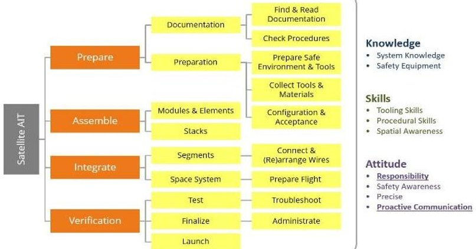

Fig. 1. Operational Competence Profile for AIT of cubesat satellites

## IV. ICARUS DEVELOPMENT

## A. ICARUS user needs

For the development of the ICARUS Minimum Viable Product (MVP), user needs from parties in the cubesat industry were obtained. These needs were used as input in an agile development process. The key personas considered were those of the Trainer and the Trainee, and the main user stories considered the realism of the workspace area, the availability of representative tools, the ability to go through real-world AIT procedures and processes as also reflected in the training scenario, the ability to add and route cables, the ability to receive feedback and log information during the training, and the ability to customize the training session and environment. These stories were central to the further ICARUS design and development.

## B. UX/UI design

In the development of ICARUS, good User Experience / User Interaction (UX/UI) design lies at the core. Considering all the user interactions in an AIT procedure, these should be represented with a suitable level of realism within the constraints posed by the VR hardware. To achieve this, an iterative design and development process was applied based on user input and feedback. Simple and frequent user testing with a small number of representative users, as is commonly advocated in UX literature [22], allowed for many issues to be addressed quickly while a broader set of user feedback was collected over time. Test users included developers, internal customers, external customers and the general public. In addition, to improve user experience established design patterns (conventions) from both game/VR experiences [23] and physical tool and workspace designs were applied (see Fig. 2 and Fig. 3), following various best practices from UX literature [24]. Examples include the use of clear signage around the virtual workspace (see Fig. 4), height adjustable work surfaces and natural mapping of inputs (grasping and locomotion) [25] including haptic and audio feedback (see Fig. 5).

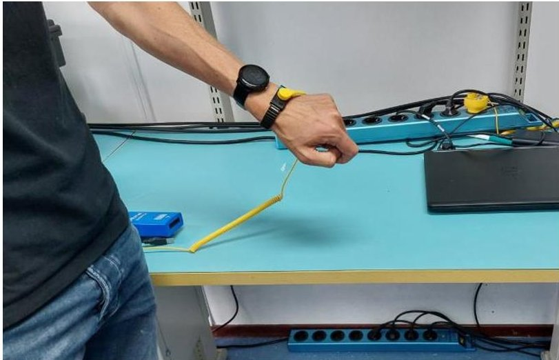

Fig. 2. Site research to define workspace requirements (example)

<!-- PDF_PAGE: 3 -->

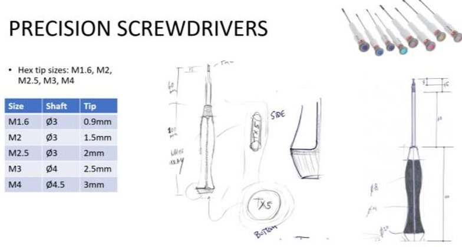

Fig. 3. Asset definition and design (example)

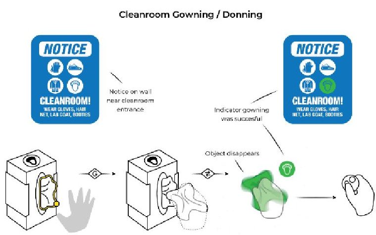

Fig. 4. UX/UI wireframe for cleanroom gowning (example)

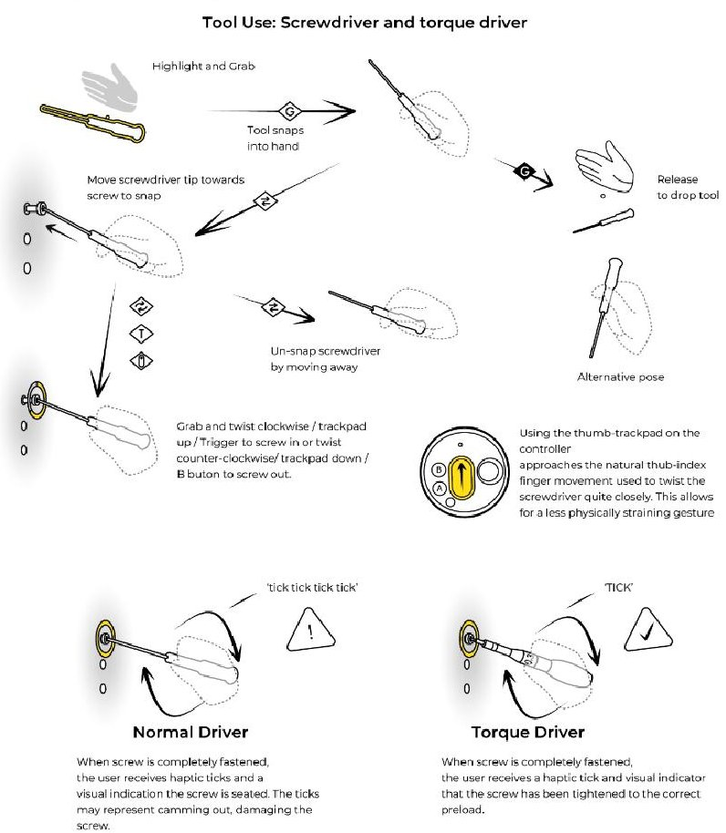

Fig. 5. UX/UI wireframe for screwdriver and torque driver (example)

## C. Software development

ICARUS was developed using an industry standard game engine (Unreal Engine). Such a game engine provides a wide array of pre-built tools and features specifically designed for game and VR development, such as a physics engine and realtime rendering systems. ICARUS MVP was developed as a stand-alone, single user tool, which is operated on a local device. From a hardware architectural perspective, ICARUS MVP runs as a tethered application (see Fig. 6) and presently supports the Valve Index and Quest 2/3 Head Mounted Displays (HMDs).

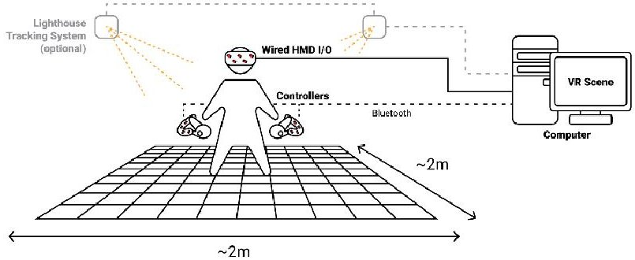

Fig. 6. High level overview of ICARUS hardware design

ICARUS specific functionality was developed with a strong focus on performance, to ensure a good user experience in VR. This is critically important to avoid simulation sickness and general issues with user discomfort during the training. Indeed, a minimum frame rate of 70 frames per second (fps) is necessary to prevent motion sickness, while higher frame rates are recommended to enhance visual fidelity and user experience [26][27].

Compared to conventional interfaces, VR nearly doubles GPU costs due to its stereoscopic nature. Hence, to achieve a suitable performance, effective performance management strategies were essential during the development of ICARUS. One of these strategies was continuous monitoring of SteamVR's GPU performance graphs during development, to help spot issues early. Sudden increases in frame time can be attributed to specific effects or assets, and can be remedied by temporarily disabling, optimizing or removing them. In cases where this approach misses issues, more detailed data can be gained from tools such as Unreal Engine's GPU Profiler and Unreal Insight. Furthermore, CPU performance issues can be encountered when performing calculations in the physics engine, such as when updating collision meshes. In cases where this cannot be avoided, these costs were spread over multiple frames wherever possible. By adopting such strategies during the development, ICARUS can achieve a frame time of 2.8ms to 3.2ms, resulting in a consistent frame rate of 144 fps on the Valve Index HMD (using Intel Core i7- 10700K CPU, 32 GB of RAM and NVIDIA GeForce RTX 3080 GPU).

Significant development effort was spent on allowing for precise interactions despite the use of relatively crude input methods (VR controllers compared to real hands). This includes support for wires, screws, and sliding parts. The general approach was to use the pre-built physics engine to initiate interactions, and transitioning to and from an analytical mode, where movement are precisely constrained via dedicated code, rather than being limited by the precision of generic real-time physics calculations. To describe the dynamic software architecture and interaction in ICARUS, Fig. 7 illustrates this for two types of objects within the ICARUS VR environment: the screwdriver and the screw. It shows a screwdriver and screw being held, with the option to magnetically snap the screw to the screwdriver.

<!-- PDF_PAGE: 4 -->

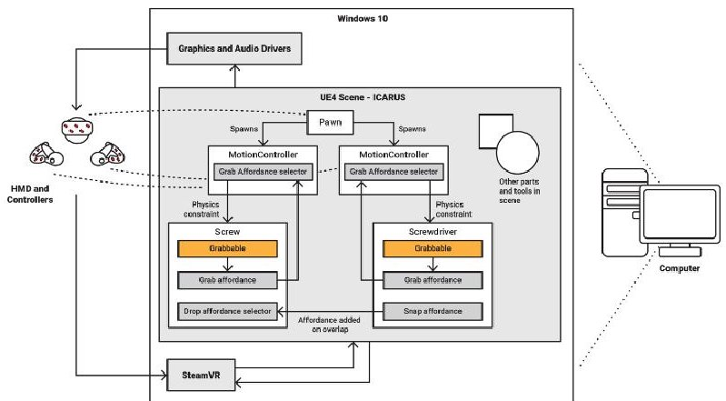

Fig. 7. An example 'vertical slice' block diagram of the entire system, from hardware to individual virtual objects.

Selected screenshots from the ICARUS are shown in Fig. 8 and Fig. 9. The upper panel of Fig. 8 shows the gowning area before entering the cleanroom, while the lower panel shows a working surface in the cleanroom itself. Fig. 9 shows a 1U cubesat in various stages of assembly. Key features included in ICARUS are among others gowning and cleaning processes and equipment (cleaning wipes, air blower), safety processes and equipment (ESD bracelet and grounding cables), procedure viewing and annotation, tooling (screwdrivers and torque tools among others), satellite assembly based on a real-world 1U cubesat model, cables and cable routing, Kapton tape and epoxy, and verification processes and equipment (measuring and weighing).

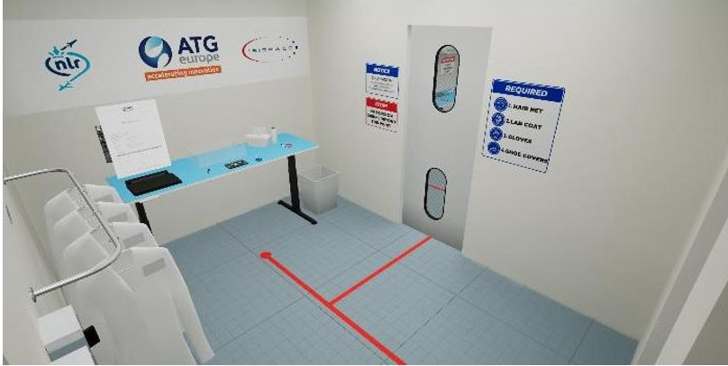

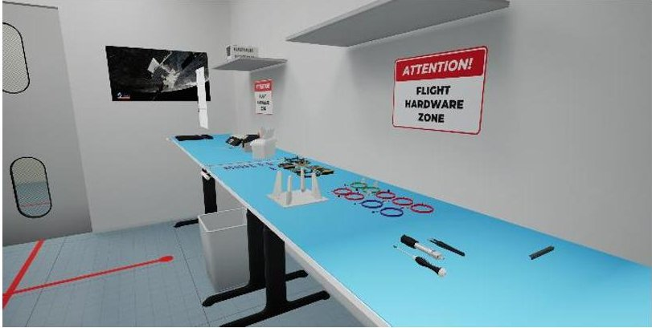

Fig. 8. Example screenshots from ICARUS VR, focusing on gowning area (upper) and cleanroom (lower)

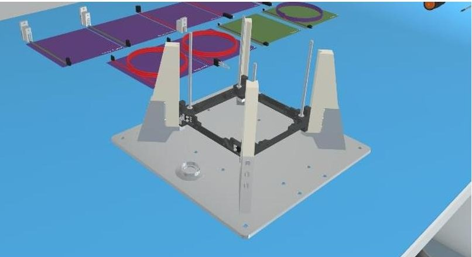

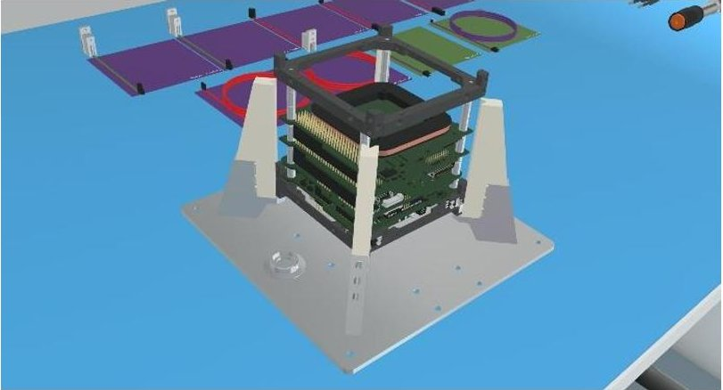

Fig. 9. Example screenshots from ICARUS VR, focusing on 1U stack integration

## V. VALIDATION

To test the useability and usefulness of ICARUS, a validation campaign was carried out involving various (space) industry parties. During this campaign, evaluation questionnaires were used to assessed satisfaction, usability, and effectiveness of the VR tool, as well as the realism of the VR environment and the clarity of the training provided. Open-ended questions allowed participants to provide additional feedback and suggestions for improvement. Besides the feedback of the participants, a training specialist observed the sessions to check whether all training objectives could be achieved.

The observations revealed promising results regarding the effectiveness of the ICARUS VR training tool. Out of 12 tasks, 11 could be trained in a simplified manner, except for the launch/orbit task, which had not been implemented at the time of validation. Furthermore, 8 out of 9 competencies could be trained and assessed during the ICARUS training sessions. However, spatial awareness proved to be a challenging competency to assess and train.

Test results obtained from 17 participants across four organizations are summarized in Fig. 10 and Fig. 11 below. The participants showed varying levels of experience with AIT engineering, with 41% being AIT engineers and 59% having other related space engineering backgrounds. In terms of VR experience, the participants were roughly evenly split, with 47% having little to no experience and 53% having some to extensive experience with VR.

<!-- PDF_PAGE: 5 -->

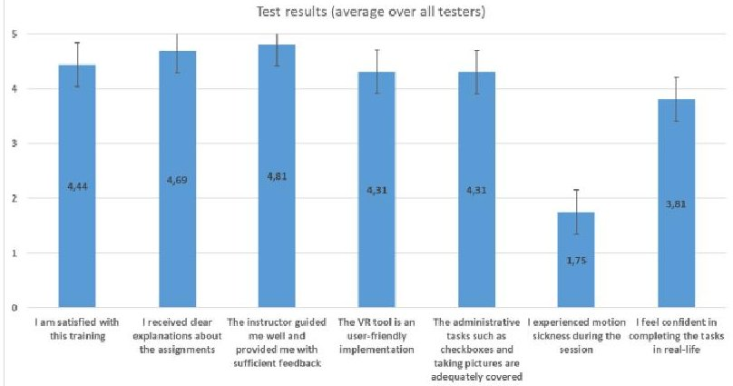

Fig. 10. Average test results and standard errors for all testers (N = 17), part 1. 5 = strongly agree, 4 = agree, 3 = neutral, 2 = disagree, 1 = strongly disagree.

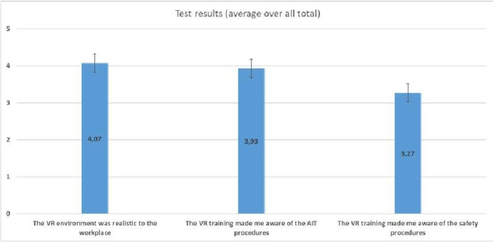

Fig. 11. Average test results and standard errors for all testers (N = 17), part 2. 5 = strongly agree, 4 = agree, 3 = neutral, 2 = disagree, 1 = strongly disagree.

Based on these results, Trainees expressed high satisfaction with the training, generally rating between "agree" and "strongly agree," with minimal differences based on their background. ICARUS was perceived as user-friendly and considered to effectively represent administrative tasks related to AIT procedures. Most trainees reported minimal motion sickness, and many felt increased confidence performing similar tasks in real life after the training. While ICARUS was generally seen as realistically resembling the actual workplace, perceptions varied among participants from different organizations, possibly due to differences in satellite and cleanroom sizes between them. In general, the training notably increased awareness of AIT procedures.

To assess the training effectiveness, participants were asked how confident they felt in performing the tasks in real life after completing the ICARUS training, on a scale of 1 (strongly disagree) to 5 (strongly agree). The results showed variation in confidence levels among participants, with an average score of 3.81 (SD = 1.11), indicating that participants generally tended towards a positive assessment of their abilities. Notably, prior knowledge of AIT engineering had an impact on the outcomes, with a significant positive correlation found between confidence and prior AIT experience （r(17) = 0.57, p=0.053), indicating that prior knowledge influenced the training results.

Based on written feedback, Trainees appreciated the ICARUS VR training for its immersive and realistic simulation of cleanroom environments and satellite assembly procedures, which enhanced their engagement and understanding. They found the intuitive controls and ease of navigation user-friendly, facilitating a smoother learning process. Additionally, the VR environment was recognized as

a time-efficient and cost-effective training tool, particularly beneficial for newcomers to cleanroom settings, as it reduces the need for physical resources and extensive instructor time. However, some trainees experienced difficulties with controls and interactions, especially for tasks requiring fine motor skills, such as screwing in parts and handling small objects. Feedback also indicated that certain aspects of the simulation lacked realism, notably the absence of tactile feedback during hardware assembly and the simplified representation of some complex real-life operations.

In general, Trainees reported several notable advantages of AIT and cleanroom training in VR. It facilitates rapid familiarization with new environments and procedures, enabling users to quickly understand and become comfortable with their workspace and tasks. The immersive nature of ICARUS helps build confidence and develop skills without the risk of damaging hardware or making mistakes, providing a safe space for learning. Additionally, it delivers a realistic experience by replicating real-life scenarios, offering valuable visual and spatial understanding despite the absence of tactile feedback. Furthermore, ICARUS enhances training efficiency and safety by reducing the need for physical resources and minimizing risks associated with handling actual equipment.

## VI. CONCLUSIONS

Based on the outcome of the validation campaign, it is concluded that ICARUS' functionality is considered suitable for general AIT and cleanroom training, with most of the trainees agreeing that the cleanroom environment and workflow are realistically resembled. Furthermore, ICARUS is considered user-friendly by most of the trainees, and is considered valuable for initial training and familiarization, making it a useful supplement to traditional methods. Indeed, most trainees would feel more confident in completing similar tasks in real-life, after following a training in ICARUS.

Regarding functionality, it is concluded that ICARUS offers a realistic and immersive environment that effectively simulates the spatial and procedural aspects of training enhancing user comprehension of task layouts and workflows Its interactive design provides immediate feedback, increasing engagement and aiding in the retention of procedural knowledge. Additionally, ICARUS's versatility can allow it to cater to various training levels, from basic onboarding to detailed procedural practice. Areas for further improvement include enhancing the precision of fine motor skill tasks, such as handling small components, for example by improving haptic feedback and control accuracy. Furthermore, adapting the system to accommodate users with varying levels of VR experience through tailored training modes or additional guidance could make ICARUS more accessible to all trainees.

Regarding user friendliness, it is noted that the ICARUS VR training tool is generally considered user-friendly, with intuitive controls and interfaces that engage even those unfamiliar with VR technology. However, there is room for improvement in the clarity and accessibility of instructional content, particularly for complex tasks. Additionally, some users reported discomfort with the VR headset during extended sessions, suggesting that enhancing the ergonomic design of the hardware could improve the overall training experience.

ICARUS VR training offers several key benefits for trainees. It facilitates efficient onboarding by familiarizing users with new environments and procedures before they

<!-- PDF_PAGE: 6 -->

transition to real-world tasks. The controlled virtual setting allows trainees to practice without the risk of damaging equipment or making critical errors, thereby reducing anxiety and building confidence. Additionally, the virtual setup minimizes the need for physical hardware, cleanroom time, and instructor involvement, enhancing cost and resource efficiency. Overall, ICARUS serves as a valuable supplement to traditional training methods, with most trainees feeling more confident in performing similar tasks in real-life after completing the VR training.

## ACKNOWLEDGMENT

This research was carried out under the ESA General Support Technology Programme (GSTP) with support from the Netherlands Space Office, Contract No. 4000137157/22/NL/GLC/va. Further acknowledgements go SCN Avatar, for providing development and testing facilities, to Andrés Martín-Barrio and Peter van der Plas, the ESA Technical Officers in charge, for their feedback during the project, to Marjolein Lambregts, for her involvement in the initial phase of the project, and to all ISISpace, NLR and ESA staff members who provided feedback during the validation phase.

## REFERENCES

[1] D., Velev, Zlateva, P. Virtual Reality Challenges in Education and Training. International Journal of Learning and Teaching, 3, 33-37, 2017, DOI: https://doi.org/10.18178/ijlt.3.1.33-37

[2] A. Winfred, et al., "Effectiveness of training in organizations: a meta-analysis of design and evaluation features." Journal of Applied psychology 88.2, 2003

[3] R. Mayer, "Multimedia learning." Psychology of learning and motivation. Vol. 41. Academic Press, 2002, 85-139

[4] J. Parong, R. Mayer. "Learning science in immersive virtual reality." Journal of educational psychology 110.6, 2018

[5] M. Howard, M. Gutworth, R. Jacobs, "A meta-analysis of virtual reality training programs", Computers in Human Behavior, Volume 121, 2021, https://doi.org/10.1016/j.chb.2021.106808

[6] S. Caso, "Emerging Technologies in Military Space Operations: Current Applications and Future Research for Educational and Training Purposes", International Journal of Training Research, November, 1-16, 2024, https://doi.org/10.1080/14480220.2024.2431482

[7] O. Kim, G. Jang, S. Mun, "The Impact of VR-Based Safety Experience Education on Safety Awareness, Safety Behavior, and Accident Prevention: The Empirical Study of VR Application in Industrial Safety Education in Korea.", XR and Metaverse, 2024, https://doi.org/10.1007/978-3-031-77975-6_7

[8] M. Howard, M. Gutworth, "A meta-analysis of virtual reality training programs for social skill development", Computers & Education, Volume 144, 2020, https://doi.org/10.1016/j.compedu.2019.103707

[9] B. Myint Kyaw, N. Saxena, P. Posadzki, J. Vseteckova, C. Konstantia Nikolaou, P. Paul George, U. Divakar, I. Masiello, A. Kononowicz, N. Zary, L. Tudor Car. "Virtual Reality for Health Professions Education: Systematic Review and Meta-Analysis by the Digital Health Education Collaboration", Journal of Medical Internet Research, 2019, https://doi.org/10.2196/12959

[10] F., Pagnini, D., Manzey, E., Rosnet, D., Ferravante, O., White, N., Smith, "Human behavior and performance in deep space exploration: Next challenges and research gaps", Npj Microgravity, 9(1), 27, 2023. https://doi.org/10.1038/s41526-023-00270-7

[11] F., Pagnini, D., Phillips, K., Bercovitz, E., Langer, E. "Mindfulness and relaxation training for long duration spaceflight: Evidences from analog environments and military settings", Acta Astronautica, 165, 1- 8, 2019, https://doi.org/10.1016/j.actaastro.2019.07.036

[12] F., Pagnini, S., Thoolen, N., Smith, A., Van Ombergen, F., Grosso, E., Langer, D., Phillips, D, "Mindfulness disposition as a protective factor against stress in Antarctica: A potential countermeasure for long-duration spaceflight?", Journal of Environmental Psychology, 94, 102254, 2024, https://doi.org/10.1016/j.jenvp.2024.102254

[13] S. Caso, S. "A Review on Education and Training Needs for Military Space Operations", I/ITSEC, 2024, Conference, Orlando, FL

[14] S. M. Petermeijer, F. Rometsch, R. Jansen, S. Ennis, A. Nabben, L. Ferra, A. E. M. Casini, B. Fischer, M. Costantini, J. Schlutz, A. Cowley, "Using eXtended Reality as a design and training tool for a future lunar human habitat: The FLEX-XR case study.", Global Space Exploration Conference 2021 (GLEX 2021), 2021, https://elib.dlr.de/143153/

[15] T. Nilsson, F. Rometsch, L. Becker, F. Dufresne, P. Demedeiros, E. Guerra, A. E. M. Casini, A. Vock, F. Gaeremynck, A. Cowley, "Using Virtual Reality to Shape Humanity's Return to the Moon: Key Takeaways from a Design Study", Proceedings of the 2023 CHI Conference on Human Factors in Computing Systems, 1-16, 2023, https://doi.org/10.1145/3544548.3580718

[16] A. D. Garcia, J. Schlueter, E. Paddock, "Training astronauts using hardware-in-the-loop simulations and virtual reality", AIAA Scitech 2020 Forum, 0167, 2020, https://doi.org/10.2514/6.2020-0167

[17] S. Ennis, F. Rometsch, F. Saling, B. Fischer, P. Mittler, L. Ferra, C. Vizzi, A. E. M. Casini, M. Marnat, C. Thevenot, L. Boyer, "Astronaut training on-board the International Space Station using a standalone Virtual Reality headset", 72nd International Astronautical Congress (IAC 2021), 2021, https://elib.dlr.de/147953/

[18] M. Costantini, F. Rometsch, A. E. M. Casini, A. Cowley, S. Ennis, C. Scott, S. Ghiste, J. Scott, L. Ferra, "eXtended Reality applications for human spaceflight: The ESA-EAC XR Lab." 72nd International Astronautical Congress (IAC 2021), Dubai, United Arab Emirates, 2021, https://elib.dlr.de/144773/

[19] G. Atta, A. Abdelsattar, D. Elfiky, M. Zahran, M. Farag, S. O. Slim, "Virtual Reality in Space Technology Education", Education Sciences, 12(12), 2022. https://doi.org/10.3390/educsci12120890

[20] Training Needs Analysis —NLR. "Royal Netherlands Aerospace Centre," April 24, 2024. https://www.nlr.org/training-needs-analysis- tna/

[21] T. Stoffregen, B. Bardy, J. Smart, R. Pagulayan, "On the Nature and Evaluation of Fidelity in Virtual Environments", Virtual and adaptive environments: Applications, implications, and Human performance issues, 2003, pp. 111-128, https://doi.org/10.1201/9781410608888

[22] S. Krug. "Don't Make Me Think, Revisited : a Common Sense Approach to Web Usability." [Berkley, Calif.] : New Riders, 2014

[23] E. Coates, "Game UI Database", 2025, available at: https://www.gameuidatabase.com/ (Accessed 4 April 2025)

[24] A. Kendrick, (2021) "10 Usability Heuristics Applied to Virtual Reality." 2021, available at https://www.nngroup.com/articles/usability-heuristics-virtual-reality/

[25] K. Sherwin, "Natural Mappings and Stimulus-Response Compatibility in User Interface Design", 2018, available at https://www.nngroup.com/articles/natural-mappings/

[26] J. Jerald, "The VR Book: Human-Centered Design for Virtual Reality", ACM Books

[27] P. Caserman, M. Martinussen, S, Gobel, "Effects of end-to-end latency on user experience and performance in immersive Virtual Reality Applications", Entertainment Computing and Serious Games, ICEC-JCSG, 2019, https://doi.org/10.1007/978-3-030-34644-7_5