<!-- PDF_PAGE: 1 -->

# IDM-CIC AND SIMU-CIC APPLICATIONS FOR SETTING UP A TECHNICAL REFERENCE DURING DESIGN PHASES OF A SATELLITE

Jean-Luc Le Gal $ ^{(1)} $ , Thierry Martin $ ^{(1)} $ , Alain Lamy $ ^{(1)} $ , Benoit Remy $ ^{(2)} $ , Rudy Morin $ ^{(3)} $ , Yohan Grégoire $ ^{(3)} $ Killian Colin $ ^{(3)} $ , Gallianne Barranger $ ^{(3)} $ , Guillaume Chaffarod $ ^{(4)} $ , Jean-Paul Grandgirard $ ^{(4)} $

$ ^{1)} $CNES, 18 avenue Edouard Belin 31401 Toulouse FRANCE jean-luc.legal@cnes.fr

$ ^{2)} $THALES Services 290 allée du Lac 31670 Labège FRANC

$ ^{3)} $VIRTUUAL IT, 5 chemin du Pigeonnier de la Cépièle 1430 Toulouse FRANCE

$ ^{4)} $CLEVER AGE, 21 boulevard de la Marquette 31080 Toulouse FRANCE

## ABSTRACT

Developed over the past ten years, IDM-CIC and SIMU-CIC applications allow to set up a technical reference during the concurrent engineering process required during the design phases of a satellite. A modular approach is implemented to build a database that interacts with engineering modules. IDM-CIC application allows to build 3D configuration with characteristics of mass and consumed / distepa power of the satellite. IDM-CIC also provides the ability to manage mission scenarios which describe trajectories, attitudes, modes and associated em produced by the SIMU-CIC application. Engineering modules can connect and exchange with this reposito to perform specific simulations (electric, thermal, communication, data handling...). All of these modules aim to establish system budget Mass Center and Inertia, Power budget, Propellant budget, Links and Data budgets. IDM View offers advanced functions for consultation of the 3D model and representation of the satellite configuration orbit. Post-processing functions are implemented to ptesen simulation results.

This paper describes the new functions developed an focuses on:

- The ability to describe orbit and attitude with SIMU-CIC,

- The new IDM-CIC modeling and visualization functions,

- The IdmStepImporter plugin to import in IDM-CIC a geometric model from CAD tools,

- And the new IDM View capabilities.

## 1. SIMU-CIC: The module to describe the mission scenarios

The SIMU-CIC application allows the generation Scilab - CelestLab environment of ephemeris files compliant with the CIC protocol [1] which is derive from the CCSDS standard [2] [3]. This protocol gin together the main definitions of the trajectories a attitudes proposed by the CCSDS standard and is supplemented by the description of data necessary f exchanges with other analysis tools (sun direction, ground stations direction, eclipse, satellite models).

The application describes the mission scenarioing into account the description of:

- orbit parameters,

- ground stations location,

- spacecraft geometry,

- and attitudes sequences.

As shown in Fig.1, the orbit can be described gusin standard orbit elements (state vector) or property associated to specific types of orbits (Repeat, SSO Frozen...). In addition, the application allows topoint a trajectory produced by another tool or generated a TLE and use it as a reference for the simulation.

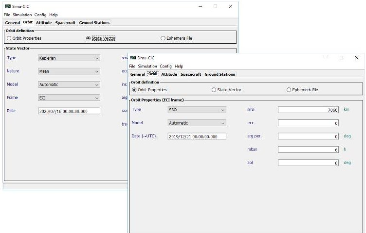

Figure 1. Orbit parameters

Ground stations can be chosen from a pre-establishe list or created by entering the geographic position the minimum elevation (Fig. 2).

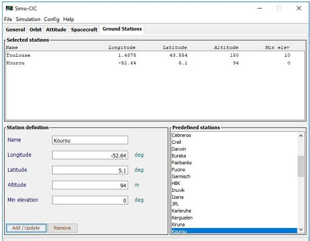

Figure 2. Selection of ground stations

<!-- PDF_PAGE: 2 -->

The geometry configuration of the satellite is stored in a list of generic nanosatellite models or standard platforms and a field of view can be described. The orientation of the solar panel is computed on the basis of predefined geometrical laws (Fig. 3).

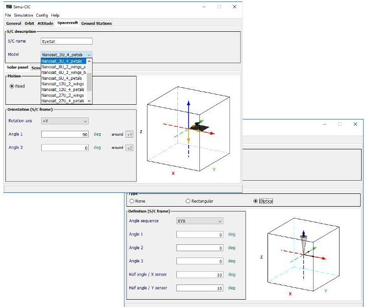

Figure 3. Spacecraft characteristics

The maximum angular velocity and maximum angular acceleration is also defined to characterized the platform.

The satellite attitude is determined by taking into account only geometrical considerations. The characterization of the attitude is done in threeps.

- description of attitude laws,

- description of elementary conditions,

- and definition of the attitude sequence.

different types of parameters such as Time, Orbit Number, Latitude, Longitude, Ground Station visibility, Eclipse... Fig. 5 presents an example with conditions on Argument of Latitude, Ground station visibility and Orbit number.

- The attitude laws are derived from a list of typical laws such as Local Orbital Frame, Inertial, Sun Pointing, Ground Station Pointing, etc... Elementary laws can also be combined. Fig. 4 presents the user interface to define these laws.

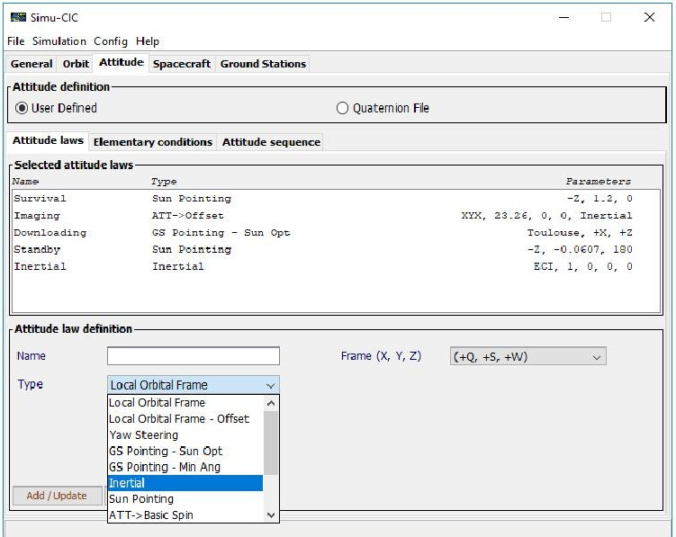

Figure 4. Attitude laws

- The elementary conditions are defined using

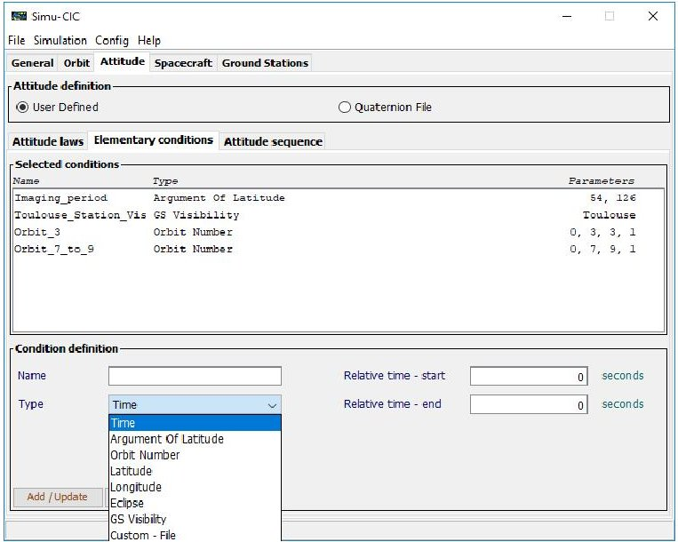

Figure 5. Elementary conditions

- The attitude sequence can then be defined by a default attitude law and a series of laws depending of conditions (Fig. 6). The priority between the conditions are managed by the order in which there are given.

The new developments allow to add a constraint to manage rallying maneuvers: by indicating "Frozen" constraint, the attitude of the satellite is impbsand the rallying maneuver is performed outside the time the described attitude.

Thus, when a user describes a station pointing mode with frozen constraint, the satellite points the ground station during all the time of visibility of the ground station.

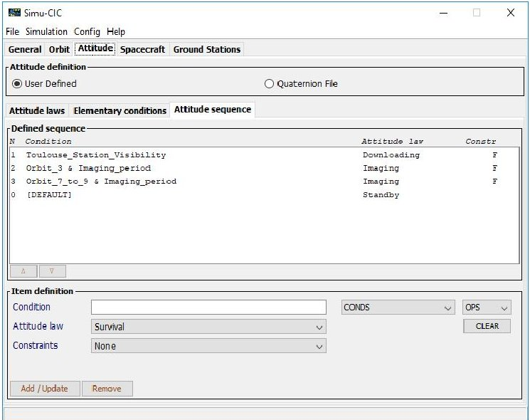

Figure 6. Attitude sequence

After defining all the parameters of the scenatic simulation is launched and results can be visualize

<!-- PDF_PAGE: 3 -->

under various plots and graphs. Fig.7 presents an example with plots of Ground track, Altitude, Sun visibility and Ground Station visibility. In addition, a set of files corresponding to the geometrical data of CIC protocol are generated.

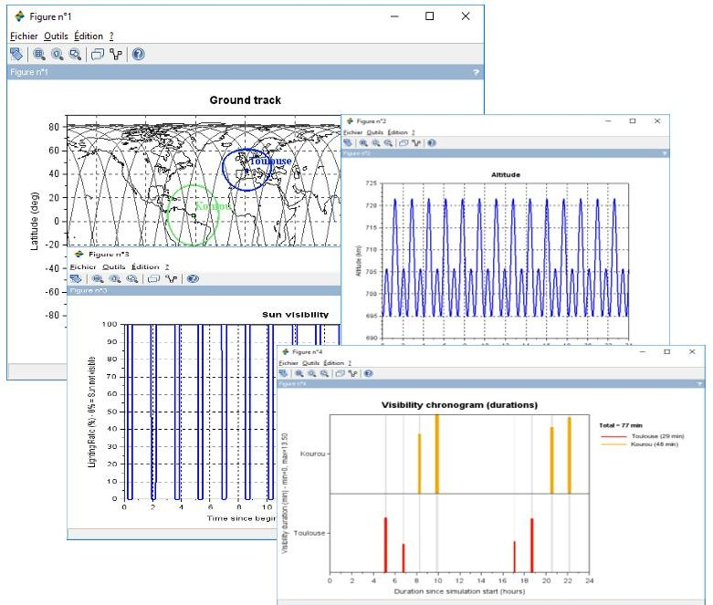

Figure 7. Plots

An integrated function is provided to start the VTS visualization application (Fig. 8) [8].

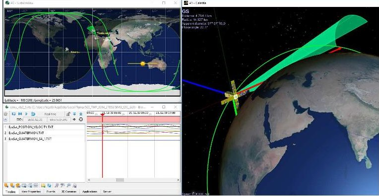

Figure 8. VTS visualization

The transfer of ephemeris files to a scenario dMID CIC is also easily done (Fig. 9) and the visualization of the satellite in orbital configuration is possi blanks to IDM View application (Fig.10).

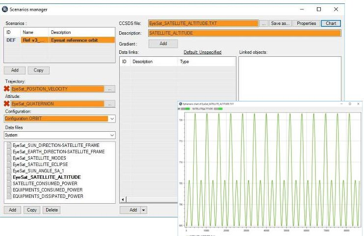

Figure 9. IDM-CIC scenario

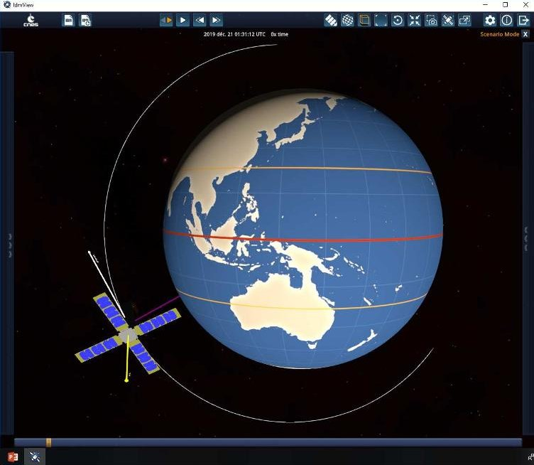

Figure 10. IDM View visualization

Finally, recent developments have added a very powerful feature allowing the use of scripts. Ioals to prepare data and process the simulation results simple Scilab scripts which use all the functions available in the CelestLab library. Fig. 11 illustrates an example of simulation and tpsl with different values of the Mean Solar Local Time the Ascending Node (MLTLAN) parameter.

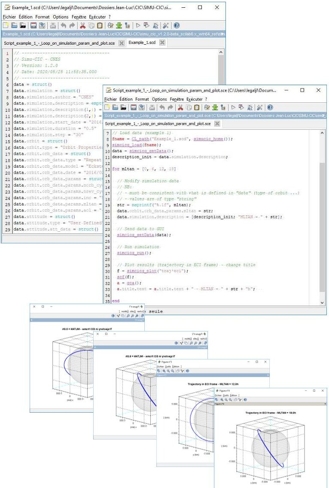

Figure 11. Script example

<!-- PDF_PAGE: 4 -->

## 2. IDM-CIC:A module to describe the Integrated Design Model of the satellite

The IDM-CIC application offers a parametric approach to set up an integrated design model of the satelli based on the ECSS-E-TM-10-25A Information model [4].

The aim of this model is to build 3D configurations perform mass and inertia budgets, to establish and dissipated power budgets and to constitute a technical reference to various engineering analysis To model the equipment, the user build 3D shapes wi assemblies of simple parametric templates. The user create topological shapes using Boolean operators (union, difference and intersection) to design more complex shapes [6] [7].

Fig. 12 presents an example of accommodation of the Pleliades satellite.

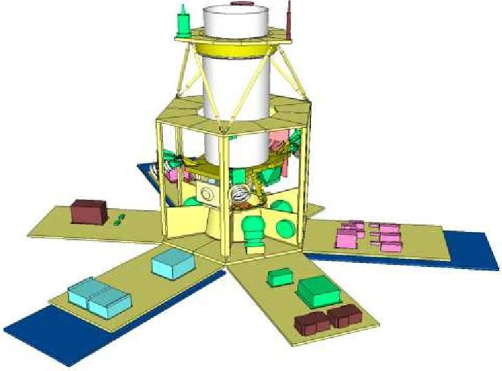

Figure 12. Satellite configuration

The version 3.4 of IDM-CIC incorporates important evolutions with a new visualization module and the ability to model new shapes based on curves.

The new visualization module is a major evolution of the software with an embedded solution of visualization which improves the quality and performances. The geometric model is displayed with presentation of names of the equipment and local coordinates.

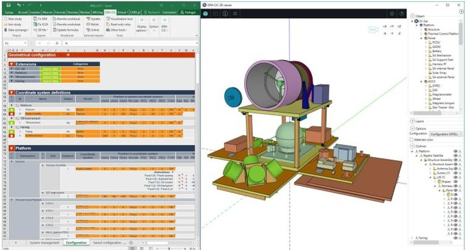

Figure 13. IDM-CIC visualization module

This new module is able to display models with CAD shapes and a function to present the articulations

animated form. Fig. 14 and 15 show the EyeSat nanosatellite and the deployment of solar panels by means of a slider.

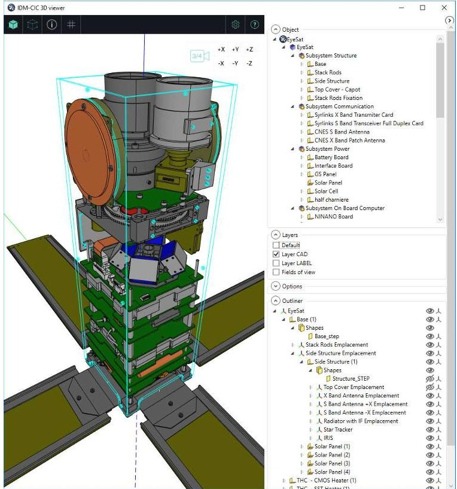

Figure 14. EyeSat nanosatellite layout

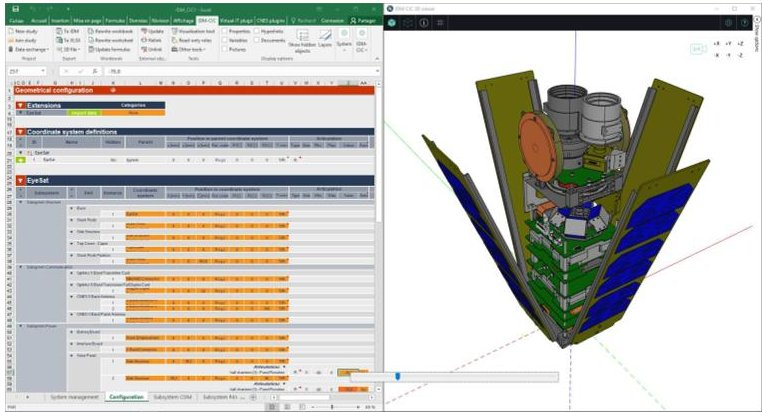

Figure 15. Solar panels deployment

New shapes have been integrated to describe curve modeling with polylines or Bezier description. This pattern is used to create pipes, surfaces or drud volume shapes. Fig. 16 presents the complete fist o primitive shapes.

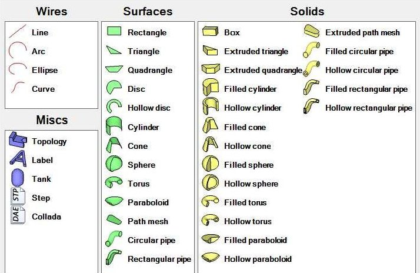

Figure 16. Primitive shapes

<!-- PDF_PAGE: 5 -->

Fig. 17 presents the user interface to describe Some examples of shapes built from these lines a shown in Fig. 18. Polylines are defined by a list of points and curvature radii defined at each angle curves are also defined by a list of points. Vectand weighting coefficients associated with each point the local tangents and allow the curvature control.

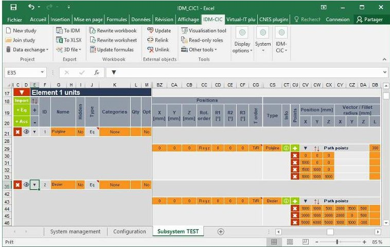

Figure 17. Curves description

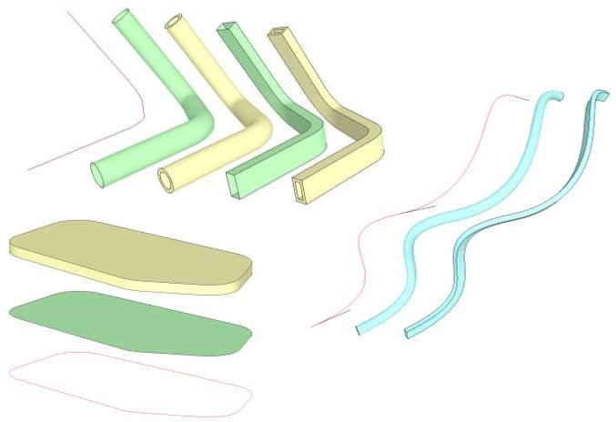

Figure 18. Shapes based on curves

These shapes are very useful for simplified modelin structure with fillets, harness, optical fiber and waveguides.

Curves are also used to define a new type of joint Equipment, assemblies or elements can thus move alo these curves. In Fig. 19 is shown a rover moving al trajectory defined by a Bezier curve.

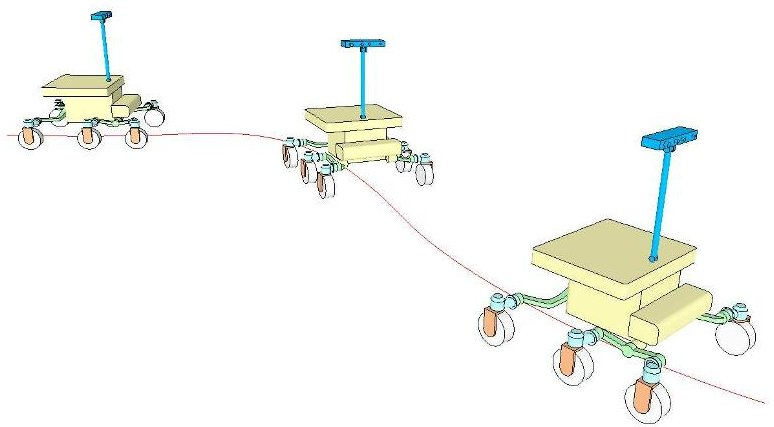

Figure 19. Rover moving along a trajectory

## 3. IDM Step Importer plugin

Developed by Virtual IT, the IDM Step Importer module offers a valuable solution to import a CAD model in an IDM model.

This possibility is highly interesting when the use complex CAD models is necessary during the design phases or during definition phases. It is then intapd to import these models into the IDM environment to manage the budgets and, in particular, the massbal in coherence with the reference geometrical configuration defined by the CAD model.

The imported model can be used as a reference to bu subsequent simplified geometric models suitable for engineering simulations.

This function is also appreciated to complete the ADC model with joints and benefit from powerful visualisation with IDM View.

Two approaches can be implemented:

- The first one consists in creating in an empty IDM model the different units from entities of the CAD model.

- The second one allows to carry out a mapping of a CAD model with the equipment and assemblies of an existing IDM model.

The following example illustrates the process by importing the STEP model presented in Fig. 20.

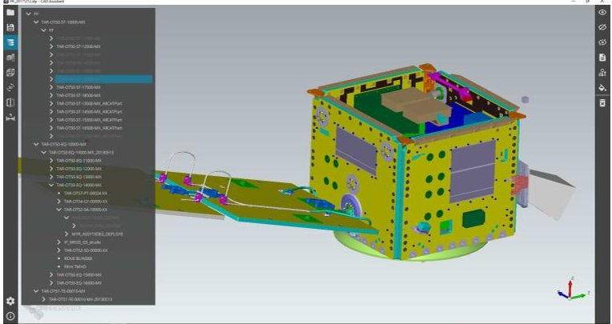

Figure 20. STEP model

The IDM model is created with the different subs and the STEP file is loaded using the IDM Step Importer plugin. The structuration of the STEP mode then displayed (Fig. 21).

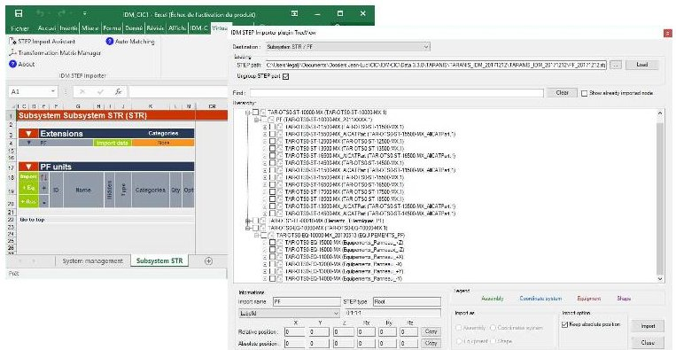

Figure 21. Structure of STEP model

<!-- PDF_PAGE: 6 -->

In the first approach, the entities are selected by choosing the desired type: Assembly, Coordinate system, Equipment or Shape (Fig. 22). This method unables to import geometry with the structure of the system engineering model in the form of assembl and subsystem equipment.

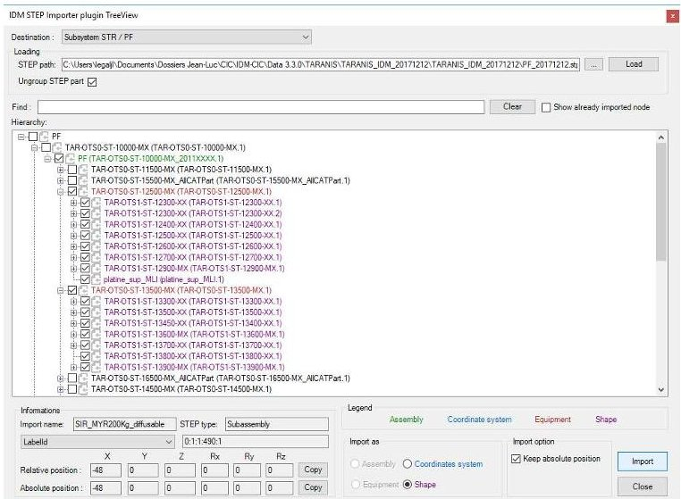

Figure 22. Structure of the IDM model

This procedure allows the creation of a set of assemblies, equipment and shapes (Fig. 23).

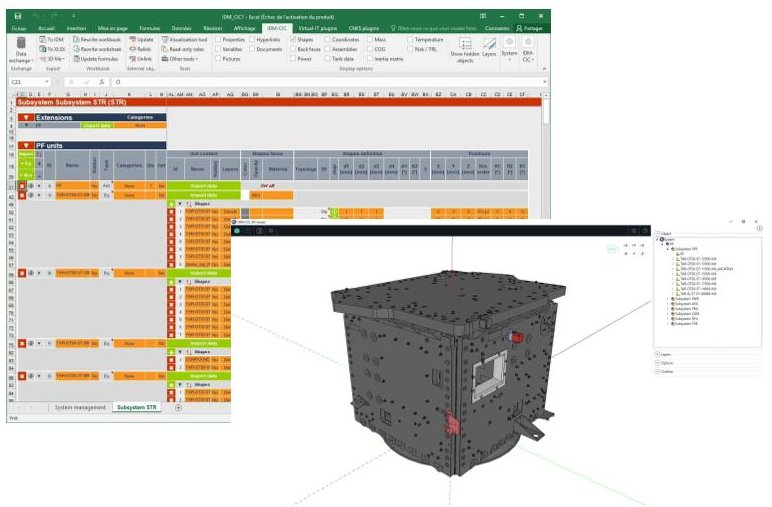

Figure 23. IDM model

The second approach is chosen to import the geometr and the positioning of existing equipment of the MID model.

In this example, the aim is to import the geometry the S-Band antenna equipment and to position it on the face of the satellite as shown in Fig. 24.

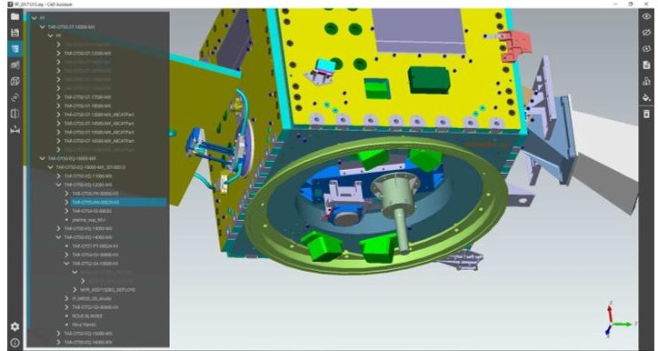

Figure 24. Position of S-Band antenna

In this case, the IDM Step Importer plugin is launched with a right click positioned on the name of the equipment in the IDM window, and the corresponding CAD entity is chosen in the displayed structure. The relative position is selected to have a description of the antenna in the frame of the equipment. Fig. 25 Figd 26 present the import process and the result of the import.

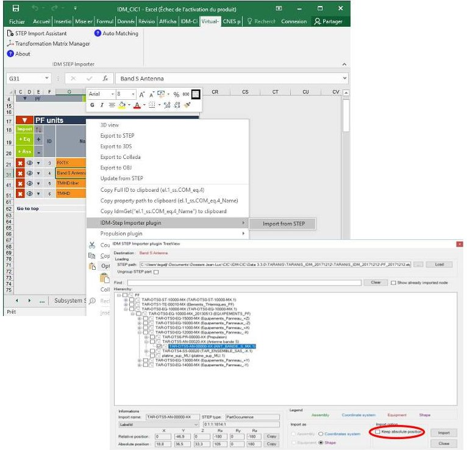

Figure 25. Import process

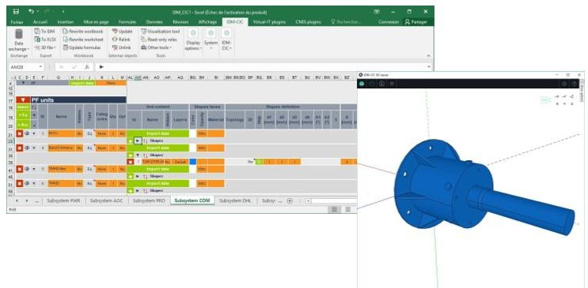

Figure 26. Imported equipment

The second step is to position the antenna on the satellite: The position of the equipment is copied pasted into the IDM configuration tab (Fig. 27).

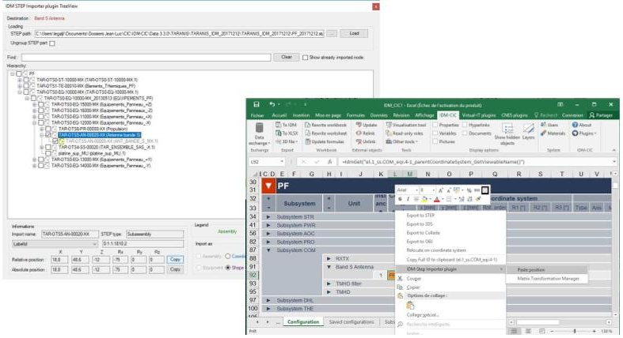

Figure 27. Copy and paste equipment position

The geometric positioning CAD matrix is then copied

<!-- PDF_PAGE: 7 -->

and the equipment is fitted in the right place (28g).

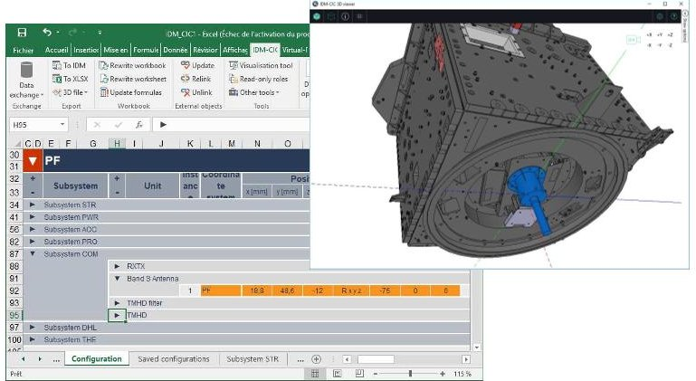

Figure 28. Equipment positioning

Import of all equipment can be done following this procedure. The final result is presented in Fig. 29

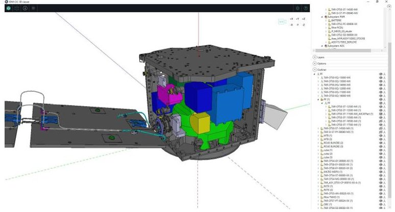

Figure 29. Platform layout

Then, the user completes the model with local coordinates and articulations which allow presen in the form of animation.

New IDM-CIC functions enable the transfer of a snap to another equipment and the change of the referenc frame of an equipment, with conservation of its position, to help the user in the model organization

Fig. 30 displays the final model of the Taranis site with its articulations.

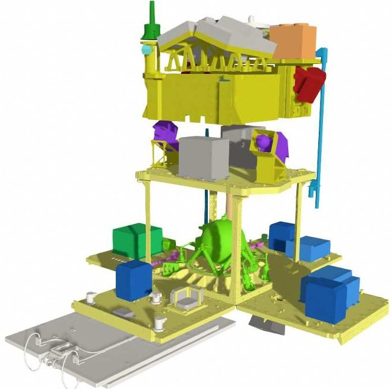

Figure 30. Taranis IDM model

## 4. IDM View

The IDM View module has been recently updated to take into account the new shapes implemented by-IDM CIC and has been optimized to load very large CAD models imported by IDM Step Importer plugin.

Management of a cache stored on the local computer avoids the complete reloading of the CAD data and, thus, optimizes the display of the model after rat fi load.

Fig. 31 presents the Angels nanosatellite built by HEMERIA company and launched in December 2019. The full CAD model was imported into IDM-CIC and the first visualization took about 15 minutes. The following loads take less than a minute.

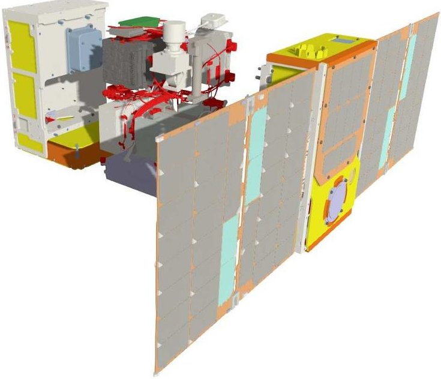

Figure 31. Angels nanosatellite

Textures have been applied to the different shapes the satellite can be represented in orbit using this produced by SIMU-CIC (Fig. 32).

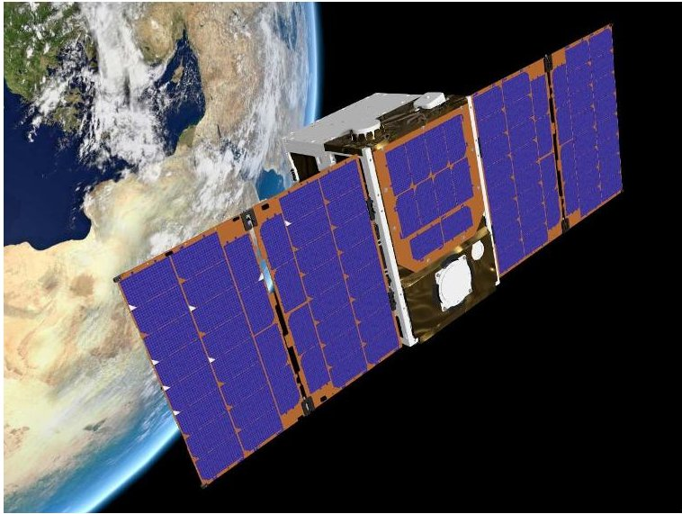

Figure 32. Angels orbit configuration

The new version of IDM View also enables the

<!-- PDF_PAGE: 8 -->

representation of several satellites in orbit (F33). Ephemeris files are managed by creating a set scenarios corresponding to the orbits of the differ satellites.

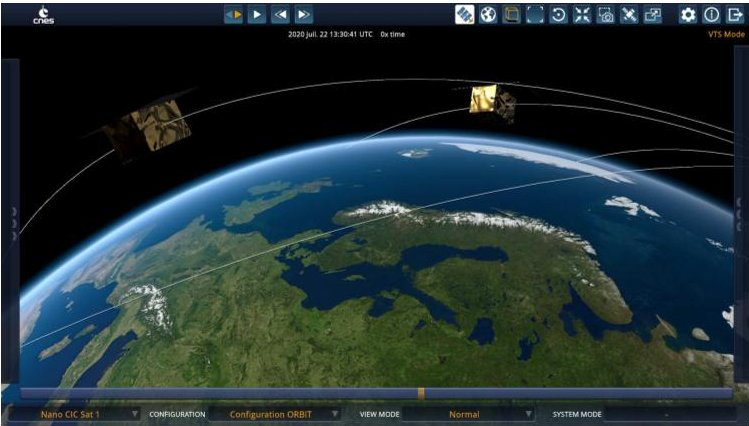

Figure 33. Satellite constellation visualization

## 5. CONCLUSION

IDM-CIC and SIMU-CIC applications allow to set up a technical reference shared by engineers all along the design phase of a space mission.

The SIMU-CIC application describes the trajectories and attitudes of the satellite for the differenarios studied. The application produces ephemeris in a standard format to describe all the data associated the mission and required for engineering analysis developments improve the description of the attitude and rallying sequences necessary for the establishment of power and link budgets. In addition, the ability using scripts offers a very powerful way to perform parametric studies.

IDM-CIC allows description of the different satellite configurations and the establishment of mass and consumed power budgets. A new 3D visualization module, integrated into the IDM environment, improves visualization quality and performances. Moreover shapes and a new articulation based on curve modeli complement 3D modeling possibilities.

Interestingly, the new IDM Step Importer plugin, developed by Virtual IT, allows the import of CAD models with the ability to adapt the structure best model to the needs of system engineering.

IDM View has been updated to take into account the new shapes and to optimize the load of very large models. Moreover, the capacity to visualize several satellites in orbit has been implemented and allows visualization of constellations.

Developed for more than a decade and used by severa hundred users, the applications offer today a devel of robustness, flexibility and a high efficiency.

This standard-based technical framework is veryuse for sharing data during collaborative design phases

for exchanges between partners in the context of of projects carried out in broad cooperation.

## 6. REFERENCES

1. CIC DATA EXCHANGE PROTOCOL V2.0, CNES June 17, 2015

2. Orbit data messages, Issue B, Rev2 CCSDS_502.0-CCSDS, November 01,2009

3. Attitude data messages, Issue B, Rev1 CCSDS_504.0-CCSDS, May 01,2008

4. ECSS-E-TM-10-25A - Engineering design model data exchange (CDF) - ECSS Technical Memoranda, ESA October 20, 2010

5. JL. Le Gal, G. Chaffarod, R. Morin, Y. Grégoire (2018), IDM Applications: a new paradigm to design parametric models in a collaborative environment. 8th International Workshop on System and Concurrent Engineering for Space Applications (SECESA 2018), Glasgow, United Kingdom, September 26-28, 2018.

6. JL. Le Gal, G. Chaffarod, R. Morin (2014), IDM CIC and IDM View: An editor and a viewer of engineering models. Poster of the 6th International Workshop on System and Concurrent Engineering for Space Applications (SECESA 2014), Stuttgart, Germany, October 8-10, 2014.

7. P. Rocha Lopes, JL. Le Gal, (2016), IDM CIC and IDM View : Concurrent engineering Tools at the service of CubeSat design. Poster of the 7th International Workshop on System and Concurrent Engineering for Space Applications (SECESA 2016), Madrid, Spain, October 5-70, 2016.

8. T. Crosnier, JL Le Gal, Q. Minster, J. Evadé, M. Joubert (2012), VTS: Visualization Tool for Space data. Poster of the 5th International Workshop on System and Concurrent Engineering for Space Applications (SECESA 2012), Lisbon, Portugal, October 17-19, 2012.