<!-- PDF_PAGE: 1 -->

# Mission to Earth-Moon Lagrange Point by a 6U CubeSat: EQUULEUS

Ryu Funase, Satoshi Ikari, Yosuke Kawabata, Shintaro Nakajima, Shunichiro Nomura, Nobuhiro Funabiki, Akihiro Ishikawa, Kota Kakihara, Shuhei Matsushita, Ryohei Takahashi, Kanta Yanagida, Daiko Mori, Yusuke Murata, Toshihiro Shibukawa, Ryo Suzumoto, Masahiro Fujiwara, Kento Tomita, Hiroki Aohama, Keidai Iiyama, Sho Ishiwata, Hirotaka Kondo, Wataru Mikuriya, Hiroto Seki, Hiroyuki Koizumi, Jun Asakawa, Keita Nishii, Akihiro Hattori, Yuji Saito, Kosei Kikuchi, Ichiro Yoshikawa, Kazuo Yoshioka, Reina Hikida, Shogo Arao, The University of Tokyo Kota Miyoshi, Yuta Kobayashi, Atsushi Tomiki, Wataru Torii, Taichi Ito, Naoya Ozaki, Nicola Baresi, Masaki Kuwabara, Hajime Yano, Toshinori Ikenaga, Tatsuaki Hashimoto, Japan Aerospace Exploration Agency Stefano Campagnola, Jet Propulsion Laboratory, California Institute of Technology

Shinsuke Abe, Ryota Fuse, Yosuke Masuda, Nihon University Masahisa Yanagisawa, The University of Electro-Communications Takayuki Hirai, Chiba Institute of Technology Kazuyoshi Arai, Ritsuko Jitsukawa, Eigo Ishioka, Haruki Nakano, Hosei University

Authors' current addresses: Ryu Funase, The University of Tokyo, Tokyo 113-8654, Japan, and Japan Aerospace Exploration Agency, Tokyo 182-8522, Japan, (e-mail: funase@space.t.u-tokyo.ac.jp). Satoshi Ikari, Yosuke Kawabata, Shintaro Nakajima, Shunichiro Nomura, Nobuhiro Funabiki, Akihiro Ishikawa, Kota Kakihara, Shuhei Matsushita, Ryohei Takahashi, Kanta Yanagida, Daiko Mori, Yusuke Murata, Toshihiro Shibukawa, Ryo Suzumoto, Masahiro Fujiwara, Kento Tomita, Hiroki Aohama, Keidai Iiyama, Sho Ishiwata, Hirotaka Kondo, Wataru Mikuriya, Hiroto Seki, Hiroyuki Koizumi, Jun Asakawa, Keita Nishii, Akihiro Hattori, Yuji Saito, Kosei Kikuchi, Ichiro Yoshikawa, Kazuo Yoshioka, Reina Hikida, Shogo Arao, The University of Tokyo, Tokyo 113-8654, Japan. Kota Miyoshi, Yuta Kobayashi, Atsushi Tomiki, Wataru Torii, Taichi Ito, Naoya Ozaki, Nicola Baresi, Masaki Kuwabara, Hajime Yano, Toshinori Ikenaga, Tatsuaki Hashimoto, Japan Aerospace Exploration Agency, Tokyo 182-8522, Japan. Stefano Campagnola, Jet Propulsion Laboratory, California Institute of Technology, Pasadena, CA 91109 USA. Shinsuke Abe, Ryota Fuse, Yosuke Masuda, Nihon University, Tokyo 102-8275, Japan. Masahisa Yanagisawa, The University of Electro-Communications, Tokyo 182-8585, Japan. Takayuki Hirai, Chiba Institute of Technology, Chiba Narashino 2750016, Japan. Kazuyoshi Arai, Ritsuko Jitsukawa, Eigo Ishioka, Haruki Nakano, Hosei University, Tokyo 102-8160, Japan. Manuscript received April 2, 2019, revised October 9, 2019; accepted October 9, 2019, and ready for publication November 21, 2019. Review handled by P. W. Kinman.

## INTRODUCTION

In the 2000s, a number of private companies and universities started to build their own nanosatellites (1-10 kg) and micro-satellites ( $ \sim 50 $ kg) by utilizing miniaturized commercial off-the-shelf (COTS) technologies, and now they are taking a certain role in space development. However, most of them are low-earth orbit missions, and deep space exploration that travels beyond the Earth's gravity is still performed by large spacecraft developed by national space agencies. As the first step towards launching a small deepspace probe by a non-governmental institution, the University of Tokyo developed and launched the 50-kg-class deep space exploration microspacecraft PROCYON (PRoximate Object Close flYby with Optical Navigation) with the cooperation of JAXA (Japan Aerospace Exploration Agency) in December 2014. PROCYON became the world's smallest full-scale deep space probe with its own propulsion and deep-space communication capabilities. During its one-year flight in deep space [1], PROCYON succeeded in its primary mission (the demonstration of a 50-kg-class deep-space exploration bus system) [2], [3], and also achieved some of its optional missions, which were the demonstration of advanced deep-space exploration technologies and scientific observations [4], [5].

<!-- PDF_PAGE: 2 -->

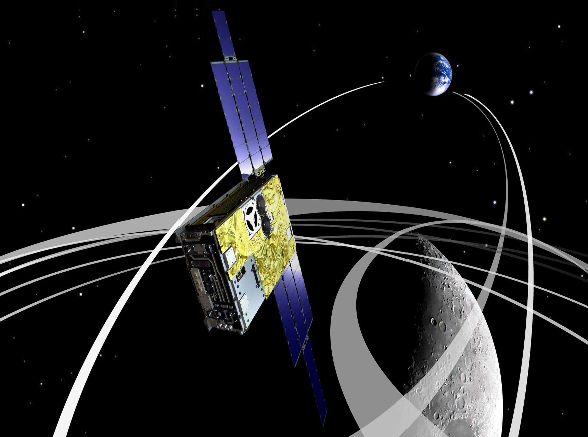

These successes demonstrated the capability of ultrasmall spacecraft for performing a deep space mission by itself, and also demonstrated that they can be a useful tool for deep space exploration. Since that time, the size of deep space probes has reduced considerably, and the world's first deep-space CubeSat "MarCO" was successfully launched in 2018 together with the "InSight" Mars mission [6]. Currently, an increasing number of small deep-space missions are being planned all over the world, and a large number of CubeSats will fly as secondary payloads onboard the first flight of NASA's SLS (Space Launch System) in 2020. SLS is NASA's next-generation heavy launch vehicle to carry astronauts beyond Earth's orbit to an asteroid and eventually to Mars. The first flight, called "EM-1" (Exploration Mission-1) will accommodate thirteen 6U CubeSats in a lunar flyby trajectory, whose size are approximately 10 cm $ \times $ 20 cm $ \times $ 30 cm, and weigh less than 14 kg each. JAXA and the University of Tokyo will jointly provide a 6U CubeSat named EQUULEUS (EQUilibriUm Lunar-Earth point 6U Spacecraft). EQUULEUS was developed using the heritage from PROCYON as well as a number of Earth-orbiting CubeSats and micro-satellites orbited by Japan. This article describes its missions, system design, and operation plan.

## ENGINEERING MISSION: TRAJECTORY CONTROL EXPERIMENT WITHIN SUN-EARTH-MOON REGION

EQUULEUS' primary mission is a trajectory control experiment, and its objective is to develop and demonstrate astrodynamics techniques for CubeSat missions to reach an Earth-Moon libration orbit, which is a key aspect of future deep-space human exploration. EQUULUES will exploit luni-solar perturbations like other CubeSats in EM-1, such as Lunar IceCube [7] and Lunar Polar Hydrogen Mapper [8].

Trajectories to libration orbits have been researched extensively, yet the only spacecraft to have ever reached lunar libration orbits is the ARTEMIS [9] spacecraft. While much can be learned from that experience, EQUULEUS has its own set of challenges and constraints, more typical of a CubeSat mission. EQUULEUS has limited thrust, propellant, and ground station availability, and cannot control the launch conditions or initial time for the orbital transfer. The launch geometry relative to the Sun-Earth-Moon system is also expected to vary during the launch period, which may require the design of different nominal trajectories for each possible launch day. The trajectory is largely affected by the uncertainties in spacecraft state-knowledge and maneuver execution, and by

<!-- PDF_PAGE: 3 -->

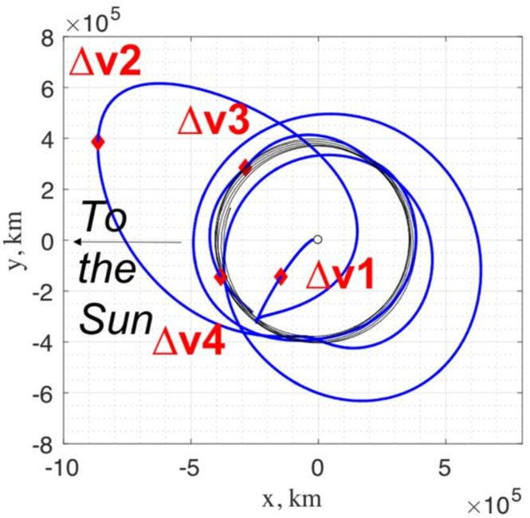

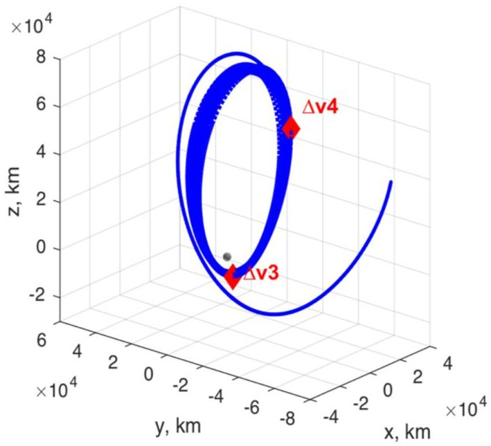

Figure 1. Left: notional EQUULEUS trajectory in the Sun-Earth rotating frame. Right: arrival and science orbit in the Earth-Moon rotating frame.

tight operational constraints. Most of these uncertainties and variables will not be known until shortly before launch; hence, the trajectory and trajectory design approach need to be robust against changes and errors. The orbit control experiment defines a new mission-design framework, where the trajectory is split into "tasks," each with a unique set of goals and constraints. The tasks produce databases of trajectory legs, which are then filtered and patched together.

The EQUULEUS mission phases are shown in Figure 1 for a notional trajectory with launch in 2018. Shortly after separation from the launch vehicle, EQUULEUS will perform a critical deterministic maneuver (DV1) of approximately 6 m/s to increase the lunar flyby altitude and to remain in the vicinity of the Earth-Moon system (while the upper-stage continues on to an Earth-escape orbital trajectory). Following the first lunar flyby (LFB1), smaller deterministic maneuvers and other LFBs will be used to reach a libration orbit around the Earth-Moon L2 point. Finally, shortly before depletion of the onboard propellant, the spacecraft will leave the orbit for space debris compliance, or spacecraft disposal. The trajectory will be computed in a high-fidelity model, which includes spherical harmonics of Earth and Moon, however solar radiation pressure is not included. The trajectory will exploit solar gravity perturbations to reduce its initially high energy relative to the Moon, and will finally be captured into a quasiperiodic orbit; yet the transfer does not appear to shadow manifolds of Halo orbits of the Sun-Earth CR3BP, as seen in ARTEMIS. In fact, low-energy transfers in the Sun-Earth-Moon system occur for some specific geometries, which might not be met by EQUULEUS, depending upon the given launch. Furthermore, the limited DV and thrust capabilities reduce the orbit-control capabilities of the first DV1, and subsequently the set of post-LFB1 orbits that can be targeted.

Full success in EQUULEUS will be achieved when the spacecraft executes the first critical week of operation, and is capable of retargeting a second lunar flyby. During the Moon-to-Moon transfer, Earth-plasmasphere observations will be carried out. The DV required for full success is 40 m/s, including stochastic maneuvers (3 sigma). Increasing levels of success will be achieved with multiple lunar flybys, transfer to lunar L2, and additional months of scientific observation in the libration orbit. Figure 2 shows the cumulative DV used during the mission, together with the current available budget of 77 m/s.

## SCIENCE MISSION 1: OBSERVATION OF EARTH'S PLASMASPHERE BY PHOENIX

EQUULEUS carries three scientific observation missions which will be conducted utilizing the flight environment until and after the spacecraft reaches EML2. One of these science missions is to observe Earth's plasmasphere, which will be conducted by a small telescope named PHOENIX (Plasmaspheric Helium ion Observation by Enhanced New Imager in eXtreme ultraviolet). At a great distance from Earth, PHOENIX will observe the whole view of the large structure of $ \mathrm{He}^{+} $ in the Earth's plasmasphere using the extreme ultraviolet emission from $ \mathrm{He}^{+} $ This observation will contribute to a better understanding of the physical process governing the terrestrial plasmas of the Earth. As a result, we can improve our understanding of the radiation environment around the Earth, which is one of the critical issues for future human cis-lunar exploration. PHOENIX will also observe the structure of plasmas surrounding the Earth with respect to the Earth's magnetic field, which will lead to the understanding of the escape process of the Earth's atmosphere from the polar

<!-- PDF_PAGE: 4 -->

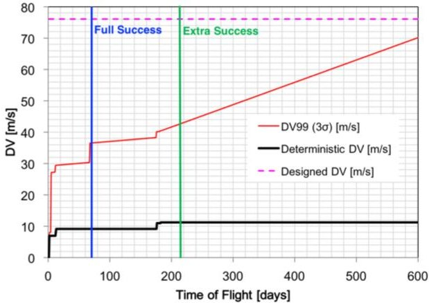

Figure 2.

DV requirement and success criteria for the notional baseline.

regions. It may also lead to an enhanced understanding of the evolution of the atmosphere of the Earth and Earthlike planets. The observation will be conducted throughout all mission phases, and will enhance the geospace in situ observation conducted by the ERG (JAXA's small space science mission launched in 2016) and NASA's Van Allen probe missions.

Figure 3 shows the optical schematics of the PHOENIX, which consists of an entrance mirror, metallic thin filter, photon counting device, and electronics parts. By flying far from the Earth, an image of the entire plasmasphere can be obtained in a single frame with a spatial resolution of 0.1 $ R_{\mathrm{E}} $ The surface of the entrance mirror is coated by 30 sets of alternating SiC and Mg layers. The effect of interference enhances the reflectance at the wavelength of 30.4 nm and eliminates possible contamination from the other sources such as H (121.6 nm) and He (58.4 nm). After the entrance mirror, a metallic thin filter made of C/Al/C further eliminates signal contamination. Next, the three-staged microchannel plates (MCP) convert the incoming photons into electron clouds. A high voltage (around $ -2.5 $ kV) is applied to generate an electron avalanche and to obtain sufficient gain. The electron clouds are collected onto the resistive anode with three channels. The position of the incoming light can be calculated from the relative gain between three corners. This method was used in the several former

Table 1.

Specification of the PHOENIX

<table border="1"><tr><td>Total mass</td><td>0.54kg</td></tr><tr><td>Dimensions</td><td>70mm×70mm×100mm</td></tr><tr><td>Power</td><td>1.8W(maximum)</td></tr><tr><td>Field of view</td><td>8deg.×8deg.(8R_{E}×8R_{E})</td></tr><tr><td>Spatial resolution(plate scale)</td><td>&lt;0.1deg.(0.1R_{E})</td></tr><tr><td>Count rate</td><td>3count/min/pix/Rayleigh</td></tr></table>

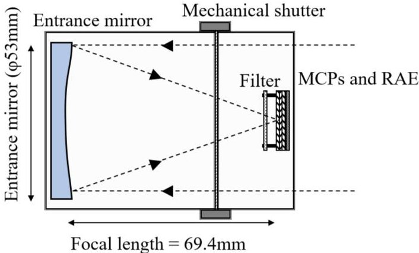

Figure 3.

Optical schematics of the PHOENIX.

missions such as TEX on KAGUYA, IMAP on ISS, and EXCEED on Hisaki [10]-[12]. In this PHOENIX mission, a mechanical shutter is attached to prevent the ingress of direct solar light. The total mass of the PHOENIX is around 540 g, and its power consumption during observation is 1.8 W. Its specification is summarized in Table 1.

## SCIENCE MISSION 2: LUNAR IMPACT FLASH OBSERVATION BY DELPHINUS

The second science mission is the observation of lunar impact flashes by an instrument named DELPHINUS (DEtection camera for Lunar impact PHenomena IN 6U Spacecraft). DELPHINUS will monitor the far side of the moon from EML2 to detect the flashes of light emitted by high-velocity meteoroids that impact on the moon surface. This observation will characterize the flux of impacting meteors, and the results will contribute to risk evaluation for future human activity and/or infrastructure on the lunar surface.

Figure 4 shows the actual flight hardware of DELPHINUS. DELPHINUS has an image processing board to detect lunar impact phenomena with a duration of 10 s of milliseconds. This image processing board has an FPGA to realize real-time image processing as fast as 60 f/s. The design of this image processing unit for DELPHINUS mission is based on that of the image feedback control unit for the asteroid detection telescope for PROCYON [13]. DELPHINUS has two cameras with the same field-of-view, in order to avoid the false-detection due mainly to electrical noises and cosmic rays. Table 2 shows the specifications of the observation by DELPHINUS.

## SCIENCE MISSION 3: MICROMETEOROID FLUX MEASUREMENT IN THE CIS-LUNAR REGION BY CLOTH

The third science mission is the observation of the micrometeoroids environment by an "instrument" named CLOTH (Cis-Lunar Object detector within THermal

<!-- PDF_PAGE: 5 -->

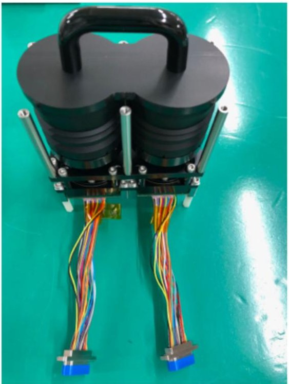

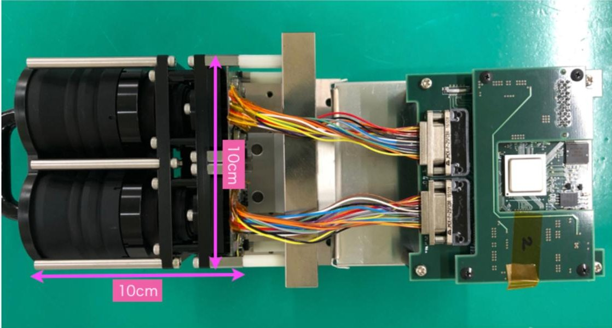

Figure 4. Flight hardware of DELPHINUS. Top: the optics (lens and CCD sensors) with a cover (non-flight item). Bottom: the whole DELPHINUS system with the FPGA image processing board.

insulation). CLOTH will detect and evaluate the impact flux of micrometeoroid around the cis-lunar region by using piezoelectric dust-impact detectors onboard the spacecraft. The primary goal of this mission is to provide the first insight of spatial distribution of sub-mm solid objects in the cis-lunar space, which will complement DELPHINUS' optical observation of lunar impact flashes by cm-order solid objects. By combining results of both CLOTH and DELPHINUS, we will learn spatial distribution and temporal variation of solid objects in the cis-lunar space from microns to 10's of cm orders, which will benefit both solar system science and risk assessment of human exploration of the Moon in the future.

In general, a statistically valid detection of microparticle impacts requires a large sensor area. On the contrary, a dedicated dust detector that occupies a large portion of a

total surface area of a spacecraft exterior seems unfeasible for very limited resources available in size and mass of a CubeSat. Thus, we have resolved this contradiction by introducing a new concept of a "smart MLI," which integrates thin-film dust detectors (PVDF piezoelectric films) into inside of the spacecraft's thermal blanket, MLI (multilayer insulation) (see Figure 5). To demonstrate the new concept of the MLI with momentum sensing capability for the first time in space is the secondary goal of this mission, which will potentially game change meteoroid and space debris monitoring in space, since this technology will enable any satellites/spacecraft in any orbits to detect dust impacts as house-keeping data of the MLI exterior.

As a microparticle impacts onto the CLOTH at hypervelocity speed, detection signals from the PVDF film sensors (CLOTH-S) (see Figure 6) immediately underneath the top-

<!-- PDF_PAGE: 6 -->

Table 2.

<table border="1"><tr><td>Pixel number</td><td>659(H)×494(V)</td></tr><tr><td>Pixel size</td><td>7.4μm(H)×7.4μm(V)</td></tr><tr><td>Lens</td><td>f=50mm,F1.4</td></tr><tr><td>Wavelength</td><td>400-800nm</td></tr><tr><td>Frame rate</td><td>60 frames/sec</td></tr><tr><td>Limiting magnitude</td><td>5.5Vmag(S/N=2)for field stars4.0Vmag(S/N=5)for lunar impact flash(18dB,60fps)</td></tr><tr><td>Power consumption</td><td>0.8W</td></tr><tr><td>Dimensions(optics only)</td><td>100mm(W)×50mm(D)×100mm(H)</td></tr><tr><td>Mass(optics only)</td><td>572g</td></tr></table>

layer MLI are processed in its electronics board (CLOTH-E) (see Figure 7) and the instrument records impact time and signal curves as clues of impact momentum and velocity ranges. The design of CLOTH-E is based on the ALADDIN [14], [15] onboard the IKAROS solar sail demonstration mission. Table 3 shows the specifications of the dust detectors.

## SPACECRAFT SYSTEM DESIGN AND KEY TECHNOLOGIES

Figure 8 shows the external view of EQUULEUS. EQUULEUS has a 6U CubeSat body (about 11 cm $ \times $ 24 cm $ \times $

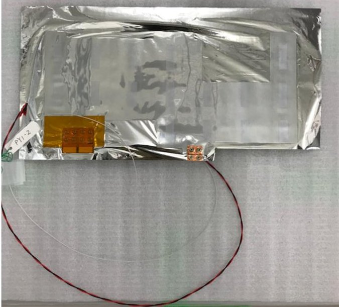

Figure 6. PVDF film sensor (PY1) integrated inside CLOTH-S.

37 cm) with two wings of gimbaled solar array paddles (SAPs). Figure 9 shows the internal configuration of the spacecraft. Table 4 shows the general specifications of the spacecraft. As described in this article, most of the spacecraft components utilize COTS parts, or are designed based on the experiences of various past space missions, except for the water resistojet propulsion system.

## WATER RESISTOJET PROPULSION SYSTEM: AQUARIUS

One of the novel technologies installed in EQUULEUS is its newly developed propulsion system. The propulsion system uses water propellant resistojet thrusters and is designated as AQUARIUS (AQUA ResIstjet propUlsion

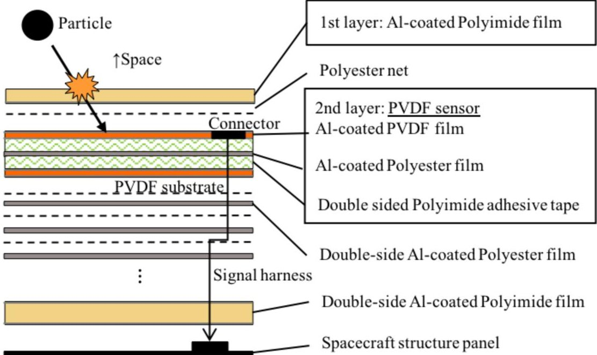

Figure 5. Multilayered structure of the dust detector (CLOTH-S).

<!-- PDF_PAGE: 7 -->

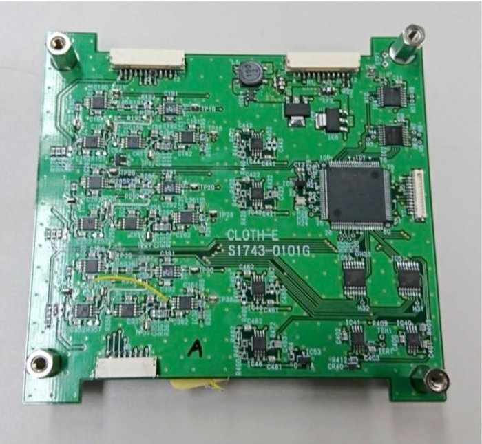

Figure 7. Electronics board of CLOTH (Engineering Model).

System) [16]. A conventional water resistojet thruster [17] conducts liquid vaporization and vapor heating to high temperature in a single cavity integrated with a nozzle. It enables a compact thruster system, but suffers from complicated two-phase flow physics and heat loss to the surrounding components. In contrast, AQUARIUS separates the two processes and conducts the vaporization at low temperature. This separation significantly

Table 3.

<table border="1"><tr><td colspan="2">Specifications of CLOTH</td></tr><tr><td>Power consumption</td><td>&lt;1W</td></tr><tr><td>Mass</td><td>31g(CLOTH-S),34g(CLOTH-E)</td></tr><tr><td>Total sensitive area</td><td>439cm2</td></tr><tr><td>Detectable dust size range</td><td>&gt;4μm at&gt;~10km/s</td></tr><tr><td>PVDF film thickness</td><td>20μm</td></tr><tr><td>PVDF aging temperature</td><td>+80℃</td></tr></table>

simplifies the physics and increases the reliability of the system. Although our system requires an additional cavity dedicated to vaporization, the cavity will be shared by multiple thrusters and will make the structure of the thruster heads simpler, minimizing the additional resources required.

AQUARIUS is composed of three elements; a water tank, a vaporization chamber, and thruster heads. The system diagram is shown in Figure 10(a). Water is stored inside the water tank [see Figure 10(b)] in the liquid phase with a pressure of less than 1 atm. Regulation valves connect the water tank and the vaporization chamber, and

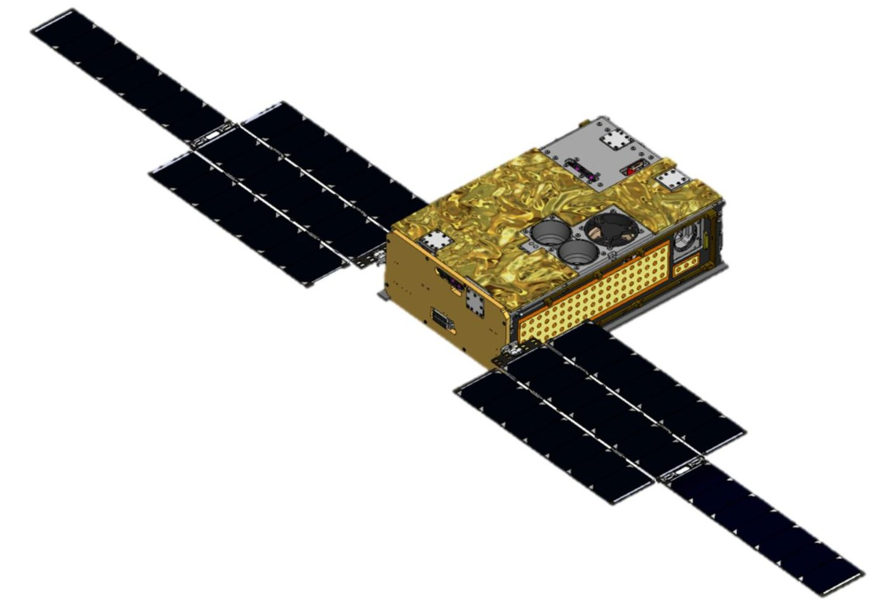

Figure 8. External view of EQUULEUS.

<!-- PDF_PAGE: 8 -->

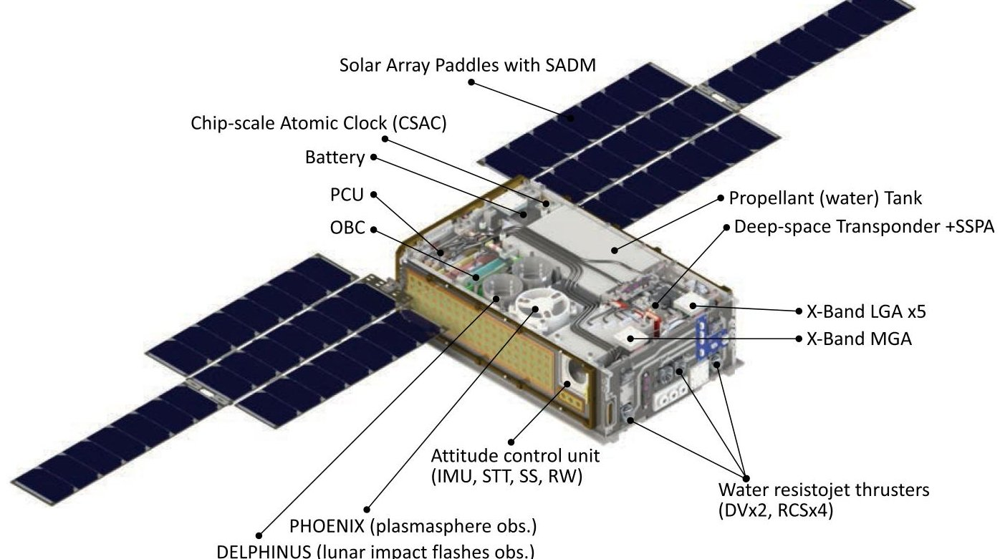

Figure 9. Internal configuration of EQUULEUS.

they are opened periodically to inject liquid water into the vaporization chamber, which works as an evaporator and a gas-liquid separator simultaneously. Pressure inside the vaporization chamber is about 2-3 kPa, corresponding to the vapor pressure of water at 20-30 $ ^{\circ} \mathrm{C} $ . The vaporized

water flows through the thruster valves and connecting tubes to the thruster heads, and generates thrust through a nozzle.

The water tank is made of aluminum (A5052) and has an internal bladder that stores approximately 1200 g of

Table 4.

<table border="1"><tr><td colspan="3">Specification of EQUULEUS</td></tr><tr><td>Structure</td><td>Size</td><td>6U, with two wings of SAPs (with gimbaling)</td></tr><tr><td></td><td>Weight</td><td>11kg</td></tr><tr><td>Power</td><td>SAP</td><td>50W@1AU(BOL)</td></tr><tr><td></td><td>BAT</td><td>35W·h</td></tr><tr><td>ADCS</td><td>Actuator</td><td>Reaction Wheel×3</td></tr><tr><td></td><td>Sensor</td><td>Star Tracker×1,Sun Aspect Sensor×4,3-axis MEMS gyro×1</td></tr><tr><td></td><td>Performance</td><td>&lt;0.02° pointing accuracy</td></tr><tr><td>Propulsion</td><td>Thrusters</td><td>RCS thruster×4(angular momentum desaturation),DVT×2(orbital maneuver)</td></tr><tr><td></td><td>Propellant</td><td>1.22kgH2O(water)</td></tr><tr><td></td><td>Performance</td><td>4mN(DVT),70sIsp</td></tr><tr><td>Communication</td><td>Frequency</td><td>X-band</td></tr><tr><td></td><td>Antenna</td><td>MGA×1(downlink),LGA×5(downlink),LGA×2(uplink)</td></tr><tr><td></td><td>Orbit determination</td><td>Range and Range Rate,DDOR(Delta VLBI)</td></tr><tr><td></td><td>Performance</td><td>1WRFoutput,64kbpsat1.5Mkm(byMGA)</td></tr></table>

<!-- PDF_PAGE: 9 -->

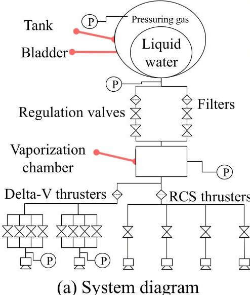

(a) System diagram

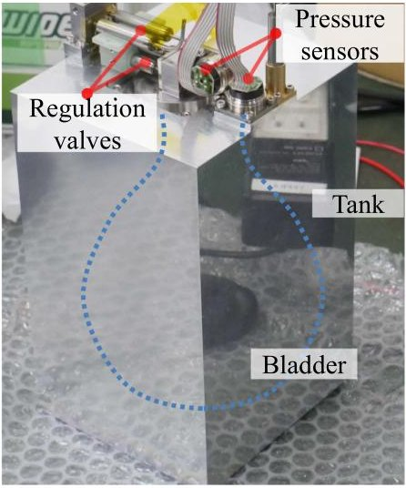

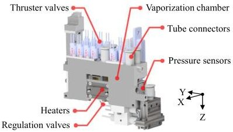

(b) Tank

(c) Vaporization Chamber

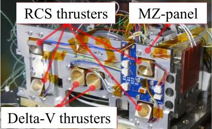

(d) Thruster-Heads

Figure 10. Water resistojet thruster system AQUARIUS. (a) System diagram. (b) Tank. (c) Vaporization chamber. (d) Thruster-heads.

water. The bladder is a commercially available product that has flight heritage by other micro-satellites. The bladder is squeezed by argon gas, which fills the space between the tank wall and the bladder at 50 kPa. The tank is equipped with two pressure sensors that are used to estimate the injected propellant mass.

The vaporization chamber is made of AlSi10Mg, with a size of 30 mm $ \times $ 78 mm $ \times $ 38 mm; a schematic is shown in Figure 10(c). The chamber is composed of a cavity for vaporization, three heaters to compensate for the vaporization heat, and labyrinth flow paths for gas-liquid separation. The cavity and flow paths are fabricated by additive manufacturing and the heaters (micro-aluminum nitride heaters) are attached around the cavity. Liquid water is injected from the regulation valves then evaporated inside the chamber at a standard temperature. Vapor flows from the cavity to each nozzle by actuating the corresponding thruster valves. X-band transponder (XTRP) is attached to the vaporization chamber in order to utilize its waste heat and save heater input energy for the propulsion system. Two pressure sensors and two temperature sensors are mounted on the chamber to control the heaters and regulation valves.

The six thruster-heads are divided into two types of thrusters: Delta-V thruster (DVT) and reaction control system thruster (RCT), as shown in Figure 10(d). Each thruster consists of a thermal insulator, a heater, and a nozzle. The heater is wrapped around the nozzle to warm the in-flowing gas to about 100 $ ^{\circ} \mathrm{C} $ . The insulator thermally decouples the nozzle from the spacecraft structure so that the heat input from the heater is effectively used to heat up the gas flow. Table 5 summarizes the specifications of the DVT and RCT nozzles. The nozzle of the RCT has a cant angle for attitude control (angular momentum desaturation).

## TELECOMMUNICATION SYSTEM

JAXA and the University of Tokyo succeeded in conducting deep-space, X-band coherent (749/880) two-way telecommunication and ranging in the 50-kg-class deepspace probe, PROCYON, for the first time [18] [20]. In the EQUULEUS mission, we effectively utilized these achievements, based on COTS products of low cost and having reasonable reliability. Since the requirements were significantly different for the PROCYON (50-kg class) versus the EQUULEUS (6U CubeSat), we had to achieve further downsizing, weight savings, and power reduction. However, regardless of the spacecraft size, realizing the appropriate equivalent isotropic radiated power (EIRP) as well as making the receiver threshold sufficiently low is indispensable for ultra-long-distance communications in deep space. Therefore, a balanced design considering the telecommunication capability, physical constraints, reliability, and cost are of great importance in the development of a telecommunications system for 6U CubeSats [18].

As is shown in Figure 11, command, telemetry, and ranging link in X-band with deep-space stations including Usuda 64 m (UDSC), Uchinoura 34 m (USC), and the deep space network (DSN) are the core telecommunications system in the EQUULEUS mission. Figure 12 and Table 6, respectively, show a block diagram and the specifications of the onboard telecommunications system. As shown in Figure 12, the telecommunications system consists of an XTRP including a transmitter (XTX), a receiver (XRX), and digital signal processor (DSP) modules, a switch (XSW), transmitting low-pass filters (XTXLPF), a receiving band-pass filter (XRXBPF), a hybrid (XHYB), a medium-gain antenna (XMGA), transmitting low-gain antennas (XTXLGA), receiving low-gain antennas

<!-- PDF_PAGE: 10 -->

Table 5.

Specifications of the DVT and RCT

<table border="1"><tr><td></td><td>DVT</td><td>RCT</td></tr><tr><td>Thrust level(mN)</td><td>4.0</td><td>1.2</td></tr><tr><td>Throat diameter(mm)</td><td>2.6</td><td>1.2</td></tr><tr><td>Nozzle expansion ratio</td><td>48</td><td>149</td></tr><tr><td>Convergent angle(°)</td><td>30</td><td>30</td></tr><tr><td>Divergent angle(°)</td><td>30</td><td>30</td></tr><tr><td>Cant angle(°)</td><td>-</td><td>30</td></tr></table>

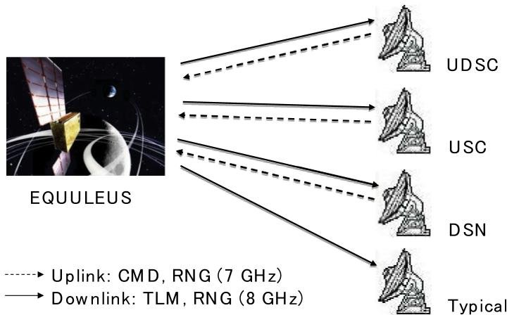

Telecommunications and ground system overview in the EQUULEUS mission.

(XRXLGA), and a chip-scale atomic clock as an ultrastable oscillator (USO). The XTRP has an extended capability port to transmit a Ka-band telemetry signal, although this was not adopted in the EQUULEUS mission due to limited resources.

For downsizing and weight-saving, surface-mount devices, SMPM connectors, and micro D metal shell (MDM) connectors were adopted in spite of the fact that they might increase transmission loss. To enhance the flexibility of the CubeSat's whole-system design, especially for heat dissipation, the telecommunications system was designed to be separable by function, i.e., XTX, XRX, DSP, etc. We adopted a gallium nitride (GaN) high-electron mobility transistor (HEMT) as the final-stage amplification device in the XTX so that we could achieve low power consumption and high EIRP simultaneously.

Different from ordinary space probes, it is quite difficult for 6U CubeSats to support transmitting and receiving antennas separated by enough distance. Thus, the receiver threshold can be degraded by insufficient isolation between these antennas. To solve this issue, a 4-pole cavity-type band-pass filter was adopted for the XRXBPF. Although the cavity-type filter was not easily downsized, excellent out-band attenuation and low transmitting loss characteristics were more significant for the realization of ultra-long-distance communication. The USO was expected to reduce the amount of time required to establish two-way operation owing to its high-frequency stability characteristics. This would be very important for secondary payloads having insufficient operation time.

Based on these balanced design policies, the fabricated telecommunications system achieved downsizing (<0.5 U (XTRP)) , weight-savings (<0.75 kg excluding RF harness), low power consumption (<13 W (high power mode)) , high output power (>1 W), and low receiver threshold (<-150 dBm). We expected that it would succeed in conducting two-way telecommunication and ranging by the 6U CubeSat in lunar and deep-space regions. Figure 13 shows the command and telemetry link margin calculation results in case typical Japanese deep space ground station is used.

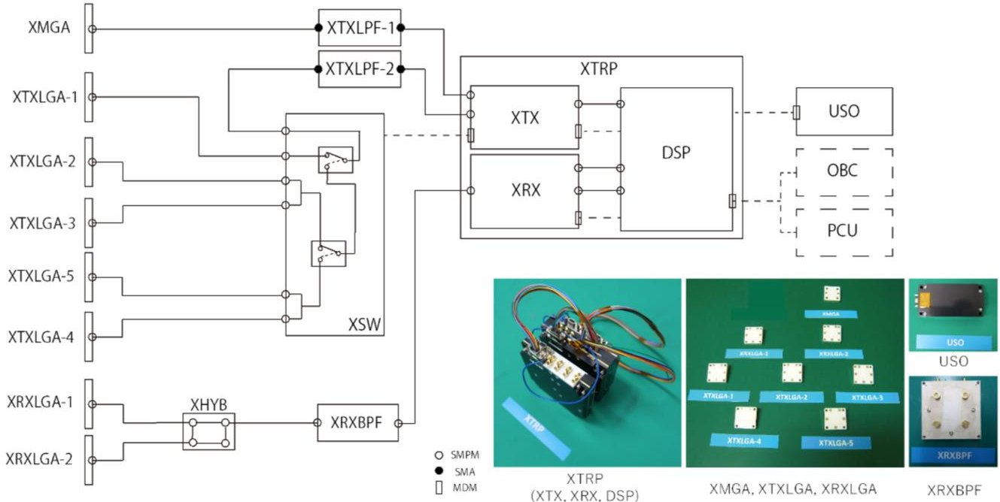

Figure 12. Block diagram and external view of the onboard telecommunication system in the EQUULEUS mission.

<!-- PDF_PAGE: 11 -->

Table 6.

<table border="1"><tr><td>Item</td><td>Value</td></tr><tr><td>Frequency</td><td>X-band(Category-B),Uplink:7.1GHz,Downlink:8.4GHz,Coherent ratio:749/880</td></tr><tr><td>Output power</td><td>High-power mode:1W,low-power mode:20mW</td></tr><tr><td>Carrier threshold level</td><td>-150dBm</td></tr><tr><td>Command bitrate</td><td>15.625bps,125bps,1kbps</td></tr><tr><td>Telemetry bitrate</td><td>8bps-32.768kbps(PCM/PSK/PM),32.768kbps-262.144kbps(PCM/PM)</td></tr><tr><td>Ranging scheme</td><td>Two-way range and two-way Doppler,DDOR(DeltaVLBI)</td></tr><tr><td>Ground station</td><td>UDSC64,USC34,DSN</td></tr><tr><td>Total mass</td><td>0.75kg(excluding harness)</td></tr><tr><td>Total power consumption</td><td>13W(two-way:high-powermode),8W(two-way:low-powermode),5.6W(receiving-only),0.3W(USOON)</td></tr></table>

## COMMAND AND DATA HANDLING (C&DH) SYSTEM

The data handling with the ground or between the components inside the spacecraft is controlled by the on-board

Command link margin (XRXLGA-2, 125bps, 1.2rad)

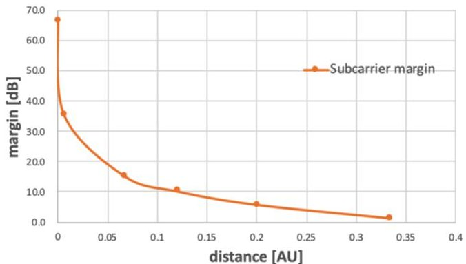

Telemetry link margin (XMGA, 1kbps, 1.2rad)

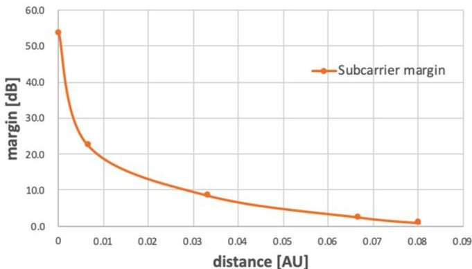

Figure 13.

Command and telemetry link margin calculation results. The top figure shows the command link margin for the Earth distance of up to 0.33 AU when onboard XRXLGA-2 antenna is used to establish 125 bps command link. The bottom figure is the telemetry link margin for the Earth distance of up to 0.08 AU when onboard XMGA antenna is used to establish 1 kbps telemetry link. Typical Japanese ground station is assumed （G/T=53.35[dB/K]）.

computer (OBC), which consists of two printed-circuit boards. It has 12 UART communication channels and 5 GPIO ports to communicate with the other components inside the spacecraft. The communication data format with the ground conforms to the CCSDS standards. The OBC has two non-volatile memories; a 2 GB NAND flash memory as the data recorder and a 2 MB MRAM for storage of important parameters which require quick accessibility. Protections against space radiation is implemented within limited resources; breaker circuits protect the OBC from the overcurrent caused by single-event latchup (SEL), and bit inversions by single-event upset are corrected using an error-correction code function on each memory, along with regular scrubbing. Other than these protections, a watchdog timer will reboot the OBC if its operation stops. The software in the OBC is built on the framework named command centric architecture (C2A) [21]. C2A describes the minimum unit of operations in the OBC as "commands" and defines its complicated behavior by a series of "commands." This framework offers a high operational flexibility in modifying behavior by adding or replacing commands on orbit.

The OBC has an extension board for sensing and driving functions. It provides the functions of (1) driving of the valves in the propulsion system, (2) measurement of pressure sensors in the propulsion system, (3) measurement of temperature in the spacecraft, and (4) driving of the heaters for temperature control. This extension board has its own microcontroller, which controls the circuits related to these listed functions.

## ELECTRIC POWER SYSTEM

The electrical power system is mainly composed of three components: the SAP, the power control unit (PCU), and

<!-- PDF_PAGE: 12 -->

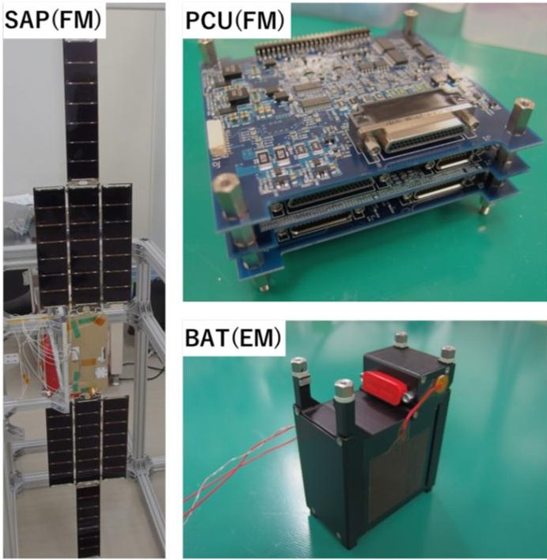

Figure 14. Components of the electrical power system of EQUULEUS.

the battery module (BAT), as shown in Figure 14. The SAP consists of two array wings that are gimbaled on a common single axis by a solar array drive assembly (SADA). The two wings have a total of 56 cells (28 cells, with four 7-cell strings per wing) which provide approximately 50 W at 1AU. The module called HaWK, including SAP, SADA, and the hold and release mechanism, was developed by MMA Design, LLC. The PCU regulates the power from the SAP to two types of power supply channels, i.e., unregulated bus voltage channels (10-12 V) and regulated 5-V channels, and supplies appropriate voltages to the other components in the spacecraft. The PCU has a maximum power point tracking function, which draws the maximum power from the SAP when the spacecraft power consumption nears its maximum power generation capability. The PCU has the functionality to protect the BAT and the PCU themselves: a battery over-charge protection circuit, and an over-current protection circuit or breaker circuit for each power supply line, so that it protects the downstream components and the PCU itself against a shortage in any of the power supply lines. The BAT consists of three 18650 lithium-ion battery cells in

series with a battery-protection circuit, and provides approximately 35 W.h of power storage.

## ATTITUDE DETERMINATION AND CONTROL SYSTEM (ADCS)

The XACT-50, developed by the Blue Canyon Technologies, is an integrated ADCS unit that is equipped with three reaction wheels, an inertial measurement unit, a star tracker, and external sun sensors, and it takes on the role of attitude determination and control of EQUULEUS. The four RCS thrusters in the propulsion system produce torques in any of the three-axis directions, and are used to control or desaturate the angular momentum accumulated by the disturbance torque arising mainly from trajectory control maneuvers and the solar radiation pressure.

Since our RCS thrusters use vaporized water as a propellant, they require some unique operations for angular momentum management. In the momentum unloading operation, the vaporizing chamber is heated up first for 10 min before water injection, and then an appropriate pair of RCS thrusters is actuated until momentum desaturation is confirmed. After this operation, there may be water remaining in the chamber, and this could potentially cause some difficulties in our propulsion system. Thus, after the 10 min of re-heating the chamber, the remaining water will have been completely ejected through the DVT without producing additional unnecessary angular momentum.

We developed a layered fault detection, isolation, and recovery (FDIR) strategy to enhance mission safety. The concept of our layered FDIR approach is shown in Table 7. The low-level FDIR detects "anticipated" anomalies such as hang-up of components and over-current due to SEL from the telemetry of each component, and can isolate and recover by turning ON and OFF of components. The middle-level and high-level FDIR can detect anomalies which cannot be modeled in advance, from the attitude control error information and a decrease of the battery power level (which implies something going wrong in the spacecraft, and the power supply to the spacecraft will be cut). For such cases, the FDIR system will try to recover the spacecraft by initiating the "sun-pointing mode" at first, and second "uncontrolled safe mode (passive single spin mode)" as a last resort.

Table 7.

<table border="1"><tr><td>FDIR level</td><td>Trigger of fault detection</td><td>Isolation and recovery strategy</td></tr><tr><td>1(Low)</td><td>Telemetry of each component</td><td>Reboot of each component</td></tr><tr><td>2(Middle)</td><td>Attitude error information</td><td>Transition to sun-pointing mode</td></tr><tr><td>3(High)</td><td>Battery power level</td><td>Transition to uncontrolled safe mode</td></tr></table>

<!-- PDF_PAGE: 13 -->

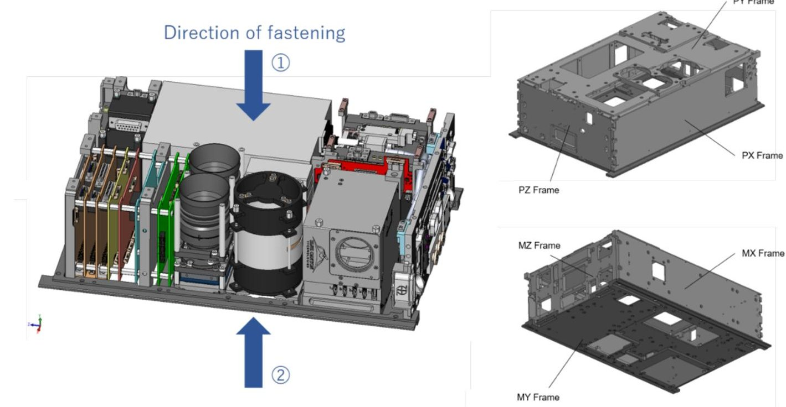

Figure 15. Overview of the EQUULEUS structure design.

## STRUCTURE AND THERMAL DESIGN

The structure of EQUULEUS consists of six machined A6061 frames (PX/MX, PY/MY, and PZ/MZ, shown in Figure 15). Most of the components are fastened to both of the top frame (PY) and the bottom frame (MY) so that the structure as a whole is very rigid.

Thermal design of EQUULEUS faces many constraints coupled with the trajectory design and spacecraft operation. In the observation phase at EML2, the relationship between the sun direction and the observation direction changes periodically (see Figure 16). To generate adequate power continuously, the SAPs are configured to be rotatable using a gimbal mechanism along the axis perpendicular to the lunar orbit plane. With this configuration, EQUULEUS will experience sunlight on only four panels out of six during its

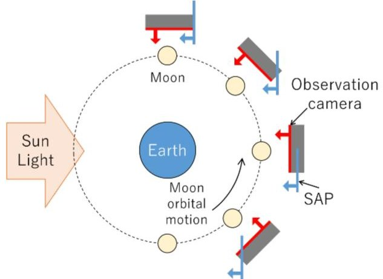

Figure 16. Relationship between the sun direction and the observation direction during the observation phase at EML2.

observation phase. The product of the optical property ( $ \alpha $ or $ \varepsilon $ ) and the panel area was designed to be thermally equal for these four panels, which helped the thermal design work to average the heat input to the spacecraft. Another challenge in the thermal design is that the heat flow design can become complicated since EQUULEUS adopts the water resistojet propulsion system. This propulsion system requires a significant amount of heat for vaporization. To save the heater energy supplied to the vaporization chamber under severe power constraints, we derived a quasi-optimal thermal design by coupling the vaporization chamber and the communication module, which consumes and wastes a large amount of power as heat. We validated this thermal design concept by sequentially conducting one-node analysis, three-node analysis, and multiple-node analysis with Thermal Desktop while detailing the spacecraft design. After thermal correlation using thermal vacuum test results, power consumption analysis especially detailed in the thrust operation phase were conducted, we confirmed the feasibility of the entire set of EQUULEUS mission phases.

## CONCEPT OF OPERATIONS

The EQUULEUS mission can be divided into four phases, as shown in Figure 17: the launch and early orbit phase (LEOP), the lunar flyby sequence phase, the insertion phase to the EML2 libration orbit, and the observation phase at EML2. Over the entire period, the highest priority in the operation is to keep the spacecraft safe, which includes maintaining sufficient tracking accuracy so as not to lose the spacecraft.

<!-- PDF_PAGE: 14 -->

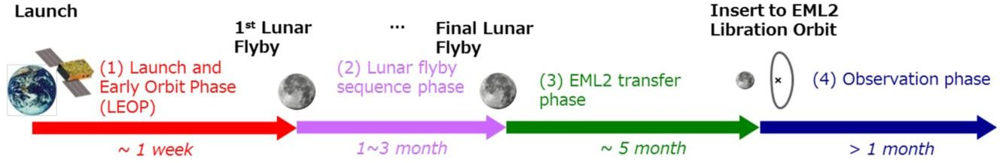

Figure 17.

Overview of the four phases of the EQUULEUS operation.

Among the four phases, LEOP is the most critical operation phase, as we need to reduce or divert the velocity of EQUULEUS so that it does not escape from the Earth-Moon system, under the constraints of limited operation time and the limited propulsion system capability. First, the initial checkouts of the components such as the STT and propulsion system will be conducted as soon as possible after separation. Then, we plan to estimate thrust execution errors using the real-time angular momentum and Doppler observation data before initiating the first maneuver for robust DV1 operation and fuel-saving. The trajectory control operation becomes ready after this calculation. Three maneuvers were designed in LEOP: DV1, trajectory correction maneuver (TCM), and clean-up maneuver (CUM). DV1 is planned to commence one day after separation, and will target the specific point on the B-plane for precise LFB1. After DV1, the result of DV1 is evaluated by the orbit determination for the subsequent TCM operation, which corrects the error of DV1 for a precise LFB1. Three days after the LFB1, CUM will be performed to correct the deviation from the nominal trajectory. Navigation accuracy is also important in order to achieve these operations successfully. We plan on ranging operations for precise orbit determination before and after trajectory controls. Note that we cannot forget to consider the off-line work, such as the re-design of the trajectory controls based on the orbit determination results.

In the lunar flyby sequence phase and the insertion phase to EML2, EQUULEUS will observe the Earth's plasmasphere by PHOENIX for more than three months regardless of the visible or nonvisible time. We will conduct several other maneuvers for reaching EML2 in these phases. In the quasi-halo orbit, EQUULEUS will observe lunar impact flashes via DELPHINUS. We must avoid solar light entering into the barrels of PHOENIX and DELPHINUS, and must also protect their image sensors in these operations. Finally, EQUULEUS will leave the quasi-halo orbit to enter into a deep-space escape trajectory just before the propellant tank becomes empty.

The size of deep space probes has been growing smaller and smaller since the success of PROCYON (50 kg-class, 2014) and MarCO (6U CubeSat, 2018). The next fleet will be the

## CONCLUSION

13 6U CubeSats onboard SLS in 2020. SLS is NASA's next-generation heavy launch vehicle to carry astronauts beyond Earth's orbit to an asteroid and eventually to Mars. Its first flight in 2020 will provide accommodations for 13 6U CubeSats to enter into a lunar flyby trajectory. JAXA and the University of Tokyo will provide a 6U CubeSat named EQUULEUS as one of the thirteen payloads.

The primary mission of EQUULEUS is an engineering mission to demonstrate trajectory control techniques within the Sun-Earth-Moon region for the first time by a nanospacecraft. This mission will be accomplished throughout the flight with a small amount of deterministic delta-V (10-20 m/s) to a libration orbit around EML2 by using multiple LFBs and low-energy transfers using weak stability regions. EQUULEUS carries three scientific observation instruments; PHOENIX to conduct the imaging of the Earth's plasmasphere by extreme ultraviolet wavelengths, DELPHINUS to observe impact flashes of meteoroids on the far side of the moon from EML2 for the first time as well as to characterize the flux of impacting meteors, and CLOTH to detect and evaluate the meteoroid impact flux in the cis-lunar region by using dust detectors. Most parts of the spacecraft utilize COTS components or are designed based on the experiences of past space missions, except for the newly developed water resistojet propulsion system.

After the official selection as a secondary payload on SLS EM-1 in April 2016, the spacecraft was jointly developed by JAXA and the University of Tokyo. EQUULEUS passed its critical design review on June 2018, and its flight model development will complete by the fall of 2019, to be ready for the launch in 2020. The operation of EQUULEUS will be conducted via deep space X-band frequencies using Japanese deep space antennas (64-m antenna and 34-m antenna) as the main tracking stations. Support from the DSN is also being planned, especially for the initial operation. The spacecraft will fly to EML2 nominally in less than one year, and will remain there for scientific observations until it leaves EML2 to enter into a deep space escape trajectory just before the depletion of the onboard propellant.

## ACKNOWLEDGMENTS

This work was supported in part by the JSPS KAKENHI Grant Numbers JP16H06370 and JP18KK0128. The work of S. Campagnola was supported by JAXA's

<!-- PDF_PAGE: 15 -->

International Top Young Fellowship program and JPL's Raise the Bar funding, and part of this research was carried out at the Jet Propulsion Laboratory, California Institute of Technology, under a contract with the National Aeronautics and Space Administration.

## REFERENCES

[1] R. Funase et al., "One-year deep space flight result of the world's first full-scale 50kg-class deep space probe PROCYON and its future perspective," in Proc. 30th Annu. AIAA/USU Conf. Small Satell., 2016, , Paper SSC16-III-05.

[2] S. Ikari et al., "Attitude determination and control system for the micro spacecraft PROCYON," Trans. Jpn. Soc. Aeronaut. Space Sci., vol. 60, no. 3, pp. 181-191, 2017.

[3] H. Koizumi et al., "Initial flight operations of the miniature propulsion system installed on small space probe: PROCYON," Trans. Jpn. Soc. Aeronaut. Space Sci., Aerosp. Technol. Jpn., vol. 14, no. ists30, pp. Pb_13-Pb_22, 2016.

[4] Y. Shinnaka et al., "Imaging observations of the hydrogen coma of comet 67P/Churyumov-Gerasimenko in September 2015 by the PROCYON/LAICA," Astronomical J., vol. 153, no. 2, pp. 76-81, 2017.

[5] S. Kameda et al., "Ecliptic north-south symmetry of hydrogen geocorona," Geophys. Res. Lett., vol. 44, no. 23, pp. 11,706-11,712, 2017.

[6] "NASA cubesats steer toward mars," NASA, 2018. Accessed: June 2, 2018. [Online]. Available: https://www. nasa.gov/feature/jpl/nasa-cubesats-steer-toward-mars

[7] N. Bosanac et al., "Trajectory design for a cislunar cubesat leveraging dynamical systems techniques: The lunar Ice-Cube mission," in Proc. 27th AAS/AIAA Space Flight Mechanics Meeting, 2017, Paper AAS 17-286.

[8] A. L. Genova and D. W. Dunham, "Trajectory design for the lunar hydrogen mapper mission," in Proc. 27th AAS/AIAA Space Flight Mechanics Meeting, 2017, Paper AAS 17-456.

[9] T. H. Sweetser et al., "ARTEMIS mission design," Space Sci. Rev., vol. 165, pp. 27-57, 2011, doi:10.1007/s11214-012-9869-1.

[10] I. Yoshikawa et al., "Telescope of extreme ultraviolet (TEX) onboard SELENE: Science from the moon," Earth, Planets Space, vol. 60, no. 4, pp. 407-416, 2008.

[11] I. Yoshikawa et al., "Imaging observation of the Earth's plasmasphere and ionosphere by EUVI of ISS-IMAP on the International Space Station," IEEJ Trans. Fundam. Mater., vol. 131, no. 12, pp. 1006-1010, 2011.

[12] K. Yoshioka et al., "The extreme ultraviolet spectroscope for planetary science, EXCEED," Planetary Space Sci., vol. 85, pp. 250-260, 2013.

[13] K. Ariu, T. Inamori, and R. Funase, "Design and demonstration of the visual feedback tracking system for the close asteroid flyby," in Proc. IEEE Aerosp. Conf., 2016, pp. 1-10, doi: 10.1109/AERO.2016.7500672.

[14] T. Hirai et al., "Microparticle impact calibration of the arrayed large-area dust detectors in interplanetary space (ALADDIN) onboard the solar power sail demonstrator IKAROS," Planetary Space Sci., vol. 100, pp. 87-97, 2014. [Online]. Available: https://doi.org/10.1016/j.pss.2014.05.009.

[15] T. Hirai et al., "Data screening and reduction in interplanetary dust measurement by IKAROS-ALADDIN," Adv. Space Res., vol. 59, no. 6, pp. 1450-1459, 2017. [Online]. Available: https://doi.org/10.1016/j.asr.2016.12.023

[16] J. Asakawa et al., "Fundamental ground experiment of a water resistojet propulsion system: AQUARIUS installed on a 6U CubeSat: EQUULEUS," Trans. Jpn Soc. Aeronaut. Space Sci., Aerosp. Technol. Jpn., vol. 16, no. 5, pp. 427-431, 2018.

[17] D. Gibbon et al., "The design, development and in-flight operation of a water resistojet micropropulsion system," in Proc. 40th AIAA/ASME/SAE/ASEE Joint Propulsion Conf. Exhib., 2004, Paper AIAA 2004-3798.

[18] Y. Kobayashi et al., "Low-cost and ultimately-downsized X-band deep-space telecommunication system for PROCYON mission," in Proc. IEEE Aerosp. Conf., 2016, pp. 1-19, doi: 10.1109/AERO.2016.7500745.

[19] Y. Kobayashi and S. Kawasaki, "X-band, 15-W-class, highly efficient deep-space GaN SSPA for PROCYON mission," IEEE Trans. Aerosp. Electron. Syst., vol. 52, no. 3, pp. 1340-1351, Jun. 2016, doi: 10.1109/TAES.2016.150207

[20] Y. Kobayashi, A. Tomiki, and S. Kawasaki, "Annual deepspace flight operation verification of X-band GaN SSPA," IEEE Trans. Aerosp. Electron. Syst., vol. 55, no. 2, pp. 930-950, Apr. 2019, doi: 10.1109/TAES.2018.2867245

[21] S. Nakajima et al., "Command centric architecture (C2A): Satellite software architecture with a flexible reconfiguration capability," in Proc. 67th Int. Astronaut. Congr., Sep. 2017, Paper IAC-17,D1,2,11,x40875.