<!-- PDF_PAGE: 1 -->

# Near-Earth Asteroid Scout Flight Mission

Tiffany Russell Lockett, NASA Marshall Space Flight Center Julie Castillo-Rogez, Jet Propulsion Laboratory Les Johnson, Joe Matus, NASA Marshall Space Flight Center Jack Lightholder, Anne Marinan, Jet Propulsion Laboratory Alexander Few, NASA Marshall Space Flight Center

## INTRODUCTION

The Near-Earth Asteroid (NEA) Scout mission will demonstrate the capability of an extremely small and inexpensive spacecraft to perform reconnaissance of an asteroid using a low-thrust solar sail propulsion system [1], [2]. This is an extension of the solar sail technology developed and flown by the NASA Marshall Space Flight Center 3U CubeSat, NanoSail-D in 2010 [3], [13]. An NEA Scout will use an $ 8 6 \mathrm{~m}^{2} $ solar sail, deployed from a 6U CubeSatbased spacecraft, to carry a camera, cold gas system, and full avionics suite on a slow flyby of an NEA within two years of launch (see Figure 1). Each "U" contains about one liter in volume so that a 6U CubeSat measures only $ 1 1 \times2 4 \times3 6 $ cm (see Figure 2).

The success criterion for the mission is the development of a capability that can close strategic knowledge gaps (SKG) at a NEA identified as a human exploration target by the Human Exploration and Operations Mission Directorate (HEOMD). The low-thrust propulsion enabled by the sail will allow the CubeSat to almost match the target's velocity, with two significant advantages. A slow relative velocity to the target will facilitate preparations for a close flyby at $ < 1 $ km at closest approach and a long operation time in proximity to the target. These flyby characteristics are required by stringent requirements on spatial resolution and observations under varying illumination.

date, time of flight, and ephemeris uncertainty. This first application of a CubeSat, as a precursor mission, will pave the way for future reconnaissance missions.

To increase resiliency against launch delay, a variety of potential targets have been identified based upon launch

The spacecraft architecture follows the CubeSat design mentality and approach, and is primarily based on the use of Commercial Off-the-Shelf (COTS) parts; high risk, lean costs, and a dynamic schedule. Screening and testing of the COTS components provides for a more reliable design, and material added to the bus structure provides shielding for these components. However, volume constraints limit the ability to add redundant systems to increase fault tolerance.

This article will provide an overview of the mission, flight system design, and unique features needed for science and propulsion.

## CONCEPT OF OPERATIONS

The NEA Scout will be placed on an Earth escape trajectory by the upper stage of NASA's space launch system (SLS) on its first flight called Artemis 1. After SLS sends its primary payload, NASA's Orion crew capsule, on a trajectory toward the moon, NEA Scout is one of the 13 CubeSats on the flight; each will be ejected, one at a time, from the SLS's Orion Stage Adapter. After ejection, an NEA Scout cold gas thrusters will be used to detumble and stabilize the spacecraft and point toward the sun to maximize power generation and enable two-way communication with Earth.

The cold gas thrusters will provide initial delta-V capability to target a lunar flyby, after which the solar sail will deploy. The NEA Scout mission will use NASA's deep space network as the primary ground system for communications and tracking.

For a late 2020 through early 2021 launch, the NEA Scout's primary target is asteroid 2013 WA44. However, due to the nature of NEAs, this specific target may not be available for later launch dates. The flexibility provided by the solar sail propulsion system will offer alternative

<!-- PDF_PAGE: 2 -->

targets that are reachable within a reasonable time of flight, < 2 years, including science data return. One month before reaching the target, the NEA Scout will start the approach phase using a combination of radio tracking and optical navigation. The solar sail will provide continuous low thrust to enable a relatively slow flyby ( < 20 m/s) with a < 50 $ ^{\circ} $ phase angle to provide lighting conditions conducive to imaging. Once the flyby is complete, three months of mission life is dedicated to the onboard processing of the science data and downlink to Earth. If the system is still fully functioning at the conclusion of the primary mission, an extended mission to another asteroid may be considered. The NEA Scout mission phases are shown in Figure 3.

## CONTRIBUTION TO EXPLORATION SCIENCE

There are many reasons to visit and characterize NEAs. They have been considered as possible destinations for future human exploration and, as such, having an idea of their surface structure and morphology is essential to reduce risks for future human visitors. Furthermore, characterizing potentially hazardous objects before they become a threat may be desirable as part of a comprehensive planetary defense strategy [4]. Finally, some commercial companies have been considering asteroid mining that may have an interest in using inexpensive spacecraft like NEA Scout for asteroid surveys.

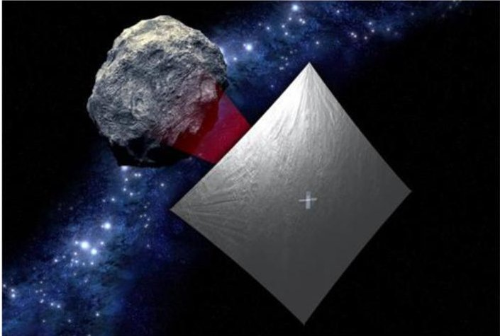

Figure 1.

Artist concept of the NEA Scout spacecraft during the asteroid flyby.

The main science goal of the NEA Scout mission is to close key SKGs at targets on the list of Near-Earth Object Human Space Flight Accessible Targets Study (NHATS) [5]. SKGs encompass information on the physical and dynamic nature of the targets, which might be used for operational planning and decision making when preparing for crewed missions. The list of SKGs of interest to NASA's HEOMD is presented in Figure 4.

A simple imager is sufficient to address a large number of SKGs, which makes that type of science within the reach of minimal platforms, such as 6U CubeSats. The camera must be "science grade," which means it must be designed using components meeting certain quality requirements, such as a detector with a good quantum efficiency, and implemented to make it resilient against a number of factors that are expected in deep space environment. For example, temperature extremes, latch-up due to radiation effects, and lens cleanliness are among a list of survivability factors.

The SKGs that cannot be addressed with an imager are the mineralogical composition—it can only be inferred from the spectral type of the target—and the asteroid mass. The gravity signal from these targets is

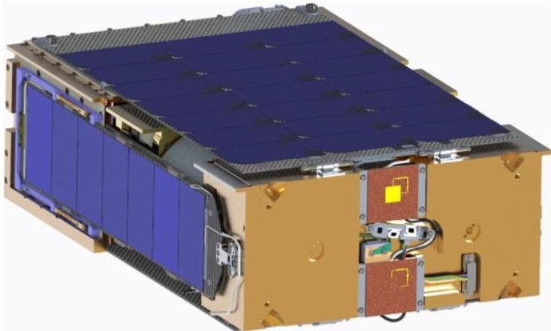

Figure 2. Stowed configuration of NEA Scout.

<!-- PDF_PAGE: 3 -->

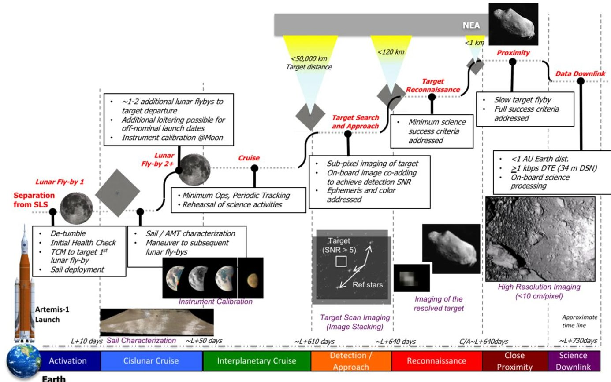

Figure 3. NEA Scout concept of operations and mission phases.

overwhelmed by the effect of solar radiation pressure allowing the mass of objects that are tens or hundreds of meters in size to be determined by all platforms. This is

especially true in the case of NEA Scout because of the large solar sail and the pool of potential targets limited to objects < 100 m.

<table border="1"><tr><td>HEO-Defined Strategic Knowledge Gaps</td><td>Expected Performance</td><td>Risk Reduction or Benefit</td></tr><tr><td>Location (position prediction/orbit)</td><td>OCC decrease to 0</td><td></td></tr><tr><td>Size (existence of binary/ternary)</td><td>High accuracy on size, detection of satellites</td><td></td></tr><tr><td>Rotation rate &amp; pole orientation</td><td>High accuracy on pole and velocity</td><td></td></tr><tr><td>Particulate environment/Debris field</td><td>Characterization of particle density in target vicinity</td><td></td></tr><tr><td>Regolith mechanical &amp; geotechnical properties</td><td>Indirect (imagery interpretation)</td><td></td></tr><tr><td>Mass/density estimates (internal structure)</td><td>Indirect (based on taxonomic characterization)</td><td></td></tr><tr><td>Surface morphologies and properties</td><td>Morphology at resolution of astronaut&#x27;s foot</td><td></td></tr><tr><td>Mineralogical &amp; chemical composition</td><td>Indirect from taxonomic characterization</td><td></td></tr></table>

Figure 4. Strategic knowledge gaps of interest to human exploration and contribution of NEA Scout (expected performance).

<!-- PDF_PAGE: 4 -->

Table 1.

Sensor Specifications and Capability

<table border="1"><tr><td>Type</td><td>20M pixel CMOS image sensor</td></tr><tr><td>Useful array size</td><td>3840×3840 pixels</td></tr><tr><td>Pixel size</td><td>6.4μm2</td></tr><tr><td>Full well</td><td>15000e-</td></tr><tr><td>Dark noise</td><td>8e- RMS</td></tr><tr><td>Windowing</td><td>Y-direction only</td></tr><tr><td>Shutter</td><td>Global</td></tr><tr><td>Color</td><td>Monochrome(with microlenses)</td></tr><tr><td>Quantization</td><td>12-bit per pixel</td></tr><tr><td>Electrical interface</td><td></td></tr><tr><td>Physical</td><td>LVDS</td></tr><tr><td>Protocol</td><td>Spacewire RMAP</td></tr><tr><td>Power</td><td>&lt;3W</td></tr><tr><td>Memory</td><td>64 Mbits</td></tr><tr><td>FPGA</td><td>Microsemi Rad-tolerant ProASIC3</td></tr><tr><td>Camera specifications</td><td></td></tr><tr><td>Mass</td><td>390g</td></tr><tr><td>Volume</td><td>63×63×71mm</td></tr><tr><td>Operating temperature</td><td>-25 to +50℃</td></tr><tr><td>Survival temperature</td><td>-35 to +70℃</td></tr><tr><td>Optics</td><td>27°FOV,f/2.8,50.2mm iFOV=0.09mrad/pix</td></tr></table>

## INSTRUMENT

To reduce development time of the camera while also reducing the overall cost and risk inherent in creating a new design, the NEA Scout camera takes advantage of an existing modular camera platform implemented for the Orbiting Carbon Observatory 3 (OCO-3) context cameras [6]. The OCO-3 context camera provided the electronics body while allowing mission-specific customizations. To meet the signal-to-noise ratio and field-of-view requirements, the NEA Scout camera integrates the monochrome version of the CMV20000 CMOS detector used in the OCO-3 implementation. For the optics, a ruggedized commercial lens was procured that meets the speed and field of view necessary for the object detection and close-up imaging: f/2.8, 50.2 mm focal length and $ 2 7^{\circ} $ field of view. The image circle projected onto the detector from

the lens is 24 mm, reducing the useful detector window to $ 3 8 4 0 \times3 8 4 0 $ pixels. In practice, the target detection only needs a reduced size, so the detector windowing capability is used to capture a smaller size image for each frame $ ( 3 8 4 0 \times2 1 8 4 $ pixels). The camera specifications are summarized in Table 1.

## TARGET

The NHATS database is large and adds 5-10 targets every year [5]. However, only a minority of objects are within the reach of NEA Scout's capabilities and mission constraints. The key limiting factors are: the encounter must occur < 1 AU from Earth, for telecommunication purposes, and the propulsion performance for total mission lifetime must be shorter than two years, based on predicted spacecraft capability. The target for NEA Scout based on a late 2020 through early 2021 launch date is 2013 WA44.

Targets that have high inclinations and eccentricities require high delta-V. The targets of most interest for HEO require as low a delta-V as possible. The pool of targets accessible to NEA Scout are definitely valuable for HEOMD's interest.

Another key constraint is the uncertainty on the a priori knowledge of the targets' orbits, which will drive the strategy used for the spacecraft to lock in on the target and start the Approach Phase. The NEA Scout's downlink limitations require that the target and the six-sigma uncertainty on its longitudinal position fit within the field of view of the camera. This requirement was a major driver for the definition of the camera capabilities. Specifically, the camera should be able to capture NEA Scout's target and its six-sigma position uncertainty of $ \sim18\ 000\ \mathrm{km} $ （one-sigma is $ \sim2700\ \mathrm{km} $ ）from a distance of about 40 000 km. The latter was defined in order to allow enough flexibility and lead time to refine the target's ephemeris and prepare for target-relative navigation while enabling a $ < 20 $ m/s encounter velocity at a phase angle $ < 50^{\circ} $ for science imaging. The distribution of target's eccentricity, semi-major axis, and delta-V requirements are summarized in Figure 5.

Since the project started, the pool of targets has changed with the shifting launch window. The NEA Scout project has been in regular communication with the center for NEOs at the Jet Propulsion Laboratory in Pasadena, CA.

The list of a priori targets that are accessible within two years after launch in the 2020-2024 timeframe is presented in Figure 6. Targets are presented in terms of their approximate diameter and orbit condition code (OCC). The latter classifies targets as a function of the uncertainties on their orbits after their most recent observation on a logarithmic scale. An OCC of 0 corresponds to a longitude runoff of < 1.0 arcsec ( $ \sim< $ 1000 km), whereas an OCC of 4 leads to

<!-- PDF_PAGE: 5 -->

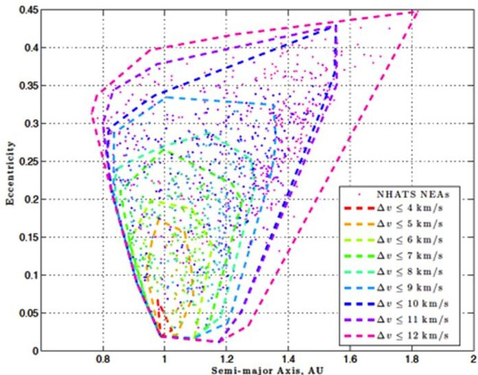

Figure 5. Space of targets available in the 45 NHATS data base as a function of key orbital characteristics and delta-V requirement.

a runoff of 1.4-6.4 arcmin (6000-24000) in one decade. For mission design, an accurate uncertainty estimate is provided by the Center for Near-Earth Object Studies [7].

Only those targets that have an OCC equal or less than 1 or those whom OCC can be retired prior to launch are viable. This is the case of 2013 WA44, whose current OCC = 3, but will benefit from ground-based observations in December 2020. Its magnitude will be 19.9 at that time, promising recovery with high probability. When a target

has been observed at least twice, the OCC drastically decreases, and even more so if the time difference between observation is long (i.e., long arc solution). For comparison, if NEA Scout were to search for a target with an OCC of 4, it would require the acquisition of hundreds of images to cover the orbit uncertainty space, an activity that is not compatible with the spacecraft's limited downlink. A follow-on mission might consider performing onboard mosaicking and extraction of point sources in order to search for the target autonomously. Figure 6 shows that at any given time, only one target is available for NEA Scout. Hence, the science team did not impose any additional requirements on the target. 2013 WA44 is an attractive target. It's magnitude of 23.7 converts into a size between 32 and 142 m [7], depending on the albedo, which is unknown. It's rotation period has also been estimated at 0.35 h (21 min). Short periods are typical of small NEAs and fast rotation leads to the removal of surface dust, which leads to a high probability that dust is a hazard in the local environment of the target. Very small (i.e., low-gravity) NEAs are also unlikely to have companions or debris field. Even if the target were subject to a micrometeorite impact in a timeframe relevant to the arrival of an NEA Scout, solar radiation pressure would sweep dust on a timescale of hours or days.

Since NEAs < 100 m (diameter) have not been explored by any space mission to date and are difficult to

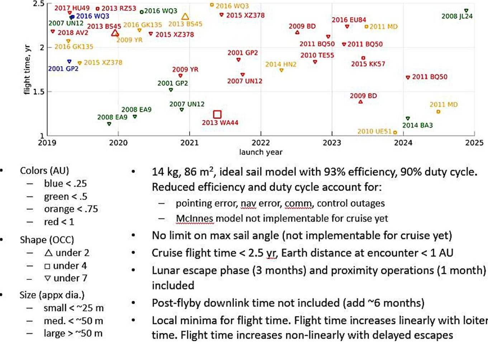

Space of possible targets that may be accessible to NEA Scout for a launch in the 2020-2024 timeframe. Only those targets whom OCCs are less than 2 or will be retired prior to launch are viable for this mission.

<!-- PDF_PAGE: 6 -->

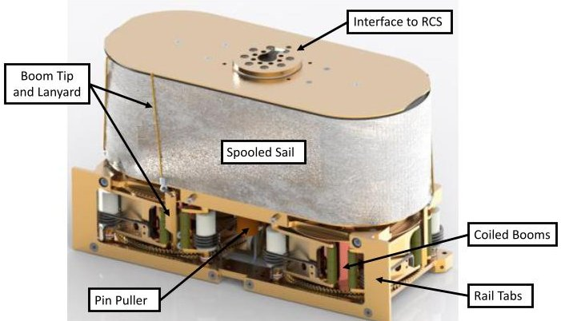

Figure 7.

3D CAD rendering of the NEA Scout flight solar sail subsystem.

study with Earth-bound assets, the NEA Scout's observations will enrich the state-of-the-art in NEA science by exploring the first object of its kind. Regarding its value to human exploration, 2013 WA44 is among the top 60 most accessible targets in terms of required delta-V ( $ \sim6 $ km/s).

## SOLAR SAIL

A solar sail was selected as the propulsion system for NEA Scout because of its nearly unlimited delta-V potential and small packaging volume. An extension of the solar sail technology developed and flown by the NASA NanoSail-D [3], [13], the NEA Scout will use an $ 8 6 \mathrm{~ m}^{2} $ solar sail deployed from $ \sim2 $ U volume of the CubeSat (see Figure 7). Within the volume constraints of the NEA Scout, there simply is not enough room for both conventional chemical or electric propulsion system and tankage that could provide sufficient delta-V capability, launch window flexibility, and overall thrust necessary to reach an NEA. With the launch date uncertainties that inevitably accompany small secondary payloads like NEA Scout, a solar sail provides an ideal alternative solution [1].

The state of the art solar sail missions that have been flown by the United States to date were NanoSail-D by NASA Marshall Space Flight Center in 2010 and LightSail 1 and 2 by The Planetary Society in 2015 and 2019, respectively [3], [13], [14]. The NanoSail-D and LightSail missions were 3U CubeSat spacecraft, deployed in low Earth orbit to demonstrate deployment of a solar sail. The LightSail 2 mission successfully demonstrated orbit raising, thus proving the performance and maneuvering capabilities of solar sails in low Earth orbit [16].

The NanoSail-D mission utilized Colorless Polymer-1 (CP1) as the base polyimide substrate with an aluminum coating as the sail fabric, for a total area of $ 1 0 \mathrm{m}^{2} $ . This is the same material an NEA Scout is using for its flight sail. LightSail 1 and 2 utilized Mylar film for both flight sails, for a total area of $ 3 2 \mathrm{m}^{2} $ [14]. The NEA Scout will advance solar sail technologies to date by demonstrating flight capability and operation of an interplanetary spacecraft with a larger solar sail system.

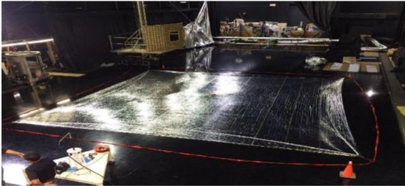

Figure 8.

NEA Scout EDU sail deployed at the MSFC flat floor facility.

To accommodate the $ 8 6 \mathrm{m}^{2} $ solar sail, the design from NanoSail-D and LightSail had to be modified to allow for longer booms and a single sail design. The system design went from a single spool for the booms and single round spool for the sail material to a dual mounted boom deployer and racetrack shaped sail spool (see Figure 7). This design accommodated the new 6U volume allocation, additional boom length, and sail storage area [15].

In May of 2016, the Engineering Development Unit (EDU) solar sail was prepared for a suite of environmental tests, culminating in a full-scale deployment at NASA Marshall Space Flight Center's (MSFC) flat floor facility (see Figure 8). The full-scale deployment premiered a fully machined EDU (see Figure 9), flight-like motor, and a developing control system [8]. Numerous half-scale deployments and mechanical development efforts were completed in preparation for the full-scale test.

Leading up to the deployment test, the EDU underwent an ascent vent test to simulate the rapid depressurization expected during ascent on SLS. This test was performed to determine the viability of the sail folding pattern and verify that the vent paths were performing nominally. The folding pattern and vent paths proved to be acceptable, and no sail damage was observed due to trapped air. After the ascent vent test, the team completed a random vibration test of the anticipated launch environment; this test vibrated the system in all three axes with intermittent, boom-only deployment tests after each axis of vibration.

Two sails were produced for EDU activities: a Mylar sail and a colorless polymer-1 (CP1) sail. Both sails were $ 8 6 \mathrm{~ m}^{2} $ in size, and the CP1 version was built as flight-like as possible. During the deployments, the team updated procedures with boom support information, electrical inputs, sail attachment methods, and mechanical fixtures. These tests proved to be critical to the overall design implementation of the system [9].

The major lessons learned during EDU testing included stepper motor sizing, boom buckling due to the test environment, and thermal design. The boom deployer was built in-house at MSFC with the sail and booms purchased from NeXolve Holding Corporation (Huntsville, AL). A lean test suite was implemented for the flight sail

<!-- PDF_PAGE: 7 -->

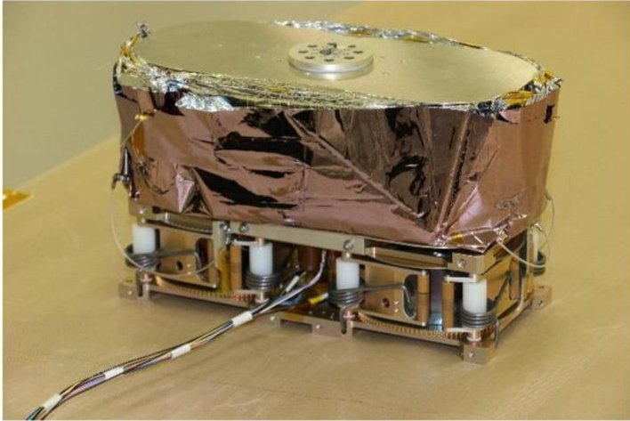

Figure 9. As-built solar sail subsystem engineering development unit.

subsystem due to cost and schedule concerns. The flight sail completed thermal vacuum testing prior to a full deployment in ambient pressure and temperature. The flight system will undergo additional environmental testing at the spacecraft level.

The flight sail deployment was the most successful to date, recording nominal operations of sail protection, break tabs, and gravity offload operations. The deployment test proved that the proposed folding geometries, folding processes, spooling processes, and test methodology had matured and yielded a successful product. (see Figures 9 and 10).

## INTEGRATION CHALLENGES

The overall configuration of the spacecraft was a difficult challenge to overcome during the initial planning stages of the mission. The solar sail volume was placed in the center of the spacecraft to allow the camera to have a clear, unobstructed view of the asteroid on the shaded side of the sail and allows the solar panels to generate power on the sun-facing side of the sail (see Figure 11).

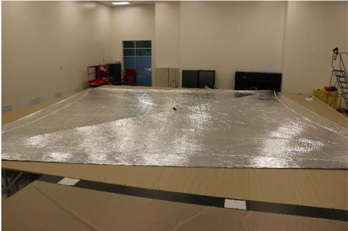

Figure 10.

Deployed flight sail at NeXolve Corporation in Huntsville, AL in June 2018.

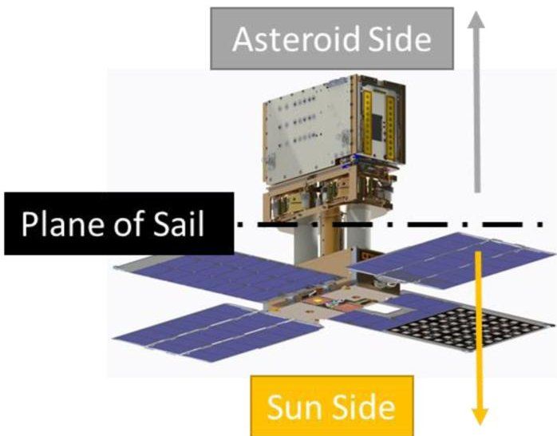

Figure 11. Flight system configuration; down is sun-pointing with the solar panels, and up faces towards the asteroid with the camera located in the avionics box, sail not pictured.

Due to the location of the sail, the position of the center of pressure in relation to the center of mass is critical for controlling the sail. The spacecraft configuration requires a complicated mechanism, called the active mass translator (AMT), to reside in the geometric center of the volume [10]. This system is designed to offset a portion of the spacecraft mass, as needed to trim the trajectory during cruise, and reduce the duty cycles of critical control mechanisms (see Figure 12). Furthermore, the mass offset can be used to overcome dispersions in the sail's center of pressure (CP) due to manufacturing errors, off-nominal deployments, or sail-damaging events [10], [11].

Though the AMT has positive impacts on the Guidance, Navigation, and Control functions, it created complicated and esoteric issues for assembly operations. The small mechanism disallows any process flexibility in how the spacecraft is assembled during integration phases. All operations, by necessity, are serialized, adding schedule risk if and when delays occur. The NEA Scout must be built from one end to the other to accommodate the intricacies of the AMT.

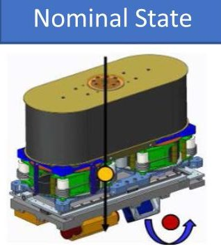

Figure 12.

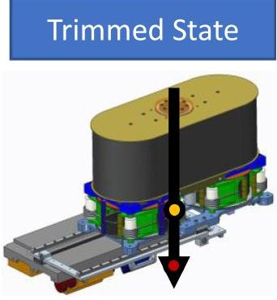

AMT configuration to balance center of mass (red) and center of pressure (yellow) during flight operations.

<!-- PDF_PAGE: 8 -->

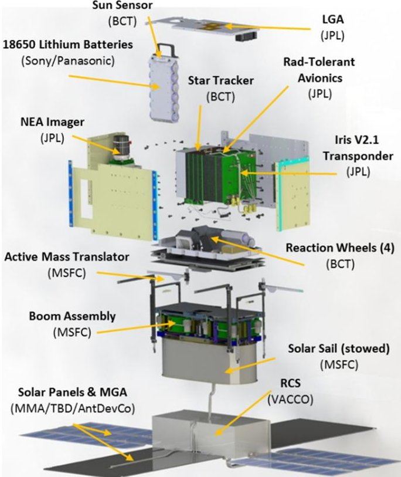

Figure 13.

Flight system subassemblies during spacecraft integration.

The harnessing is the heart of this issue with the location of the AMT within the spacecraft. The wire harness runs the entire length of the volume and through every major mechanical interface (see Figure 13). Given that the AMT moves one part of the spacecraft relative to the other by about $ 1 6 \times6. 8 $ cm,the wire harness requires additional 15 cm length of extra cabling coiled into a service loop [11]. For the spacecraft to be assembled properly, the major subsystems must be integrated simultaneously so the harnesses are properly bundled and shaped through the translation volume of the AMT.

This means the harness and the four major subassemblies of the spacecraft must be complete, electrical and mechanical interfaces vetted, masses, and volumes consistent with all documentation and subsystem checkouts passed, prior to final spacecraft assembly.

The complexity with the wiring harness means that the NEA Scout risks a complete system de-integration in the event of certain mechanical or electrical failures during system integration and testing.

## SCIENCE OPERATIONS

The science operations are divided into four major phases.

a) Demonstration of key capabilities and performance assessment during the checkout phase in the Earth- Moon system, during the few months following launch and prior to lunar gravity assist.

b) Target detection about 40 000 km prior to closest approach.

c) Encounter defined by the time from which the target is resolved in the camera (i.e., $ >\sim2 $ pixels) until closest approach.

d) Data downlink.

The downlink phase may last up to six months depending on the data volume to be returned, which is a function of the actual footprint of the target, and the opportunity to use the 70 m DSN stations that would increase downlink rate by a factor of $ \sim4. $

Science capture as a function of these phases is presented in Figure 14.

Key challenges are primarily driven by the limited downlink performance at $ \sim1 $ AU where most of the science activities are planned. Mitigating this issue and meeting the NEA Scout's science requirements have led to the development of on-board science data processing that covers a wide range of functions. This science software builds on the autonomous science experiment [17] but have not been demonstrated in deep space to date. These include on-board data correction with the application of calibration data obtained in the lab; extraction of point source and its position in a frame; cropping around the extended (i.e., resolved) target; and production of thumbnails and prioritized downlink (e.g., based on image quality) for selection by the science team [12]. Calibration data will be obtained in the lab for a range of relevant temperatures and uplink for onboard application to the image. Additional calibration information may be obtained during the checkout phase, leading to the delivery of a revised calibration mask during cruise.

The encounter is planned to occur at < 20 m/s relative velocity between the NEA Scout and the NEA, enabling observation of the resolved target for at least 1 h (and up to ten times longer if the target's size is $ \sim 1 0 0 $ m across). A priori knowledge of the target rotation properties is a critical input for the design of the encounter phase. For an unknown target, that information would have to be acquired via light curve imaging following detection in order to design the imaging sequence (e.g., data acquisition rate). However, this activity would introduce significant pressure on the operational timeline considering the limited resources of the spacecraft and ground team. The ground-based imaging and radar observations might retire this uncertainty for some of the targets and the NEA Scout team is working with astronomers (e.g., Lance Benner at JPL) so that NEAs get characterized as soon as they are identified as viable targets for NEA Scout. This is the case for 2013 WA44, which was imaged with the Discovery Channel Telescope and with one of the Gemini telescopes by Nicholas Moskovitz in October 2019. Preliminary (unpublished) results suggest nonprincipal axis rotation with a fundamental period of about 0.6 h.

This rotation period leads to imaging every $ \sim1 $ min in order to guarantee coverage of $ \sim80\% $ of the surface under changing illumination in the course of the encounter.

<!-- PDF_PAGE: 9 -->

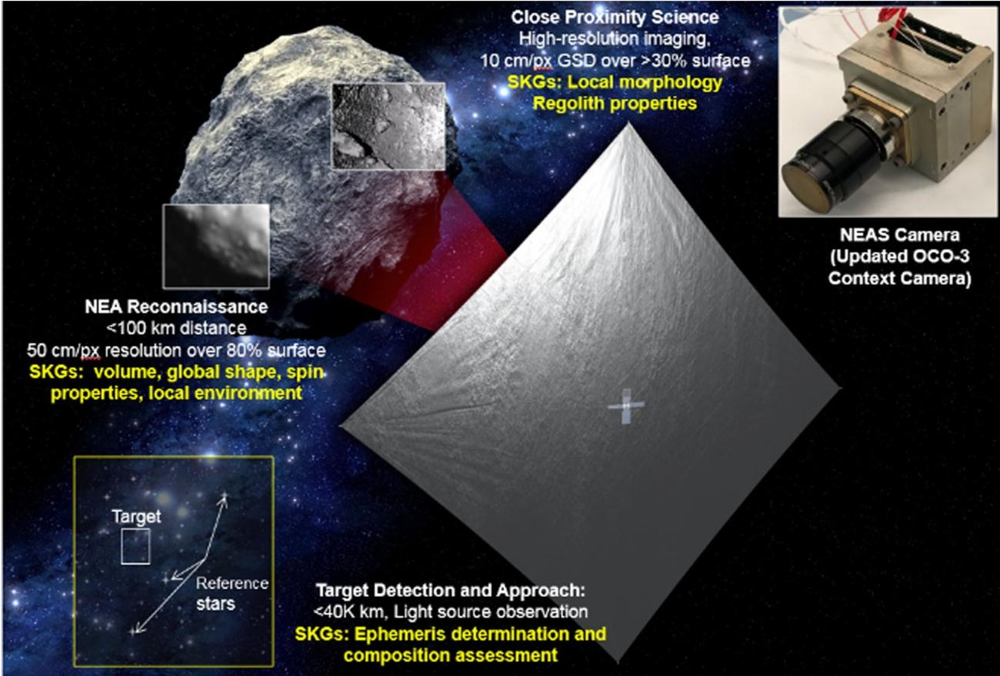

Figure 14.

Summary of the key imaging activities performed during the science phases of the mission, after escape from the Earth-Moon system.

The ground-sampling distance (GSD) requirement is < 10 cm/pix at closest approach; it is met at < 800 m from the target. The navigation simulations project a position uncertainty at the time of encounter of $ \sim150 $ m, which enables a closest approach distance as low as 500 m (assuming three-sigma), and thus, a GSD $ \sim6.5 $ cm/pix. At closest approach, 2013 WA44 fills about 25% of the field of view. The total data volume of the encounter with the current baseline target and trajectory is expected to be downlinked over the course of 6.5 months.

## CONCLUSION

The NEA Scout will be the first interplanetary CubeSat to image and characterize an NEA smaller than 100 m. Its mission will address strategic knowledge gaps relevant to all astronomical objects within this specific class range (e.g., surface state, local environment). An NEA Scout efforts combine asteroid detection/tracking and close proximity science capabilities, and paves the way for multispacecraft exploration of the NEAs.

The NEA Scout will deploy an $ 8 6 \mathrm{m}^{2} $ solar sail, which will allow the vehicle to use sunlight as its primary means of propulsion to a NEA. Through the deployment of the sail and navigation to its target, NEA Scout will demonstrate a lowcost reconnaissance capability for the future robotic mission.

The NEA Scout's scientific innovations include an end-to-end demonstration of on-board image processing and science data prioritization and extraction, which can

support future missions with tight resources, e.g., outer solar system missions.

An NEA Scout will carry autonomous imaging processing capability, including a 0.5U camera and an X-band radio transponder called Iris. The mission will provide a pathway for future solar sail technology demonstration missions and help reduce operations cost for the future CubeSat/SmallSat efforts.

## ACKNOWLEDGMENTS

The NEA Scout is a joint partnership between NASA Marshall Space Flight Center and the Jet Propulsion Laboratory. The project has contributing members from NASA Langley Research Center, NASA Goddard Space Flight Center, Deep Space Network, and NASA Johnson Space Center. Contributing small businesses are Blue Canyon Technologies, Mountain Man Aerospace, VACCO Industries, and NeXolve Holding Corporation.

## REFERENCES

[1] L. McNutt, L. Johnson, D. Clardy, J. Castillo-Rogez, A. Frick, and L. Jones, "Near-Earth Asteroid Scout," in Proc. AIAA Space Conf., San Diego, CA, USA, 2014.

[2] L. Johnson, J. Castillo-Rogez, and J. Dervan, "Near Earth Asteroid (NEA) Scout: NASA's solar sail mission to a NEA," in Proc. 68th Int. Astronaut. Congr., Adelaide, SA, Australia, 2017.

<!-- PDF_PAGE: 10 -->

[3] D. Alhorn et al., "NanoSail-D: The small satellite that could!," in Proc. 25th AIAA/USU Small Satell. Conf., Logan, UT, USA, 2011.

[4] National Research Council. Defending Planet Earth: Near-Earth-Object Surveys and Hazard Mitigation Strategies. Washington, DC, USA: Nat. Acad. Press, 2010.

[5] Near-Earth Objects Human Accessible Targets Study [n.d.]. [Online]. Available: https://cneos.jpl.nasa.gov/nhats/

[6] C. McKinney et al., "Context cameras for the Orbiting Carbon Observatory 3 (OCO-3) instrument," in Proc. IEEE Aerosp. Conf., 2018, pp. 1-15.

[7] Center for Near Earth Object Studies (CNEOS) [n.d.]. [Online]. Available: https://cneos.jpl.nasa.gov/ca/

[8] A. Sobey and T. Lockett, "Design and development of NEA scout solar sail deployer mechanism," in Proc. 43rd Aerosp. Mechanisms Symp., San Jose, CA, USA, 2016.

[9] A. Few, T. Lockett, R. Wilson, and D. Boling, "Testing and development of NEA Scout solar sail deployer mechanism," in Proc. 44th Aerosp. Mechanisms Symp., Cleveland, OH, USA, 2018.

[10] A. Few, "Development of a high performance, low profile translation table with wire feedthrough for a deep space CubeSat," in Proc. 43rd Aerosp. Mechanisms Symp., San Jose, CA, USA, 2016.

[11] A. Few, T. Lockett, R. Wilson, and D. Boling, "Testing and maturing a mass translating mechanism for a deep space CubeSat," in Proc. 44th Aerosp. Mechanisms Symp., Cleveland, OH, USA, 2018.

[12] J. Lightholder, J. Castillo-Rogez, D. Thompson, and C. Basset, "Near Earth Asteroid Scout CubeSat science data retrieval optimization using onboard data analysis," in Proc. IEEE Aerosp. Conf., Big Sky, MT, USA, 2019.

[13] M. Whorton, A. Heaton, R. Pinson, G. Laue, and C. Adams, "NanoSail-D: The first flight demonstration of solar sails for nanosatellites," in Proc. 22nd AIAA/USU Small Satell. Conf., Logan, UT, USA, 2007.

[14] C. Biddy and T. Svitek, "LightSail-1 Solar sail design and qualification," in Proc. 41st Aerosp. Mechanism Symp., Pasadena, CA, USA, 2012.

[15] L. Johnson, A. Sobey, and K. Sykes, "Solar sail propulsion for interplanetary CubeSats," in Proc. AIAA Propulsion Energy, Orlando, FL, USA, 2015.

[16] J. Davis. LightSail 2 Spacecraft Successfully Demonstrates Flight by Light. (2019). Accessed: Jul. 31, 2019. [Online]. Available: http://www.planetary.org/blogs/jason-davis/ lightsail-2-successful-flight-by-light.html

[17] S. Chien et al., "Using autonomy flight software to improve science return on Earth Observing One," J. Aerosp. Comput., Inf., Commun., vol. 2, no. 4, Apr. 2005.

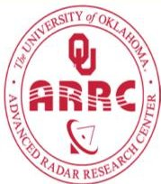

## Advanced Radar Research Center (ARRC) at the University of Oklahoma

The Advanced Radar Research Center (ARRC, www.arrc.ou.edu) at the University of Oklahoma (OU) is currently seeking ten graduate research assistants and three full-time engineers. The ARRC is growing rapidly with over 150 faculty, students, post-docs, and professional staff, and is housed within the new Radar Innovations Laboratory on OU's research campus. The ARRC is dedicated towards end-to-end radar development spanning prototype development, signal processing, and data interpretation. Information on faculty members' specific research interests are available on the ARRC website (given above).

Graduate students will receive a nationally competitive monthly stipend (plus tuition waivers). Opportunities also exist for technical conference participation, industrial/government internships, and fellowships (in addition to stipends). Applicants must: (1) apply at www.ou.edu/admissions/apply for graduate status in ECE or meteorology, and (2) email graduate statement of purpose to info@arrc.ou.edu for proper review by ARRC faculty. Resumes for exceptional post-docs will be considered, salary at least $100k/yr.

The ARRC's engineering positions provide competitive, full-time salaries and benefits. See Job Numbers 192807, 192806 and 192805 at https://jobs.ou.edu . OU is a Carnegie-R1 comprehensive research university and enrolls over 30,000 students. Norman is a culturally rich town located near the Oklahoma City metro area. With outstanding amenities and an easily affordable cost of living, Norman is a perennial contender within the "Best Places to Live" rankings.