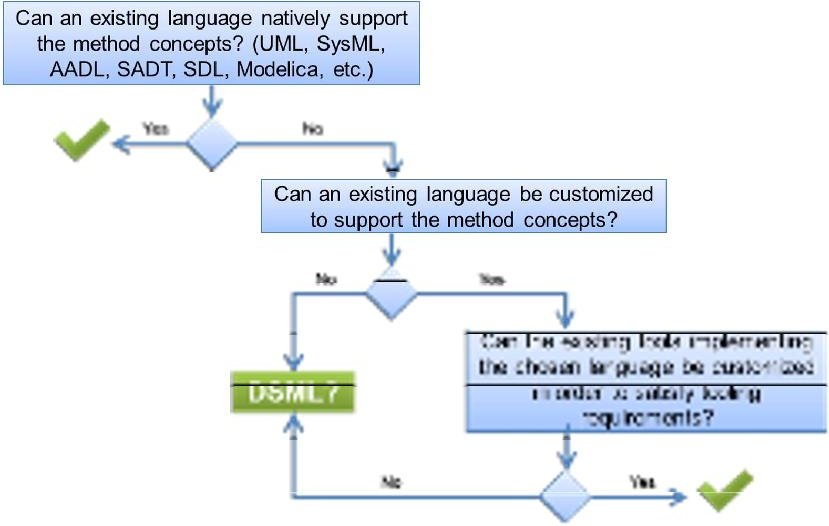
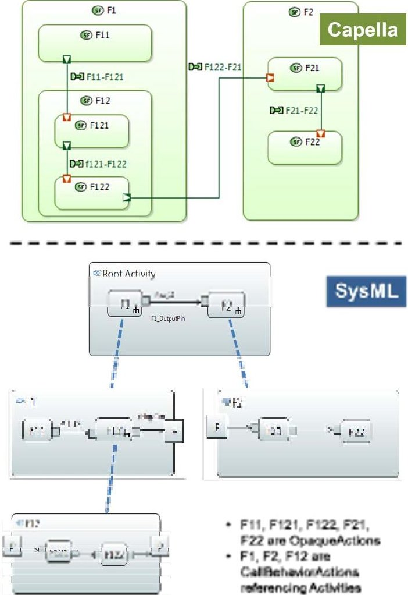
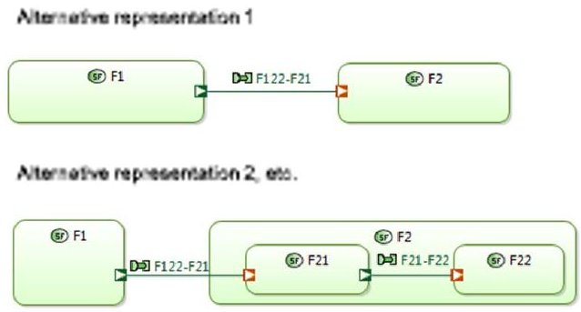
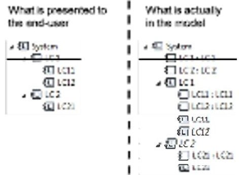
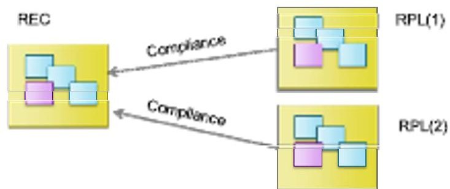
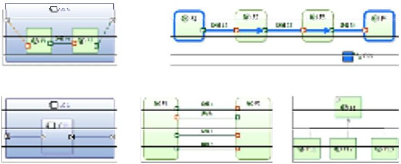
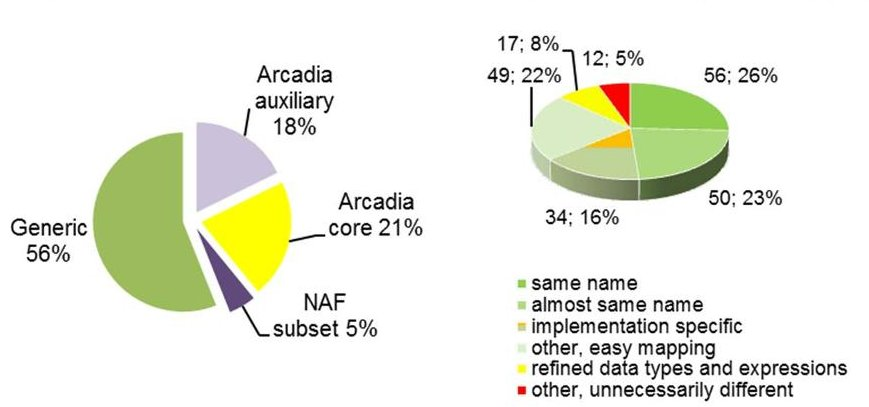
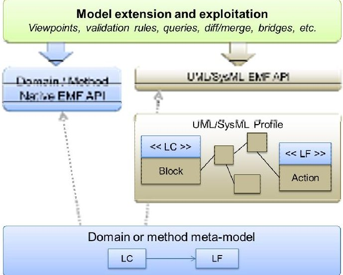

<!-- PDF_PAGE: 1 -->

# Not (strictly) relying on SysML for MBSE: language, tooling and development perspectives

The Arcadia/Capella rationale

Stéphane Bonnet, Jean-Luc Voirin, Daniel Exertier, Véronique Normand

THALES

Velizy-Le-Bois, France

{stephane.bonnet, daniel.exertier, veronique.normand} @thalesgroup.com, jean-luc.voirin@fr.thalesgroup.com

Abstract — Using the Arcadia/Capella solution as an example, this paper explores why standard UML/SysML languages are not necessarily the unique or best alternatives for implementation of a model-based systems engineering solution (MBSE). The Thales experience is used to elicit MBSE language and tooling requirements. This paper analyzes various implementation alternatives and justifies structuring choices made regarding Capella to efficiently support the Arcadia engineering method.

Keywords — mbse; dsml; sysml; method; tool; Arcadia; Capella

## I. INTRODUCTION

Modeling enables understanding of complex systems which helps anticipate and verify solutions and their costs before building them. Models can serve a wide spectrum of purposes, from specification to low-level simulation.

Model-based systems engineering (MBSE) is the formalized application of modeling to support system requirements, design, analysis, verification and validation activities, beginning in the conceptual design phase and continuing throughout development and later life cycle phases. While MBSE is expected to become the norm for systems engineering execution in the next ten years [1], it is no silver bullet. Modeling is not a goal per se and is even less so a guaranty of success. MBSE consists of relying on models to meet engineering objectives (define interfaces, evaluate tradeoffs, verify hypotheses, etc.).

Thales is a major electronic systems company that designs, builds, and provides services for the aerospace, defense, transportation, space and security markets. In 2005, Thales bet on model-based systems engineering (MBSE) as a key lever for engineering performance improvement and initiated an ambitious rollout program, investing massively on both methodological and tooling aspects.

Nearly ten years later, the results include a model-based engineering method (Arcadia) and a supporting modeling workbench (Capella) deployed on various domains in all Thales Business Units worldwide and made open source in 2014 [2]. While hundreds of Thales engineers have been using Capella as their main daily design workbench for a few years already, the Clarity consortium aims at building an ecosystem around Capella [3]. Several major industrial organizations, tool

providers, and consulting organizations have already joined the consortium.

This paper explains the choices integral to development of Arcadia and Capella, based on both experimentations and system engineers' feedback. It examines different perspectives: language, tooling, and development.

## II. CORE REQUIREMENTS FOR A MBSE SOLUTION

A workshop dedicated to operational deployment of MBSE (conducted in October 2014 in Canberra, Australia [4]) resulted in a collection of returns on experience from MBSE actors across several organizations and countries. Methodological and tooling issues have been identified as two of the biggest obstacles to MBSE deployment. For years, modeling tools and languages have been complex and difficult to customize. Survey results show that unstable and buggy tool chains have been showstoppers in multiple occasions.

## A. Language and method

Numerous modeling languages have been available for decades. Reference [5] proposes a classification of these languages based on their scope of purpose, level of semantic formalization, scope of distribution, degree of standardization, their adaptation to users' cultural background, and the existence of an ecosystem.

First experiments in deploying model-based approaches in Thales quickly showed a strong methodological support was mandatory to help set modeling objectives and ensure they were reached. A method for model-based engineering provides at least:

- A supporting modeling language. As the core concepts are the first tangible elements they are confronted with, it is essential to minimize the learning curve and avoid exposing practitioners to an overly complex language.

- Modeling guidelines including practices, workflows and recommendations.

Reference [6] explains how the Arcadia method has been elaborated, tried in real-world contexts and subsequently adapted. The close loop between operational users, method experts, and tooling developers has been a key in this success.

<!-- PDF_PAGE: 2 -->

## B. Scope

The scope of a MBSE solution coincides with the modeling intentions. Arcadia and Capella are not covering the full spectrum of design activities. Instead, their focus is on architectural design (justification of components/interfaces through functional analysis, architecture non-functional early evaluation, and preparation of integration and validation activities) excluding low-level behavioral modeling or simulation.

The scope of a method has direct consequences on the tooling: therefore, a limitation of this paper is that it only reflects the Thales experience in the field of system architectural design. It should not be taken as universal, one size-fits-all set of requirements and implementation for MBSE workbenches.

## C. Tooling

The original audience for the Arcadia/Capella solution was primarily systems engineers with diverse skills. Their close involvement in the solution specification and maturation has shaped a workbench suiting their needs. The following requirements are highlights of their expectations regarding MBSE workbenches. They are referenced between accolades when relevant in the following sections of this paper.

<table border="1"><tr><td>R1</td><td>A MSBE workbench shall be method-driven. Instead of providing a blank page, a MBSE workbench must provide guidance and assist in applying and enforcing the method: the workbench must define high-level objectives, where to start, which diagrams to create, how they relate them, etc.</td></tr><tr><td>R2</td><td>A MBSE workbench shall establish simplicity as its golden rule. The objective is to reduce the time and effort to build and maintain models.</td></tr><tr><td>R3</td><td>A MBSE workbench shall help manage complexity. This can be accomplished through automatically computed and maintained model synthetic views, abstractions in levels, and semantic navigations.</td></tr><tr><td>R4</td><td>A MBSE workbench shall improve productivity and provide accelerators based on model transformations and generation from models. Anything that can be deduced automatically should be.</td></tr><tr><td>R5</td><td>A MBSE workbench shall be extensible, particularly through a multi-viewpoint approach allowing the evaluation of designs according to different concerns.</td></tr><tr><td>R6</td><td>A MBSE workbench should favor the exploitation of models. That can be accomplished through advanced query and impact analysis capabilities as well as through an open and regular API.</td></tr><tr><td>R7</td><td>A MBSE workbench shall be scalable. Because systems are complex, models are typically big. Intrinsic performance of the tool and rich multi-user capabilities are critical.</td></tr></table>

After years of model-based experimentations, Thales began developing a Group-wide solution for MBSE in 2005 with advanced UML profiling [7]; however the company quickly adopted a different strategy resulting in the open sourcing of Capella in 2014.

## III. THE CAPELLA IMPLEMENTATION CHOICE: NOT SYSML, NOT DSML, BUT HYBRID

Once the core concepts of an MBSE method have been defined, the most fundamental tool-related questions to be addressed are illustrated by Figure 1.

Figure 1: Structuring questions for MBSE solution

While many of the existing modeling languages like $ \mathrm{SADT}^{1} $ or $ \mathrm{AADL}^{2} $ have been inspirations, only SysML has been seriously considered as a candidate to develop Capella, the workbench supporting the Arcadia method.

## A. SysML and Profiles

UML has now existed for more than 15 years and has become a de facto international standard. It is the result of years of work by internationally renowned experts, who have given the language rich expression capabilities and excellent coverage of most common modeling needs [5]. SysML is a specialization of UML intended to address systems engineering concerns and to hide to a certain extent some of the softwarerelated concepts that form the core of UML [8].

Multiple modeling tools providing various degrees of extensibility and customization support SysML. The most common approach to implement MBSE methodological guidance is to enrich the SysML language with method-specific profiles $ ^{3} $ , adding semantics, and to provide relevant productivity and validation tooling.

Between 2003 and 2006, this alternative was the first-line approach for Arcadia method support. A few man-years worth of development went into the creation of a UML profile and a significant amount of associated tooling such as model transformations and validations [7]. The developed solution suffered not only from language complications, but from tooling issues as well and was quickly rejected by the pilot practitioners. A vast majority of Thales systems engineers have no software engineering background. Core object oriented concepts that come with UML and SysML (specialization, generalization, unnecessary encapsulation, etc.) cannot be easily masked and have been major obstacles.

## B. Implement a solution with a DSML

Standard or universal languages such as SysML target a wide variety of domains and modeling intentions. At the other

<!-- PDF_PAGE: 3 -->

end of the spectrum, specialized modeling languages are intended to provide solutions for particular domains or modeling intentions. DSMLs (Domain-Specific Modeling Language) typically have reduced coverage and more focused intentions. These characteristics make them more likely to provide richer semantics and enhanced formalism.

Despite the emergence of dedicated environments favoring the development of DSMLs, the development cost can be significant given the maturity level an end-user typically expects from an industrial solution; however this cost can be counter balanced by the fact that DSMLs tools are typically less complex and easier to learn.

While DSML editing tools - such as Sirius [9] and Kitalpha [10] - have been used to build Capella, the core Arcadia language is too rich and too generalist for Capella to be categorized as a DSML:

- Arcadia targets operational analysis and system architectural design. It is inspired by a wide variety of standard languages, from architecture frameworks (such as $ \mathrm{N A F}^{4} $ or $ \mathrm{D O D A F}^{5} $ ) to SysML.

- The method is independent of any engineering domain.

## C. Hybrid approach: the art of compromise

Capella is thus neither a SysML profile nor a DSML. The core meta-model of Capella has been strongly inspired by SysML and the diagrams provided are very similar. However, when considering the SysML language as a reference, the meta-model of Capella is simultaneously simplified, modified and enriched {R2}.

- Simplified or modified. Whenever UML/SysML concepts were more complex than necessary to model architectures, they were either excluded (many behavior modeling constructs are absent) or simplified (components, parts, instances).

- Enriched. Arcadia covers a part of the Architecture Frameworks that SysML does not. Corresponding concepts are part of the Capella meta-model.

The main advantage of this hybrid approach is that Capella diagrams can be read and understood (to a certain extent) by engineers having no particular knowledge of Arcadia. Interoperability with other engineering tools is not, however, as good as if Capella was a SysML profile. The following section elaborates further on some of the biggest language-related differences between Capella and SysML.

## IV. LANGUAGE ASPECTS

## A. Management of functional analysis

The object-oriented origins of SysML have clearly been an obstacle for adoption by Thales system engineers not familiar with the world of software development. The meta-model of Capella is not a strict implementation of SysML and varies on a multitude of concepts. This section describes two of the main Capella differences.

Functional analysis addresses the activities that the system must achieve to produce its desired outputs [11]. It allows translation of functional requirements into a formalized set of system functions having well-defined inputs and outputs.

While being one of the most established modeling techniques in systems engineering, functional analysis is actually not strictly supported by SysML which does not define the concepts of "functions" and "function hierarchy". Function-oriented approach can however be implemented in SysML:

- Functions modeled as actions/activities diagrams. SysML actions/activities are semantically close to Arcadia functions as they are behavior elements identified by verbs - intended to be allocated to structural elements

- Functions modeled as blocks [12]. The functional tree is captured as a hierarchy of blocks with dataflow being represented as Internal Block Diagrams.

None of these two options met the Arcadia requirements of simplicity {R2} and scalability {R3}, as exhaustively detailed in [13]. Activity diagrams come with a multitude of complex constructs that are far beyond the needs of a simple Arcadia function hierarchy: activities, numerous different kinds of actions, pins, parameters, nodes, etc. Using blocks to model functions appears semantically wrong; it does not enforce the conceptual difference between structural elements and functions.

Figure 2: Equivalent functional decompositions in Capella and SysML

<!-- PDF_PAGE: 4 -->

These limitations can be hidden by adequate tooling and profiling, with the restrictions described in the following section. The real showstopper in Thales was the encapsulation mechanism exploited in both cases to support nested functions.

Figure 2 describes the fundamental difference between SysML activity diagrams and Capella functional models. It shows how a simple functional breakdown can rapidly become complex with SysML,

In SysML activity diagrams, object flows can only be created between functions at the same level. This means two leaf functions in the hierarchy can only communicate through delegation constructs going through their respective owning activities. Maintaining the consistency of object flows across several levels is a tedious and error-prone task that seriously jeopardizes scalability.

In Capella functional models, only leaf functions can ultimately have input and output data flow, own ports, and be later allocated to structural elements. Ports and data flows appearing on non-leaf functions either reflect an intermediate design that is not yet finalized, or are a computed synthesis. The ports owned by children functions can be artificially displayed on parent functions. This makes the production of synthetic views possible at no cost (Figure 3).

Figure 3: Computed synthetic views in Capella

The Capella implementation is well-adapted to both top-down approaches (refinement work consists in creating sub functions and drag-dropping existing ports) and bottom-up approaches (production of synthetic views simply consists of grouping leaf functions in parent ones).

Finally, another major difference between SysML activity diagrams and Capella functional analysis relates to control flows, which are not supported in the latter. This topic is thoroughly explained in [13].

## B. Management of types and instances

In Thales at least, a significant cultural difference exists between systems and software engineers. The former are more likely to think first in terms of instances. By default, everything is considered an instance; the concept of type only emerges when replication becomes necessary. Software engineers on the other hand typically start with types and instantiate them later on when modeling deployments.

One of the major objectives of Arcadia models is to be a reference for non-functional analyses (performance, safety, etc.). Being able to distinguish each instance of architecture

elements and associating different characteristics to each is mandatory.

Conceptually, UML/SysML types, parts, and instances are supposed to provide all required constructs to support these kinds of analyses. However, the management of elements at instance level is today considered a weakness of SysML: the FAQ of the SysML Forum $ ^{6} $ states, "Instance Specifications are ambiguously defined and poorly integrated with the rest of SysML." For example, a tool like SysML-based Scade Systems [14] is providing additional reusable/unique blocks mechanisms for enhanced hierarchy management to overcome these limitations.

At first, explicitly relying on type-instance duality was considered for Capella models. But the multiplication of metamodel concepts (functions, instances of functions, function ports, instances of function ports, functional exchanges, instances of functional exchanges, components, instances of components, component ports, instances of component ports, etc.) was far too complex to be exposed to the end-user.

This explains why the concept of part is actually hidden in Capella, as illustrated by Figure 4. Each component is considered as an instance by default. From an implementation point of view, this choice is equivalent of applying the SysML "PropertySpecificType" stereotype on each part. In SysML, the property-specific type implicitly creates a block subclass which types the part in order to add the unique characteristics [15].

Figure 4: Hidden part concept in Capella

This approach enables simple native instance-level modeling {R2}. However, being able to reuse elements and have the equivalent of "types" or "definitions" for these elements is a must-have in any architectural design solution. In Capella, this is implemented with the concepts of Replicable Elements Collections (REC) and Replicas (RPL). An analogy can be made with RECord and RePLay. A REC is the definition of a reusable set of model elements while a RPL is one single usage of a REC in a given context.

A customizable {R5} compliance relationship is defined between REC and RPLs, as shown in Figure 5. Black-box conformance means no deviation is tolerated on the RPLs. Constrained-reuse compliance means potential changes are restricted (for example, allocating additional functions to a component without changing its interfaces). RECs are likely to

<!-- PDF_PAGE: 5 -->

be stored in libraries and shared between projects. RECs and RPLs are kept synchronized.

Figure 5: RECs and RPLs

Figure 6 provides examples of RECs: a REC can be as simple as a single function or component, or as rich as two functions interacting with one another, a functional chain, a group of components, or even an interaction model (sequence diagram). The Capella meta-model does not explicitly distinguish types and instances. The nature of a model element is given by its context of usage: a component in a REC is a type; a component in a RPL is an instance {R2}.

Figure 6: Examples of RECs

## C. Capella-SysML language distance

While this paper is not intended to cover all of the differences between SysML and Capella meta-models, Figure 7 provides a rapid overview of the distance between them. Capella provides class diagrams, case diagrams, state machines, sequence diagrams, etc. Their differences are often subtle and essentially consist of simplifications. Bridges are currently under development.

Capella meta-model analysis

Capella - UML/SysML Mapping

Figure 7: Capella-SysML mapping of concepts

## V. TOOLING AND DEVELOPMENT ASPECTS

## A. Customizing a UML/SysML workbench

This section examines some of the difficulties encountered by Thales between 2004 and 2007 when developing advanced profile-based solutions [7]. While the ability of tools to be customized has significantly improved since then - especially open source tools like UML Designer [16] or Papyrus [17] - many of the issues explained here would still be problems.

In general, adding semantics through profiling is fairly easy. Unlike years ago, tools now provide means to easily customize diagram palettes and add buttons for stereotyped elements. However, preventing the usage non-stereotyped elements is often complicated if not impossible.

In the context of Arcadia/Capella, an illustration of this relates to the use of control flows, which is prohibited by the method [13]. When customizing a modeling workbench, it is very difficult to prevent the creation of (or the access to) elements that the method does not support. This lead to two issues which generated lots of misunderstandings in Thales early stages of MBSE deployment.

- It is difficult for the end-user to clearly see and understand the frontier between the method-supported concepts and the native UML/SysML concepts.

- It generates additional development, as the tooling must be aware unsupported elements are likely to be found.

Tooling can sometimes hide the complexity associated with UML/SysML. For example, this has been done in Capella's early versions to simplify the usage of activity diagrams (masking most of the action-related concepts). But the underlying complexity is still exposed with third party exploitation of the model (querying tools, specialty engineering tools, etc.) {R6}.

A not-so-rare bias is to twist the underlying UML/SysML concepts to achieve specific diagram representations. When the semantics carried by a profile deviates too far from the original specification semantics, UML/SysML is reduced to being an interchange format and is no longer a reference improving the communication between engineering stakeholders.

With most UML/SysML workbenches, the graphical representations of model elements are strongly constrained by the existing available diagrams. Capella provides views - like trees or graphically computed links - that are not mapped on real model elements but are the result of computation on model elements. In 2007, none of the evaluated UML workbenches were providing solutions for this. Today, a tool like UML Designer [17] is a promising marriage between a UML/SysML standard workbench and a rich diagram specification environment Sirius [9].

## B. Development, customization, and exploitation aspects

The preceding sections emphasized the importance of a simple, method-adapted language for the end-users. In a wider picture, this simplicity is also essential for developers of viewpoints and tool extensions on top of the core architecture modeling workbench. Such extensions are typically necessary

<!-- PDF_PAGE: 6 -->

to support specialty engineering like performance, safety, sizing, etc.

Developing a viewpoint means enriching the meta-model, customizing diagrams, and developing specific analysis logic. EMF, the Eclipse Modeling Framework, provides the most complete suite for the development of modeling tools [18]. In particular, it provides means to generate Java APIs for a given meta-model. EMF is the foundation of tools like Capella, Papyrus, and UML Designer.

Figure 8 shows major differences between DSML-like and profile-based solutions. Profiles are intended to add semantics and somehow hide a part of the UML/SysML inherent complexity. However, the core concepts they represent can actually not be handled through a dedicated EMF Java API: they have to be accessed through the API of the underlying language concepts. This often means direct relationships in the domain or method meta-model are actually mapped on a chain traversing several UML/SysML concepts. Figure 8 illustrates the relationship between a logical component and a function in Arcadia, which would actually translate in block, activity partition, activities, and actions in SysML.

Figure 8: DSML vs SysML APIs

In 2006, Thales developed a solution combining both worlds: the domain-specific EMF API of the Capella early version was implemented with a live mapping on a SysML profile. The complexity and performance did not scale and the solution was abandoned.

This direct access to the method or domain core concepts is, more generally, essential for any exploitation of the model. For example, end-users want to query "logical components implementing function F", not "Blocks with stereotype Logical typing an ActivityPartition in which the Action F with stereotype Function is present" {R2}{R6}. This requirement is also relevant for bridges with specialty engineering tools, for model validation, for model diff/merge, etc.

methodological support and tooling issues are the most common technical obstacles to success. Capitalizing on the Arcadia/Capella experience, this paper emphasizes the importance of methodological guidance. In order for tools to be adopted by the end-users, they must be carefully crafted.

Designing an MBSE method and developing an industrial solution that supports the method is a true challenge. Modeling objectives are the primary drivers that shape and scope the solution. In certain cases, these modeling objectives challenge the selection of SysML as the underlying language.

This paper illustrates how the modeling intentions promoted by Arcadia have governed the development of Capella, from language to tooling perspectives. Capella is not a SysML implementation, yet not quite a DSML. Capella is hybrid. It is a pragmatic solution built for and by end-users.

This hybrid solution does not overcome the issue of nonstraightforward interoperability with other modeling tools. Even so, the vast majority of Capella users consider the benefits of an adapted engineering workbench to outweigh the fact that it is not strictly based on a standard.

## VI. CONCLUSION

Important social, technical and organizational factors are likely to impact MBSE deployment outcomes. Lack of

## REFERENCES

[1] "Systems Engineering Vision 2025", INCOSE, Sept. 2007

[2] https://polarsys.org/capella

[3] http://www.clarity-se.org

[4] F. Lestideau and S. Bonnet, 2014, "The challenges of deploying MBSE solutions", Workshop, INCOSE/SESA MBSE Symposium, Canberra, Australia. http://www.mbsesymposium2014.com.au

[5] J. Aracic, P. Roques, "Select and deploy a conceptual modelling language. Some Keys.", http://blogs.crescendo-technologies.com

[6] J.-L. Voirin, S. Bonnet, V. Normand, D. Exertier, "From initial investigations up to large-scale rollout of an MBSE method and its supporting workbench: the Thales experience", INCOSE International Symposium 2015

[7] V. Normand, D. Exertier, "Model-driven systems engineering: SysML & the MDSysE approach at Thales", in "Model Driven Engineering for distributed real-time embedded systems", John Wiley & Sons, Sept. 2005, ISBN 9781905209323

[8] OMG, Systems Modeling Language (SysML), Version 1.3, June 2012

[9] http://eclipse.org/sirius

[10] https://polarsys.org/kitalpha

[11] A. P. Sage and W. B. Rouse, "Handbook of Systems Engineering and Management", Wiley, 1999

[12] Lamm, J. G. and Weilkiens, T., Funktionale Architekturen in SysML. In M. Maurer and S.-O. Schulze (eds.), Tag des Systems Engineering 2010, pp. 109-118. Carl Hanser Verlag, München, Germany, November 2010. English translation by J. Lamm.

[13] J.-L. Voirin, "Modelling languages for Functional Analysis put to the test of real life", CSDM, Paris, 2012

[14] http://www.esterel-technologies.com/products/scade-system

[15] S. Friedenthal, A. Moore and R. Steiner, "A Practical Guide to SysML, Second Edition: The Systems Modeling Language", The MK/OMG Press, ISBN-13: 978-0123852069

[16] http://www.umldesigner.org

[17] https://www.eclipse.org/papyrus

[18] D. Steinberg, F. Budinsky, M. Paternostro, E. Merks," EMF: Eclipse Modeling Framework", Addison-Wesley Professional, 2008