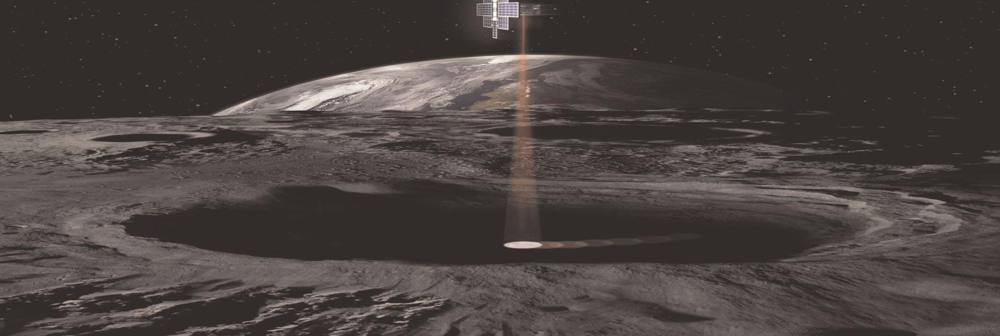
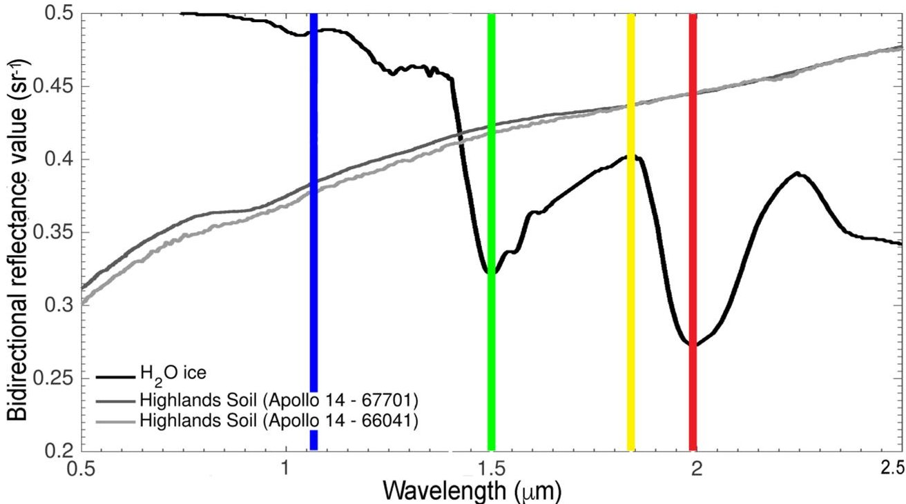
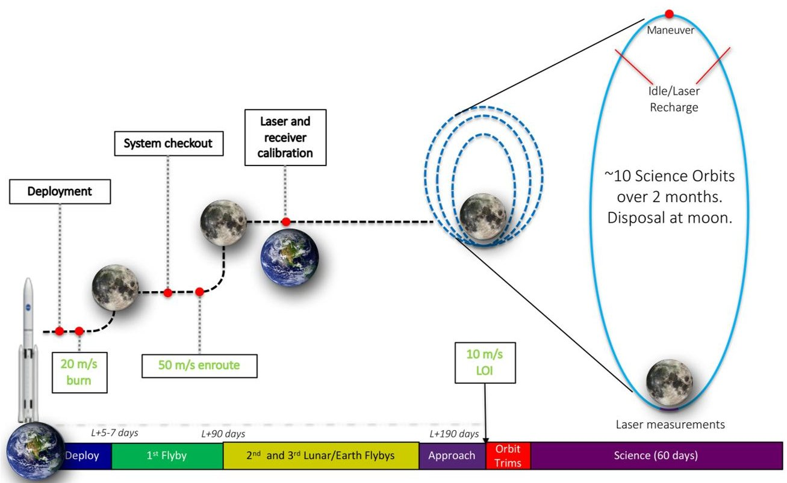
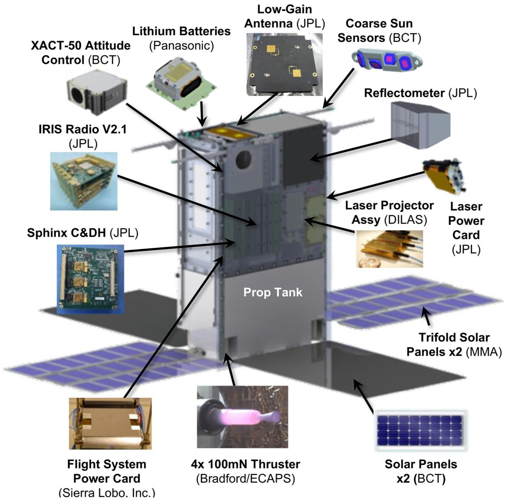

<!-- PDF_PAGE: 1 -->

# Lunar Flashlight: Illuminating the Lunar South Pole

Barbara A. Cohen, NASA Goddard Space Flight Center Paul O. Hayne, University of Colorado Benjamin Greenhagen, JHU Applied Physics Laboratory David A. Paige, University of California, Los Angeles Calina Seybold, John Baker, Jet Propulsion Laboratory

## INTRODUCTION

Water ice and other volatile compounds may be present on the Moon's surface within permanently shadowed regions (PSRs) near the lunar poles. Understanding the composition, quantity, distribution, and form of water and other volatiles associated with lunar PSRs is identified as a Strategic Knowledge Gap (SKG) for NASA's human exploration program, projected to visit the lunar south pole in the next decade. These polar volatile deposits are also scientifically interesting, having potential to reveal important information about the delivery of water to the Earth-Moon system.

Lunar Flashlight is a very small satellite (6U bus, or $ 1 2 \times 2 4 \times 3 6 $ cm), developed and managed by the Jet Propulsion Laboratory, that will search for water ice exposures and map their locations in the Moon's south polar region. The Lunar Flashlight mission will demonstrate technologies for NASA such as green propulsion and active laser spectroscopy while proving the capability of performing a planetary science investigation in the CubeSat form factor. Lunar Flashlight was selected in 2014 by the NASA Advanced Exploration Systems

program within the Human Exploration and Operations Mission Directorate; the mission is currently funded as a technology demonstration mission within NASA's Space Technology Mission Directorate (STMD) portfolio. Lunar Flashlight will be one of 13 secondary payloads launched on Artemis-1, currently scheduled for 2020.

## SCIENCE AND PAYLOAD

Water on the Moon contains both a record of science and a resource for exploration. Volatile compounds are fundamental tracers of a planetary body's origin, evolution, and interaction with its space environment. The observed abundance and chemical inventory of condensed volatiles may also reveal a history of dynamical exchange among different regions of the solar system. Near the poles of the Moon, large areas of perennial (or "permanent") shadow create cold traps, where volatiles would be thermally stable for billions of years. PSRs may, therefore, hold a record of volatile delivery, transport, sequestration, and loss through geologic time [1], [2]. In addition, water could be an important target of in situ resource utilization (ISRU), where $ \mathrm{O}_{2} $ and $ \mathrm{H}_{2} $ O for life support or $ \mathrm{H}_{2} $ and $ \mathrm{O}_{2} $ for fuel and propellant could be derived from deposits of water ice [3] $ ^{[3]} $ $ ^{[5]} $

Lunar polar water ice consists of at least two reservoirs: deeply buried ice deposits and surficial water frost. The Clementine, Lunar Prospector, and Lunar Reconnaissance Orbiter (LRO) missions made observations consistent with ice deposits centimeters-to-meters deep in PSRs with concentrations $ \sim 1 \% $ $ \mathrm{H_{2}O} $ by mass [6] $ - [9] $ , but not all PSRs contain water ice signatures. The Lunar CRater Observation and Sensing Satellite (LCROSS) mission excavated and heated 10's of m of regolith, revealing 5-7 wt% of $ \mathrm{H_{2}O} $ along with a comet-like array of volatiles [10]. At the lunar surface, spectroscopic and albedo measurements from LRO and the Chandrayaan-1 Moon Mineralogy Mapper $ \left(\mathrm{M}^{3}\right) $ show increased surface reflectance consistent with water frost at concentrations ranging from

<!-- PDF_PAGE: 2 -->

$ \sim 0. 1 $ up to $ \sim 1 0 $ wt% in the south polar PSRs, with a patchy distribution [11] $ - $ [13]. However, the distribution of apparent water frost at the surface does not match the subsurface distribution, and neither is its occurrence proven everywhere temperatures are cold enough to permit trapping of water molecules [14]. Current data are not yet sufficient to conclude that the form, quantity, or distribution of lunar $ \mathrm{H}_{2} \mathrm{O} $ is present at concentrations sufficient for IRSU, or to predict the distribution of ice at scales of a rover or human landed mission. To be "operationally useful" for such missions, $ \mathrm{H}_{2} \mathrm{O} $ concentrations of greater than $ \sim 0. 5 $ wt% are required [15].

Because of this uncertainty, and the potential utility of water as a resource to human exploration, NASA identified a SKG for Human Exploration to understand the

composition, quantity, distribution, and form of water and other volatiles associated with PSRs [16]. The Lunar Flashlight mission will use infrared reflectance spectroscopy to make definitive detections of surficial water frost within PSRs if it is present in quantities above $ \sim2 $ wt% in areas measured by the mission. Reflectance spectroscopy is a surface measurement technique; the depth of penetration is the same scale as the wavelength being employed (i.e., IR spectroscopy probes the top 1-2 $ \mu $ m of the surface). Dry lunar regolith and water ice have very different infrared spectra (see Figure 1): water ice has two prominent molecular absorption features at $ \sim1.5 $ and $ 2\mu\mathrm{m} $ , whereas dry lunar regolith has a featureless spectrum and an increasing albedo with wavelength (red slope). When observing mixtures of regolith and ice (either areal or volumetric

Figure 1. Lunar Flashlight uses four-point spectroscopy to distinguish dry regolith from water ice frost. Two of the four wavelengths ( $ \sim1.495 $ and $ \sim1.99 $ $ \mu\mathrm{m} $ ) correspond to overtone vibrational absorption features for water ice, while the two other wavelengths ( $ \sim1.064 $ and $ \sim1.85 $ $ \mu\mathrm{m} $ ) correspond to nearby continua. The measurement will ratio the reflectance value in the absorption features to the continuum to determine water ice abundance.

<!-- PDF_PAGE: 3 -->

Figure 2. Mission profile and timeline of the $ \sim 8 $ mo Lunar Flashlight primary mission showing major events during the cruise and the 2 mo science phase. All delta-V values are notional until after SLS releases the final launch trajectories to the secondary payloads.

mixtures), the observed depth of each absorption band will be proportional to the relative contribution of ice and dry regolith. Lunar Flashlight will measure surface reflectance in the two near-IR wavelengths diagnostic of water ice presence, along with two continuum wavelengths, to calculate the band depth and thereby constrain the water ice abundance.

Because ambient sunlight does not reflect off the surface of PSRs to be collected by a spectrometer, Lunar Flashlight carries an active laser illumination system and a multiband optical receiver to measure surface reflectance in PSRs. The Lunar Flashlight illumination system uses stacked laser diode bars to emit energy pulses at four discrete wavelengths in rapid sequence, while a receiver system detects the reflected light. We optimized the laser wavelengths to distinguish the water ice absorption bands from dry lunar regolith using two pairs of molecular absorption bands and continuum measurements (see Figure 1). The selected central wavelengths (and requirements) are 1.064 （-0.060/+0.230） $ \mu\mathrm{m} $ and 1.850 （-0.030/+0.020） $ \mu\mathrm{m} $ for continuum measurements and 1.495 （-0.015/+0.015） $ \mu\mathrm{m} $ and 1.990 （-0.020/+0.025） $ \mu\mathrm{m} $ for absorption bands. The Lunar Flashlight 1.064 $ \mu\mathrm{m} $ laser is the same wavelength used by the Lunar Orbiter Laser Altimeter instrument on LRO, potentially enabling a tie point of absolute surface reflectance, although at a different spatial scale. Reflectance and water ice band depths will be calculated along the track of the spacecraft in order to identify locations where $ \mathrm{H}_{2} \mathrm{O} $ ice is present at the scale of $ \sim10 $ km along-track and about 35 m cross-track.

The laser diodes were procured from DILAS, Inc.; the continuum bands are off-the-shelf procurements and custom laser epitaxies were grown for the water band wavelengths. The diode lasers, supplied with 45 A current from batteries, emit 14-72 W (depending on wavelength). About 99.6% of the emitted energy is encircled within a full-angle of 17 mrad. The receiver is an aluminum off-axis paraboloidal mirror with a focal length of 70 mm, which collects the reflected light from the lunar surface onto a single-pixel InGaAs detector with a 2-mm diameter, providing a 20-mrad field of view (FOV). The detector temperature is cold biased and stabilized by a heater. At a spacecraft altitude of 12.6 km above the lunar surface, the receiver subsystem signal-to-noise ratio on the measured reflectance band ratio is 1000-2000, corresponding to a water ice discrimination from dry regolith of 0.2-0.3 wt%. The signal to noise realizable by the entire instrument will depend heavily on the noise within the electronics used to read the detector. The detector electronics are currently in their final design and test phase; the achievable signal-to-noise ratio of the entire instrument system will be determined through end-to-end characterization. See the work presented in [17] and [18] for a more thorough description of the design and characterization of the Lunar Flashlight multiband reflectometer.

In nominal operation, the LF lasers will fire sequentially for 1-6 ms each, followed by a pause of 1-6 ms with all lasers off. At an altitude of 20 km, the lasers will have a footprint on the surface of approximately 35 m in diameter. The optical receiver collects and measures the

<!-- PDF_PAGE: 4 -->

Figure 3. Lunar Flashlight spacecraft (6U, 14 kg) uses a mix of space-qualified commercial and custom-built components.

light reflected from this FOV on the lunar surface. The measurement with all lasers off quantifies the background, which is the sum of detector dark current, thermal emission from the receiver itself incident on the science detector, and solar and Earthshine illumination reflected from the lunar surface and detected by the instrument from both inside and outside its FOV. This background measurement will be subtracted from each laser light measurement. The strength of a water-ice absorption feature would be determined by taking the ratio of each band measurement to the adjacent continuum measurement. Lunar Flashlight aims for a standard observational threshold of 3 $ \sigma $ difference between the unknown measurement and a dry regolith spectrum to discriminate a water-ice absorption feature. After the signal-to-noise ratio of the instrument system is characterized, the number of measurements that will be required to achieve this detection will be modeled. Data will be processed by adding successive measurements along-track for each spectral band to achieve the

required discrimination; the number of coadded spectra will define the mapping resolution (anticipated to be $ \sim 2 $ 10 km along-track resolution). The total duration of the laser-firing per pass will be approximately 2-3 min during the closest approach. By repeating these measurements over multiple points, Lunar Flashlight will create a map of surficial water frost concentration that can be correlated with previous mission data and used to guide future missions. All calibrated data and derived data products will be publicly archived in NASA's Planetary Data System.

## MISSION DESIGN

Lunar Flashlight and the other Artemis-1 secondary payloads will be launched within a secondary payload deployment system (SPDS) mounted in the Orion Stage Adapter of the Block-1 SLS [19]. Tyvak Nano-Satellite Systems will integrate each payload into a Planetary Systems

<!-- PDF_PAGE: 5 -->

Corporation dispenser and deliver it for integration into the SPDS. After launch and Orion separation, the SPDS will deploy payloads at several "bus stops" along the SPDS trajectory. The SPDS will command the dispenser door to open, allowing the spring-loaded dispenser plate to push the payload into space. Lunar Flashlight will be dispensed at the first available "bus stop" at about 36,000 km above Earth.

Figure 2 is a high-level timeline of the Lunar Flashlight primary mission, showing mission phases (along the bottom of the graphic), major activities (such as instrument calibration), and notional (until final trajectories are released) delta-V values through lunar orbit insertion (LOI). After deployment from SPDS, the spacecraft will detumble, deploy its solar panels, and make initial contact with Earth. As indicated by the mission phases, Lunar Flashlight takes a little over 6 mo to reach the Moon, performing three Earth/Moon flybys along the way.

After ~190 days, Lunar Flashlight performs an LOI to insert into a near-rectilinear halo orbit (NRHO) with a period of ~7 days and a perilune altitude of 15 km (+/-5 km). Since NRHOs are not completely stable, orbit maintenance maneuvers will need to be performed during each orbit. While represented in Figure 2 as occurring at apolune, the timing of these maneuvers during the orbit period will be defined and planned by the navigation team during operations. The science data collection (laser measurements) will take place near perilune (within $ 1 0^{\circ} $ latitude of the south pole) during 10 orbits over the two-month planned primary science phase. If propellant levels permit, Lunar Flashlight will request an extended mission to complete more science passes. Lunar Flashlight will end its mission with a controlled impact near the lunar south pole.

## SPACECRAFT

Lunar Flashlight uses a standard aluminum CubeSat 6U bus primary structure and weighs approximately 14 kg. Building on the success of the JPL INSPIRE and MarCO satellites [20], [21], Lunar Flashlight uses a single string design with limited fault redundancy and employs COTS components that have been screened for use in space application alongside custom-built subsystems (see Figure. 3).

Propulsion: The Lunar Flashlight Propulsion System (LFPS) is responsible for maneuvering the spacecraft to the Moon, placing the spacecraft into a polar orbit around the moon upon arrival, and performing orbital maintenance while in orbit. The LFPS comprises an advanced low toxicity "green" micropropulsion system. The LFPS development is the responsibility of NASA's Marshall Space Flight Center. The "green" [either LMP-103S/LT or AF-315M)] propellant is considerably less toxic, noncarcinogenic, and simpler to handle, ship, and store than

hydrazine. Each of the four 100 mN thrusters independently operates to perform both navigation and attitude control maneuvers controlled by an integrated microprocessor controller.

Power: The Lunar Flashlight flight system uses two trifold MMA Design High Watts per Kilogram deployable solar arrays, two 2Ux3U deployable solar arrays, batteries, and a power distribution card for its power system. The solar panels will provide ~55 W total power at end of life. There are two batteries onboard: one for the spacecraft and one for the payload, which will be used to fire the lasers during science passes. Both sets of batteries comprise Lithium-Ion 18650 cells, but by different manufacturers (one by Sony; one by Panasonic).

Communications: Lunar Flashlight will use the JPL-developed Iris radio, a radiation-hardened software-defined radio based on other JPL products such as the Electra Proximity Radio and the Universal Space Transponder. The Iris radio was successfully demonstrated on the MarCO satellites [20]. Lunar Flashlight uses the Iris 2.1 X-Band Transponder with 4 W RF output power, supporting downlink data rates up to 256 kb/s, uplink data rates of 8 kb/s, and two pairs of INSPIRE-heritage lowgain antennas. Uplink commanding and downlink receiving will be conducted using NASA's deep space network.

Command and Data Handling: The C&DH subsystem is a 1U (10 cm x 9.4 cm) single-string architecture composed of a computer board to provide computation, control, storage, and interfacing functions, and an interface board to provide switching, driving, data acquisition, interfacing, and other functions, along with 8 GB of radhard NAND flash memory. JPL has built a radiation-tolerant miniaturized C&DH board called Sphinx which uses a dual-core fault-tolerant LEON3-FT (GR712) processor.

Attitude control: Attitude control is performed with a Blue Canyon Technologies (BCT) integrated attitude control unit (star tracker, reaction wheels, inertial measurement unit, control algorithms). Lunar Flashlight uses a BCT XACT-50 (product line designation) unit, which is derived from the MarCO unit.

Thermal: The Lunar Flashlight thermal design is overall passively cooled and actively heated. The detector operating temperature is maintained at or below $ - 6 0^{\circ} \mathrm{C} $ by a space-facing radiator and isolating the optics from the chassis. Phase-change thermal storage will maintain a constant operational temperature for the lasers during the minutes of operation during the science passes. Both the propulsion unit and the solar panels are thermally isolated from the main spacecraft, and the solar panel edges nearest the thrusters are insulated. In addition, four thermostat-controlled heaters are available.

Flight software: The Lunar Flashlight Flight Software (FSW) subsystem provides onboard spacecraft software functionalities such as commanding, telemetry, uplink, downlink, data storage, time, parameters, data

<!-- PDF_PAGE: 6 -->

management, fault protection and interface management for various hardware components including the Iris radio, payload, power, attitude control, propulsion unit, and Sphinx. Lunar Flashlight FSW is developed using the F Prime framework with heritage from the ASTERIA mission [22].

## SUMMARY

Lunar Flashlight is a low-cost mission to be launched as part of NASA's first SLS flight. This innovative mission will demonstrate several firsts, including being one of the first instruments onboard a CubeSat performing science measurements beyond low Earth orbit, and the first planetary mission to use multiband active reflectometry from orbit. It will demonstrate new 100 mN thrusters using green propellant, providing nearly 25% higher performance than hydrazine in a low toxicity form for transport and storage. Lunar Flashlight will drive infusion of these technologies into smaller satellites and payloads for NASA.

The mission goals are to test new technologies and to detect and map the surface distribution of water ice within the PSRs of the lunar south pole. Lunar Flashlight's fourchannel laser projector will illuminate PSRs, measuring surface reflectance at wavelengths diagnostic of water ice. Lunar Flashlight will attempt to distinguish water ice from dry regolith in two ways: 1) spatial variations in albedo and 2) reflectance ratios between absorption and continuum channels. Confirming and mapping these properties within the PSRs and in the sunlit terrain will be highly complementary to other lunar datasets, including LRO.

Two other missions on the Artemis-1 launch (Lunar IceCube and LunaH-Map) will make complementary lunar volatile measurements [23], [24]. Although each mission uses a different design and measurement approach, the results from all three missions will be synergistic when viewed as a fleet of tiny missions simultaneously exploring the nature and distribution of water on the Moon ahead of human exploration.

## ACKNOWLEDGMENT

JPL, a division of the California Institute of Technology in Pasadena, manages Lunar Flashlight for NASA. A part of this work was performed at the Jet Propulsion Laboratory, California Institute of Technology, under contract with the National Aeronautics and Space Administration.

## REFERENCES

[2] D. J. Lawrence, "Volatiles on the lunar surface and subsurface," in Encyclopedia of Lunar Science, B. Cudnik, Ed. New York, NY, USA: Springer, 2018, doi: 10.1007/ 978-3-319-05546-6_16-1.

[3] M. Anand et al., "A brief review of chemical and mineralogical resources on the Moon and likely initial in situ resource utilization (ISRU) applications," Planet Space Sci., vol. 74, no. 1, pp. 42-48, 2012.

[4] G. B. Sanders, "Advancing in situ resource utilization capabilities to achieve a new paradigm in space exploration," presented at the AIAA SPACE Astronautics Forum Expo., Orlando, FL, USA, 2018, doi: 10.2514/6.2018-5124.

[5] D. Kornuta et al., "Commercial lunar propellant architecture: A collaborative study of lunar propellant production," REACH, vol. 13, 2019, Art. no. 100026. [Online]. Available: https://doi.org/10.1016/j.reach.2019.100026

[6] S. Nozette et al., "The clementine bistatic radar experiment," Science, vol. 274, pp. 1495-1498, 1996.

[7] S. Nozette, P. D. Spudis, M. S. Robinson, D. B. J. Bussey, C. Lichtenberg, and R. Bonner, "Integration of lunar polar remote-sensing data sets: Evidence for ice at the lunar south pole," J. Geophys. Res., vol. 106, pp. 23253-23266, 2001.

[8] W. C. Feldman et al., "Evidence for water ice near the lunar poles," J. Geophys. Res., vol. 106, pp. 23231-23252, 2001.

[9] A. B. Sanin et al., "Testing lunar permanently shadowed regions for water ice: LEND results from LRO," J. Geophys. Res. Planets, vol. 117, 2012.

[10] P. O. Hayne et al., "New approaches to lunar ice detection and mapping: Study overview and results of the first workshop," in Proc. Annu. Meeting Lunar Exploration Anal. Group, 2013, p. 7043.

[11] A. Colaprete et al., "Detection of water in the LCROSS ejecta plume," Science, vol. 330, pp. 463-468, 2010, doi: 10.1126/science.1186986.

[12] P. O. Hayne et al., "Evidence for exposed water ice in the Moon's south polar regions from Lunar Reconnaissance Orbiter ultraviolet albedo and temperature measurements," Icarus, vol. 255, pp. 58-69, Jul. 15, 2015. [Online]. Available: https://doi.org/10.1016/j.icarus.2015.03.032

[13] E. A. Fisher et al., "Evidence for surface water ice in the lunar polar regions using reflectance measurements from the Lunar Orbiter Laser Altimeter and temperature measurements from the Diviner Lunar Radiometer Experiment," Icarus, vol. 292, pp. 74-85, 2017. [Online]. Available: https://doi.org/10.1016/j.icarus.2017.03.023

[14] S. Li et al., "Direct evidence of surface exposed water ice in the lunar polar regions," Proc. Nat. Acad. Sci., vol. 115, no. 36, pp. 8907-8912, 2018, doi: 10.1073/pnas.1802345115.

[15] D. A. Paige et al., "Diviner lunar radiometer observations of cold traps in the Moon's south polar region," Science, vol. 330, no. 6003, pp. 479-482, 2010, doi: 10.1126/science.1187726.

<!-- PDF_PAGE: 7 -->

[16] Lunar Exploration Analysis Group Specific Action Team, "Strategic knowledge gaps for the "moon first" human exploration scenario," 2011. [Online]. Available:http:// www.lpi.usra.edu/leag/GAP_SAT_03_09_12.pdf

[17] Q. Vinckier et al., "Design and characterization of the multi-band SWIR receiver for the lunar flashlight CubeSat mission," Remote Sens., vol. 11, no. 4, 2019. [Online]. Available: https://doi.org/10.3390/rs11040440

[18] U. Wehmeier et al., "The lunar flashlight CubeSat instrument: A compact SWIR laser reflectometer to quantify and map water ice on the surface of the moon," presented at the SPIE 10769, CubeSats and NanoSats for Remote Sensing II, San Diego, CA, USA, 2018, doi: 10.1117/ 12.2320643.

[19] K. F. Robinson, S. F. Spearing, and D. Hitt, "NASA's space launch system: Opportunities for small satellites to deep space destinations," in Proc. 32nd Annu. AIAA/USU Conf. Small Satellites, Logan, UT, USA, 2018.

[20] A. Klesh et al., "MarCO: Early operations of the first CubeSats to mars," in Proc. 32nd Annu. AIAA/USU Conf. Small Satellites, Logan, UT, USA, 2018, Paper SSC18-WKIX-04.

[21] B. Sherwood et al., "Planetary CubeSats come of age," in Proc. 66th Int. Astronaut. Congr., Jerusalem, Israel, 2015.

[22] C. M. Pong, "On-orbit performance & operation of the attitude & pointing control subsystems on ASTERIA," in Proc. 32nd Annu. AIAA/USU Conf. Small Satellites, Logan, UT, USA, 2018.

[23] P. E. Clark et al., "Lunar ice cube mission: Determining lunar water dynamics with a first generation deep space CubeSat," Science, vol. 330, pp. 463-468, 2016.

[24] C. Hardgrove et al., "The lunar polar hydrogen mapper (LunaH-Map) mission: Mapping hydrogen distributions in permanently shadowed regions of the moon's south pole," in Proc. Annu. Meeting Lunar Exploration Anal. Group, 2015.