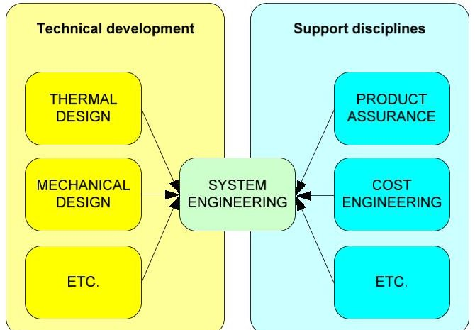
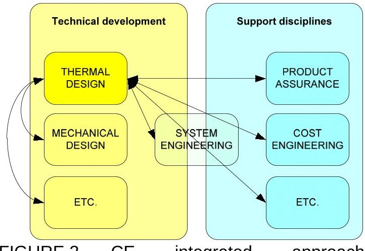
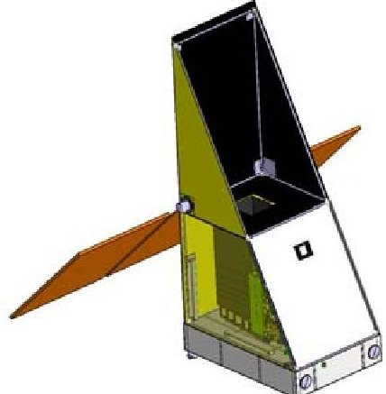
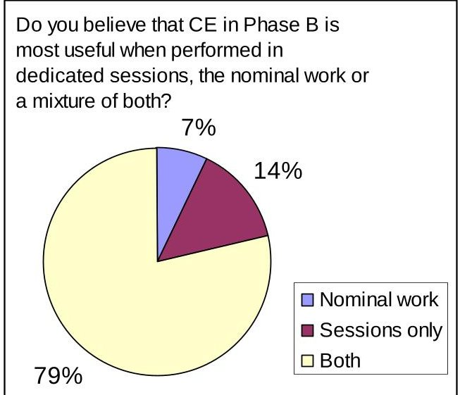
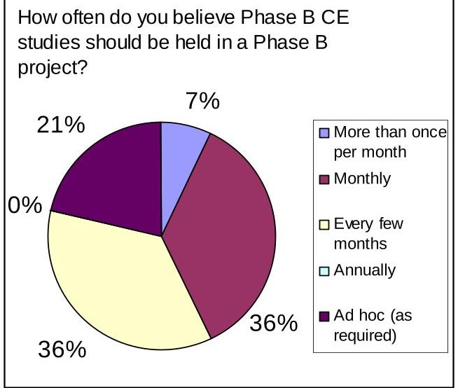
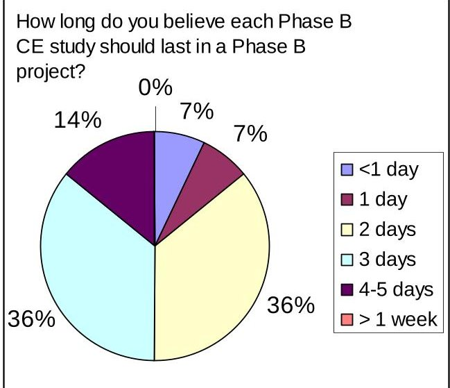

<!-- PDF_PAGE: 1 -->

# IMPLEMENTATION OF CONCURRENT ENGINEERING TO PHASE B SPACE SYSTEM DESIGN*

R. Findlay, A. Braukhane, D. Schubert, J.F. Pedersen, H. Müller, O. Essmann, DLR - Institute of Space Systems, Bremen, Germany

* This article was originally published in CEAS Space Journal, 2011. The final publication is available at http://www.springerlink.com/content/6rg03w2p05523538/

## Abstract

Concurrent engineering (CE) has been in use within the space industry since the mid-1990's for the development of robust, effective design solutions within a reduced period of time; to date however, such applications have focussed on Phase 0/A feasibility studies, with the potential for application in later phases not yet demonstrated. Applications at the DLR Institute of Space Systems have addressed this gap with practical attempts made on three satellite projects. The use of Phase 0/A CE techniques such as dedicated CE sessions, online trade-offs and design iterations and consolidation were taken and augmented with more novel practices such as online requirements engineering. Underlying these practices was a suite of tools coming from both external and internal sources. While it is noted that the traditional time and cost benefits expected from Phase 0/A use are less likely to be achieved for Phase B applications, the resulting solutions demonstrated an increased robustness and performance.

## 1 INTRODUCTION

Concurrent engineering (CE) has been in use within the space industry since the mid-1990's, and is now a well-established means for developing early space system concept designs. Applications of CE to Phase 0/A studies have reported four- to thirteen-fold savings in time, and an analogous two- to threefold reduction in cost $ ^{1,2,3} $ . Proponents also typically comment on a perceived increase in the resulting design quality.

Nevertheless, despite drawing theoretical attention in the literature $ ^{4} $ , the application of CE to later space system design phases remains unreported. With such considerable benefits assumed for Phase 0/A applications, it seems reasonable to expect that applications to later design phases may afford similar benefits.

To this extent the Institute of Space Systems at DLR Bremen has sought to address this test case gap via tentative applications to three projects currently in Phase B. The most notable example of this work has focussed on an extensive application to the development of the DLR AsteroidFinder mission, a small satellite due for launch in 2014 to characterize the

population of Inner Earth Objects (IEOs) in orbit close to the Sun $ ^{5} $ . The small team size and large demands on the system make it an ideal test bed for such an application. Other examples include the DLR CLAVIS nanosatellite and a design review of the Compass-II cubesat (from the University of Applied Sciences, Aachen).

Over one year of experience in performing Phase B CE has now been accumulated, and from this an initial methodology and recommendations can be derived.

## 2 METHODOLOGY

## 2.1 CE Overview

Concurrent engineering is a methodology that has been in use within the space industry since the mid-1990's for performing efficient, effective Phase O/A design studies. Two key aspects are a high degree of integration (of people, tools and processes) and a simultaneous, real-time exchange of information. It is a strongly modelbased approach, with reliance upon frequent short period iteration cycles.

<!-- PDF_PAGE: 2 -->

The considered approach for applying CE to Phase B is derived from that for Phase 0/A. Again, the simultaneous interaction of all spacecraft disciplines is utilised, involving participation of both traditional spacecraft subsystems (e.g. attitude and orbit control, thermal control) and support disciplines such as product assurance and cost engineering. Data is exchanged in a highly integrated, distributed fashion and, while the system engineers and team leader have a general overarching control function, they do not act as the single distribution node of information (compare Figure 1 and Figure 2) as in traditional practice.

FIGURE 1. Traditional system engineeringled approach

FIGURE 2. CE integrated approach, highlighted for thermal engineering only

In order to avoid ambiguity of meaning and to try to draw a distinction between Phase 0/A and Phase B, a distinction is here made between concurrent design (CD) and concurrent engineering. In this context, CD is understood to be the application of concurrent methods for the creation or revision of a product design; CE is the application of any engineering process in a concurrent way to aid with the development of

a product. Thus, in addition to design practices CE also embraces concurrent requirement engineering, interface control, quality assurance monitoring and design consolidation.

CE can be applied by two main means: in the nominal everyday working culture; and in dedicated CE sessions. This methodology proposes utilising a combination of the two. Dedicated CE sessions are held to resolve pertinent issues and for regular design consolidations, and are configured to include the active involvement of all team members. In addition to this CE is integrated into the daily project culture with the use of highly-integrated, co-located teams, short communication and decision paths, and a high degree of inter-subsystem tool integration. Dedicated problem teams can then be quickly set up to handle conflicts in an efficient and timely manner.

Team leadership of the dedicated CE sessions was assumed by the project leaders given that they held the authority to most quickly enact decisions and had the best overall knowledge of the interfaces between the various disciplines. A specific agenda was always prepared in advance, however sessions were often allowed to evolve naturally as the discussions progressed.

## 2.2 Employed CE Techniques for Phase B

The CE techniques employed mimicked those typically used in conventional Phase O/A studies. These included system-level trade-off analyses, database-oriented design consolidation, online requirements engineering CAD configuration walkthroughs and dedicated design discussions.

## 2.2.1 System-level tradeoffs

To ensure swift, appropriate decision-making in the face of competing design options, online system-level trade-offs were performed. The full design team was involved in the selection of trade valences and weightings, with the preselection of trade-off criteria and design options performed by the system engineers to save time.

## 2.2.2 Design consolidation (database)

<!-- PDF_PAGE: 3 -->

Database-led design consolidation allows for the finding of incongruities in the design on a numerical basis. A centralised data-repository is used, with each subsystem given full write access on their subsystem information and read access on all others. The system engineer is then responsible for collecting this information and checking that it meets system-level performance indicators (e.g. mass, power, data).

Given the automated nature of the process and the fact that one subsystem's outputs can be made to serve as another's inputs, the speed with which design iterations can be performed is thus increased.

## 2.2.3 Design consolidation (presentations)

A second method of design consolidation uses informal presentations from all discipline representatives to find potential qualitative incongruities. The stress for all presentations was placed on demonstrating the assumptions behind and results from any major analyses and on current system-level interfaces.

## 2.2.4 Requirements engineering

## 2.2.5 Online walkthroughs

Online requirements engineering was performed via a requirement-by-requirement consolidation of an onscreen system-level requirements document. A full cross-discipline team was selected and used to resolve incongruities.

Onscreen model-based walkthroughs of the current design configuration - including major issues, discrepancies and conflicts - were used to ensure a coherent understanding of the system, and indeed each subsystem, in a visual sense.

## 2.2.6 Cost engineering

Dedicated cost engineering reviews were performed involving all work-package managers and using pre-existing cost analyses (i.e. from Phase-A work) as the primary working documents.

Detailed discussions were performed to identify duplications of effort, budget saving potentials and budget shortages. Fully consolidated cost plans with bottom-up estimate accuracy could then be established within a couple of days.

## 2.3 CE Tools in Phase B

A number of CE-specific tools and resources were used to augment the applied techniques, with these being described in the following. Note that in addition to the CE tools described a suite of non-CE specific tools (e.g. MS Office $ ^{\circ} $ Matlab $ ^{\circ} $ , CATIA V5 $ ^{\circ} $ ) were also used and considered fundamentally important to the process.

## 2.3.1 DLR Concurrent Engineering Facility (CEF)

The DLR Concurrent Engineering Facility (CEF) was established in October 2008 at DLR Bremen, and has been used as the setting for a vast array of Phase 0/A development studies. It offers a main conferencing room specifically tailored to house up to twelve discipline experts, backed by a suite of modern conferencing and presentation infrastructure $ ^{6} $ .

## 2.3.2 ESA CDF Integrated Design Model

The Integrated Design Model (IDM) was developed by the ESA Concurrent Design Facility (CDF) and is a widely used tool in the European space industry for Phase 0/A $ \mathrm{C E}^{7,8} $ . It is based on an interconnected network of discipline-specific MS Excel $ ^{\circled{2}} $ workbooks linked to a centralised database workbook. It is thus highly flexible and configurable. It also has heritage from a considerable number of completed Phase 0/A studies in ESA and beyond.

## 2.3.3 J-CDS Concurrent Design Platform

The J-CDS Concurrent Design Platform (CDP) is a tool designed to serve not only Phase 0/A CE but also the more dedicated needs of Phase B CE. While maintaining use of Microsoft Excel $ ^{\circled{2}} $ for the lower-level domain work, the CDP acts as an overarching framework and data repository. The tool is thus able to handle vast data sets and affords control of data exchange at the individual parameter level, and

<!-- PDF_PAGE: 4 -->

offers integration to domain-specific tools such as Matlab $ ^{\circledR} $ .

## 3 TEST CASES

## 3.1 AsteroidFinder

In 2007 DLR began development of the Kompaktsatellit series of microsatellites, with project lead being held by the DLR Institute of Space Systems in Bremen. The first mission to be selected for this new series of satellites was AsteroidFinder, a mission to detect dangerous Near Earth Objects (NEOs) using a high-performance optical telescope (see Figure 3). The project is currently in a delta Phase-B, and is due to enter Phase C/D in January 2012. Launch is scheduled for 2015.

FIGURE 3. DLR AsteroidFinder

Due to the success of CE application in the Phase 0/A design of the mission, AsteroidFinder was considered a good candidate for the first attempted application to Phase B design. Seven official CE studies were held in the course of the phase, with the CE approach also being applied in a coarser manner during all day-to-day activities. CE studies were held to resolve particular issues, for instance a configuration redesign to improve spacecraft agility and for preparation of the system technical specification; the day-to-day implementations of CE were aided by ad hoc cross-domain team meetings, frequent exchange of unreleased design data and integration of mission analysis, power and thermal design tools.

The full scope of the presented Phase B CE methodology was applied to explore in detail the proposed techniques and tools. For

instance, both the IDM and CDP were trialled and compared, with variations in leadership role and style also attempted. Additionally, the necessity of the CEF as a supporting environment was investigated, as well as the impact of team composition and session format on study performance.

Note that the AsteroidFinder project served as the main testbed for the developed Phase B CE methodology, with the results obtained from this application providing most input to the refinement and validation of the approach. However two other examples provide more cursory demonstrations of the further applicability of the approach.

## 3.2 CLAVIS

CLAVIS is a DLR internally developed nanosatellite with the aim of providing a standardised platform for technology demonstration along the lines of the "plug-andplay" principle for accommodation of different payloads. One dedicated CE study was performed with the main goals of consolidating the bus configuration and integration of the first payload, namely an Automatic Identification System (AIS).

In contrast to the AsteroidFinder project, the application of the CE methodology was not distributed over a long time span with a few days per month of plenary sessions but on a single full week study with several design iterations on a daily basis, as is commonly applied for DLR Phase 0/A CE studies.

Due to very small spacecraft size and the fact that the project had already achieved a high state of maturity (and thus detail), it was felt that a full usage of the IDM (or any other design model) would not have added any additional benefits. As such, only the IDM system budget worksheet was used in the study. This was placed under the responsibility of the system engineer. During each session and in parallel to the discussions about the current configuration, the entire team was led through the different budgets by the system engineer to confirm their status or to implement design changes and parameter updates.

<!-- PDF_PAGE: 5 -->

The University of Applied Sciences, Aachen, is developing their second nano-satellite, the so-called Compass-II. In order to review the current configuration and to down-scale the satellite with lower cost components a Phase B CE study was performed in the CEF.

Similar to the CLAVIS nano-satellite study, four short (approximately two hour) moderated plenary sessions were held over the course of one week. The basic configuration was defined prior to the study kick-off and only minor accommodation changes, the interfaces to the payload and a revision of some components was performed. This was done mainly using small splinter discussions in reduced groups.

## 4 ASTEROIDFINDER PARTICIPANT SURVEY

1. Do you consider the use of CE in Phase B has been beneficial for the project as a whole? [Yes/No]

In order to verify and improve the developed approach, an anonymous survey was carried out on fourteen participants of the AsteroidFinder studies (the baseline development test bed). The questions were as follows:

2. Do you consider the use of CE in Phase B has been beneficial for your individual discipline work for the project? [Yes/ No]

3. Do you have greater satisfaction with the resulting system design as a result of using CE in Phase B? [Yes/No]

4. Do you believe that CE has allowed for more optimal system-level decision making? [Yes/No]

5. Do you believe that the use of CE has saved time for your Phase B work? [Yes / No]

6. Do you believe that CE in Phase B is most useful when perfromed in dedicated sessions, the nominal work or

a mixture of both? [Sessions only / Nominal work only / Both]

7. How often do you believe Phase B CE studies should be held in a Phase B project? [More than once per month / Monthly / Every few months / Annually / As required]

8. How long do you believe each Phase B CE study should last in a Phase B project? [<1 day / 1 day / 2 days / 3 days / 4-5 days / >1 week]

9. Do you believe that the time-management of the sessions was appropriate? [Yes/No]

10. Do you believe that participation by all disciplines in each CE study session is necessary? [Yes/No]

11. Would the CE sessions be improved by having an external (non-AsteroidFinder related) team leader? [Yes/No]

12. Do you believe that use of the CEF was necessary for the application of CE practice in Phase B? [Yes/No]

13. Do you believe that the tools available to you were sufficient in order to allow you to perform your work satisfactorily during the Phase B CE sessions? [Yes/ No]

14. Do you forsee applications for CE to Phase C/D work? [Yes/No]

Survey participants represented a broad cross-section of the team including team leaders, system engineers, subsystem engineers and support disciplines (e.g. cost engineering and mission analysis). All members had participated both in the dedicated CE sessions and in the day-to-day CE work, and so were qualified to give comment on the different levels of integration that the methodology should embrace.

## 5 RESULTS

The following results are based on the experience gained from all three test cases,

<!-- PDF_PAGE: 6 -->

with those from AsteroidFinder given the greatest weighting. Excerpts of results from the AsteroidFinder survey are also incorporated where illustrative.

## 5.1 CE usefulness for Phase B

The application of CE to the three projects demonstrated considerable benefits. For instance, the use of CE was felt to elicit superior, more robust and more innovative design solutions, with fewer discrepancies in assumptions between disciplines. Furthermore, the CE work was shown to render fast, effective solutions to design problems. Almost the entire survey group (93%) reported that they felt that the use of CE in AsteroidFinder had been beneficial both for the project in general and for their individual discipline work. Numerous examples of significant design improvements resulting from the application of CE exist, including: changes in downlink concept to compensate for Moment of Inertia (Mol) underestimates; a paradigm change in spacecraft configuration to achieve necessary agility improvements; and an overhaul of the operations concept to accommodate misinterpretations of the science requirements (all AsteroidFinder).

## 5.2 Participant satisfaction

The participant survey showed that CE practice was well-received amongst the AsteroidFinder team, with most surveyed team members claiming greater satisfaction with both the resulting system design (71%) and with the optimality of system-level decision making (79%) as a result of applying CE. Instances were noted when, during system-level tradeoffs, the option that was previously most favoured by the system engineering team was trumped by an alternative when assessed by the full team.

Nevertheless, as commented below, appropriate study format is a prerequisite to maintaining participant satisfaction.

## 5.3 Technique suitability

Based on the experiences of the team leaders and system engineers involved in the three projects, the following techniques were considered of most benefit during Phase B CE

work: online system-level trade-off analyses; design consolidation (presentations); online requirements engineering; and CAD configuration walkthroughs.

In both the AsteroidFinder and CLAVIS projects it was felt that the database-oriented design consolidation was too inefficient to be of significant practical use; however it must be noted that this could be traced to the delay in finding a suitable data repository early on in each project and the effort required to transfer any existing data to a new repository (the JCDS CDP only became available towards the end of these projects). This may be avoided by using a tool appropriate for Phase B from the beginning of Phase 0/A. Dedicated design discussions were also considered of significant use only when they focussed on pre-defined, specific issues, and adherence to this original issue was enforced strictly by the team leader.

## 5.4 Tool appropriateness

The use of the CEF proved advantageous throughout the sessions, allowing for easier distribution of data and ideas between disciplines. However, while certainly useful, it was only considered a necessity by a slight majority of survey participants (57%) Successful sessions for AsteroidFinder were also performed in standard meeting rooms.

The suitability of available software tools was also considered relatively high, with the current suite achieving a 64% satisfaction rating. Note however that this result is at odds with the experiences of the system engineering team: after early attempts the IDM was regarded as inadequate in its current state for Phase B implementation due to its lack of system-level parameter control and historical tracking. Hence there was a lack of a suitable modelling tool. The CDP appeared to overcome these drawbacks, however so far only preliminary attempts were attempted with this tool. Furthermore, due to the unavailability of a suitable data models from the Phase 0/A, a new models had to be re-established - this induced unnecessary effort and led to a decrease in team motivation during early "data processing" sessions.

<!-- PDF_PAGE: 7 -->

It was also noted that for maximum benefit from the CE approach, all session data must be easily accessible outside of the session locations. The CE data repository should be the sole data repository for the project - otherwise, duplication of effort significantly reduced team satisfaction.

## 5.5 Format of CE studies/sessions

While the usage of CE throughout the day-to-day project work afforded great benefits indeed, the majority of surveyed participants favoured a combination of CE usage in dedicated study sessions and in the everyday work (see Figure 4) - successful performance of the dedicated sessions was considered vitally important in achieving suitable results and equally in garnering team support for the CE approach.

FIGURE 4. Survey results: CE sessions vs. day-to-day work

One of the major findings of the study is that strong, independent session leadership is essential for achieving the most from the study sessions and in maintaining team support. While the results indicated only a slight preference for such an approach, many of the most vehement criticisms from the AsteroidFinder sessions centred on the usage of the project leader also as study leader. It was felt that this resulted in too skewed a focussing on system-level topics that were not of relevance to many of the present disciplines, causing dissatisfaction with the usage of their time. Equally, it was discovered that a stricter adherence to a predefined agenda is preferred

by most participants, rather than the more flexible approach attempted. Only 36% of surveyed participants thought that the time management of AsteroidFinder CE sessions was appropriate.

The most suitable number of CE studies to be held within the Phase B of each project was found to depend on the project scale: while for AsteroidFinder frequent studies were preferable, both CLAVIS and Compass-II achieved adequate success with only one dedicated study. Team enthusiasm seems to be greatest for either monthly or several monthly sessions (see Figure 5).

FIGURE 5. Survey results: study frequency

A vast majority of participants indicated that the ideal study duration was either two or three days, with much shorter or longer sessions considered either too rushed or too taxing, respectively (see Figure 6). For the smaller projects (CLAVIS and Compass-II), five-day studies were found particularly useful in motivating the team and achieving good results however it is expected that this enthusiasm could wane for more frequent studies (as used on AsteroidFinder). Furthermore, in these cases a considerable amount of time was reserved for offline work.

<!-- PDF_PAGE: 8 -->

FIGURE 6. Survey results: study duration

Opinion was largely split over whether participation should be made mandatory for all disciplines to all CE sessions.

## 5.6 Time/cost savings

Given that there was no measured reduction in either time or cost expenditure for the three projects in Phase B compared to other similar projects, it does not appear that CE can be promoted as a cost/time saving tool for Phase B work. However, it should be considered that the expected increases in design robustness achieved as a result of using CE could lead to significant cost savings in later phases. CE offers a means for discovering discrepancies in design assumptions, particularly with regards to interface compatibility, between subsystems, which typically become increasingly costly to fix as a project proceeds $ ^{9} $ .

## 5.7 Applications to Phase C/D

As a final consideration, the survey participants were queried on whether they foresaw scope for application of CE to Phase C/D work. The issue seems polarised - only 57% of those surveyed felt that there is sufficient scope for the continued application of CE in these later phases.

## 6 DISCUSSION

Given the successful implementation of CE in the Phase B of the three projects, it seems that CE has been demonstrated as a useful tool for improving Phase B design and development of

satellites. While it is evident that further test cases are required to streamline the methodology, the approach was well received by the project teams and delivered many of the anticipated benefits of a Phase 0/A application, albeit without the time or cost savings.

The employed methodology, tools and techniques, while not flawless, achieved success in improving the designs in terms of robustness and performance. In future applications, external session leadership will be used to maintain higher levels of participant satisfaction, coupled with a stronger focus on greater discipline involvement and a stricter adherence to the agenda. Data models created in Phase 0/A will also be setup in such a way as to maximise reuse potential in Phase B.

The greatest benefit of CE in Phase B was in areas of system performance optimisation (via trade-offs), design consolidation and requirements engineering. Such practices can prove difficult in Phase B given the increasing scope of system data, and CE was certainly found to be an asset in this regard. On the other hand, the usage of CE for online "brainstorming" design sessions became less attractive as the projects progressed, due to the increasing level of "design inertia" which grows hand-in-hand with design maturity. By the end of Phase B it is important to freeze many of the high-level system and subsystem interfaces, thus the scope for major design changes without incurring significant time or cost penalties is reduced as the Phase progresses.

A further area of important consideration is the increased level of team member involvement and satisfaction that the usage of CE can create. The importance of this should not be overlooked-a highly integrated and motivated team will often find better and more innovative solutions to complex problems. This was found particularly relevant in the smaller projects where participants may have had less frequent interaction throughout the course of their nominal work.

Nonetheless, it must be clear that the above methodology is so far only tested on projects up to the scale of small satellites - for larger projects, such applications may prove more difficult. However, given the wide range of

<!-- PDF_PAGE: 9 -->

demonstrated applicability of CE to all major types and scales of space systems in Phase 0/A (from the design of cubesats to large interplanetary spacecraft, launchers and even systems-of-systems) it seems reasonable to assume that the Phase B methodology can be easily extended to larger projects.

As for opportunities to continue CE usage beyond Phase B and into Phases C/D, it seems apparent that while opportunities do exist (for instance in integration sequence and test schedule planning), such applications may prove challenging: the time constraints of team members may be stricter (with regards to conflicting AIV duties) and the usefulness of any system-level data repository - for what should be, by this stage, a more independent level of development - may prove low. Nevertheless, with sufficient team support, such applications could prove useful, particularly for inter-subsystem work.

## 7 FUTURE WORK

Applications of CE to larger Phase B projects should be attempted to verify the recommendations for systems larger than small satellites. Further investigations into the proposed applicability of CE to Phase C/D should also be made.

## 8 RECOMMENDATIONS

Based on over one year of experience of applying CE to Phase B projects, the following recommendations, derived primarily from the AsteroidFinder project, can be made:

1. CE is a useful approach for eliciting superior, more robust solutions, but not for reducing the time or cost of Phase B projects.

2. The following practices are considered the most appropriate for Phase B work: online system-level trade-off analyses; design consolidation (presentations); online requirements engineering; and CAD configuration walkthroughs.

4. CE study sessions should be short (two to three days duration) and frequent on the order of months for long-term projects.

3. CE work should be employed in both nominal daily work and dedicated sessions.

5. CE session leadership should be from an experienced, external team leader.

6. Data models established in Phase 0/A should be compatible with further development in Phase B (e.g. same tools, data format).

## 9 CONCLUSIONS

CE is a well-established means for improving the success of space system development in Phase 0/A, and such benefits have now been shown to exist for applications to Phase B development. While significant reductions in time and cost have not been shown to arise from such applications, nonetheless CE has proved an effective means for performing design consolidation, requirements engineering and system performance optimisation. With experienced, external session leadership and an appropriate suite of supporting tools and techniques, CE can be easily integrated into the working environment in both nominal work and dedicated CE design sessions; furthermore, team member satisfaction will remain higher, thus leading to a more successful acceptance of the CE approach.

## REFERENCES

[1] Smith, J.L. (1998) Concurrent engineering in the Jet Propulsion Laboratory Project Design Center, Proc. Aerospace Manufacturing Technology Conference & Exposition (Long Beach, CA), Jun 2-4

[2] Wall, S.D. (2000) Use of Concurrent Design in Space Mission Design, Proc. European Systems Engineering Conference (Munich), Sep 13

[3] ESA/CDF (2010) The ESA Concurrent Design Facility: Concurrent engineering applied to space mission assessments, unpublished, available:

http://esamultimedia.esa.int/docs/cdf/CDF_INF OPACK_2010.pdf

[4] Miro, J. (2006) Evolution of Concurrent Engineering in Phases B/C/D, Proc. 2nd Concurrent Engineering for Space Applications Workshop (Noordwijk), Nov 19-20

<!-- PDF_PAGE: 10 -->

[5] Findlay, R., Spietz, P., Pedersen, J.F., and Gerené, S. (2010) Concurrent engineering through the stages: AsteroidFinder (Phase B), Proc. 4th International Workshop on System & Concurrent Engineering for Space Applications (Lausanne), Oct 13-15

[6] Romberg, O., Braukhane, A., Schumann, H., (2008) Status of the Concurrent Engineering Facility at DLR Bremen, Proc. DGLR Congress (Darmstadt), Sep 23-25

[7] Bandecchi, M., Melton, B., Gardini, B., and Ongaro, F. (2000) The ESA/ESTEC Concurrent

Design Facility, Proc. of the $ 2^{\mathrm{nd}} $ European Systems Engineering Conference (Munich), Sep. 13-15

[8] Biesbroek, R. (2010) Sustainable Satellite Design Activities in the ESTEC CDF, Proc. 4th International Workshop on System & Concurrent Engineering for Space Applications (Lausanne), Oct 13-15

[9] Astrium GmbH (2010) Application of Lean Engineering Principles to Space Mission Development, contract ESTEC 22118/08/NL/AF. Prepared for the European Space Agency.