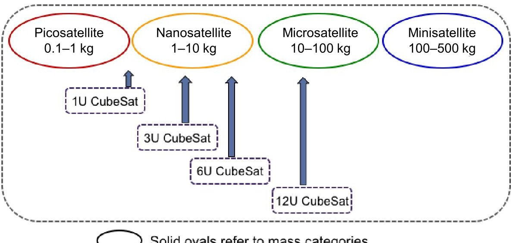
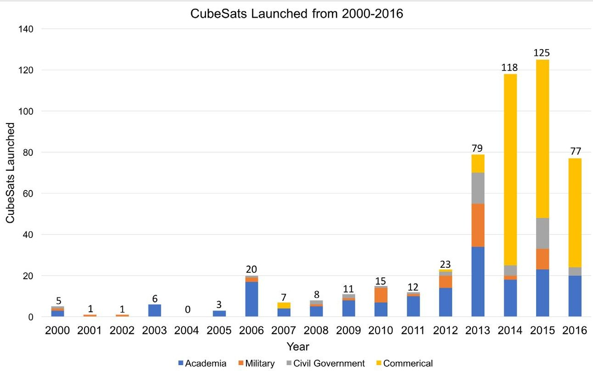
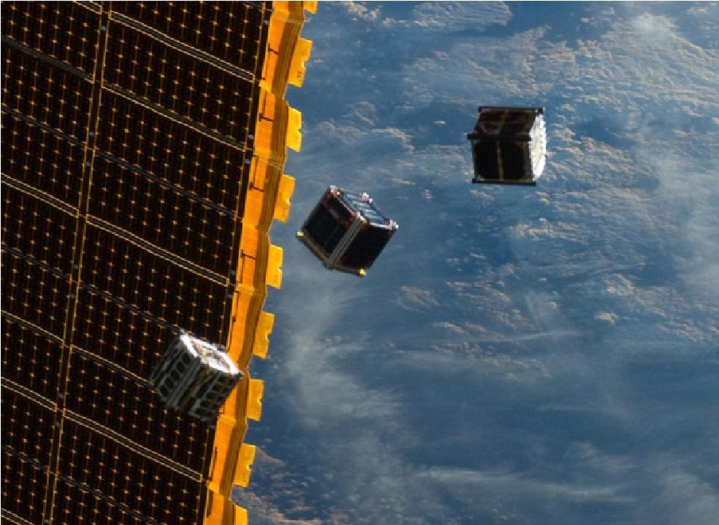
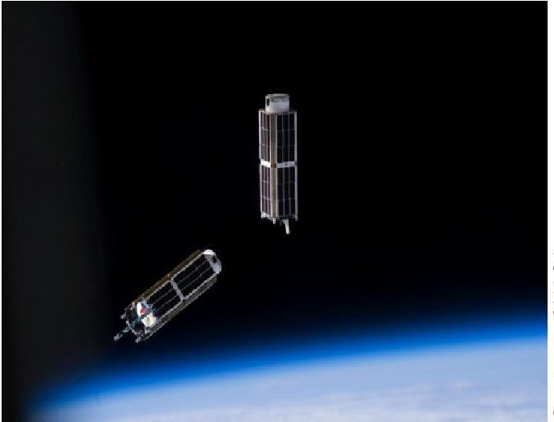
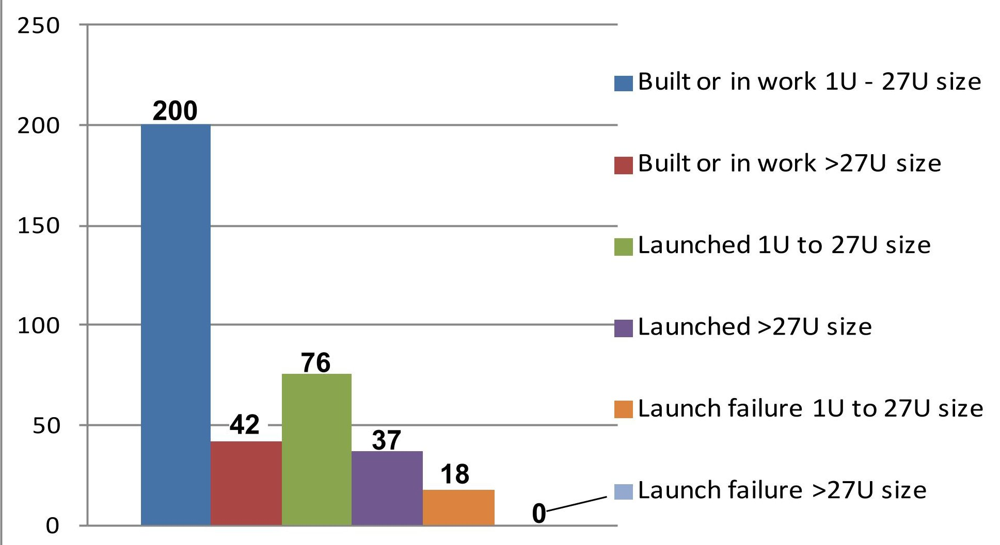
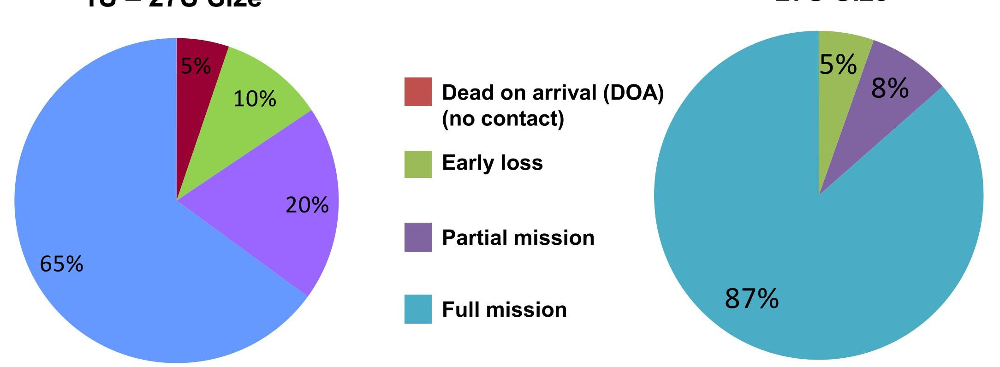
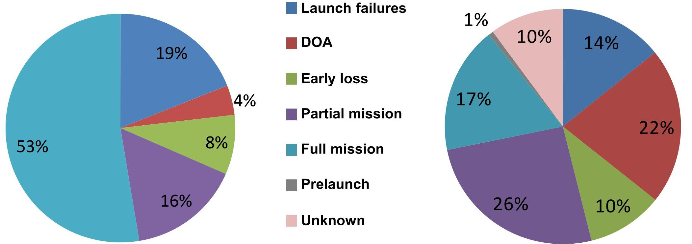
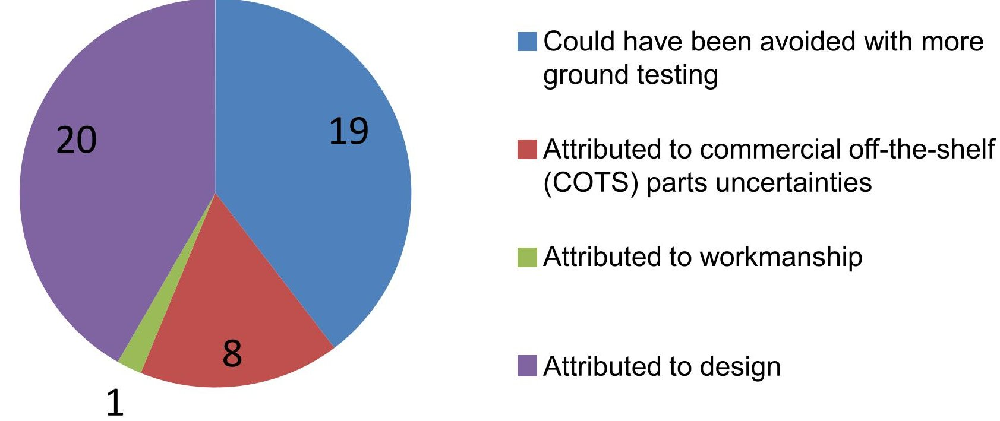
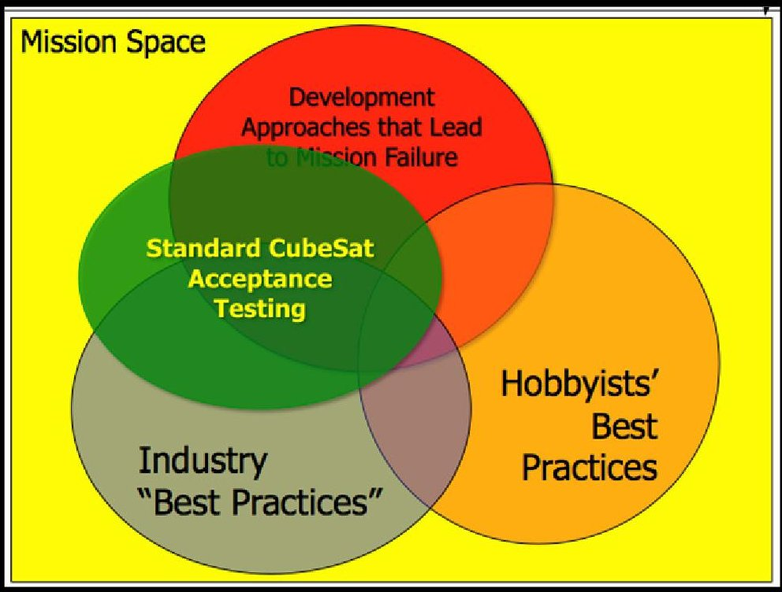

<!-- PDF_PAGE: 1 -->

# Improving Mission Success of CubeSats

June 12,2017

Catherine C. Venturini Developmental Planning and Projects Advanced Development and Planning Division

Prepared for:

Space and Missile Systems Center Air Force Space Command 483 N. Aviation Blvd. El Segundo, CA 90245-2808

Contract No. FA8802-14-C-0001

Authorized by Space Systems Group

Developed in conjunction with Government and Industry contributors as part of the U.S. Space Programs Mission Assurance Improvement Workshop.

Distribution Statement A: Approved for public release, distribution unlimited.

<!-- PDF_PAGE: 2 -->

## Abstract

As a concept, the CubeSat class of satellite is over 15 years old. The first were launched in 2003 and a few more in 2006. The numbers were noticeably greater in 2009 and have been increasing at a rapid pace ever since. However, if mission success is defined as simply the degree to which the mission goals were achieved, then the mission success of this class of satellite has been low. To find out why, our mission assurance topic team interviewed CubeSat developers in academia, industry, and government-funded research centers. The information in this document comes from the interview responses to a common set of questions that were posed to guide, but not limit, these conversations. Those who have built and flown satellites generously shared their processes, circumstances, results, and lessons learned, and everyone interviewed shared their current processes and philosophies on design, testing, and mission assurance. While root cause was not determined for most on-orbit anomalies, the theories of what possibly went wrong were still useful, as were the lessons learned on what could have been improved during the development process. The responses were grouped into themes which concluded with simple, actionable recommendations that we believe will improve the likelihood of mission success of future CubeSat development projects.

<!-- PDF_PAGE: 3 -->

## Acknowledgments

This document has been produced as a collaborative effort of the Mission Assurance Improvement Workshop (MAIW). The forum was organized to enhance mission assurance processes and supporting disciplines through collaboration between industry and government across the U.S. Space Program community utilizing an issue-based approach. The process is to engage the appropriate subject matter experts to share best practices across the community in order to produce valuable mission assurance guidance documentation.

The document was created by multiple authors throughout the government and the aerospace industry. For their content contributions, the following contributing authors are acknowledged for making this collaborative effort possible:

<table border="1"><tr><td>Barbara Braun</td><td>The Aerospace Corporation</td></tr><tr><td>David Hinkley</td><td>The Aerospace Corporation</td></tr><tr><td>Catherine Venturini</td><td>The Aerospace Corporation</td></tr><tr><td>Bob Andrews</td><td>Ball Aerospace and Technologies Corporation</td></tr><tr><td>Greg Berg</td><td>The Boeing Company</td></tr><tr><td>Jeff Christensen</td><td>The Boeing Company</td></tr><tr><td>Kim Hicks</td><td>The Boeing Company</td></tr><tr><td>Mike Tolmasoff</td><td>The Boeing Company</td></tr><tr><td>Andrew Whiting</td><td>The Boeing Company</td></tr><tr><td>Tom Wiedenbauer</td><td>Harris Corporation</td></tr><tr><td>Gary Kushner</td><td>Lockheed Martin Corporation</td></tr><tr><td>Rick Gebbie</td><td>MIT Lincoln Laboratory</td></tr><tr><td>Renelito Delos Santos</td><td>SSL</td></tr></table>

A special thank you for co-leading this team and efforts to ensure completeness and quality of this document are extended to:

Catherine Venturini

Mike Tolmasoff

The Aerospace Corporation

The Boeing Company

Renelito Delos Santos

SSL

<!-- PDF_PAGE: 4 -->

The topic team would also like to acknowledge the contributions and feedback from the subject matter experts who reviewed the product prior to publication:

<table border="1"><tr><td>Ron Duphily</td><td>The Aerospace Corporation</td></tr><tr><td>Lynn Friesen</td><td>The Aerospace Corporation</td></tr><tr><td>Larry Harzstark</td><td>The Aerospace Corporation</td></tr><tr><td>Gail Johnson-Roth</td><td>The Aerospace Corporation</td></tr><tr><td>Elizabeth Klein-Lebbink</td><td>The Aerospace Corporation</td></tr><tr><td>Art McClellan</td><td>The Aerospace Corporation</td></tr><tr><td>Charles Swenson</td><td>The Aerospace Corporation</td></tr><tr><td>Reuben Rohrschneider</td><td>Ball Aerospace and Technologies Corporation</td></tr><tr><td>Ryan Nugent</td><td>California Polytechnic State University, San Luis Obispo</td></tr><tr><td>Steven Pereira</td><td>Johns Hopkins University Applied Physics Laboratory</td></tr><tr><td>Andrew Robertson</td><td>Millennium Space Systems</td></tr><tr><td>Conor Galligan</td><td>MIT Lincoln Laboratory</td></tr><tr><td>Sue Aleman</td><td>NASA</td></tr><tr><td>Andrew Demo</td><td>NASA</td></tr><tr><td>Kenneth LaBel</td><td>NASA</td></tr><tr><td>Jesse Leitner</td><td>NASA</td></tr><tr><td>Miquel Moe</td><td>NASA</td></tr></table>

<!-- PDF_PAGE: 5 -->

# Improving Mission Success of CubeSats

Mike Tolmasoff, The Boeing Company Renelito Delos Santos, SSL Catherine Venturini, The Aerospace Corporation

June 12,2017

<!-- PDF_PAGE: 6 -->

## Outline

- Introduction

- Present state of affairs

- Methodology and process

- Interview statistics

- Themes

- Recommendations

- Acronyms and abbreviations

- References and further reading

<!-- PDF_PAGE: 7 -->

## Introduction

<!-- PDF_PAGE: 8 -->

## Problem Statement

- There has been an exponential increase in CubeSats launched since 2003:105 from 2003 through 2012,79 in 2013,and 118 in 2014. Yet mission success rates average 45 percent and 77 percent between academia and industry, respectively. Missions were deemed a success if the CubeSat operated on orbit for 60 days or longer [7].

- As the importance of CubeSat payloads and missions increases, what aspects of mission assurance can significantly improve mission success rates?

<!-- PDF_PAGE: 9 -->

## Intended Audience

- The target audience for this product consists of:

- CubeSat designers and developers (academia, industry)

- CubeSat product suppliers (hardware, software)

- CubeSat customers (government, others)

- This product intended to address the needs of producers and consumers

- CubeSat designers, developers, and suppliers will use this product to improve their design and manufacturing processes

- CubeSat customers will use this product to improve their requirements and statement of work documentation

<!-- PDF_PAGE: 10 -->

## Charter

- Brought a colloquium together to review CubeSat design and manufacturing processes across industry, academia, and government suppliers to identify best practices

- Interviewed leading CubeSat suppliers from industry, academia, and government to understand approaches taken to increase probability of mission success, where mission success is defined as the achievement of desired mission performance over intended design life

- Identified important areas (e.g., parts/qualification, design process, etc.) that CubeSat providers have focused on to improve probability of mission success

<!-- PDF_PAGE: 11 -->

## Product Overview

- This study was made possible by the dedication of the MAIW steering and program committees and the hard work of the team comprising engineering professionals from government, industry, and academia

- The "Present State of Affairs" section highlights the growth of CubeSat applications and underscores the need "to move the needle" towards improving mission success

- The "Methodology and Process" section thoroughly explains how our work was performed

- The "Interview Statistics" section highlights data gathered from the interviews

- The "Themes" section provides a comprehensive summary of the interviews conducted and observations shared from the community that was interviewed

- The "Recommendations" section describes the set of eight actionable recommendations that we believe will help improve CubeSat mission success

- The "References and Further Reading" section lists documents referenced in the report and related documents compiled by the team

<!-- PDF_PAGE: 12 -->

## Recommendation Summary

- The recommendations and rationale are on pages 68 through 84

- The eight recommendations are actionable and time-phased to a program lifecycle from authorization to proceed through delivery to launch

- Each recommendation can be implemented individually

- Each recommendation is scalable

- High-risk-tolerant programs can implement a recommendation in a simple, low-side-compliant manner

- Risk-adverse programs can implement a recommendation more rigorously

- The recommendations are invariant to CubeSat size

<!-- PDF_PAGE: 13 -->

## Future Topic Areas Related to this Study

- Assess the value of implementing the study recommendations

- Update interview questions to determine whether organizations are implementing the study recommendations and what the impact has been to their programs and missions

- Assess the evolution of manufacturing towards large constellations and how organizations implement processes to ensure mission success

- Evaluate the CubeSat supply chain and what processes are being used to qualify parts and subsystems, including interviewing suppliers

- Evaluate utility and feasibility of shared-use facilities for integration, verification, and test (IV&T)

<!-- PDF_PAGE: 14 -->

# Present State of Affairs

<!-- PDF_PAGE: 15 -->

## Background

- CubeSats are generally defined by the standard of a cube 10 centimeters (cm) x 10 cm x 10 cm (referred to as 1U) on each side, weighing approximately 1.33 kilograms (kg) and having 1 watt (W) of power

- From this baseline, one can extend the size to a 10 cm x 10 cm x 20 cm (referred to as 2U) and 10 cm x 10 cm x 30 cm (referred to as 3U) form factor and larger

- The standard was originally developed in the late 1990s as a joint effort between California Polytechnic State University, San Luis Obispo (Cal Poly) and Stanford University for the academic community [13][14]

- Cal Poly and Stanford University developed the Poly-Picosatellite Orbital Deployer (P-POD) launch dispenser standard to provide a low-cost solution to develop and safely launch CubeSats

Small Satellite Nomenclature

- The P-POD has a tubular design that can hold up to 10 cm x 10 cm x 34 cm of deployable hardware

<!-- PDF_PAGE: 16 -->

## CubeSats Launched from 2000 through 2016

- The breakout year for CubeSats was 2013, which saw a fourfold increase in CubeSat launches [5]

- The increase in launch opportunities since 2013 is from:

- Additional rideshare opportunities on U.S. launch vehicles

- International Space Station (ISS) launches

- Foreign launch opportunities

- CubeSat launches in 2016 decreased due to launch failures and delays [4]

- New entrant launch vehicles are in development that will expand options for access to space [4]

Data Source: M. Swartwout CubeSat Database at Saint Louis University [4]

<!-- PDF_PAGE: 17 -->

## CubeSats Launched from 2000 through 2016 (cont.)

- Commercial missions have been dominant in recent years, with private funding enabling many new startup companies, e.g., Planet Labs Inc. [8]

- Academia continues to have strong educational component for training future workforce but also for conducting science missions with funding from the National Science Foundation (NSF), Air Force Research Laboratory (AFRL), and the National Aeronautics and Space Administration (NASA) [9][10]

- Government interest has grown to include operational missions, including experiments and technical demonstrations that provide an important role in technology maturation [10]

Courtesy of NASA

Courtesy of NASA

<!-- PDF_PAGE: 18 -->

# Methodology and Process

<!-- PDF_PAGE: 19 -->

## Methodology and Process Overview

## Research preparation

- Literature search

- Questionnaire development

- Wish list of organizations to interview

- Dry-run interviews to improve interviewing skills and refine questionnaire

- Interview process

- Contact organizations and schedule interviews

- Conduct interviews and generate interview summaries

## Analysis process

- Analyze data, identify themes, and formulate recommendations

- Product generation

- Initial product

- Subject matter expert review

- Final product

<!-- PDF_PAGE: 20 -->

## Research Preparation

## Literature search

- Goal: To ensure that mini-topic will not be replicating existing research

- Result: No existing research found on mini-topic

## Questionnaire development

- Questions were intentionally open-ended to stimulate conversation during the actual interview

- Team focused on obtaining qualitative data in seven major focus areas:

1. Organizational experience with CubeSats

2. Teams and turnover

3. Customer expectations and risk tolerance

4. Reviews

5. Analyses and tests

6. Most and least important tests or processes

7. Organization's mission assurance philosophy

<!-- PDF_PAGE: 21 -->

## Research Preparation (cont.)

## Wish list of organizations to interview

- 57 organizations identified

## Dry-run interviews

- Goal: To improve team interviewing skills and refine questionnaire

- Result: Two dry-runs conducted, lessons learned debriefs held, and questionnaire iterated

## Final questionnaire

- The following pages present the final questionnaire that was used during actual interviews

- Questionnaire contains three main sections:

1. Interview questions

2. Reference list of analyses

3. Reference list of tests

<!-- PDF_PAGE: 22 -->

## Final Questionnaire - Interview Questions

<table border="1"><tr><td>1</td><td>How many CubeSats has your organization built? Out of those built, how many have flown? Were the missions successful, where mission success is defined as achievement of the desired mission performance over the intended design life?</td></tr><tr><td>2</td><td>Describe one or more of your recent CubeSat missions. Was it successful? What do you think contributed most to its success? If not successful, what would you do differently?</td></tr><tr><td>3</td><td>What is the experience level of your team (e.g., recent college graduates, senior engineers, or a mixture)?</td></tr><tr><td>4</td><td>Do the team members change often or are the team members consistent for long periods of time?</td></tr><tr><td>5</td><td>What were the customer expectations and risk-tolerance level (low, medium, high)? Did their expectations change with time?</td></tr><tr><td>6</td><td>Please list the major reviews that occurred for the project (e.g., preliminary design review [PDR], critical design review [CDR], etc.). Did your customer participate in these reviews? Did you have independent reviewers participating?</td></tr><tr><td>7</td><td>Before you approve a detailed design (mechanical, electrical, or software), do you perform an independent peer review?</td></tr><tr><td>8</td><td>What performance analyses were done (e.g., thermal simulation, power budget, radio frequency [RF] link budget)? What tests were done (e.g., thermal cycling, deployment testing)? See analyses and test lists below for reference.</td></tr><tr><td>9</td><td>What test or process do you consider essential to CubeSat success (i.e., “if you only could do one test, which one would you do”)? What would be the second most important test/process? What test or process would you eliminate if you could? What did you think was not value-added?</td></tr><tr><td>10</td><td>What is your organization&#x27;s “philosophy” on mission assurance?</td></tr></table>

<!-- PDF_PAGE: 23 -->

## Final Questionnaire - Reference List of Analyses

- RF power margin

- Phase noise

- Pointing/stability (assumes active control)

- Power budget (energy balance)

- Mass properties

- Clearance of deployments (assumes deployable appendages)

- Thermal (external environmental modelling and internal effects)

- Finite element modeling

- Venting

- Mechanical stress

- Force/torque margin (assumes deployable appendages)

- Electrostatic discharge/internal electrostatic discharge (ESD/iESD)

- Electromagnetic interference/ electromagnetic compatibility (EMI/EMC)

- Single event effects/single event upsets (SEEs/SEUs)

- Radiation

- Contamination

- Failure modes effects analysis (FMEA)

- Reliability

- Electrical stress

- Worst-case circuit analysis

- Software throughput

- Software timing

<!-- PDF_PAGE: 24 -->

## Final Questionnaire - Reference List of Tests

- Thermal cycle testing

- Thermal vacuum testing

- Thermal balance testing

- Random vibration testing

- Acoustic testing

- Sine sweep (often done before and after random vibration)

- Strength testing (sine burst, sine vibration, or other?)

- Modal survey testing

- Shock testing

- EMI/EMC testing

- Abbreviated/full functional testing

- Day-in-the-life and week-in-the-life testing

- RF compatibility testing (factory and/or launch base)

- Command testing (checking commands against the vehicle—sometimes done by tracking commands throughout the testing sequence)

- End-to-end testing (involves the ground system and the end user)

- Deployment testing (including first-motion testing)

- Mass properties (including spin balance)

- Fit checks (to the deployer in this case)

- Subsystem tests, e.g., star tracker, software, attitude determination and control subsystem (ADCS) magnetic tests, continuity tests on solar panels, antenna patterns, battery testing

- Mission operations rehearsal

<!-- PDF_PAGE: 25 -->

## Interview Process

## Sub-divided topic team into four interview teams

- Each interview team was responsible for:

- Initiating contact with organizations

- Scheduling and conducting interviews

- Taking interview notes and generating interview summaries

- Individual roles assigned within interview sub-teams

- Lead interviewer, lead data analyst, and interview scribes

- Final interview summary generated for each interview which passed multiple peer reviews

- Multiple peer reviews ensured that the interview summary was both accurate and consistent with what was discussed during the interview

- Peer-reviewed and approved by greater topic team

- Peer-reviewed and approved by interviewed organization

<!-- PDF_PAGE: 26 -->

## Contacting Organizations

- A communications package was developed to aid in reaching out to organizations

- The mini-topic, "Improving the Mission Success of CubeSats," is looking to gather best practices and lessons learned from past and present CubeSat missions that will benefit the entire community

- We will not ask, nor do we want, any proprietary information

- The topic team comprises members from The Aerospace Corporation, academia, and industry

- None of the data will be released outside of the topic team

- The aggregate data and analysis from the interviews will be available in a publicly releasable report

- Organizations will have the opportunity to review more detailed data from the interviews

- Final questionnaire was sent to organizations the week of their interviews

<!-- PDF_PAGE: 27 -->

## Organizations Interviewed

<table border="1"><tr><td>Academia(10)</td><td>Industry(5)</td><td>Government/FFRDC/UARC(8)</td></tr><tr><td>California Polytechnic State University</td><td>Atmospheric&amp;Space Technology Research Associates,LLC(ASTRA)</td><td>The Aerospace Corporation</td></tr><tr><td>Georgia Institute of Technology</td><td>Blue Canyon Technologies</td><td>Air Force Research Laboratory</td></tr><tr><td>Massachusetts Institute of Technology</td><td>The Boeing Company</td><td>Massachusetts Institute of Technology Lincoln Laboratory</td></tr><tr><td>Montana State University</td><td>Millennium Space Systems</td><td>NASA Ames Research Center</td></tr><tr><td>Saint Louis University</td><td>Planetary Resources</td><td>NASA Goddard Space Flight Center</td></tr><tr><td>University of Michigan</td><td></td><td>NASA Wallops Flight Facility</td></tr><tr><td>University of Southern California</td><td></td><td>Space and Naval Warfare Systems Command</td></tr><tr><td>United States Naval Academy</td><td></td><td>Space Dynamics Laboratory</td></tr><tr><td>U.S.Air Force Academy</td><td></td><td></td></tr><tr><td>Utah State University</td><td></td><td></td></tr></table>

*Two organizations declined participation in the study and 32 organizations were not interviewed due to time constraints

Total Participating Organizations: 23

FFRDC = Federally Funded Research and Development Center UARC = University-Affiliated Research Center

<!-- PDF_PAGE: 28 -->

## Data Analysis

- Core dataset composed of all the interview notes and the interview summaries

- 415 pages of interview data were mined

- Identified common themes and theme categories across interviews 40 common themes

- 8 theme categories

- Developed recommendations by analyzing themes and theme categories

- 8 recommendations on how to improve mission success of CubeSats

<!-- PDF_PAGE: 29 -->

## Product Generation

## Initial product

- Topic team members took ownership over major sections:

<table border="1"><tr><td>Product Section</td><td>Section Lead</td></tr><tr><td>Introduction</td><td>Mike Tolmasoff</td></tr><tr><td>Present State of Affairs</td><td>Catherine Venturini</td></tr><tr><td>Methodology and Process</td><td>Renelito Delos Santos</td></tr><tr><td>Interview Statistics</td><td>Greg Berg</td></tr><tr><td>Themes</td><td>Barbara Braun, David Hinkley, and Bob Andrews</td></tr><tr><td>Recommendations</td><td>Gary Kushner</td></tr><tr><td>References and Further Reading</td><td>Catherine Venturini</td></tr></table>

- Subject matter expert review

- 17 subject matter experts reviewed the draft product

- 190 actionable comments were provided

- Final product

- Topic team adjudicated all actionable comments from subject matter experts and updated the product

<!-- PDF_PAGE: 30 -->

# Interview Statistics

<!-- PDF_PAGE: 31 -->

## Interview Statistics Introduction

- The following pages summarize statistical analyses based on answers given during the 23 interviews held with academia, industry, and government agencies

- The data is primarily from the interviews, with minor additions from online sources

- "Lessons learned" were volunteered by the interviewees. Some organizations were less forthcoming than others with regard to identifying and discussing failures.

- Both quantitative and qualitative data was obtained and assessed

- Responses to the qualitative questions often included discussions that addressed on-orbit anomalies and potential corrective actions

- For purposes of this assessment, the satellites were segregated into two size groups:

- Group 1 = 1U (1.33 kg) to 27U (36 kg) Picosats/Nanosats

- Group 2 = >27U to 200 kg Microsats/Smallsats

- The development, launch, and on-orbit experiences for Group 1 spanned a time frame from 2002 to 2016. The Smallsats in Group 2 include programs from the 1980s and 1990s

<!-- PDF_PAGE: 32 -->

## Interview Statistics - Basic Data Set

- Satellites built and flown by respondents

U.S. SPACE PROGRAM MISSION ASSURANCE IMPROVEMENT WORKSHOP THE BOEING COMPANY | EL SEGUNDO, CA | MAY 2-4, 2017

<!-- PDF_PAGE: 33 -->

## Mission Status by Size

- Respondent assessments of mission success for satellites that achieved orbit

1U-27U Size

U.S. SPACE PROGRAM MISSION ASSURANCE IMPROVEMENT WORKSHOP THE BOEING COMPANY | EL SEGUNDO, CA | MAY 2-4, 2017

<!-- PDF_PAGE: 34 -->

## Comparison to Related CubeSat Research

MAIW interviews: 94 Picosats/Nanosats launched

Dr. Swartwout's database: 288 CubeSats launched [6]

- Rough correlation exists for launch failures and early loss categories

- Many more DOA observed in larger dataset

- MAIW interviewees appear to have more partial and full successes, possibly due to these organizations having more experience with lessons learned from multiple missions

<!-- PDF_PAGE: 35 -->

## 27 Anomalies Were Discussed During Interviews

- Respondents described anomalies

- Respondents offered opinions on root cause

- Each of the 27 has one or more contributors

- Note that more ground testing could have identified some or all of the other issues

<!-- PDF_PAGE: 36 -->

## Themes

<!-- PDF_PAGE: 37 -->

## Themes Introduction

- During the course of the interviews, many themes emerged

- These were concepts, practices, and observations made by the interviewees which stood out, either due to their pertinence or their recurrence

- Many of the themes were common across industry, academia, and government

- Notable differences are mentioned on the following pages

- Most of the themes are broadly applicable to all missions regardless of mission resources or success criteria; exceptions are noted

- To preserve confidentiality, themes and observations are not attributed to specific companies or agencies

- Themes were used to derive the recommendations that follow

<!-- PDF_PAGE: 38 -->

## Theme 1: Setting the Purpose and Vision of the Mission

- Different agencies have different visions for CubeSats

- Some see them as educational tools for students

- Some see them as "lab benches in space"

- Some see them as capable platforms for simple or potentially complex missions

- Industry observers must be careful when interpreting metrics of success

- CubeSats have relatively high failure rates in part because they are willing to take big risks

- For academic institutions, student education is often the primary measure of mission success

- A number of academic developers will launch regardless of readiness

- "We'd rather take a 5 percent chance of it working, than a 0 percent chance of it ever launching."

<!-- PDF_PAGE: 39 -->

## Theme 1: Setting the Purpose and Vision of the Mission (cont.)

- Many organizations commented on the need for missions to be properly scoped and resourced from the start

- Many interviewees commented on the negative implications of "scope creep"

- One interviewee discussed how a simple-seeming science change to a mission led to redesign of the electronics board, noting, "Little decisions early on make a big impact at the end."

- Another commented, "At first, we had very simple expectations. Then as the requirements changed, we got in over our heads."

- Interviewees recommended establishing (and defending) a minimum baseline mission, and also having a de-scope plan in place should circumstances require it

<!-- PDF_PAGE: 40 -->

## Theme 1: Setting the Purpose and Vision of the Mission (cont.)

- Many organizations commented on the need for missions to be properly scoped and resourced from the start (cont.)

- Several interviewees encountered mismatches between funding/resources and expectations: "Make sure the financials match the mission up front."

- Sometimes the customer had higher expectations of the project than the funding could support

- Sometimes the developer was overly optimistic in cost estimation (this is one situation where a de-scope plan can help)

- Two agencies from industry identified the need for a "pathfinder" demonstration to validate new bus designs prior to production of operational vehicles

- "The customer should have recognized that without a pathfinder flight of an 'empty bus' that there were too many new things on the first flight."

<!-- PDF_PAGE: 41 -->

## Theme 1: Setting the Purpose and Vision of the Mission (cont.)

- Many organizations commented on the need for missions to be properly scoped and resourced from the start (cont.)

- Two academic institutions credited their strong systems engineering approach—and extreme resistance to scope creep—for their mission success

- "Limit complexity, and test extensively"

- Establish the purpose, success criteria, and expectations of the mission early and often

- There is a need to define upfront what mission success actually means, and to communicate this to key stakeholders from the beginning to the end of the program

- See References [1] through [3] for a discussion of risk management, risk communication, and requirements flowdown approaches

<!-- PDF_PAGE: 42 -->

## Theme 2: Establishing the Program Structure

## Team makeup

- Team size and composition varied among CubeSat developers and from academia to industry

- Academic institutions have the highest turnover, as students graduate

- Many academic teams benefited from experienced leads and mentors

- From the limited interview data, it appears that the more experienced the mentor is, the greater the success rate is among academic institutions

- Many mentors came from industry and applied the lessons learned from industry to their academic programs

<!-- PDF_PAGE: 43 -->

## Theme 2: Establishing the Program Structure (cont.)

## Documentation rigor

- Contrary to popular perception, many interviewees felt that process documentation was more important

- ...the more inexperienced the team (to ensure the application of best practices)

- ...the more turnover expected (to ensure continuity)

- ...as teams and companies grow in size (to maintain corporate culture)

- "We started to lose institutional knowledge through confusion."

- One academic institution with a good success record stated, "We use formal shop (work) orders, good as-built discipline, and good as-tested documentation. These help with transferring knowledge between students during turnover."

<!-- PDF_PAGE: 44 -->

## Theme 2: Establishing the Program Structure (cont.)

## Reviews

- Most of the respondents followed the typical government/industry review cycle (PDR, CDR, etc.)

- In many academic cases, these reviews were tied to the academic calendar, rather than project milestones

- The value of the major reviews was debated

- Pros:

- Most academic institutions thought it helpful to expose students to industry practices

- Several interviewees felt that the major reviews helped identify interface or operational concept disconnects

- Major reviews sometimes provide useful deadlines

- Cons:

-сцисси Major reviews take resources away from engineering

<!-- PDF_PAGE: 45 -->

## Theme 2: Establishing the Program Structure (cont.)

## Reviews (cont.)

- The use of less formal, but rigorous, peer reviews was considered more value-added

- Bringing in "independent" reviewers for these peer reviews was helpful

- These reviewers are sometimes engineers from the same organization that are not working that particular program

- "For less-formal projects, you can do formal or detailed reviews of major risks, and a catch-all for the rest of the areas"

- Review style is not always up to the program

- Approach and formality are sometimes dictated by the customer

- Interviewees recommended working with the customer to understand their expectations and come to a mutually agreeable review strategy

<!-- PDF_PAGE: 46 -->

## Theme 2: Establishing the Program Structure (cont.)

## Schedule

- Nearly every academic institution—and several government and industry agencies—commented on the "time crunch factor"

- Most launches will not wait for a CubeSat

- "We are incredibly optimistic about what they can accomplish on a fixed time schedule with a volunteer labor force"

- This puts extreme pressure on the latter half of the schedule, including assembly and test—something that nearly every institution considers critical

- Several institutions attribute their on-orbit failures to the time crunch factor

- One in particular called out the small form factor of CubeSats combined with the short assembly time as potentially contributing to an on-orbit failure

- "At the outset, dedicate half your schedule to testing"

<!-- PDF_PAGE: 47 -->

## Theme 2: Establishing the Program Structure (cont.)

## Programmatic philosophy

- "Have a really good concept, scoped appropriately, and good systems engineering at PDR to be sure you can complete your conceptual design within the budget"

- At least one mission suffered from the interplay between academic campus priorities versus university-affiliated laboratory priorities

- Campus groups typically prioritize education and are willing to accept risk

- University-affiliated laboratories are more like industry, and want to improve their success rates

- Both are perfectly acceptable philosophies, but can clash, to the detriment of the mission

<!-- PDF_PAGE: 48 -->

## Theme 3: The Risk Process

- A good risk process is more important for CubeSat missions, not less

- Risk-based mission assurance allows missions with low resources to get the most "bang for the buck"

- "Do a reliability/risk assessment at the beginning. What is new? What is a single-point failure that will kill you in one fell swoop?"

- "Write crisp risk statements." Refer to [1] through [3] for guidance on risk assessment and mitigation processes.

- Put more detail into design reviews and testing

- "We place a lot of specific thought into what adds value. We identify what are the most important things we need to do, and make sure those things get done, rather than trying to do everything."

- "You don't have the resources to focus on everything. Pick and choose based on risk, not on gut feel or emotion."

<!-- PDF_PAGE: 49 -->

## Theme 3: The Risk Process (cont.)

## The cost-to-risk-reduction ratio

- When choosing analyses to do, tests to perform, and processes to implement, consider the ratio between programmatic risk (cost, schedule), and technical risk (risk of an on-orbit failure)

- Focus on the low-ratio work first, and work up from there as resources allow

- Flight software is always a risk

- "Software is hard to analyze." Early, functional testing is necessary.

- Ability to reprogram on orbit helps, but teams must be careful

- One organization got out of the habit of thoroughly verifying new software uploads through regression testing and suffered a failure

- Have robust safe modes

<!-- PDF_PAGE: 50 -->

## Theme 4: Design and Analysis

## Design for simplicity and robustness

- Simple designs have fewer failure modes

- Most university missions have very simple operations

- Simple deployables, minimal or no attitude control, low data downlink, low power need

- Complicated designs have more challenging development; funds and timelines do not fit the CubeSat paradigm (rapid and cheap)

- Tri-folded wings, expensive payloads, capable pointing, directional antennas

- "Bus and payloads were both very ambitious"

- Standardization increases efficiency and mitigates risk

- Procuring a standardized/commercial bus allows students to focus on figuring out how to integrate a new payload onto that bus

- Leverage commercial suppliers of large components, and focus on payloads

<!-- PDF_PAGE: 51 -->

## Theme 4: Design and Analysis (cont.)

## Design for simplicity and robustness (cont.)

- Employ fail-safes built into the satellite electronics

- Watchdog timers are a common and easy-to-implement safety feature for processors

- Many experienced developers cited use of timers

- "Have a good, robust accounting of your mass, volume, power, and data resources."

- "Have many ways to reset the satellite."

- CubeSats often use non-radiation-hardened parts, which can latch up

- Consider "back door" resets through radio

- One developer does a complete satellite reset every 24 hours as a precautionary measure

- One organization makes certain that all non-radiation-hardened components can be power-cycled

<!-- PDF_PAGE: 52 -->

## Theme 4: Design and Analysis (cont.)

## Design for disassembly and re-work

- The small CubeSat form factor can lead to assembly issues

- Many developers cited disassembly as common occurrence

- Most CubeSats undergo little to no subsystem-level testing

- Issues are not discovered until the satellite is fully assembled

- Small size makes it hard to de-integrate, repair, and re-integrate

- "A lot of time was wasted on integration and de-integration... if something needed to change, we had to take the whole thing apart."

- One university believes that pinched or broken cables during assembly might have contributed to their on-orbit failure

- A few organizations specifically highlighted the importance of "safe-to-mate" procedures

<!-- PDF_PAGE: 53 -->

## Theme 4: Design and Analysis (cont.)

## Overdesign and overbuild for risk reduction

- Several organizations bought a completely separate set of boards to facilitate repair on the bench

- The entire repaired board is then replaced into the CubeSat

- "It was much easier to build on the CubeSat kit board when things needed to be changed."

- One university took advantage of the small size of CubeSats and built a 1.5U satellite into a 3U form factor

- Extra space mitigated issues with assembly and rework

- Most CubeSats are single string; one commercial developer recommends redundancy in numbers: "If you need redundancy,let's launch two spacecraft."

- Many organizations hold plenty of margin in power, data, and parts performance numbers

<!-- PDF_PAGE: 54 -->

## Theme 4: Design and Analysis (cont.)

- Most universities do not do much analysis

- Do not have permanent staff in all satellite disciplines (attitude control, thermal, RF)

- Students do not have experience or longevity to accomplish detailed analysis with specialized tools

- Designs are simpler, less capable, and higher risk, but lower cost

- Analyses are more basic, done in spreadsheets or multipurpose mathematical software

- Professional companies perform many analyses for more complete understanding of the satellite design

- More cost

- Helps having workforce that specializes in creating and running these models

- Need additional testing to correlate the analyses

- "Testing is done to confirm analyses."

<!-- PDF_PAGE: 55 -->

## Theme 5: "Test, Test, Test" - The Importance of Testing

- All organizations, without exception, emphasized the importance of testing, especially full-system functional testing

- "Immediate directly useful are end-to-end functional demonstrations starting as early as possible."

- "End-to-end functional testing and payload timing are key tests."

- "The major contributor to our success is our extremely thorough test program."

- "Our successes are from test, test, test."

- One organization created an entire laboratory devoted to realistic day-in-the-life testing

- Includes radio communication capability, a Global Positioning System (GPS) simulator, a Helmholtz cage, a star field simulator, etc.

- The laboratory helps them wring out failures before launch through testing

<!-- PDF_PAGE: 56 -->

## Theme 5: "Test, Test, Test" - The Importance of Testing (cont.)

- One organization conducts a set of four tests following assembly, but before functional testing:

1. Command execution test

2. Day-in-the-life test

3. End-to-end communications test

4. Full power system charge cycle

- "Through experience, we've learned that the 'Four Tests' prove out the ability to integrate and operate the hardware."

<!-- PDF_PAGE: 57 -->

## Theme 5: "Test, Test, Test" - The Importance of Testing (cont.)

- Payload-to-bus interfaces were problem spots

- One commercial company recommends buying a second set of bus components for in-house testing at the payload developer location, prior to delivery of the payload

- Almost every organization emphasized early full-system functional testing

- Time spent testing is always too short

- "More integrated testing time—never enough."

- "Test early because tests do not work the first time."

- Many CubeSat missions emphasize system-level testing

- More experienced developers test at the subsystem level

- This additional testing is expensive, but sometimes more insightful

- "It is also expensive to take apart an integrated CubeSat to fix a problem."

- Universities are often driven to system-level testing by cost and schedule limitations

<!-- PDF_PAGE: 58 -->

## Theme 5: "Test, Test, Test" - The Importance of Testing (cont.)

- Thermal vacuum (TVAC) testing, while resource-intensive, best emulates the space environment

- "TVAC is the most important true system test."

- "We find more problems in TVAC than in vibe."

- In the absence of TVAC testing, many interviewees recommend at least conducting functional testing at thermal extremes

- RF compatibility ensures ground station configuration

- "An over-the-air test is absolutely necessary. You might as well not fly otherwise."

- Deployment testing is necessary but can be challenging

- Some deployable mechanisms cannot be reset

- Some deployable mechanisms can only be used a limited number of times

<!-- PDF_PAGE: 59 -->

## Theme 5: "Test, Test, Test" - The Importance of Testing (cont.)

- Hardware-in-the-loop (HIL), software-in-the-loop (SIL), and simulation

- Most CubeSat organizations use "Flatsats" for simulation and test

- Two companies also use HIL and SIL to expand test cases and explore margin

- Universities tended to be light on attitude control simulation capabilities compared to industry

- Adequate software testing is a concern everywhere

- Formal regression testing was more common among industry than in academia

- "Software ... is always changing up to the last minute."

- One solution is a lot of test time on flight article

- All programs should do day-in-the-life testing and fault mode entrance/exit testing

<!-- PDF_PAGE: 60 -->

## Theme 5: "Test, Test, Test" - The Importance of Testing (cont.)

- One academic organization pointed out that standard satellite acceptance testing catches most industry failures, but may fail to catch "hobbyist" failures [6]

- The yellow box is the space of all the conceivable approaches to a mission

- The red bubble is some subset of those design choices that will lead to failure

- The light green and orange bubbles are industry and hobbyist best practices, respectively

- The dark green bubble is the current test practices for this class of satellite

- The current test practices (dark green bubble)

Courtesy of M. Swartwout, Saint Louis University

- Catch most of the industry failures and approaches that lead to failure because industry has "naturally" adopted a set of tests designed to catch their most common failures

- Do not serve the novices or hobbyists who typically have best practices based upon terrestrial experience such as robots

<!-- PDF_PAGE: 61 -->

## Theme 6: Common CubeSat Failures

- The communication system, consisting of radio, antenna, and ground segment, must work for mission success

- Communication system failures were common

- Several respondents said their satellites worked for a short time and then went silent

- "It [the radio] ceased operation early in the mission."

- A good ground segment has been hard to find

- "A lot of CubeSat missions have a hard time securing a ground station ahead of time."

<!-- PDF_PAGE: 62 -->

## Theme 6: Common CubeSat Failures (cont.)

- Power systems, consisting of solar cells, batteries, and power management boards, form a complex system that must work for mission success

- Satellite power system issues were common

- "There were issues with the power and the satellite reset often."

- "A design flaw with the solar panel" caused a steady power decrease, ending the mission

- "The satellite operated for months before it succumbed to a power system issue."

- Purchased power systems should be tested in their intended configuration

- The actual performance of purchased power subsystems surprised some teams

- "The power system delivered had an inherent flaw."

- The power system interaction with other spacecraft systems must be considered

- One system was inefficient and overheated easily in its installed configuration

<!-- PDF_PAGE: 63 -->

## Theme 6: Common CubeSat Failures (cont.)

- Deployables, such as antennas or solar panels, are often critical to the mission and can be sources of risk

- Several respondents reported RF failures believed to be caused by antennas that did not deploy or which hung up on deployment

- One CubeSat had only one solar array deploy on orbit

- Deployables have been difficult to test

- Burn wires are common deployment mechanisms, but are sensitive to workmanship and are not easily resettable

- Testing deployables like you fly is difficult and time consuming

- One deployment failure was traced back to the lack of a vacuum deployment test

- One design was marginal and failed only occasionally in testing

<!-- PDF_PAGE: 64 -->

## Theme 7: Parts Quality, Availability, and Documentation

- A number of interviewees brought up issues with CubeSat parts and subsystems

- One university called out the lack of quality radios at a CubeSat price point

- CubeSat missions typically use COTS standard assemblies and components due to their low cost and lead time

- These have sometimes proven unsuitable for the expected space environment

- Untested COTS standard assemblies and components are a significant flight risk

- Performance may not match specification

- Inexperienced developers do not have the history to know which parts are trustworthy, and when additional testing may be advisable

- Additional emphasis needs to be placed on testing versus analysis

- A COTS database of known good/bad standard assemblies and components would help reduce cost and risk

<!-- PDF_PAGE: 65 -->

## Theme 7: Parts Quality, Availability, and Documentation (cont.)

- COTS/CubeSat standard assemblies and components are often poorly or inaccurately documented

- "It's hard to find information on COTS parts. They come with poor user manuals- teams are learning as they go."

- Some COTS magnetometers had different axes than those listed on the specification sheet

- Tests done on COTS burn wires were not done under vacuum or at temperature

- Testing was necessary to flesh out the differences between the specification sheets and reality

- "Even though the CubeSat philosophy tends to de-emphasize documentation, having up-to-date vetted documentation from vendors, delivered on time and with the proper revisions, would make a big difference."

<!-- PDF_PAGE: 66 -->

## Theme 7: Parts Quality, Availability, and Documentation (cont.)

- The lack of availability of quality CubeSat parts can impact mission success

- To combat availability issues, overstocking is a government strategy for risk mitigation

- Overstocking spare parts allows transferability on many items between projects

- Overstocking on parts and overbuilding on hardware mitigates risk; in the event of failure, another CubeSat can be built and flown again with a quick turnaround since the parts are already available

- Space derating provides significant risk mitigation and design synergy at a minimal cost

- "A derating analysis is easy to do, and if you do it right, the designers design with derating in mind. All parts then have plenty of margin. There is a high benefit for the low cost, and the analysis is straightforward."

- See [11] and [12] for derating standards and guidelines

<!-- PDF_PAGE: 67 -->

## Theme 8: Launch is a Significant Driver

- Launch schedule pressure is a major risk driver on CubeSats and ripples into much of the decisionmaking during a typical program

- CubeSat programs are often secondary rideshares

- At the end of the program, the important system-level testing often gets "crunched" because CubeSats have to meet a launch delivery deadline

- Heavy schedule pressure is a major cause of failure of CubeSats

- "We need to spend more time in AI&T [assembly, integration, and test], but we can't afford to miss the launch, so we ship at the delivery date regardless of maturity."

<!-- PDF_PAGE: 68 -->

## Theme 8: Launch is a Significant Driver (cont.)

## Launch delays are also a problem

- "The solar panel deployment had tested OK in the lab but there was a long time and significant handling of the spacecraft before launch which could easily have led to a broken mechanism."

- One government organization waited on the ISS for seven months before deployment due to deployer issues, which severely degraded their batteries

- Launch-vehicle-required inhibit approaches are often extremely conservative

- "Inhibits are ... single-point failures with unknown reliability. A $26 set of parts can take down your whole mission."

- "A Class A mission would never put in a switch they couldn't work around."

<!-- PDF_PAGE: 69 -->

## Theme 8: Launch is a Significant Driver (cont.)

- Launch vehicle environments can have a big impact on design

- CubeSats rarely know until after CDR what launch vehicle they will use

- Prior to manifest, launch requirements are very generic

- Accounting for various launch vehicle vibration levels can result in overdesign and wasted effort

- One academic satellite designed to the expected vibration environment, and then was given a new, higher environment from the launch vehicle; re-testing was challenging

- "Launch providers sometimes require unrealistic vibe levels that force overdesign on CubeSats. This is exacerbated by the fact that most CubeSats don't know their ride until after CDR."

<!-- PDF_PAGE: 70 -->

## Theme 8: Launch is a Significant Driver (cont.)

- The need to accommodate the realities of launch availability can also drive innovation

- Design for in-flight recalibration

- "Deliver to self" instead of "delivering to a launch provider"

- Freeze the design and complete the test of one flight article, while evolving the design of the next flight article

- This allows leapfrogging systems while waiting for launch

- "The downside to using CubeSats as a development tool is that launch access becomes a limiting factor."

- Launch delays push out schedules, but new technologies cannot be incorporated without breaking configuration

- Innovation proceeds faster than the technology can be proven on orbit

<!-- PDF_PAGE: 71 -->

# Recommendations

<!-- PDF_PAGE: 72 -->

## Recommendations Introduction

- Recommendations were derived from the themes listed previously and, in some cases, repeat some of the observations

- The first two pages are summaries of the eight recommendations

- Rationales and more detailed explanations are shown on later pages

- Further details and justifications can be found by reviewing the content of the themes

- The recommendations were kept at a broad level and are designed to be tailorable and actionable by all CubeSat teams

- Although recommendations may appear to be general knowledge and common sense, it was rare to find a team that followed all actions

- Most of these can be implemented with minimal increased cost to a program, while moving the program towards higher levels of mission success

<!-- PDF_PAGE: 73 -->

## Recommendations

1. Define your scope, goals, and success criteria at program start

- Justify your ability to complete it within the available time, using the available budget and resources

- During the project lifecycle, aggressively defend it against growth, but have a plan to de-scope, if necessary

2. Plan for ample IV&T time

- Stick to the baseline IV&T of 1/3 to 1/2 of the overall schedule

3. Conduct risk-based mission assurance

- Perform a risk assessment at the beginning of the program to prioritize analyses, tests, reviews, and activities

4. Design for simplicity and robustness

- Assume designs will fail and then prove they will work

- Design the satellite for easy assembly and disassembly

- Have respectable margins, robust safe modes, few deployables, graceful performance degradation, and frequent preventative satellite resets

<!-- PDF_PAGE: 74 -->

## Recommendations (cont.)

## 5. Build an experienced team—it matters

- A successful team has veteran member(s) and frequent informal peer reviews (discussions) with proven subject matter experts

## 6. Stock spare components

- Extra boards support parallel software development and are flight spares

- Extra hardware protects schedule during mechanical testing

7. At a minimum, perform the four mission assurance tests:

1. Day-in-the-life (or longer) testing

2. Communication link testing with the ground station

3. Power system charge/discharge testing

4. Thermal testing (in vacuum if at all possible)

- Then perform the tests that have the highest risk-reduction value

## 8. Maintain a healthy skepticism on vendor subsystem datasheets

- Hold margin on all performance numbers during design, and verify after receipt

<!-- PDF_PAGE: 75 -->

## Recommendation #1

- Define your scope, goals, and success criteria at program start. Justify your ability to complete the project within the available time, using the available budget and resources. During the project lifecycle, aggressively defend it against growth, but have a plan to de-scope, if necessary.

- Rationale: Scope creep is a problem on all missions, but for CubeSats which are smaller and typically more cost- and resource-constrained, there is even less room to accommodate changes. Many interviewees commented on how even simple changes ultimately led to costly failures and re-work. Interviewees also stressed that CubeSat developers—and sometimes their customers—tend to be overly optimistic about what these small, low-cost platforms can achieve. It is critical that the funding match the desired complexity, reliability, and purpose of the mission, and viceversa.

<!-- PDF_PAGE: 76 -->

## Recommendation #2

- Plan for ample IV&T time. Stick to the baseline IV&T of 1/3 to 1/2 of the overall schedule.

- Rationale: Many interviewees-especially academic institutions commented on the "time crunch factor" as contributing to on-orbit failure. With a heavy emphasis on "launching at all costs" and a generally optimistic attitude toward what can be accomplished on a fixed schedule, testing time is often shortened to close the schedule. Firewalling time for IV&T also helps create a realistic project scope, by limiting development time and hence promised capability. Even some industry experts have shifted to a "deliver to ourselves" approach to ensure that design changes are frozen early enough to allow ample time for testing and possible rework. Another highly recommended practice is to test often and test early.

<!-- PDF_PAGE: 77 -->

## Recommendation #3

- Conduct risk-based mission assurance. Perform a risk assessment at the beginning of the program and review it regularly to prioritize analyses, tests, reviews, and activities.

- Rationale: A good risk process is more important for CubeSat missions, not less. It is particularly important for academic missions or for any mission that does not have the time or resources to conduct all the traditionally recommended analyses and tests. All risks are not equal in a cost- and schedule-constrained project; risk-based mission assurance allows programs with limited resources to decide where to allocate those resources and where to cut back. Ask yourself, "What keeps you up at night?" Using a metric such as the ratio between programmatic risk (cost, schedule) to technical risk (on-orbit performance) can help determine where to focus effort.

<!-- PDF_PAGE: 78 -->

## Recommendation #4

- Design for simplicity and robustness. Assume designs will fail and then prove they will work. Design the satellite for easy assembly and disassembly. Have respectable margins, robust safe modes, few deployables, graceful performance degradation, and the ability to perform satellite resets.

- Rationale: CubeSats are characterized by rapid and inexpensive development cycles. Most programs lack time and resources to fully analyze and test complicated subsystems to eliminate risk; therefore, strive for simplicity. As a baseline, place significant effort into designing a satellite that has robust power, communication, and thermal margins in any configuration. This will keep the satellite alive long enough for operators to find and correct issues.

<!-- PDF_PAGE: 79 -->

## Recommendation #5

- Build an experienced team—it matters. A successful team has veteran member(s) and frequent informal peer reviews (discussions) with proven subject matter experts.

- Rationale: Many academic teams benefited from experienced leads and mentors. From the limited interview data, it appears that the more experienced the mentor, the greater the success rate among academic institutions. Most industry teams already draw on the experience of their personnel, but even in industry, CubeSat missions typically have very small teams where the experience of a single person can make or break the program. Peer reviews prevent a singular design by allowing others to comment and share their experience and perspective. They are often easy to organize due to their informality, so the cost-to-benefit ratio is low. Successful teams consulted knowledgeable peers either inside or outside their organization.

<!-- PDF_PAGE: 80 -->

## Recommendation #6

Stock spare components. Extra boards support parallel software development and are flight spares. Extra hardware protects schedule during mechanical testing.

- Rationale: CubeSat parts and subsystems cost less than traditional aerospace parts and subsystems. Buying extra boards and components is relatively cheap insurance against failure, and can enable additional testing (mission assurance) and parallel development (schedule protection). Flight spares can promote a more rigorous testing campaign by reducing the fear that "the only copy" will be broken.

<!-- PDF_PAGE: 81 -->

## Recommendation #7

- At a minimum, perform the four mission assurance tests:

1. Day-in-the-life (or longer) testing

2. Communication link testing with the ground station

3. Power system charge/discharge testing

4. Thermal testing (in vacuum if at all possible)

## Then perform the tests that have the highest risk-reduction value for your mission

- Rationale: CubeSats are often pressed for testing time and resources.The tests listed provide confidence that the satellite will function on orbit and communicate to a ground station. If time permits, attitude control system (ACS) testing for satellites with complex ACS systems is also recommended. If thermal vacuum testing is not possible, then operational testing at thermal extremes should be done. Once the basic ability of the system is proven, use your risk assessment from Recommendation #3 to determine which tests are most likely to root out the problems that will kill your mission.

## U.S. SPACE PROGRAM MISSION ASSURANCE IMPROVEMENT WORKSHOP THE BOEING COMPANY | EL SEGUNDO, CA | MAY 2-4, 2017

<!-- PDF_PAGE: 82 -->

## Recommendation #7 (cont.)

- Because Recommendation #7 is one of the key recommendations of the product, each of the four recommended tests is described in detail on the following pages

<!-- PDF_PAGE: 83 -->

## Recommendation #7: Day-in-the-Life Test

- Motivation: This test validates that satellite software is nominally functional, and that the combination of hardware and software can perform its basic mission

- Method:

- Start satellite operations in a state similar to being ejected on orbit

- Use ground station or ground support equipment to communicate, upload commands, and download data

- Command satellite to perform common operations

- Run a typical payload collection scenario and download the data. Confirm it is valid.

- Use a solar illuminator if possible (or a charging source that is cycled in accordance with the expected orbit day/night cycle) to simulate on-orbit battery charge/ discharge

- Allow the test to run as long as possible (several days to a week)

- Test resources: Completed satellite, ground station or ground support equipment to communicate with the satellite, and ground support equipment to charge batteries and stimulate sensors

Key software test; also validates that batteries can supply necessary power

<!-- PDF_PAGE: 84 -->

## Recommendation #7: Communications Link Test

- Motivation: This test gives confidence that the satellite RF pattern is accurate and all RF connections have minimal loss

- Method:

- Use ground station equipment that is of the same type as the real ground station (or better yet, use the real ground station equipment)

- Go a known distance away and calculate the space loss for that distance (typically 100 dB)

- Calculate the satellite slant range distance at 5-degrees elevation (typically 155 decibels [dB])

- Add additional attenuation to the ground side of the link until the total loss approaches the calculated free-space loss at 5-degrees elevation; confirm the link is good

- Add even more attenuation until link extinguishes (to prove that there are no RF sneak paths)

- Aim different sides of the antenna pattern at the ground station antenna to check RF pattern uniformity

- If you have a GPS onboard, this is a good time to take a GPS fix to verify its functionality

- Test resources: Completed satellite, ground station or RF facsimile, and variable RF attenuator

## Verifies link closure; confirms all RF connections, antenna, and ground plane are good

<!-- PDF_PAGE: 85 -->

## Recommendation #7: Power System Test

- Motivation: Key must-work test to verify that power generation is adequate and understood

- Method:

- Use the as-built satellite so that solar panels and wiring are the flight build

- Go outside on a sunny day. Take precautions to handle satellite in an electrostatically safe manner. Take precautions to keep satellite clean without obscuring the sunlight too much

- Expose solar cells to the sun and collect satellite telemetry on the electrical power subsystem

- Confirm that the power budget matches the measured results. (The sunlight on Earth surface is at least 30-percent weaker than in space.)

- Test both deployed panels and body mounted cells

- Test discharge by operating satellite without sunlight. Verify that batteries carry the load.

- Test resources: Completed satellite, electrostatic and contamination precautions, and ground system or support equipment to communicate with the satellite

Key test to verify that the as-built power system is operating nominally

<!-- PDF_PAGE: 86 -->

## Recommendation #7: Thermal and/or Vacuum Testing

- Motivation:

- Verifies components and deployments operate properly at temperature. Verifies that heat paths are sufficient to prevent temperatures outside the working limits of satellite systems

- Deployments and components often behave differently at thermal extremes than at ambient temperatures

- Satellite heat loads and thermal paths are often not accurately described to thermal engineers or faithfully achieved in the satellite build. Satellite operational modes may change during the design, rendering the thermal analysis inaccurate

- The best "like you fly" version of this test operates the spacecraft in flight-like scenarios at both thermal extremes and vacuum, cycling between hot and cold extremes

- If this is not feasible, conduct testing at thermal extremes at ambient pressure

- Also consider testing at ambient temperature in vacuum

## Key test to correlate thermal model and confirm operations at temperature and in vacuum

<!-- PDF_PAGE: 87 -->

# Recommendation #7: Thermal and/or Vacuum Testing (cont.)

- Method:

- Apply thermocouples to key satellite subsystems and log the temperature history

- Install completed satellite in chamber and establish test temperature/pressure levels

- Run mission scenarios and correlate with the recorded thermocouple responses and spacecraft power usage telemetry

- Cycle from hot to cold and back again, if possible

- Conduct deployments at both hot and cold extremes

- Correlate thermal model to verify temperatures will remain within limits for all mission scenarios

- Test resources: Completed satellite installed in chamber and isolated from thermal conduction paths, ground station or support equipment to communicate with satellite inside chamber, and thermocouples and ground support equipment to collect temperature data

## Key test to correlate thermal model and confirm operations at temperature and in vacuum

<!-- PDF_PAGE: 88 -->

## Recommendation #8

- Maintain a healthy skepticism on vendor subsystem datasheets. Hold margin on all performance numbers during design, and verify after receipt.

- Rationale: A number of interviewees complained that the information in CubeSat component or subsystem datasheets was insufficient or inaccurate. The CubeSat subsystem industrial base is young and many non-military/non-aerospace items have not been flight proven. Holding substantial margin will help cover such limitations. Testing is necessary to confirm that the purchased component or subsystem will provide the expected and required performance.

<!-- PDF_PAGE: 89 -->

# Acronyms and Abbreviations

<!-- PDF_PAGE: 90 -->

## Acronyms and Abbreviations

<table border="1"><tr><td>ACS</td><td>Attitude control system</td></tr><tr><td>ADCS</td><td>Attitude determination and control system</td></tr><tr><td>AFRL</td><td>Air Force Research Laboratory</td></tr><tr><td>ASTRA</td><td>Atmospheric &amp; Space Technology Research Associates, LLC</td></tr><tr><td>CDR</td><td>Critical design review</td></tr><tr><td>cm</td><td>Centimeter</td></tr><tr><td>COTS</td><td>Commercial off-the-shelf</td></tr><tr><td>dB</td><td>Decibel</td></tr><tr><td>DOA</td><td>Dead on arrival</td></tr><tr><td>EMI/EMC</td><td>Electromagnetic interference/electromagnetic compatibility</td></tr><tr><td>ESD/iESD</td><td>Electrostatic discharge/internal-electrostatic discharge</td></tr><tr><td>FFRDC</td><td>Federally Funded Research and Development Center</td></tr><tr><td>FMEA</td><td>Failure modes effects analysis</td></tr><tr><td>GPS</td><td>Global Positioning System</td></tr><tr><td>HIL</td><td>Hardware-in-the-loop</td></tr></table>

<!-- PDF_PAGE: 91 -->

## Acronyms and Abbreviations (cont.)

<table border="1"><tr><td>ISS</td><td>International Space Station</td></tr><tr><td>IV&amp;T</td><td>Integration and test</td></tr><tr><td>kg</td><td>Kilogram</td></tr><tr><td>NASA</td><td>National Aeronautics and Space Administration</td></tr><tr><td>NSF</td><td>National Science Foundation</td></tr><tr><td>PDR</td><td>Preliminary design review</td></tr><tr><td>P-POD</td><td>Poly-Picosatellite Orbital Deployer</td></tr><tr><td>RF</td><td>Radio frequency</td></tr><tr><td>SEE/SEU</td><td>Single event effect/single event upset</td></tr><tr><td>SIL</td><td>Software-in-the-loop</td></tr><tr><td>TVAC</td><td>Thermal vacuum</td></tr><tr><td>UARC</td><td>University-affiliated Research Center</td></tr><tr><td>W</td><td>Watt</td></tr></table>

<!-- PDF_PAGE: 92 -->

## References and Further Reading

<!-- PDF_PAGE: 93 -->

## References

1. Guarro, S., G. Johnson-Roth, and W. Tosney, (eds.), Mission Assurance Guide, Aerospace Report No. TOR-2007(8546)-6018 Rev B, The Aerospace Corporation, El Segundo, CA, June 2012. Retrieved from: http://aerospace.wpengine.netdna-cdn.com/wp-content/uploads/2015/05/Mission-Assurance Guide-TOR-20078546-6018-REV-B.pdf.

2. Johnson-Roth, G. Mission Assurance Guidelines for A-D Mission Risk Classes, Aerospace Report No. TOR-2011(8591)-21, The Aerospace Corporation, El Segundo, CA, June 2011. Retrieved from: http://aerospace.wpengine.netdna-cdn.com/wp-content/uploads/2015/04/TOR-20118591-21-Mission Assurance-Guidelines-for-A-D-Mission-Risk-Classes.pdf.

3. Johnson-Roth, G., Key Considerations for Mission Success for Class C/D Mission, Aerospace Report No. TOR-2013-00294, The Aerospace Corporation, El Segundo, CA, June 2013. Retrieved from: http://aerospace.wpengine.netdna-cdn.com/wp-content/uploads/2015/04/TOR-2013-00294-Key Considerations-for-Mission-Success-for-Class-CD-Mission.pdf.

4. Doncaster, B., C. Williams, and J. Shulman, "2017 Nano/Microsatellite Market Forecast," February 2017. Retrieved from: http://spaceworksforecast.com.

5. Swartwout, M., CubeSat Database. Retrieved from: https://sites.google.com/a/slu.edu/swartwout/home/cubesat-database.

<!-- PDF_PAGE: 94 -->

## References (cont.)

7. Swartwout, M., "CubeSats and Mission Success: 2016 Update," NASA Electronic Parts and Packaging (NEPP) Program 2016 Electronics Technology Workshop, June 2016. Retrieved from: https://nepp.nasa.gov/workshops/etw2016/talks/14TUE/20160614-0900-Swartwout-etw2016.pdf

8. Swartwout, M., "The First One Hundred CubeSats: A Statistical Look," Journal of Small Satellites [online journal], Vol. 2, No. 2., December 2013. Retrieved from: http://www.jossonline.com/.

9. The Tauri Group, "Start-Up Space: Rising Investment in Commercial Space Ventures," January 2016. Retrieved from: https://brycetech.com/downloads/Start_Up_Space.pdf.

10. Voss, D., "Perspectives on Integrating SmallSats into the DoD," 30th Annual AIAA/USU Conference on Small Satellites, August 2016. Retrieved from: http://digitalcommons.usu.edu/smallsat/2016/TS1SciFuture/2/.

11. Zurbuchen, T. and B. Lal, "Achieving Science with CubeSats: Thinking Inside the Box," 30th Annual AIAA/USU Conference on Small Satellites, August 2016. Retrieved from: http://digitalcommons.usu.edu/smallsat/2016/TS1SciFuture/1/.

12. Robertson, S., L. Harzstark, J. Siplon, et al., Parts, Materials, and Processes Control Program for Space and Launch Vehicles, Aerospace Report No. TOR-2006(8583)-5235, The Aerospace Corporation, El Segundo, CA, November 2006.

<!-- PDF_PAGE: 95 -->

## References (cont.)

13. Robertson, S., L. Harzstark, J. Siplon, et al., Technical Requirements for Electronic Parts, Materials, and Processes Used in Space and Launch Vehicles, Aerospace Report No. TOR-2006(8583)-5236, The Aerospace Corporation, El Segundo, CA, November 2006.

14. The CubeSat Program at Cal Poly SLO, "CubeSat Design Specification Rev. 13," February 2014. Retrieved from: http://www.cubesat.org.

15. The CubeSat Program at Cal Poly SLO, "6U CubeSat Design Specification PROVISIONAL," April 2016. Retrieved from: http://cubesat.org.

<!-- PDF_PAGE: 96 -->

## Further Reading

The following references were researched and gathered by the team to provide additional resources and material relevant to this study.

- Abramowitz, L. and J. Avrett, "SENSE: Lessons Learned through Acquisition and On-Orbit Operations," 29th Annual AIAA/USU Conference on Small Satellites, August 2015. Retrieved from: http://digitalcommons.usu.edu/smallsat/2015/all2015/30/.

- Abel, J., "Quick-Turn, Low Cost Spacecraft Development Principles," 30th Annual AIAA/USU Conference on Small Satellites, August 2016. Retrieved from: http://digitalcommons.usu.edu/smallsat/2016/S3BigPicture/5/.

- Barret, T. and M. Obal, "Aeneas Got Aperture," 28th Annual AIAA/USU Conference on Small Satellites, August 2014. Retrieved from: http://digitalcommons.usu.edu/smallsat/2014/Poster/9/.

- Beckwith, K., "EEE Parts Database of CubeSat Projects and Kits," NASA Jet Propulsion Laboratory, Pasadena, CA, December 2015.

- Clark, C. "A Robust Nanosatellite OBC Created with SEL and SEU Immunity as a Driving Requirement," 13th Annual CubeSat Developer's Workshop, April 20, 2016. Retrieved from: http://www.cubesat.org/collaborate/.

- Clark, C., A. Strain, R. Marshall, J. Doonan, and P. Anderson, "High Volume Production of Small Satellites; Challenges and Solutions," Small Satellites, System & Services Symposium (4S), Valletta, Malta, May 30-June 3, 2016.

<!-- PDF_PAGE: 97 -->

## Further Reading (cont.)

- Cooper, B., "Corvus-BC Manufacturing Lessons Learned," 13th Annual CubeSat Developer's Workshop, April 20, 2016. Retrieved from: http://www.cubesat.org/collaborate/.

- Doncaster, B., C. Williams, and J. Shulman, "2017 Nano/Microsatellite Market Forecast," January 2017. Retrieved from: http://spaceworksforecast.com.

- Doncaster, B., J. Shulman, J. Bradford, and J. Olds, "SpaceWorks' 2016 Nano/Microsatellite Market Forecast," 30th Annual AIAA/USU Conference on Small Satellites, August 2016. Retrieved from: http://digitalcommons.usu.edu/smallsat/2016/TS2Launch/1/.

- Fitzsimmons, S. and A. Tsuda, "Rapid Development using Tyvak's Open Source Software Model," 27th Annual AIAA/USU Conference on Small Satellites, August 2013. Retrieved from: http://digitalcommons.usu.edu/smallsat/2013/all2013/17/.

- Frazier, W., "CubeSat Strategies for Long-Life Missions," Low-Cost Planetary Missions Conference, June 20, 2013. Retrieved from: http://lcpm10.caltech.edu/program.html.

- Gerhardt, D., S. Palo, X. Li, et al., "The Colorado Student Space Weather Experiment (CSSWE) On- Orbit Performance," 27th Annual AIAA/USU Conference on Small Satellites, August 2013. Retrieved from: http://digitalcommons.usu.edu/smallsat/2013/all2013/3/.

<!-- PDF_PAGE: 98 -->

## Further Reading (cont.)

- Gunderson, A., D. Klumpar, A. Crawford, et al., "Simultaneous Multi-Point Space Weather Measurements using the Low Cost EDSN CubeSat Constellation," 27th Annual AIAA/USU Conference on Small Satellites, August 2013. Retrieved from: http://digitalcommons.usu.edu/smallsat/2013/all2013/39/.

- Guo, J., J. Bouwmeester, and E. Gill, "From Single to Formation Flying CubeSats: An Update from the Delft Programme," 27th Annual AIAA/USU Conference on Small Satellites, August 2013. Retrieved from: http://digitalcommons.usu.edu/smallsat/2013/all2013/38/.

- Hicks, M. and C. Niederstrasser, "Small Sat at 30: Trends, Patterns, and Discoveries," 30th Annual AIAA/USU Conference on Small Satellites, August 2016. Retrieved from: http://digitalcommons.usu.edu/smallsat/2016/TS3YearInReview/12/.

- Johnson, C. (ed.), "Handbook for New Actors in Space," Secure World Foundation, January 26, 2017. Retrieved from: https://swfound.org/handbook/.

- Kang, J., F. Arute, D. Yoel, et al., "Testing using Combined Environments to Reduce Payload Mass, Cost and Mission Risk," 27th Annual AIAA/USU Conference on Small Satellites, August 2013. Retrieved from: http://digitalcommons.usu.edu/smallsat/2013/all2013/110/.

<!-- PDF_PAGE: 99 -->

## Further Reading (cont.)

- Klesh, A., J. Baker, J. Castillo-Rogez, et al., "INSPIRE: Interplanetary NanoSpacecraft Pathfinder in Relevant Environment," 27th Annual AIAA/USU Conference on Small Satellites, August 2013. Retrieved from: http://digitalcommons.usu.edu/smallsat/2013/all2013/127/.

- LaBel, K. and M. Sampson, "Introduction and NASA Electronic Parts and Packaging (NEPP) Program Overview," NASA Goddard Space Flight Center GSFC-E-DAA-TN17464, Greenbelt, MD, September 10, 2014.

- Langer, M. and J. Bouwmeester, "Reliability of CubeSats - Statistical Data, Developers' Beliefs and the Way Forward," 30th Annual AIAA/USU Conference on Small Satellites, August 2016. Retrieved from: http://digitalcommons.usu.edu/smallsat/2016/TS10AdvTech2/4/.

- Leitner, J., "Risk-based SMA for Cubesats," NASA Goddard Space Flight Center GSFC-E-DAA-TN38633, Greenbelt, MD, December 1, 2016.

- Mason, J., M. Baumgart, T. Woods, et al., "MinXSS CubeSat On-Orbit Performance and the First Flight of the Blue Canyon Technologies XACT 3- axis ADCS," 30th Annual AIAA/USU Conference on Small Satellites, August 2016. Retrieved from: http://digitalcommons.usu.edu/smallsat/2016/S5GuidCont/2/.

- Masui, H., T. Hatamura, and M. Cho, "Testing of Micro/Nano Satellites and their On-orbit Performance," 27th Annual AIAA/USU Conference on Small Satellites, August 2013. Retrieved from: http://digitalcommons.usu.edu/smallsat/2013/all2013/43/.

<!-- PDF_PAGE: 100 -->

## Further Reading (cont.)

- Nakamura, Y., K. Nishijo, K. Murakami, et al., "Small Demonstration Satellite-4 (SDS-4): Development, Flight Results, and Lessons Learned in JAXA's Microsatellite Project," 27th Annual AIAA/USU Conference on Small Satellites, August 2013. Retrieved from: http://digitalcommons.usu.edu/smallsat/2013/all2013/113/.

- "NASA Addresses CubeSat SMA and Reliability Challenges," December 16, 2015. Retrieved from: https://sma.nasa.gov/news/articles/newsitem/2015/12/16/nasa-addresses-cubesat-sma-and reliability-challenges.

- Neilsen, T., G. Crowley, C. Swenson, et al., "DICE: Mission Results from Over a Year of On-Orbit Operations," 27th Annual AIAA/USU Conference on Small Satellites, August 2013. Retrieved from: http://digitalcommons.usu.edu/smallsat/2013/all2013/2/.

- Perez, T. and K. Subbarao, "A Survey of Current Femtosatellite Designs, Technologies, and Mission Concepts," Journal of Small Satellites [online journal], Vol. 5, No. 3, October 2016. Retrieved from: http://www.jossonline.com/.

- Polat, H.C., J. Virgili-Llop, and M. Romano, "Survey, Statistical Analysis and Classification of Launched CubeSat Missions with Emphasis on the Attitude Control Method," Journal of Small Satellites [online journal], Vol. 5, No. 3, October 2016. Retrieved from: http://www.jossonline.com/.

- Richardson, G., K. Schmitt, M. Covert, and C. Rogers, "Small Satellite Trends 2009-2013," 29th Annual AIAA/USU Conference on Small Satellites, August 2015. Retrieved from: http://digitalcommons.usu.edu/smallsat/2015/all2015/48/.

<!-- PDF_PAGE: 101 -->

## Further Reading (cont.)

- Rowen, D., R. Dolphus, P. Doyle, and A. Faler, "OCSD-A/AeroCube-7A Status Update," 13th Annual CubeSat Developer's Workshop, April 20, 2016. Retrieved from: http://www.cubesat.org/collaborate/.

- Saunders, A., "A Failure Analysis of the ExoCube CubeSat," 13th Annual CubeSat Developer's Workshop, April 20, 2016. Retrieved from: http://www.cubesat.org/collaborate/.

- Scholz, A. (ed.), CubeSat Standards Handbook: A Survey of International Space Standards with Application for CubeSat Missions, The LibreCube Initiative, January 2017. Retrieved from: http://librecube.net/.

- Seri, Y., H. Masui, and M. Cho, "Mission Results and Anomaly Investigation of HORYU-II," 27th Annual AIAA/USU Conference on Small Satellites, August 2013. Retrieved from: http://digitalcommons.usu.edu/smallsat/2013/all2013/119/.

- Sinclair, D. and J. Dyer, "Radiation Effects and COTS Parts in SmallSats," 27th Annual AIAA/USU Conference on Small Satellites, August 2013. Retrieved from: http://digitalcommons.usu.edu/smallsat/2013/all2013/69/.

- Swartwout, M. and C. Jayne, "University-Class Spacecraft by the Numbers: Success, Failure, Debris. (But Mostly Success.)," 30th Annual AIAA/USU Conference on Small Satellites, August 2016. Retrieved from: http://digitalcommons.usu.edu/smallsat/2016/TS13Education/1/.

<!-- PDF_PAGE: 102 -->

## Further Reading (cont.)

- Villain, R. and M. Puteaux, "Facts & figures on possible future directions of the smallsat market," Small Satellites, System & Services Symposium (4S), Valletta, Malta, May 30-June 3, 2016.

- Welsh, J., K. Blauvelt, and S. Leventer, "Digital Assurance: Empowering Decision Makers in the Digital Age," 30th Annual AIAA/USU Conference on Small Satellites, August 2016. Retrieved from: http://digitalcommons.usu.edu/smallsat/2016/TS4AdvTech1/4/.

- Zea, L., V. Ayerdi, S. Argueta, and A. Muñoz, "A Methodology for CubeSat Mission Selection," Journal of Small Satellites, Vol. 5, No. 3, October 2016. Retrieved from: http://www.jossonline.com/.

<!-- PDF_PAGE: 103 -->

# Improving Mission Success of CubeSats

Approved Electronically by:

Jacqueline M. Wyrwitzke, PRINC DIRECTOR MISSION ASSURANCE SUBDIVISION SYSTEMS ENGINEERING DIVISION OFFICE OF EVP

Todd M. Nygren, CHIEF ENG/GEN MGR CORPORATE CHIEF ENGINEERING OFFICE OFFICE OF EVP

Cognizant Program Manager Approval:

Arthur J. Dhallin, SYSTEMS DIRECTOR ADVANCED PROGRAMS ADVANCED SYSTEMS OFFICE OF EVP

All trademarks, service marks, and trade names are the property of their respective owners. SY0207

<!-- PDF_PAGE: 104 -->

Improving Mission Success of CubeSats

Aerospace Corporate Officer Approval:

Malina M. Hills, SR VP SPACE SYS SPACE SYSTEMS GROUP

Content Concurrence Provided Electronically by:

Catherine C. Venturini, PROJECT ENGR SR SPACE & GROUND DEVELOPMENTAL PLANNING & PROJECTS OFFICE OF EVP

All trademarks, service marks, and trade names are the property of their respective owners. SY0207

<!-- PDF_PAGE: 105 -->

# Improving Mission Success of CubeSats

Technical Peer Review Performed by:

Jacqueline M. Wyrwitzke, PRINC DIRECTOR MISSION ASSURANCE SUBDIVISION SYSTEMS ENGINEERING DIVISION OFFICE OF EVP