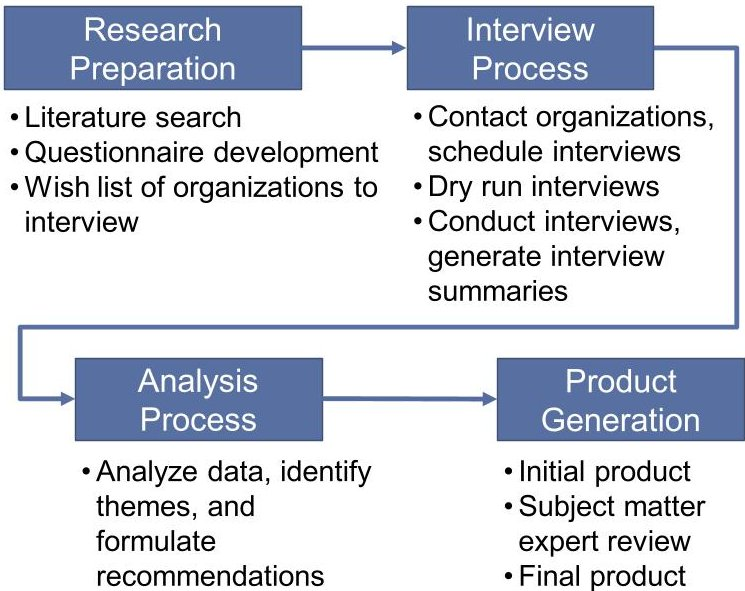
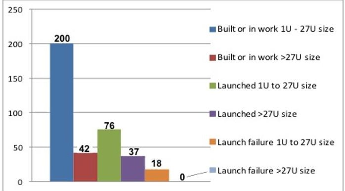
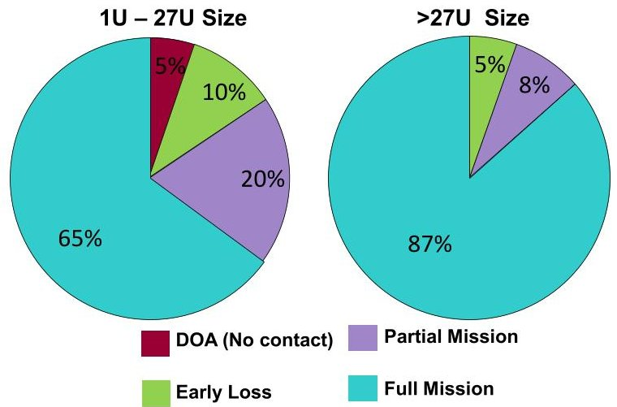
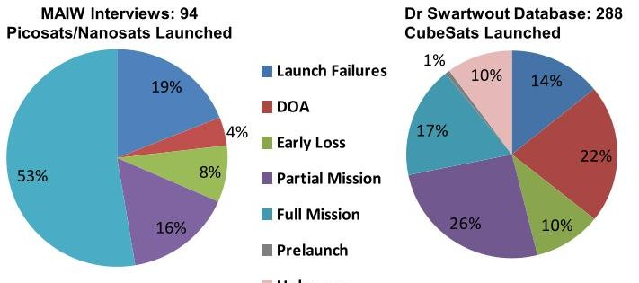
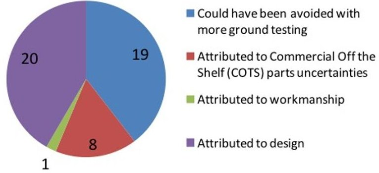

<!-- PDF_PAGE: 1 -->

# Improving Mission Success of CubeSats

Catherine Venturini, Barbara Braun, David Hinkley The Aerospace Corporation El Segundo, CA 90245; 310-336-5923 catherine.venturini@aero.org

Greg Berg Formerly at The Boeing Company

## ABSTRACT

As a concept, the CubeSat class of satellites is over 15 years old. The first CubeSat satellites were launched in 2003 and a few more in 2006. In recent years, CubeSats have proliferated at an astonishing rate. What started as a largely academic exercise has taken on much greater significance, with commercial entities gearing up to produce vast constellations of the small but capable spacecraft. Amidst all the hype one fact tends to get overlooked: CubeSats do not have a great record of mission success. This presentation provides simple, actionable recommendations that should improve the likelihood of mission success for future CubeSat development projects. The recommendations were gleaned from a study across academic, commercial and government organizations engaged in the design and development of miniature spacecraft. These organizations generously shared their processes, circumstances, results, and lessons learned; they also shared their current processes and philosophies on design, testing, and mission assurance. The results highlighted a number of important themes and issues, all of which formed the basis for the eight recommendations. Most of the recommendations can be tailored and implemented without much cost, and many seem to be common sense—though the study team found that few CubeSat developers followed them all. This paper specifically looks at the research process, the recurring themes and the eight recommendations to improve mission success of CubeSats.

## INTRODUCTION

As the rate of CubeSat launches increases each year, the community is seeing more diversity in the types of missions being developed by industry, academia, and government. Each of these missions have different expectations that have impacts to testing, risk management, and program oversite. $ ^{1,2} $ What is common among the missions is that mission success is important and there are greater expectations that missions will succeed. So how does the community achieve greater mission success and still follow the CubeSat ideal of low-cost, off-the-shelf parts, and agile development cycles?

This was the problem statement for the study, "Improving Mission Success of CubeSats" under the 2017 Mission Assurance Improvement Workshop (MAIW). The study team consisted of 13 members across government and industry that came together to

address this topic. The MAIW is a community of practice that brings together the U.S. Space Industry to explore and document best practices and common approaches to mission assurance. 2017 was the 10th year of the workshop.

This paper describes the methodology and process of the study, presents the themes distilled from a compilation of lessons learned gathered from the interviews, and proposes eight recommendations that will help the CubeSat community improve mission success.

## METHODOLOGY AND PROCESS

The research methodology for the study consisted of a straight forward process (Figure 1) of research preparation, collecting data, analyzing the data, and publishing results to help the CubeSat community improve probability of mission success.

<!-- PDF_PAGE: 2 -->

Figure 1: A systematic, straightforward process was followed for this study

## Research Preparation

Preparation began with a literature survey of papers and presentations about CubeSat successes and failures. In addition to understanding historical problems, the team wanted to ensure the MAIW topic was not replicating existing research, which was verified. This research also helped development of a questionnaire that was used to interview CubeSat organizations. Dry run interviews within the team were used to improve the questionnaire and practice for the many interviews that were planned. The final set of questions used were the following:

1. How many CubeSats has your organization built? Out of those built, how many have flown? Were the missions successful, where mission success is defined as achievement of the desired mission performance over intended design life?

2. Describe one (or more) of your recent CubeSat missions. Was it successful? What do you think contributed most to its success? If not successful, what would you do differently?

3. What is the experience level of your team?

4. Do the team members change over often or are the team members consistent for long periods of time?

customer participate in these reviews? Did you have independent reviewers participating?

5. What were the customer expectations and risk tolerance level (low, medium, high)? Did their expectations change with time?

6. Please list the major reviews that occurred for the project (i.e. PDR, CDR, etc.) Did your

7. What type of reviews do you perform before approving a detailed design (mechanical, electrical or software)? Do you perform any independent peer reviews?

8. What performance analyses were done? What tests were done?

9. What test or process do you consider essential to CubeSat success? What would be the second most important test / process? What test or process would you eliminate if you could? What did you think was not value-added?

These questions were devised to gather some statistical data, but more importantly the team made a number of the questions open ended to spark candid conversations about experiences and lessons learned. This proved to be the most valuable information collected.

The team identified 57 candidate organizations from academia, industry and government with CubeSat development experience. In the end however, the team held only 23 interviews (Table 1): MAIW process deadlines and team personnel availability precluded more interviews. Discussions with foreign entities were avoided, due to ITAR constraints.

Table 1: Organizations Interviewed

<table border="1"><tr><td>Academia(10)</td><td>Industry(5)</td><td>Government/FFRDC/UARC(8)</td></tr><tr><td>California Polytechnic State University</td><td>Atmospheric&amp;Space Technology Research Associates, LLC(ASTRA)</td><td>The Aerospace Corporation</td></tr><tr><td>Georgia Institute of Technology</td><td>Blue Canyon Technologies</td><td>Air Force Research Laboratory</td></tr><tr><td>Massachusetts Institute of Technology</td><td>The Boeing Company</td><td>Massachusetts Institute of Technology Lincoln Laboratory</td></tr><tr><td>Montana State University</td><td>Millennium Space Systems</td><td>NASA Ames Research Center</td></tr><tr><td>Saint Louis University</td><td>Planetary Resources</td><td>NASA Goddard Space Flight Center</td></tr><tr><td>University of Michigan</td><td></td><td>NASA Wallops Flight Facility</td></tr><tr><td>University of Southern California</td><td></td><td>NAVY Space and Naval Warfare Systems Command</td></tr><tr><td>United States Naval Academy</td><td></td><td>Space Dynamics Laboratory</td></tr><tr><td>U.S. Air Force Academy</td><td></td><td></td></tr><tr><td>Utah State University</td><td></td><td></td></tr></table>

<!-- PDF_PAGE: 3 -->

## Interview Process

The MAIW team split up into smaller sub-teams to efficiently schedule and execute the interviews and follow-up, as necessary. When the interviews were scheduled, the sub-teams explained objectives and the process, and provided the list of questions well in advance. The sub-teams introduced the team members participating in the interview. The MAIW team made sure that participants understood that:

- We would not ask, nor did we want to receive any proprietary information

- None of the raw data would be released outside of the topic team

- The "aggregate" data and analysis from the interviews will be made available in a publicly releasable report

The organization being interviewed was encouraged to bring everyone needed who could answer the questions provided. The MAIW lead assigned to that interview directed the questioning. At least two MAIW team members were present for each interview, many times there were three or more. Each person wrote notes and after the interview concluded, the lead would compile the notes into a single account. That final summary was sent to the interviewee for approval and correction. The approved and corrected notes were archived.

Most interviews were performed via telecon, however whenever it was convenient, face-to-face conversations occurred. In addition to the interview questions, the conversations often led to additional discussions to further understand processes, ground test issues, and on-orbit anomalies.

## Analysis Process

The interviews resulted in 415 pages of information. This was distilled in a spreadsheet where we identified common themes and theme categories. The MAIW then met in one location to reach a final consensus: 40 distinct common trends that fell into 8 theme categories and subsequently produced 8 recommendations on how to improve mission success of CubeSats.

## Report Generation

A draft report was generated by the MAIW team and reviewed by a panel of 17 Subject Matter Experts (SMEs). The SMEs were selected from the interviewees and others with action authority in the field. This process resulted in 190 actionable comments that were adjudicated with the SMEs and incorporated into the final report. The final report

followed the MAIW approval and public release processes.

## INTERVIEW STATISTICS

The interview results were analyzed to help the CubeSat community improve probability of mission success. A top level statistical analysis provided some insight during this process. The following data is primarily from the interviews, with minor additions from online sources. "Lessons learned" were volunteered by the interviewees. Both quantitative and qualitative data was obtained and assessed. Responses to the qualitative questions often included discussions that addressed on-orbit anomalies and potential corrective actions.

For purposes of this assessment, the satellites were segregated into two size groups:

1. Group 1=1U (1.33 kg) to 27U (36 kg) Picosats/Nanosats

2. Group 2 = >27U to 200 kg Microsats/Smallsats

The development, launch, and on-orbit experiences for Group 1 spanned a time frame from 2002 to 2016. The Smallsats in Group 2 include programs from the 1980s and 1990s.

## Basic Data Set

Figure 2 summarizes the satellites being built, awaiting launch or that have flown by the 23 organizations interviewed. This is the basic data set used in the analysis. The data is segregated by the two group sizes, as listed above. Because the development process is valuable to this study, we included satellites that were currently being built in the statistics with those already built and launched. Of the 242 satellites that have been built or were being built at the time of the interview, only 95 arrived in orbit and 18 were lost during launch.

Figure 2: Satellites built and flown by respondents

<!-- PDF_PAGE: 4 -->

## Mission Status

Figure 3 summarizes the interview respondent assessments of mission success for their satellites that achieved orbit. One can observe that the larger class Smallsats have been more successful than the CubeSat group.

Figure 3: Mission status by size

We compared our Group 1 CubeSat data set (94 CubeSats) with a CubeSat database (288 CubeSats) developed through research performed by Dr. Swartwout at St Louis University as of Spring 2017 (Figure 4) $ ^{3} $ . Some observations include:

- Rough correlation exists for launch failures and early loss categories

- Many more DOA (Dead on Arrival) cases are observed in the larger dataset

- The interviewees appear to have more partial and full successes, possibly due to these organizations having more experience with lessons learned from multiple missions

Figure 4: Comparison to related CubeSat research

## Anomaly Discussions

During the course of the interviews many of the respondents described anomalies and offered their opinions on the root causes. There were 27 anomalies

out of the 94 satellites that were discussed and various levels of root cause assessments were performed. These discussions in many cases identified multiple contributors to the problems as shown in Figure 5. It was also noted that if more ground testing had been performed, it could have identified some or all of the other issues.

Figure 5:27 anomalies were discussed during interviews

## THEMES

During the interviews, many themes emerged. These were concepts, practices, and observations made by the interviewees which stood out, either due to their pertinence or their frequency. Many of the themes were common across industry, academia, and government, and most of the themes are broadly applicable to all missions regardless of mission resources or success criteria. To preserve confidentiality, the themes and observations are not attributed to companies or agencies.

## Theme #1: Setting the Purpose and Vision of the Mission

Different agencies have different visions for the CubeSats they build. Some see them as educational tools for students, some see them as "lab benches in space," and some see them as capable platforms for potentially complex missions. Several interviewees encountered mismatches between the resources of the developer and the expectations of the customer. In some cases, the customer's expectations were out of line with the funding and resources available to the developer. In other cases, the developer was overly optimistic about what could be accomplished given the resources available. "At first, we had very simple expectations. Then as the requirements changed, we got in over our heads," one commented.

For academic institutions, student education is often the primary measure of mission success; while a successful launch and on-orbit campaign is always desired, getting to delivery is considered the major achievement. Many

<!-- PDF_PAGE: 5 -->

academic developers will launch regardless of readiness. As one such developer stated, "we'd rather take a 5% chance of it working, than a 0% chance of it ever launching." Because of this, industry observers must be careful when interpreting success rates. CubeSats have relatively high failure rates in part because such developers are willing to take big risks.

Many interviewees commented on the negative implications of "scope creep." One interviewee discussed how a simple-seeming science change to a mission led to redesign of the electronics board, noting that "little decisions early on make a big impact at the end." Interviewees recommended establishing (and defending) a minimum baseline mission and having a de-scope plan in place should circumstances require it. Two academic institutions credited their strong systems engineering approach—and extreme resistance to scope creep—for their mission success. "Limit complexity, and test extensively," one stated. There is a need to define upfront what mission success actually means to all parties, and to communicate this to key stakeholders from the beginning to the end of the program. $ ^{4,5,6} $

## Theme #2: Establishing the Program Structure

Team composition, system engineering practices, and review approach varied among CubeSat developers and from academia to industry. Not unexpectedly, academic institutions had the highest team member turnover rate due to graduation. For academic teams in particular, having an experienced mentor was important. From the limited interview data, it appears that among academic institutions, the more experienced the mentor, the greater the success rate. Many mentors came from industry and applied the lessons learned from industry to their academic programs.

Many interviewees felt that process documentation was more important, not less, with inexperienced teams, and with teams that turnover frequently. One academic institution with a good success record stated, "We use formal shop orders, good as-built discipline, and good as-tested documentation. These help with transferring knowledge between students during turnover." Similarly, interviewees noted that documentation becomes more important as teams and companies grow-in-size, to maintain corporate culture through changing times. One industry developer noted that as the company grew, "We started to lose institutional knowledge through confusion."

Most of the respondents followed the typical government/industry review cycle (Preliminary Design Review, Critical Design Review, etc.), though in many academic cases, these reviews were tied to the academic calendar, rather than project milestones. The

value of the major reviews was debated. Most academic institutions thought it helpful to expose students to industry practices and several interviewees felt that the major reviews helped identify disconnects, especially with external partners. Interviewees also pointed out that major reviews sometimes provide useful deadlines to drive design decisions to closure. On the other hand, major reviews take resources away from engineering - something that is hard to tolerate in low-resource programs. The use of less formal, but rigorous peer reviews was considered more valueadded. Respondents noted that review style is not always up to the program. Review approach and formality are sometimes dictated by the customer and interviewees recommended working with the customer to understand their expectations and come to a mutually agreeable review strategy.

Nearly every academic institution—and several government and industry agencies—commented on the "time crunch factor" in CubeSat schedules. Launches will typically not wait for a CubeSat and teams were often overly optimistic on design timelines. This put extreme pressure on the latter half of the schedule, including assembly and test—something that nearly every institution considers critical. Several institutions attributed their on-orbit failures to incomplete testing due to insufficient time and recommended dedicating half of a development schedule to testing from the outset.

## Theme #3: The Risk Process

Many respondents felt that a good risk process is even more important for CubeSat missions than for larger, Class A missions. Risk-based mission assurance allows programs with low resources to get the most "bang for the buck." "You don't have the resources to focus on everything," said one interviewee. "Pick and choose based on risk, not on gut feel or emotion." One interviewee advocated determining the "cost to risk-reduction ratio" of design, integration, and test activities. Specifically, when choosing which analyses to do, tests to perform, and processes to implement, CubeSat developers should consider the ratio between programmatic risk (increased cost, delayed schedule) and technical risk (on-orbit failure). Teams make the most effective use of limited resources by focusing on the work with the lowest programmatic to technical risk ratios.

Respondents called out flight software as a particularly risky area. For CubeSats, flight software is often the most complex subsystem on the satellite and is notoriously difficult to analyze. Interviewees repeatedly stressed the importance of early functional testing of flight software. Robust safe modes and the ability to

<!-- PDF_PAGE: 6 -->

patch or reprogram software on orbit, also helps reduce risk.

## Theme #4: Design and Analysis

For CubeSats, it is particularly important to design for simplicity and robustness. The funding and timelines required for complicated designs do not fit the stereotypical "rapid and inexpensive" CubeSat paradigm. Tri-fold wings, expensive payloads, capable pointing, directional antennas, and other complex systems, all add risk to CubeSat missions. Simple designs, by contrast, have fewer failure modes and are more likely to be achievable within the scope of a typical CubeSat program. Interviewees recommended keeping deployables simple, having minimal or no attitude control, and sticking to low data and power requirements to improve the chances of mission success.

CubeSat parts are mostly commercial and not designed for the space radiation environment. Interviewees mentioned that watchdog timers and other fail-safe devices that reset components automatically, helped their CubeSat missions succeed. CubeSat missions typically use non-radiation-hardened parts, which can latch-up. "Have many ways to reset the satellite," recommends one respondent. Some developers reset their on-orbit missions every 24 hours as a precautionary measure.

A CubeSat's small size makes it hard to de-integrate, repair, and re-integrate. Furthermore, most CubeSats undergo little to no subsystem-level testing. As a result, issues are usually discovered while testing the fully assembled satellite. "A lot of time was wasted on integration and de-integration... if something needed to change, we had to take the whole thing apart," observed one developer. Designing for disassembly and using a larger form factor than needed can keep these risks low. One university deliberately built a 1.5U satellite into a 3U form factor - the extra space allowed for easier assembly and re-work. Another bought a separate set of boards, conducted any needed repairs on the bench, and then replaced the entire board on the CubeSat, rather than disassembling the CubeSat and repairing the flight board directly.

## Theme #5: Test, Test, Test - the Importance of Testing

Every organization interviewed emphasized the importance of testing, especially full-system functional testing. When asked what test they considered the most critical to CubeSat success, most organizations pointed to end-to-end functional testing. "Immediately directly useful are end-to-end functional demonstrations starting as early as possible," stated one respondent. One

organization created an entire laboratory devoted to realistic day-in-the-life testing, including a GPS simulator, star field simulator, and a Helmholtz cage. Even if such resources are not available, organizations can demonstrate much of the on-orbit functionality of a CubeSat through day-in-the-life testing.

One organization that works extensively with university satellites recommends four tests following assembly, and before environmental testing:

- A command execution test, where all commands are sent to the satellite and checked for correct execution;

- A day-in-the-life test, where a typical 24-hour period on-orbit is simulated;

- An end-to-end communications test, where the ground system is used to command the spacecraft over radio frequency links;

- A complete power system charge cycle, where the battery is discharged to its full depth of discharge through satellite operations and then recharged using the solar panels.

These four tests demonstrate basic functionality and can typically be conducted without elaborate test equipment.

Some academic institutions debated the value of thermal vacuum (TVAC) testing. Thermal vacuum chambers are expensive equipment, and often not present in a university CubeSat laboratory. Furthermore, TVAC testing is time consuming to set up and difficult to execute properly. Developers without access to a TVAC facility relied solely on ambient-pressure thermal testing. They believed that functional testing at temperature extremes provided nearly the same value, for less cost. However, TVAC testing accurately emulates the space environment, including the absence of air, which eliminates convective cooling. One respondent observed that testing in TVAC would have found a mission crippling error. Another respondent did find an error and corrected it prior to shipment - that error also would have ended the mission.

Deployment testing was also debated; while nearly everyone agreed that critical deployables should be tested in flight-like conditions, many pointed out that these tests can be hard to conduct. Some deployment mechanisms cannot be reset or can only be used a limited number of times, which makes it hard to test them extensively. The root cause of several CubeSat failures has been attributed to deployments.

<!-- PDF_PAGE: 7 -->

The lack of time for testing, and the tendency for test time to be squeezed to make a launch date, was frequently re-emphasized, as was the importance of software testing.

## Theme #6: Common CubeSat Failures

During the interviews, the team collected a list of common CubeSat failures and subsystems worthy of more attention. These included:

- The communication system. Not only were communication system failures common (and typically mission-ending), it was hard for CubeSat developers to find a good ground segment.

- The power system. Interviewees noted that the actual performance of purchased power systems did not always match specifications. They also warned that power systems should be tested in their intended configuration.

- Deployables, such as solar panels and antennas. Burn-wire systems are sensitive to workmanship and are not easily resettable. Testing deployables like-you-fly is difficult and time-consuming.

These subsystems, therefore, warrant greater attention and analysis.

## Theme #7: Parts Quality, Availability, and Documentation

A number of interviewees brought up issues with CubeSat parts and subsystems. CubeSat missions typically use commercial off-the-shelf (COTS) standard assemblies and components, due to their low cost and lead time. These have sometimes proven unsuitable for the expected space environment and the performance of COTS components does not always match specifications. Inexperienced CubeSat developers do not have the history to know when additional testing is advisable and which parts are trustworthy.

CubeSat standard assemblies and components are often poorly or inaccurately documented. "It's hard to find information on COTS parts," stated one developer. "They come with poor user manuals and teams are learning as they go." In many cases, testing was necessary to flesh out the differences between the specification sheets and reality. "Even though the CubeSat philosophy tends to de-emphasize documentation," one interviewee stated, "having up-to-date vetted documentation from vendors, delivered on time and with the proper revisions, would make a big difference."

CubeSat standard components are commercial and not designed specifically for space. Interviewees also recommended overstocking spare parts and using part derating to improve margin. $ ^{7,8} $ Spare parts will allow additional targeted component testing and protect schedule if a part fails during system-level tests.

## Theme #8: Launch is a Significant Driver

Launch schedule pressure is a major risk driver on CubeSats and it ripples into much of the decisionmaking during a typical program. CubeSat programs are often secondary rideshares, with little flexibility in the launch date. At the end of the program, the important system-level testing often gets "crunched" because CubeSats must meet a launch delivery deadline. The result is incomplete or inadequate testing. "We need to spend more time in AI&T [assembly, integration, and test]," one developer said, "but we can't afford to miss the launch. So, we ship at the delivery date, regardless of maturity."

Launch delays are also a problem. In one case, a failed solar array passed all testing, but there was a long-time delay and significant handling of the spacecraft before launch. It is believed that this led to a broken mechanism. Another government organization's satellite sat unpowered on the International Space Station for seven months before deployment. It is believed that the delay degraded their batteries. Launch delays can also put pressure on budgets and schedules, encouraging customers to add more capability. One industry developer uses a "deliver to self' paradigm, instead of "delivering to a launch provider."

CubeSats are typically required to follow stringent "do no harm" guidelines. Integrators therefore require multiple-redundant inhibit systems designed to keep a CubeSat from powering up before launch. "Inhibits are ... single-point failures with unknown reliability. A $26 set of parts can take down your whole mission," observed one interviewee. Another pointed out that, "A Class A mission would never put in a switch they couldn't work around."

Launch vehicle environments for CubeSats are often severe. As a secondary payload that is intended to be no threat to the primary payload, the dispensers are relegated to places on the rocket away from the fairing. Some launch environments are significantly worse than others, and CubeSats rarely know until after CDR what launch vehicle they will use. Accounting for various launch vehicle vibration levels can result in overdesign and wasted effort. One academic satellite designed to the expected vibration environment, and then was given a new, higher environment from the launch vehicle; retesting was challenging.

<!-- PDF_PAGE: 8 -->

## RECOMMENDATIONS

From the themes and lessons learned, the team produced eight recommendations. They are intended to improve the success of CubeSat developers. In this section, each recommendation is offered along with an explanation about why it is important and how it might be implemented effectively. The degree of implementation correlates to the amount of risk retired. Although recommendations may appear to be general knowledge and common sense, it was rare to find a team that followed all actions. Most of these can be implemented with minimal increased cost to a program, while moving the program towards higher levels of mission success.

Recommendation #1: Define your scope, goals, and success criteria at program start. Justify your ability to complete it within the available time, budget, and resources. During project life cycle, defend it aggressively against growth.

Scope creep is a problem on all missions, but for CubeSats, which are smaller and typically more cost and resource constrained, there is even less room to accommodate changes. A project is sold to customers as a capability for a certain cost-a certain vision and expectation are transferred and must be recorded as a governing document. As a project evolves and risks are discovered, the costs become more defined and the price grows inevitably more expensive.

Interviewees stressed that CubeSat developers - and sometimes their customers - tend to be overly optimistic about what these small, low-cost platforms can achieve and unrealistic about the difficulty in realizing their desired functionality and expected reliability. CubeSat customers are new to the satellite business and will not appreciate that cost increases always occur. In contrast, experienced teams, before the ink from their signature on the contract is dry, immediately look for ways to reduce scope to hedge against the certain cost growth - they never add scope, without a contract increase. Therefore, learning from years of evolutionary behavior development that has, not surprisingly, been reflected in the responses to this survey, it is recommended that project leadership and customers define scope, goals, and success criteria at the start of a program and stop there, unless additional funding is added to the contract.

It's critical that the funding match the desired complexity, reliability, and purpose of the mission, and vice-versa. During the project lifecycle, the contractor project management must defend the original scope against growth and in addition, if the customer does not have financial reserves, then have a graceful descope

plan, to make up for future time and funding shortfalls. Budget estimates should have significant margins because the development teams are usually young and therefore without prior satellite development experience to correct for the misperception that CubeSats are easy to realize because they are small.

Recommendation #2: Conduct risk-based mission assurance. Perform a risk assessment at the beginning of the program and review it regularly to prioritize analyses, tests, reviews, and activities.

The amount of mission assurance applied to a project affects its cost. Mission assurance techniques exist for all phases of a project from part selection standards to how reviews are conducted. Any activity adds cost, so the goal is to identify those that provide the most value. At the end of the project, arguably the most important goal is that the satellite functions well. At all stages of the project, the greatest concerns to achieving that end should be listed, ranked and worked. In short, ask yourself throughout the program, "What keeps me up at night?" The answer becomes your risk list and the basis for the project schedule. This directs resources to the problems that are front-and-center, but admittedly at the expense of the more subtle or latent ones.

It is prudent to have an awareness of good mission assurance practices. Some are easy to implement if the right culture is nurtured. But, in a cost- and schedule-constrained project, a risk-based mission assurance plan directs programs with limited resources where to allocate those resources and where to cut back.

Recommendation #3: Plan for ample Integration, Verification, and Test (IV&T) time. Baseline IV&T to be 1/3 to 1/2 of the overall schedule and stick to that.

Throughout the survey, running out of time and money was a constant theme. This recommendation is a rule-of-thumb that, if applied, will alleviate a common project management failure mode. The implementation of a firewall of budget and schedule starting at IV&T also flows backwards: it forces the team to modify and potentially de-scope project goals, before design complexity starts to endanger the IV&T time. The start of a new project is arguably its most interesting time period. There are a lot of possibilities of how to achieve the end goals and about how the program will be executed. Narrowing down those possibilities is an art form and must be bounded by a time and or budget limit. If this is not done, then there is less of both for the integration phase, where all problems ultimately come to light, at the baseline functional test that is required before environmental testing can start.

<!-- PDF_PAGE: 9 -->

During the study interviews, almost all developers commented on how the "time crunch factor" contributed to on-orbit failure. The IV&T schedule period can arguably be defined as the point at which all the hardware is available and working. Projects should start testing hardware as it becomes available, as components, subassemblies and groups of subassemblies. This type of development is called "test often and test early." The point is to remain skeptical that things will work and to test whatever can be tested, at the soonest time it can be.

Recommendation #4: Design for simplicity and robustness. Assume designs will fail and then prove they will work. Design the satellite for easy assembly and disassembly. Have respectable margins, robust safe modes, few deployables, graceful performance degradation, and the ability to perform satellite resets.

Design problems have many possible solutions. In early trade studies, various parameters are compared, and the best solution is selected. This recommendation proposes adding significantly greater weight to the parameters of design simplicity and robustness. The inaccessibility of satellites once they are in orbit and the single string design of almost all CubeSats, necessitates extensive testing for reliability and confidence. However, if a design is complicated, then even more time is spent both realizing initial functionality and subsequently testing for robustness. Add to this the fact that many CubeSat developers do not have access to sophisticated analyses and testing.

An often-overlooked aspect of simple design is a consideration for easy assembly and disassembly. Despite the best plans and intentions, satellites are often taken apart. If disassembly is a difficult or lengthy operation, then that will factor into a decision to fix something or take a risk to leave it as is.

Another aspect of reliable and robust design that is not given enough respect is the incorporation of respectable margins, in any configuration for thermal performance communications link, and power generation. All are key to a satellite that will operate in space, at its most fundamental functional level.

Finally, rounding out the fundamental attributes of a robust design are simple and tested safe modes, software reprogrammability and daily satellite resets. These characteristics will keep a satellite alive long enough for operators to find and correct issues.

Recommendation #5: Build an experienced team - it matters. A successful team has veteran member(s) and frequent informal peer reviews (discussions) with proven subject matter experts.

It is no surprise that a team with prior experience in all phases of producing a satellite has a greater chance of seeing the effort run smoothly, meeting performance, financial and schedule goals. However, such experience is not always available. The study found that successful academic teams had experienced leads and mentors as part of the team. Typically, the satellite leads were students that had worked on a satellite in their early years, with mentors who had good training in the art of systems engineering and program management. Successful academic satellite teams sought outside participation in their peer reviews and for problem resolution. Those outside experts filled in the team's knowledge gaps.

The industry staffing paradigm is different. Industry teams typically have good continuity from project to project. Also, industry teams can hire the skills that they specifically need. However, industry teams were less likely to seek outside experts for peer reviews and problem resolution because of contracting and proprietary knowledge challenges. This situation is compounded because the low cost of CubeSat projects limits the team size and knowledge gaps are inevitable. To remedy this, successful industry teams had a larger pool of employees whom they temporarily borrowed for tough issues. Therefore, solving unique problems or assessing the completeness of a design is easier with a wide pool of participants. Academia can take advantage of the outside talent pools more easily than industry. Industry should consider working legal and contracting issues to simplify bringing experts into their project as needed.

Recommendation #6: Stock spare components. Extra boards support parallel software development and are flight spares. Extra hardware protects schedule during mechanical testing.

The development of a new system is prone to mistakes. If hardware is not easy to replace, then an effort must be made to avoid errors that might damage it. Unfortunately, extra care most often means that less testing is done. CubeSat components are not like traditional space hardware: they cost less and are more readily available, but their documentation and prior testing may be lacking. Therefore, purchasing spares is a cost-effective strategy to protect schedule and to increase mission assurance through testing. A proposal for any mission will aim for the lowest cost. However, even though the cost of labor far exceeds hardware cost, the hardware budget is often cut. Spare hardware will save a project money in the long run by protecting against a schedule slip waiting for damaged hardware to be repaired. The spare hardware can also be used as

<!-- PDF_PAGE: 10 -->

another development set for parallel work by the software team.

Recommendation #7: At a minimum, first perform these four mission assurance tests: 1) Day-in-the-life [or longer] testing; 2) Communication link testing with the ground station; 3) Power system charge / discharge testing, and 4) Thermal testing (in vacuum if at all possible). Then, perform the tests that have the highest risk reduction value for your mission.

A satellite development has many tests that are performed to verify that it meets requirements. However, these four tests do more. When combined with robust design margins, they verify that the satellite will be functional. Many developers cited these tests as essential, providing the most "bang for the buck."

The day-in-the-life (DITL) test validates that satellite software is nominally functional, and that the combination of hardware and software can perform its basic mission. A mission scenario is simulated, and commands are generated in the planning software. Those commands are uploaded to the satellite and executed automatically with the satellite in a similar state as expected on orbit. The results are downloaded at the end of the scenario. The satellite data from the scenario will include payload data and telemetry that is inspected to verify that it is "as expected."

The communication link test is between the as-built flight satellite and a ground station. Separating the satellite and the ground station by a long distance provides the bulk of the attenuation, and variable attenuators provide the rest. A file transfer is initiated as the link is slowly extinguished. The total path loss at the limit of the link is the demonstrated range. Make sure the attenuation demonstrated makes sense - sneak paths are common in RF test configurations that simulate long distances. The ground station should be as identical as the one that will be used in flight (or better yet, use the real ground equipment), although the antenna will generally have reduced gain for the shorter range between the satellite and the ground station for this test and to reduce the amount of added attenuation.

CubeSats are small enough that the entire satellite power system can be tested at once. This is an easy yet powerful test. Expose the satellite to sunlight and examine the satellite's telemetry. The batteries must be shown to charge, and the power coming in from the solar arrays should be visible in the telemetry. Verify that the satellite batteries can handle the anticipated electrical loads when no sunlight is present (eclipse). Download satellite telemetry during these tests and verify it is correct.

CubeSat thermal tests verify that components and deployments operate properly at temperature and that heat paths are sufficient to prevent temperatures outside the working limits of satellite systems. Deployments and components often behave differently at thermal extremes than at ambient temperatures. Satellite heat loads and thermal paths are often not accurately described to thermal engineers or faithfully achieved in the satellite build. Also, satellite component loads become refined during the electronics development phase, rendering the thermal analysis inaccurate.

Thermal tests at ambient pressure verify the design margins on electrical and mechanical subassemblies when they are operated at the thermal extremes. The ambient pressure ensures rapid changes and an even application of temperature. If enough cycles are done, then it also proves soldering workmanship. It is often done with the batteries not installed or present because they severely limit the thermal range of the test.

The best "like-you-fly" version of thermal testing operates the spacecraft in flight-like scenarios in vacuum at both thermal extremes. This verifies that the heat loads are properly applied and managed. Using the test results from thermocouples or onboard telemetry, the thermal model of the satellite is updated. This is important because the model is used to simulate a wide variety of additional configurations and concepts of operation. This test is often done with the batteries installed to verify heaters and other battery thermal safeguards.

For all programs, these tests are essential. The likelihood that the satellite will pass them depends on how much other quality analysis and testing has already occurred. In resource constrained programs that can only afford minimal testing, these tests are a necessary go/no-go assessment of whether the satellite performance is acceptable or can be fixed in time for the delivery to proceed.

Recommendation #8: Maintain a healthy skepticism on vendor subsystem datasheets. Hold margin on all performance numbers during design and verify after receipt.

A number of interviewees complained that the information in CubeSat component or subsystem datasheets was insufficient or inaccurate. The CubeSat subsystem industrial base is young and many non-military / non-aerospace items haven't been flight proven. Holding substantial margin will help cover such limitations. Testing is necessary to confirm that the purchased component or subsystem will provide the expected and required performance.

<!-- PDF_PAGE: 11 -->

## SUMMARY

The MAIW study conducted an extensive literature review and interviewed 23 organizations across government, academia, and industry to identify common themes and lessons learned from CubeSat programs. From the data gathered, eight actionable recommendations were developed to improve mission success. The team hopes that many CubeSat programs will find value in the results and implement them in their future programs.

The study final report is available to download from the following website: https://www.nasa.gov/smallsat institute/small-spacecraft-body-of-knowledge.

## ACKNOWLEDGMENTS

The authors want to thank the rest of the topic team members: Bob Andrews, Jeff Christensen, Kim Hicks. Mike Tolmasoff, Andrew Whiting, Tom Wiedenbauer, Gary Kushner, Rick Gebbie, and Renelito Delos Santos for the considerable time and effort they put in to this study. The authors also want to thank the SMEs: Ron Duphily, Lynn Friesen, Larry Harzstark, Gail Johnson Roth, Elizabeth Klein-Lebbink, Art McClellan, Charles Swenson, Reuben Rohrschneider, Ryan Nugent, Steven Pereira, Andrew Robertson, Conor Galligan, Sue Aleman, Andrew Demo, Kenneth LaBel, Jesse Leitner, and Miquel Moe for their time to review and comment on the final report.

## REFERENCES

1. Swartwout, M., "CubeSats and Mission Success: 2016 Update," NASA Electronic Parts and Packaging (NEPP) Program 2016 Electronics Technology Workshop, June 2016.

2. Swartwout, M., "The First One Hundred CubeSats: A Statistical Look," Journal of Small Satellites [online journal], Vol. 2, No. 2., December 2013.

3. Swartwout, M., CubeSat Database. Retrieved from: https://sites.google.com/a/slu.edu/swartwout/home/cubesat-database.

4. Guarro, S., G. Johnson-Roth, and W. Tosney, (eds.), Mission Assurance Guide, Aerospace Report No. TOR-2007(8546)-6018 Rev B, The Aerospace Corporation, El Segundo, CA, June 2012.

5. Johnson-Roth, G. Mission Assurance Guidelines for A-D Mission Risk Classes, Aerospace Report No. TOR-2011(8591)-21, The Aerospace Corporation, El Segundo, CA, June 2011.

6. Johnson-Roth, G., Key Considerations for Mission Success for Class C/D Mission, Aerospace Report No. TOR-2013-00294, The Aerospace Corporation, El Segundo, CA, June 2013.

7. Robertson, S., L. Harzstark, J. Siplon, et al., Parts, Materials, and Processes Control Program for Space and Launch Vehicles, Aerospace Report No. TOR-2006(8583)-5235, The Aerospace Corporation, El Segundo, CA, November 2006.

8. Robertson, S., L. Harzstark, J. Siplon, et al., Technical Requirements for Electronic Parts, Materials, and Processes Used in Space and Launch Vehicles, Aerospace Report No. TOR 2006(8583)-5236, The Aerospace Corporation, El Segundo, CA, November 2006.