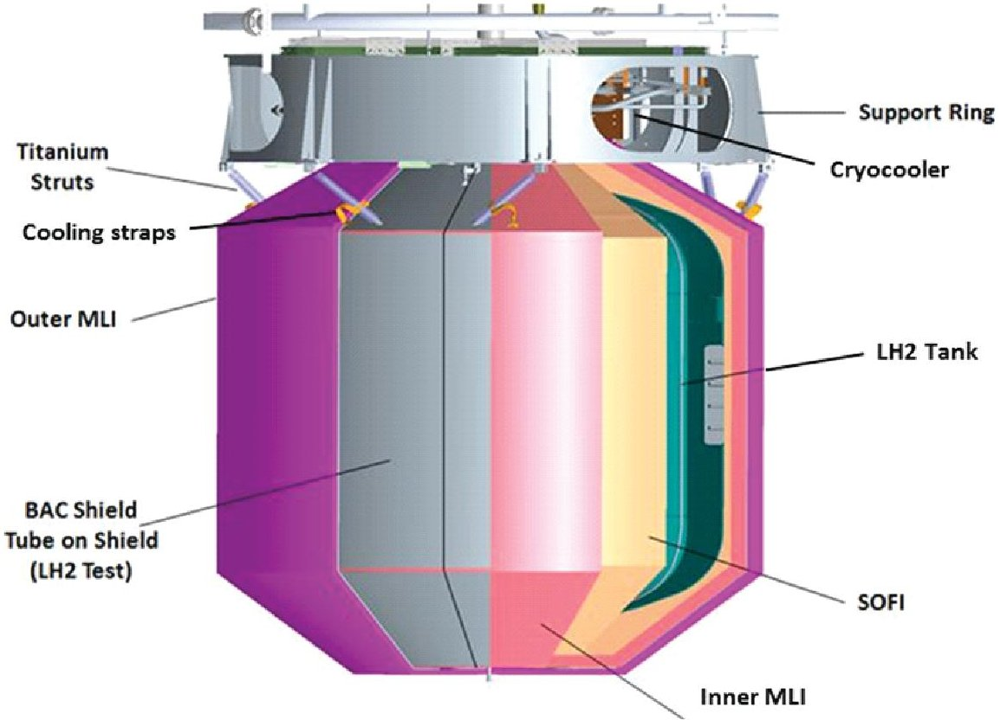
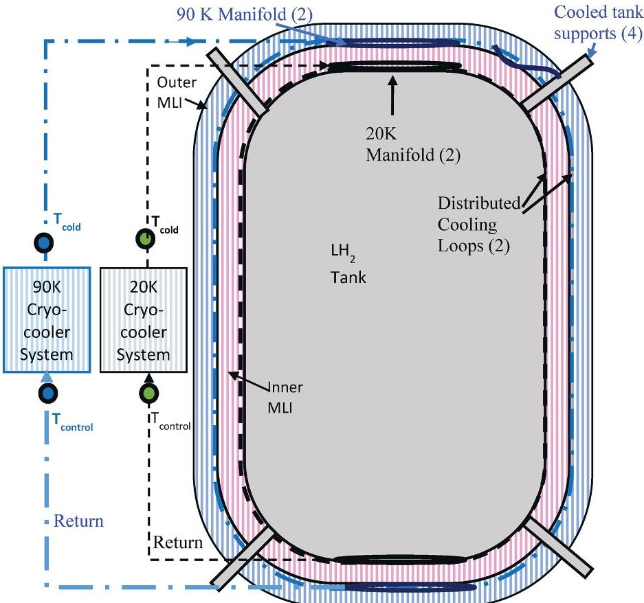
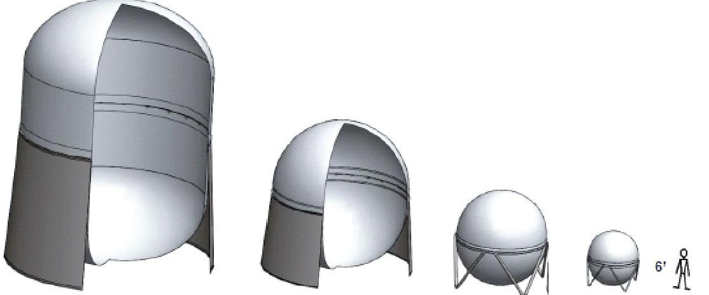
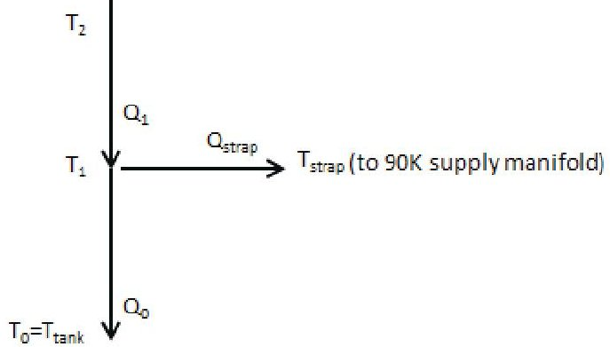
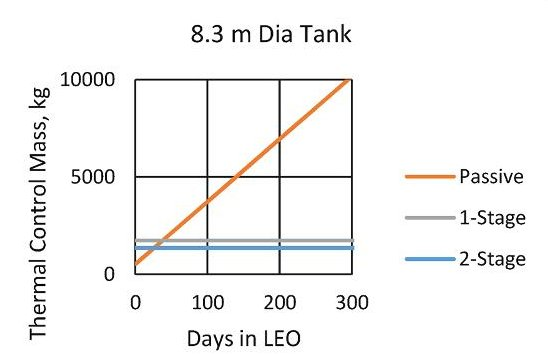
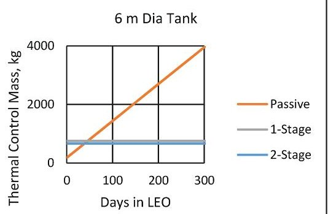
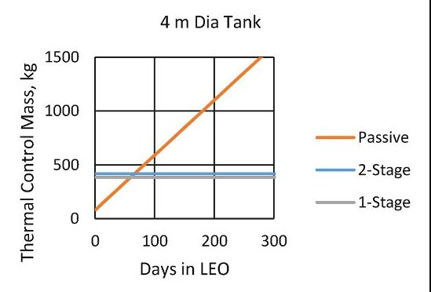
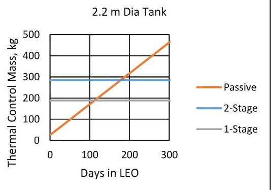
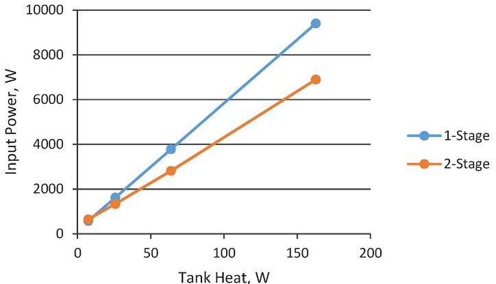
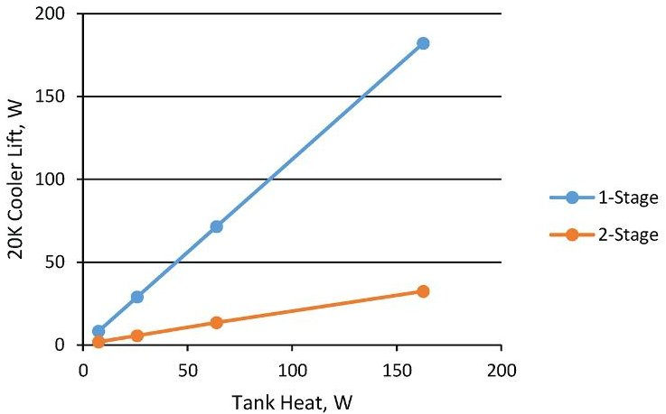

<!-- PDF_PAGE: 1 -->

# In-Space Cryogenic Propellant Storage Applications for a 20W at 20K Cryocooler

D. W. Plachta $ ^{1} $ , J. R. Feller $ ^{2} $ , M. C. Guzik $ ^{1} $

$ ^{1} $NASA Glenn Research Center, Cleveland, OH 44135

$ ^{2} $NASA Ames Research Center, Moffett Field, CA 94035

## ABSTRACT

The National Aeronautics and Space Administration is currently developing technologies for future space exploration missions and scientific discovery missions by addressing the need to raise the technology readiness level of cryogenic fluid management storage technologies. Cryogenic propellants are part of exploration plans due to their inherent high specific impulse, yet their inherently low boiling points cause high heat loads that can cause substantial boil-off losses in the long term. Recent developments to reduce boil-off and scale up the concept for large tanks provides important information on the benefit of an active cooling system applied to liquid hydrogen propellant storage. Findings point to zero-boil off technology as a means of reducing mass in liquid hydrogen storage systems when low Earth orbit loiter periods are greater than 2 months. These findings have spurred the development of the 20 Watt (W) at 20 Kelvin (K) flight representative cryocooler. The analysis presented explores the propellant tank sizes and heat loads within the range of this cryocooler, to achieve zero-boil-off propellant storage. This analysis is performed both with and without the integration of a 90K reduced boil-off cryocooler. Larger tanks, such as those considered in the Mars Reference Mission, are considered. Results are highly dependent on the cryogenic upper stage structural heat, however, a thermally optimized structure considered herein combined with self-supporting MLI shows that 20 W at 20K cooling is an appropriate size to eliminate boil-off for three of the four liquid hydrogen propellant storage tank sizes considered. Two 20 W coolers are needed, along with a 90K cooler, for the largest tank considered in the trade space.

## INTRODUCTION

To achieve zero boil-off of liquid hydrogen $ \left(\mathrm{L H}_{2}\right) $ , it is critical that the heat loads into the tank, particularly the tank structure, are minimized. Also, it is necessary to advance the state-of-the-art in $ \mathrm{L H}_{2} $ temperature cryocoolers for flight, which are at a relatively low state-of-the-art for propellant storage application. Because of this, the National Aeronautics and Space Administration (NASA) is advancing the most promising cryocooler technology for $ \mathrm{L H}_{2} $ Zero Boil-Off (ZBO) storage, the reverse turbo-Brayton cycle cryocooler. This advancement is important in that the present state-of the-art 20K cryocooler technology has a lift capacity of less than $ 1 \mathrm{~W}^{1} $ , much less than the projected tank heat leak rates, while offering no ability to distribute the cooling. The purpose of this paper is to clarify the usefulness of a 20 W capacity with missions that NASA may pursue, with the goal of minimizing power and mass. The issues of power availability and the expense of power systems

<!-- PDF_PAGE: 2 -->

limits the consideration of active cooling. Mass is also critical as it increases the size and cost of the launch vehicle and reduces the potential payload mass.

One method of reducing power and mass is to optimize the active cooling system for propellant storage. Since 2007, several developments $ ^{2,3} $ and tests $ ^{4} $ have been conducted by NASA with the goal of increasing the technology readiness level of Cryogenic Boil-Off Reduction Systems (CBRS) and Zero Boil-Off (ZBO). The focus to date has been on cryocooler integration into the large surface areas of cryogenic propellant tanks, to understand the feasibility and losses involved. In addition to that, an effort was started to develop a higher capacity liquid hydrogen cryocooler.

With respect to the application of the 20 W at 20K cryocooler, however, an analysis into tank heat leaks and methods to achieve two circuits of cooling is required. Given the relatively high power and costs associated with this cryocooler, the goal is to study methods to achieve ZBO with low power and low mass. To accomplish this, a second cryocooler is considered. The second stage, a 90K cryocooler system, was found to reduce tank heat by 60%, as measured by the heat reduction of the components cooled by the cryocooler, in Reduced Boil-Off (RBO) testing at NASA Glenn $ ^{4} $ (see Figure 1). A schematic representation of the two circuits of cooling envisioned, using both the 90K cooling system and a 20K cryocooler system, is shown in Figure 2.

Previous modeling efforts determined that 90K cryocoolers, as part of an RBO system, begin to reduce mass for liquid hydrogen loiter periods in space when compared to passive only storage, that is with multi-layer insulation (MLI) only and no active cooling, with its constant boil-off, after several weeks, and ZBO storage reduces mass after two months. This follow-on effort uses two-stage cooling with both the 90K and 20K cryocooler systems, to determine potential mass and power reductions. As part of that, an explicit approach to size the 90K cryocooler is developed as an improvement on the previous model that indirectly optimized mass. This analysis incorporates RBO testing heat exchanger data. As done in the previous scaling study, this analysis was applied to a range of four tank sizes, as shown in Figure 3.

Figure 1. Cut-a-way image of the Cryogenic Boil-Off Reduction System test article, designed and tested at NASA GRC. This test article serves at the basis for component scaling.

<!-- PDF_PAGE: 3 -->

Figure 2. Two cryocooler system with 20 and 90K cooling

## THERMAL BALANCE APPROACH

The two circuits of cooling, as configured in Figure 2, integrates a nominally 90K broad area cooled (BAC) shield to intercept heat on the structural supports, the fluid lines, and within the MLI. The heat load of the 90K shield is determined by optimizing the location of the heat intercept, knowing the thermal performance of the cooling straps from the RBO testing and developing the thermal balance relations for a penetration with a heat intercept, via a cooling strap. Also, the MLI is modeled outside the shield and between the shield and the tank.

Note that in these discussions and analysis, 20K and 90K are stated as the cooling points on the cryocooler but these are just approximations and refer to a 20K class cryocooler and an a 90K

Figure 3. Notional LH2 tanks analyzed in this study. From left to right, the Earth Departure Stage, 8.3 m dia with a Ti skirt, a 6 m dia spherical tank with a Ti skirt, a 4 m dia sphere with 8 Ti struts, and a 2.2 m dia tank with 8 Ti struts. Show in the right is a 1.8 m tall person.

<!-- PDF_PAGE: 4 -->

class cryocooler and BAC system. Liquid hydrogen will more likely be stored between 21.5 and 23K, its saturation temperatures at the likely tank pressure range required by propulsion systems. Also, the 90K cooling stage is assumed because previous analysis $ ^{5} $ showed that there is little sensitivity to mass and power if this stage is between 80 and 110K; 90K is within that range. The nodes at each of these temperatures and of the environment appear in subscript and they are defined as: 0 is at the 20K tank, 1 is at the 90K broad area cooling (BAC) shield, and 2 is at a representative low Earth orbit (LEO) environment, which is assumed to be at 220K.

## Heat Load on 20K Tank

The total heat load on the LH2 tank is:

$$
Q _ {t a n k} = Q _ {m l i, 0} + \sum_ {i} Q _ {p e n, 0, i} + Q _ {c o n s t} - Q _ {b a c}
$$

$ Q_{\mathrm{mli},0}=Q_{\mathrm{mli},0}\left( \mathrm{T}_{\mathrm{shield}},\mathrm{T}_{0}\right) $ is the heat leak from the shield to the tank wall through the inner MLI blanket. $ Q_{pen,0,i}=Q_{pen,0,i}\left( \mathrm{T}_{1,i},\mathrm{T}_{0}\right) $ is the solid conduction through the $ i^{\mathrm{th}} $ penetration, from the thermal intercept (near 90K, but specifically at temperature ) to the tank wall. $ Q_{const} $ is the sum of all approximately constant heat leaks to the tank (e.g., through instrumentation leads). $ Q_{bac} $ is the heat removed to the 20K cryocooler via the tube-on-tank BAC heat exchangers. This does not include heat removed via thermal straps to the 20K heat distribution manifolds.

## Heat Load on the 20K Cryocooler

The total heat load on the nominally 20K cryocooler is:

$$
\mathrm {Q} _ {2 0} = \mathrm {Q} _ {b a c} + \mathrm {Q} _ {m a n 2 0, s u p p l y} + \mathrm {Q} _ {m a n 2 0, r e t u r n} + \mathrm {Q} _ {s u p p l y 2 0} + \mathrm {Q} _ {r e t u r n 2 0}
$$

$$
\mathrm {Q} _ {m a n 2 0, s u p p l y} = \sum_ {i} \mathrm {Q} _ {s t r a p 2 0, i} + \mathrm {Q} _ {m a n 2 0, s u p p l y, p a r a s i t i c}
$$

Eqn. (3) is the total heat load on the inlet manifold. $ Q_{strap20,i}=Q_{strap20,i(\mathrm{T}1,i,\mathrm{T}man20)} $ is the heat conducted by the $ i^{\mathrm{th}} $ strap from the $ i^{\mathrm{th}} $ penetration to the supply manifold. $ Q_{man20,supply,parasitic} $ is the total parasitic heat load on the supply manifold. Parasitic heat is the portion of the cryocooler system heat that is not useable by the system. Also, for simplicity, it is assumed that all heat removed from the penetrations is conducted to the two (20K and 90K) supply manifolds. $ Q_{supply20} $ and $ Q_{return20} $ are the parasitic heat loads on the supply and return lines running from the cryocooler to their respective manifolds.

## Heat Load on the 90K Shield

The 90K shield is embedded between the inner and outer MLI blankets. The net heat load on it is simply:

$$
Q _ {s h i e l d} = Q _ {m l i, 1} - Q _ {m l i, 0}
$$

$ Q_{mli,1}=Q_{mli,1}\left(T_{\mathrm{env}},T_{\mathrm{shield}}\right) $ , with $ T_{\mathrm{env}} $ equal to the temperature of the thermal environment, is the heat leak to the shield through the outer MLI blanket and $ Q_{mli,0}=Q_{mli,0}\left(T_{\mathrm{shield}},T_{0}\right) $ is the heat leak from shield to tank wall through the inner MLI blanket.

## Heat Load on the 90K Cryocooler

Total heat load on the 90K cryocooler is:

$$
\mathrm {Q} _ {9 0} = \mathrm {Q} _ {\text {s h i e l d}} + \mathrm {Q} _ {\text {m a n 9 0 , s u p p l y}} + \mathrm {Q} _ {\text {m a n 9 0 , r e t u r n}} + \mathrm {Q} _ {\text {s u p p l y 9 0}} + \mathrm {Q} _ {\text {r e t u r n 9 0}}
$$

$$
\mathrm {Q} _ {\text {m a n 9 0 , s u p p l y}} = \sum_ {i} \mathrm {Q} _ {\text {s t r a p 9 0 , i}} + \mathrm {Q} _ {\text {m a n 9 0 , s u p p l y , p a r a s i t i c}}
$$

Eqn. (6) is the total heat load on the supply manifold, where $ Q_{strap90,i}=Q_{strap90,i}\left(T_{1,i} T_{man90}\right) $ is the heat conducted by the $ i^{\mathrm{th}} $ strap from the $ i^{\mathrm{th}} $ penetration to the inlet manifold, and $ Q_{man90,supply,parasitic} $ is the total parasitic heat load on the supply manifold. $ Q_{man90,return},Q_{supply90},Q_{return90} $ and are 90K counterparts of $ Q_{man20,return},Q_{supply20}, $ and $ Q_{return20}. $

<!-- PDF_PAGE: 5 -->

## Thermal Balance Relations for a Penetration with One Intercept

For the penetration shown in Fig. 4 the thermal balance at the intercept node is:

$$
\mathrm {Q} _ {s t r a p} = \mathrm {Q} _ {1} - \mathrm {Q} _ {0} = \left(\mathrm {T} _ {1} - \mathrm {T} _ {m a n}\right) / \mathrm {R} _ {s t r a p}
$$

where $ \mathrm{T}_{0}=\mathrm{T}_{tank} $ and $ \mathrm{T}_{2} $ are the known boundary temperatures and $ R_{strap} $ is the thermal resistance of the strap, including the contact resistances at each strap end. Generally Eqn. 7 must be solved numerically. However, once it is solved and $ \mathrm{Q}_{0}, $ $ \mathrm{Q}_{1}, $ and $ \mathrm{Q}_{strap} $ are known for a given $ T_{man} $ , then if $ T_{man} $ is increased or decreased slightly $ (T_{man}\rightarrow T_{man}+\delta T_{man}) $ , the resulting heat leaks can be calculated approximately. They are:

$$
Q _ {0} ^ {\prime} = Q _ {0} + \left(\frac {4}{L}\right) _ {0} \kappa \left(T _ {0}, T _ {1}, \delta T\right) \left(T _ {1} + \delta T + T _ {0}\right)
$$

$$
Q _ {l} ^ {\prime} = Q _ {l} - \left(\frac {4}{L}\right) _ {1} \kappa \left(T _ {1}, \delta T, T _ {2}\right) \left(T _ {2} - \left(T _ {0} + \delta T\right)\right)
$$

and

$$
Q _ {s t r a p} ^ {\prime} = Q _ {1} ^ {\prime} - Q _ {0} ^ {\prime}
$$

It is assumed that $ R_{strap}=5 \mathrm{~K / W} $ , which was the lowest strap resistance measured in the LH2 RBO testing performed at GRC.

## ASSUMPTIONS

## MLI

The assumed multi-layer insulation (MLI) in the study was load-bearing MLI designed by Quest $ ^{6} $ and tested by NASA in RBO testing. This insulation was selected because of its excellent performance and because it can support the weight of a broad area cooling shield. A 40 layer blanket was assumed, with 25 layers outside of the shield and 15 layers underneath the shield; this location was found optimal in the previous scaling study effort. A scale factor of 3 was applied to the predicted heat load, which was calculated by a layer-by-layer thermal model, $ ^{7} $ which was developed as a function within Excel using Visual Basic for Applications. The scale factor, which has been used in other studies $ ^{8} $ , to account for the historically higher heat loads of tank applied MLI, was applied to the outer and inner layers. Additionally, since the RBO testing found a reduced scale factor for the outer MLI and an increased scale factor for the inner MLI, an indication of higher temperature sensitivity than the model predicts, a second analysis was performed with the RBO test scale factors of 2 on the outer MLI and 5 on the inner MLI. Traditionally constructed MLI was not considered in this study.

It should be noted that the RBO testing demonstrated a 55% heat reduction by integrating the broad area cooled shield into the MLI, significantly less than that predicted by the model. Post-test inspections showed no inherent issue with the MLI and no explicit reason for the less than expected performance. New work at NASA on MLI performance between 20K and 90K is in progress. However, the same model predicting high boil-off reduction is used in this analysis.

Figure 4. Heat flow between the environment at temperature T2 (node 2), the T1 $ \sim 9 0 $ K cooling stage (node 1), and the tank at temperature $ T_{0}=T_{\mathrm{tank}} $ (node 0).

<!-- PDF_PAGE: 6 -->

## Structure and Plumbing

The same structural relations shown in the scaling study were used with the notional tanks considered in this study. Titanium skirts were assumed for the 8.3 and 6 m diameter tanks, and 8 titanium struts were assumed for the 4 and 2.2 m diameter tanks, as notionally shown in Figure 3. Note that this analysis, performed by Orbitec's partner Lockheed Martin Space Systems Corp. Advanced Technology Center, was thermally and structurally optimized. Lockheed met the natural frequency and factors of safety for stress and buckling while minimizing the heat load through the support structure. It is important to note that for the larger tanks, analysis revealed that the torsional vibration mode is a dominant driver and would have resulted in a relatively massive support structure. However, Lockheed assessed that this vibration mode is not a major concern for the launch vibration environment and can be ignored for the 8.3 and 6 m diameter tanks. Another assumption that could have a substantial effect on results is, given that no detailed model of the temperatures along the structure was performed, no structural insulation was assumed and therefore no associated structural insulation heat load was calculated. Similarly, no insulation on the plumbing was assumed and no heat load calculated. The vent and fill lines could possibly be under the tank insulation for some of the path. Solid conduction for an assumed length and diameter of the vent, fill, and pressurization lines, as well as for instrumentation was estimated. However, unlike the scaling study, no feed line heat leak was included. The lack of engine detail and the knowledge of the feed line valve location prevents any definition of this heat leak. Also, it, too, could be adjacent to the tank and could follow the perimeter of the oxidizer tank down to the engine, adding length which decreases heat load.

## Strap Cooling

While the tank and MLI are cooled by the tube-on-tank or tube-on-shield concept, the tank penetrations are not. To reduce the tank penetration heat, copper cooling straps were included to transfer heat from the penetrations to the broad area cooled shield, with an assumed 2.5 cm wide strap for each strut and for each 25 cm of tank skirt circumferential length. The straps in the test reduced penetration boil-off by 68% for the tank struts and 64% for the fill and drain line. The resultant contact resistance of 5 K/W from the test was integrated into the model. The cooling strap location was optimized, by changing the location and summing the thermal system mass, including the active thermal control system with power and heat rejection. The optimal location was the same for each tank size, which was to intercept heat closer to the warm end, at 80% of the length of the structure being cooled. Radiative effects were ignored in that optimization.

## Cryocooler

The cryocooler power and mass were determined from the results of a contracted study with Creare, Inc. (contract number NNG12LN29P). This was done for several point designs between 20 and 80 W at 20K, and a curve was created to predict mass and power between these points. Similarly, point designs were performed between 100 and 500 W, a curve was created, and the mass and power were predicted for the heat loads. Note that this effort does not consider standard compressor or turbo-machinery sizes; rather they are floating notional sizes to match the required $ \mathrm{L H_{2}} $ tank heating rate, with margin. Included with the selected cryocooler mass and power is the integration losses to the LH2 tank, which includes the parasitic loss and thermal ineffectiveness predictions of the NASA design. The assumed losses are based on RBO testing with a 15 W 77K reverse turbo-Brayton cycle cryocooler. A listing of the major assumptions in the study is shown in Table 1.

A listing of the major assumptions in the study is shown in Table 2.

## RESULTS

## Heat Loads

The predicted heat loads are shown in Table 3.

The thermal control system mass was determined by summing the MLI, foam, and boil-off mass for the passive case and summing the MLI, foam, and active cooling system mass including

<!-- PDF_PAGE: 7 -->

Table 1. The assumed value and associated basis for the major parameters used in the study.

<table border="1"><tr><td>Parameter</td><td>Assumed Value</td><td>Basis</td></tr><tr><td>Tank Pressure</td><td>172kPa</td><td>Pump fed engine</td></tr><tr><td>Thermal Margin</td><td>50% applied to all thermal loads</td><td>JPL Design Standards</td></tr><tr><td>Tank and Structure Mass</td><td>Approx.1.2x propellant mass</td><td>Orbitec contract(LM sub)9</td></tr><tr><td>Insulation Mass</td><td>0.08kg/m2per layer self-supporting MLI</td><td>CBRS test</td></tr><tr><td>Spray on foam mass</td><td>0.9kg/m2</td><td>CBRS test</td></tr><tr><td>Broad area cooled shield mass</td><td>1.2kg/m2</td><td>CBRS test,5mil Al foil</td></tr><tr><td>Radiator mass</td><td>0.021kg/watt heat rejected;10% margin added for structure</td><td>CBRS,including cooler interface plate</td></tr><tr><td>Radiator surface area</td><td>0.0013m2/watt;10% margin added</td><td>CBRS test</td></tr><tr><td>Solar array mass/area</td><td>2.3kg/m2;30% contingency added to surface area</td><td>The New Space Mission Analysis and Design10</td></tr><tr><td>Solar array specific power</td><td>48W/kg;30% contingency added to mass</td><td></td></tr><tr><td>Tank Ullage</td><td>3% of tank volume</td><td>Prevent tank rupture</td></tr><tr><td>Tank Residual</td><td>2% of tank volume</td><td>Inaccessible propellant</td></tr><tr><td>Environmental Temperature</td><td>220K</td><td>Representative temp.of Earth and Sun oriented low Earth orbits</td></tr><tr><td>Heat Rejection Temperature</td><td>T=300K</td><td>Discussions with cryocooler vendor,Creare</td></tr></table>

Table 2. Predicted heat loads.

<table border="1"><tr><td>Tank Diameter</td><td>8.3</td><td>6</td><td>4</td><td>2.2</td><td>m</td></tr><tr><td>MLI</td><td>87</td><td>30</td><td>14</td><td>4</td><td>W</td></tr><tr><td>Structure</td><td>21</td><td>12</td><td>3</td><td>.4</td><td>W</td></tr><tr><td>Plumbing</td><td>1</td><td>.4</td><td>.4</td><td>.4</td><td>W</td></tr><tr><td>Passive Heat Load</td><td>108</td><td>43</td><td>17</td><td>5</td><td>W</td></tr><tr><td>Heat Load with 50% Margin</td><td>163</td><td>64</td><td>26</td><td>7</td><td>W</td></tr></table>

Table 3. Mass, power, and 20K lift comparison for MLI scale factor (SF) changes.

<table border="1"><tr><td></td><td>8.3m</td><td>6m</td><td>4m</td><td>2.2m</td></tr><tr><td>2-Stage Mass,kg,SF3</td><td>1362</td><td>664</td><td>418</td><td>285</td></tr><tr><td>2-Stage Mass,kg,SF5,2</td><td>1350</td><td>660</td><td>414</td><td>282</td></tr><tr><td>2-Stage Power,W,SF3</td><td>6900</td><td>2815</td><td>1335</td><td>643</td></tr><tr><td>2-Stage Power,W SF5,2</td><td>6126</td><td>2550</td><td>1210</td><td>600</td></tr><tr><td>20K Lift,W,SF3</td><td>32.3</td><td>13.4</td><td>5.5</td><td>1.8</td></tr><tr><td>20K Lift,W,SF5,2</td><td>47.9</td><td>18.8</td><td>7.9</td><td>2.5</td></tr></table>

the cryocooler, radiator, and solar array mass for the active zero boil-off cases, both with a single stage of cooling and two circuits of cooling. Figure 5 shows the results of this analysis for the four tank sizes considered. The point where curves cross, the equal mass points, are when the passive system mass, including boil-off, equals the active system mass. At loiter periods that exceed these intersect points, active cooling should be considered. Note that these intersect points decrease with size, non-linearly, indicating the efficiencies gained with turbo-machinery as the cryocooler size

<!-- PDF_PAGE: 8 -->

Figure 5. Thermal control system mass is shown for the four tank sizes considered in the trade space.

increases. Also, the two stage concept weighs less than the one stage cooling for the larger tanks. For the two smaller tank cases, the opposite is true—a one stage design is lighter in weight. Weight is not the only factor, however. Input power availability is critical--this is shown in Figure 6 plotted versus tank heat load. It is clear that for the larger tank sizes, the two cryocooler configuration reduces power by thousands of Watts but that this advantage is not realized for the lower heat loads (smaller tanks). Figure 7 shows the effect that the two circuits of cooling has on the 20K cryocooler lift. Minimizing the 20K lift requirement is important, as new technology is part of the development effort in the 20 W at 20K cryocooler presently being manufactured by Creare. For the largest tank with highest tank heat of 182 W, the 2 circuits of cooling concept decreases the 20K lift to just 32 W. The 90K cryocooler lift varies from 535 W for the 8.3 m diameter tank to 33 W for the 2.2 m tank.

## MLI Scale Factor Variation

As stated in the assumptions, the scale factor used in determining the MLI heat loads was 3. However, this scale factor was not realized during RBO testing, which found that under the shield,

Figure 6. Input power vs. tank heat load.

<!-- PDF_PAGE: 9 -->

Figure 7. 20K cryocooler lift versus tank heat for the 1-stage and 2-stage cooling concepts.

where MLI was between 20 and 90 K, the MLI heat leak was higher than expected for both traditional and self-supporting MLI. The reasons for less than expected performance is unclear but is presently being investigated by NASA. A second analysis was done that increased this scale factor from 3 to 5, the scale factor found during RBO testing. Also, the MLI over the shield performed better than expected, so that scale factor was adjusted downward from 3 to 2. The results of this trade increased the 20K lift significantly but did not change the overall mass significantly (see Table 3).

The total power actually decreased as the increase in the 20K cryocooler power was more than offset by the decrease in the 90K cryocooler power.

## Boil-Off Reduction

With the MLI scale factor set at 3 for inner and outer MLI, the percentage of boil-off reduction with the broad area cooled shield is 83% for all tank sizes. This is in contrast to a boil-off reduction of 73% when the scale factor of 5 is applied to the inner MLI and 2 for the outer. Note that both of these predictions are theoretical for an idealized shield. These reductions remain much greater than the RBO tested shield, which reduced boil-off by 55%.

## SUMMARY

There were two major assumptions in this analysis with the first being that the insulation around the tank structure had no heat leak. This was done because of the lack of configuration information of the structure. The second major assumption was that the torsional vibration mode can be ignored in the tank structure sizing. Note that this analysis does not represent a current stage design; in fact, the current upper stage design shows a higher tank structural heat load of several orders of magnitude.

With those assumptions in mind, an analysis was performed to determine the size and application of 20K cryocoolers to a range of propellant tank sizes with and without the inclusion of a second circuit of cooling. The focus of this sizing effort was on the direct sizing of the 90K cryocooler system, based on the equations presented and the RBO test program results. Results show that the 20K cryocooler size and power is reduced by the inclusion of the 90K cooling stage for the two large tank cases considered. The largest system considered, the 8.3 m diameter tank, only requires 32 W of lift at 20 K, a substantial reduction from the single stage concept, which required a 182 W at 20K cryocooler. However, for the small tanks the second stage of cooling does not reduce mass.

## ACKNOWLEDGMENT

This effort is sponsored by the Space Technology Mission Directorate's Small Business Innovative Research (SBIR) and Game Changing Development Programs at NASA.

<!-- PDF_PAGE: 10 -->

## REFERENCES

1. Northrop Grumman., "Cryocoolers Data Sheet," Model HCC at 20K, 2014, www.northropgrumman. com/aerospacesystems

2. Plachta, D. W., et. al. "Cryogenic Boil-Off Reduction System, Adv. in Cryogenic Engineering, Vol. 53, Amer. Institute of Physics, Melville, NY (2008), p. 1457.

3. Feller, J. R., et. al., "Analysis of Continuous Heat Exchangers for Cryogenic Boil-Off Reduction," Adv. in Cryogenic Engineering, Vol. 53, Amer. Institute of Physics, Melville, NY (2008), p. 401.

4. Plachta, D. W., Johnson, W. L., Feller, J. R., "Cryogenic Boil-Off Reduction System Testing," NASA TM 2015-0000134, AIAA/ASME/SAE/ASEE Joint Propulsion Conference; 50th; 28-30 Jul. 2014; Cleveland, OH

5. Plachta, D, W., Guzik, M. C., "Cryogenic Boil-Off Reduction System Scaling Study," Cryogenics Vol. 60 (2014), pp. 62-67, www.elsevier.com/locate/cryogenics

6. Johnson, W. L., et. al., "Tank Applied Testing of Load Bearing MLI," AIAA paper 2014-3581, presented at the Propulsion and Energy Forum, Cleveland, OH, 2014.

7. Johnson, W. L., et. al., "Thermal Coupon Testing of Load-Bearing Multilayer Insulation," Adv. in Cryogenic Engineering, Vol. 59, Amer. Institute of Physics, Melville, NY (2014), http://dx.doi.org/10.1063/1.4860775

8. Knoll, R., et. al., 1991, "A Review of Candidate Multi-layer Insulation Systems for Potential Use on Wet-Launched LH2 Tankage for the Space Exploration Initiative Lunar Missions," AIAA 91-2176

9. Orbital Technologies Co., "Cryogenic Propellant Tank Structural/Thermal Database," Contract NNC10BA11B, 2012, Report No. OTC-GS-0261.1-FR-12-01

10. Wertz James R, et al., Space Mission Engineering: the New SMAD, Vol. 28. Space Technology Library, Microcosm Press, 2011.