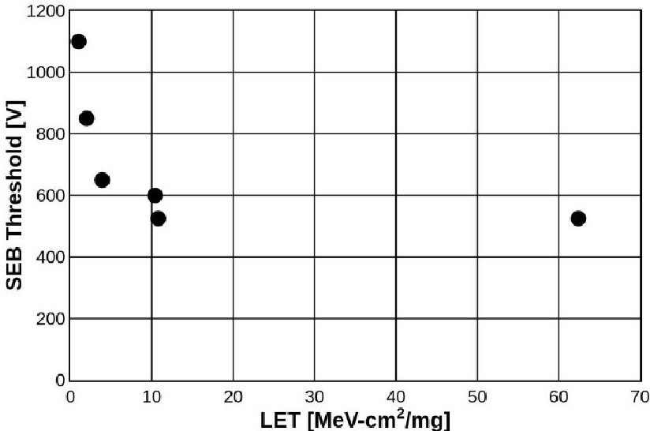
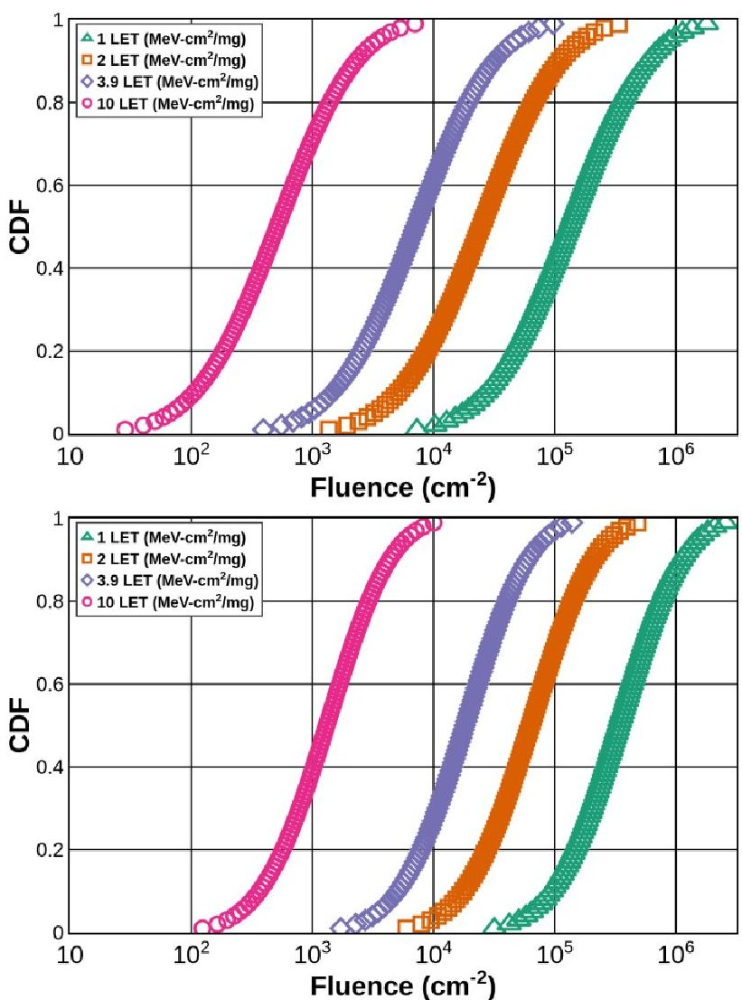
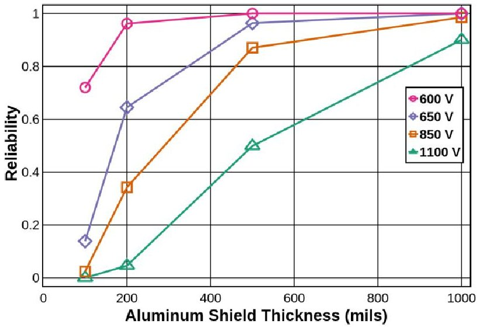
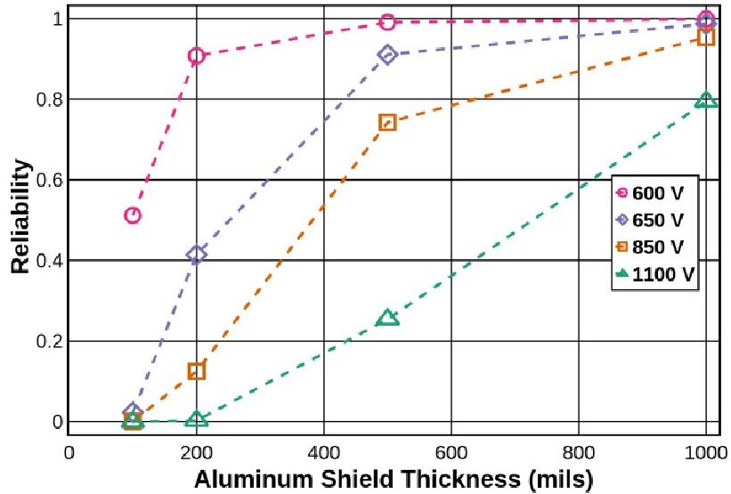
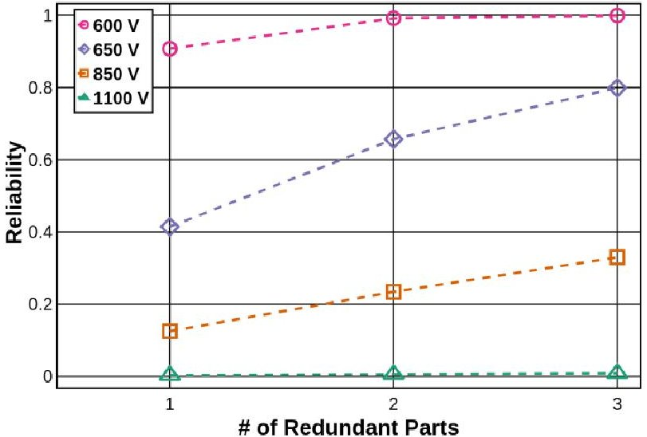
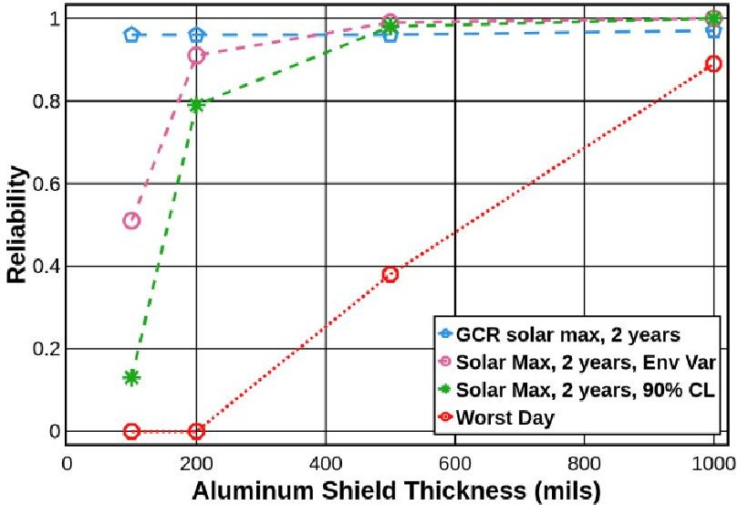
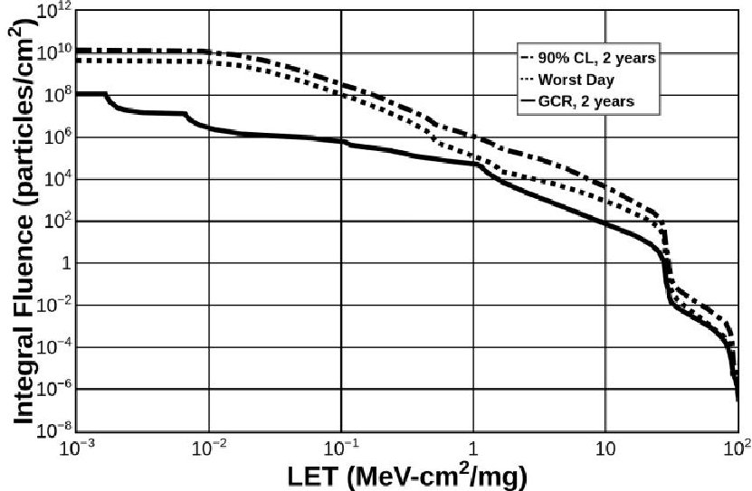

<!-- PDF_PAGE: 1 -->

# Inclusion of Radiation Environment Variability for Reliability Estimates for SiC Power MOSFETs

Rebekah A. Austin, Student Member, IEEE, Brian D. Sierawski, Senior Member, IEEE, Robert A. Reed, Fellow, IEEE, Ronald D. Schrimpf, Fellow, IEEE, Kenneth F. Galloway, Fellow, IEEE, Dennis R. Ball, Member, IEEE, and Arthur F. Witulski, Member, IEEE

Abstract—Variability of the solar energetic particle environment is investigated for single-event-burnout reliability of silicon-carbide power metal-oxide-semiconductor field effect transistors. A probabilistic assessment of failure evaluates the benefits of de-rating voltage, shielding, and mission length. The Prediction of Solar particle Yields for Characterizing Integrating Circuits code is used to calculate a cumulative density function for the fluence of the environment. The lethal ion method is then used to determine what proportion of the environment will cause single-event-burnout. The operating voltage determines the lowest linear-energy-transfer particle that will cause single-eventburnout and that should be included in the environment distribution. The shielding and mission length also determine the final environment distribution of the mission fluence. Through calculating the reliability for different operating voltages, shielding, and mission length for a specific device, it is shown that shielding thickness and operating voltage have a large effect on reliability and can be traded off during the design.

Index Terms—Heavy ion, power MOSFETs, probabilistic risk assessment, radiation hardness assurance methodology, reliability estimation.

## I. INTRODUCTION

SINGLE-event-burnout (SEB) and single-event-gate-rupture (SEGR) pose challenges for radiation hardness assurance (RHA) methodologies. Error rate prediction for SEB and SEGR is difficult because the sample size required to generate traditional cross-section curves is large [1]. The prescribed method for RHA in power devices is to de-rate the voltage to a point where no SEB is seen for a worst-case environment [2]. However, in some emerging technologies, like silicon-carbide (SiC) metal-oxide-semiconductor field effect transistors (MOSFET), derating the operating voltage by 50% does not eliminate the risk of SEB and might negate the benefits of using the technology in the first place. SiC MOSFETs are of interest for space application requiring high voltage, high temperature operation [3]. Worst-case failure rates calculated for these devices would preclude their use in many critical applications [4]. However, there are non-critical applications, such as a large

constellation of CubeSats, where these devices could be used, and a less conservative reliability estimate would provide value to a design team.

Environment stress, the mission dose, and device strength (the dose levels that cause part failure) were combined in an estimate of mission total ionizing dose (TID) and displacement damage dose (DDD) failure probabilities in previous work [5]. Reliability estimates of single event effects as functions of particle fluence were presented in [6]. We synthesize these two works and construct an assessment of catastrophic SEB reliability including environment variability. In this work, probabilistic models for multiple solar particle environments are combined with aluminum shield thickness and device derating to estimate the probability of catastrophic failure from SEB for 1200 V SiC power MOSFETs. The reliability is compared among a galactic cosmic ray (GCR) environment, a solar maximum environment at a 90% confidence level (CL), a worst day environment, and a solar maximum environment that incorporates the environment variability. Failure rates are analyzed to provide a measure of reliability over a 1- or 2-year mission. This methodology shows how these parameters significantly impact the estimated reliability for SiC power MOSFETs.

## II. RELIABILITY PREDICTION METHODOLOGY FOR SINGLE EVENT BURNOUT

In this section a method is introduced for computing the reliability of a SiC device susceptible to SEB in the heavy-ion environment of space, which incorporates the SiC burnout thresholds for different ions and the heavy ion environment variability. Reliability is the probability that an item will perform as required in a specific environment for a specified period of time [7]. When estimating the environment for radiation effects, the uncertainty is handled in different ways. Solar particle environments exist for worst day, worst week, and confidence levels from 1% to 99%. Depending on the criticality of the part and the risk posture of the mission, different estimates of the environment are used, but they do not

<!-- PDF_PAGE: 2 -->

Fig. 1. SEB threshold for different LET for SiC MOSFET [10].

account for the inherent variability that comes from describing the confidence level from 1% to 99%. For some missions, considering the average environment matches the risk posture of the mission and reduces the chance of over-design.

After estimating the environment, the portion of the environment that will cause radiation-induced failures is determined. For SEB, this occurs when a particle deposits enough charge in the sensitive area and the MOSFET drain-source junction is reverse biased beyond a critical voltage (the SEB threshold voltage). Two assumptions are made to calculate the probability of failure from SEB for a SiC MOSFET. First, it is assumed that the part tested represents the entire population of parts; part-to-part variability is not accounted for as that variability is normally small [8]. Commercial Si power MOSFETs exhibit considerable variability [9], however, so this variability may need to be incorporated in some cases. Second, it is assumed that any particle within an acceptance angle and linear energy transfer above $ \mathrm{LET}_{crit} $ will result in SEB if it hits the sensitive area while the part is in the off state. Fig. 1 shows how the SEB threshold voltage changes for a Wolfspeed C2M0080120D SiC MOSFET as a function of linear energy transfer [10]. Note that the MOSFET is rated for a maximum drain voltage of 1200 V. Full test conditions can be found in [10].

## A. Device Failure Distribution, $ F_{G}(x) $

In this work, it is assumed that the failure rate is proportional to the particle flux, similar to the lethal ion failure analysis from [11] and [12]. Every particle at or above the critical LET causes a SEB if the particle hits the device when the device is in an SEB sensitive state. This is determined by the proportionality factor k, defined in (1). This constant combines $ \sigma \left( \mathrm{c m}^{2} \right) $ the SEB sensitive area, 1 - duty cycle, corresponding to the fraction of time the device is off, and (1 - cos $ \theta $), which is the acceptance angle in which burnout may occur.

$$
k = \sigma (1 - d u t y c y c l e) (1 - \cos \theta)
$$

Using the device and conditions reported in [10], the sensitive area of the MOSFET is $ 3 \times1 0^{-3} \mathrm{c m}^{2} $ , the duty cycle is $ 50\% $ , and the angle of sensitivity around the normal is $ \pm1 5^{\circ} $ The conversion of angle around the normal to solid angle is

TABLE I

SEB THRESHOLD VOLTAGE DERATING AND CRITICAL LET VALUES

<table border="1"><tr><td>SEB Voltage(V)</td><td>Derating(%)</td><td>LETcrit(MeV-cm2/mg)</td><td>Color and Shape</td></tr><tr><td>1100</td><td>92</td><td>1</td><td>Green Triangle</td></tr><tr><td>850</td><td>71</td><td>2</td><td>Orange Square</td></tr><tr><td>650</td><td>54</td><td>3.9</td><td>Purple Diamond</td></tr><tr><td>600</td><td>50</td><td>10</td><td>Pink Circle</td></tr></table>

2 $ \pi $ (1-cos $ \theta $ ). To account for the opposite side of the sphere, the conversion is multiplied by 2. To normalize solid angle to steradians, the conversion is divided by $ 4 \pi $ , producing the last term in (1).

The arrival of a particle during a mission that causes SEB is a random event and the probability of this event happening is the same throughout the duration of the mission. Because the event rate is constant, an exponential distribution is used to describe the probability of failure. Let x represent the total mission fluence above the critical LET. The probability that the device experiences SEB is:

$$
F _ {G} (x) = 1 - e ^ {- k x}
$$

Fig. 2. Fluence probability distribution for a 1 year (top) and 2 year (bottom), solar max, GEO mission with 100 mils Al shielding.

<!-- PDF_PAGE: 3 -->

## B. Space Radiation Environment Variability Distribution, $ f_{s}(x) $

The Prediction of Solar particle Yields for Characterizing Integrating Circuits (PSYCHIC) code is a probabilistic model of the cumulative solar proton and heavy ion energy spectra [13]. The model was used to generate spectra with confidence levels from 1% to 99% for 1 and 2 year missions in solar maximum. Each environment was transported through 100, 200, 500, and 1000 mils of aluminum shielding using CREME96 [14] and folded into an integral LET spectrum. This process produces a cumulative distribution function (CDF) of the fluences above the critical LET for burnout shown in Fig. 1 for the total mission time. The CDFs for different critical LETs are plotted in Fig. 2 for a 1 and 2 year mission with 100 mils of shielding. Each curve contains 99 points corresponding to the cumulative fluence for the confidence levels 1 to 99%. The fluence axis is a log scale. The critical LET levels for the curves, from right to left are 1, 2, 3.9, and 10 MeV-cm $ ^{2} $ /mg. These LET values come from the test values in Fig. 1 and correspond to a specific SEB threshold voltage listed in Table 1. The LET is for silicon and is what the CRÈME-96 LETSPEC modeling environment provides. The difference in the spectrum between silicon and silicon carbide was within the measurement error for the experiment. For repeatability and ease of use LET in silicon is used in this paper. The CDF curves shift to the right from 1 year (top) to 2 years (bottom) as the number of particles expected during the mission increases. The width of the CDF curves from 1 year to 2 year decreases because the model uncertainty decreases as the mission time increases. The variability in the solar cycle averages out as mission time increases. The environment CDFs were fit with a lognormal distribution, the mean and standard deviation were estimated, and the probability density function (PDF) $ f_{s} ( x ) $ , was calculated. The PDFs are used for the reliability calculation in (3).

## C. Predicted Reliability for Single Event Burnout Environment

The probability of success, or the reliability, is one minus the exponential cumulative distribution function $ \mathrm{F_{G}} (\mathrm{x}) $ presented in II.A. This is considered the strength distribution. The particle

fluence $ \mathrm{f_{s}}(\mathrm{x}) $ in II.B provides the stress. Assuming the two probabilities are independent, the reliability of a device is calculated using static stress-strength analysis [15] [16].

$$
R = \int [ 1 - F _ {G} (x) ] f _ {s} (x) d x
$$

To calculate the reliability from (3), the integral is numerically calculated over the mission fluences for a given $ \mathrm{L E T}_{\mathrm{c r i t}} $ Each mission length, shielding thickness, and $ \mathrm{L E T}_{\mathrm{c r i t}} $ have their own CDF curve like the ones in Fig. 2 that is used to derive $ \mathrm{f_{s}}(\mathrm{x}) $ . These critical LETs used to model the environment correspond to different operating voltages for the device. The SEB threshold voltages for critical LETs of 1, 2, 3.9, and 10 $ \mathrm{M e V-c m^{2} / m g} $ correspond to operating voltages of 1100, 850, 650, and 600 V, respectively, in Fig. 1. Figs. 3a and 3b show the reliability of a part that exhibits SEB for a GEO mission length of 1 (a) or 2 (b) years for SEB threshold voltages of 1100, 850, 650, and 600V and 100, 200, 500, and 1000 mils of aluminum shielding. For example, if the part is de-rated by 50% so that the operating voltage is 600 V with 200 mils of Al shielding, the part reliability is 96% for a one year mission and 91% for a two year mission.

## III. DISCUSSION - DERATING AND RADIATION HARDNESS ASSURANCE

When the critical LET for a device is relatively low for the expected mission environment, the preceding method can calculate the reliability of that part. This is especially important when derating the operating voltage to a level where no SEB events are seen would eliminate the technology advantage of the part. The reliability estimate can be used to evaluate the effectiveness of derating, shielding, and limiting operational time. For the device in this paper, derating the voltage alone is not enough to achieve high reliability. To achieve an estimated reliability above 80%, the parts need to be behind at least 200 mils of Al shielding with 50% voltage derating. If the parts can be heavily shielded, lower derating voltages could be considered. For example, for a year mission behind 1000 mils of aluminum shielding, operating the part at 850 V (derating it

Fig. 3. Reliability of parts that exhibit SEB. The solid curves on the left are for a one year GEO mission and the dotted curves on the right are for a 2 year mission. The triangles are for an operating voltage of 1100 V, the squares 850 V, the diamonds 650 V, and the circles 600 V.

<!-- PDF_PAGE: 4 -->

Fig. 4. Reliability of parts for a 1 year GEO mission behind 500 mils of Al shielding. Redundancy is implemented in a parallel configuration.

to 71%) , corresponding to a critical LET of 2 MeV-cm $ ^{2} / \mathrm{mg} $ , the reliability is estimated to be 99%.

Another way to increase the reliability would be to implement redundant systems. By adding one or two additional systems so that the reliability block diagram would have the systems in parallel, the probability of failure (one minus the probability of success in Fig. 3) is raised to the power of the number of systems in parallel, reducing the probability of failure. For example, in a CubeSat constellation, one could have multiple duplicate satellites. If one, two, or three satellites are used to implement a function in the system where only one of the satellites needs to be working at one time, the reliability of the overall constellation is increased. Assuming that the SiC power MOSFET's reliability was the lowest in the satellite and dominated the overall system reliability, Fig. 4 shows how redundancy increased the probability of success for the different de-rated voltages for a 1 year GEO mission with 500 mils of aluminum shielding.

Fig. 5 compares this reliability prediction method to the background GCR environment and the worst day solar particle environment. CREME96 was used to calculate the integral flux for a critical LET of 10 MeV-cm $ ^{2} $ /mg at various shielding thicknesses at solar maximum [14]. The GCR environment, worst day solar particle environment, and the 90% confidence level environment for solar maximum through 100 mils of aluminum shielding as integral fluences are plotted in Fig. 6. Equation (3) was used to calculate the reliability for the different environments, based on these fluences. The solar maximum environments do not include the GCR environment when calculating the reliability. For shielding thickness below approximately 400 mils, the solar particle environment limits the reliability the part because the calculated reliability is lower than the reliability calculated for the GCR environment. As shielding increases, and the lower energy solar particles are more effectively stopped, the GCR component of the environment limits the reliability. Fig. 5 also shows a prediction based on the 90% confidence level solar energetic particle environment. Recall a confidence level of 90% means there is a 90% chance that the fluence will not be greater than predicted for the given mission length. If one were to consider this as a worst-case environment, the part reliability would be

Fig. 5. Reliability of parts when the critical LET is for 10 MeV-cm $ ^{2} $ /mg for just a GCR environment (blue pentagon dash), a solar max environment including environment variability (pink circle dash), solar max for a specific confidence level (green starburst dash), and worst day (red octagon dots) for a 2 year mission.

underestimated by a factor of $ 2 \times $ for nominal shielding of 100 mils of aluminum. For non-critical applications, including environment variability gives a better estimate of reliability.

Fig. 5 also shows the difference in reliability calculated for an even more extreme environment, the worst day environment. If the worst day is used to determine the part reliability, over 600 mils of aluminum shielding would be required to reach a 50% probability of surviving the event. For a part in a critical application, this would reasonably drive a high shielding requirement or even a different part selection. But for a lower criticality part on a risk tolerant mission, using the worst day environment would lead to over design in a mission. The reliability accounting for environment variability is over 90% for just 200 mils of aluminum shielding.

## IV. CONCLUSIONS

For systems leveraging the electrical benefits of SEB-vulnerable power devices, or other devices with destructive failure modes, a less conservative evaluation of failure may be necessary. When designing a system to use similar parts, reducing the operating voltage, or increasing shielding

Fig. 6. Integral fluence environment versus LET for the 90% confidence level for 2 years (dot dash), the worst day solar particle fluence (dots), and the GCR environment (solid line) for through 100 mils of Al shielding for a GEO orbit during solar maximum.

<!-- PDF_PAGE: 5 -->

thickness is more effective than limiting operational time.

The method in this paper shows how environment variability can be included to calculate the reliability of a part for a destructive SEE. It does not rely on a large testing sample that would be required to construct traditional cross-section curves [1], or assumptions related to effective LET [17]. By including environment variability, reliability for a part can be calculated that is not worst case and allows for the evaluation of parts for non-critical systems where the possibility of a destructive SEE is tolerated. For the 1200 V SiC power MOSFETs used in this paper, the reliability was calculated for a range of derating voltages, shielding, and mission length. Shielding thickness and the de-rated voltage have a large effect on the reliability. These techniques may increase the reliability to an acceptable level in non-critical applications.

## REFERENCES

[1] D. K. Nichols, J. R. Coss, T. Miyahira, J. Titus, D. Oberg, J. Wert, P. Majewski, J. Lintz, "Update of single event failure in power MOSFETs," in Proc. IEEE Radiat. Effects Data Workshop Rec., 1996, pp. 67-72.

[2] C. Poivey, "Radiation hardness assurance for space systems," in Proc. IEEE NSREC Short Course Notebook, Radiat. Effects, 2002, pp. V1-V57.

[3] A. Elasser, T. P. Chow, "Silicon carbide benefits and advantages for power electronic circuits and systems," in Proc. IEEE, 2002, vol. 90, no. 5, pp. 969-986, Jun. 2002.

[4] K. F. Galloway, A. F. Witulski, R. D. Schrimpf, A. L. Sternberg, D. R. Ball, A. Javanainen, R. A. Reed, B. D. Sierawski, J. -M. Lauenstein, "Failure estimates for SiC power MOSFETs in space electronics," in Aerospace, 2018, vol. 5, no. 67, pp. 1-7.

[5] M. A. Xapsos, C. Stauffer, A. Phan, S. S. McClure, R. L. Ladbury, J. A. Pellish, M. J. Campola, K. A. LaBel, "Inclusion of radiation environment variability in total dose hardness assurance methodology," IEEE Trans. Nucl. Sci., vol. 64, no. 1, pp. 325-331, Jan. 2017.

[6] M. Berg, K. LaBel, M. Campola, M. Xapsos, "Analyzing system on a chip single event upset responses using single event upset data, classical reliability models, and space environment data," presented at Radiat. Effects on Components and Systems, Geneva, SZ, Oct. 7, 2017.

[7] P. D. T. O'Conner, A. Kleyner, "What is Reliability Engineering," in Practical Reliability Engineering, $ 5^{\mathrm{th}} $ ed. New York, NY, USA: Wiley, 2012, ch. 1, sec. 1.1, pp. 1.

[8] Test Procedures for the Measurement of Single-Event Effects in Semiconductor Devices from Heavy Ion Irradiation, EIA/JESD57, 1997.

[9] J. S. George, D. A. Clymer, T. L. Turflinger, L. W. Mason, S. Stone, R. Koga, E. Beach, K. Huntington, J. -M. Lauenstein, J. Titus, M. Sivertz, "Response variability in commercial MOSFET SEE qualification," IEEE Trans. Nucl. Sci., vol. 64, no. 1, pp. 317-324, Jan. 2017.

[10] A. F. Witulski, D. R. Ball, K. F. Galloway, A. Javanien, J. -M. Laurenstein, A. L. Sternberg, R. D. Schrimpf, "Single-event burnout mechanisms in SiC power MOSFETs," IEEE Trans. Nucl. Sci., vol. 65, no. 8, pp. 1951-1955, Aug. 2018.

[11] J. L. Titus, C. F. Wheatley, T. H. Wheatley, W. A. Levinson, D. I. Burton, J. L. Barth, R. A. Reed, K. A. LaBel, J. W. Howard, K. M. VanTyne, "Prediction of early lethal SEGR failures of VDMOSFETs for commercial space systems," IEEE Trans. Nucl. Sci., vol. 46, no. 6, pp. 1640-1650, Dec. 1999.

[12] J. -M. Lauenstein, N. Goldsman, S. Liu, J. L. Titus, R. L. Ladbury, H. S. Kim, A. M. Phan, K. A. LaBel, M. Zafrani, P. Sherman, "Effects of ion atomic number on single-event gate rupture (SEGR) susceptibility of power MOSFETs," IEEE Trans. Nucl. Sci., vol. 58, no. 6, pp. 2628-2636, Dec. 2011.

[13] M. A. Xapsos, C. Stauffer, T. Jordan, J. L. Barth, R. A. Mewaldt, "Model for cumulative solar heavy ion energy and linear energy transfer spectra," IEEE Trans. Nucl. Sci., vol. 54, no. 6, pp. 1985-1989, Dec. 2007.

[14] A.J. Tylka, J. H. Adams, Jr., P. R. Boberg, B. Brownstein, W. F. Dietrich, E. O. Flueckiger, E. L. Petersen, M. A. Shea, D. F. Smart, and E. C. Smith, "CREME96: a revision of the cosmic ray effects on micro-electronics code", IEEE Trans. Nucl. Sci., vol. 44, no. 6, pp. 2150-2160, Dec. 1997.

[15] E. A. Amerasekera, F. N. Najm, "Static stress-strength analysis," in Failure Mechanisms in Semiconductor Devices, $ 2^{\mathrm{nd}} $ ed. New York, NY, USA: Wiley, 1997, ch. 5, sec. 5.6.11, pp. 249.

[16] D. Kerwin, "Reliability and qualification of custom integrated circuits for harsh environment applications using commercial wafer foundries," in Proc. IEEE NSREC Short Course Notebook, Radiat. Effects, 2010, pp. V1-V134.

[17] J. C. Pickel, "Single-event effects rate prediction," IEEE Trans. Nucl. Sci., vol. 43, no. 2, pp. 483-495, Apr. 1996.