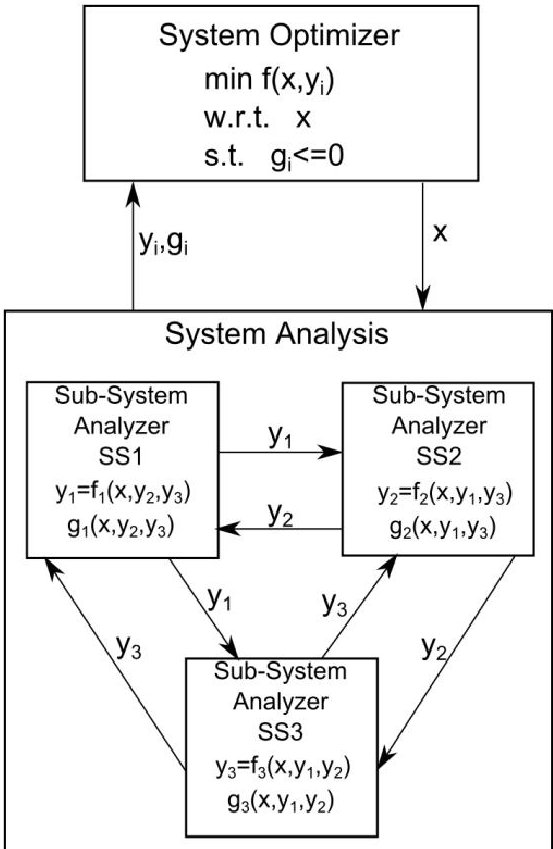
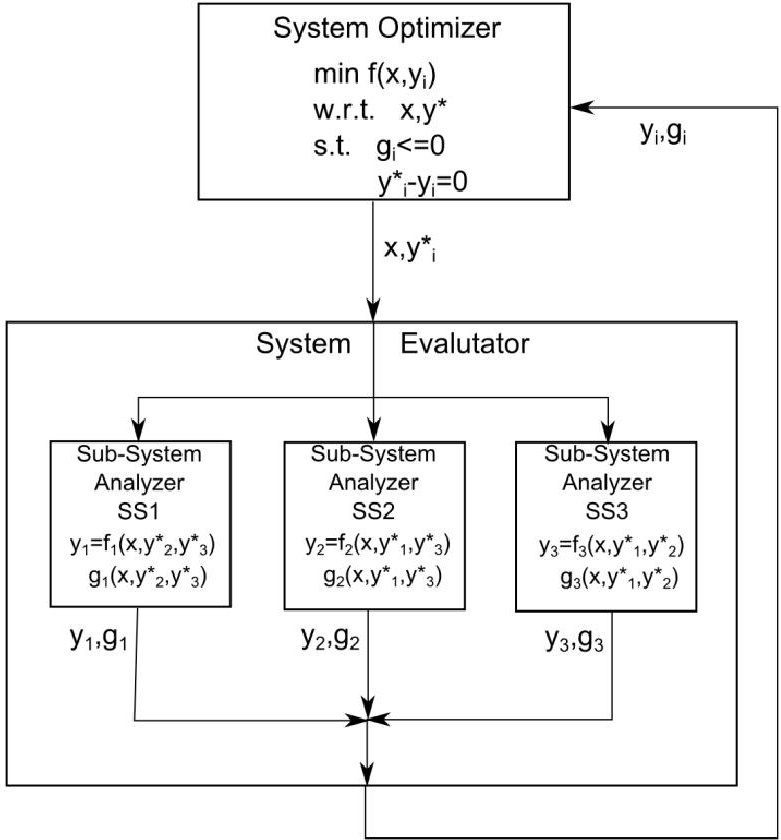
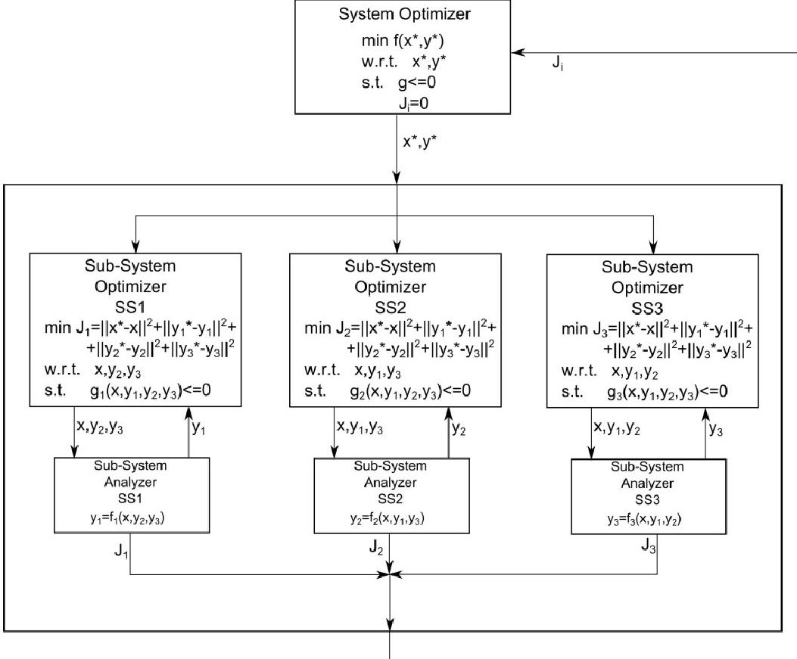
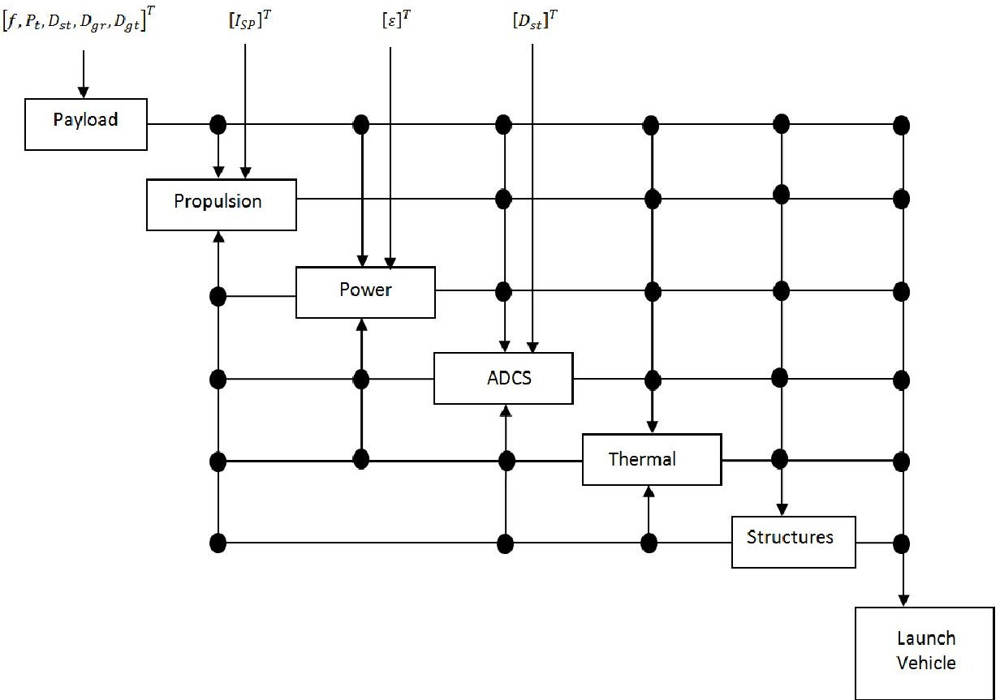

<!-- PDF_PAGE: 1 -->

# 10th World Congress on Structural and Multidisciplinary Optimization May 19 -24, 2013, Orlando, Florida, USA

# Incorporation of Value-Driven Design in Multidisciplinary Design Optimization

Bryan L. Mesmer $ ^{1} $ , Christina L. Bloebaum $ ^{2} $ , Hanumanthrao Kannan $ ^{3} $

$ ^{1} $ Iowa State University, Ames, Iowa, USA, BMesmer@iastate.edu $ ^{2} $ Iowa State University, Ames, Iowa, USA, Bloebaum @iastate.edu $ ^{3} $ Iowa State University, Ames, Iowa, USA, HKannan@iastate.edu

## 1. Abstract

It has become apparent that as modern day large-scale systems become increasingly complex the traditional Multidisciplinary Design Optimization (MDO) Systems Engineering design philosophy is becoming problematic. The communication of preferences through requirements has resulted in arbitrarily chosen constraints and objective functions attempting to reflect the stakeholder's desires within the limited design space. Design alternatives are deemed infeasible due to constraint violations even though they maybe preferred by the stakeholder. Value-Driven Design (VDD) offers a new perspective on complex system design, communicating stakeholder preferences through a value function and minimal number of requirements. This paper explores a hybrid VDD/MDO formulation that utilizes the strengths of each discipline. An example of a large-scale complex engineered system is introduced and optimal designs are compared using traditional MDO Systems Engineering formulations and the hybrid VDD/MDO formulations. MDO frameworks of Multidisciplinary Feasible, Individual Discipline Feasible and Collaborative Optimization are used to determine the optimal designs. The example demonstrates the need for proper preference communication through a value function that reflects the stakeholder's desire through a VDD/MDO formulation.

2. Keywords: Value-Driven Design, Multidisciplinary Design Optimization, Systems Engineering

## 3. Introduction

The design of modern day large-scale systems is a highly complex task, involving thousands of individuals from multiple disciplines and various locations in vast organizations. Multidisciplinary Design Optimization (MDO) [1] [2] was established in the early 1980s to enable design for these large-scale complex engineered systems (LSCES). Multidisciplinary Design Optimization (MDO) is a collection of frameworks that are used by design organizations to enable efficient determination of optimal designs of large-scale systems. Common usage of MDO frameworks involves establishing an objective function and requirements. The objective function that enables optimization has generally been considered an exogenous variable by MDO practitioners. The requirements imposed through MDO are used reflect the preferences of the product stakeholder. MDO uses these two means of desire capturing to determine the best system design.

Value-driven design (VDD) [3] provides a mathematically sound methodology for capturing all of the attributes of a design and converting those attributes into a singular value. The values of design alternatives are then compared directly to one another to determine the optimum design. This is dissimilar to objective functions commonly used in MDO which may incorporate product attributes, but do not fully capture the value of the product. The creation of a hybrid method fusing principles of VDD and MDO would involve the use of VDD value statements in MDO, enabling true product optimization based on the value of the design. VDD also drives to reduce or eliminate requirements. The requirements that are disseminated in MDO restrict the design space, potentially eliminating design alternatives that have a dramatic objective function increase but are marginally infeasible. MDO requirements are typically altered during the course of the design process to allow design alternatives that were previously infeasible, showcasing the initial ambiguity of the requirements. VDD captures the ideas that are attempted to be projected from the establishment of requirements and incorporates them into the value function. VDD in MDO reduces constraints on the design space, while preserving the MDO framework. Previous papers have discussed possible benefits of incorporating VDD into MDO[4-6]. This paper will expand upon the discussion by examining VDD incorporation into specific MDO frameworks and demonstrate their usefulness through examples.

This paper will examine the incorporation of VDD in both single level and multi-level MDO frameworks. The single level frameworks to be examined include Multidisciplinary Feasible (MDF) and Individual Discipline Feasible (IDF) [7]. Single level frameworks implement a single system level optimizer. Multi-level frameworks involve both system level optimizers and subsystem optimizers. Incorporation of VDD for single level frameworks will involve the use of a well-derived value function in place of the objective function and the elimination or significant reduction of requirements. The multi-level MDO framework examined in this paper is Collaborative Optimization (CO) [8] and will also involve manipulations of the objective function and requirements. A simple example involving a satellite system will be used in this paper to demonstrate the ability to incorporate VDD into MDO frameworks and to display the benefits of such an

<!-- PDF_PAGE: 2 -->

integration of ideas. Comparisons will be made between the hybrid VDD-MDO method and MDO with the traditional objective function and requirements.

## 4. Background

Multidisciplinary design optimization was formed in the 1980s from the need for optimization techniques in the structures field. As computational abilities advanced, MDO began focusing more on the optimization of entire systems involving couplings between disciplines or subsystems of the systems. Couplings are connections between portions of a system through physical and non-physical means. MDO initially focused on bi-level hierarchical decompositions[1] and evolved into focusing on total system optimizations[2,9,10]. In order to enable optimization, MDO requires that an objective function be created to capture the desires of the stakeholder. While requiring this function, MDO does not provide means of creating the function.

During the same time as the formation of the field of MDO as we know it today, the Systems Engineering community was establishing their own techniques to handle design for LSCES through methods such as the waterfall process[11]. The Systems Engineering methods rely heavily on using requirements to characterize the preferences of the stakeholder. These requirements do not describe what the stakeholder wants, just merely what they do not want with respect to various aspects of the system. The requirements are viewed as a pass/fail characteristic, where if a requirement is violated then the design is a total failure. Furthermore, all designs that pass the requirements are viewed as equals. The differentiation between design alternatives as pass/fail is not enough, leaving a design that failed slightly equivalent to a design that failed significantly. The requirements themselves are commonly determined arbitrarily, able to be changed if proven to restrict the design space too much.

To meld MDO to the system practices of the times, requirements were implemented into the frameworks. The design space restrictions associated with requirements are present in MDO; however, due to the objective function the designer is able to differentiate between feasible designs. While making MDO applicable for use in practice, the requirements reduce the abilities of the optimization process by restricting the design space.

Value-Driven Design (VDD) [3] is a systems engineering method that offers a different perspective on the design of LSCSE. VDD strives to determine the best system using a minimal number of constraints. Simple elimination of constraints in the current systems engineering methods would result in a loss of stakeholder preferences. VDD captures those lost preferences through a value function[12]. A value function captures the desire of a stakeholder through a meaningful equation relating the system attributes to a worth of the system, typically monetary in value for industry applications. The singular value of a design alternative resulting from a value function allows direct comparison between design alternatives. VDD provides a framework for decomposing the system value function to be distributed to sub-systems, enabling decision making by subsystem designers which are consistent with the preferences of the stakeholder[13, 14]. VDD does not provide methods to capture the couplings involved in LSCES.

Due to the inherent complementary characteristics of MDO and VDD, recent research[15] has begun to explore the benefits of a single method encompassing aspects of both fields. MDO provides the framework to design LSCES by capturing and handling the couplings that are present in the system. MDO also provides a mean of optimizing the system. VDD provides a means for reducing the restrictions placed on the design space due to requirements and captures those preferences of the stakeholder through a value function. By using the VDD value function in place of MDO's objective function, a method is created that provides a way to handle the characteristics of a LSCES as well as provide a proper mathematical description of the stakeholder's value preference of a design alternative.

## 5. Multidisciplinary Design Optimization Frameworks

Multiple papers[2,7,16-18] have reviewed the many frameworks that have been developed in the field of MDO. This paper will focus on three of these frameworks for use in comparing traditional MDO to a hybrid MDO/VDD method. These frameworks include Multidisciplinary Feasible, Individual Discipline Feasible and Collaborative Optimization.

## 5.1. Multidisciplinary Feasible

Multidisciplinary Feasible (MDF)[16,18] is an MDO framework that incorporates a system level optimizer. The optimizer uses an optimization method, such as Linear Programming[19] or Particle Swarm Optimization[20], to determine the optimal system design according to an objective function. The optimizer distributes design variable values to a system analysis which sends back system outputs for use in the optimization method. The system analysis converges the coupled sub-systems to ensure both sub-system and system consistency for every set of design variables determined by the system optimizer. While easy to understand and implement, the MDF framework requires significant computational effort in the system analysis

<!-- PDF_PAGE: 3 -->

portion, especially when dealing with highly coupled systems. The MDF framework is depicted visually in Figure 1.

Figure 1: Multidisciplinary Feasible

## 5.2. Individual Discipline Feasible

Individual Discipline Feasible (IDF)[7,21] is similar to MDF in that it incorporates a single optimizer at the system level. The optimizer determines the optimal system design, according to the objective function, by distributing design variable values and system output values to subsystem analyses. The subsystem analyses returns system outputs to be used in the objective function. An equality constraint is added to the system optimizer to drive the system optimization determined system outputs to be equivalent to the system outputs received from the subsystem analyses. The subsystem analyses are consistent with respect to the design variables and system outputs that they receive from the system optimizer. The system itself is only consistent when the appended equality constraint is satisfied, typically at convergence. IDF benefits from the absence of a system analysis, allowing for parallel computation of the subsystem analyses. The IDF framework is shown in Figure 2.

## 5.3. Collaborative Optimization

Collaborative Optimization (CO)[8,22] differs from both MDF and IDF by incorporating multiple optimizers. In CO a system optimizer determines a set of design variable values and system output values that it wishes to examine to minimize the system level objective function. This set is distributed to the subsystems as targets. Each subsystem has its own optimizer, determining the set of design variables and system outputs that will result in a design that is closest to the targets distributed from the system optimizer. In order to ensure the system optimization will be consistent at convergence, an equality constraint is added to drive the target system outputs and the subsystem supplied outputs to be equal. The subsystem analyses are consistent with respect to the set of design variables and system outputs that they receive from the subsystem optimizer. The system is not consistent unless the added equality constraints are satisfied. CO allows for parallel computation of the subsystems and also allows the subsystem designers to have control of the optimization of their respective subsystems. These separate subsystems allow for different optimization techniques to be utilized, leveraging the various characteristics of the separate subsystems to increase efficiency. The CO framework is visualized in Figure 3.

<!-- PDF_PAGE: 4 -->

Figure 2: Individual Discipline Feasible

Figure 3: Collaborative Optimization

## 6. Satellite System

To demonstrate the differences between a traditional MDO formulation and a hybrid MDO/VDD formulation in practice a large-scale complex engineered system example is created. The LSCES used in this paper is that of a geo-stationary communication satellite typically used for television broadcasting. A communications satellite, in its simplest definition, is a transmission relay, receiving communications signal from a transmitting ground station. The received signal is amplified, processed and transmitted back to a

<!-- PDF_PAGE: 5 -->

different receiving ground stations. Typically a satellite has a payload, which accomplishes the mission objective of the satellite. The satellite's bus consists of all the subsystems that aid the satellite in accomplishing the mission objective. The mission objective of a television broadcast satellite is to re-transmit the signals received from a ground station to another ground station efficiently and effectively. Each of the individual subsystems and payload of the example satellite are described in Appendix A, as well as the associated analysis equations.

Due to the complex nature of the satellite system, simplifications and assumptions were made to allow an efficient analysis. The resulting example is best perceived as a conceptual design of the satellite system. The assumptions associated with each of the subsystem analyses are depicted in Appendix A through the system equations. The amount of subsystems, typically in the hundreds for a satellite system, was reduced to seven broader subsystems. These subsystems are: Payload, Propulsion, Power, Attitude Determination and Control, Thermal, Structures and Launch Vehicle. The satellite system was chosen due to its highly coupled subsystems. Figure 4 represents these couplings using a design structure matrix (DSM)[23, 24]. The subsystem analyses are represented in the figure as boxes. The vertical lines originating at the top of the figure represent design variables distributed to the subsystem analyses. Horizontal lines leaving a subsystem represent outputs of the subsystem. Vertical lines that branch off of these horizontal lines and enter another subsystem represent behavior variables, outputs of a subsystem that another subsystem needs in order to perform their analysis. The origins of these vertical lines are represented by dots, indicating that the two subsystems connected by the lines are coupled. For example, an output of the Propulsion subsystem is needed for analysis of the ADCS subsystem, and vice versa. This results in the coupling of the two subsystems and is represented by the dots on the respected line intersects.

Figure 4: Satellite System DSM

In most system representations there are design variables and behavior variables. The design variables are values that are able to be adjusted by the designer in order to determine an optimal design. The behavior variables are values that are outcomes of analysis, typically dependent on the design variables and other behavior variables. Detailed descriptions of the design and behavior variables associated with the simplified example satellite system are given in Tables 1 and 2. Table 3 describes the behavior variables needed by a subsystem by the variables along the row of that particular subsystem. The behavior variables outputted by a subsystem to other subsystems are the variables associated with the column of that particular subsystem. For example, in Table 3 consider the $ 3^{rd} $ row, representing the Power subsystem. The Power subsystem receives the Power needed by the Payload, ADCS and Thermal subsystems $ (P_{payload}, P_{ADCS}, P_{thermal}) $ as inputs. Now consider the $ 3^{rd} $ column, also representing the Power subsystem, but now indicating outputs of the Power subsystem being received by other subsystems. In this column it is seen that the Propulsion subsystem receives the mass of the solar array and the battery mass as inputs originating from the power subsystem.

<!-- PDF_PAGE: 6 -->

Table 1: Description of Design Variables

<table border="1"><tr><td>Design Variable</td><td>Description</td></tr><tr><td>f</td><td>Frequency in Hz</td></tr><tr><td>Pt</td><td>Transmitter power in Watts</td></tr><tr><td>Dsat,ant</td><td>Diameter of the satellite antenna in m</td></tr><tr><td>Dground,rec</td><td>Diameter of the receiving ground antenna in m</td></tr><tr><td>Dground,trans</td><td>Diameter of the transmitting ground antenna in m</td></tr><tr><td>Isp</td><td>Specific impulse of the propulsion system in seconds</td></tr><tr><td>E</td><td>Energy density of the battery in $ \frac{W-hr}{kg} $</td></tr></table>

Table 2: Description of Behavior Variables

<table border="1"><tr><td>Behavior variable</td><td>Description</td></tr><tr><td>Mpayload</td><td>Mass of the payload in kg</td></tr><tr><td>Ppayload</td><td>Power required by the payload in Watts</td></tr><tr><td>Mtransponders</td><td>Mass of the transponders in kg</td></tr><tr><td>Mpropellant</td><td>Mass of the propellant in kg</td></tr><tr><td>MSA</td><td>Mass of the Solar Array in kg</td></tr><tr><td>Mbattery</td><td>Mass of the battery in kg</td></tr><tr><td>Array size</td><td>Area of the Solar array in m2</td></tr><tr><td>MADCS</td><td>Mass of the ADCS in kg</td></tr><tr><td>PADCS</td><td>Power required by the ADCS in W</td></tr><tr><td>MRW</td><td>Mass of the reaction wheels in kg</td></tr><tr><td>Mthermal</td><td>Mass of the thermal system in kg</td></tr><tr><td>Pthermal</td><td>Power required by the thermal system in W</td></tr><tr><td>Mbus</td><td>Mass of the satellite bus in kg</td></tr><tr><td>Ls</td><td>Length of the bus in m</td></tr><tr><td>rs</td><td>Radius of the bus in m</td></tr></table>

Table 3: Description of Couplings

<table border="1"><tr><td></td><td>Payload</td><td>Propulsion</td><td>Power</td><td>ADCS</td><td>Thermal</td><td>Structures</td><td>Launch Vehicle</td></tr><tr><td>Payload</td><td>-</td><td>-</td><td>-</td><td>-</td><td>-</td><td>-</td><td>-</td></tr><tr><td>Propulsion</td><td>Mpayload</td><td>-</td><td>MSA,Mbattery</td><td>MADCS</td><td>Mthermal</td><td>Mbus</td><td>-</td></tr><tr><td>Power</td><td>Ppayload</td><td>-</td><td>-</td><td>PADCS</td><td>Pthermal</td><td>-</td><td>-</td></tr><tr><td>ADCS</td><td>Mpayload</td><td>Mpropellant</td><td>MSA,Mbattery,Array size</td><td>-</td><td>Mthermal</td><td>Mbus,Ls,rS</td><td>-</td></tr><tr><td>Thermal</td><td>-</td><td>-</td><td>-</td><td>-</td><td>-</td><td>Ls,rS</td><td>-</td></tr><tr><td>Structures</td><td>Mtransponders</td><td>Mpropellant</td><td>Mbattery</td><td>MRW</td><td>Mthermal</td><td>-</td><td>-</td></tr><tr><td>Launch Vehicle</td><td>Mpayload</td><td>Mpropellant</td><td>MSA,Mbattery</td><td>MADCS</td><td>Mthermal</td><td>Mbus</td><td>-</td></tr></table>

## 7. Optimal Satellite Examples

The previously described satellite system is next used to compare the system design using a traditional MDO method and a hybrid MD)/VDD method. The software used in this study is MATLAB (2013a, The Mathworks, Natick, MA). The optimization method used in the various MDO frameworks for constrained problems was the MATLAB function fmincon with the algorithm being active-set. For unconstrained optimization problems the MATLAB function fminsearch was used. The traditional MDO formulation will first be examined to design the system, followed by a hybrid formulation incorporating VDD principles and

<!-- PDF_PAGE: 7 -->

concluded with a comparison of results and of performance of the three MDO frameworks used, MDF, IDF and CO.

## 7.1. Traditional Objective Function and Requirements

In traditional satellite system design formulations a common objective function is that of the minimization of the mass of the satellite. This objective function has been traditionally used in aerospace systems due to its relationship with the cost of the system. Generally, as a mass of an aerospace system increases the cost of the system increases. This objective function in and of itself will not produce a useful system design, as the objective function will be driven to zero mass. As is done in traditional system design constraints in the form of requirements must be created to restrict the design. These constraints are representations of the desires of the stakeholder, indicating regions of the design space that they commonly arbitrarily deem as infeasible.

Several constraints were created for the satellite system example. The sum of mass of all the subsystems is constrained to be less than 1000 kg to meet a launch vehicle requirement. The array size must be less than $ 2 0 \mathrm{m}^{2} $ and the natural frequencies along the axial and lateral directions of the structure should be greater than or equal to 30 Hz and 15 Hz respectively. This requirement is derived from the natural frequencies being greater than the natural frequencies associated with the launch vehicle. Finally, the Signal to Noise ratio must be greater than 10 dB, which will result in a higher quality signal. Apart from inequality constraints, side constraints are imposed on the problem as well. These side constraints are derived from common satellite system design practices[25].

The formal optimization statement in standard notation is seen in Eq.(1). The optimal system design for the traditional MDO systems engineering formulation is seen in Table 4. The associated objective function value and constraint values for the optimal design are displayed in Table 5. It can be seen that the design variables are driven to either their upper or lower bounds during the optimization. The bound to which they are driven to correlates to the design variable's relationship to the mass of the system. Due to the objective function simply being to minimize mass the design variables were determined accordingly. This problem demonstrates the control that the arbitrarily determined constraints have on a design in a traditional MDO systems engineering formulation. The constraints do not allow exploration into the infeasible region, excluding designs that may have a significant improvement of objective function. For example, perhaps a transmitted power of 295 W reduces the mass of the system to an amount previously believed unreachable.

$$
\begin{array}{l} f i n d \boldsymbol {X} = \left[ f, P _ {t}, D _ {s t}, D _ {g r}, D _ {g t}, I _ {s p}, \varepsilon \right] ^ {\prime} \\ M i n f \left(\boldsymbol {X}, \boldsymbol {y}, \boldsymbol {p}\right) = M _ {t o t a l} \\ s. t. g _ {1}: M _ {p a y l o a d} + M _ {p r o p e l l a n t} + M _ {p o w e r} + M _ {A D C S} + M _ {t h e r m a l} + M _ {s t r u c t u r e s} - 1 0 0 0 \leq 0 \\ g _ {2}: A r r a y s i z e - 2 0 m ^ {2} \leq 0 \\ g _ {3}: 1 0 d B - S i g n a l t o N o i s e r a t i o \leq 0 \\ g _ {4}: 3 0 H z - f _ {n a t, a} \leq 0 \\ g _ {5}: 1 5 H z - f _ {n a t, l} \leq 0 \\ 1 \mathrm {G H z} \leq f \leq 1 0 0 \mathrm {G H z} \\ 3 0 0 W \leq P _ {t} \leq 3 0 0 0 W \\ 0. 5 m \leq D _ {s t} \leq 2 0, \\ 2 m \leq D _ {g r} \leq 2 0 m \\ 2 m \leq D _ {g t} \leq 2 0 m \\ 3 5 0 s \leq I _ {s p} \leq 6 0 0 s \\ 3 5 \frac {W - h r}{k g} \leq \varepsilon \leq 2 0 0 \frac {W - h r}{k g} \\ \end{array}
$$

<!-- PDF_PAGE: 8 -->

Table 4: Optimal Design for Traditional MDO Systems Engineering Formulation

<table border="1"><tr><td>Design Variable</td><td>Values</td></tr><tr><td>f</td><td>1GHz</td></tr><tr><td>Pt</td><td>300W</td></tr><tr><td>Dsat,ant</td><td>0.5m</td></tr><tr><td>Dground,rec</td><td>2m</td></tr><tr><td>Dground,trans</td><td>2m</td></tr><tr><td>Isp</td><td>600s</td></tr><tr><td>$\mathcal{E}$</td><td>200$\frac{W-hr}{kg}$</td></tr></table>

Table 5: Constraints and Objective Function Values

<table border="1"><tr><td>Constraints and Objective function</td><td>Values</td></tr><tr><td>F</td><td>344.7352</td></tr><tr><td>$g_{1}$</td><td>-0.31901</td></tr><tr><td>$g_{2}$</td><td>-655.2648</td></tr><tr><td>$g_{3}$</td><td>-1.2106e+3</td></tr><tr><td>$g_{4}$</td><td>-10.4733</td></tr></table>

Another common technique used in traditional MDO Systems Engineering is to create a multi-objective function. Such an objective function is created to design the example satellite system, and is stated in Eq.(2). The constraints for the multi-objective function formulation are identical to Eq.(1) with the exception of the $ 2^{n d} $ inequality constraint, which is depicted in Eq.(2). The multi-objective function is the minimization of the mass of the system as well as the maximization of the power transmitted. The optimal design for this formulation is seen in Table 6. The constraint and objective function values are seen in Table 7. Once again the optimal design falls on constraints, which is typical for traditional MDO Systems Engineering formulations. The multi-objective function, while incorporating multiple aspects of the system, still succumbs to the design space constraint and proper capturing of stakeholder value concerns associated with traditional MDO Systems Engineering.

$$
\begin{array}{l} M i n f (\boldsymbol {X}, \boldsymbol {y}, \boldsymbol {p}) = M _ {t o t a l} - P _ {t} \\ g _ {2}: A r r a y s i z e - 4 0 m ^ {2} \leq 0 \\ \end{array}
$$

Table 6: Optimal Design for Multi-Objective Function

<table border="1"><tr><td>Design Variable</td><td>Values</td></tr><tr><td>f</td><td>1GHz</td></tr><tr><td>Pt</td><td>1033.3W</td></tr><tr><td>Dsat,ant</td><td>0.5m</td></tr><tr><td>Dground,rec</td><td>2m</td></tr><tr><td>Dground,trans</td><td>2m</td></tr><tr><td>Isp</td><td>600s</td></tr><tr><td>$\mathcal{E}$</td><td>200$\frac{W-hr}{kg}$</td></tr></table>

<!-- PDF_PAGE: 9 -->

Table 7: Constraint and Multi-Objective Function Values

<table border="1"><tr><td>Constraints and Objective function</td><td>Values</td></tr><tr><td>F</td><td>-332.8815</td></tr><tr><td>$g_{1}$</td><td>0</td></tr><tr><td>$g_{2}$</td><td>-299.6250</td></tr><tr><td>$g_{3}$</td><td>-958.7798</td></tr><tr><td>$g_{4}$</td><td>-7.4264</td></tr></table>

## 7.2. Value Function

In a hybrid MDO/VDD formulation the MDO objective function would be replaced by a value function, representing the true preference of the stakeholder, unlike the traditional formulation where the preferences were primarily communicated through the requirements. Due to the value function being the primary driving force for preference communication in the hybrid formulation the need for requirements is drastically reduced. This is seen in the following hybrid formulation by no requirements being established at all.

It is has been previously assumed that the satellite being designed is in the context of a commercial television communication endeavor. Therefore, it is a safe assumption that the driving force behind the industrial organization designing the satellite is to maximize profit. Profit can be obtained by calculating the total revenue gained and the total cost of the system. The cost model of the satellite system was derived using empirical relations[25]. These empirical equations estimate the cost of the satellite system and are displayed in Appendix B. The simplified revenue model of the satellite is partially dependent on the number of useful transponders onboard the satellite with the incorporation of market demand for the number of transponders. The market also dictates the leasing price per transponder. A leasing price of $1M per transponder per year has been assumed. With this revenue statement the inclination maybe to infinitely increase the number of transponders, however the utilization rate of the transponders[26-29] also becomes an important factor in the statement. A market demand of 50 transponders was assumed and the transmitter power $ P_{t} $ per transponder was assumed to be 30 Watts. The revenue also depends on the signal to noise ratio (SNR). A high SNR will result in a higher quality signal resulting in customers willing to pay more to lease a transponder. There is a saturation point, above which the revenue will not increase with the increase in SNR, captured in the revenue model.

The revenue as a function of the number of transponders (which is a function of Transmitter power, $ P_{t} $ ) is shown in Eq.(3). Eq.(3) represents a linear relationship between the number of transponders and the revenue as well as the failure rate of the transponders. This equation does not take into account the demand of the market. Consideration of the market demand (50 transponders) will result in constant revenue once the satellite has reached the market demand. An empirical equation was obtained to reflect the demand of the market, expressed in Eq.(4).

$$
\begin{array}{l} R _ {t} = (N \times \text {O p e r a t i o n a l l i f e t i m e} \times 1 M \$) - (\text {O p e r a t i o n a l l i f e t i m e} \times 0. 0 2 \times N \times 1 M \$) \\ w h e r e: \\ N: N u m b e r o f t r a n s p o n d e r s \\ O p e r a t i o n a l l i f e t i m e = 1 0 y e a r s \\ \end{array}
$$

$$
\begin{array}{l} R _ {t} = a _ {1} \times P _ {t} ^ {9} + a _ {2} \times P _ {t} ^ {8} + a _ {3} \times P _ {t} ^ {7} + a _ {4} \times P _ {t} ^ {6} + a _ {5} \times P _ {t} ^ {5} + \\ a _ {6} \times P _ {t} ^ {4} + a _ {7} \times P _ {t} ^ {3} + a _ {8} \times P _ {t} ^ {2} + a _ {9} \times P _ {t} ^ {1} + a _ {1 0} \\ w h e r e: \\ P _ {t} = 3 0 N \\ a _ {1} = - 6 2. 3 1 \times 1 0 ^ {- 2 1} \\ a _ {2} = 9 6 3. 3 1 5 \times 1 0 ^ {- 1 8} \\ a _ {3} = - 6. 3 2 \times 1 0 ^ {- 1 2} \\ a _ {4} = 2 2. 9 2 \times 1 0 ^ {- 9} \\ a _ {5} = - 5 0. 1 \times 1 0 ^ {- 6} \\ a _ {6} = 6 7. 7 2 \times 1 0 ^ {- 3} \\ \end{array}
$$

$$
a _ {7} = - 5 6. 0 6
$$

$$
a _ {8} = 2 7. 1 9 \times 1 0 ^ {3}
$$

$$
a _ {9} = - 6. 6 4 \times 1 0 ^ {6}
$$

$$
a _ {1 0} = 7 1 6. 1 5 \times 1 0 ^ {6}
$$

<!-- PDF_PAGE: 10 -->

Revenue is also obtained relating to the signal to noise ratio per transponder. Eq.(5), representing this revenue, takes into account the saturation point of the SNR where customers would no longer pay more for the increase in quality. Eq.(5) is based on the assumption that a negative SNR will result in a loss of revenue and a positive SNR will result in an increase in revenue.

$$
\begin{array}{l} R _ {S N R} = b \times S N R ^ {9} + b \times S N R ^ {8} + b \times S N R ^ {7} + b _ {4} \times S N R ^ {6} + b \times S N R ^ {5} + \\ b _ {6} \times S N R ^ {4} + b _ {7} \times S N R ^ {3} + b _ {8} \times S N R ^ {2} + b _ {9} \times S N R ^ {1} + b _ {1 0} \\ w h e r e: \\ b _ {1} = 1 3 4. 4 0 \times 1 0 ^ {- 1 2} \\ b _ {2} = 2 0. 2 7 \times 1 0 ^ {- 9} \\ b _ {3} = - 9 8 4. 9 4 \times 1 0 ^ {- 9} \\ b _ {4} = - 2 2 9. 6 8 \times 1 0 ^ {- 6} \\ b _ {5} = 1. 1 1 \times 1 0 ^ {- 3} \\ b _ {6} = 9 1 6. 7 5 \times 1 0 ^ {- 3} \\ b _ {7} = 1. 6 1 7 \\ b _ {8} = - 2. 0 8 5 \times 1 0 ^ {3} \\ b _ {9} = 4 9. 8 5 \times 1 0 ^ {3} \\ b _ {1 0} = - 1 8 6. 7 5 \times 1 0 ^ {3} \\ \end{array}
$$

$$
b _ {1 0} = - 1 8 6. 7 5 \times 1 0 ^ {3}
$$

With revenue streams formed the profit for a design alternative can be established, and is seen in Eq.(6). Note that in this equation the total cost is defined in Appendix B. As done commonly in Economics, a discount rate is applied to the profit to represent the notion that a dollar in the future is not worth the same as a dollar in the present[30]. Hence the net present profit is calculated in Eq.(7). During the formation of the value function it became apparent that a deep understanding of the system or subsystems was needed to understand the impact each design and behavior variable had on the cost and revenue. Unanticipated behavior of the system occurred when a cost or profit driver was missing as the optimal system tended to drive towards unattainable variable values. The revenue, cost and profit equations are all in units of U.S. dollars.

$$
Profit = \left(R _ {t} + R _ {S N R} \times N\right) - T o t a l C o s t
$$

$$
N e t p r e s e n t p r o f i t = \frac {P r o f i t}{(1 + r _ {d}) O p e r a t i o n a l l i f e t i m e}
$$

$$
w h e r e:
$$

$$
r _ {d}: d i s c o u n t f a c t o r = 10 \%
$$

The formal optimization statement for the hybrid VDD/MDO method is seen in Eq.(8). Seen in this equation is the absence of any form of constraints. While it is recognized that in some industries a complete elimination of constraints is not possible, VDD's goal is to eliminate as many as possible, incorporating those preferences communicated through the requirements into the value function. The elimination of constraints allows for the true optimum with respect to an accurate representation of the stakeholder's preferences to be determined. According to the net present profit statement established for the satellite system, the optimal design is shown in Table 8. Table 9 represents the value function and system attribute values associated with the optimal design. Without restrictions placed on the design space the optimizer for the hybrid VDD/MDO method is able to perform an unrestricted search for the best design.

$$
\begin{array}{l} f i n d \boldsymbol {X} = \left[ f, P _ {t}, D _ {s t}, D _ {g r}, D _ {g t}, I _ {s p}, \varepsilon \right] ^ {\top} \\ \operatorname {M i n} f (\boldsymbol {X}, \boldsymbol {y}, \boldsymbol {p}) = - N e t p r e s e n t p r o f i t \\ \end{array}
$$

<!-- PDF_PAGE: 11 -->

Table 8: Optimal Design for Hybrid Method

<table border="1"><tr><td>DV&#x27;s</td><td>Values</td></tr><tr><td>f</td><td>10GHz</td></tr><tr><td>Pt</td><td>1751.4W</td></tr><tr><td>Dsat,ant</td><td>0.3507m</td></tr><tr><td>Dground,rec</td><td>1.3209m</td></tr><tr><td>Dground,trans</td><td>0.7872m</td></tr><tr><td>Isp</td><td>478.4seconds</td></tr><tr><td>$\mathcal{E}$</td><td>139.786$\frac{W-hr}{kg}$</td></tr></table>

Table 9: Value Function and System Attribute Values

<table border="1"><tr><td>Outputs</td><td>Values</td></tr><tr><td>Net present profit</td><td>-185.9123e+6</td></tr><tr><td>$f_{nat,a}$</td><td>855.5 Hz</td></tr><tr><td>$f_{nat,a}$</td><td>20.1 Hz</td></tr><tr><td>SNR</td><td>14.47 dB</td></tr><tr><td>Array size</td><td>60.0875 m^{2}$</td></tr><tr><td>Spacecraft total mass</td><td>1155.7 kg</td></tr></table>

## 7.3. MDO Frameworks

During the study of the example satellite system three separate MDO frameworks, MDF, IDF and CO, were used to determine the optimal design. All three frameworks determined the correct optimal system design for the traditional MDO Systems Engineering formulations. The simple side constraints and inequality constraints were beneficial for the optimization procedure as the design space was severely limited. As is typical in optimization methods, the initial conditions did impact the resulting optimal design. Multiple initial conditions were required to insure the global minimum. Convergence issues also become apparent concerning the IDF and CO formulations due to the additional equality constraints. The optimization methods had difficult determining search vectors that would reduce all equality constraints. While these issues presented a challenge to the designer it was recognized that the IDF and CO formulations would benefit more complex system analysis through separation of the subsystems.

The issues present in the optimization of the traditional MDO Systems Engineering formulation was compounded in the hybrid VDD/MDO formulation. For this formulation the MDF and IDF frameworks were able to determine the optimal design; however, the CO framework had convergence issues that resulted in nonglobal optimums. Due to the open design space, the VDD/MDO MDF and IDF took longer to find the optimum than the traditional formulation. The convergence issues of the CO framework is theorized to originate from the increased complexity of the value function, resulting issues determining search vectors that would reduce all of the CO imposed equality constraints. The satellite system was further reduced to 3 subsystems and optimized using the CO framework, resulting in accurate results, although convergence issues still were present. Future work concerning the CO framework and the satellite system example will involve normalization of subsystem cost parameters and investigation into previously researched improvements.

## 7.4. Comparison of Results

The results obtained from the traditional MDO Systems Engineering formulations and the hybrid VDD/MDO formulations show the stark difference in perspectives concerning the design for LSCES. The preferences in the traditional formulation were communicated through the use of arbitrarily chosen requirements. These requirements restricted the ability of the optimizer to thoroughly search the design space. Furthermore, the objective function in the traditional formulation is generally formed using a handful of system attributes. These objective functions, similar to the requirements, make an attempt at capturing the desire of the stakeholder but, in the example of the satellite system, misrepresent what the stakeholder is driving for. In the example a

<!-- PDF_PAGE: 12 -->

minimization of mass was used in the optimization, which is commonly used in industry to reflect the notion that increased mass results in increased cost. The resulting optimal designs reflected the preferences communicated with designs that were the lightest in the design space allowable by the constraints.

The satellite system example showcased the benefits of a hybrid VDD/MDO formulation. While the value function requires greater initial overhead than traditional objective functions and requirements, the resulting function captures the true desires of the stakeholders, enabling accurate optimization consistent with the stakeholder's preferences. The optimal design for the satellite system using the hybrid formulation was a satellite that was bigger with a total mass of 1155.7kg than the traditional MDO formulation with a total mass of 344 kg. If we assume that the net present profit is the stakeholder's true preference then even though the VDD optimal design is large, costing more money due to the additional fuel, the revenue from the additional transponders and improved signal to noise ratio outweigh the weight cost. The VDD optimal design would produce a net present profit of $185,912,000, while the traditional MDO Systems Engineering formulation would produce a design with a net present profit of $31,060,000 and the multi-objective formulation would produce a profit of $120,125,000. While determining the true optimum with respect to the communicated preferences, the traditional framework produced a significantly lower profit than the true design optimum. In an effort to drive the cost down using the weight of the system the traditional formulation inadvertently reduced the profits that the company would receive. It is also seen that the optimal design according to the VDD formulation is not possible in the traditional framework as the antenna diameters are outside of the arbitrarily determined bounds.

## 8. Conclusion

The complexity of modern engineering systems has driven the design community to reexamine the basis of the frameworks from which we design. The traditional MDO Systems Engineering formulation of restricting the design space through constraints and forming an objective function to explore within the confined space results in designs that are typically non-optimal to the stakeholder's preferences. The perspective of VDD to communicate the stakeholder's preferences through meaningful value functions is needed in order to accurately determine the stakeholder's most preferred alternative. The satellite system example discussed in this paper offers a glimpse into a typical industry setting design process with traditional requirements and objective functions. The value function created, while not perfect, captures the true profit desire of a commercial organization. The value function is shown to be easily integrated into various MDO frameworks to determine the true optimal. Due to the VDD reduction of constraints a LSCES design process will have less cycles of redefining the requirements, reducing costs and schedule overruns. This paper has shown that value functions, while requiring more effort in the initial stage, enables an optimization in current MDO frameworks with less restrictions and the ability to find designs that would otherwise be infeasible due to arbitrarily determined constraints.

The future work concerning the hybrid VDD/MDO formulation is to expand the example model to accurately reflect the complexity and scale of the true model. Industrial partners will be sought to help in expansion of the number of subsystems and in increasing the subsystem analyses fidelities. Economists and business partners will be leveraged to improve the profit model that was created. Improvements to the Collaborative Optimization MDO framework will be made to reduce the concerns with convergence due to the complexity of the system. While much work is needed to demonstrate the full potential of the hybrid formulation, this paper has demonstrated that a need for a new formulation is apparent and that the hybrid formulation provides the new perspective that will drive the future of design for LSCES.

## 9. Appendix A

Appendix A will discuss each of the satellite system subsystems as well as define the equations used in each of the subsystem's analysis.

## 9.1. Payload

The payload for a communications satellite contains transponders and antennas. The function of a transponder is to serve as a communication link/channel between the uplink and the downlink antennas, whereas antennas receive and transmit the signals. The analysis equations of the payload are given as follows.

$$
\text {T r a n s m i t t e r a n t e n n a g a i n}: G _ {\mathrm {t}} = \eta_ {\mathrm {t}} \frac {\left(\pi D _ {\mathrm {t}}\right) ^ {2}}{\lambda}
$$

$$
\text{Where:} \quad \eta_ {\mathrm {t}} = 60 \% (\text{transmitter antenna efficiency})
$$

$$
\lambda = \frac {c}{f} (\mathrm {w a v e l e n g t h})
$$

$$
\mathrm {c} = 2. 9 9 7 8 \times 1 0 ^ {8} \mathrm {m / s} (\mathrm {v e l o c i t y o f l i g h t})
$$

$$
f: \mathrm {d o w n l i n k f r e q u e n c y i n H z}
$$

$$
\mathrm {D} _ {\mathrm {t}}: \mathrm {D i a m e t e r o f t r a n s m i t t e r a n t e n n a i n m}
$$

<!-- PDF_PAGE: 13 -->

$$
\text {R e c e i v e r a n t e n n a g a i n :} G _ {\mathrm {t}} = \eta_ {\mathrm {r}} \frac {\left(\pi \mathrm {D} _ {\mathrm {r}}\right) ^ {2}}{\lambda}
$$

$$
\text{Where:} \eta_ {\mathrm {r}} = 60 \% (\text{receiver antenna efficiency})
$$

$$
\mathrm {D} _ {\mathrm {r}}: \mathrm {D i a m e t e r o f r e c e i v e r a n t e n n a i n m}
$$

$$
\text {S i n g l a t o n o i s e r a t i o:} \frac {\mathrm {E} _ {\mathrm {b}}}{\mathrm {N} _ {0}} = \frac {\mathrm {P} _ {\mathrm {t}} \mathrm {L} _ {\mathrm {l}, \mathrm {t}} \mathrm {G} _ {\mathrm {t}} \mathrm {L} _ {\mathrm {S}} \mathrm {L} _ {\mathrm {a}} \mathrm {G} _ {\mathrm {r}} \mathrm {L} _ {\mathrm {l}, \mathrm {r}}}{\mathrm {K} _ {\mathrm {b}} \mathrm {T} _ {\mathrm {s}} \mathrm {R}}
$$

$$
\text {W h e r e :} \mathrm {T} _ {\mathrm {s}} = \text {S y s t e m n o i s e t e m p t a r t e (1 3 5 K)}
$$

$$
\mathrm {K} _ {\mathrm {b}} = \mathrm {B o l t z m a n n c o n s t a n t} 1. 3 8 0 7 \times 1 0 ^ {- 2 3} \mathrm {m} ^ {2} \mathrm {k g} / \mathrm {s} ^ {2} \mathrm {K}
$$

$$
\mathrm {P} _ {\mathrm {t}}: \mathrm {T r a n s m i t t e r p o w e r i n W}
$$

$$
\mathrm {L} _ {\mathrm {l}, \mathrm {t}}: \mathrm {L i n e l o s s b e t w e e n t r a n s m i t t e r} \& \mathrm {a n t e n n a}
$$

$$
\mathrm {L} _ {\mathrm {a}}: \mathrm {T r a n s m i s s i o n p a t h l o s s}
$$

$$
\mathrm {h} = \mathrm {O r b i t a l} \mathrm {a l t i t u d e} (\cong 3 5 0 0 0 \mathrm {k m})
$$

$$
\text {S p a c e I o s s}: \mathrm {L} _ {\mathrm {S}} = \left(\frac {\mathrm {c}}{4 \pi \mathrm {h f}}\right) ^ {2}
$$

$$
\mathrm {L} _ {\mathrm {l}, \mathrm {r}}: \mathrm {L i n e l o s s b e t w e e n r e c e i v e r} \& \mathrm {a n t e n n a}
$$

$$
R = \mathrm {D e s i r e d b i t s p e r s e c o n d} (3. 5 \mathrm {M b p s f o r T V})
$$

$$
A = \mathrm {R a i n a t t e n u a t i o n i n d B}
$$

A rain attenuation factor of (-A) will be added to the Signal to Noise ratio in dB when the frequency of transmission increases beyond 10 GHz. This factor is linearly dependent on the frequency.

$$
\begin{array}{l} \mathrm {M a s s o f t h e p a y l o a l , M} _ {\mathrm {p a y l o a l}} = 6 \mathrm {D} _ {\mathrm {t}} ^ {2} (\mathrm {a p p r o x i m a t i o n} [ 2 5 ]) \\ \mathrm {P o w e r r e q u i r e d b y t h e p a y l o a l , P} _ {\mathrm {p a y l o a l}} = 1. 9 5 \mathrm {P} _ {\mathrm {t}} + 6. 5 (\mathrm {l i n e a r a p p r o x i m a t i o n} [ 2 5 ]) \\ \end{array}
$$

The same analysis equations apply for both uplink and downlink, with the roles of the ground & satellite antenna reversed. The composite link budget analysis equations result in a composite signal to noise ratio, which is a function of both uplink and downlink signal to noise ratios.

## 9.2. Propulsion

The propulsion system consists of small thrusters that are used for station keeping. This subsystem aids the satellite in maintaining the desired trajectory, controlling spin and maintaining three-axis stability. The analysis equations of the propulsion system are given below.

$$
\text{Burnout mass: } M _ {\mathrm {B}} = \text{Mass of the spacecraft} - M _ {\text{propellant}}
$$

$$
\Delta V
$$

$$
\mathrm {M a s s r a t i o}, R = \mathrm {e} ^ {\overline {{\mathrm {I s p g e}}}}
$$

$$
\mathrm {w h e r e} \mathrm {I} _ {\mathrm {s p}}: \mathrm {s p e c i f i c} \mathrm {i m p u l s e} \mathrm {i n} \mathrm {s e c o n d s}
$$

$$
g: \mathrm {a c c e l e r a t i o n d u e t o g r a v i t y}
$$

$$
\Delta \mathrm {V}: \mathrm {c h a n g e i n v e l o c i t y n eeded t o g e t i n o r b i t}
$$

$$
\begin{array}{l} \mathrm {M a s s o f t h e p r o p e l l a n t}: \mathrm {M} _ {\mathrm {p r o p e l l a n t}} = \left(\left(\mathrm {R} \mathrm {M} _ {\mathrm {B}}\right) - \mathrm {M} _ {\mathrm {B}}\right) \times \mathrm {M a r g i n f a c t o r}, \\ \mathrm {W h e r e : M a r g i n f a c t o r = 1 . 2} \\ \end{array}
$$

## 9.3. Power

The power subsystem consists of batteries, solar panel and other power generating sources. The power subsystem provides all the subsystems and the payload with power. The design of this subsystem is governed by the power needed by the other subsystems. The analysis equations of the power subsystem are given below.

$$
\mathrm {P} _ {0} = \mathrm {P} _ {\mathrm {A D C S}} + \mathrm {P} _ {\mathrm {P a y l o a d}} + \mathrm {P} _ {\mathrm {T h e r m a l}}
$$

$$
\begin{array}{l} \mathrm {W h e r e}: \mathrm {P} _ {\mathrm {p a y l o a d}}: \mathrm {p o w e r} \mathrm {r e q u i r e d} \mathrm {b y} \mathrm {t h e} \mathrm {p a y l o a d} \\ \mathrm {P} _ {\mathrm {A D C S}}: \mathrm {P o w e r} \mathrm {r e q u i r e d} \mathrm {b y} \mathrm {t h e} \mathrm {A D C S} \\ \mathrm {P} _ {\mathrm {T h e r m a l}}: \mathrm {P o w e r} \mathrm {r e q u i r e d} \mathrm {b y} \mathrm {t h e} \mathrm {t h e r m a l} \mathrm {s y s t e m} \\ \end{array}
$$

$$
\text {R e q u i r e d s o l a r a r r a y o u t p u t :} \mathrm {P} _ {\mathrm {S A}} = \mathrm {P} _ {0} + \mathrm {P} _ {0} \left(\frac {\mathrm {T} _ {\mathrm {E}}}{\mathrm {T} _ {\mathrm {S}}}\right) \left(\frac {1}{\mathrm {H h}}\right)
$$

<!-- PDF_PAGE: 14 -->

$$
\text {W h e r e : T o t a l o r b i t a l p e r i o d :} T _ {0} = 2 4 \mathrm {h r s}
$$

$$
\text{Maximum eclipse time: } T _ {\mathrm {E}} = 1. 2 \text{ hrs}
$$

$$
\text {M a x i m u m s u n l i t t i m e}: T _ {\mathrm {S}} = T _ {\mathrm {O}} - T _ {\mathrm {E}}
$$

$$
\text{Discharging efficiency: H} = 94 \%
$$

$$
Charging efficiency: h = 92 \%
$$

Mass of solar array: $ \mathrm{M_{SA}}=0.04*\mathrm{P_{SA}} $ (approximation[25])

$$
\begin{array}{l} \mathrm {A r r a y s i z e} = \frac {\left[ \frac {P _ {\mathrm {S A}}}{\left\{\left(1 - \mathrm {d e g r a d a t i o n}\right) \left(1 - \mathrm {t e m p e r a t u r e e f f e c t}\right) \right\}} \right]}{\mathrm {s o l a r f l u x} * \cos \propto * \mathrm {c e l l e f f i c i e n c y} * \mathrm {p a c k i n g f a c t o r}} \\ \mathrm {W h e r e : d e g r a d a t i o n = 0 . 3} \\ \mathrm {t e m p e r a t u r e e f f e c t} = \left(t _ {0} - t _ {\mathrm {r e f}}\right) 0. 0 0 5 \\ t _ {0} = 6 0 ^ {\circ} \mathrm {C} \\ t _ {\mathrm {r e f}} = 2 8 ^ {\circ} \mathrm {C} \\ \mathrm {s o l a r f l u x} = 1 3 6 7 \mathrm {W / m} ^ {2} \\ \mathrm {c e l l e f f i c i e n c y} = 1 4 \% \\ \mathrm {s u n i c i d e n c e a n g l e :} \alpha = 2 3. 5 ^ {\circ} \\ \mathrm {p a c k i n g f a c t o r} = 0. 9 \\ \end{array}
$$

$$
\text {B a t t e r y c a p a c i t y} = \frac {\mathrm {P} _ {0} \mathrm {T} _ {\mathrm {E}}}{(\mathrm {D O D}) \mathrm {H}} \mathrm {W} - \mathrm {h r}
$$

$$
\text {W h e r e : D e p t h o f d i s c h a r g e : D O D = 0. 8}
$$

$$
\text{Battery mass: } \mathrm{M}_{\text{Battery}} = \frac{\text{Battery capacity}}{\text{Energy density} (\mathcal{E})}
$$

Mass of the power system: $ M_{\mathrm{Power}}=M_{\mathrm{SA}}+M_{\mathrm{Battery}} $

## 9.4. Attitude Determination and Control

The Attitude Determination and Control subsystem (ADCS) consists of sensors such as star trackers and solar trackers to track the attitude and orientation of the spacecraft. The ADCS also contains components to control the attitude and orientation of the satellite such as momentum wheels, gyros and thrusters. The analysis equations of the ADCS are given as follows.

$$
\text {G r a v i t y - g r a d i e n t t o r q u e :} T _ {\mathrm {g}} = \frac {3 \mu \left| I _ {\mathrm {z}} - I _ {\mathrm {y}} \right| \sin 2 \theta}{2 R ^ {3}}
$$

Where: $ I_{y} $ : Mass moment of inertia of the spacecraft along the y-axis $ kg-m^{2} $

$ I_{z} $ : Mass moment of inertia of the spacecraft along the z-axis $ kg-m^{2} $

$$
\begin{array}{l} \mu = 3. 9 8 6 \times 1 0 ^ {1 4} \mathrm {m} ^ {3} / \mathrm {s} ^ {2} \\ \mathrm {R a d i u s o f t h e o r b i t:} R = \left(h + R _ {\mathrm {E}}\right) \\ \mathrm {P o i n t i n g a c c u r a c y:} \theta = 1 ^ {\circ} \\ \end{array}
$$

Torque due to solar radiation: $ \mathrm{T}_{\mathrm{sp}}\approx 0. 3 \mathrm{~F} $ (approximation[25])

$$
\text {W h e r e}: F = \frac {F _ {s}}{c} A _ {s} (1 + q) \cos \alpha
$$

$$
F _ {\mathrm {s}} = 1 3 6 7 \mathrm {W} / \mathrm {m} ^ {2}
$$

$$
c: v e l o c i t y o f l i g h t
$$

$$
\mathrm {A} _ {\mathrm {s}} = 2 \mathrm {L} _ {\mathrm {s}} \mathrm {r} _ {\mathrm {s}} + 2 \mathrm {L} _ {\mathrm {S A}} \mathrm {b} _ {\mathrm {S A}} + \mathrm {t} _ {\mathrm {p a y l o a d}} \times \mathrm {D} _ {\mathrm {s t}}
$$

thickness of the satellite antenna: $ t_{\mathrm{payload}} = (0.5\%) $ $ D_{t} $

breadth of the solar array: $ b_{\mathrm{sa}}=\sqrt{\frac{\mathrm{Array size}}{3}} $

length of the solar array: $ \mathrm{I}_{\mathrm{s a}} \approx 3 \mathrm{b}_{\mathrm{s a}} $

$$
\alpha = 2 3. 5 ^ {\circ}
$$

$$
q = 0. 6
$$

Total Disturbance Torque, $ \left( \mathrm{T}_{\mathrm{D}} \right) = $ Solar radiation Torque + Gravity Distribution torque

Reaction Wheel Torque needed: $ \mathrm{T}_{\mathrm{R W}}=\mathrm{T}_{\mathrm{D}}\times $ Margin factor

<!-- PDF_PAGE: 15 -->

$$
\text {A n g u l a r M o m e n t u m t o c o u n t e r d i s t u r b a n c e T o r q u e s :} \mathrm {h} _ {\mathrm {d}} = \frac {\mathrm {T} _ {\mathrm {R W}} \times 2 4 \times 6 0 \times 6 0}{4} \times 0. 7 0 7
$$

$$
\text {A n g u l a r M o m e n t u m n eeded f o r p o i n t i n g a c c u r a c y :} \mathrm {h} _ {\mathrm {p}} = \frac {\mathrm {T} _ {\mathrm {R W}} \times 2 4 \times 6 0 \times 6 0}{4 \times \theta_ {\mathrm {d}}}
$$

$$
\text {W h e r e :} \theta_ {\mathrm {d}} = 1 ^ {\circ} (\text {p o i n t i n g a c c u r a c y n eeded})
$$

$$
\text {T o t a l a n g u l a r m o m e n t n e e d e d b y R W:} \mathrm {h} = \mathrm {h} _ {\mathrm {d}} + \mathrm {h} _ {\mathrm {p}}
$$

$$
\text{Mass of RW: } \mathrm{M}_{\mathrm{RW}} = \frac{(\mathrm{h} + 44)}{22} \text{ (obtained from linear interpolation[25])}
$$

$$
\text{Mass of attitude sensors: } M_{\text{sensors}} = 3 \text{ kg} ([25])
$$

$$
\text {T o t a l m a s s:} \mathrm {M} _ {\mathrm {A D C S}} = \mathrm {M} _ {\mathrm {R W}} + \mathrm {M} _ {\mathrm {s e n s o r s}}
$$

$$
\text {P o w e r n e e d b y R W m o t o r :} \mathrm {P} _ {\mathrm {R W}} = \frac {(\mathrm {h} + 3 9 . 5 6)}{3 . 9 9 6} (\text {l i n e a r i n t e r p o l a t i o n} [ 2 5 ])
$$

$$
\text {P o w e r n e e d b y s e n s o r s :} \mathrm {P} _ {\mathrm {s e n s o r s}} = 1 0 \mathrm {W} ([ 2 5 ])
$$

$$
\text {T o t a l p o w e r}: \mathrm {P} _ {\mathrm {A D C S}} = \mathrm {P} _ {\mathrm {R W}} + \mathrm {P} _ {\mathrm {s e n s o r s}}
$$

## 9.5. Thermal Control

The satellite will be exposed to high and low temperature extremes during their operational lifetime. The operating temperature of most of the subsystems and the payload are not in this range. A thermal shield must be provided for all the components of the satellite to function properly. Thermal control of the satellite can be accomplished by using insulators, radiators and heaters. The analysis equations of the thermal subsystem are given as follows. The operating temperature ranges of all the components were assumed.

Insulators:

Projected area of the insulated layers: $ A_{\mathrm{p}}=\frac{\sigma\mathrm{T}4\mathrm{A}} {S^{\frac{\alpha}{\varepsilon}}} $

Where: $ \sigma $: Stefan Boltzmann constant

A: surface area of the component

S: solar flux at 1 AU

$ \alpha $: absorptivity of the insulating material

$ \varepsilon $: emissivity of the insulating material maximum operating temperature of the component

$$
\text{Mass of the insulator: } M_{\text{ins}} = 0.73 \text{ A}_{\text{p}} \text{ (Approximation[25])}
$$

Radiator:

$$
\text {A r e a o f r a d i a t o r}: A _ {\mathrm {r a d i a t o r}} = \frac {Q _ {\mathrm {i n t}}}{\varepsilon_ {\mathrm {r a d}} * \sigma T ^ {4}}
$$

Where: $ Q_{\mathrm{int}} $ : internal heat generated $ \varepsilon_{\mathrm{rad}} $ : emissivity of the radiator

$$
\mathrm {M} _ {\mathrm {r a d i a t o r}} = 3. 3 \mathrm {A} _ {\mathrm {r a d i a t o r}} \quad (\mathrm {A p p r o x i m a t i o n} [ 2 5 ])
$$

Heater:

$$
\begin{array}{l} \mathrm {P} _ {\mathrm {h e a t e r}} = \varepsilon_ {\mathrm {r a d}} \sigma \left(\mathrm {A} _ {\mathrm {r a d i a t o r} \partial}\right) T _ {\min } ^ {4} \\ \mathrm {w h e r e} T _ {\min }: \mathrm {m i n i m u m o p e r a t i n g t e m p e r a t i o n o f t h e c o m p o n e n t} \\ \end{array}
$$

## 9.6. Structures

The satellite bus establishes the basic geometry of the satellite, which provides place for all the subsystems to be housed in. The structure and configuration of the bus plays a major role in the overall design of

<!-- PDF_PAGE: 16 -->

the satellite. The bus acts as a chassis for circuitry, computers, gyroscopes, etc. A cylindrical bus was considered in this paper. The analysis equations for the structures subsystem are given as follows.

Estimation of length and radius of the bus:

$ V_{\mathrm{bus}}= $ Margin factor $ \times $ Sum of the Volume of all the subsystes

$$
\begin{array}{l} \mathrm {L} _ {\mathrm {s}} = \left[ \left(1 6 \times \frac {\mathrm {V} _ {\mathrm {b u s}}}{\mathrm {p i}}\right) ^ {1 / 3} \right] \\ \mathrm {r} _ {\mathrm {s}} = \mathrm {L} _ {\mathrm {s}} / 4 \\ \end{array}
$$

Structure sizing for tensile strength:

$$
\begin{array}{l} \mathrm {A x i a l l o a d}: \mathrm {P} _ {\mathrm {a x i a l}} = 9. 8 1 \mathrm {M} _ {\mathrm {S / C}} \mathrm {L} _ {\mathrm {a}} \\ \mathrm {W h e r e}: \mathrm {L} _ {\mathrm {a}} = \mathrm {a x i a l l o a d f a c t o r} \approx 6. 5 \\ \mathrm {M} _ {\mathrm {S / C}} = \mathrm {s p a c e c r a f t m a s s} \\ \end{array}
$$

$$
\begin{array}{l} B e n d i n g m o m e n t: B M = 9. 8 1 M _ {S / C} \left(L _ {S} / 2\right) L _ {B M} \\ \mathrm {W h e r e} |: \mathrm {L} _ {\mathrm {S}} = \mathrm {l e n g t h} \mathrm {o f t h e b u s} \\ \mathrm {L} _ {\mathrm {B M}} = \mathrm {B e n d i n g m o m e n t l o a d f a c t o r} \approx 3 \\ \end{array}
$$

$$
\text {E q u i v a l e n t a x i a l l o a d}: \mathrm {P} _ {\mathrm {e q}} = \mathrm {P} _ {\mathrm {a x i a l}} + \frac {2 \mathrm {B M}}{\mathrm {r} _ {\mathrm {s}}}
$$

$$
\text {W h e r e :} \mathrm {r} _ {\mathrm {s}} = \mathrm {R a d i u s} \mathrm {o f} \mathrm {t h e b u s}
$$

$$
\begin{array}{l} \mathrm {U l t i m a t e L o a d}: \mathrm {F} _ {\mathrm {u l t i m a t e}} = \mathrm {P} _ {\mathrm {e q}} \times \mathrm {F O S} _ {\mathrm {u l t i m a t e}} \\ \mathrm {W h e r e : F O S} _ {\mathrm {u l t i m a t e}} = \mathrm {F a c t o r O f S a f e t y} \\ \end{array}
$$

$$
\text{Thickness required: } t_{\text{req},1} = \frac{F_{\text{ultimate}}}{F_{\text{tu}}(2\pi r_s)}
$$

$$
\text{Where: } \mathrm{F}_{\mathrm{tu}} = \text{Ultimate tensile strength}
$$

$$
t _ {\mathrm {r e q}, 2} = \frac {P _ {\mathrm {e q}} \times F O S _ {\mathrm {y i e l d}}}{F _ {\mathrm {t y}} \left(2 \pi r _ {\mathrm {s}}\right)}
$$

$$
\text{Where:} \mathrm{F}_{\mathrm{ty}} = \mathrm{yield} \mathrm{tensile} \mathrm{strength}
$$

$$
\begin{array}{l} \mathrm {I f} t _ {\mathrm {r e q}, 1} > t _ {\mathrm {r e q}, 2} \mathrm {t h e n} t _ {\mathrm {s}} = t _ {\mathrm {r e q}, 1} \mathrm {e l s e} t _ {\mathrm {s}} = t _ {\mathrm {r e q}, 2} \\ \mathrm {W h e r e :} t _ {\mathrm {s}} = \mathrm {T h i c k n e s s o f t h e b u s} \\ \end{array}
$$

Sizing for Stability (Compressive Strength):

$$
\text {Buckling Stress:} \sigma_ {\mathrm {e r}} = 0. 6 \times \gamma \times \frac {\mathrm {E} _ {\mathrm {t s}}}{\mathrm {r} _ {\mathrm {s}}}
$$

$$
\begin{array}{l} \gamma = 1 - 0. 9 0 1 \left(1 - \mathrm {e} ^ {- \varphi}\right) \\ \end{array}
$$

$$
\varphi = \frac {1}{1 6} \sqrt {\frac {r _ {s}}{t _ {s}}}
$$

$$
\text {C r i t i c a l b u c k l i n g l o a d:} \mathrm {P} _ {\mathrm {e r}} = A \sigma_ {\mathrm {e r}}
$$

The bus must be capable of withdrawing the applied load, i.e., $ P_{\mathrm{eq}} $ . If $ P_{\mathrm{er}} < P_{\mathrm{eq}} $ is not adequate. Thickness should be changed in order to make the structure adequate.

$$
\text{Margin of Safety: MS} = \frac {\mathrm {P} _ {\mathrm {er}}}{\mathrm {P} _ {\mathrm {eq}}} - 1
$$

MS should be positive for the structure to withstand the load.

$$
\begin{array}{l} \mathrm {M a s s o f t h e b u s :} \mathrm {M} _ {\mathrm {s}} = \left(2 \pi \mathrm {r} _ {\mathrm {s}} \mathrm {L} _ {\mathrm {s}} \mathrm {t} _ {\mathrm {s}}\right) \rho \\ \mathrm {W h e r e :} \rho = \mathrm {D e n s i t y o f t h e m a t e r i a l} \\ \end{array}
$$

$$
\text {N a t u r a l f r e q u e n c y a l o n g a x i a l d i r e c t i o n :} \mathrm {f} _ {\mathrm {n a t}, \mathrm {a}} = 0. 2 5 \left(\frac {\mathrm {A} _ {\mathrm {e}}}{\mathrm {M} _ {\mathrm {b u s}} \mathrm {L} _ {\mathrm {s}}}\right)
$$

$$
\text {W h e r e :} A = C / S \text {a r e a o f t h e b u s}
$$

<!-- PDF_PAGE: 17 -->

$$
\text {N a t u r a l f r e q u e n c y a l o n g l a t e r a l d i r e c t i o n :} \mathrm {f} _ {\mathrm {n a t}, \mathrm {l}} = 0. 5 6 0 1 \sqrt {\frac {\mathrm {E x}}{\mathrm {M} _ {\mathrm {b u s}} \mathrm {L} _ {\mathrm {s}} ^ {3}}}
$$

$$
\text {W h e r e: I} = \text {M o m e n t o f I n e r t i a a l o n g l a t e r a l d i r e c t i o n}
$$

$$
\mathrm {f} _ {\mathrm {n a t}, \mathrm {a}} \geq 3 0 \mathrm {H z} \& \mathrm {f} _ {\mathrm {n a t}, \mathrm {l}} \geq 1 5 \mathrm {H z}
$$

## 9.7. Launch Vehicle

The launch vehicle subsystem is a rocket that puts the satellite in the desired orbit. The function of the launch vehicle ends there. We are not dealing with the design of launch vehicles here, whereas we will be just selecting a particular launch vehicle as an optimum one for the mission. The selection of the launch vehicle is greatly influenced by the altitude of the orbit, type of orbit (i.e., GEO, Molniya or Sun-synchronous), and the mass and dimensions of the spacecraft.

$$
\text {M a s s r a t i o t :} R = \exp \left[ \frac {\Delta V _ {\mathrm {L E O}}}{\left(\mathrm {I} _ {\mathrm {s p , l v}} g _ {\mathrm {e}}\right)} \right]
$$

Where: $ \Delta V_{\mathrm{LEO}}= $ delta-V required by to get Geo transfer orbit (GTO) from the ground station.

$$
I _ {\mathrm {s p}, \mathrm {I v}} = \mathrm {S p e c i f i c I m p u l s e o f t h e l a u n c h v e h i c l e}
$$

$$
\mathrm {g} _ {\mathrm {e}} = 9. 8 1 \mathrm {m} / \mathrm {s} ^ {2}
$$

$$
\text{Mass of propellant needed to get to GTO: } \mathrm{M}_{\text{propellant, lv}} = \left(\left(\mathrm{R} \mathrm{M}_{\mathrm{B}}\right) - \mathrm{M}_{\mathrm{B}}\right) \times \text{Margin factor}
$$

$$
\text{Where: } M _ {\mathrm {B}} = \text{Burnout mass and Margin factor} = 1. 2
$$

## 10. Appendix B

Appendix B contains the equations to calculate the cost portion of the satellite system profit statement.

$$
\text{Spacecraft mass} = \mathrm{M}_{\text{propellant}} + \mathrm{M}_{\text{thermal}} + \mathrm{M}_{\text{SA}} + \mathrm{M}_{\text{Battery}} + \mathrm{M}_{\text{bus}} + \mathrm{M}_{\text{ADCS}} + \mathrm{M}_{\text{payload}}
$$

$$
\mathrm {L a u n c h v e h i c l e m a s s} = \mathrm {M} _ {\mathrm {p r o p e l l a n t}, \mathrm {l v}}
$$

$$
\text{Cost of payload} = 140 \times \mathrm{M}_{\text{payload}}
$$

$$
\text{Cost of launch vehicle} = 10000 \times \text{Spacecraft mass}
$$

$$
\begin{array}{l} \mathrm {C o s t o f p o w e r s y s t e m} = \left(- 9 2 6 + 3 9 6 \left(\mathrm {M} _ {\mathrm {S A}} + \mathrm {M} _ {\mathrm {B a t t e r y}}\right) ^ {0. 7 2}\right) + \left(- 2 1 0 6 3 1 + 2 1 3 5 2 7 \times \mathrm {A r r a y S i z e} ^ {0. 0 0 6 6}\right) + \\ + \left(3 7 5 + 4 9 4 \left(\frac {\mathrm {B a t t e r y C a p a c i t y}}{5 0}\right) ^ {0. 7 5 4}\right) + 5 0 0 0 \times \mathrm {E n e r g y d e n s i t y} \\ \end{array}
$$

$$
\text{Cost of thermal system} = (2 4 6 + 4. 2 \times \mathrm{M}_{\text{thermal}}^{2}) + (- 1 8 3 + 1 8 1 \mathrm{P}_{\text{Thermal}}^{0. 2 2})
$$

$$
\text {C o s t o f A D C S s y s t e m} = 1 3 5 8 + 8. 5 8 \times \mathrm {M} _ {\mathrm {A D C S}} ^ {2} + 3 4 1 + 2 6 5 1 \times \varphi_ {\mathrm {p}} ^ {- 0. 5}
$$

$$
\text{Cost of structures system} = 140 \times \left( \mathrm{M}_{\text{bus}} \right)
$$

$$
\text{Cost of propulsion system} = 17.8 \times 800^{0.75}
$$

$$
\begin{array}{l} \text {C o s t o f i n t e g r a t i o n}: \text {t e s t a n d a s s e m b l y} = 0. 1 3 9 \left(\mathrm {C} _ {\text {p a y l o a d}} + \mathrm {C} _ {\text {p o w e r}} + \mathrm {C} _ {\text {t h e r m a l}} + \mathrm {C} _ {\mathrm {A D C S}} + \right. \\ + C _ {\mathrm {s t r u c t u r e s}} + C _ {\mathrm {p r o p u l s i o n}} + C _ {\mathrm {l a u n c h v e h i c l e}}) \\ \end{array}
$$

$$
\text{Cost of ground antennae} = 50 \times \left( M_{\text{ground,rec}} + M_{\text{ground,rec}} \right)
$$

$$
\begin{array}{l} \text {C o s t o f g r o u n d s u p p o r t a n d o p e r a t i o n s} = 0. 0 6 6 \left(C _ {\text {p a y l o a d}} + C _ {\text {p o w e r}} + C _ {\text {t h e r m a l}} + C _ {\mathrm {A D C S}} + \right. \\ + C _ {\mathrm {s t r u c t u r e s}} + C _ {\mathrm {p r o p u l s i o n}}) + C _ {\mathrm {g r o u n d , a n t}} \\ \end{array}
$$

$$
\begin{array}{l} \text {T o t a l C o s t} = \left(C _ {\text {p a y l o a d}} + C _ {\text {p o w e r}} + C _ {\text {t h e r m a l}} + C _ {\mathrm {A D C S}} + C _ {\text {s t r u c t u r e s}} + C _ {\text {i n t e g r a t i o n , t e s t , a s s e m b l y}} + \right. \\ + C _ {\mathrm {g r o u n d s u p p o r t}} + C _ {\mathrm {p r o p u l s i o n}} + C _ {\mathrm {l a u n c h v e h i c l e}}) \\ \end{array}
$$

<!-- PDF_PAGE: 18 -->

## 11. References

[1] Sobiesczanski-Sobieski, J., B.B. James, and M. Riley, Structural Optimization by Generalized, Multilevel Decomposition. NASA Technical Memorandum 87605, 1985.

[2] Sobieszczanski-Sobieski, J. and R.T. Haftka, Multidisciplinary aerospace design optimization: survey of recent developments. Structural and Multidisciplinary Optimization, 1997. 14(1): p. 1-23.

[3] Collopy, P.D. and P.M. Hollingsworth, Value-Driven Design. Journal of Aircraft, 2011. 48(3): p. 749- 759.

[4] Bloebaum, C.L., P. Collopy, and G.A. Hazelrigg, NSF/NASA Workshop on the Design of Large-Scale Complex Engineered Systems - From Research to Product Realization, in 14th AIAA/ISSMO Multidisciplinary Analysis and Optimization Conference2012: Indianapolis, Indiana.

[5] Bloebaum, C.L. and A.-M.R. McGowan, The Design of Large-Scale Complex Engineered Systems: Present Challenges and Future Promises, in 14th AIAA/ISSMO Multidisciplinary Analysis and Optimization Conference2012: Indianapolis, Indiana.

[6] Collopy, P.D., C.L. Bloebaum, and B.L. Mesmer, The Distinct and Interrelated Roles of Value-Driven Design, Multidisciplinary Design Optimization, and Decision Analysis, in 12th AIAA Aviation Technology, Integration and Operations (ATIO) Conference and 14th AIAA/ISSMO Multidisciplinary Analysis and Optimization Conference2012, AIAA: Indianapolis, Indiana.

[7] Cramer, E., et al., Problem Formulation for Multidisciplinary Optimization. SIAM Journal on Optimization, 1994. 4(4): p. 754-776.

[8] Braun, R.D., et al., Implementation and Performance Issues in Collaborative Optimization, 1996, NASA Langley Technical Report Server.

[9] Bloebaum, C.L., P. Hajela, and J. Sobieszczanski-Sobieski, Non-Hierarchic System Decomposition in Structural Optimization. Engineering Optimization, 1992. 19(3): p. 171-186.

[10] Hajela, P., C.L. Bloebaum, and J. Sobieszczanski-sobieski, Application of global sensitivity equations in multidisciplinary aircraft synthesis. Journal Name: Journal of Aircraft; (USA); Journal Volume: 27, 1990: p. Medium: X; Size: Pages: 1002-1010.

[11] Shishko, R., NASA systems engineering handbook. 1995.

[12] Collopy, P.D., Aerospace System Value Models: A Survey and Ovservations, in AIAA Space 2009 Conference and Exposition2009: Pasadena, CA.

[13] Collopy, P.D., Economic-Based Distributed Optimal Design, in AIAA Space 2001 - Conference and Exposition2001: Albuquerque, NM.

[14] Taylor, B., C. Paredis, and P. Collopy, Multi-Level System Design: Comparing Value-Driven and Requirements-Driven Approaches. Proceedia Computer Science, (Publication Pending).

[15] Collopy, P., C.L. Bloebaum, and B.L. Mesmer, The Distinct and Interrelated Roles of Value-Driven Design, Multidisciplinary Design Optimization and Decision Analysis, in 14th AIAA/ISSMO Multidisciplinary Analysis and Optimization Conference2012: Indianapolis, Indiana.

[16] Martins, J.R.R.A. and A.B. Lambe, Multidisciplinary Design Optimization: Survey of Architectures. AIAA Journal (Submitted), 2012.

[17] Ruben, P., L. Hugh, and B. Kamran, Evaluation of Multidisciplinary Optimization Approaches for Aircraft Conceptual Design, in 10th AIAA/ISSMO Multidisciplinary Analysis and Optimization Conference. 2004, American Institute of Aeronautics and Astronautics.

[18] Marriage, C., Automatic Implementation of Multidisciplinary Design Optimization Architectures Using PiMDO. 2008: Library and Archives Canada = Bibliothèque et Archives Canada.

[19] Dantzig, G.B., Linear programming and extensions. 1998: Princeton university press.

[20] Kennedy, J. and R. Eberhart. Particle swarm optimization. in Neural Networks, 1995. Proceedings., IEEE International Conference on. 1995.

[21] Alexandrov, N.M. and R.M. Lewis, Analytical and Computational Aspects of Collaborative Optimization for Multidisciplinary Design. AIAA Journal, 2002. 40(2): p. 301-309.

[22] Braun, R.D. and I.M. Kroo, Development and Application of the Collaborative Optimization Architecture in a Multidisciplinary Design Environment, 1995, NASA Langley Technical Report Server.

[23] Steward, D.V., The design structure system: A method for managing the design of complex systems. Engineering Management, IEEE Transactions on, 1981. EM-28(3): p. 71-74.

[24] Browning, T.R., Applying the design structure matrix to system decomposition and integration problems: a review and new directions. Engineering Management, IEEE Transactions on, 2001. 48(3): p. 292-306.

[25] Wertz, J. and W.J. Larson, Space Mission Analysis and Design. Vol. 8. 1999: Kluwer Academic Pub.

[26] Saleh, J., et al., Utilization Rates of Geostationary Communication Satellites: Models of Loading Dynamics. Journal of Spacecraft and Rockets, 2006. 43(4): p. 903-909.

<!-- PDF_PAGE: 19 -->

[27] Saleh, J.H., Flawed metrics: Satellite cost per transponder and cost per day. Aerospace and Electronic Systems, IEEE Transactions on, 2008. 44(1): p. 147-156.

[28] Brathwaite, J. and J.H. Saleh, Value-centric framework and pareto optimality for design and acquisition of communication satellites. International Journal of Satellite Communications and Networking, 2009. 27(6): p. 330-348.

[29] Saleh, J. and J. Torres Padilla, Beyond cost models: communications satellite revenue models. Integrating cost considerations into a value-centric mindset. International Journal of Satellite Communications and Networking, 2007. 25(1): p. 69-92.

[30] Samuelson, P.A., A Note on Measurement of Utility. The Review of Economic Studies, 1937. 4(2): p. 155-161.