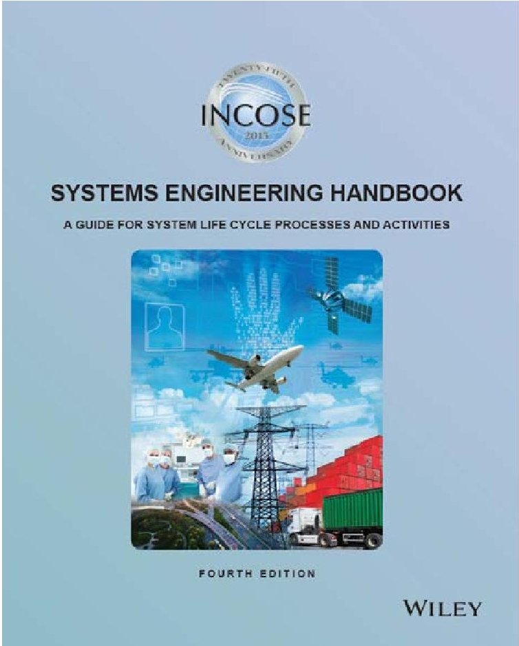
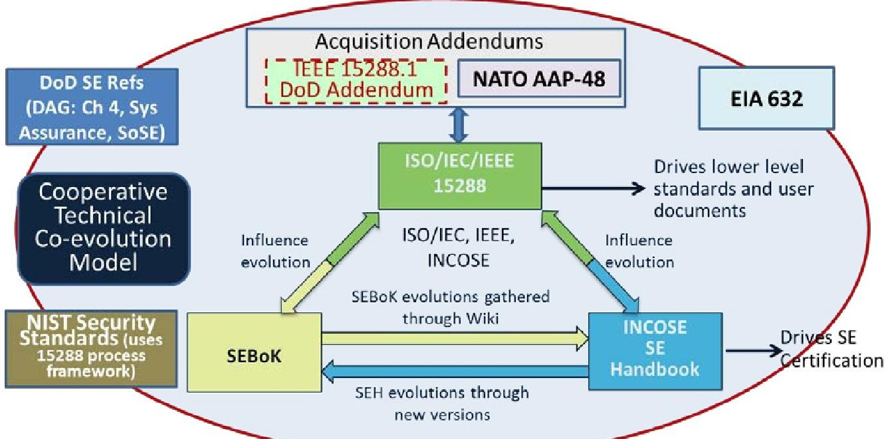
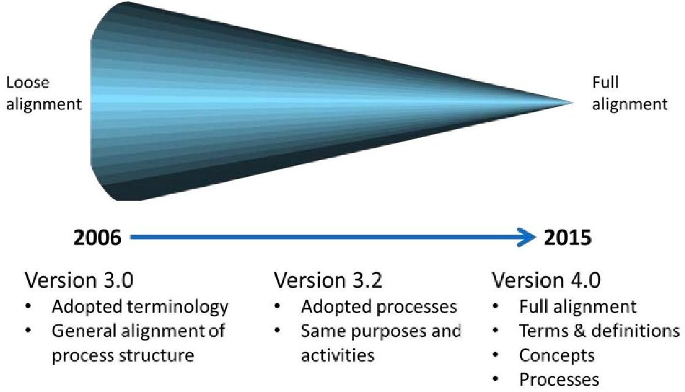

<!-- PDF_PAGE: 1 -->

# INCOSE Systems Engineering Handbook Version 4: Updating the Reference for Practitioners

David D. Walden, ESEP Sysnovation, LLC 13741 Johnson Mem. Dr. Shakopee, MN USA 55379 Dave@sysnovation.com

Garry J. Roedler, ESEP

Lockheed Martin

PO Box 61511

Bldg 100 M7023

King of Prussia, PA USA 19406

garry.j.roedler@lmco.com

Dr. Kevin Forsberg, ESEP

ORG Systems

1390 Grizzly Road

Portola, CA USA 96122

kforsberg@ogrsystems.com

Copyright 2015 by Walden, Roedler, and Forsberg. Published and used by INCOSE with permission.

Abstract. The objective of the International Council on Systems Engineering (INCOSE) Systems Engineering Handbook (SEH) is to describe key process activities performed by systems engineers and other engineering professionals throughout the life cycle of a system. It also describes a wide range of fundamental system concepts that broaden the thinking of the systems engineering practitioner, such as system thinking, system science, life cycle management, specialty engineering, system-of-systems, and complex systems. This handbook defines the discipline and practice of systems engineering for students and practicing professionals alike, providing an authoritative reference that is acknowledged world-wide.

This paper provides an overview of the SEH Version 4 that was released in 2015. It describes the overall impetus for change, highlights changes from the previous versions, and describes the new content added for this version. The primary purpose of this paper is to inform the systems engineering community of the changes incorporated into SEH Version 4.

## Overview of the Handbook

INCOSE defines systems engineering as an interdisciplinary approach and means to enable the realization of successful systems. It has become an essential discipline to ensure the system of interest is the right solution to meet the stakeholder needs, while being affordable across the life cycle of the system. Systems engineering considers both the business (including cost and schedule) and the technical needs of all stakeholders with the goal of providing a quality product that meets those needs.

The INCOSE SEH describes key process activities performed by systems engineers and other engineering professionals throughout the life cycle of a system. This

<!-- PDF_PAGE: 2 -->

handbook can serve as the definitive reference to system concepts and systems engineering practices and methods that have proven beneficial to the systems engineering community at large. As such, it serves as a basis for the knowledge content for the INCOSE systems engineering certification program. It can also add significant value in new domains, if the concepts and practices are appropriately selected and applied.

## General Update Information on Version 4

This section addresses the overall impetus for change in going from Version 3.2.2 (INCOSE, 2011) to Version 4 (INCOSE, 2015) of the SEH.

Drivers for Change. Since Version 3 of the SEH, it has been aligned with ISO/IEC/IEEE 15288, Systems and software engineering - System life cycle processes (latest version ISO, 2015). This alignment ensures the handbook's usefulness across a wide range of application domains, man-made systems and products, as well as business and services. For the past several years ISO has been updating the standard with the result being ISO/IEC/IEEE 15288:2015, Systems and software engineering - System life cycle processes. INCOSE has been an active participant in this update. The 2015 version represents a logical progression in this international standard. One key driver for change was the need for these updates to be reflected in the SEH.

Another driver for change was to refresh the technical content with the latest updates from INCOSE Working Groups. It had been several years since the technical content in the SEH had been updated. Numerous INCOSE Working Groups contributed new content consistent with systems engineering "state of practice."

Since Version 3.2.2 of the SEH was released, significant effort has gone into creating a Guide to the Systems Engineering Body of Knowledge (SEBoK) (see www.sebokwiki.org). A third driver for change to the handbook was to add additional topics consistent with SEBoK version 1.3 (SEBoK, 2014). INCOSE has been a significant contributor to the SEBoK and is now one of its custodians going forward.

Participation. Version 4 of the SEH was the result of the combined efforts of numerous people. In addition to five editors, over 55 individuals from across the world participated as section authors. In many cases, these section authors were INCOSE Working Group Chairs or SEBoK authors.

The INCOSE Technical Operations led a world-wide review team which generated excellent comments that significantly improved the handbook. Other individual reviewers and certification beta test takers also generated useful review comments.

Wiley Publication. Prior to Version 4 of the SEH, INCOSE self-published the handbook and distributed it through INCOSE channels, primarily via the INCOSE website. For Version 4, INCOSE has decided to publish the handbook through John Wiley & Sons. Publishing through Wiley will raise the quality and visibility of the handbook to new levels. It will also provide for new eBook formats to be available for iPad, Kindle, Nook, etc.

<!-- PDF_PAGE: 3 -->

An objective for Version 4 of the handbook was to balance maintaining the "spirit" of the handbook (know that it is a natural progression from previous versions of the handbook) with making the version "different" than the Version 3 series (know that it is a new version). To strike that balance, the editorial team decided to make the hard copy of the handbook 8" x 10" (previously 6" x 9") , move to a double column format (previously single column), and create new (but similar) cover art and content (see Figure 1), including a new back cover.

Figure 1. SEH Version 4 Cover

## Systems Engineering Standards Alignment Efforts

Over the past decade, there are several key resources that have come to the forefront as the basis of knowledge, requirements, and guidance for systems engineering. These resources include ISO/IEC/IEEE 15288, Systems and software engineering System life cycle processes; the INCOSE Systems Engineering Handbook; the Defense Acquisition Guide, Chapter 4; EIA 632, Engineering of a System; and recently the development of the Systems Engineering Body of Knowledge (SEBoK). It was obvious to many of the stakeholders, including INCOSE, that for the user of these resources, higher value would be obtained if they were consistent in terminology and concepts, and easily able to support concurrent usage. The challenge was that the resources came from a number of different sources. However, through carefully planned collaboration, successful actions were taken and are planned to continue to evolve and harmonize this set. Figure 2 shows the alignment of several of the key SE resources that has occurred through the collaborative efforts. Notice that ISO/IEC/IEEE 15288 is at the center of this "Cooperative Technical Co-evolution" model, but overtime 15288, the SEBoK, and the INCOSE SEH have reached a point where each influences the other. Also, as the alignment has evolved there are several

<!-- PDF_PAGE: 4 -->

derivative or related products that have been developed that can be used in conjunction with these or extend their usage into specific domains.

Figure 2. Alignment of Key SE Resources

Figure 3 shows the gradual alignment of the SE Handbook with ISO/IEC/IEEE 15288 over time. In 2006, INCOSE made the decision to start to better align the SE Handbook with the relevant systems related standards, especially 15288. At that time, the SEH V3.0 adopted the terminology in 15288 and started to align with the process structure. As the revision to 15288 was released in 2008, the SEH was being revised as Version 3.2. Since it was evident that 15288 was becoming the predominant standard for system life cycle processes, the SEH adopted the processes and their purposes and activities. For Version 4 of the SEH, the revision has been coordinated with the recent revision of 15288 to ensure full alignment in the terminology, definitions, concepts and processes. The INCOSE SEH now provides more comprehensive information for the system life cycle processes in 15288, as well as providing information on the full breadth of SE topics.

Figure 3. Evolution of INCOSE SEH Alignment with ISO/IEC/IEEE 15288

<!-- PDF_PAGE: 5 -->

## Summary of Changes for SEH Version 4

Appendix A provides a summary of the significant changes made in the SEH Version 4.

## Summary and Conclusions

Version 4 of the INCOSE SEH represents the next major step in the evolution of this important guide for systems engineering practitioners. While it is clearly tied to previous versions, it also represents a significant update based on alignment with ISO/IEC/IEEC 15288:2015 and the SEBoK, along with inputs from the INCOSE technical community.

This handbook can serve as the definitive reference to system concepts and systems engineering practices and methods that have proven beneficial to the systems engineering community at large. As such, it serves as a basis for the knowledge content of systems engineering certification. It can also add significant value in new domains, if the concepts and practices are appropriately selected, tailored, and applied.

## References

INCOSE. 2011. Systems Engineering Handbook: A Guide for System Life Cycle Processes and Activities. Version 3.2.2. Krueger, M., Walden, D., and Hamelin, R. D. (Eds.). San Diego, CA (US): International Council on Systems Engineering.

INCOSE. 2015. Systems Engineering Handbook: A Guide for System Life Cycle Process and Activities. Fourth Edition. Walden, D., Roedler, G., Forsberg, K., Hamelin, R.D., and Shortell, T. (Eds.). San Diego, CA: International Council on Systems Engineering. Published by John Wiley & Sons.

ISO.2015.ISO/IEC/IEEE 15288:2015, Systems and Software Engineering - System Life Cycle Processes. International Organization for Standardization.

SEBoK. 2014. Guide to the Systems Engineering Body of Knowledge (SEBoK). Version 1.3. Pyster, A., Olwell, D., Hutchison, N., Enck, N., Anthony, J., Henry, D., and Squires, A. (Eds.). The Trustees of the Stevens Institute of Technology Hoboken, NJ. Available at: http://www.sebokwiki.org.

## Appendix A - Summary of Changes for Version 4

This appendix provides a summary of the major changes in going from Version 3.2.2 to Version 4 of the handbook.

All Chapters.

- The Input Processing Output (IPO) diagrams (formerly context diagrams) have been streamlined by eliminating the redundant controls and enablers on each diagram.

- IPO diagrams updated to reflect a new underlying Vitech CORE model of (one instance of) the process areas.

- Chapter 1. Systems Engineering Handbook Scope.

- Minimal changes.

<!-- PDF_PAGE: 6 -->

Chapter 2. Systems Engineering Overview.

- Refreshed most sections

- Added new sections:

2. 5 Enabling Systems

2. 9 Systems Science and Systems Thinking

2. 10 Systems Engineering Leadership

2. 11 Systems Engineering Professional Development

Chapter 3. Generic Life Cycle Stages.

- Added new section:

3. 4.1 Iteration and Recursion

- Added two new case studies:

3. 6.4 Cyber Security Considerations in System Engineering

3. 6.5 Design for Maintainability

Chapter 4. Technical Processes.

- Renamed/Split/Added sections to match 15288:

4. 1 Business or Mission Analysis Process (New) - focuses on defining the business or mission problem or opportunity, characterize the solution space, and determine potential solution class(es).

4. 2 Stakeholder Needs and Requirements Definition Process (Renamed and revised) - revision focuses on clarification of the activities and tasks.

4. 3 Systems Requirements Definition Process (Renamed and revised) - revision focuses on clarifying the transformation of user-focused (stakeholder) needs and requirements to solution-focused requirements. Also, aligns with ISO/IEC/IEEE 29148 (Requirements Engineering), SEBoK, and the INCOSE Requirements Guide.

4. 4 Architecture Definition Process (Split from Architectural Design) - Deals with fundamental principles, concepts, properties, and characteristics and their incorporation into the system of interest. Focuses on generating system architecture alternatives, to select one or more alternative(s) that frame stakeholder concerns and meet system requirements, and to express this in a set of consistent views.

4. 5 Design Definition Process (Split from Architectural Design) Focuses on providing sufficient detailed data and information about the system and its elements to enable the implementation consistent with the requirements and the architectural entities.

4. 6 System Analysis Process (New) - Provides a general approach to identify, plan, and perform analysis to provide results as input to Systems Engineering activities and decisions.

- Significant changes to the following processes:

4. 8 Integration Process - broader focus to ensure appropriate connection between Integration and Architecture regarding the Interface definition. Integration is more than just assembly of system elements.

<!-- PDF_PAGE: 7 -->

4. 9 Verification Process - Added reference to and concepts from SEBoK and IEEE Std 1012, as well as agree with changes to 15288.

4. 11 Validation Process - Added reference to and concepts from SEBoK and IEEE Std 1012, as well as agree with changes to 15288.

4. 12 Operation Process - Added information from SMEs and aligned with 15288 and SEBoK.

4. 13 Maintenance Process - Significant rewrite to account for current guidance and lessons learned in maintenance. Added information on Logistics Support. Aligned with 15288 and SEBoK.

Chapter 5. Technical Management Processes,

- Chapter renamed to match 15288 (was Project Processes in Version 3.2.2)

- Added section to match 15288

5. 8 Quality Assurance Process (New) - adds a quality process at the project level to complement the Quality Management Process at the organizational level.

- Changed scope of section to match 15288

5. 4 Risk Management Process - add the concept of Opportunity Management - aligned with leading resources.

- Significant rewrite of:

5. 3 Decision Management Process

Chapter 6. Agreement Processes.

- Minimal changes.

- Chapter 7. Organizational Project-Enabling Processes.

- Added section to match 15288

7. 6 Knowledge Management Process (New) - Focuses on creating the capability and assets that enable the organization to exploit opportunities to re-apply existing knowledge, including the knowledge of its people and reusable assets.

- Changed scope of section to match 15288

7. 3 Portfolio Management Process - Added concept of product line management (see also new Section 8.3) and ties to Architecture Definition.

Chapter 8. Tailoring Process and Application of Systems Engineering. Added new sections:

8. 2 Tailoring for Specific Product or Domain Application - includes information on applying systems engineering in the following domains: automotive, biomedical and healthcare, defense and aerospace, infrastructure, space, and (ground) transportation.

8. 3 Application of SE for Product Line Management

8. 4 Application of SE for Services

8. 5 Application of SE for Enterprises

8. 6 Application of SE for Very Small and Micro Enterprises (VSME)

<!-- PDF_PAGE: 8 -->

Chapter 9. Cross-Cutting Systems Engineering Methods.

- Renamed to include all cross-cutting activities (not just technical)

- Moved several sections into Chapter 9

- Refresh of all sections

- Expanded modeling and simulation & MBSE

- Added a new section

9. 6 Interface Management

Chapter 10. Specialty Engineering Activities.

- Significant organization and content changes

- Combined Affordability, Cost Effectiveness, Life Cycle Cost Analysis sections

- Expanded Reliability, Availability, Maintainability section

- Added some new "ilities" sections

10. 9 Resilience Engineering

10. 11 System Security Engineering

Appendices.

- All refreshed for new content.

- New or elaborated:

A References (SEHv3.2.2 had references distributed by chapter; Version 4 has references in a single appendix)

E Input-Output descriptions, removed from the text body and put into Appendix E

## Biographies

David Walden, ESEP, is co-owner and principal consultant for Sysnovation, LLC, a company focused on Systems Engineering consulting and education/training. Previously, Mr. Walden was with General Dynamics Advanced Information Systems for 13 years and worked at McDonnell Aircraft Company for 10 years. He has been a co-editor of the INCOSE SE Handbook since version 3.2 and also serves as the INCOSE liaison to ISO/IEC JTC1/SC7 Working Groups 10 and 20. Mr. Walden was the Program Manager of the INCOSE Certification Program from 2007-2013. Mr. Walden is also a Senior Member of the Institute of Electrical and Electronics Engineers (IEEE) and Tau Beta Pi. Mr. Walden has an M.S. in Management of Technology (MOT) from the University of Minnesota, an M.S. in Electrical Engineering and an M.S. in Computer Science from Washington University in St. Louis, and a B.S. in Electrical Engineering from Valparaiso University in Indiana. Mr. Walden is an INCOSE Expert Systems Engineering Professional (ESEP).

Garry Roedler, ESEP, is a Fellow and the Engineering Outreach Program Manager for Lockheed Martin. Mr. Roedler holds degrees in mathematics education and mechanical engineering from Temple University and the Expert Systems Engineering Professional (ESEP) certification from INCOSE. Mr. Roedler is an INCOSE Fellow, author of numerous publications and presentations, and the recipient of many awards. His leadership roles across many technical organizations include Chair of the INCOSE Corporate Advisory Board; steering group member for the National Defense Industrial Association Systems Engineering Division; working group chair for the IEEE Joint Working Group for DoD Systems Engineering Standardization; editor of ISO/IEC/IEEE 15288, Systems Life Cycle Processes and several other standards; and

<!-- PDF_PAGE: 9 -->

key roles in the development of the Systems Engineering Body of Knowledge (SEBoK) and the INCOSE Systems Engineering Handbook. This unique set of roles has enabled Mr. Roedler to influence the technical co-evolution and consistency of these key resources.

Dr. Kevin Forsberg, ESEP, is an INCOSE Expert Systems Engineering Professional (ESEP), a recipient of the INCOSE Pioneer Award, an INCOSE Fellow, and a Fellow of ASME. Dr. Forsberg was co-chair of the initial Certification Advisory Group (2003-2009) in INCOSE. Currently Dr. Forsberg is co-owner and principal consultant for OGR Systems, Inc., which provides consulting and training in Systems Engineering and Project Management worldwide. He is co-author of all three editions of "Visualizing Project Management," published by Wiley & Sons (1996, 2000, 2005). He was awarded the NASA Public Service Medal (1981) "in recognition of his outstanding technical and managerial contributions to the Space Shuttle Program." He received the CIA Seal Medallion for excellence in Project Management training, and in recognition of his pioneering efforts in the field of Project Management (1998). He received his PhD in Engineering Mechanics from Stanford University (1961) and his B.S. in Civil Engineering from Massachusetts Institute of Technology (1956).