<!-- PDF_PAGE: 1 -->

# Increased System Consistency through Incorporation of Coupling in Value-Based Systems Engineering

Hanumanthrao Kannan $ ^{1,} $ $ ^{*} $ Bryan L. Mesmer, $ ^{2} $ and Christina L. Bloebaum $ ^{1} $

$ ^{1} $Iowa State University, Aerospace Engineering, Ames, IA 50011-2140

$ ^{2} $Industrial and Systems Engineering and Engineering Management, University of Alabama in Huntsville, Huntsville, AL 35899

Received 31 December 2015; Revised 24 September 2016; Accepted 7 March 2017, after one or more revisions Published online in Wiley Online Library (wileyonlinelibrary.com). DOI 10.1002/sys.21377

## ABSTRACT

The design of large-scale complex engineered systems involves hundreds to thousands of designers making decisions across different organizations and at different levels of organizational hierarchy. These systems are designed within a systems engineering framework, where requirements are used as proxies for stakeholder preference. Requirements drive the development process and are flowed across organizations and down through the organizational hierarchies. Value-driven design offers a new perspective where the preferences of the stakeholder are communicated directly through a decomposable value function, rather than decomposable requirements, thereby enabling improved consistency in system preference. This paper investigates two key aspects of achieving improved system consistency through a value-based systems engineering approach, using a commercial satellite system as a testbed. The paper first contrasts the diverse systems that result from traditional requirements-based versus preference-based formulations, demonstrating how a value-based approach aids in capturing the true preferences of the stakeholder in problem formulation. The paper demonstrates the importance of using system couplings to enable an improved accuracy for value function decomposition. The paper demonstrates that ensuring system analysis consistency through use of system sensitivities can overcome issues pertaining to: dependencies of attributes; inadequately capturing system interactions; and direct modification of attributes to determine value impact. $ \textcircled{c} $ 2017 Wiley Periodicals, Inc. Syst Eng 20: 21-44, 2017

Key words: value-driven design; system consistency; multidisciplinary design optimization

## NOMENCLATURE

<table border="1"><tr><td>A</td><td>Attribute</td></tr><tr><td>CBatt</td><td>Cost of battery</td></tr><tr><td>Cground</td><td>Cost of ground subsystem</td></tr><tr><td>Cpayload</td><td>Cost of payload subsystem</td></tr></table>

$ C_{\mathrm{p o w e r}} $ Cost of power subsystem $ C_{\mathrm{S A}} $ Cost of solar array $ O L $ Operational lifetime $ P_{0} $ Power required by all subsystems $ P_{t} $ Transmitter power $ P $ Number of system level attributes $ p $ System attribute number $ p_{1-3} $ SL1 - SL3 attribute number $ P_{\mathrm{p a y l o a d}} $ Power required by payload subsystem $ m_{1-3} $ SL1 - SL3 subsystem number

<!-- PDF_PAGE: 2 -->

$ r_{d} $ discount factor Rev Revenue $ Revenue_{y} $ Revenue generated per year SS Subsystem SL Subsystem level TC Total Cost V Value function/Value SNR Signal to Noise Ratio NPP Net Present Profit

## 1. INTRODUCTION

Large-scale complex engineered systems (LSCES) typically comprise tightly coupled interacting subsystems (spanning many levels of the design hierarchy) that yield a collective behavior. Often, these complex systems interact with other complex systems (such as a fighter jet interacting with an aircraft carrier), increasing the complexity. Traditionally, these LSCES are designed using systems engineering methods and processes, where requirements are used as proxies for the actual preferences [NASA, 2007]. These requirements essentially become the primary means of communicating preference across and within organizations. They are decomposed and flowed down the organizational hierarchies. The requirements define a hyperspace in which design variables (parameters) must fall, but unfortunately provide no system level guidance as to a best choice within the hyperspace. In other words, there is no system level optimization, nor a system level preference to which lower level optimization should conform. This leads to a lack of system consistency in preference communication across the organizations involved, and within any individual organizational hierarchy. Value-driven design (VDD) offers a new perspective on complex system design, where the preferences of the stakeholder are communicated through a decomposable value function while reducing the number of requirements placed on the design space [Julie et al., 2010; Collopy and Hollingsworth, 2011; Hollingsworth, 2011.; Collopy and Poleacovschi, 2012.; Heng et al., 2012.; Mesmer, Bloebaum, and Kannan, 2013]. Hence, VDD enables an improved means of promoting system consistency with regards to communication of stakeholder preference [Mesmer et al., 2013].

Additionally, the top-down decomposition associated with traditional requirements-based systems engineering approaches use Interface Control Documents [Buede, 2009], which do not capture physics-based couplings across the system. Multidisciplinary design optimization (MDO) leverages the physics-based couplings between subsystems to create analysis and optimization frameworks to handle systems comprising many inherently coupled subsystems [Sobieszczanski-Sobieski and Haftka, 1997; Martins and Lambe, 2012]. MDO, therefore, provides not only a framework for performing optimization within subsystems and across the system, but also provides the means for ensuring system analysis consistency. The Global Sensitivity Equation method [Sobieszczanski-Sobieski, 1990], for instance, provides a means for obtaining system sensitivities in terms of local (disciplinary) sensitivities. These system sensitivities are then used for system approximations [Hajela,

Bloebaum, and Sobieszczanski-Sobieski, 1990], coupling suspension and reduction [Bloebaum, 1995; English, Miller, and Bloebaum, 1996; English, Bloebaum, and Miller, 2001], and subsystem/system optimization [Hajela et al., 1990], among other uses. While MDO methods and frameworks can incorporate traditional systems engineering requirements through constraint representations, they do not provide a means for generating a system-level objective function, as there is a presumption that such a function already exists, or that each subsystem will use its own relevant objective function. Hence, an opportunity exists to leverage VDD and MDO to ensure consistency in both stakeholder preferences as well as system analysis and decomposition.

In this paper, it is demonstrated that lack of stakeholder preference consistency drives the final system design and resultant system value to vary greatly. Comparisons are made of final designs resulting from use of traditional proxies for the preference to that resulting from a value function capturing the true preference directly. Additionally, the paper focuses on the need to appropriately capture system couplings in the decomposition of the value function to enable more informed and consistent decision making. Comparisons of value impact are made with and without system couplings during the decomposition, using a scorecard representation. It is demonstrated that a value-based system decomposition approach can yield drastically different results depending on whether local or system sensitivities are used during the decomposition. The overall goal of this research is to demonstrate the need and opportunities for achieving greater consistency during the system development process. It should be noted that the focus of this paper is not on how to develop a value function, but on contrasting the issues associated with consistency in representation and communication of preferences of the stakeholder.

## 2. BACKGROUND

Most modern LSCES are extremely complex and multidisciplinary, involving diverse disciplines spanning geographical locations working toward a single system design. These elements make it difficult to address the design of LSCES as a whole. The traditional systems engineering approach is typically implemented within a hierarchical organization, wherein requirements are flowed down to lower level designers [NASA, 2007]. This leaves the lower level decision makers incapable of determining the impact of their subsystem design decisions on the system as a whole. An example of a hierarchically decomposed system for a commercial satellite is shown in Figure 1. While the physics associated with the satellite system are inherently coupled, systems engineering practice imposes a hierarchic decomposition.

The field of MDO was developed specifically with the aim of enabling optimization of the system as a whole by addressing the inherent subsystem interactions through couplings, thereby enabling system consistency of the physics [Sobieszczanski-Sobieski and Haftka, 1997; Martins and Lambe, 2012]. MDO evolved as a field of optimization in the early 1980s from structural optimization [Sobieski, 1990; Sobieszczanski-Sobieski and Haftka, 1997]. The impacts of

<!-- PDF_PAGE: 3 -->

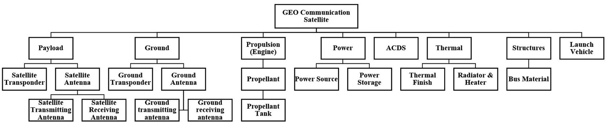

Figure 1. Hierarchical decomposition of a satellite system (preliminary design).

the couplings are captured in both the analysis and optimization. In MDO, the couplings between subsystems are referred to as behavior variables. Each subsystem may also have some set of design variables. MDO enables the differentiation among feasible designs (those that are bounded by requirements) using the objective function. However, typical MDO objective functions are generally only proxies for the true system preference (e.g., cost, weight, or performance). For example, in satellite design, cost or mass are often used as proxies for profit, given the assumption that lowest mass will reduce costs or that the direct minimization of cost will produce greater profit [Mosher, 1998; Wertz and Larson, 1999; Futron, 2002; Hassan and Crossley, 2003; Scialom, 2003; Richie, Lappas, and Palmer, 2007; Hassan and Crossley, 2008; Ravanbakhsh, Mortazavi, and Roshanian, 2008; Ebrahimi, Farmani, and Roshanian, 2011; Wang, Xu, and Xia, 2012; Wu, Huang, and Wu, 2012; John et al., 2013; Wu et al., 2013]. Often, multiobjective optimization is used as a means of including more than one objective in a single function in an attempt to explore trade-offs among these objectives [Hassan and Crossley, 2003; Jilla and Miller, 2004].

Recently, new systems engineering approach (VDD) has been proposed as an alternative to traditional requirementsbased systems engineering [Collopy and Horton, 2002; Collopy, 2006, 2009; Collopy and Hollingsworth, 2011; Hollingsworth, 2011.; Collopy, Bloebaum, and Mesmer, 2012; Goetzke, Bloebaum, and Mesmer, 2014]. VDD captures the true preferences of the stakeholder through a single value function (an objective function) and reduces the requirements placed on the design space to enable further designer freedom [Collopy and Hollingsworth, 2011; Mesmer et al., 2013]. Value functions are formed such that they are comprised of fundamental objectives that represent the true preference(s) of the stakeholders [Keeney, 2009; Parnell et al., 2013]. Two different definitions of value functions exist in literature [Keeney, 2009; Hazelrigg, 2012]. One of them argues that only one fundamental objective exists that captures the true preference of the stakeholder involved [Keeney, 2009], whereas the second definition argues that the fundamental objectives can be single or multiple depending on the stakeholders involved (Hazelrigg). In this paper, we will be adopting the former definition of value functions. In this paper, true preferences mean that the stakeholders have only one fundamental/ultimate preference about the objective of the system. Particularly, this paper deals with stakeholders interested in maximizing profit. The value function has a singular unit (such as money or probability of mission success) that directly correlates to the stakeholder's preference, with attributes being functions of lower-level attributes, behavior variables, and design variables. This formulation of a value function allows for a direct comparison of design alternatives from a wide range of systems that share the same set of attributes. For example, a value function might be constructed as a function of attributes such as speed, cost, range, etc., that could lead to the design of two radically different system alternatives, such as a boat or a plane. This enables the two alternatives to be compared with one another in the unit of dollars by using a value function of maximizing profit.

In VDD, the value function is decomposed and distributed to lower level subsystems to enable more informed and consistent decision making at each level of the organization and at each phase of the design process [Collopy, 2001]. Researchers in VDD have used scorecards to communicate a linearized value function down to the lower levels [Collopy, 2001; Mullan et al., 2011., 2012.]. This offers a way of representing the impacts of lower-level attributes on the overall value function, but does not take couplings into consideration [Mullan et al., 2011., 2012.]. More recently, couplings were addressed using a Value Influence (VI) factor [Mullan et al., 2011.], which represents the influence of one attribute on the other attribute's value. However, this VI factor is purely empirical and application-specific. The quantification of couplings and the understanding of the impacts of these couplings on the overall value of the system are important in performing tradeoffs within and among different levels of hierarchy in the design process. The field of MDO offers rigorous methods to determine such impacts.

In this paper, system couplings from MDO are used to obtain the impact on system value of a subsystem at any level of the hierarchy. The capture of system couplings in obtaining value impact results in a physically consistent system. Once the couplings are captured using total derivatives, these are then used to obtain the total change in value at a level due to the corresponding change in attributes. This is incorporated into the scorecard approach from VDD and is also used in a system optimization of a commercial satellite example. The relationship between design variables, behavior variables, attributes, and the value function, in the context of both MDO and VDD, is important to understand.

Consider Figure 2. The attributes, which characterize the system, are functions of design variables (X) and behavior variables (Y). The behavior variables are obtained as solutions to a set of simultaneous nonlinear coupled equations that

<!-- PDF_PAGE: 4 -->

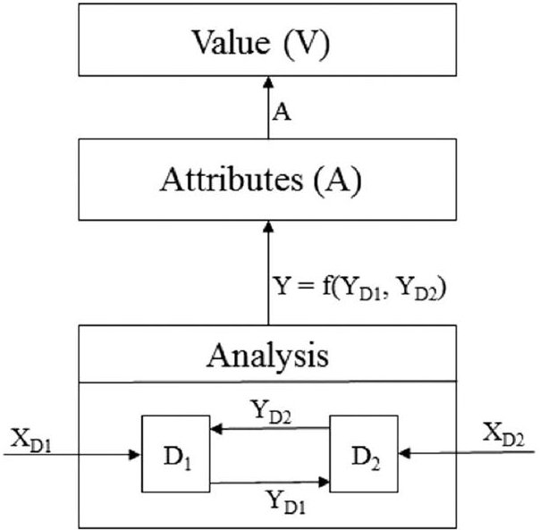

Figure 2. Value function formulation.

represent the analysis of individual disciplines. The system considered here consists of two disciplines, $ D_{1} $ and $ D_{2} $ , that are internally coupled, which means that the output from $ D_{1} $ is an input to $ D_{2} $ , and vice versa. The analysis equations associated with $ D_{1} $ and $ D_{2} $ can be represented using Equations (1) and (2). As an example, the output of $ D_{1} $ is $ Y_{D1} $ , a behavior variable, which is then fed to $ D_{2} $ . $ D_{2} $ is also a function of its design variable set, $ X_{D2} $ . Similar relationships exist for $ D_{1} $ .

This set of nonlinear-coupled equations is iteratively converged to achieve system consistency. When creating a value function for a coupled system, the attributes, A, will be functions of behavior variables and design variables. The value function will be a function of attributes and design variables. These relationships are shown in Equations (3) and (4):

$$
D _ {1} \left(\left(X _ {D 1}, Y _ {D 2}\right), Y _ {D 1}\right) = 0
$$

$$
D _ {2} \left(\left(X _ {D 2},, Y _ {D _ {1}}\right), Y _ {D _ {2}}\right) = 0
$$

$$
A = f \left(Y _ {D _ {1}}, Y _ {D _ {2}}, X _ {D _ {1}}, X _ {D _ {2}}\right)
$$

$$
V = f \left(A, X _ {D _ {1}}, X _ {D _ {2}}\right).
$$

In this paper, we demonstrate the need to exploit the complementary natures of both MDO and VDD concepts to achieve an improved systems engineering process. We provide a motivation for using a value function to enable more informed and consistent decision making across levels of the organization, and also to achieve a system optimization that reflects the true preference of the stakeholder. The optimization frameworks previously developed in the MDO community can use the value functions as objective functions [Collopy et al., 2012]. A commercial satellite system, of two different fidelities, is used as a testbed for this research and is described in the next section.

## 3. SATELLITE SYSTEM TESTBED

A geo-stationary commercial communication satellite testbed is created for the research in this paper, as well as to serve as a testbed for other researchers. For that reason, details are provided to fully describe the design variables, behavior variables, attributes, objective functions, constraints, and analysis equations. The fidelity of the models increase in complexity going from the conceptual to the preliminary design phase. The system comprises a launch vehicle, ground station, and satellite, with design variables, behavior variables, and attributes associated with each of the disciplines or component subsystems.

One way of visually representing couplings in a complex system is by using a Design Structure Matrix (DSM) as shown in Figure 3 [Steward, 1981; Browning, 2001]. It shows the discipline-based DSM for the conceptual phase, which has a total of 9 continuous design variables (Table AII), 22 behavior variables, and 4 system attributes. Here, the term disciplinebased is used to represent the interaction of disciplinary analysis models in the system. Feed-forwards are indicated in the upper right quadrant and feedbacks in the lower left. Figure 3 represents a lower fidelity model of the satellite system consistent with a conceptual design study. It is primarily used in the first study in this paper, in which the importance of capturing the true stakeholder preferences using a value function is demonstrated [Mesmer et al., 2013; Kannan, 2015].

In the second study in this paper, a higher fidelity model of the satellite system is used (associated with a preliminary design phase) that corresponds to the organizational decomposition shown in Figure 1 and the discipline-based and attribute-based DSM's in Figures 4 and 5 [Kannan, 2015]. The attribute-based DSM represents the organizational (teambased) couplings which are present between the different subsystems at subsystem level 1 (SL1), the first level of the hierarchy. Here, the satellite system is decomposed into three levels of hierarchy and eight major subsystems at level 1. A total of 36 design variables define the satellite system, out of which 14 are continuous and 22 are discrete. A detailed description of the attributes and design variables associated with all the levels of the hierarchy is provided in the Appendix. This higher fidelity model is used in the second study in this paper to demonstrate the necessity of including system sensitivities in the decomposition of the value function, including scorecard representations.

## 4. STUDY 1—CONSISTENCY IN SYSTEM PREFERENCE

In traditional systems engineering approaches, the requirements are viewed as a pass/fail characteristic, such that if a requirement is violated, the design is a failure. This would necessitate a redesign or possible trade-off of requirements across the system, resulting in time and cost delays. Also, all designs that pass the requirements are viewed as equal, without an overarching design objective. Using pass/fail criteria is insufficient to differentiate between designs that fail slightly versus those that fail significantly. These issues are magnified when requirements are based on such origins as legacy

<!-- PDF_PAGE: 5 -->

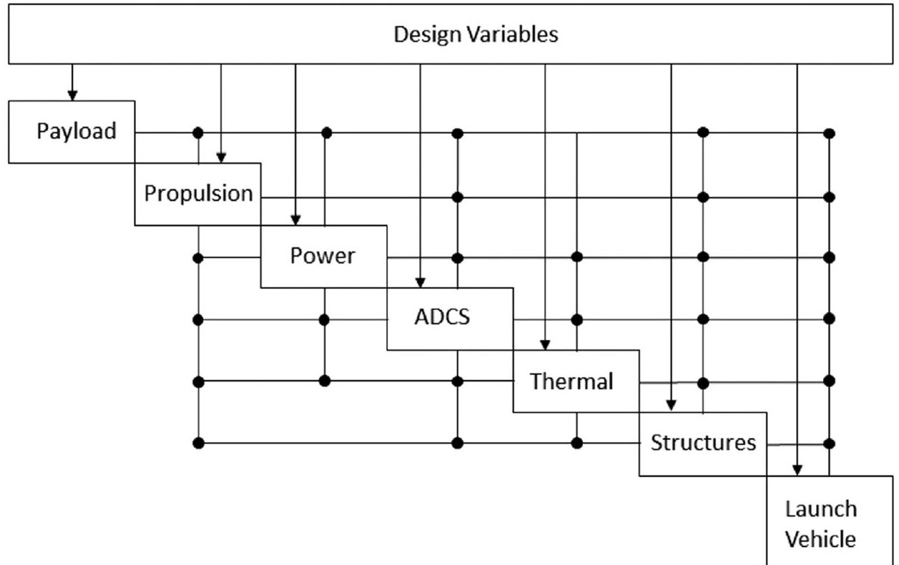

Figure 3. Discipline-based DSM (conceptual design).

design knowledge or organization traditions, often restricting the design space unnecessarily.

Present systems engineering procedures make implementation of MDO across the system difficult, if not impossible. MDO has found application within lower level teams, generally during detailed design. In these applications, the design team often chooses an objective function most relevant to the component or subsystem being designed. Hence, the problem formulation, while relevant to the component or subsystem,

will not provide direct insight to the system as a whole. This leads to inconsistency in design preferences across the system, which then leads to a final system design that none of the disciplines might actually prefer. The focus of the first study of this paper is to emphasize why and how problem formulation is important in reflecting the true preferences of the stakeholder of the system, and ultimately how system consistency can be improved using a VDD formulation. This first study uses the lower fidelity models associated with the

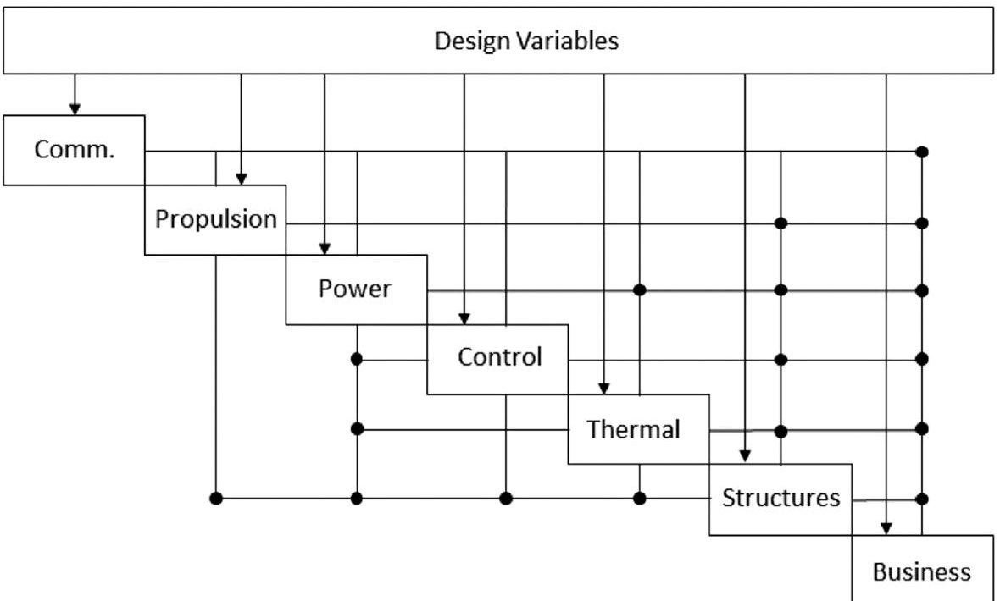

Figure 4. Discipline-based DSM (preliminary design).

<!-- PDF_PAGE: 6 -->

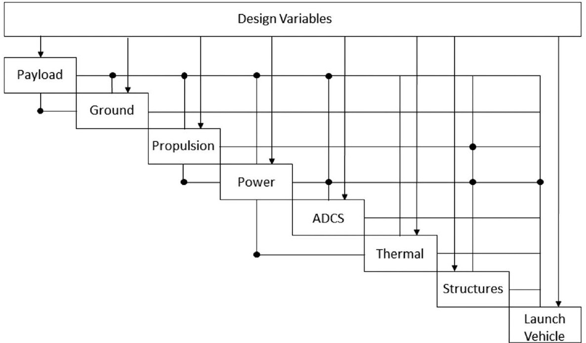

Figure 5. Attribute-based DSM (preliminary design).

conceptual phase of the satellite system design process (Fig. 3 and Table AI).

In traditional satellite MDO applications, designers are typically interested in formulating optimization problems using mass of the satellite [Ravanbakhsh et al., 2008], cost of the satellite [Scialom, 2003], or some combination of characteristics as the objective function [Hassan and Crossley, 2003, 2008; John et al., 2013]. These objectives are chosen as proxies for the true preference, such as profit or mission success. It will be demonstrated in this study that vastly different systems will be obtained with these proxies, compared to using the true preference directly.

The software used in this study is MATLAB [2013], validated using independently coded C++ optimization algorithms. The optimization method used in the various MDO frameworks for constrained problems (traditional proxy objective function/requirement formulations) is the MATLAB function "fmincon," using the interior-point algorithm. The constrained problem solutions are verified using the heuristic optimization algorithm, Particle Swarm Optimization (PSO) [Kennedy and Eberhart, 1995], with a penalty function to account for constraint violations and a neighborhood approach to increase the likelihood of finding the global optimum [Suganthan, 1999; Veeramachaneni et al., 2003]. PSO is used for the value function formulation due to the need for a robust method as the design space is nonrestricted and more complex than the proxy objective functions investigated.

## 4.1. Objective Function Formulations for Cases 1-7

The traditional satellite MDO problem formulations using proxy objective functions are first examined, followed by a value function problem formulation. These proxy objective functions are simplified versions of the true preference of the stakeholder. For instance, if the stakeholder's true preference

is maximizing profit, then traditionally proxies such as mass and cost are used as creating these proxy functions involves comparatively lesser effort. Six different examples of proxy satellite MDO objective function/requirement formulations are presented, as outlined in Table I. For each objective function, two cases are explored pertaining to whether the launch vehicle has been predetermined or not. Cases 1 and 2 in Table I use the total spacecraft mass as the objective function, subject to constraints. This objective function has been traditionally used in aerospace systems since, as the mass of an aerospace system increases, the cost of the system generally increases. This relationship stems from the heavy financial burden of placing each pound of payload into orbit [Futron, 2002]. Several constraints are created for the satellite system example to reflect the traditional system design practice.

## 4.1.1. Proxy Objective Function Formulation: Cases 1 and 2—Minimize Mass

Two scenarios concerning the launch vehicle for the satellite are considered-one in which the launch vehicle is predetermined (Case 1) and one in which it is not (Case 2). A discussion on the rationale behind these constraints is given in the Appendix. The optimization problem statement that is represented in the standard form, used in the optimization community [Vanderplaats, 2007], associated with Case 1 is seen in Equation (5). In Equation (5), $ g_{1}-g_{5} $ represent the nonlinear inequality constraints that are imposed on the problem. The bounds or side constraints of each of the design variables are also provided in Equation (5), which represent the range within which the design variables change. A more detailed discussion on representation of standard optimization problem statement can be found in Vanderplaats [2007]. When the launch vehicle is not predetermined (Cases 2, 4, and 6), the constraints $ g_{2}-g_{5} $ are

<!-- PDF_PAGE: 7 -->

eliminated:

find $ X=\left[ f_{\mathrm{down}}, f_{\mathrm{up}}, P_{t}, P_{gt}, D_{\mathrm{sat,trans}}, D_{\mathrm{sat,rec}}, D_{\mathrm{ground,rec}}, \right. $

$$
D _ {\mathrm {g r o u n d , t r a n s}}, \varepsilon ] ^ {T}
$$

Min $ f ( X,y)=M_{\mathrm{total}} $

$$
s. t. \quad g _ {1}: 1 0 \mathrm {d B} - S N R _ {\mathrm {c o m p o s i t e}} \leq 0
$$

$$
\begin{array}{l} g _ {2}: M _ {\mathrm {p a y l o a d}} + M _ {\mathrm {p r o p e l l a n t}} + M _ {\mathrm {p o w e r}} + M _ {\mathrm {A D C S}} + M _ {\mathrm {t h e r m a l}} \\ + M _ {\mathrm {s t r u c t u r e s}} - 1 0 0 0 \leq 0 \\ \end{array}
$$

$$
g _ {3}: A r r a y s i z e - 4 0 \mathrm {m} ^ {2} \leq 0
$$

$$
g _ {4}: L _ {s} - 5 \mathrm {m} \leq 0
$$

$$
g _ {5}: r _ {s} - 2. 5 \mathrm {m} \leq 0
$$

$$
\begin{array}{l} 1 \mathrm {G H z} \leq f _ {\mathrm {d o w n}} \leq 1 0 0 \mathrm {G H z} \\ 1 \mathrm {G H z} \leq f _ {\mathrm {u p}} \leq 1 0 0 \mathrm {G H z} \\ 3 0 0 \mathrm {W} \leq P _ {t} \leq 3 0 0 0 \mathrm {W} \\ 3 0 0 \mathrm {W} \leq P _ {g t} \leq 3 0, 0 0 0 \mathrm {W} \\ \end{array}
$$

$$
0. 5 \mathrm {m} \leq D _ {\mathrm {s a t , t r a n s}} \leq 2. 5 \mathrm {m}
$$

$$
2 \mathrm {m} \leq D _ {\mathrm {g r o u n d . r e c}} \leq 2 0 \mathrm {m}
$$

$$
0. 5 \mathrm {m} \leq D _ {\mathrm {s a t , r e c}} \leq 2. 5 \mathrm {m}
$$

$$
2 \mathrm {m} \leq D _ {\mathrm {g r o u n d , t r a n s}} \leq 2 0 \mathrm {m}
$$

$$
3 5 \frac {\mathrm {W} - \mathrm {h o u r}}{\mathrm {k g}} \leq \varepsilon \leq 2 0 0 \frac {\mathrm {W} - \mathrm {h o u r}}{\mathrm {k g}}.
$$

## 4.1.2. Proxy Objective Function Formulation: Cases 3 and 4—Minimize Cost

The objective functions of Cases 1 and 2 use mass as an approximation of cost. To explore the impact that a more accurate cost model has on the design of the example satellite system, empirical cost relationships are constructed [Wertz and Larson, 1999: Kannan 2015: Mesmer et al., 2013] and used to form an objective function based on cost. Cost is commonly used as an objective function in the satellite industry, as is mass. While this cost model is still only an approximation, it captures much of the complexity of a realistic system cost model. The formulation for the system design incorporating the cost model is shown in Equation (6). Case 3 has constraints similar to Case 1, whereas for Case 4, the constraints $ g_{2}-g_{5} $ are eliminated as in Case 2:

$$
\mathrm {f i n d} X = \left[ f _ {\mathrm {d o w n}}, f _ {\mathrm {u p}}, P _ {t}, P _ {g t}, D _ {\mathrm {s a t , t r a n s}}, D _ {\mathrm {s a t , r e c}}, D _ {\mathrm {g r o u n d , r e c}}, \right.
$$

$$
D _ {\mathrm {g r o u n d . t r a n s}}, \varepsilon \bigg ] ^ {T} \operatorname {M i n} f (\boldsymbol {X}, \boldsymbol {y}) = T o t a l C o s t. \tag {6}
$$

Table I. Proxy Objective Function Formulations

<table border="1"><tr><td>Case</td><td>Objective Function</td><td>Predetermined Launch Vehicle</td></tr><tr><td>1</td><td>Minimize Mass</td><td>Yes</td></tr><tr><td>2</td><td>Minimize Mass</td><td>No</td></tr><tr><td>3</td><td>Minimize Total Cost</td><td>Yes</td></tr><tr><td>4</td><td>Minimize Total Cost</td><td>No</td></tr><tr><td>5</td><td>Multiobjective</td><td>Yes</td></tr><tr><td>6</td><td>Multiobjective</td><td>No</td></tr></table>

Given that the cost model takes into account the cost of the launch vehicle, the launch vehicle constraints here are associated with a maximum launch vehicle (in terms of payload size and mass) based on a belief that larger launch vehicles would be too costly. The system cost equations take into account various relationships between the design variables and the capital necessary to achieve the system design. For example, the system cost model takes into account the direct relationship between increasing ground transmitter power and increasing cost due to the equipment necessary to achieve the increase, a direct relationship that was not captured in the minimize mass objective function of Cases 1 and 2. Costs including maintenance and end of life product disposal are not included in this model, but could be added if desired.

## 4.1.3. Proxy Objective Function Formulation: Cases 5 and 6—Multiobjective Formulation

Another common technique used in traditional MDO formulations, and the engineering industry at large, is to create a multiobjective function. A multiobjective function allows a stakeholder to express his preferences on multiple characteristics of a design. Here, a multiobjective function is formed that captures mass and transmitter power, and is stated in Equation (7) for Cases 5 and 6:

$$
\operatorname {M i n} f (\boldsymbol {X}, \boldsymbol {y}) = w _ {1} \times M _ {\mathrm {t o t a l}} - w _ {2} \times P _ {t},
$$

where $ w_{1} $ and $ w_{2} $ are weighting factors.

## 4.1.4. Value Function Formulation: Case 7

As mentioned earlier, VDD aids the designer in capturing the true preferences of the stakeholder through a single value function, which can be used as an objective function in MDO frameworks. Since the satellite being designed is a commercial television communication satellite, the driving desire behind the industrial organization designing the satellite is to maximize profit. Hence, the revenue, cost, and profit equations used to create the value function are in the units of U.S. dollars, consistent with the stakeholder's preference of maximizing profit. System profit can be obtained by subtracting the total cost of the system from the total revenue. The value function used in this paper is just a simplified model of a more complex function. The investigations associated with the complexity of value functions is outside the scope of the paper, as this paper only focuses on highlighting the issues

<!-- PDF_PAGE: 8 -->

Table II. Optimal Design for Cases 1-4

<table border="1"><tr><td></td><td></td><td colspan="4">Optimal values</td></tr><tr><td>Design Variable</td><td>Initial values</td><td>Case 1</td><td>Case 2</td><td>Case 3</td><td>Case 4</td></tr><tr><td>$f_{down}$</td><td>5GHz</td><td>5GHz</td><td>5GHz</td><td>5GHz</td><td>5GHz</td></tr><tr><td>$f_{up}$</td><td>5GHz</td><td>5GHz</td><td>5GHz</td><td>5GHz</td><td>5GHz</td></tr><tr><td>$P_{t}$</td><td>500W</td><td>300W</td><td>300W</td><td>300W</td><td>300W</td></tr><tr><td>$P_{gt}$</td><td>500W</td><td>500W</td><td>500W</td><td>300W</td><td>300W</td></tr><tr><td>$D_{sat,trans}$</td><td>1m</td><td>0.5m</td><td>0.5m</td><td>0.5m</td><td>0.5m</td></tr><tr><td>$D_{sat,rec}$</td><td>1m</td><td>0.5m</td><td>0.5m</td><td>0.5m</td><td>0.5m</td></tr><tr><td>$D_{ground,rec}$</td><td>5m</td><td>5m</td><td>5m</td><td>2m</td><td>2m</td></tr><tr><td>$D_{ground,trans}$</td><td>5m</td><td>5m</td><td>5m</td><td>2m</td><td>2m</td></tr><tr><td>$\mathcal{E}$</td><td>50$\frac{W-hour}{kg}$</td><td>200$\frac{W-hour}{kg}$</td><td>200$\frac{W-hour}{kg}$</td><td>200$\frac{W-hour}{kg}$</td><td>200$\frac{W-hour}{kg}$</td></tr><tr><td>$F$ and $g$的</td><td></td><td></td><td></td><td></td><td></td></tr><tr><td>$F$</td><td>-</td><td>422.9930</td><td>422.9930</td><td>9.2491e+6</td><td>9.2491e+6</td></tr><tr><td>$g_{1}$</td><td>-</td><td>-10.9754</td><td>-10.9754</td><td>-2.7685</td><td>-2.7685</td></tr><tr><td>$g_{2}$</td><td>-</td><td>-577.0070</td><td>-</td><td>-577.0070</td><td>-</td></tr><tr><td>$g_{3}$</td><td>-</td><td>-22.3260</td><td>-</td><td>-22.3320</td><td>-</td></tr><tr><td>$g_{4}$</td><td>-</td><td>-4.0495</td><td>-</td><td>-4.0495</td><td>-</td></tr><tr><td>$g_{5}$</td><td>-</td><td>-2.1832</td><td>-</td><td>-2.1832</td><td>-</td></tr></table>

associated with inconsistencies in representing and communicating preferences in the design of LSCES. The formal optimization statement using the value function is seen in Equation (8) which has no constraints. While it is recognized that in some industries a complete elimination of constraints is not possible, particularly with regards to those pertaining to policy, one goal of the VDD approach is to reduce as many constraints as possible, incorporating those preferences that have traditionally been communicated by requirements into the value function through relationships to the attributes. This incorporation provides a more meaningful preference communication (i.e., through a value function), providing for trade-offs inherently, than the discrete acceptable or unacceptable preference communicated through requirements. In the VDD approach to system engineering, all designers are given the value function to enable decisions consistent with that of the stakeholder. This is demonstrated in the second study of this paper. The analysis associated with the value function formulation in Equation (8) is presented here for completeness and to demonstrate how constraints (i.e., requirements) can be reposed in terms of attribute relationships to a value function:

$$
\mathrm {f i n d} \boldsymbol {X} = \left[ f _ {\mathrm {d o w n}}, f _ {\mathrm {u p}}, P _ {t}, P _ {g t}, D _ {s t}, D _ {s r}, D _ {g r}, D _ {g t}, \varepsilon \right] ^ {T}
$$

$$
\mathrm {M i n} f (\boldsymbol {X}, \boldsymbol {y}) = - N e t p r e s e n t p r o f i t.
$$

The approximate cost model of the satellite system used in Cases 3 and 4 is used here. A revenue model based on the number of transponders and signal quality is developed in this paper. A detailed discussion on how the revenue model is formulated is given in the Appendix as well. In a formal industrial setting, the revenue equation would be highly modified and would evolve into a significantly more complex function. However, for the purpose of this demonstration and comparison, the key aspects of revenue have been captured. The profit for the satellite system is simply the total revenue less the cost, as shown in Equation (9). In order to determine the net

present value of future money, a discount rate is applied to future revenues [Samuelson, 1937]:

$$
Profit = \sum_ {y = 1} ^ {O L} Revenue _ {y} - Total Cost.
$$

A discount rate is not applied to total cost as the cost is assumed to occur in year 0. The revenues are received in years 1 through 10 and therefore are discounted to present worth. The incorporation of the discount rate $ ( r_{d} ) $ is seen in the net present profit calculation of Equation (10), where OL represents operational lifetime (10 years). The discount rate is chosen for the satellite example to be 10% , a rate that is within the typical range of 10-20% for industrial firms [Collopy, 2009]. The incorporation of time preference in the form of a discount equation produces a net present profit that is less than the total profit of the system due to the delay in revenue flow. The incorporation of other critical aspects, such as supply and demand, cost incurred due to development time, operational cost, etc., were not included in this paper given that the focus of this paper is on the need to represent couplings so as to have improved system consistency. However, these additional attributes will be investigated in future work:

$$
\text{Net present profit} = -\text{Total Cost} + \sum_{y=1}^{OL} \frac{\text{Revenue} e_y}{(1 + r_d)^y}.
$$

When constructing a value function, a deep comprehension of the system and subsystems is needed to understand the impact each design variable and attribute has on the cost and revenue (for a value function of NPP). Unanticipated behavior of the system occurs when a cost or revenue driver is missing, and is detected when the optimal system tends to drive toward unattainable variable values. This is a situation equivalent to having missing or contradictory requirements in the present system engineering approaches. It is critical that all influential system characteristics be captured in the value

<!-- PDF_PAGE: 9 -->

function, which can result in a complex function. The value function is deemed sufficiently accurate when the rank order of design alternatives due to the value function is equivalent to or acceptably approximates the rank order due to the stakeholder's preference. In the case of the satellite example, this translates to the desire to achieve the most net present profit.

## 4.2. Discussion of Results for Study 1: Cases 1-7

4. 2.1. Proxy Objective Function Formulations: Cases 1-4 Results associated with the proxy problem formulation in Cases 1-4 demonstrate that the constraints do not allow exploration into the infeasible region (which is of course expected) and further provides a solution that does not actually capture the true preference of the stakeholder. The objective function captures a system characteristic (mass as in Cases 1 and 2), that is related to an economic system characteristic (cost as in Cases 3 and 4), which is not the stakeholder's true preference (maximize profit in this case). The most critical issue here is that trade-offs across the requirements (constraints here) cannot easily be accomplished when lacking the impact of those trades on a system level preference.

The optimal system design for Cases 1-4, as well as the associated objective functions and inequality constraint values, are shown in Table II. It is shown that some of the design variables are driven to either their upper or lower bounds at the optimum, while others are not. For those variables not at their bounds, two situations exist. Those variables that only impact constraints will remain at their initial value until and unless these bounds become active, thereby resulting in a potential for drastically varying final designs. Those variables that are not at their bounds but do influence the objective function will indeed vary throughout the process and will result in a true optimum value. For example, the frequencies are not directly related to system mass (i.e., a change in only frequency does not correlate directly to a change in mass) but are indirectly related through the signal-to-noise ratio, the gain and the antenna diameters. Similar relationships can be observed for the ground antennae diameters and the ground transmitter power. The values shown in Table II for the design variables associated with Case 1 which are not at a bound are equivalent to their initial optimization algorithm settings since these design variables only impact constraints that do not become active.

This example illustrates a flaw in the proxy formulation, where as long as a preference represented by a constraint is satisfied, there is no need to improve the system characteristics captured solely by that constraint. For example, all signalto-noise ratios above 10 dB are viewed as acceptable, while the reality is that the signal will be impacted with differing acceptable ratios. The bound to which the design variables that reside on a side constraint are driven correlates to the design variable's relationship to the mass of the system, as the objective function is simply concerned with minimizing mass. For example, smaller diameter antennas and lower transmitter power (resulting in fewer transponders on board) result in a system with less mass.

Traditional proxy system design, Case 2, is identical to Case 1 with the exception that the design of the satellite is no longer constrained by the launch vehicle requirements. For this case, it is assumed that a launch vehicle is always available that can accommodate the optimal satellite design (the inequality constraints $ g_{2}-g_{5} $ are eliminated). It can be seen from Table II that even after eliminating the constraints, the optimal design is the same as Case 1, due to the restrictions that the side constraints are placing on the design space and the inactivity of the predetermined launch vehicle constraints. Cases 1 and 2 clearly identify a major pitfall of proxy formulations in which the constraints restrict exploration of the design space and all variables are not reflected in a systemlevel objective function that captures system preference. In these cases of traditional use of requirements, design variables that are primarily related to the determination of a constraint variable, such as signal to noise, may have a range of optimal values which produce a satisfied constraint and identical objective function values.

The results of Cases 3 and 4 are very similar to that of Cases 1 and 2, with the difference reflected in the ground antennae diameters and the ground transmitter power. As was true with Cases 1 and 2, the side constraints of Cases 3 and 4 are the dominating constraints, making the elimination of the launch vehicle constraints a nonfactor for this specific satellite design. In Cases 3 and 4, the ground antennae construction and material costs are taken into account, resulting in the ground antennae diameters being driven toward their lower bounds. This was not seen in Cases 1 and 2 as the ground antennas had no impact on the satellite's mass. The ground transmitter power is driven to its lower bound due to the lower cost in purchasing equipment to supply and handle lower power demands. The similarities between the solutions for Cases 1 and 2, and Cases 3 and 4, reveal that the use of an approximate cost model based on system mass has merit. The mass of the system does have a large impact on system cost, as reflected in the cost model used in Cases 3 and 4. However, while the mass objective function often used in traditional satellite design practices can be shown to have merit in approximating system cost, it clearly is still not representing the true preference of the stakeholder (profit, here).

## 4.2.2. Proxy Objective Function Formulations: Cases 5 and 6

The results seen in Table IV demonstrate the balancing act that is occurring between the two diametrically opposed objectives of the multiobjective function. While the multiobjective function is trying to minimize mass, it is also trying to maximize transmitter power. As transmitter power increases, the mass of the satellite increases due to the larger components needed to handle the increased power draw and supply. When the transmitter power objective has a significant associated weight, such as for weight set [0.1, 0.9], the optimal design is for the transmitter power to be increased until it is constrained. For the multiobjective functions with transmitter power objectives of significant weight (as seen with weight sets [0.1, 0.9], [0.25, 0.75], and [0.5, 0.5]), the inequality constraint limiting further multiobjective function improvement

<!-- PDF_PAGE: 10 -->

is $ g_{3} $ (related to the array size limitation due to the predetermined launch vehicle). As the satellite transmitter power design variable grows, the system is required to generate the power demanded. Since the power is generated from solar arrays, increased power demands result in a need for increased solar panel area represented by the array size.

The constraints for the multiobjective function formulation are identical to the previous cases as expressed in Equation (5). The multiobjective function is the minimization of the mass of the system as well as the maximization of the transmitter power, two system objectives that are representations of cost and revenue, upon which the stakeholder has preferences. Transmitter power is related to revenue proportionally. As the transmitter power is increased, more transponders can be accommodated on the satellite, enabling the stakeholder to increase the number of customers, and hence, increase revenue. Due to the objectives captured in multiobjective functions typically having nonconsistent units and the stakeholder possibly having preferences on each objective's overall importance, weights are associated with the objectives. These weights are difficult to determine as they are typically associated with competing stakeholder preferences. The optimal designs for this formulation (assuming a predetermined launch vehicle), as well as the constraints and multiobjective function values, are seen in Table III. In this table there are multiple sets of weights that are explored, varying the impact that the two system objectives have on the multiobjective function. These normalized weights also indicate a stakeholder who is uncertain of the importance of each objective compared to the other. In all of the various weight configurations, the optimal design falls on constraints, which is typical for traditional MDO formulations.

As the weight associated with the transmitter power is reduced, the mass objective becomes more influential, driving the transmitter power design variable down in order to decrease the mass. The driving down of the transmitter power is seen with weight set [0.636, 0.364] where g3 is no longer active and the transmitter power is reduced from the value of 1202.94 W that are seen in weight sets [0.1, 0.9], [0.25, 0.75], and [0.5, 0.5]. This is the first proxy MDO objective function in the paper that does not fall completely on a set of active constraints, as the transmitter power is not at a side constraint and the inequality constraints are inactive. Eventually, the objective associated with mass becomes so influential that the system is once again completely bounded by the constraints, as the transmitter power is driven to its lower bound of 300 W, as seen in weight sets [0.75, 0.25] and [0.9, 0.1]. In all weight sets examined for the multiobjective functions, the design variables that are only impacting the mass of the satellite (satellite antennae diameters and battery energy density) are driven to their bounds in order to reduce the mass. Design variables that are not captured in the multiobjective function and are not affected by the active constraints (frequencies, ground transmitter power, and ground antennae diameters) remain at their initial values, highlighting once again the possibility of a range of optimal designs with traditional optimization formulations, which lack a system preference that enables inherent trades.

In Case 6, the multiobjective function formulations are examined without the constraints formed from a predeter-

Table III. Optimal Design for Cases 5 and 6

<table border="1"><tr><td rowspan="2">Design Variable</td><td colspan="2">$W_{1}=0.1;W_{2}=0.9$</td><td colspan="2">$W_{1}=0.25;W_{2}=0.75$</td><td colspan="2">$W_{1}=0.5;W_{2}=0.5$</td><td colspan="2">$W_{1}=0.636;W_{2}=0.364$</td><td colspan="2">$W_{1}=0.75;W_{2}=0.25$</td><td colspan="2">$W_{1}=0.9;W_{2}=0.1$</td></tr><tr><td>Case 5</td><td>Case 6</td><td>Case 5</td><td>Case 6</td><td>Case 5</td><td>Case 6</td><td>Case 5</td><td>Case 6</td><td>Case 5</td><td>Case 6</td><td>Case 5</td><td>Case 6</td></tr><tr><td>$f_{d}(\mathrm{GHz})$</td><td>5

<!-- PDF_PAGE: 11 -->

Table IV. Optimal Design for Value Function Formulation

<table border="1"><tr><td>Design Variable</td><td>Values</td><td>Outputs</td><td>Values</td></tr><tr><td>$f_{down}$</td><td>10GHz</td><td>Net present profit</td><td>$311,089,900</td></tr><tr><td>$f_{up}$</td><td>10GHz</td><td>SNR</td><td>30dB</td></tr><tr><td>$P_{t}$</td><td>1799.10W</td><td>Spacecraft total mass</td><td>1179.83kg</td></tr><tr><td>$P_{gt}$</td><td>5811.74W</td><td>Array size</td><td>54.7758m^{2}$</td></tr><tr><td>$D_{sat,trans}$</td><td>0.359m</td><td>Bus length</td><td>1.356m</td></tr><tr><td>$D_{sat,rec}$</td><td>0.158m</td><td>Bus radius</td><td>0.452m</td></tr><tr><td>$D_{ground,rec}$</td><td>10.30m</td><td></td><td></td></tr><tr><td>$D_{ground,trans}$</td><td>4.557m</td><td></td><td></td></tr><tr><td>$\mathcal{E}$</td><td>1421.86 $\frac{W-hour}{kg}$</td><td></td><td></td></tr></table>

mined launch vehicle, with the results shown in Table III. Similar results are observed to that of Case 5. A difference is seen when the transmitter power objective has significant weight (as seen with weight sets [0.1, 0.9], [0.25, 0.75], and [0.5, 0.5]). The transmitter power is no longer restricted by a predetermined launch vehicle inequality constraint, but is now restricted by its upper bound. This results in the optimal designs under the associated weight sets to have transmitter power of 3000 W compared to 1202.94 W, as seen in Case 5. The multiobjective function values associated with these weight sets in Case 6 are significantly improved compared to the more restrictive Case 5. For example, for weight set [0.1, 0.9] the multiobjective function value for Case 6 is -2501.18, compared to Case 5's multiobjective function value of -987.4087, highlighting the impact of constraints (and therefore requirements) on design space exploration. With this improvement comes the understanding that the cost of the launch vehicle was not captured in this multiobjective function, leading to a design that produces an improved multiobjective function value, but may be less preferred by the stakeholder in accordance to his true preference (such as maximizing profit) due to the cost of a larger launch vehicle.

A major complication concerning multiobjective function formulations is the determination of the weights of objectives which do not have consistent units. In this case, the designer is trying to determine a single value for a design in terms of an objective that may be represented by the units of kilograms and an objective that may be represented by the units of watts. Furthermore, the multiobjective function formulation, while incorporating multiple aspects of the system, still succumbs to the same concerns associated with traditional satellite optimization formulations as previously discussed.

## 4.2.3. Value Function Formulation: Case 7

We have observed and recognize that the use of system characteristics as proxies to approximate the true stakeholder preference leads to optimized designs that are inconsistent with the stakeholder's true preferences. In a multilevel MDO framework, in which subsystems identify their own objectives, the implementation of proxy formulations will result in system inconsistency. For example, in Figure 1, if each of the subsystems/teams picks their own objective functions and

constraints to maximize/minimize for, rather than maximizing the true system preference, then this will result in a system that is not preferred by the stakeholder. Another downfall of proxy formulations is that multiobjective functions, formed from objectives with inconsistent units, require a process for determining the correct weights for each objective. To form a useful multiobjective function, the weights must relate the objectives to a single unit. As seen in all of the proxy formulation cases in the previous sections, the constraints play a major role in the optimal result, and in fact were the drivers in the optimization. This restricts the design space, makes trades in the system extremely challenging, and potentially eliminates designs that may produce a higher objective function value. Clearly, a method that enables proper capture of stakeholder preference together with greater design freedom would be an advantage for LSCES design and development.

The optimal design for the satellite system using the value function defined is shown in Table IV, as well as the value function and selected system attribute values. Without constraints placed on the design space, the VDD/MDO formulation is able to perform an unrestricted search for the best design. In the value function formulation for the satellite problem there is a singular optimum, unlike the range of optima that resulted in Cases 1-6.

The results of the value function formulation are driven to maximize the system's net present profit, contrary to the traditional satellite optimization formulations that minimized cost or maximized a pseudo profit, as characterized by cost and transmitter power in the multiobjective function. For some design variables (i.e., frequencies, powers, and ground antennae diameters), the optimum value function formulation values actually satisfy the imposed side constraints from Cases 1 to 6, even though they are not explicitly part of the optimization statement. Other optimal design variables from the value formulation (i.e., the satellite antennae diameters and the battery energy density) would have not been achievable in the traditional formulation due to the previously imposed side constraints. This demonstrates the fact that the value function offers greater design freedom to achieve the system preference. For the satellite antennae diameters, a lower bound constraint indicates an imposed limitation due to the stakeholder desiring a high quality signal. The optimum satellite antennae diameters in the value function formulation are smaller than the lower bounds set in the traditional cases, impacting the SNR negatively. The small satellite antennae reduce the cost of placing the satellite into orbit by reducing mass. The satellite system as a whole compensates for the smaller satellite antennae by creating a large ground antenna, which increases manufacturing costs but are beneficial to the system as a whole in terms of the signal quality. This type of trade would not have been easily captured in the traditional proxy formulations.

In the value function formulation results, the design variable associated with the energy density (E.) of the satellite battery also violates the side constraints imposed in the proxy formulations. In the proxy formulations, the upper bound of the side constraint would typically be imposed due to stakeholder preferences such as not wanting to invest in new and costly battery technology or wanting to use commercial off the shelf components. The battery energy density for the optimum satellite system from the value function formulation

<!-- PDF_PAGE: 12 -->

Table V. Net Present Profit of all Cases

<table border="1"><tr><td>Problem Formulation</td><td>Net Present Profit($)</td></tr><tr><td>Case1</td><td>33,617,900</td></tr><tr><td>Case2</td><td>33,617,900</td></tr><tr><td>Case3</td><td>16,940,800</td></tr><tr><td>Case4</td><td>16,940,800</td></tr><tr><td>Case5</td><td>151,614,800</td></tr><tr><td>Case6</td><td>192,747,500</td></tr><tr><td>Case7</td><td>311,089,900</td></tr></table>

is significantly larger than the upper bound of 200 W hour/kg imposed in the proxy formulations. The larger battery energy density yields expensive technologically advanced batteries that will increase cost significantly. However, the cost increase is offset by a reduction in mass and volume of the batteries, reducing associated manufacturing and launch vehicle costs. The satellite frequencies are partially driven to 10 GHz due to the impact of the environment on signal quality, taken into account by the rain attenuation factor [Ippolito, 2008]. The satellite system's SNR is driven to 30 dB in order to increase revenue. The satellite transmitter power is also driven to a large value in order to increase revenue by increasing the number of possible transponders to be leased. The increase in transponders causes the cost of the system to increase due to an increase in mass and solar array area necessary to enable the satellite system to structurally support the additional transponders and to generate the necessary power. The optimum values of the design variables and the associated system attributes in the value function formulation inherently reflect the trade-off between revenue and cost in order to determine the maximum system net present profit. No constraints or multiobjective formulations were required to achieve this and, in fact, would not have been able to achieve such trade-offs.

The net present profits that are associated with each of the optimal designs of the paper, using Equation (9), are shown in Table V. This table shows how the different objective functions and sets of constraints from Cases 1 to 7 impact the profitability of the satellite system (with the understanding that the traditional cases do not have objective functions of maximize net present profit). Table V illustrates the impact that misrepresentations of the stakeholder's true preference have on the system design. The net present profit values seen in Table V are associated directly with the optima found in the previous sections, which all used identical initial design variable sets in the optimization algorithms. It is interesting to note that the net present profit associated with Cases 3 and 4 (cost) is less than the net present profit associated with Cases 1 and 2 (mass). The formation of a more accurate cost function is generally performed with the expectation that a system will result in the company making more money. However, Cases 3 and 4 show that the company actually makes less money. Cases 5 and 6 in Table V represent the net present profit associated with the optimal designs in Table III that have the highest net present profit out of all the cases in Table III. It can be seen quite clearly that the proxy objective function formulations produced significantly lower net present profits than the value function formulation, even

with the removal of active constraints due to launch vehicle requirements. In an effort to drive the cost down using the mass of the system, the proxy formulations inadvertently reduced the profits that the company would receive. It is also seen that the optimal design resulting from the value function formulation would never be achievable using the proxy formulations, given that the requirements from Cases 1 to 6 (which are typically formed from company legacy or industry traditions) are violated. Even with representing the constraints to reflect the market demand (50 transponders and SNR greater than 30 dB), the traditional proxy formulations did not result in any feasible design due to the presence of contradicting constraints. The constraints, array size and total spacecraft mass $ ( g_{2} $ and $ g_{3} $ ), were always violated due to the relaxation of constraints $ ( P_{t} \geq1 5 0 0 $ W and SNR $ \geq3 0 $ dB) to represent market demand. This further highlights the issues with representing preferences using requirements and emphasizes the need for a value approach that captures all the internal design trade-offs through a value function that represents true preference(s) of the stakeholder.

Thus far, the focus of the paper has been on emphasizing the importance of capturing true preferences of the stakeholder. This is the first step toward enabling a design decision that is consistent with the system preference, involving all the disciplines in the system. The next section of this paper addresses decomposing a value function in a hierarchically decomposed system and improving system consistency by capturing couplings in a hierarchically decomposed environment (as opposed to Study 1 couplings, which were captured in a nonhierarchically decomposed system).

## 5. STUDY 2—CONSISTENCY IN SYSTEM DECOMPOSITION

Study 1 focused on the importance of capturing true preference(s) of the stakeholder using a value approach where the satellite system involved no hierarchy. However, in reality, large organizations designing LSCES such as satellites are hierarchical in nature. In order for a value-based approach to be practical, a thorough investigation of its applicability in a hierarchically decomposed environment is needed. Organizations such as Boeing consist of a number of geographically dispersed teams responsible for designing subsystems to small components for an artifact such as a satellite. With so many teams being involved, a requirements-driven approach does not prove effective in communicating system preferences through the hierarchy. Past researchers in VDD have used scorecards to decompose linearized system value functions as opposed to requirements. However, only hierarchical interactions that are present between subsystems were taken into consideration. In the second part of this investigation, we demonstrate that system consistency in a hierarchically decomposed system can be improved by implementing a decomposable value function that captures system couplings. Further, we demonstrate that the lack of these couplings can lead to significant misrepresentation of the impacts on system value. In this section, system consistency refers to ensuring that the decomposable value function correctly captures the system physics to obtain an accurate representation of value

<!-- PDF_PAGE: 13 -->

Table VI. Subsystem Value Functions

<table border="1"><tr><td>Level</td><td>Value Function</td></tr><tr><td>System</td><td>$\sum_{p=1}^{P}\left(\frac{\partial V}{\partial A_{01p}}\right)_{A_{01p},0}\left(A_{01p}-A_{01p,0}\right)$</td></tr><tr><td>Subsystem level 1(SL1)</td><td>$\sum_{p=1}^{P}\left(\sum_{m_{1}=1}^{M_{1}}\left(\sum_{p_{1}=1}^{P_{1}}\left(\frac{\partial V}{\partial A_{01p}}\frac{\partial A_{01p}}{\partial A_{1m_{1}p_{1}}}\right)_{A_{1m_{1}p_{1},0}}\left(A_{1m_{1}p_{1}}-A_{1m_{1}p_{1},0}\right)\right)$</td></tr><tr><td>Subsystem level 2(SL2)</td><td>$\sum_{p=1}^{P}\left(\sum_{m_{1}=1}^{M_{1}}\left(\sum_{p_{1}=1}^{P_{1}}\left(\sum_{m_{2}=1}^{M_{2}}\left(\sum_{p_{2}=1}^{P_{2}}\left(\frac{\partial V}{\partial A_{01p}}\frac{\partial A_{01p}}{\partial A_{1m_{1}p_{1}}}\right)_{A_{2m_{2}p_{2},0}}\left(A_{2m_{2}p_{2}}-A_{2m_{2}p_{2},0}\right)\right)\right)$</td></tr><tr><td>Subsystem level 3(SL3)</td><td>$\sum_{p=1}^{P}\left(\sum_{m_{1}=1}^{M_{2}}\left(\sum_{p_{1}=1}^{P_{1}}\left(\sum_{m_{2}=1}^{M_{2}}\left(\sum_{p_{2}=1}^{P_{2}}\left(\sum_{m_{3}=1}^{M_{3}}\left(\sum_{p_{3}=1}^{P_{3}}\left(\frac{\partial V}{\partial A_{01p}}\frac{\partial A_{01p}}{\partial A_{1m_{1}p_{1}}}\right)_{A_{3m_{3}p_{3},0}}\left(A_{3m_{3}p_{3}}-A_{3m_{3}p_{3},0}\right)\right)\right)\right)$</td></tr></table>

impact during trade-off decisions among groups. Additionally, representation of lateral couplings is critical during decomposition in order to capture potential attribute dependencies, which greatly impact the system value estimate. Part of this work has been presented in past conferences [Kannan, Bloebaum, and Memser, 2014, 2015].

We introduce a notation in Table VI to represent the linearized decomposition relationships for a hierarchical (top-down) system. To clarify, in Table VI, the subsystem value functions only represent top-down hierarchical relationships, and do not capture the lateral couplings across the system (i.e., the value functions listed here assume that the lower-level attributes are just inputs to the subsystems directly above them in the hierarchy).

The notation is described first with reference to Figure 6. This notation will also be used later when introducing system coupling impacts in the decomposition. Figure 6 shows a representation of a simple hierarchical system with a system level and one lower level (Subsystem level 1). The first subscript associated with attributes (A) indicates the level number, so that the system level is 0, and Subsystem level 1 is 1. The second subscript indicates the subsystem number associated with that level. In Figure 6, there are two subsystems in level 1, so that subscript will be 1 or 2. The third subscript represents the attribute number within that subsystem at that level. So for this sample system from Figure 6, $ A_{1,1,2} $ represents the second attribute in the first subsystem in the first subsystem level.

For the three subsystem case of the linearized relations shown in Table VI, $ P $ is the number of system-level attributes, $ P_{1-3} $ is the number of attributes at Subsystem level 1 (SL1) through Subsystem level 3 (SL3), $ M_{1-3} $ is the number of subsystems at SL1 through SL3, $ p $ is the attribute number at the system level, $ p_{1-3} $ is the attribute number at SL1 through SL3 and $ m_{1-3} $ is the subsystem number at SL1 through SL3.

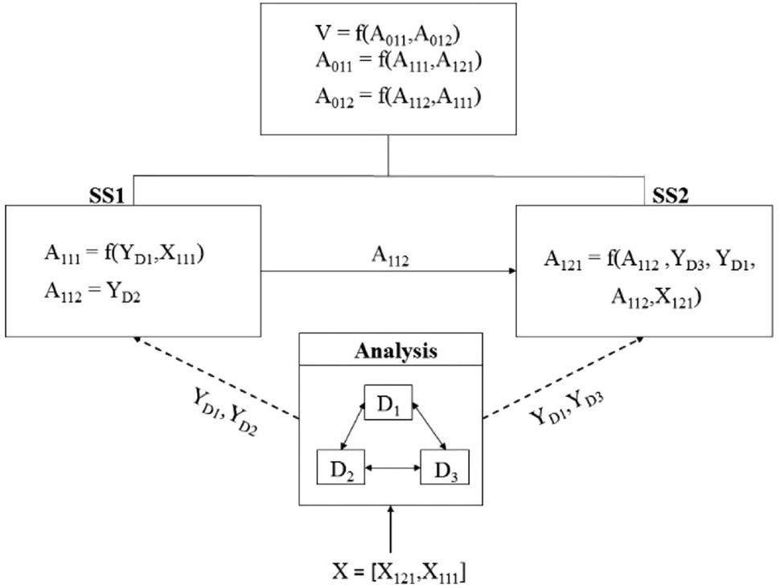

Figure 6. Attribute functional relationships.

<!-- PDF_PAGE: 14 -->

This in fact corresponds to the hierarchical decomposition of the satellite system (preliminary design) from Figure 1 which is the system used in this study.

Coupling impacts can be mathematically captured by calculating the total derivatives that represent the total change in system value due to a change in an attribute. A change in system value due to a change in a specific attribute is mathematically represented by Equation (11). The total derivative term on the right-hand side of the equation can be solved in terms of partial derivatives and is discussed in detail using a simple example in the forthcoming sections:

$$
\frac {d V}{d A _ {x , y , z}} = \frac {\partial V}{\partial A _ {x , y , z}} + \sum_ {p = 1} ^ {P} \left(\frac {\partial V}{\partial A _ {0 , 1 , p}} \frac {d A _ {0 , 1 , p}}{d A _ {x , y , z}}\right).
$$

Here, x is the level number (0 being the system level to N being the total number of levels), y is the subsystem number, z is the attribute number, V is the value function which is a function of system-level attributes (such as $ f ( A_{0,1,1}, A_{0,1,2}, A_{0,1,3}, \dots A_{0,1,P} ) $), and P is the number of attributes at the system level.

As mentioned earlier, the attributes are functions of other variables and therefore a proper capture of these functional relationships is required in order to accurately calculate the total change in value resulting from a change in the attributes. This can be demonstrated using the following example. Let us consider the two level systems from Figure 6. It can be seen that the value function at the top level is a function of system-level attributes $ ( A_{0,1,1} $ and $ A_{0,1,2} $ ), which are in turn functions of lower level attributes and behavior variables. The functional relationships between attributes at level 1 are shown in the figure. The Y's in the figure denote behavior variables with the subscript representing the discipline number, that is, $ D_{1} $ indicates discipline 1 and $ D_{2} $ indicates discipline 2, etc. The analysis associated with disciplines 1-3 is represented in Equations (12)-(14):

$$
D _ {1} \left(\left(X _ {1, 1, 1}, Y _ {D _ {2}} \text {o r} A _ {1, 1, 2}\right), Y _ {D _ {1}}\right) = 0
$$

$$
D _ {2} \left(\left(X _ {1, 2, 1}, X _ {1, 1, 1}, Y _ {D _ {1}}, Y _ {D _ {3}}\right), Y _ {D _ {2}}\right) = 0
$$

$$
D _ {3} \left(\left(X _ {1, 2, 1}, Y _ {D _ {1}}, Y _ {D _ {2}}\right), Y _ {D _ {3}}\right) = 0.
$$

The figure shows that the attributes at level 1 are functions of other attributes, design variables and behavior variables. So, in order to obtain the total change in value due to the attributes at level 1, the attribute couplings between SS1 and SS2 and the physics-based couplings need to be captured. To see this more clearly, let us consider obtaining the total change in value due to the attribute $ A_{1,1,2} $ , which is represented in Equation (15):

$$
\frac {d V}{d A _ {1 , 1 , 2}} = \frac {\partial V}{\partial A _ {1 , 1 , 2}} + \frac {\partial V}{\partial A _ {0 , 1 , 1}} \frac {d A _ {0 , 1 , 1}}{d A _ {1 , 1 , 2}} + \frac {\partial V}{\partial A _ {0 , 1 , 2}} \frac {d A _ {0 , 1 , 2}}{d A _ {1 , 1 , 2}}.
$$

Equation (16) represents the total change in the systemlevel attribute $ A_{0,1,1} $ due to $ A_{1,1,2} $ , which is needed to solve Equation (15):

$$
\frac {d A _ {0 , 1 , 1}}{d A _ {1 , 1 , 2}} = \frac {\partial A _ {0 , 1 , 1}}{\partial A _ {1 , 1 , 1}} \frac {d A _ {1 , 1 , 1}}{d A _ {1 , 1 , 2}} + \frac {\partial A _ {0 , 1 , 1}}{\partial A _ {1 , 2 , 1}} \frac {d A _ {1 , 2 , 1}}{d A _ {1 , 1 , 2}}.
$$

Table VII. Scorecard without Couplings

<table border="1"><tr><td>Attributes</td><td>Change in Status</td><td></td><td>Gradient</td><td>Value Impact</td></tr><tr><td>A111</td><td>A1-A111,0</td><td>$\times \sum_{p=1}^{P}\left(\frac{\partial V}{\partial A_{01p}}\frac{\partial A_{01p}}{\partial A_{111}}\right)_{A_{111,0}}=$</td><td></td><td></td></tr><tr><td>A112</td><td>A112-A112,0</td><td>$\times \sum_{p=1}^{P}\left(\frac{\partial V}{\partial A_{01p}}\frac{\partial A_{01p}}{\partial A_{112}}\right)_{A_{112,0}}=$</td><td></td><td></td></tr><tr><td>A121</td><td>A121-A121,0</td><td>$\times \sum_{p=1}^{P}\left(\frac{\partial V}{\partial A_{01p}}\frac{\partial A_{01p}}{\partial A_{121}}\right)_{A_{121,0}}=$</td><td></td><td></td></tr><tr><td colspan="3">Change in system value</td><td colspan="2">$=\sum\left(\begin{array}{c}Value\\ Impact\end{array}\right)$</td></tr></table>

Equation (17) represents the total change in $ A_{1,1,1} $ due to $ A_{1,1,2} $ , which is needed to solve Equation (16):

$$
\frac {d A _ {1 , 1 , 1}}{d A _ {1 , 1 , 2}} = \frac {\partial A _ {1 , 1 , 1}}{\partial Y _ {D _ {1}}} \frac {d Y _ {D _ {1}}}{d A _ {1 , 1 , 2}}.
$$

The matrix elements can be solved. Since $ Y_{D1} $ is a function of $ A_{1,1,2} $ , the total derivative of $ Y_{D1} $ with respect to $ A_{1,1,2} $ exists and can be obtained from Equation (18) as follows:

$$
\frac {d Y _ {D _ {1}}}{d A _ {1 , 1 , 2}} = \frac {\partial Y _ {D _ {1}}}{\partial A _ {1 , 1 , 2}}.
$$

In a similar manner the total change in $ A_{0,1,2} $ with respect to $ A_{1,1,2} $ can be obtained. It is clear from the above example that a capture of couplings to the behavior-variable-level is needed as it provides a more detailed representation of the interactions present in the system. A typical scorecard used in previous research that uses the subsystem value functions without couplings [Mullan et al., 2011., 2012.; Cheung et al., 2012] is seen in Table VII.

This scorecard calculates the impact on value $ (\Delta V) $ by all the attributes of a subsystem at a particular level. In essence, the scorecard calculates the terms in the second column of Table VI. The first column of the scorecard represents the attributes of a subsystem at a particular level. The second column calculates the change in attribute value from initial value (at which the value function is linearized). The gradient column represents the partial derivative terms. The value obtained by multiplying the gradient column term by the change in status is captured in the last column.

The last column gives the value impact $ (\Delta V) $ of each individual attribute on the system value, based on local sensitivities. The last row of the table represents the total impact on value by the entire subsystem, which is a summation of the individual attribute value impacts.

The individual impact on value by the attributes can be used to indicate which subsystem attributes affect the value most. This knowledge aids the designers in focusing their efforts on the design variables that contribute to those attributes. It should also be noted that the attributes cannot be changed directly but can only be changed by changing the corresponding design variables. These design variables

<!-- PDF_PAGE: 15 -->

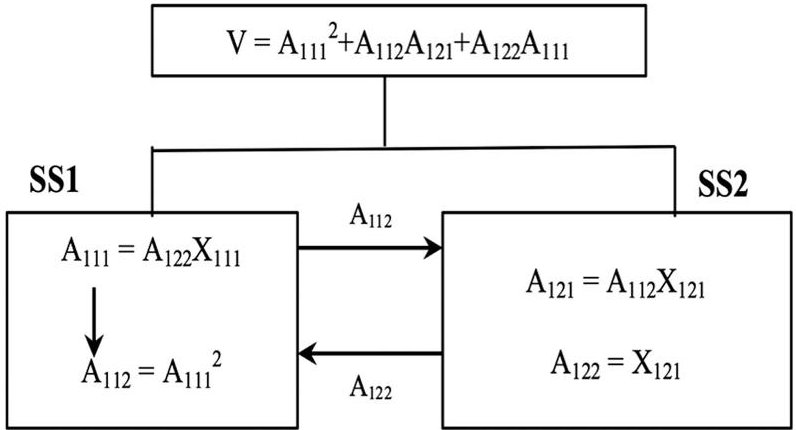

Figure 7. Attribute dependency.

Table VIII. Scorecard with Couplings

<table border="1"><tr><td>Attributes</td><td>Change in Status</td><td>Gradient</td><td>Value Impact</td></tr><tr><td>A111</td><td>A111-A111,0</td><td>$\times$ $\left[\frac{dV}{dA_{111}}\right]_{A_{111,0}}=$</td><td></td></tr><tr><td>A112</td><td>A112-A112,0</td><td>$\times$ $\left[\frac{dV}{dA_{112}}\right]_{A_{112,0}}=$</td><td></td></tr><tr><td>A121</td><td>A121-A121,0</td><td>$\times$ $\left[\frac{dV}{dA_{121}}\right]_{A_{121,0}}=$</td><td></td></tr><tr><td colspan="3">Change in system value</td><td>$\sum\left(\begin{array}{c}Value\\ Impact\end{array}\right)$</td></tr></table>

$$
\Delta V _ {X _ {1, 1, 2}} = \frac {\partial V}{\partial A _ {0 , 1 , 1}} \Delta A _ {0, 1, 1 _ {X _ {1, 1, 2}}} + \frac {\partial V}{\partial A _ {0 , 1 , 2}} \Delta A _ {0, 1, 2 _ {X _ {1, 1, 2}}},
$$

can be continuous, discrete, or integer. Obtaining the value impact of a continuous design variable is straightforward as it is similar to the calculation of attribute value impacts. In cases involving discrete or integer design variables, calculating derivatives is meaningless. However, the value impact of these design variables can be obtained by determining the change in attribute values. This is shown using Equations (19) and (20) as follows:

$$
\Delta A _ {0, 1, 1 _ {X _ {1, 1, 2}}} = A _ {0 1 1} \left(X _ {1, 1, 2, B}\right) - A _ {0 1 1} \left(X _ {1, 1, 2, A}\right).
$$

where

Equation (19) represents the value impact of a discrete design variable $ ( X_{1,1,2} ) $ . Equation (20) represents the total change in attribute $ A_{0,1,1} $ with respect to the discrete design variable $ X_{1,1,2} $ . Here, $ X_{1,1,2,\mathrm{A}} $ represents discrete choice A and $ X_{1,1,2,\mathrm{B}} $ represents choice B and $ A_{0,1,1} ( X_{1,1,2,\mathrm{B}} ) $ represents the value of $ A_{0,1,1} $ with choice B and $ A_{0,1,1} ( X_{1,1,2},_{\mathrm{A}} ) $ represents the value of $ A_{0,1,1} $ with choice A. For instance, the change in $ A_{0,1,1} $ can be thought of as the change in cost due to a change from Engine A to Engine B.

A scorecard with couplings can be formed where the total derivative in Equation (11) is used in the gradient column (as seen in Table VIII). In this paper, we demonstrate the need for total derivatives to be used, which ensures system consistency in physics.

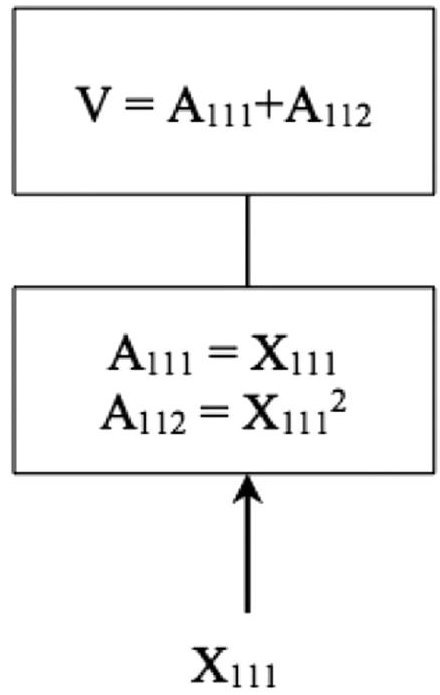

Figure 8. Design variable dependency.

## 5.1. Attribute Dependency

The designer at a particular level must be careful in selecting the attributes to be represented in the scorecards. The attributes must be independent of each other. This can be done by calculating the sensitivities between attributes. Consider a simple coupled two-subsystem example as shown in Figure 7. The designer wishes to maximize the value function as shown in the figure, which is a function of lower level attributes. Subsystems 1 and 2 are coupled via attributes and the attribute $ A_{1,1,2} $ is a function of $ A_{1,1,1} $ , which is an attribute associated with the same subsystem at the same level.

The scorecard representing the value impact of SL2 attributes is represented in Table IX. The scorecard shows that the total change is $ \Delta V=2 4. 8 8 $ . However, the actual change in value $ (\Delta V.) $ that is obtained when the new attribute values (listed in "Change in status" column of scorecard) are substituted in the value function is 8.68. This discrepancy is due to the dependency of attributes. Figure 7 shows that the only independent attribute is $ A_{1,2,2} $ and all the other attributes are functions of $ A_{1,2,2} $ both directly and indirectly via another attribute. The value impact of $ A_{1,2,2} $ is counted twice when the value impact of $ A_{1,1,1} $ is calculated since $ A_{1,1,1} $ is a function of $ A_{1,2,2} $ . Similarly, the value impact of $ A_{1,2,2} $ is counted again via $ A_{1,1,1} $ , during the calculation of $ A_{1,1,2} $ . Hence, there is a significant discrepancy in $ \Delta V. $

Another area of concern is due to attributes that are functions of the same design variables. Consider the simple one subsystem, two-level system shown in Figure 8, where the designer wishes to maximize the value function. The attributes at SL1 (the second level of the hierarchy), $ A_{1,1,1} $ and $ A_{1,1,2} $ are a function of the same design variable $ X_{1,1,1} $ The scorecard for SL1 is depicted in Table X. This scorecard calculates the value impact due to change in attributes $ A_{1,1,1} $ and $ A_{1,1,2} $ . The design variable responsible for the change in both $ A_{1,1,1} $ and $ A_{1,1,2} $ is $ X_{1,1,1} $ . For a desired value of $ A_{1,1,1} $ = 2.1, the corresponding value of $ X_{1,1,1} $ = 2.1, whereas for a desired value of $ A_{1,1,2} $ = 4.1, $ X_{1,1,1} $ = 2.02. This indicates that

<!-- PDF_PAGE: 16 -->

Table IX. Scorecard—Attribute Dependency

<table border="1"><tr><td>Attributes</td><td>Change in Status</td><td>×</td><td>Gradient</td><td>=</td><td>Change in Value</td><td>ΣActual Value Impact</td><td>Expected Value Impact</td></tr><tr><td>A111</td><td>2.2-2</td><td>×</td><td>[dV/dA111]0=37</td><td>=</td><td>7.4</td><td>24.88</td><td>8.68</td></tr><tr><td>A112</td><td>4.84-4</td><td>×</td><td>[dV/dA112]0=8</td><td>=</td><td>6.72</td><td></td><td></td></tr><tr><td>A121</td><td>4.84-4</td><td>×</td><td>[dV/dA121]0=4</td><td>=</td><td>3.36</td><td></td><td></td></tr><tr><td>A122</td><td>1.1-1</td><td>×</td><td>[dV/dA122]0=74</td><td>=</td><td>7.4</td><td></td><td></td></tr></table>

Table X. Attribute Dependency

<table border="1"><tr><td>Attributes</td><td>Change in Status</td><td>×</td><td>Gradient</td><td>=</td><td>Change in Value</td><td>∑Value impact</td></tr><tr><td>A111</td><td>2.1-2</td><td>×</td><td>[dV/dA111]0=1</td><td>=</td><td>0.1</td><td>0.2</td></tr><tr><td>A112</td><td>4.1-4</td><td>×</td><td>[dV/dA112]0=1</td><td>=</td><td>0.1</td><td></td></tr></table>

the system is inconsistent and does not represent a legitimate system. This inconsistency is due to both attributes being dependent on each other through $ X_{1,1,1} $ . This dependency issue can be overcome by characterizing the system at SL1 by using either $ A_{1,1,1} $ or $ A_{1,1,2} $

## 5.2. Case Studies—Couplings in System Decomposition

A simple two-level system and the higher fidelity satellite system, as described in Section III, are considered in this paper to contrast the effects of capturing couplings to maintain physical system consistency. As mentioned earlier, the total derivative terms on the right-hand side of Equation (11) are solved in terms of partial derivatives for the simple system. Similar equations are used to explore the satellite. The results associated with both the systems are discussed in detail in the results section.

## 5.2.1. Simple System

A simple example consisting of only two levels of hierarchy and two subsystems is shown in Figure 9. This system is used to explore the effects of couplings and to investigate the representation of the total derivative terms on the right-hand side of Equation (11) in terms of partial derivatives. The example considered here is a minimization problem where the value function (V) is minimized to find the optimum. Each of the two subsystems at SL1 consists of attributes and design variables. Figure 9 represents the coupling that links the two subsystems by an arrow between them.

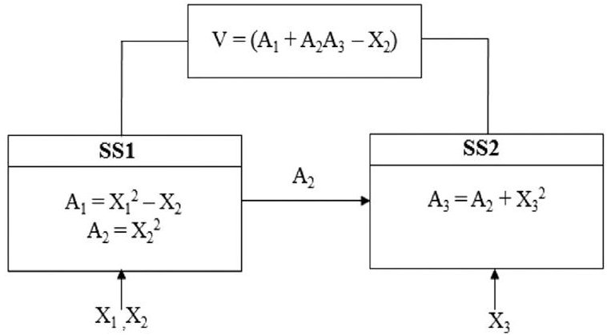

Figure 9. Simple two-level system.

The total impact of attributes on value with couplings for this simple example can be represented in a matrix form, shown in Equation (21) (a matrix representation of Equation (11)). The terms on the right-hand side of Equation (21) represent the value impact of each attribute, used in the gradient column of the scorecard. The elements in the $ 3\times 3 $ matrix on the left-hand side of Equation (21) represent the total derivative terms previously seen on the right-hand side of Equation (11):

$$
\left[ \begin{array}{l l l} \frac {\partial V}{\partial A _ {1}} & \frac {\partial V}{\partial A _ {2}} & \frac {\partial V}{\partial A _ {3}} \end{array} \right] \left[ \begin{array}{c c c} \frac {d A _ {1}}{d A _ {3}} & \frac {d A _ {1}}{d A _ {2}} & 1 \\ \frac {d A _ {2}}{d A _ {3}} & 1 & \frac {d A _ {2}}{d A _ {1}} \\ 1 & \frac {d A _ {3}}{d A _ {2}} & \frac {d A _ {3}}{d A _ {1}} \end{array} \right] = \left[ \begin{array}{c c c} \frac {d V}{d A _ {3}} & \frac {d V}{d A _ {2}} & \frac {d V}{d A _ {1}} \end{array} \right]
$$

The value impacts on the right hand can be solved easily once the total derivatives on the left side are evaluated. These

<!-- PDF_PAGE: 17 -->

Table XI. Scorecard—Simple Two-Level System at SLI, SSI

<table border="1"><tr><td></td><td>Attributes</td><td>Change in Status</td><td>×</td><td>Gradient</td><td>=</td><td>Change in Value</td><td>Σ($\begin{array}{c}Value\\ Impact\end{array}$)</td></tr><tr><td rowspan="2">With coupling</td><td>A1</td><td>-1.7675+1.75</td><td>×</td><td>$\left[\frac{dV}{dA_{1}}\right]_{0}=1$</td><td>=</td><td>-0.0175</td><td>-0.6975</td></tr><tr><td>A2</td><td>3.96-4</td><td>×</td><td>$\left[\frac{dV}{dA_{2}}\right]_{0}=17$</td><td>=</td><td>-0.680</td><td></td></tr><tr><td rowspan="2">Without coupling</td><td>A1</td><td>-1.7675+1.75</td><td>×</td><td>$\left[\frac{\partial V}{\partial A_{1}}\right]_{0}=1$</td><td>=</td><td>-0.0175</td><td>-0.5375</td></tr><tr><td>A2</td><td>3.96-4</td><td>×</td><td>$\left[\frac{\partial V}{\partial A_{2}}\right]_{0}=13$</td><td>=</td><td>-0.520</td><td></td></tr></table>

Table XII. Initial Design—Simple Two-Level System

<table border="1"><tr><td>Design Variable</td><td>A1</td><td>A2</td><td>A3</td><td>Value</td></tr><tr><td>$X_{1}=0.5$</td><td></td><td></td><td></td><td></td></tr><tr><td>$X_{2}=2.0$</td><td>-1.75</td><td>4</td><td>13</td><td>48.25</td></tr><tr><td>$X_{3}=3.0$</td><td></td><td></td><td></td><td></td></tr></table>

total derivatives can be determined by following similar steps as in Equations (16)-(18). The partial derivative terms can be obtained either analytically or numerically using finite difference.

The scorecard with and without couplings for the simple two-level system is shown in Table XI ("with couplings" takes into account the interaction between attribute $ A_{2} $ and attribute $ A_{3} $ ). This scorecard only represents the impact on value due to the change in attributes. It is understood that the attributes cannot be changed directly without changing the corresponding design variables. Table XI shows that the value impact due to SS1, with the couplings captured, is greater than the value impact due to SS1 without couplings. If the designer at SS1 uses a scorecard with no couplings, the conclusion might be that the attributes at SS1 are not worth changing since they do not result in a drastic decrease in value. The designer will be able to make a more accurate (and meaningful) assessment by capturing the pathway in which $ A_{2} $ impacts the value through $ A_{3} $ . This emphasizes that care must be taken in capturing the couplings to obtain sensitivity information. A similar scorecard comparison can be created for subsystem 2, which would result in the value impacts with and without couplings being similar. This is due to $ A_{3} $ having no pathway to impact the value through attributes $ A_{1} $ and $ A_{2} $ . Therefore, $ A_{3} $ can only change the value directly.

As previously mentioned, the attribute values must be related to a set of design variables in order for the system design to be consistent. The set of design variables that are related to the attributes associated with the system in Figure 9 is shown in Table XII.

Table XIII represents the modified attributes from the changes made by the designer of the first subsystem (as performed in Table XI). The set of design variables are chosen to ensure system consistency with the modified attributes. The actual value of the new system is determined, as is the

change in the actual value. The expected change in values predicted by the scorecards (from Table XI) is compared with the actual change through percentage error calculation. It is seen that the percentage error in the change in value with couplings is smaller than without couplings. This further highlights the greater accuracy gained by incorporating couplings into the scorecard. Table XIII also represents a similar comparison of expected value changes relating to the scorecard for SS2 at SL1 with and without couplings. It can be seen that the value impacts are the same for both cases. This identical error is due to $ A_{3} $ not being an input to SS1.

It is important to note that the final designs determined from the two subsystem scorecards are different. This emphasizes the need for a system-wide iteration to ensure system-wide consistency. It is also important to note that a change in $ A_{3} $ may mean a change in $ A_{2} $ . Identifying the couplings that exist is a critical step when forming scorecards to ensure that the change in value is meaningful.

## 5.2.2. Hierarchically Decomposed Satellite System

Now let us consider the hierarchically decomposed satellite system as described in Section 3 to demonstrate the importance of capturing couplings in system decomposition in the context of VDD. Figure 10 shows the pathway that $ P_{\mathrm{payload}} $ takes to impact the value through the Power subsystem, in addition to the direct impact through the Payload system. The total derivatives that are needed for various scorecard implementations can be derived as was done for the simple system example. As can be seen in Figure 10, the pathways in which an attribute can affect another attribute can be many. Proper capturing of these pathways is needed to fully understand how a change in one attribute will impact another. The commercial satellite system offers an LSCES example (Fig. 1) to explore these issues with scorecards. The system-level scorecard with and without couplings will be similar, since the system-level attributes (Total cost and Revenue) only impact the value directly. Table XIV represents the scorecard for the attributes at the next subsystem level (SL1). Due to the large number of attributes at this level, only four are represented (payload cost, downlink signal-to-noise ratio, ground cost, and uplink signal-to-noise ratio), with the understanding that many more would actually be represented to capture the entire impact of the SL1 attributes.

<!-- PDF_PAGE: 18 -->

Table XIII. Final Design—SS1 and SS2 (Simple System)

<table border="1"><tr><td></td><td>Design Variable</td><td>A1</td><td>A2</td><td>A3</td><td>Value</td><td>Actual Value Change</td><td>Exp. Value Change-Coupled SS1 Scorecard</td><td>% Error in ΔV with Couplings</td><td>Exp. Value Change-Noncoupled SS1 Scorecard</td><td>% Error in ΔV without Coupling</td></tr><tr><td>SS1</td><td>X1=0.47X2=1.98X3=3.0</td><td>-1.76</td><td>3.96</td><td>13</td><td>47.49</td><td>-0.75</td><td>-0.69</td><td>1.92</td><td>-0.53</td><td>28.35</td></tr><tr><td>SS2</td><td>X1=0.50X2=2.00X3=2.97</td><td>-1.75</td><td>4</td><td>12.87</td><td>47.72</td><td>0.52</td><td>-0.52</td><td>1.98</td><td>-0.52</td><td>1.98</td></tr></table>

Table XIV. SL1 Scorecard—Satellite Example

<table border="1"><tr><td></td><td>Attributes</td><td>Change in Status</td><td>×</td><td>Gradient</td><td>=</td><td>Change in Value</td></tr><tr><td>1.</td><td></td><td>$C_{\text{payload}}-C_{\text{payload},0}$</td><td>×</td><td>$\left[\frac{dV}{dC_{\text{paylaod}}}\right]_{0}$</td><td>=</td><td></td></tr><tr><td>2.</td><td></td><td>$SNR_{\text{down}}-SNR_{\text{down},0}$</td><td>×</td><td>$\left[\frac{dV}{dSNR_{\text{down}}}\right]_{0}$</td><td>=</td><td></td></tr><tr><td>3.</td><td></td><td>$C_{\text{ground}}-C_{\text{ground},0}$</td><td>×</td><td>$\left[\frac{dV}{dC_{\text{ground}}}\right]_{0}$</td><td>=</td><td></td></tr><tr><td>$\vdots$</td><td></td><td>$\vdots$</td><td></td><td>$\vdots$</td><td></td><td>∑(Value Impact)</td></tr></table>

Only the scorecards associated with the Payload subsystem for all the levels of hierarchy are presented in this paper due to the complexity of the satellite system. Similar scorecards can be made for the other subsystems. Table XV represents the scorecards associated with SL1, SL2, and SL3 of the

satellite system. The scorecard at SL1, SS1 of payload yields the same value impact with and without couplings. This is due to the fact that attributes, $ C_{\mathrm{payload}} $ and $ SNR_{\mathrm{down}} $ , are only direct inputs to the system and not to any other subsystem.

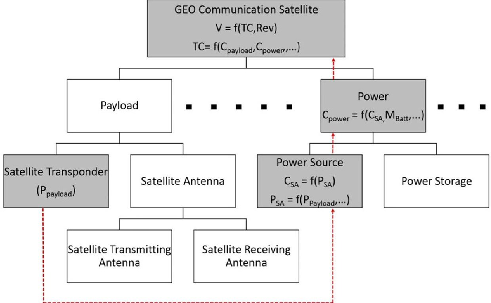

Figure 10. Attribute impact—Satellite system.

<!-- PDF_PAGE: 19 -->

Table XV. Scorecard at all Levels—Satellite System

<table border="1"><tr><td colspan="3">SL1,SS1</td><td colspan="3">SL2,SS1</td><td colspan="3">SL3,SS2</td></tr><tr><td>Attributes</td><td>Without Coupling</td><td>With Coupling</td><td>Attributes</td><td>Without Coupling</td><td>With Coupling</td><td>Attributes</td><td>Without Coupling</td><td>With Coupling</td></tr><tr><td>$C_{\text{payload}}$</td><td>602.78</td><td>602.78</td><td>$M_{\text{trans}}$</td><td>75</td><td>75</td><td>$G_{\text{sr}}$</td><td>0</td><td>10463</td></tr><tr><td>$SNR_{\text{down}}$</td><td>2420000</td><td>2420000</td><td>$P_{\text{payload}}$</td><td>0</td><td>-34090</td><td>$M_{\text{sr}}$</td><td>263.86</td><td>263.86</td></tr><tr><td>$\Delta V$</td><td>2420602.7</td><td>2420602.7</td><td>$\Delta V$</td><td>75</td><td>-34015</td><td>$\Delta V$</td><td>263.86</td><td>10727.7</td></tr></table>

The subsystems at SL2 are the payload satellite transponder (SL2, SS1) and payload satellite antennae (SL2, SS2) as shown in Figure 1. The scorecard for SL2, SS2 is not represented as the value impact due its attribute is similar with and without couplings. It can be seen in Table XV that the value impact due to the change in attributes at SL2, SS1 with couplings is much greater than the one without couplings. This is due to critical interactions not being captured (i.e., for the scorecard without couplings, the partial derivative terms just represent the interactions in the hierarchy (only within Payload subsystem), whereas they fail to capture the lateral interactions across the satellite system). For example, the attribute $ P_{\mathrm{payload}} $ supplies input to the Power subsystem. Due to this coupling, an increase in $ P_{\mathrm{payload}} $ will result in an increase in Solar Array area and Battery mass that in turn will result in an increase in the cost and mass of the satellite. An increase in cost and mass of the satellite results in a decrease in value. Hence, the real impact of $ P_{\mathrm{payload}} $ on the system value can only be captured using total derivatives (as shown in Table XV with couplings). Without knowledge of the total impact of $ P_{\mathrm{payload}} $ on the value, the designer at SL2, SS1 may easily make decisions that would result in the satellite company losing profit.

The scorecard representing SL3 (satellite transmitting antenna (SL3, SS1) and satellite receiving antenna (SL3, SS2) from Fig. 3) is also seen in Table XV. The scorecard associated with SL3, SS1 is not shown in Table XV, as the attributes value impacts, both with and without couplings, are similar. The effect of not capturing the couplings is seen in the SL3, SS2 scorecard (satellite receiving antenna subsystem), shown in Table XV. The attribute $ G_{sr} $ (gain of satellite receiving antenna) is only an input into the Ground subsystem. Hence, the only path for the attribute to impact the system value is through the ground subsystem. This pathway for impact is captured through the total derivative used in the "with coupling" scorecard. Without the couplings, the interaction is not captured and, since the attribute is not an input into any subsystem directly above the satellite receiving antenna subsystem, the gradient is zero. The desired change in value can be achieved by determining the design variables responsible for the changes in attributes that are considered. For example, the attribute $ SNR_{\mathrm{down}} $ (downlink signal-to-noise ratio) at SL1, SS1 that is a function of a number of attributes and design variables (shown in Equation (22)). It has already been found from the scorecard at SL1, SS1 (Table XV) that an increase in $ SNR_{\mathrm{down}} $ will result in an increase in value. A change in $ SNR_{\mathrm{down}} $ can be achieved in multiple ways. One way to change the downlink signal-to-noise ratio is by changing $ G_{st} $ (gain of satellite transmitting antenna), an attribute at

SL3, SS1. $ G_{st} $ is a function of $ D_{\mathrm{sat,trans}} $ (diameter of satellite transmitting antenna) and $ f_{\mathrm{down}} $ (downlink frequency) (Equation (23)), which are design variables at SL3, SS1. Changing these design variables will result in a change in $ G_{st} $ . The change in $ G_{st} $ will result in a change in $ SNR_{\mathrm{down}} $ , leading to a change in value. However, care must be taken in changing the design variables, since some design variable changes might result in increased cost rather than revenue. For example, the designer might increase $ D_{\mathrm{sat,trans}} $ under the belief that it will result in an increase in $ G_{st} $ and hence an increase in value. This may not result in a net value increase as an increase in $ D_{\mathrm{sat,trans}} $ will result in an increase in mass and an associated cost:

$$
S N R _ {\mathrm {d o w n}} = f \left(P _ {s t}, G _ {s t}, G _ {g r}, L _ {s}\right),
$$

$$
G _ {s t} = f \left(D _ {\mathrm {s a t , t r a n s}}, f _ {\mathrm {d o w n}}\right).
$$

Similarly, a desired change in $ P_{\mathrm{payload}} $ can be achieved by changing the design variables that modify the attribute (as shown in Equation (24)). As mentioned earlier, the effect of changing the design variables on the value must be explored before changing them. The impact of a particular design variable on value at any level can also be captured by obtaining the total derivative, which captures all the interactions in the system. For example, a change in the design variable $ P_{st} $ (satellite transmitter power) will change the system value through multiple paths, including payload power and downlink signal-to-noise ratio:

$$
P _ {\mathrm {p a y l o a d}} = f \left(A m p, N, P _ {s t}\right).
$$

The main focus of this section was to demonstrate the importance of capturing couplings to obtain the impacts of attributes on system value. Case studies indicate that capturing couplings result in a more accurate representation of value impact of attributes by ensuring a physically consistent system. The attribute impacts on value act as a starting point for designers at different levels of the hierarchy to focus on the areas which impact the system value more. In order to actually maximize value, the design variables corresponding to the attributes that impact the value positively should be changed by taking the dependency issues into consideration. This will be investigated as part of future work.

## 6. CONCLUSION

This paper explored two critical aspects of system consistency during the design of LSCES, using a commercial satellite system as a testbed. The first pertained to identifying the

<!-- PDF_PAGE: 20 -->

means by which preference consistency across the entire system, all organizations involved in the development process, and all stages of decision making could be ensured with the implementation of a value-based systems engineering approach. The implementation of VDD enables the preferences of the stakeholder to be communicated directly through a decomposable value function, rather than decomposable requirements, thereby providing a mechanism for improved consistency in system preference across all decision makers. The paper clearly demonstrated the potential value gap that exists between a value-driven approach versus more traditional requirements-based optimization approaches in which proxies for the true preference are used. The paper then demonstrated the importance of using system couplings, obtained through multidisciplinary design and optimization methods, to enable an improved accuracy for the decomposing the value function. The paper demonstrated that decomposition of the value function without appropriate incorporation of system couplings can lead to significant errors as a result of system analysis inconsistencies. The results demonstrated that ensuring system analysis consistency through use of system sensitivities can overcome the issue of inadequately capturing system interactions, including consideration of attribute dependencies, and direct modification of attributes to determine value impact. It was shown that lack of system couplings can lead a decision maker to completely wrong conclusions regarding the impact of attributes and design variables on the system value. The paper lays the groundwork for a value-based system engineering framework that enables improved system consistency in both system preference and system analysis.

## APPENDIX

## Rationale Behind Constraints

When the launch vehicle is predetermined, the constraints are formulated to represent the stakeholder's preference for

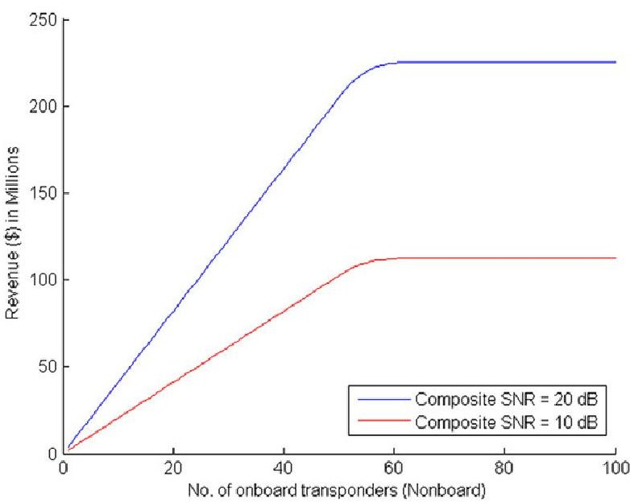

Figure A1. Total revenue versus number of onboard transponders.

Table AI. Description of Design Variables—Satellite System Conceptual Design

<table border="1"><tr><td>Design Variable</td><td>Description</td></tr><tr><td>$f_{\mathrm{dow}}$</td><td>Downlink frequency in Hz</td></tr><tr><td>$f_{\mathrm{up}}$</td><td>Uplink frequency in Hz</td></tr><tr><td>$P_{t}$</td><td>Satellite Transmitter power in Watts</td></tr><tr><td>$P_{gt}$</td><td>Ground Transmitter power in Watts</td></tr><tr><td>$D_{\mathrm{sat,trans}}$</td><td>Satellite transmitting antenna diameter in m</td></tr><tr><td>$D_{\mathrm{sat,rec}}$</td><td>Satellite receiving antenna diameter in m</td></tr><tr><td>$D_{\mathrm{ground,rec}}$</td><td>Ground receiving antenna diameter in m</td></tr><tr><td>$D_{\mathrm{ground,trans}}$</td><td>Ground transmitting antenna diameter in m</td></tr><tr><td>$\mathcal{E}$</td><td>Energy density of the battery in $\frac{\mathrm{W}-\mathrm{hour}}{\mathrm{kg}}$</td></tr></table>

the satellite to be delivered into orbit by a particular launch vehicle. These constraints relate to the launch vehicle's payload capability in terms of both mass and size. For example, one requirement formed is that the sum of mass of all the subsystems is constrained to be less than 1000 kg. Also, the array size must be less than $ 4 0 \mathrm{m}^{2} $ to fit in the payload envelope of the launch vehicle and the dimensions of the satellite bus must be less than the payload envelope diameter and length. The signal-to-noise ratio constraint exists not because of a launch requirement but rather a performance requirement. Apart from inequality constraints, side constraints are imposed on the example problem. These side constraints are derived from common satellite system design practices [Wertz and Larson, 1999].

## Revenue Model

An approximate revenue model of the satellite is developed here based on the number of useful transponders onboard the satellite with the incorporation of market demand for the number of transponders. The market also dictates the leasing price per transponder. A maximum leasing price of $1.1M per transponder per year is assumed, which is consistent with similar approximations [Saleh and Torres Padilla, 2007]. With this revenue statement, the inclination might be to infinitely increase the number of transponders; however, the utilization rate of the transponders [Saleh et al., 2006; Saleh and Torres Padilla, 2007; Saleh, 2008; Brathwaite and Saleh, 2009] also becomes an important factor in the statement. A market demand of 50 transponders is assumed and the transmitter power needed per transponder is assumed to be 30 W, consistent with ranges discussed in Wertz and Larson [1999]. The satellite has an operational life of 10 years and over that time a percentage of transponders are anticipated to fail each year, reducing the usable transponders available each year. To capture this, a lower yearly revenue will result for each consecutive year as transponders fail. This can be seen in Equation (A.1), where $ N_{\mathrm{Leased}} $ represents the number of leased transponders for year y, FR represents failure rate (2% per year), and $ N_{\mathrm{OnBoard}} $ represents number of on board transponders. Equation (A.1) represents the number of leased transponders each year

<!-- PDF_PAGE: 21 -->

Table AII. Attributes and Design Variables—Satellite System (Preliminary Design)

<table border="1"><tr><td colspan="2">Levels</td><td></td><td>Attributes</td><td>Design Variables</td></tr><tr><td colspan="2">SYSTEM(Geo Communication Satellite)</td><td></td><td>Total cost, Revenue</td><td>Single satellite or satellite constellation?</td></tr><tr><td rowspan="9">Subsystem level1</td><td>(SS1) Payload</td><td></td><td>$C_{\text{payload}},SNR_{\text{d}}$</td><td>N,Type of HPA,Satellite longitude</td></tr><tr><td>(SS2) Ground Station</td><td></td><td>$C_{\text{ground}},SNR_{\text{up}}$</td><td>Ground longitude$_{\text{rec}}$,Ground latitude$_{\text{rec}}$,Ground longitude$_{\text{trans}}$,Ground latitude$_{\text{trans}}$</td></tr><tr><td>(SS3) Power</td><td></td><td>$C_{\text{power}}$</td><td>Type of power source</td></tr><tr><td>(SS4) Propulsion</td><td></td><td>$C_{\text{Engine/kg}},C_{\text{propulsion}}$</td><td>Type of liquid propulsion system(mono/bi)</td></tr><tr><td>(SS5) ADCS</td><td></td><td>$C_{\text{ADCS}}$</td><td>Type of controller</td></tr><tr><td>(SS6) Thermal</td><td></td><td>$C_{\text{thermal}}$</td><td>Type of passive thermal control</td></tr><tr><td>(SS7) Structures</td><td></td><td>$C_{\text{structures}}$</td><td>Configuration of bus</td></tr><tr><td>(SS8) Launch vehicle</td><td></td><td>$C_{\text{LV}}$</td><td>Launch site,Type of launch vehicle</td></tr><tr><td rowspan="11">Subsystem level2</td><td rowspan="2">Payload</td><td>(SS1) Satellite Transponders</td><td>$M_{\text{trans}},P_{\text{payload}},V_{\text{trans}}$</td><td>$P_{\text{st}}$</td></tr><tr><td>(SS2) Satellite antennae</td><td>$C_{\text{sat,ant}},M_{\text{sat ant}}$</td><td>Antenna type(Parabolic/Helical antenna)</td></tr><tr><td rowspan="2">Ground station</td><td>(SS1) Ground transponder</td><td>$C_{\text{g,transmitter}}$</td><td>$P_{\text{gt}}$</td></tr><tr><td>(SS2) Ground antennae</td><td>$C_{\text{g,antennae}}$</td><td>Antenna type(Parabolic/Helical antenna)</td></tr><tr><td rowspan="2">Power</td><td>(SS1) Solar Array</td><td>$C_{\text{SA}},$ Array size,$M_{\text{SA}}$</td><td>SA_material</td></tr><tr><td>(SS2) Battery</td><td>$C_{\text{Batt}},$ Battery mass,Battery capacity,$V_{\text{batt}}$</td><td>Battery type</td></tr><tr><td>Propulsion</td><td>(SS1) Propellant</td><td>$M_{\text{propellant}},V_{\text{propellant}},C_{\text{Engine}},C_{\text{propellant}}$</td><td>Propellant</td></tr><tr><td rowspan="2">Thermal</td><td>(SS1) Surface Finish</td><td>$C_{\text{thermalfinish}}$</td><td>$(\frac{\alpha}{\varepsilon})_{\text{SA}},(\frac{\alpha}{\varepsilon})_{\text{sat,trans}},(\frac{\alpha}{\varepsilon})_{\text{sat,rec}},(\frac{\alpha}{\varepsilon})_{\text{bus}}$</td></tr><tr><td>(SS2) Radiator and Heater</td><td>$P_{\text{thermal}},C_{\text{radiator}},C_{\text{heater}},M_{\text{radiator}}$</td><td>$\varepsilon_{\text{radbattery}},\varepsilon_{\text{radRW}},\varepsilon_{\text{radproptank}}$</td></tr><tr><td>Structures</td><td>(SS1) Bus</td><td>$C_{\text{bus/kg}}$</td><td>Bus material</td></tr><tr><td rowspan="5">Subsystem level3</td><td rowspan="2">Satellite antennae</td><td>(SS1) Satellite transmitting antenna</td><td>$G_{\text{st}},M_{\text{st}}$</td><td>$f_{\text{down}},D_{\text{st}}$</td></tr><tr><td>(SS2) Satellite</td><td>$G_{\text{sr}},M_{\text{sr}}$</td><td>$D_{\text{sr}}$</td></tr><tr><td rowspan="2">Ground antennae</td><td>receiving antenna(SS1) Ground transmitting antenna</td><td>$M_{\text{gt}},G_{\text{gt}}$</td><td>$D_{\text{gt}},f_{\text{up}}$</td></tr><tr><td>(SS2) Ground receiving antenna</td><td>$M_{\text{gr}},G_{\text{gr}}$</td><td>$D_{\text{gr}}$</td></tr><tr><td>Propulsion</td><td>Propellant</td><td>(SS1) Propellant tank</td><td>$M_{\text{proptank}},V_{\text{proptank}},C_{\text{proptank}}$</td><td>Propellant tank material</td></tr></table>

in terms of the failure rate and the number of onboard transponders:

$$
N _ {\mathrm {L e a s e d}, y} = \left\{ \begin{array}{c c} N _ {\mathrm {O n B o a r d}} * (1 - F R) ^ {y} N _ {\mathrm {O n B o a r d}} * (1 - F R) ^ {y} \leq 5 0 \\ 5 0 N _ {\mathrm {O n B o a r d}} * (1 - F R) ^ {y} > 5 0 \end{array} \right.
$$

where

$$
N _ {\mathrm {O n B o a r d}} = \left(\frac {P _ {t}}{3 0}\right).
$$

The revenue is also dependent on the composite signalto-noise ratio （ $ SNR_{\mathrm{composite}} $ ）. A high $ SNR_{\mathrm{composite}} $ results in a high quality signal, culminating in customers willing to pay more to lease a transponder. A composite SNR below 5 dB results in an unusable signal, generating zero market demand and, hence, zero revenue. A composite SNR above 30 dB is deemed excessive and unnecessary, resulting in constant revenue above this value, since customers are not willing to spend more on higher signal quality which is unusable

<!-- PDF_PAGE: 22 -->

to them. This is captured using an unitless parameter called signal quality ratio (QR) as seen in Equation (A.2). The range for usable signal quality is assumed in this paper:

$$
Q R = \left\{ \begin{array}{c c} 0 & S N R _ {\mathrm {c o m p o s i t e}} \leq 5 \\ S N R _ {\mathrm {c o m p o s i t e}} / 3 0 & 5 < S N R _ {\mathrm {c o m p o s i t e}} \leq 3 0 \\ 1 & S N R _ {\mathrm {c o m p o s i t e}} > 3 0 \end{array} . \right.
$$

The yearly revenue as a function of the number of leased transponders (which is a function of transmitter power, $ P_{t} $ ) per year and composite SNR is shown in Equation (A.3). For the lower fidelity satellite model with nine design variables, the number of transponders is assumed to be continuous and not discrete. Equation (A.2) represents a linear relationship between the number of leased transponders per year and the yearly revenue, taking into account the failure rate of the transponders and the saturation points due to market demands. The quality of the signal is also incorporated into the yearly revenue through the signal quality ratio. Consideration of the market demand (50 transponders) results in constant revenue once the satellite has reached this saturation point:

$$
R e v e n u e _ {y} = N _ {\mathrm {L e a s e d}, y} * 1. 1 * 1 0 ^ {6} * Q R.
$$

Graphical representations of the revenue model associated with the number of transponders are seen in Figure A1, with different composite SNR values. In Figure A1, the revenue is the total revenue over the course of 10 years (simply the summation of the yearly revenues). Due to the incorporation of a failure rate, the peak revenues associated with the number of on board transponders greater than 50, the market saturation point.

## ACKNOWLEDGMENTS

This research was funded in part by the National Science Foundation (Grant CMMI-1300921). The opinions, findings, and conclusions stated herein are those of the authors and do not necessarily reflect those of the sponsor.

## REFERENCES

C. Bloebaum, Coupling strength-based system reduction for complex engineering design, Struct Optimization 10(2) (1995), 113- 121.

J. Brathwaite and J.H. Saleh, Value-centric framework and Pareto optimality for design and acquisition of communication satellites, Inl J Satellite Commun Networking 27(6) (2009), 330-348.

T.R. Browning, Applying the design structure matrix to system decomposition and integration problems: A review and new directions, IEEE Trans Eng Manage, 48 (2001), 292-306.

D.M. Buede, The engineering design of systems: Models and methods, John Wiley & Sons., Hoboken, New Jersey, 2009.

J. Cheung, J. Scanlan, J. Wong, J. Forrester, H. Eres, P. Collopy, P. Hollingsworth, S. Wiseall, and S. Briceno, Application of value-driven design to commercial aeroengine systems, J Aircraft 3 (2012), 688-702.

P.D. Collopy, Economic-based distributed optimal design, AIAA Paper 4675 (2001), 2001.

P. Collopy, Value Driven Design and the Global Positioning System, AIAA Space 2006, San Jose, 2006.

P. Collopy and R. Horton, Value modelling for technology evaluation, 38th AIAA/ASME/SAE/ASEE Joint Propulsion Conference & Exhibit, 2002.

P.D. Collopy, Aerospace system value models: A survey and observations, AIAA Space 2009 - Conference and Exposition, Pasadena, CA, 2009.

P.D. Collopy, C.L. Bloebaum, and B.L. Mesmer, The distinct and interrelated roles of value-driven design, multidisciplinary design optimization, and decision analysis, 12th AIAA Aviation Technology, Integration and Operations (ATIO) Conference and 14th AIAA/ISSMO Multidisciplinary Analysis and Optimization Conference, Indianapolis, Indiana, AIAA, 2012.

P.D. Collopy and P.M. Hollingsworth, Value-driven design, J Aircraft 48(3) (2011), 749-759.

P.D. Collopy and C. Poleacovschi, Validating value-driven design, Air Transport and Operations: Proceedings of the Third International Air Transport and Operations Symposium 2012, IOS Press, 2012.

M. Ebrahimi, M. Farmani, and J. Roshanian, Multidisciplinary design of a small satellite launch vehicle using particle swarm optimization, Struct Multidisciplinary Optimization 44(6) (2011), 773-784.

K. English, C. Bloebaum, and E. Miller, Development of multiple cycle coupling suspension in the optimization of complex systems, Struct Multidisciplinary Optimization (2001), 22(4) 268- 283.

K. English, E. Miller, and C. Bloebaum, Total derivative based coupling suspension for system reduction in complex design, Proceedings of the Sixth AIAA/USAF/NASA/OAI Symposium on Multidisciplinary Analysis and Optimization, Seattle, WA, 1996.

Futron, Space transportation costs: Trends in price per pound to orbit 1990-2000, Futron Corporation, Bethesda, Maryland, 2002.

E.D. Goetzke, C.L. Bloebaum, and B.L. Mesmer, Profit and operational-based value functions, 15th AIAA/ISSMO Multidisciplinary Analysis and Optimization Conference, Atlanta, GA, 2014.

P. Hajela, C.L. Bloebaum, and J. Sobieszczanski-Sobieski, Application of global sensitivity equations in multidisciplinary aircraft synthesis, J Aircraft 27(12) (1990), 1002-1010.

R. Hassan and W. Crossley, Spacecraft reliability-based design optimization under uncertainty including discrete variables, J Spacecraft Rockets 45(2) (2008), 394-405.

R.A. Hassan and W.A. Crossley, Multi-objective optimization of communication satellites with two-branch tournament genetic algorithm, J Spacecraft Rockets 40(2) (2003), 266-272.

G.A. Hazelrigg, Fundamentals of decision making for engineering design and systems engineering, 2012.

S.S. Heng, M. Price, R. Douglas, and D. Thornhill, Value driven design in automotive transport systems, Air Transport and Operations: Proceedings of the Third International Air Transport and Operations Symposium 2012, IOS Press., 2012.

P. Hollingsworth, An investigation of value modelling for commercial aircraft, Air Transport and Operations: Proceedings of the Second International Air Transport and Operations Symposium 2011, IOS Press Inc., 2011.

<!-- PDF_PAGE: 23 -->

L.J. Ippolito Jr, Satellite communications systems engineering: Atmospheric effects, satellite link design and system performance, John Wiley & Sons., West Sussex, United Kingdom, 2008.

C.D. Jilla and D.W. Miller, Multi-objective, multidisciplinary design optimization methodology for distributed satellite systems, J Spacecraft Rockets 41(1) (2004), 39-50.

H. John, L. Dae Young, C. James, and M. Joaquim, Largescale MDO of a small satellite using a novel framework for the solution of coupled systems and their derivatives, 54th AIAA/ASME/ASCE/AHS/ASC Structures, Structural Dynamics, and Materials Conference, American Institute of Aeronautics and Astronautics, 2013.

C. Julie, S. James, W. James, F. Jennifer, E. Hakki, C. Paul, H. Peter, W. Steve, and B. Simon, Application of value-driven design to commercial aero-engine systems, 10th AIAA Aviation Technology, Integration, and Operations (ATIO) Conference, American Institute of Aeronautics and Astronautics, 2010.

H. Kannan, An MDO augmented value-based systems engineering approach to holistic design decision-making: A satellite system case study, Aerospace Engineering, PhD thesis, Iowa State University, 2015.

H. Kannan, C.L. Bloebaum, and B.L. Mesmer, Incorporation of coupling strength models in decomposition strategies for valuebased MDO, 15th AIAA/ISSMO Multidisciplinary Analysis and Optimization Conference, American Institute of Aeronautics and Astronautics, 2014.

H. Kannan, C.L. Bloebaum, and B.L. Memser, Incorporation of coupling strength models in a value-based systems engineering framework for optimization, AIAA Aviation 2015 (16th AIAA/ISSMO Multidisciplinary Analysis and Optimization Conference), Dallas, TX, 2015.

R.L. Keeney, Value-focused thinking: A path to creative decision making, Harvard University Press, Cambridge, Massachusetts, 2009.

J. Kennedy and R. Eberhart, Particle swarm optimization, 1995, Proceedings of the IEEE International Conference on Neural Networks, 1995.

J. Martins and A.B. Lambe, Multidisciplinary design optimization: Survey of architectures, AIAA J 51(9) (2012), 2049- 2075.

MATLAB. Natick, Massachusetts, The Mathworks Inc., 2013.

B.L. Mesmer, C.L. Bloebaum, and H. Kannan, Incorporation of value-driven design in multidisciplinary design optimization, 10th World Congress of Structural and Multidisciplinary Optimization (WCSMO), Orlando, Florida, 2013.

T. Mosher, Spacecraft design using a genetic algorithm optimization approach, Aerospace Conference, 1998 IEEE, 1998.

C. Mullan, M. Price, D. Soban, and C. Fanthorpe, Surplus value sensitivity and subsystem analysis, Air Transport and Operations: Proceedings of the Third International Air Transport and Operations Symposium 2012, IOS Press Inc., 2012.

C. Mullan, M. Price, D. Soban, A. Murphy, and J. Butterfield, A study of aircraft susbsytem impacts within a value driven design framework, Air Transport and Operations: Proceedings of the Second International Air Transport and Operations Symposium 2011, IOS Press Inc., 2011.

NASA, NASA Systems Engineering Handbook. Washington, D.C., 2007.

G.S. Parnell, M. Terry Bresnick, S.N. Tani, and E.R. Johnson, Handbook of decision analysis, John Wiley & Sons, Hoboken, New Jersey, 2013.

A. Ravanbakhsh, M. Mortazavi, and J. Roshanian, Multidisciplinary design optimization approach to conceptual design of a Leo Earth Observation Microsatellite, Proceeding of AIAA SpaceOps 2008 Conference, 2008.

D.J. Richie, V.J. Lappas, and P.L. Palmer, Sizing/optimization of a small satellite energy storage and attitude control system, J Spacecraft Rockets 44(4) (2007), 940-952.

J. Saleh and J. Torres Padilla, Beyond cost models: Communications satellite revenue models. Integrating cost considerations into a value-centric mindset, Intl J Satellite Commun Networking 25(1) (2007), 69-92.

J. Saleh, J. Torres-Padilla, E. Morgan, and R. Sperber, Utilization rates of geostationary communication satellites: Models of loading dynamics, J Spacecraft Rockets 43(4) (2006), 903-909.

J.H. Saleh, Flawed metrics: Satellite cost per transponder and cost per day, IEEE Trans Aerospace Electronic Syst 44(1) (2008), 147-156.

P.A. Samuelson, A note on measurement of utility, Rev Econ Stud 4(2) (1937), 155-161.

U. Scialom, Optimization of satellite constellation reconfiguration, MSc thesis, Massachusetts Institute of Technology, 2003.

J. Sobieski, Multidisciplinary design optimization, Aerospace Am 28(12) (1990), 65-65.

J. Sobieszczanski-Sobieski, Sensitivity of complex, internally coupled systems. AIAA J 28(1) (1990), 153-160.

J. Sobieszczanski-Sobieski and R.T. Haftka, Multidisciplinary aerospace design optimization: Survey of recent developments, Struct Multidisciplinary Optimization 14(1) (1997), 1-23.

D.V. Steward, The design structure system: A method for managing the design of complex systems. IEEE Trans Eng Manage 3 (1981), 71-74.

P.N. Suganthan, Particle swarm optimiser with neighbourhood operator, Proceedings of the 1999 Congress on Evolutionary Computation, 1999. CEC 99, , IEEE, 1999.

G.N. Vanderplaats, Multidiscipline design optimization, Vanderplaats Research & Development INC., Monterey, 2007

K. Veeramachaneni, T. Peram, C. Mohan, and L.A. Osadciw, Optimization using particle swarms with near neighbor interactions, Genetic and Evolutionary Computation—GECCO 2003, Springer, 2003

X.H. Wang, Y. Xu, and R.W. Xia, Multidisciplinary design optimization for an earth observation satellite, Adv Mat Res 591 (2012), 132-135.

J. Wertz and W.J. Larson, Space mission analysis and design, Kluwer Academic Pub., 1999

W. Wu, H. Huang, S. Chen, and B. Wu, Satellite multidisciplinary design optimization with a high-fidelity model, J Spacecraft Rockets 50(2) (2013), 463-466.

W.R. Wu, H. Huang, and B.B. Wu, Application of multidisciplinary design optimization to a resource satellite, Appl Mech Mat 195 (2012), 1066-1077.

<!-- PDF_PAGE: 24 -->

Dr. Hanumanthrao Kannan is a Postdoctoral Research Associate in the Department of Aerospace Engineering at Iowa State University. He completed his Ph.D. in Aerospace Engineering in December 2015, also from Iowa State University. Previously, he obtained his M.S. in Astronautical Engineering from the University of Southern California (2011) and a B.S in Aeronautical Engineering from Anna University, India (2010). His work involves enabling a more informed and realistic design decision-making by bringing together Multidisciplinary Design Optimization (MDO), Value-Driven Design (VDD), and Decision Analysis (DA) in the context of Large-Scale Complex Engineered Systems (LSCES).

Dr. Bryan Mesmer is an Assistant Professor in the Department of Industrial and Systems Engineering and Engineering Management at the University of Alabama in Huntsville. Dr. Mesmer was previously a Postdoctoral Research Associate in the Department of Aerospace Engineering at Iowa State University. He completed his Ph.D. in August 2012 at the State University of New York at Buffalo in Mechanical Engineering. Also at the University at Buffalo, he completed his M.S. in Mechanical Engineering (2010) and a dual B.S. in Mechanical and Aerospace Engineering (2007). His work has focused on improving the design process, particularly for large-scale complex systems. Research topics include: system design architecture; interactions in systems and design; incorporation of end-user models and simulations in design; and integration of new system and design processes in government and industry practice.

Professor Christina Bloebaum joined the faculty of Aerospace Engineering at Iowa State University (ISU) as the Dennis and Rebecca Muilenburg Professor of Aerospace Engineering in August 2012 and is presently the Associate Chair for Research. Prior to that time, she was the Program Director for the Engineering and Systems Design (ESD) and System Science (SYS) programs at the National Science Foundation from 2009 to 2012. She was on leave from the University at Buffalo (UB), where she had been a member of the faculty, holding numerous administrative and research positions, since 1991. She received her degrees from the University of Florida. Professor Bloebaum was the 2012 recipient of the American Institute of Aeronautics and Astronautics (AIAA) Multidisciplinary Design Optimization Award. She is a Fellow of the AIAA. She was the recipient of the SUNY Chancellor's Award for Excellence in Teaching, was honored for Notable Contributions to Teaching and Learning at UB, was recognized by the SUNY Research Foundation for Excellence in Research, and was named a Visionary Innovator by UB's office of technology transfer. She was the recipient of the first UB Chair for Competitive Product and Process Design while establishing the New York State Center for Engineering Design and Industrial Innovation (NYSCEDII), for which she was the Executive Director. Professor Bloebaum was recipient of the prestigious NSF Presidential Faculty Fellow Award. Professor Bloebaum has graduated 14 Ph.D. students and over 70 M.S. students. Her present research area is in achieving system consistency in the design of large-scale complex engineered systems.