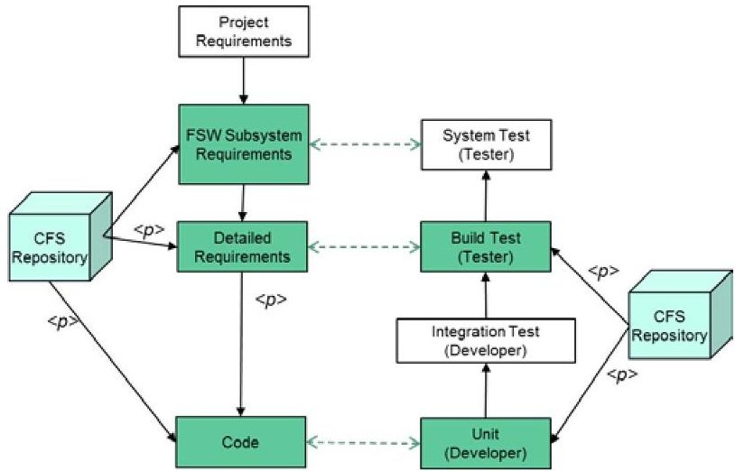
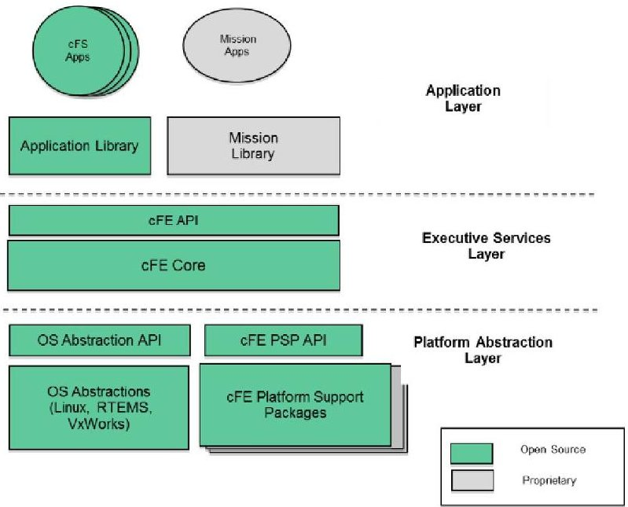
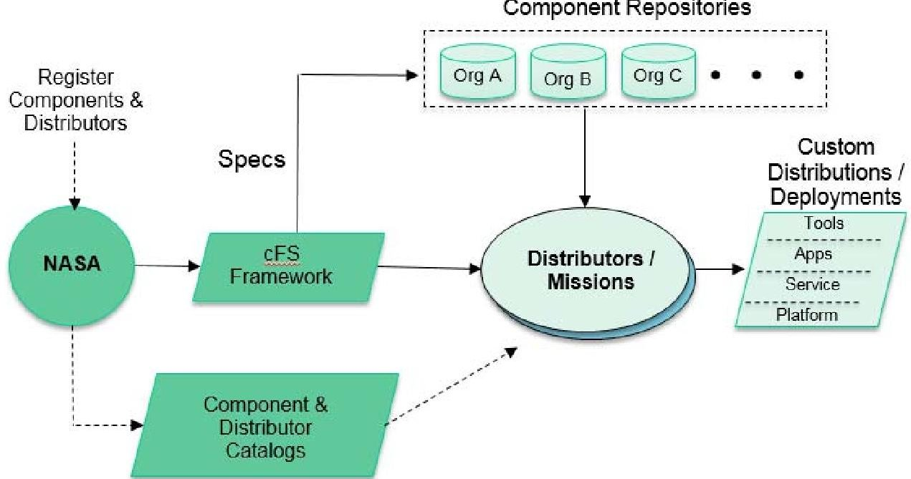
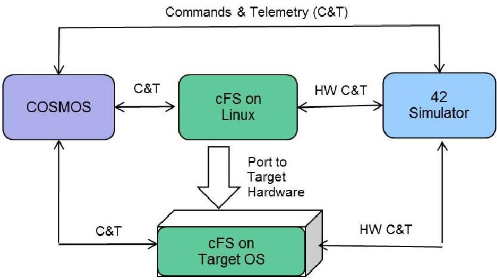
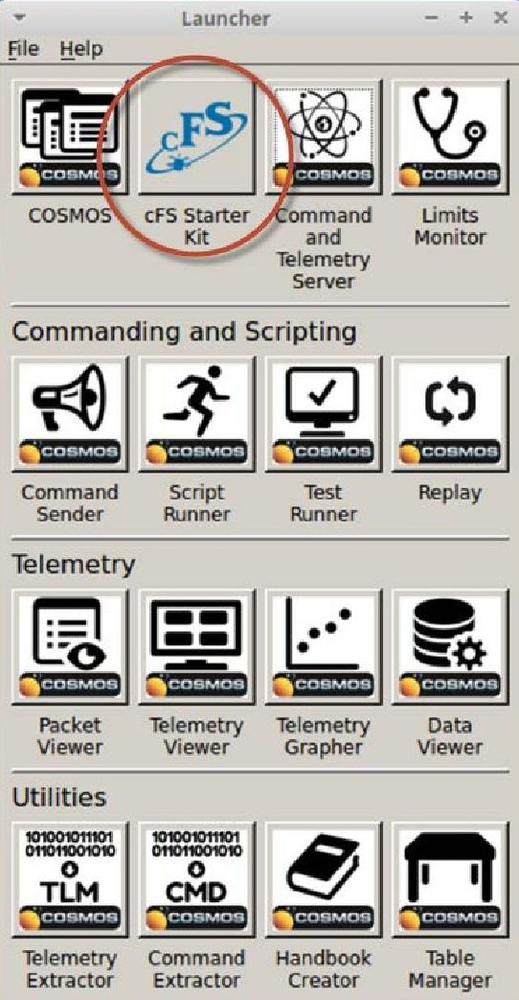
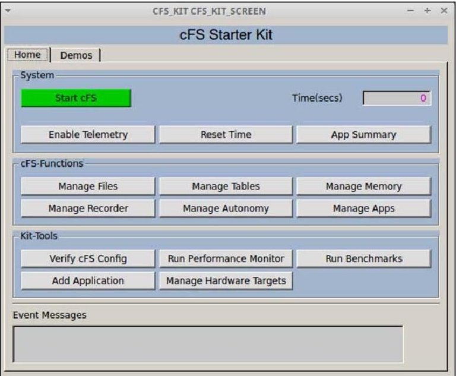
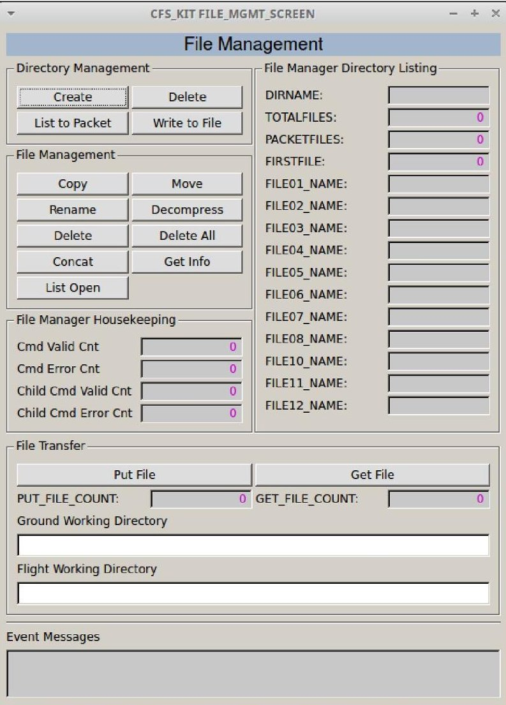
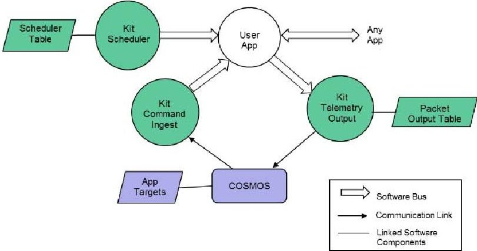
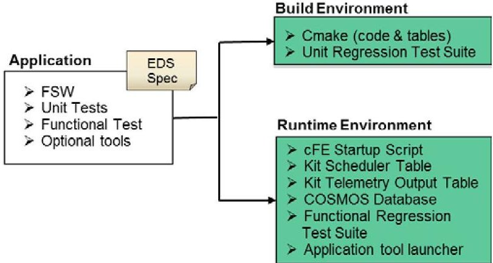

<!-- PDF_PAGE: 1 -->

# Increasing Flight Software Reuse with OpenSatKit

David McComas

NASA

Goddard Space Flight Center

8800 Greenbelt Rd.

Greenbelt, MD 20771

301-286-9038

David.C.McComas@nasa.gov

Abstract—In January 2015 the National Aeronautics and Space Administration (NASA) Goddard Space Flight Center (GSFC) released the core Flight System (cFS) as open source under the NASA Open Source Agreement (NOSA) license. The cFS is based on flight software (FSW) developed for 12 spacecraft spanning nearly two decades of effort. The cFS can provide about a third of the FSW functionality for a low-earth orbiting scientific spacecraft. The cFS is a FSW framework that is portable, configurable, and extendable using a product line deployment model. However, the components are maintained separately so the user must configure, integrate, and deploy them as a cohesive functional system. This can be very challenging, especially for organizations with minimal FSW development experience, such as universities, that are building CubeSats. This paper describes the OpenSatKit $ ^{[2]} $ that was developed to address the cFS deployment challenges and to serve as a cFS training platform for new users.

OpenSatKit provides a fully functional out-of-the box software system that includes NASA's cFS, Ball Aerospace's command and control system COSMOS, and a NASA dynamic simulator called 42. The kit is freely available, since all of the components have been released as open source. The kit runs on a Linux platform. It includes eight cFS applications, several kit-specific applications, and built in demos that illustrate how to use key application features. It also includes the software necessary to port the cFS to a Raspberry Pi and instructions for configuring COSMOS to communicate with the target. All of the demos and test scripts can be rerun unchanged with the cFS running on the Raspberry Pi.

OpenSatKit can serve two significant architectural roles that will further help the adoption of the cFS and help create a community of users that can share assets. First, the kit is being enhanced to automate the integration of applications with the goal of creating a virtual cFS 'App Store'. Second, a platform certification test suite can be developed that would allow users to verify the port of the cFS to a new platform. This paper will describe the current state of these efforts and plans for the future.

## TABLE OF CONTENTS

2. CORE FLIGHT SYSTEM...1

3. OPENSATKIT ...4

4. FUTURE WORK ...7

5. SUMMARY ...7

ACKNOWLEDGEMENTS ...7

REFERENCES ...7

BIOGRAPHY ...8

## 1. INTRODUCTION

The NASA Goddard Space Flight Center (GSFC) released its Core Flight System (cFS) as open source in 2015 $ ^{[1]} $ . The cFS is a very mature and highly reliable FSW framework that is being used on several operational NASA Class B missions. This paper describes the cFS architecture and how the cFS platform abstraction and application components are independently configuration managed. It also describes how the cFS's open architecture requires either an end user or a distributor to configure and integrate the components into an operational system.

OpenSatKit $ ^{[2]} $ is presented as a freely available open source solution to the cFS integration and deployment problem. The kit includes eight preconfigured cFS applications and provides tools for creating and integrating additional applications. Starting with an operational flight-ground system makes the FSW developer's job much easier. Developers can focus on tailoring the kit's cFS components to their needs, adding new mission-specific applications, porting the cFS to their target platform, and verifying the system.

## 2. CORE FLIGHT SYSTEM

This section provides an overview of core Flight System and describes architectural highlights, its open architecture, and the product model.

## Overview

The core Flight System $ ^{[1]} $ (cFS) is a reusable flight software (FSW) framework developed by the NASA Goddard Space Flight Center's (GSFC) Flight Software Systems Branch (FSSB) over the past 15 years. The cFS was developed because previous GSFC FSW reuse efforts had limited success in reducing cost and schedules. Early reuse efforts used a "clone and own" approach where a new project would copy FSW components from one or more previous missions based on functional requirement similarities. This informal source-code based approach to reuse proved difficult for managers to control the scope of the changes and as a result, a comprehensive verification and validation effort had to be performed for the new mission, which severely limited the cost savings. In addition, since FSW components were not configuration managed independent of projects, component

U.S. Government work not protected by U.S. copyright

<!-- PDF_PAGE: 2 -->

quality did not necessarily increase because a single lineage for each component was not maintained.

To meet these challenges the FSSB formed a team of senior engineers to perform a structured heritage analysis across a decade of missions. The initial funding was from nonmission sources, which allowed the engineers to participate uninhibited by near-term mission schedules. The diversity of the heritage missions (single string vs. redundant string, varying orbits, different operational communication scenarios, etc.) provided valuable insights into what drove FSW commonality and variability across different missions.

The team took the entire FSW life-cycle into consideration, including in-orbit FSW sustaining engineering, as they performed their analysis. The team identified system and application level variation points to address the range and scope of the flight systems domain. The goal was to enable portability across embedded computing platforms and to implement different end-user functional needs without the need to modify the source code.

The cFS uses compile-time configuration parameters to implement the variation points. Figure 1 below shows the results using a classic software engineering "V-model". The shaded components are cFS artifacts and the 
 notation indicates a parameterized artifact.

Figure 1. The cFS-Based Project FSW Lifecycle

This lifecycle product line approach dramatically increased the number of reusable artifacts and changed how future missions would approach their FSW development efforts.

## Architectural Highlights

While a majority of the heritage analysis focused on FSW functional features a significant and conscious effort was made to address the cFS's architectural quality attributes $ ^{[3]} $ Quality attributes are hard to quantitatively trade but they can ultimately determine the success or failure of a software product line. The prominent quality attributes balanced by the cFS include portability, performance, reusability, usability, scalability, interoperability, verifiability, complexity, and predictability.

Design Decisions—Design meetings, trade studies, and code reviews were used to create a consistent architectural quality attribute balance. Two key trade studies were performed to determine whether to support file systems and whether to support both static and dynamic linking.

Figure 2. The cFS Layered Architecture

At the time of the cFS formulation, these were difficult trade studies because to date no GSFC missions had flown a file system and dynamic linking was not supported by all of the operating systems being considered by new missions. The results of the trade studies were to include file system support and to support both static and dynamic linking. These decisions have proven to be vital to the cFS's reusability, usability, and interoperability, which has been very beneficial to the ever-expanding user base.

API-Based LayersTwo additional pivotal cFS architectural features are the Application Program Interface (API)-based layers and the definition of an application as a distinct welldefined architectural component. Figure 2 above illustrates the three distinct layers and identifies which components have been released as open source.

Layer 1 contains the Operating System (OS) and Board Support Package (BSP) and access to the functionality in these components is controlled through two APIs: the Operating System Abstraction Layer (OSAL $ ^{[3]} $ ) and the Platform Support Package (PSP).

The OSAL and PSP APIs provide a platform independent (OS and hardware) interface that provides common OS and BSP services. The Platform Abstraction Layer has been very successful in decoupling the higher layers from hardware and OS implementation details allowing the cFE and applications to be run unchanged on a wide range of platforms.

Layer 2 contains the core Flight Executive (cFE) that provides five services that were determined to be common across most FSW projects. The APIs in Layers 1 and 2 have been instrumental in the cFS's success across multiple platforms and the cFE API has remained functionally

<!-- PDF_PAGE: 3 -->

unchanged since the launch of the Lunar Reconnaissance Orbiter in 2009. Together the APIs define an application runtime environment for the applications $ ^{[3]} $ in Layer 3. The application layer contains thread-based applications as well as libraries (e.g. linear algebra math library) which can be shared among multiple applications.

Application as a PluginThe second pivotal architectural feature is the definition of an application as a plug-in component. The cFE enables this feature by providing a core set of services, a runtime environment, and a tool suite for building and hosting flight software applications.

cFS Tables are binary files containing groups of application defined parameters that can be changed during runtime. The Table service provides a ground interface for loading and dumping application tables.

Core ServicesThe core services include a Software Bus (messaging), Time Management, Event Messages (alerts), Table Management (runtime parameters), and Executive Services (startup and runtime). The Software Bus provides a publish-and-subscribe Consultative Committee for Space Data Systems (CCSDS) $ ^{[6]} $ standards-based inter-application messaging system that supports single and multi-processor configurations. Time Management provides time services for applications.

Runtime Environment Executive Services provide the runtime environment that allows applications to be managed as an architectural component. All of the services contain tunable compile-time parameters allowing developers to scale the cFE to their needs. The cFS manages non-volatile storage using a file system and it uses a script file to determine which application object files should be loaded during initialization. In turn applications subscribe to cFE services during their initialization.

The Event Message service allows applications to send timestamped parameterized text messages. Four message classes based on severity are defined and filtering can be applied on a per-message and per-class basis.

On-Orbit MaintenanceSince cFE resources are managed on a per-application basis the cFE supports starting, stopping, and loading individual applications during runtime. This allows applications to be developed independent of the platform, very similar to how apps are managed by smart phones. It can also simplify on-orbit maintenance as demonstrated by the Global Precipitation Measurement (GPM) FSW sustaining engineering team in the fall of 2014 when they successfully replaced the file transfer application without disrupting normal science operations.

## Open Architecture

The cFS is an open architecture that defines a framework with a product line deployment model. Separately configuration managed components are integrated into an operational system.

Configured Items—Working up the layers in Figure 2, the configured items are the OSAL, the cFE, and each application. PSPs are developed for specific hardware-OS platforms and are currently bundled with the cFE. Configuration parameters are tuned on a per-component basis as well as for the integrated system.

Table 1 below provides metrics for the cFS as it is being used on GSFC's GPM mission that launched on February 27, 2014. These metrics are representative of the current versions of the cFS components. They have only undergone minor updates since the final build of GPM, so they provide a good reference point for future missions.

Table 1. GPM cFE/Application Metrics

<table border="1"><tr><td>cFE/App</td><td>LogicalLines of Code</td><td>ConfigurationParameters</td></tr><tr><td>cFE</td><td>12930</td><td>General:17Executive Service:46Event Service:5Software Bus:29Table Service:10Time Service:32</td></tr><tr><td>CFDP</td><td>8559</td><td>33</td></tr><tr><td>Checksum</td><td>2873</td><td>15</td></tr><tr><td>Data Storage</td><td>2429</td><td>27</td></tr><tr><td>File Manager</td><td>1853</td><td>22</td></tr><tr><td>Health&amp;Safety</td><td>1531</td><td>45</td></tr><tr><td>Housekeeping</td><td>575</td><td>8</td></tr><tr><td>Limit Checker</td><td>2074</td><td>13</td></tr><tr><td>Memory Dwell</td><td>1035</td><td>8</td></tr><tr><td>Memory Manager</td><td>1958</td><td>25</td></tr><tr><td>Scheduler</td><td>1164</td><td>19</td></tr><tr><td>Stored Command(124 command sequences)</td><td>2314</td><td>26</td></tr></table>

Configuration Parameters-A configuration parameter is defined with either a mission scope or a processor scope. For example, the maximum length of an event message is defined at the mission level and the "include local event log" is defined at the processor level.

The metrics in Table 1 above are provided to give a general sense of the level of tenability. It's hard to gauge the configuration complexity with simply a number because the parameters span a large functional range from a simple default file name to a system behavioral definition like the time client/ server configurations.

<!-- PDF_PAGE: 4 -->

Figure 3. The cFS Product Model

## Product Model

The cFS has successfully demonstrated many of the initial architectural quality attributes, but usability, which in turns impacts reusability, has been challenging. NASA does not maintain a component library with a standard deployment model where users can select, tune, and integrate components into an operational system. A private company such as Apple that controls the hardware and software platform for apps in a very large ecosystem can create a viable market place. Government organizations operate under different financial models and legal constraints therefore a centralized government controlled library is not feasible. The cFS situation is actually more complex than Apple's because the cFS framework supports an expanding number of platform abstractions as well as apps. As new Platform Abstraction Layers are created, who should certify them and maintain them? Similar questions need to be answered regarding apps.

The cFS has evolved from a NASA Goddard vertically integrated platform $ ^{[1]} $ to an open source ecosystem $ ^{[4]} $ resulting in the cFS product model shown in Figure 3 above. A NASA multi-Center Configuration Control Board (CCB) controls the cFS Framework that contains the Platform Abstraction Layer APIs, a limited set of implementations of those APIs, the cFE, test applications, build tools, and specifications for developing OSALs, PSPs, and applications. The CCB could be thought of as an API standards board with reference implementations. Independent of the CCB, NASA has established catalogs of cFS components and distributors $ ^{[5]} $ NASA does not vet the suppliers listed in the catalogs. Distributors combine the cFS Framework with additional cFS components to create functional systems. OpenSatKit serves as a cFS distribution.

A goal of the cFS product model is to encourage organizations to create distributions tailored for a specific

user group. Although not promoted as cFS distributions, two additional NASA efforts that combine cFS components into an operational system could be considered distributions.

One such effort is the NASA Operational Simulator for Small Satellites $ \left( \mathrm{N O S}^{3} \right)^{[9]} $ that is designed to support FSW throughout the spacecraft lifecycle. $ \mathrm{N O S}^{3} $ also uses COSMOS, cFS, and 42. However, they have a "NOS Engine" that supports simulated hardware components early in the spacecraft lifecycle and actual hardware components during spacecraft integration and test.

The other effort is a training package released by the NASA Johnson Space Center called CFS-101 $ ^{[10]} $ . This package is strictly for training. It only includes the cFS "lab apps" and uses a small Python command and telemetry ground system.

## 3. OPENSATKIT

This section provides an overview of OpenSatKit, and describes cFS application management and system integration and verification.

## Overview

OpenSatKit provides a fully functioning flight-ground system running on Ubuntu Linux 16.04 LTS $ ^{[2]} $ . Currently the installation script only supports Ubuntu Linux, but the kit is designed to run on other Linux platforms. The starter kit components are shown in Figure 4 below. Ball Aerospace's COSMOS $ ^{[6]} $ , a user interface for command and control of embedded systems, is used as the ground system. The cFS running on Linux provides a desktop FSW component. The 42 Simulator $ ^{[7]} $ provides a simulation of spacecraft attitude and orbit dynamics and control. All of these components are freely available as open source software.

<!-- PDF_PAGE: 5 -->

Figure 4. Starter Kit Block Diagram

Launching OpenSatKit—OpenSatKit is started by launching COSMOS from the cfs-kit/cosmos directory. A customized COSMOS Launcher Graphical User Interface (GUI) appears. The customized launcher is the standard COSMOS Launcher with the addition of a cFS Starter Kit button as shown in Figure 5 below.

Figure 5. Custom COSMOS Launcher

When the user selects the cFS Starter Kit icon, COSMOS' Command and Telemetry Server and Telemetry Viewer tools launch, as they are required by the kit. The OpenSatKit main page shown in Figure 6 below also opens.

Figure 6. Starter Kit Main Page

GUI—The main page layout reflects the primary goals of the kit: provide a complete cFS system to simplify the cFS learning curve, simplify application development and integration into a cFS system, and assist in porting the cFS to a new platform. The main page has two tabs: Home and Demo. The Home tab provides buttons to perform all of the kit's functions. The Demo tab provides preconfigured demonstrations for most of the Home tab's functions.

Home The Home tab is divided into four sections: (1) System, (2) cFS-Functions, (3) Kit-Tools, and (4) Event Messages. The System section allows the user to start the cFS and perform some simple system level operations to ensure that the system is functioning properly. Each button in the cFS-Functions section opens a command and telemetry page that allows the user to focus on a particular cFS functional activity that requires one or more apps. For example, the File Management page (Figure 7 below) is used to manage onboard directories/files using the File Manager (FM) app and transfer files between COSMOS and the cFS using the Trivial File Transfer Protocol (TFTP) app.

Built-In DemosThe Demo tab contains a demo for each of these functional areas. The cFS-Function pages and corresponding demos help users conquer the cFS learning curve. In addition, the page definitions and underlying Ruby scripts provide examples that users can build upon for their mission-specific applications.

Kit-Tools—The Kit-Tools section provides tools that assist the user with verifying a platform, evaluation a platform's performance, integrating additional applications to the kit, and porting the cFS to a new target. The current kit includes a Raspberry Pi target.

<!-- PDF_PAGE: 6 -->

Figure 7. File Management Page

## cFS Application Management

The application layer is where the majority of the cFS scalability and extendibility occurs. Users create new mission FSW by partly or completely reusing existing cFS compliant apps and combining them with apps that are developed specifically for the mission. Just as the cFE provides common FSW services, there is a set of apps that provide common higher level functional services. Figure 8 below shows the minimal context for a user app on a single processor system. The Scheduler (SCH), Command Ingest (CI), and Telemetry Output (TO) apps provide the higher level services.

Figure 8. User Application Context

Apps must have the ability to receive commands from and send telemetry to the ground system. The Command Ingest

app receives commands from the ground and sends them on the software bus. The software bus uses the command message identifier to route the command to the app that has subscribed to the message id. An app also generates one or more telemetry packets and sends them on the software bus. The Telemetry Output app uses a table to determine message IDs to which to subscribe, and how often to forward them to the ground system.

Scheduler AppUsers have multiple mechanisms for controlling the execution of an application. The Scheduler app (SCH) provides a time-synchronized mechanism for scheduling application activities. The Scheduler app uses a table to define time slots to schedule the sending of a message that users can use to initiate an activity. Activities can be scheduled to occur faster or slower than every second. Even if an app's execution is data driven (.i.e. pends for one or more data packets to start its execution) it is often convenient to use the scheduler as a control mechanism for scheduling the sending of time-based "housekeeping" telemetry.

Kit Apps—The service apps in Figure 3 above are identified as "kit" apps because they have been specifically designed for the kit. The kit apps use text files for tables (cFS apps use binary files) that simplify the automation of integrating a new app into the kit. The kit scheduler has not been qualified for flight, so a user must transition from the kit SCH to the cFS SCH app. The cFS only provides the CI_LAB and TO_LAB apps, which are also not flight qualified. Therefore, the kit apps do not create additional work since every user must develop their own CI and TO apps.

Application Generation Tool—OpenSatKit provides an application generation tool that creates a "hello world" app. In addition to the FSW source code the tool generates an initial unit test; an initial build test; a COSMOS command definition file for the no operation and reset app commands; a COSMOS housekeeping telemetry definition file; and an installation script.

Automating App Kit Integration-All of the metadata required to integrate an app into the kit has been identified. If app suppliers can supply this data in a standard format then the process of integrating an application into the kit could be automated.

An effort is underway that will accomplish this automation goal. The CCSDS Spacecraft Onboard Interfaces Services (SOIS) Electronic Data Sheet (EDS) defines a layered description of a hardware or software component interface in a machine-readable format $ ^{[8]} $ . EDS provides a standard exchange mechanism for device and software interface definitions. The cFS team is incorporating EDS developer tools and specifications into the cFS Framework and component specifications. Once this is complete the logistic of implementing a distributed "app store" and automated application integration into OpenSatKit can be implemented.

Figure 9 below shows the application workflow using EDS specifications. The application could be an existing reusable

<!-- PDF_PAGE: 7 -->

application or a new user application. Applications are packaged with the FSW, unit tests, functional tests compatible with the COSMOS scripting environment, and optional support tools. A tool to generate or display a complex table is an example of a support tool.

Figure 9. EDS Application Workflow

The EDS spec needs to specify enough information to have the application automatically integrated into the kit's build environment so the application will be built and its unit tests run as part of the unit regression test suite.

The EDS spec also needs to define all of the runtime requirements. This includes the cFE startup script, which defines apps to be run; the kit component data files, which include scheduler table, telemetry output table, and COSMOS target, which provide an application runtime environment (see Figure 8); a functional test that verifies the app; and optional tools for application-specific data management.

## System Integration and Verification

OpenSatKit provides multiple levels of support for verifying the initial installation of the kit, adding applications, and deploying the cFS to a target platform. The "Verify cFS Config" button on the home page runs a test script that verifies all of the preconfigured OpenSatKit apps are integrated into the system. The script is designed using COSMOS's Test Runner framework so new applications can easily be added and removed. This same script can be run after the cFS is ported to a new platform to verify all of the apps are still running as expected.

Test Suite Framework—An application functional test suite framework is also included with the kit. This test suite also uses COSMOS' Test Runner framework. These tests are intended to verify the functional requirements for each application. The cFS functional tests have not been translated to run within the COSMOS Ruby scripting environment.

## 4. FUTURE WORK

application EDS model is defined OpenSatKit can be updated to support automated application integration.

After the NASA cFS team integrates EDS into the cFS tool chain and artifacts, an application metadata model can be defined. This definition should be maintained by the NASA cFS CCB in order to maintain a cFS standard. Once the

There are multiple efforts that could be done to improve the verification and validation processes associated with porting the cFS to a target platform. First, the kit currently includes a benchmark app. The goal of this app is to allow a user to run a consistent benchmark test suite on different targets. The benchmark app is a prototype and needs to be matured. Second, a platform test app can be written that would verify the platform abstraction is functioning properly. Third, the cFS functional tests should be translated to run within the kit's functional test suite framework.

## 5. SUMMARY

This paper described cFS architecture and how the cFS platform abstraction and application components are independently configuration managed. The cFS open architecture model requires either an end user or a distributor to configure and integrate the components into an operational system.

The cFS is a very mature and highly reliable FSW system that has been used on several NASA Class B missions $ ^{[5]} $ . It would therefore be quite beneficial to the aerospace community to make the cFS more accessible.

OpenSatKit was presented as a freely available open source solution to this problem. It includes eight preconfigured cFS applications and provides tools for creating and integrating additional applications,

## ACKNOWLEDGEMENTS

The author acknowledges and thanks the cFS community for its hard work and dedication towards maturing the cFS by contributing ideas, applications, and tools. The author would also like to thank the Johnson Space Center's Advanced Exploration Systems project for its financial support of the cFS.

## REFERENCES

[1] National Aeronautics and Space Administration, Flight Software Systems Branch, cFS Overview 2017, http://cfs.gsfc.nasa.gov/Introduction.html

[2] OpenSatKit Download Site, 2017 http://opensatkit.github.io

[3] Jonathan Wilmot, Lorraine Fesq, Dan Dvorak "Quality Attributes for Mission Flight Software: A Reference for Architects," http://resources.sei.cmu.edu/library/assetview.cfm?assetid=454600.

[4] Herman Hartman, Chapter 3 University of Groningen thesis "Software Product Line Engineering for Consumer Electronics".

<!-- PDF_PAGE: 8 -->

[5] cFE Component Catalog, 2017 http://coreflightsystem.org

[6] Ball Aerospace COSMOS Website, 2017 http://cosmosrb.com/

[7] 42 Simulator Website, 2017 https://sourceforge.net/ projects/fortytwospacecraftsimulation/

[8] CCSDS XML Specifications for Electronic Data Sheets for Onboard Devices and Software Components, 2015, http://cwe.ccsds.org/fm/Lists/Projects/DispForm.aspx?ID =269

[9] NASA Operational Simulator for Small Satellites, 2017, http://www.stf1.com/simulation.php

[10] cFS 101, 2017, https://github.com/nasa/CFS-101

## BIOGRAPHY

David McComas received a M.S. in Computer Engineering from the Johns Hopkins University Applied Physics Lab, Laurel in 1991. He has been with the NASA GSFC for 32 years. He spent the majority of his career working on flight software FSW for in-house spacecraft and instruments in various roles including developer, tester,

technical team lead, and product development lead. These roles included both Command and Data Handling (C&DH) FSW, Guidance Navigation and Control (GN&C) FSW, and simulator development. He currently serves as the cFS Program Manager.