<!-- PDF_PAGE: 1 -->

# Initial Flight Assessment of the Radio Aurora Explorer

James W. Cutler, John C. Springmann, Sara Spangelo University of Michigan 1320 Beal Avenue, Ann Arbor, MI, 48019; 734-615-7238 jwcutler@umich.edu

Hasan Bahcivan SRI International 333 Ravenswood Avenue, Menlo Park, CA 94025; (650) 859-2000 hasan.bahcivan@sri.com

## ABSTRACT

We present initial flight data from the first Radio Aurora Explorer (RAX) satellite. Launched on 20 November 2011, RAX-1 was a joint venture between the University of Michigan and SRI International. Its primary mission objective was to study small-scale plasma density irregularities in the Earth's ionosphere. Several electrostatic ion plasma instabilities are known to spawn magnetic field-aligned irregularities (FAI), or dense plasma clouds that can disrupt communication between Earth and orbiting spacecraft. The RAX mission utilized a bistatic radar configuration; the RAX spacecraft is the radar receiver and the transmitters are several world-wide incoherent scatter radars. The primary radar is located in Poker Flat, Alaska. We describe initial flight results from the mission. The radar receiver was successfully operated and performed better than estimated on orbit. RAX-1 bus performance was also successful except for the solar power generation system. A systematic fault in the panels resulted in loss of power about sixty days into the mission. Despite this failure, RAX-1 demonstrated that novel science is possible and useful on small nanosatellite platforms. We describe lessons learned from the mission. We also give a brief overview of our continued development effort on the RAX mission in preparation for a late 2011 launch of a second spacecraft, RAX-2.

## INTRODUCTION

The Radio Aurora Explorer (RAX) is the first of several nanosatellites sponsored by the National Science Foundation (NSF) to study space weather. The RAX mission is a joint effort between SRI International in Menlo Park California and the University of Michigan in Ann Arbor Michigan. The payload was developed at SRI, and the satellite bus was developed in the Michigan Exploration Laboratory (MXL). There are currently two satellites in the RAX mission.

RAX's primary mission objective is to study small-scale plasma irregularities in the ionosphere. Plasma instabilities generate geomagnetic field-aligned irregularities (FAI) known to disrupt communication and navigation signals between Earth and the orbiting spacecraft. To study FAI, the RAX satellites utilize a large incoherent scatter radar in Poker Flat, Alaska (known as PFISR). PFISR transmits powerful radio signals into the plasma instabilities that are scattered into space. During that time, the RAX spacecraft, in low Earth orbit, will record

the scattered signals with an onboard receiver. These signal recordings will be processed by an onboard computer and transmitted back to our ground stations where scientists will analyze them.

The goal of this RAX mission is to enhance our understanding of FAI formation so that short-term forecast models can be generated. This will aid spacecraft operators with planning their mission operations around periods of expected communication disruption.

In this paper, we describe initial flight results from the RAX-1 launch that occurred in late 2010. We give an overview of the RAX science mission, and briefly describe the launch and the first contacts. We then summarize payload performance and flight experiments. Lastly, we describe the bus performance and conclude with a description of the RAX-2 launch scheduled for late 2011.

<!-- PDF_PAGE: 2 -->

## SCIENCE MISSION OVERVIEW

The RAX mission is a UHF radar experiment to remote sense ionospheric plasma properties. It was developed in response to NSF's 2008 CubeSat-based Science Missions for Space Weather and Atmospheric Research. The primary mission goal is to assess the generation and distribution of natural ionospheric irregularities a space weather phenomenon that can severely degrade the performance of communication and navigation assets [1]. Secondary goals include training the next generation of space engineers and monitoring amateur radio frequency bands.

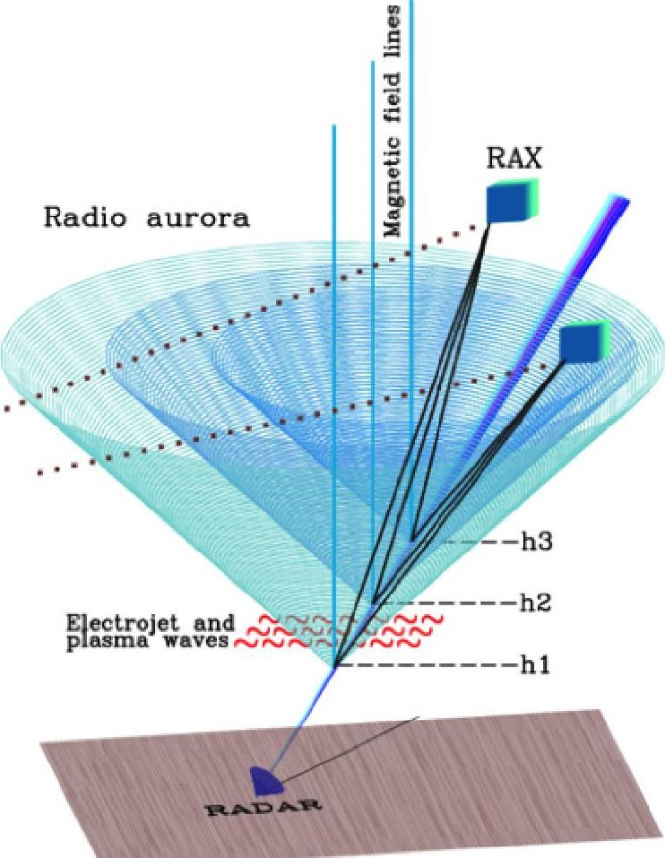

Figure 1: The bistatic radar configuration of the RAX mission. Radar pulses are reflected off the magnetically aligned plasma disturbances. The reflections scatter in cones and are received by the RAX satellite.

For these radar experiments, the RAX mission coordinates globally distributed, megawatt-class ground-based radar observatories with an on-orbit CubeSat radar receiver. This produces a unique radar scattering geometry for characterizing the climatology and evolution of meter-scale ionospheric structures-features inaccessible to ground-based observation [2]. See Figure 1. The RAX-1 satellite is pictured in Figure 2.

The RAX mission will investigate ionospheric irregu Cutler

larities to gain insight into several candidate causal mechanisms (plasma instabilities), only a few of which have been observed by ground-based research radars. By gauging the global spatial distribution of these ionospheric irregularities and their causal geophysical drivers, the RAX mission will advance the state of space weather forecasting.

## LAUNCH

RAX was one of several payloads flown aboard STP S26, the 26th small launch vehicle mission operated by the United States Air Force (USAF) Space Test Program (STP). STP-S26 launched a Minotaur IV rocket, built by Orbital Sciences Corporation, carrying sixteen payloads on six satellites. The five other satellites onboard were STPSat-2, FalconSAT-5, FASTRAC, FASTSAT-HSV01, and O/OREOS [6].

On 20 November 2010, STP-S26 launched into a low Earth, circular orbit approximately 650 km in altitude and $ 72^{\circ} $ inclination. The rocket launched from the Kodiak Launch Complex in Kodiak, Alaska. Initial insertion was into a period of full illumination that lasted

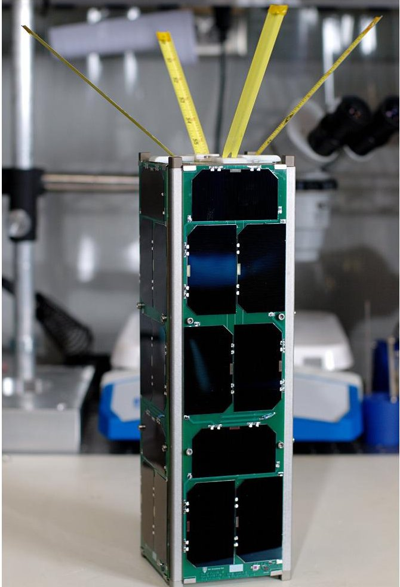

Figure 2: The RAX-1 satellite fully integrated and prior to integration into the Cal Poly P-Pod. The antenna elements require tie down before storage in the P-Pod.

25th Annual AIAA/USU Conference on Small Satellites

<!-- PDF_PAGE: 3 -->

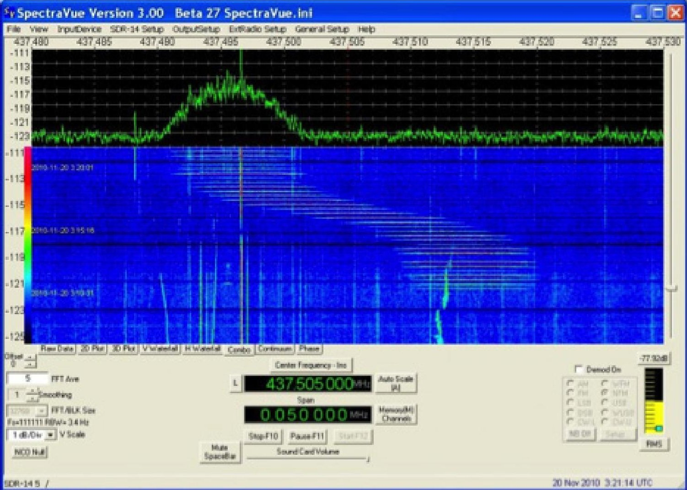

Figure 3: The waterfall spectral plot of RAX beacons as received by a HAM, AH6NM, in Hawaii.

approximately two weeks. Due to orbit perturbations, the RAX-1 then drifted into a period of varying eclipse periods.

## FIRST CONTACTS

Amateur radio operators in Hawaii made first contact with RAX-1 by receiving automated RAX telemetry beacons. Hank Kaul, KH6HAK, used a simple handheld transceiver and a small 7-element yagi antenna to record audio from RAX-1 beacons [3]. Richard Flagg, AH6NM, also from Hawaii, recorded RAX-1 beacons with a software-defined radio and logged the data over time. Figure 3 shows a waterfall plot of signal strength versus frequency over time. The Doppler shift in the signal is clearly evident.

Primary operations commenced at the University of Michigan in Ann Arbor, Michigan. A student-based operations team tracked RAX-1 during its four to six passes daily. Uplinks were most successful during night passes. A survey of local noise spectrum indicated strong local noise near RAX-1 UHF frequencies during the day.

## PAYLOAD PERFORMANCE

The radar receiver performed extremely well during the RAX-1 experiments. Noise floor characteristics were assessed. Active radar measurements were made with the Poker Flat Incoherent Scatter Radar (PFISR).

Results from on orbit noise floor measurements of the payload receiver were better than any ground based testing prior to launch. Figure 4 shows a spectrum of 50 ms of payload receiver data measured over the Indian Ocean on 08 December 2010. Attitude of the satellite during this experiment has not yet been calculated. The calculated noise power within the $ \pm 50 $ kHz band centered at 0 Hz is -113 dBm. The calculated noise (-113 dBm) was better than the best achieved in the lab and anechoic chamber (-110 dBm). This indicated the receiver and satellite systems were operating extremely well.

A 300s active radar experiment was conducted with PFISR on 10 December 2010. Figure 5 is a plot of the satellite location over time where the blue cross is the radar location on the ground and the red cross is the bore sight location of the radar transmissions at 650 km.

25th Annual AIAA/USU Conference on Small Satellites

<!-- PDF_PAGE: 4 -->

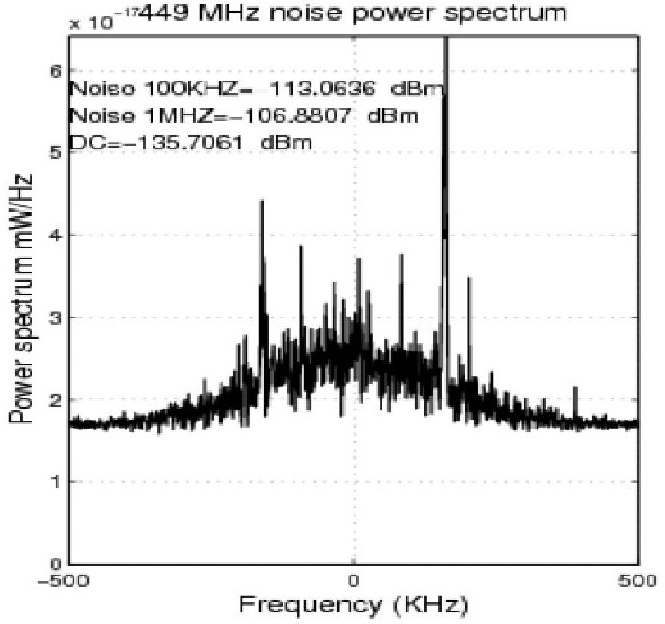

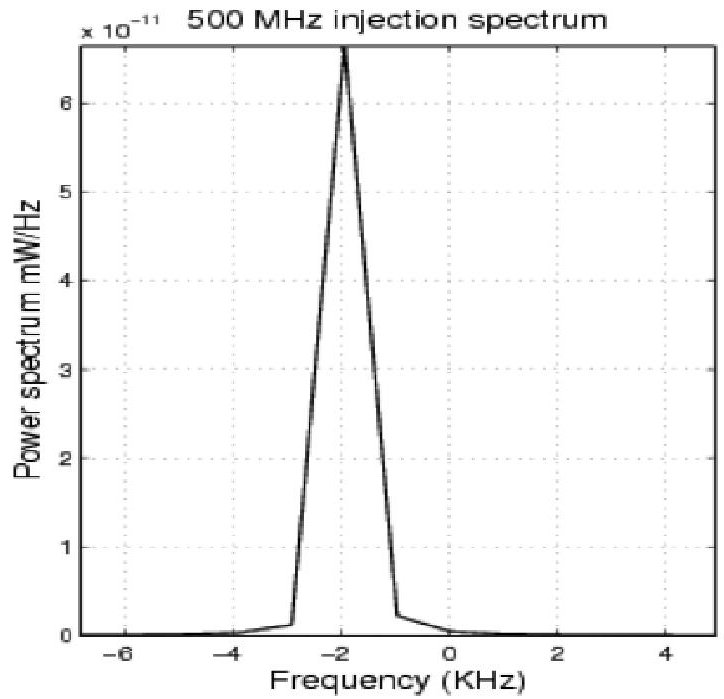

Figure 4: Initial receiver assessments are plotted. On the left, the noise floor of the receiver was measured during a pass over the Indian Ocean. Noise levels in orbit were lower than those achieved on the ground. On the right, a test tone was injected into the receiver at 500 MHz onboard RAX. It matched ground testing. The receiver was fully functional on orbit.

Figure 6 is a range-time-intensity for this experiment. The data is as expected. The direct (PFISR-to-RAX) radar pulses (emanating from radar side lobes) are seen as the intense red line from 50-300s with range delays of 8-10s. The range delay decreases as RAX approaches the radar. The strong signal in the lower left is due to aliasing in the range delay calculations. Disturbances between 0-50s with delays of approximately 5 and 8 ms are due to interference from additional, nearby radar systems. In this experiment, no FAI were detected nor were they expected. Electron density and magnetometer readings indicated very quiet geophysical conditions.

In addition, the receiver recovered from saturation extremely well. Side lobe transmissions from the radar saturate the receiver. It recovers within 100 microseconds thus allowing for low noise measurements of any radar echoes. This feature demonstrates the extremely sensitive and precise sensing capability of the RAX-1 receiver.

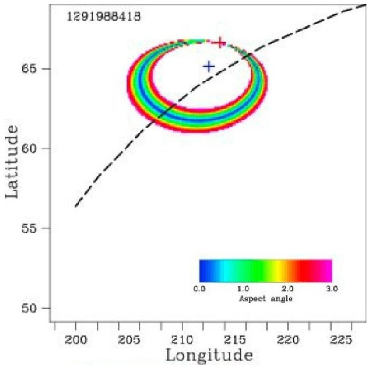

Figure 5: Position information for a RAX radar experiment is shown. The dashed line is the satellite track. The pass was ascending and the satellite moved from bottom left to top right. The blue cross hairs correspond to the PFISR location. The red cross hairs correspond to the direction of transmission. The colored rings are the aspect ratio, an element of the science analysis.

<!-- PDF_PAGE: 5 -->

## BUS PERFORMANCE

We provide a summary of RAX-1 bus systems, which performed nominally except for the solar panels. The systems included the following:

- Low power embedded flight computer based off the MSP430 series of processors.

- UHF and S-Band transceivers.

## Communication

- Position and time system with a real time clock and GPS receiver.

- Attitude determination with an inertial measurement unit and distributed coarse sun sensors and magnetometers.

- Passive magnetic stabilization.

- Instrument data processing unit with a PXA270 microprocessor running Linux.

- Electrical power system with solar power generation and storage with Lithium ion batteries.

## GPS Performance

The Novatel OEMV-1 GPS receiver worked as expected during nominal RAX-1 operations. Figure 7 is a plot of expected GPS satellite signal reception and the actual signal reception by the RAX-1 receiver during operation over Alaska.

The UHF radio system, the AstroDev Li-1, operated nominally. The radio was run at 9600 bps with an output power of 0.5W. Operationally, there was difficulty in communicating with RAX during day passes in Ann Arbor, Michigan. This was attributed to local noise sources. Night passes were reliable. The input filter on the Li-1 was wider than expected and thus no Doppler correction was needed on the uplink frequency. RSSI was monitored during the mission and peak values were greater than -80 dBm during non-experimental times.

The S-Band Microhard MHX-2400 was not operated on RAX during flight. Given the power anomaly and the complexity in operating a dish to support the Microhard only UHF communication was used.

## Attitude Determination System

Attitude determination is critical for RAX mission success. To correctly characterize FAI, the antenna pointing direction must be known with an accuracy of $ 5^{\circ} $ , a derivative requirement from the science objectives and implementation characteristics of the RAX radar-receiving antenna. This need led to the development of an attitude determination subsystem that utilizes a three-axis

RAX-PFISR RTI (SNR) 2010/12/10 13:40:18 UT

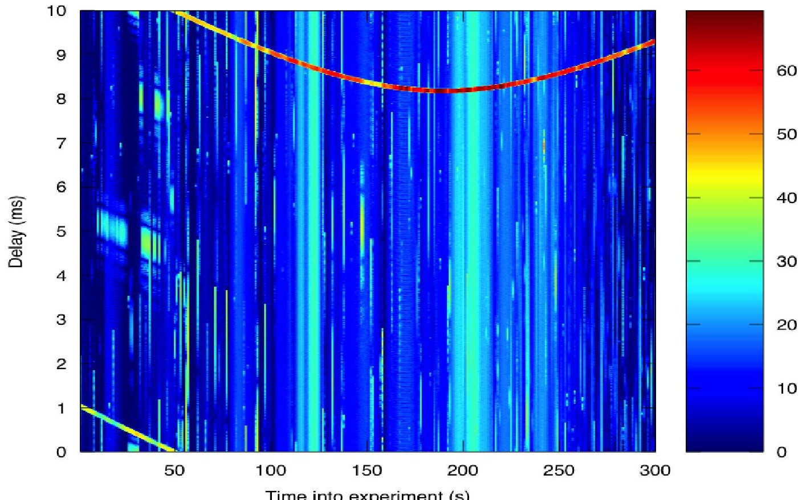

Figure 6: A data plot generated onboard RAX during processing of a typical experiment. The range delay from transmission to reception is plotted as a function of time for a 300 s experiment. The color corresponds to signal to noise ratio.

<!-- PDF_PAGE: 6 -->

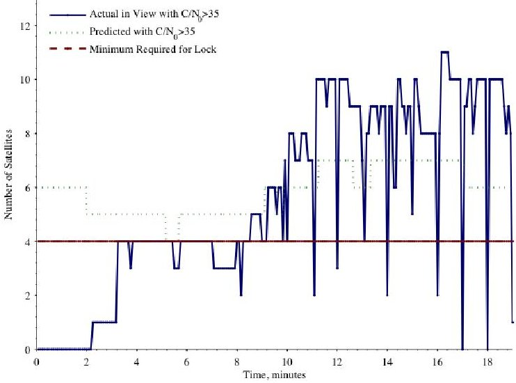

Figure 7: A plot of simulated versus actual number of GPS satellites in view with a sufficient carrier to noise ratio to maintain lock (C/N>35) relative to the RAX GPS receiver during a GPS check-out test over Alaska. There must be a minimum of four GPS satellites with a sufficiently strong signal to maintain GPS lock.

rate gyro, multiple magnetometers, coarse sun sensors (photodiodes), and an extended Kalman filter.

The RAX-1 magnetometer suite consisted of two internally mounted tri-axial magnetometers and four dual axis magnetometers mounted on external faces of the satellite. The internal magnetometers were calibrated using a novel, scalar based method that involved simple rotations of the satellite in a known magnetic field during ground calibration [4]. Once on orbit, calibration was applied but the data was susceptible to satellite-induced noise. A novel on-orbit calibration method was developed that used the IGRF magnetic field model [5] and current satellite measurements. The majority of the on-orbit noise was coming from electric current loops in the satellite, and noise was significantly reduced to just above the noise floor of the sensor itself. Results are plotted in Figure 8. External magnetometer data has not been processed due to its inherent lower resolution and higher noise floors.

Coarse, single-axis sun sensors on each of the six faces of the RAX spacecraft compliment magnetometer measurements. These sensors are photodiodes that measure the angle between the sun and the normal direction of the sensor. Three illuminated, non-parallel sensors are needed for a unique sun vector measurement. The sensors have a conical field of view with a half-angle of $ 7 0^{\circ} $ Since the sensors are mounted to the six orthogonal faces of the satellite, a complete sun vector measurement is not possible for all attitudes. See Figure 9.

Without three illuminated sun sensors, it is not possible to estimate a unique attitude solution from the sun sensors and magnetometers alone, but the illuminated sun sensors, regardless how many are available, are used in the extended Kalman filter. The extended Kalman filter is a recursive estimation technique that fuses the gyro measurements with the sun and magnetometer measurements. Sun sensor measurements improve the accuracy of the filter compared to filtering with only magnetometer and gyro measurements. The accuracy of the attitude estimation using the extended Kalman filter is between $ 2^{\circ} $ and $ 4^{\circ} $ , depending on the number of illuminated sun sensors, and degrades to approximately $ 8^{\circ} $ with no sun sensors illuminated (eclipse).

The attitude determination subsystem performed nominally throughout the mission with one exception in that the photodiode performance degraded over time. The photodiodes generate current as a function of incidence angle to the sun, and the degradation was manifested by a gradual decrease in the total current output over time. This resulted in an increase of the uncertainty of the sensor due to the decreasing angular resolution.

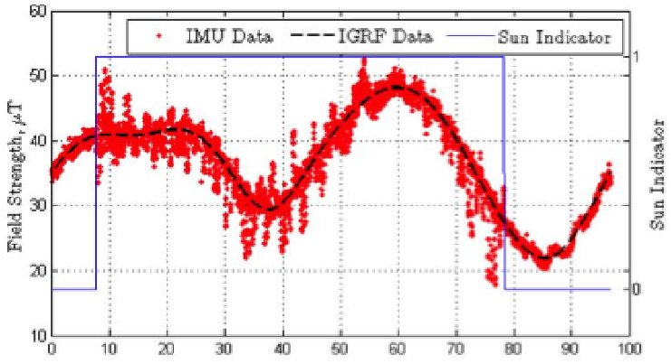

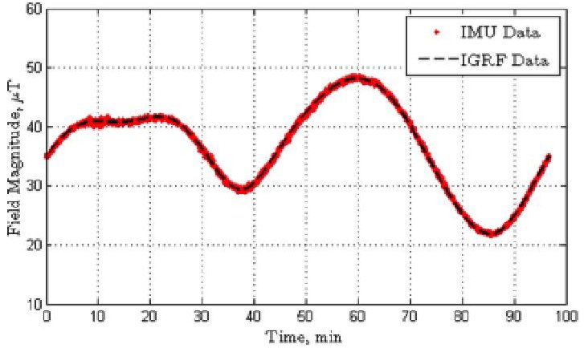

Figure 8: The top plot shows IMU magnetometer data in red plotted against the predicted field by the IGRF model. The blue line indicates whether RAX is in the sun or eclipse. It can be seen that the data is far noisier during times of illumination. The lower plot, solar panel currents are taken into account during on orbit magnetometer calibration. The post processing reduces uncertainty by a factor of 10.

<!-- PDF_PAGE: 7 -->

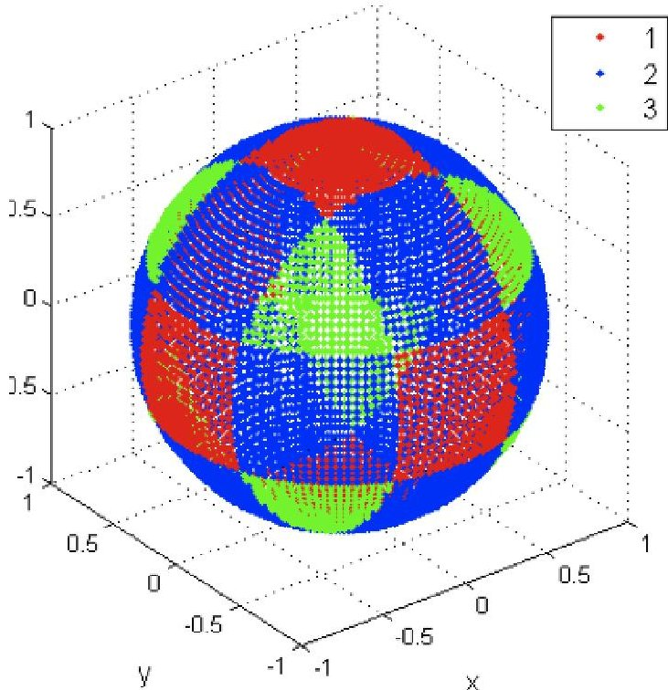

Figure 9: This is the attitude sphere, which is a unit sphere representing all possible satellite orientations. The axes are the directions of the satellite-fixed coordinate system. Each point on the sphere represents a possible direction to the sun in the satellite-fixed frame. The colors on the plot represent the number of illuminate sun sensors for the corresponding sun direction. Green means three sun sensors are illuminated, blue means two, and red indicates that one sun sensors is illuminated. This is a direct result of the fact that there is a sun sensor mounted on each of the six orthogonal faces of the satellite.

Attitude-independent sun sensor calibration algorithms have been developed to estimate the degradation, and the details will be presented in future publications. Estimates show that the degradation in current output was approximately 15% over 40 days. Lab-based testing has shown that the degradation is due at least partly to ultraviolet (UV) radiation. To mitigate this for the RAX-2 mission, coverglass will be used on the sun sensors to block UV radiation. Additionally, more sun sensors will be included and mounted at various angles such that three sun sensors will be illuminated for any attitude.

## Attitude Control System

Attitude control on RAX-1 was a passive magnetic stabilization system with primary magnets to align the spacecraft along the Earth's magnetic field. Hysteresis material was used to dampen out oscillations.

Post deployment from the rocket, the RAX-1 initial rotation rates were $ 1 4^{\circ} / \mathrm{s}, $ $ 2^{\circ} / \mathrm{s}, $ and $ 1 0^{\circ} / \mathrm{s} $ in the X, Y, and Z axes, respectively. The maximum measured angular rates were $ 1 5^{\circ} / \mathrm{s}, $ $ 1 5^{\circ} / \mathrm{s}, $ and $ 1 0^{\circ} / \mathrm{s} $ in the X, Y, and Z axes. It should be noted that these maximum rates did not occur simultaneously in each axis. The magnitude of the angular rates over time is shown in Figure 10.

The RAX-1 rotation dampening took longer than simulated. This has been attributed to saturation of the hysteresis material, due to its close proximity to the primary magnets, such that the rods were saturated and unable to effectively dissipate magnetic energy. Laboratorybased experiments are under way to confirm this result, and upgrades to simulation systems are also occurring to effectively model it. The rotational kinetic energy over time is shown in Figure 11.

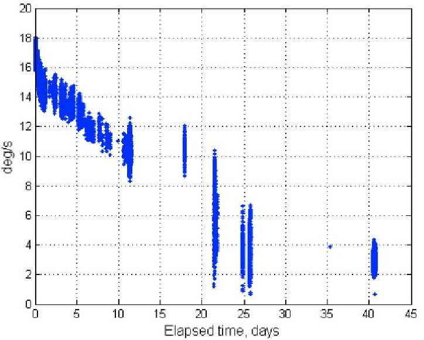

Figure 10: Angular rates ( $ ^{\circ} / \mathrm{s} $ ) versus time (days) over the duration of the mission.

## Power System Performance

The power system consisted of three main components: four body mounted solar panels, an electrical power system (EPS) that regulated solar panel inputs and bus voltage outputs, and a 4.4 Ah lithium-ion battery pack. The EPS and battery systems performed nominally throughout the mission. However, the solar panels systematically degraded throughout the mission resulting in an eventual loss of power.

Degradation of the +Y panel is shown in Figure 12. Power versus sun sensor measurements are plotted where color indicates temperature of the panel. Two sets of data are plotted over the course of 12 days. The plots show that as the mission progressed, the panels produced less power for given sun sensor readings. There was a

<!-- PDF_PAGE: 8 -->

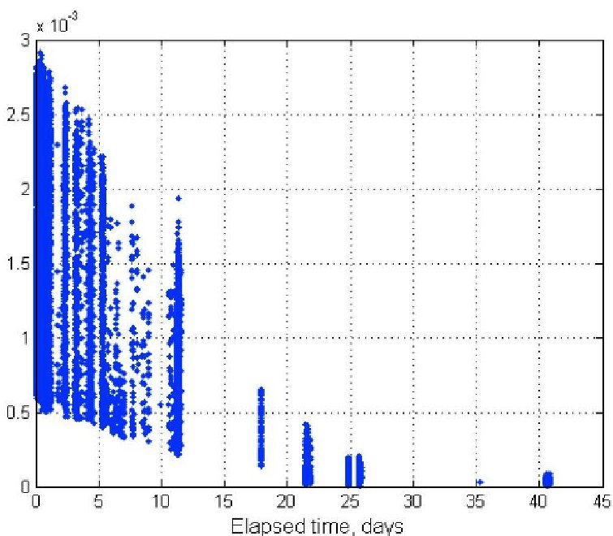

Figure 11: Kinetic energy (J) versus time (days) over the duration of the mission. The energy is computed using the inertia matrix that was measured pre-flight, and the rates are from the gyro measurements.

larger than expected temperature dependence as well; the panel power dropped off at temperatures $ 4 0^{\circ}-5 0^{\circ} \mathrm{C} $ lower than calculated.

After extensive ground testing, it was concluded that the panels experienced gradual degradation on orbit due to cell shorting caused by individual cells on each panel being partially shadowed by the UHF antennas. Because bypass diodes were not connected, the cells experienced a strong reverse voltage bias that destroyed them.

RAX-1 maintained a positive power budget for the first portion of the mission. Power degradation was discovered in late December 2010. Nominal operations were modified to place RAX-1 into an ultra low power operations mode that enabled the batteries to charge at lower power generation levels. Ultimately, the panel degradation was sufficient to halt power production and RAX-1 ceased operation.

## CONCLUSIONS

The RAX mission has successfully demonstrated the functionality of a novel, Cubesat-based bistatic radar experiment capable of exploring ionospheric disturbances. The radar experiment performed as expected. The majority of the bus systems performed as expected as well, including: GPS-based position determination and timing, attitude determination and control, communication, and on board processing. The RAX-1 mission ended prematurely after more than 60 days of operation due to a power system anomaly.

A second RAX satellite, shown in Figure 13, is scheduled to launch 25 October 2011 as part of the ELaNA 3 program sponsored by NASA Kennedy Space Center. Delivery of the flight satellite is scheduled for August 2011. RAX-2 will perform the same mission concept with improved bus performance and additional operational modes. Science measurements will be enhanced through interactive experiments with high power ionospheric heaters where FAI will be generated on demand.

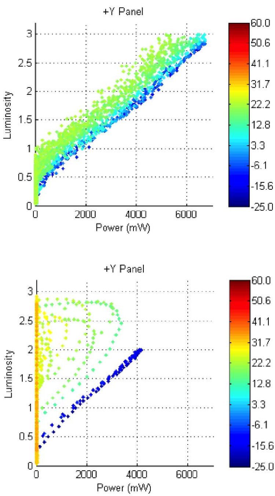

Figure 12: Plots of sun sensor output (Voltage) versus power (mW) for a) 03 December 2010 and b) 15 December 2010. The color of the points corresponds to degrees in C. For b) temperature drastically reduces power output.

<!-- PDF_PAGE: 9 -->

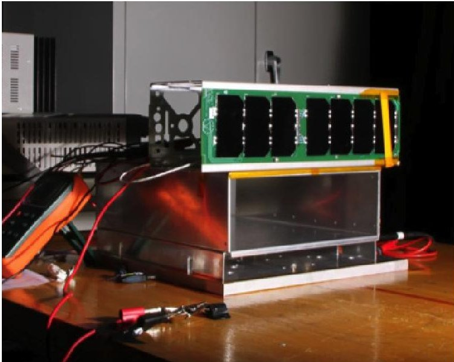

Figure 13: A RAX-2 test panel is pictured during illumination testing. We have partially showed a cell and are testing response and recovery.

## ACKNOWLEDGEMENTS

RAX was funded by the National Science Foundation grant ATM-0838054. STP did a great job launching RAX, thank you! Global HAMs were instrumental in collecting RAX beacons. Thank you. Orbital Sciences Corporation and the Aerospace Corporation provided help with GPS receiver assessment. Many thanks to Jackie at Advanced Circuits and her team in building RAX PCBs. The magnetometer calibration work was done in collaboration with Creare, Inc. and funded by the Air Force Research Laboratory (SBIR contract number FA9453-10-C-0056). Additional support came from the Department of Defense through a National Defense Science and Engineering Graduate Fellowship (NDSEG) for the third author. Thank you to Allison Craddock for editing expertise and superb engineering support.

## REFERENCES

1. Lanzerotti, L.J. (ed.), Report of the Assessment Committee for the National Space Weather Program, Office of the Federal Coordinator for Meteorological Services and Supporting Research, Silver Spring, MD 20910, June 2006.

2. Bahcivan, H., M. C. Kelley, and J. W. Cutler (2009), Radar and rocket comparison of UHF radar scattering from auroral electrojet irregularities: Implications for a nanosatellite radar, J. Geophys. Res., 114, A06309, doi:10.1029/2009JA014132.

3. WB9DWL, "RAX Hawaii -First Signal", http:// www.youtube.com/watch?v=vHcfJWVUp78, viewed 01 June 2011.

4. Clavier, Odile, Theodore Beach, Brynmor Davis, Ariane Chepko, James Cutler, "Enabling low-cost high accuracy magnetic field measurements on Small Sats for space weather missions", 25th Small Satellite Conference, Logan, Utah, August, 2011.

5. Springmann, John C., "Attitude-Independent Magnetometer Calibration with Time-Varying Bias", 25th Small Satellite Conference, Logan, Utah, August, 2011.

6. Wikipedia, "STP-S26", http://en.wikipedia.org/wiki/STP-S26, June 2011.