<!-- PDF_PAGE: 1 -->

# Initial Flight Results of the RAX-2 Satellite

John C. Springmann, Benjamin P. Kempke, James W. Cutler The University of Michigan 1320 Beal Ave, Ann Arbor, MI 48109; 734-647-7148 jspringm@umich.edu

Hasan Bahcivan SRI International 333 Ravenswood Avenue, Menlo Park, CA 84025; 650-859-2000 hasan.bahcivan@sri.com

## ABSTRACT

The second Radio Aurora Explorer satellite, RAX-2, is a triple CubeSat studying the formation of plasma irregularities in Earth's ionosphere. The spacecraft was developed jointly by SRI International and the University of Michigan, and it is the first satellite funded by the National Science Foundation. RAX-2 launched October 28, 2011 and is currently operating on orbit. RAX uses a bistatic radar configuration to study the ionospheric irregularities: a ground-based incoherent scatter radar station illuminates the irregularities, and the RAX-based radar receiver measures radar scatter from the irregularities. RAX has successfully measured radar scatter from the ionospheric irregularities, providing unprecedented auroral region measurements. In this paper, we review the mission goals and satellite development, and discuss initial flight results from the mission. This includes a summary of results from the first detection of radar scatter, power system performance, spacecraft attitude dynamics, global UHF noise measurements, and data download strategies and results of partnering with the amateur radio community.

## INTRODUCTION

The Radio Aurora Explorer (RAX) is a triple CubeSat studying space weather [1]. It was developed jointly by SRI International and the Michigan Exploration Laboratory (MXL) at the University of Michigan, and it is the first nanosatellite mission funded by the National Science Foundation [2].

RAX-2, the second satellite in the RAX mission, launched October 28, 2011 and is currently operating in orbit. RAX-2 was part of the NASA ELaNa 3 launch, which was a Delta II carrying NASA's NPP satellite and 5 other CubeSats: DICE-1 and -2, AubieSat-1, MCubed, and HRBE (formerly called E1P). The CubeSats were deployed into a $ 1 0 2 ^{o} $ inclination, 400 x 820 km orbit.

The primary objective of the RAX mission is to study the formation of magnetic field-aligned plasma irregularities (FAI) in the polar lower ionosphere (80- 400 km) [3]. These dense clouds of electrons are known to disrupt tracking and communication between Earth and spacecraft. RAX utilizes a bistatic radar configuration to study the irregularities. A groundbased incoherent scatter radar station illuminates the irregularities, and the RAX-based radar receiver measures the resulting radar scatter as it passes overhead. RAX is providing data to improve

understanding of the ionospheric irregularities with the ultimate goal of enabling the development of short-term forecast models.

The RAX radar receiver was developed by SRI International, and the remainder of the satellite bus was developed by MXL. Spacecraft operations are carried out by MXL and science operations are led by SRI. The command and control ground stations are located at the University of Michigan and SRI International, and RAX operates in the UHF amateur band, enabling world-wide receive stations run by amateur radio operators.

At the time of this writing (May 2012), RAX-2 has been operating for over 215 days and has provided over 100 MB of science engineering data, including 159,000 telemetry packets (beacons). RAX-2 has conducted 19 radar experiments and has provided the highest resolution (in altitude and aspect angle) auroral region UHF radar measurements ever taken. A summary of operations from the first six months of the mission is given in [4], which includes a timeline of major events and discusses the progression from spacecraft checkout to nominal operations. In this paper, rather than discussing operations, we focus on flight results achieved so far in the mission. In the next section, Mission Overview, we review the scientific mission and

<!-- PDF_PAGE: 2 -->

describe the transition from RAX-1 to RAX-2. In Scientific Results, we summarize scientific results achieved so far, focusing on RAX-2's first measurement of radar scatter. Next, in Satellite Bus Performance, we discuss satellite bus performance including solar panel performance, attitude dynamics, UHF received signal strength, and data downloads. We conclude with a summary.

## MISSION OVERVIEW

The purpose of the RAX mission is to study plasma irregularities in the ionosphere. Plasma instabilities generate magnetic field-aligned irregularities (FAI) that are known to disrupt communication and navigation signals between Earth and orbiting spacecraft. To study the FAI, RAX utilizes an on-board ultra-high frequency (UHF) radar receiver in conjunction with a groundbased incoherent scatter radar (ISR) station [3] [5]. This is a bi-static configuration, where the transmitter is the ground-based, megawatt-class ISR station, and the receiver is onboard RAX. The ISR station transmits pulses into the ionosphere, which scatter off the FAI into space. RAX measures the scattered signals as it

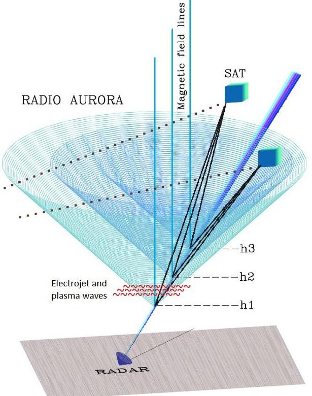

Figure 2. Drawing of the radar measurement geometry [3], [5]. The ground-based incoherent scatter radar station transmits pulses into the ionosphere, which scatter from the magnetic fieldaligned plasma irregularities. The scattered signals are measured by the satellite-based radar receiver passing overhead. In the drawing, the cones represent scatter from irregularities at three different altitudes. The cubes represent two passes of RAX-2.

passes overhead. A drawing of the measurement configuration is shown in Figure 2. The primary ISR for the RAX mission is the Poker Flat Incoherent Scatter Radar (PFISR), located near Fairbanks, Alaska. Experiments have also been conducted with the Resolute Bay Incoherent Scatter Radar (RISR), located in Resolute, Canada, and the RAX radar receiver is compatible with four additional ISR stations (ESR, Millstone, Arecibo, MUIR [3]). The goal of the mission is to improve the understanding of FAI and enable the development of short-term forecast models. RAX-2 measurements have already provided unprecedented detail for characterization of the ionospheric irregularities.

RAX-2 continues the mission started by RAX-1. RAX-1 launched in November 2010, and after successful initial operations, which included one processed radar experiment [3], the mission ceased after approximately two months due to a solar panel failure [6]. An investigation of the cause of the failure took place in early 2011, and it was found that the primary cause of the failure was partial shadowing from the turnstile antenna, seen extending from the top of the spacecraft in Figure 1. Shadows cast on individual solar cells or parts of cells series can cause reverse biasing of the cell which can result in destructive shorts. This failure can be prevented by including reverse bias protection diodes in parallel with each individual solar cell, which was not done on RAX-1. Details of the RAX solar panel investigation and re-design will be presented in a publication that is currently in development.

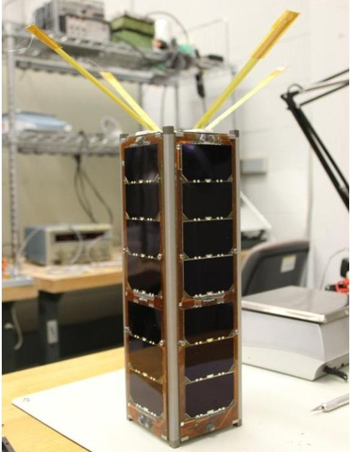

Figure 1. The RAX-2 spacecraft.

<!-- PDF_PAGE: 3 -->

With the exception of the solar panels, the designs of RAX-1 and RAX-2 are very similar. The satellite subsystems are discussed in [7]. Flight results from RAX-1 are provided in [6], and additional details on the satellite design will be provided in [1]. Details of the attitude determination subsystem are given in [8], the design of the GPS subsystem will be available in [9], and design papers dedicated to the other subsystems are also in development.

## SCIENTIFIC RESULTS

The unique radar scattering geometry provided by the RAX mission, composed of the ground-based transmitter and satellite-based receiver, enables high resolution characterization of FAI. The primary science product of the mission is the intensity of the irregularities as a function of the electron density, electron temperature, ion temperature, magnetic fieldalignment, and altitude. The intensity is measured by RAX, the electron density and temperatures are

measured by the ISR, and altitude and magnetic-field alignment can be computed from the spacecraft position and magnetic field orientation. Details of the scientific mission can be found in [3].

Due to the snapshot nature of each experiment, which lasts five minutes as RAX passes over the radar station, and the probability of geophysical activity at a given time being low, a large number of experiments are needed to detect backscatter from FAI. The first detection of scatter from FAI occurred March 8, 2012 [10], which was the $ 1 8^{th} $ processed radar experiment. The experiment was conducted with PFISR, and the resulting range-time-intensity (RTI) plot is shown in Figure 3. Radar echo from FAI is seen in the boxed region of the plot, just above the direct radar beam. A zoomed-in portion of the portion of the data containing the radar echo is shown in Figure 4. In Figure 4, the dashed black line shows the range delay corresponding to echo from FAI at an altitude of 100 km, and the red

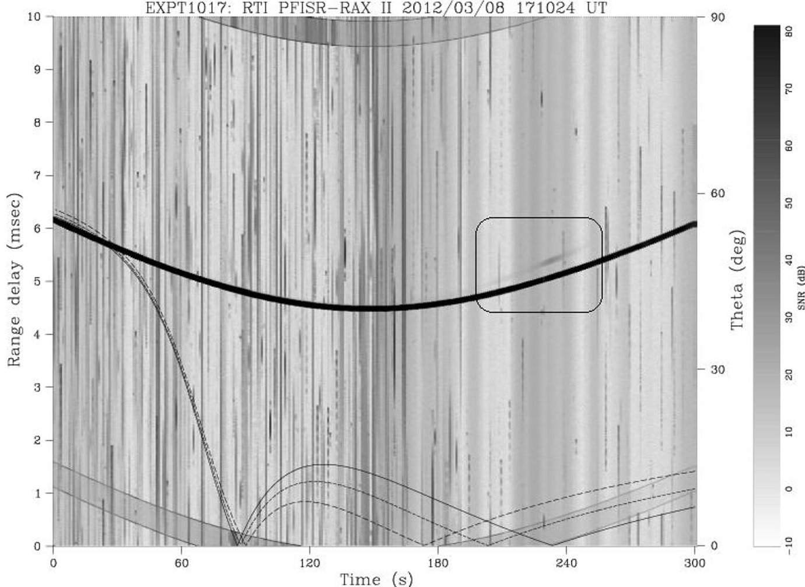

Figure 3. Range-time-intensity plot from the RAX-PFISR experiment conducted March 8, 2012. The y-axis is the delay time between transmission and receipt of the radar pulses. The x-axis is time into the experiment; each experiment lasts 5 minutes as the spacecraft passes over the radar station. The thin solid and dashed lines show the aspect angles of scattering for the altitudes of 100 and 300 km, respectively. The right y-axis is used for the aspect angles. The shading is the signal-to-noise ratio. The saturated signal (black strip) with a range delay between 4.5 and 6.5 ms is the direct radar signal from PFISR. Radar scatter from FAI is seen in the boxed region above the direct beam.

<!-- PDF_PAGE: 4 -->

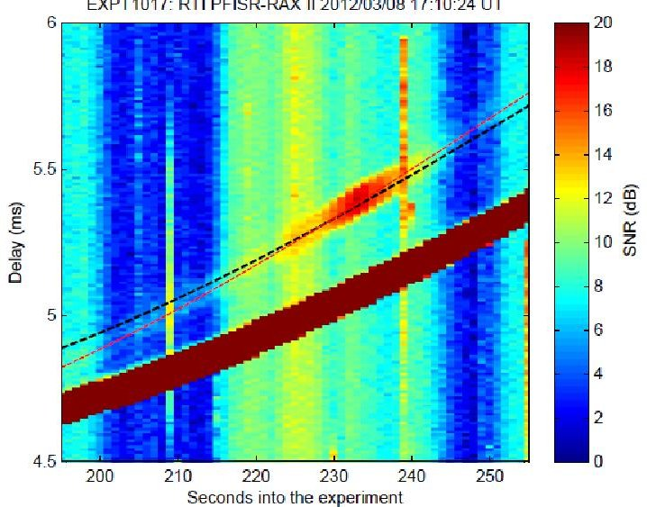

Figure 4. Zoomed-in portion of Figure 3 between 190 and 260 seconds. The black line is the expected range delay corresponding to FAI at an altitude of 100 km. The red line is a visual fit to the maximum intensity of the radar scatter.

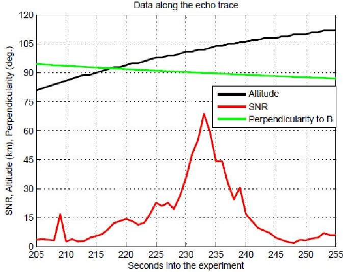

Figure 5. This plot shows FAI altitude, SNR, and aspect angle along the red line of Figure 4, which is a fit to the maximum intensity of the radar echo. Radar scatter was caused by FAI between the altitudes of 80 and 115 km. The angle shown in the plot is a measure of magnetic-field alignment. The maximum intensity of the scatter signals corresponds to an angle of $ 9 0^{\circ} $ ,where the Bragg wave vector is exactly perpendicular to the geomagnetic field lines.

line is a fit to the peak intensity of the measured scatter. Figure 5 shows FAI altitude, signal-to-noise ratio (SNR), and magnetic aspect angle corresponding to data along the red line of Figure 4. In this experiment, radar scatter was measured from irregularities at altitudes between 80 and 115 km.

This experiment has provided unprecedented characterization of FAI. The irregularities are located with an altitude resolution of 3 km and sub-degree resolution in aspect angle, which is a first for auroral region measurements. Preliminary analysis of this experiment can be found in [10], and a thorough analysis is in progress.

Radar scatter was detected again on the next experiment, which took place April 25. We are currently downloading raw radar measurements from both experiments for detailed analysis. The measurements from these experiments as well as future RAX experiments will enable improved characterization of meter-scale ionospheric irregularities.

## SATELLITE BUS PERFORMANCE

In this section, we discuss select portions of satellite bus data collected throughout the mission. This includes solar panel performance, attitude dynamics that result from P-POD deployment and the passive magnetic control system, UHF signal strength monitoring over the world, and data download strategies and the amount of data obtained.

## Solar Panel Performance

The main difference between RAX-1 and RAX-2 is the solar panels. The RAX-2 solar panels were redesigned to prevent the gradual performance degradation that occurred on RAX-1 [6]. As discussed in the section Mission Overview, RAX-2 includes reverse bias protection diodes that were not included on RAX-1, and the redesign of the panels successfully corrected the problem, as demonstrated in Figure 6.

Figure 6 shows the power generated over time from a single solar panel. This data is representative of the behavior of all four panels. Using the manufacturer-reported specifications of the solar cells, the maximum power of each solar panel is 7.1 W. From pre-flight testing, the predicted actual orbit performance of the flight panels is 6.5-6.8 W per panel. As seen in Figure 6, the actual power production of the panel shown is below this for the majority of the mission. This is because minimal subsystems are turned on for the majority of the time. Additionally, the data in Figure 6 has not been filtered by sun angle or temperature. We see that overall, the performance of the panel has been constant over the mission. The decrease in power from all the panels in February and March is due to higher temperatures when the spacecraft was in constant sunlight. And the apparent higher power produced during the two periods before December 27 is due to a higher density of data points in these time periods.

<!-- PDF_PAGE: 5 -->

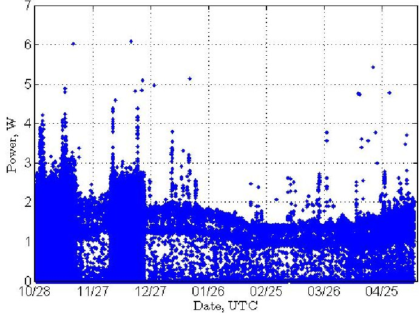

Figure 6. Power generated by a RAX-2 solar panel. The actual power produced is less than the maximum capability of the panel because of the low power demand of the spacecraft. The apparent increase in performance before 11/20 and between 12/10 and 12/27 is due to a higher density of data points during these times. The decrease and increase in performance between 1/26 and 4/25 is due to higher temperatures, resulting in lower power production. This time is when RAX-2 was in constant sunlight.

## Attitude Dynamics

RAX-2 utilizes a passive magnetic attitude control system. This is a common attitude control scheme for nanosatellites that includes permanent magnets to align the spacecraft with the geomagnetic field and soft magnetic material to dissipate rotational kinetic energy. The materials used in the RAX-2 subsystem are four Alnico-5 permanent magnets with a total dipole moment of $ 3. 2^{1} $ A-m $ ^{2} $ , and two grams of HyMu80. The plots discussed below summarize the performance of the attitude control subsystem.

Figure 7 shows angular velocity measurements over time since launch. This data is taken directly from the rate gyroscope measurements without any processing. The maximum measured absolute velocities are 12.6, 12.6, and 17.1 deg/s in the x, y, and z axes, respectively (the z-axis is the minor axis, which is the vertical direction in Figure 1). The maximum measured magnitude is 20.1 deg/s. The rotational kinetic energy of the spacecraft is shown in Figure 8, and is computed

using the measured angular rates and the mass properties measured before flight. The angle between the permanent magnets and the geomagnetic field, determined from the magnetometers after calibration using the method of [11], is shown in Figure 9. Figures 7-8 demonstrate the effectiveness of the soft magnetic material in decreasing the rotational kinetic energy, and Figure 9 demonstrates the effectiveness of the permanent magnets.

From the figures, we see that it took approximately three weeks for RAX-2 to reach a kinetic energy levels near the steady-state value, and it took approximately two months to become aligned to the geomagnetic field

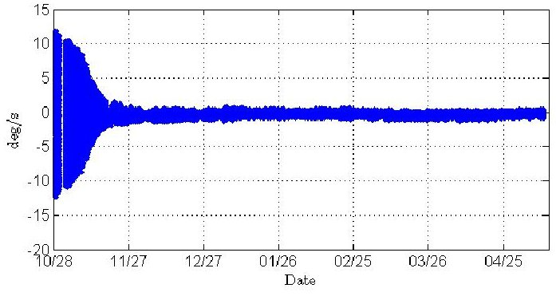

(a) x-axis

(b) y-axis

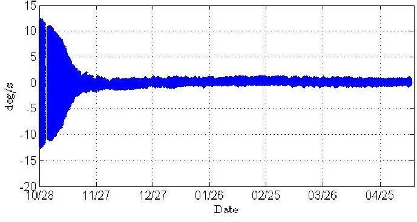

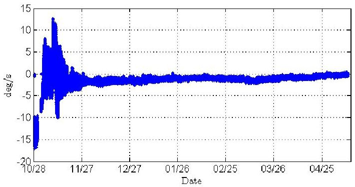

(c) z-axis

Figure 7. Measured angular velocities in the x-, y-, and z-axes. The maximum measured absolute rates in each axis were 12.6, 12.6, and 17.1 deg/s respectively.

<!-- PDF_PAGE: 6 -->

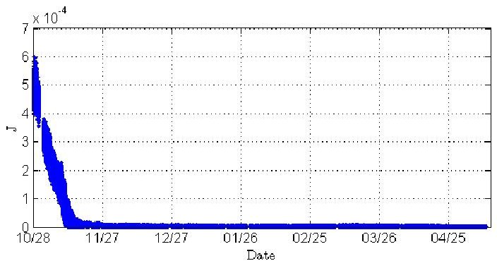

Figure 8. Rotational kinetic energy versus time, computed from the pre-flight inertia measurement and rate gyroscope measurements. Energy is dissipated due to the hysteresis behavior of the soft magnetic material. The energy reaches a near steady-state value after approximately three weeks.

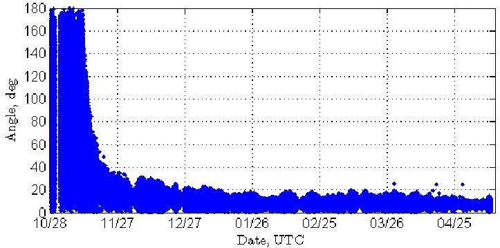

Figure 9. Angle between the spacecraft z-axis (aligned with the permanent magnets) and the geomagnetic field. This is computed using magnetometer measurements after correction by calibration using the method of [11]. We see that it took approximately two months to become magnetic field aligned to within 20 degrees.

within 20 deg. This is longer than the predicted time. The subsystem was simulated using the methods of [12], [13]. We hypothesize that the disagreement with predictions is due to a discrepancy between the simulated and actual magnetic parameters. The soft magnetic material may be saturated due to the close proximity of the permanent magnets, resulting in different parameters of the hysteresis loop produced by the soft magnets rotating in the geomagnetic field. An analysis of the performance of the passive magnetic system is in work for future publication.

## UHF Received Signal Strength

The UHF radio, an Astronautical Development Lithium-1, provides a measurement of received signal strength, referred to as the received signal strength indicator (RSSI). This has provided interesting data throughout the mission. Two sets of RSSI data are

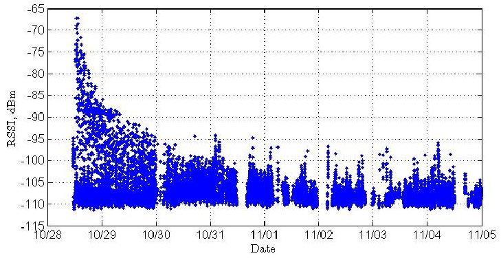

Figure 10. Received signal strength indicator (RSSI, units of dBm) versus time for the first week of the mission.

discussed below: the decay in RSSI early in the mission, and a global mapping of UHF RSSI.

RSSI over the first week of the mission is shown in Figure 10. There is an exponential decay in signal strength over the first few days of the mission, which is likely due to the separation of the CubeSats over time. The relatively high RSSI immediately after P-POD deployment could be caused by transmissions and electromagnetic noise generated by the five other CubeSats. In addition to the RSSI data, CubeSat-to-CubeSat communication was demonstrated by RAX-2 decoding an MCubed beacon. The number of bytes received by RAX-2 increased without any commands being sent to RAX, and the number of bytes received matched the number of bytes in MCubed beacons. Given the similarity of the two satellites (they were built in the same lab and use nearly identical radio hardware and software), the bytes received must have been caused by an MCubed beacon.

RAX-2 is capable of global UHF signal strength monitoring. Figure 11 shows RSSI measurements from between December 5 and 20, 2011, overlaid on a world map. The location of the data points correspond to the satellite location and are color-coded by RSSI (units of dBm). One plot shows data when RAX-2 is in the sun, and the other shows data in eclipse. No other processing, such as accounting for attitude or antenna gain, is shown.

## Partnering with the Amateur Radio Community

To maximize the data return from the spacecraft, the RAX-2 operations team partners with the amateur radio community. The radio uses AX.25 protocol, GMSK modulation, and is operated at 9.6 kbps (the radio is capable of 38.4 kbps, but this has not been used yet on RAX-2). RAX-2 operates in the UHF amateur band,

<!-- PDF_PAGE: 7 -->

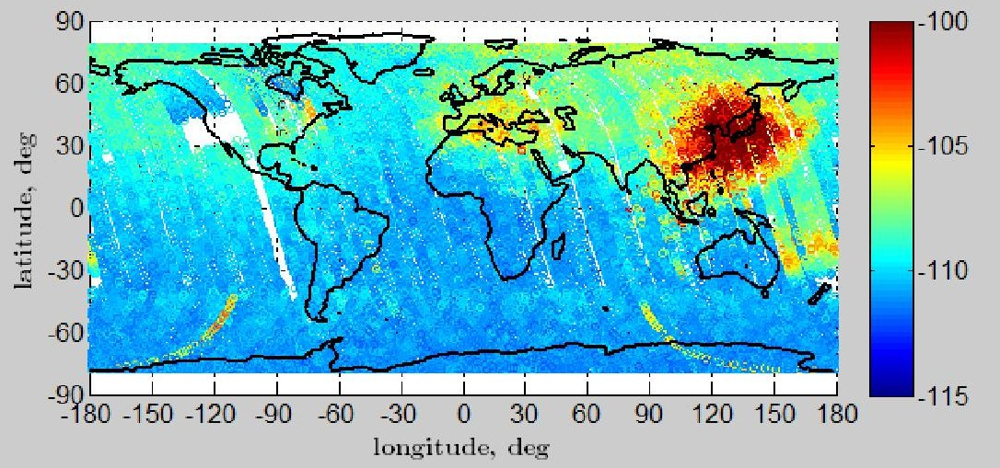

(a) Measurements in sunlight.

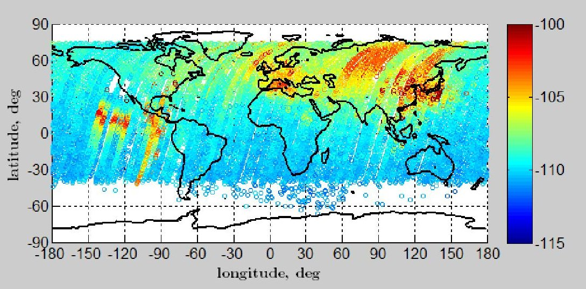

(b) Measurements in eclipse.

Figure 11. RSSI measurements taken between December 5 and 20, 2011 and overlaid on a world map. The location of the data points correspond to spacecraft location, and the color-coding corresponds to RSSI with units of dBm. Subfigure (a) shows measurements taken when RAX-2 is in sunlight, and subfigure (b) shows measurements when the spacecraft is in eclipse.

and a ground station client is publically available on the RAX website $ ^{2} $ . The client displays telemetry from beacons for the user, and also uploads the data to RAX ground station servers.

During typical operations, commands are sent from the University of Michigan ground station once per day, which include a download schedule for the next 24 hours. In addition to downloading data to the primary ground stations at the university and SRI International, downloads are scheduled over any amateur operator that listens regularly. Stations that receive RAX data on a regular basis are located in Australia, New Zealand, Japan, and the United States. As of May 22, 2012, approximately 99 MB of data has been received from

RAX-2. 54.4 MB has been downloaded to the primary ground stations at the university and SRI, and 44.6 MB has been received by amateur radio operators.

A plot of the cumulative sum of data received over the mission is shown in Figure 12. After a successful spacecraft checkout, RAX-2 downloaded regularly until an SD card failure on January 16 [4]. The lull in downloads on December 25 corresponds to the holidays. Scheduled downloads resumed on February 20 after modifying operational procedures to deal with the SD card failure.

## SUMMARY

RAX-2 is studying magnetic field-aligned plasma irregularities in the ionosphere. On March 8, 2012 during the $ 1 8^{th} $ radar experiment RAX-2 made its first measurements of radar scatter from the ionospheric

<!-- PDF_PAGE: 8 -->

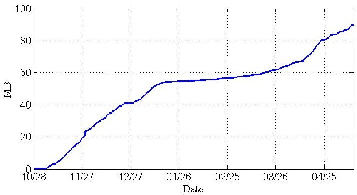

Figure 12. The cumulative sum of data received (MB) over the mission. The data is downloaded to the primary ground stations at the University of Michigan and SRI International, as well as amateur radio operators worldwide.

irregularities. Radar scatter was measured again on April 25, 2012. These measurements have provided the highest ever resolution (in altitude and aspect angle) measurements of the irregularities.

RAX-2 is a continuation of the mission started by RAX-1, which suffered a power failure on orbit after two months of operation. Following an investigation of the cause of the failure and subsequent design correction, RAX-2 launched less than one year after RAX-1. The power system and other subsystems have performed well on orbit.

The other subsystems discussed in this paper were the UHF radio and passive magnetic control system. The radio has provided a global survey of noise in the UHF band, and soon after deployment from the PPOD, RAX data demonstrates the potential for CubeSat-to-CubeSat communication. RAX partners with the amateur radio community to increase the data return from the satellite, and almost half of the data downloaded from the satellite has been received by amateur radio operators. As of May 22, 2012, 99 MB of data had been downloaded using the 9600 bps link. The passive magnetic control system successfully dampened the rotational energy and aligned RAX-2 with Earth's magnetic field. Attitude data, as well as orbit data from other sensors and subsystems, will be analyzed and feed into design improvements for future satellites.

RAX-2 operations are planned to continue another year to conduct ionospheric irregularity and scintillation experiments using UHF ISRs in mid-to-high latitudes.

## Acknowledgments

RAX was developed under NSF grant AGS 08-38054 to SRI and AGS 08-28046 to the University of

Michigan. Additional on-orbit analysis and operations support is currently provided by RAPID awards AGS 12-16111 and AGS 12-25628 to SRI and the University of Michigan, respectively. Ground-based radar operations and maintenance for PFISR is supported by NSF cooperative agreement ATM-0608577 to SRI. The Delta-II launch and associated P-POD integration services were graciously provided by the NASA Educational Launch of Nanosatellite program authorized by the Space Operations Mission Directorate and managed by the Launch Services Program at Kennedy Space Center. Additional funding is from the Department of Defense through a National Defense Science and Engineering Graduate (NDSEG) fellowship for the first author. The authors thank the other current and former members of the RAX team, both at SRI International and the University of Michigan. Additionally, the authors thank the amateur radio operators that have supported the mission; to all the HAMs: your help has been fantastic, thanks!

## References

[1] J. W. Cutler and H. Bahcivan, "The Radio Aurora Explorer - A Mission Overview," AIAA Journal of Spacecraft and Rockets. Submitted June 2012.

[2] T. Moretto, "CubeSat Mission to Investigate Ionospheric Irregularities," Space Weather, vol. 6, 2008.

[3] H. Bahcivan and J. W. Cutler, "Radio Aurora Explorer: Mission science and radar system," Radio Science, vol. 47, 2012.

[4] J. C. Springmann, B. P. Kempke, J. W. Cutler and H. Bahcivan, "Development and Initial Operations of the RAX-2 CubeSat," in ESA/CNES Small Satellites Systems and Services Symposium, Portoroz, Slovenia, 2012.

[5] H. Bahcivan and J. W. Cutler, "Radar and rocket comparison of UHF radar scattering from auroral electrojet irregularities: Implications for a nanosatellite radar," Journal of Geophysical Research, vol. 114, 2009.

[6] J. W. Cutler, J. C. Springmann, S. Spangelo and H. Bahcivan, "Initial Flight Assessment of the Radio Aurora Explorer," in AIAA/USU Conference on

<!-- PDF_PAGE: 9 -->

Small Satellites, Logan, UT, 2011.

[7] J. Cutler, M. Bennett, A. Klesh, H. Bahcivan and R. Doe, "The Radio Aurora Explorer - A Bistatic Radar Mission to Measure Space Weather," in AIAA/USU Conference on Small Satellites, Logan, UT, 2010.

[8] J. C. Springmann, A. J. Sloboda, A. T. Klesh, M. W. Bennett and J. W. Cutler, "The attitude determination system of the RAX satellite," Acta Astronautica, vol. 75, pp. 120-135, 2012.

[9] S. C. Spangelo, M. W. Bennett, D. C. Meinzer, A. T. Klesh and J. W. Cutler, "Design and Implementation of the GPS Subsystem for the Radio Aurora Explorer," Acta Astronautica Submitted May 2012.

[10] H. Bahcivan, J. W. Cutler, M. W. Bennett, B. P. Kempke, J. C. Springmann, J. Buonocore, M. Nicolls and R. Doe, "First measurements of radar coherent scatter by the Radio," Geophysical Research Letters. Accepted June 2012.

[11] J. C. Springmann and J. W. Cutler, "Attitude Independent Magnetometer Calibration with Time-Varying Bias," AIAA Journal of Guidance, Control, and Dynamics, To appear, 2012.

[12] G. Park, S. Seagraves and N. H. McClamroch, "A Dynamic Model of a Passive Magnetic Attitude Control System for the RAX Nanosatellite," in AIAA Guidance, Navigation, and Control Conference, Toronto, Canada, 2010.

[13] D. Lee, J. C. Springmann, S. C. Spangelo and J. W. Cutler, "Satellite Dynamics Simulator Development Using Lie Group Variational Integrator," in AIAA Modeling and Simulation Technologies Conference, Portland, Oregon, 2011.