<!-- PDF_PAGE: 1 -->

# Insight, Innovation, and the Big Picture in System Design

Application of FunKey Architecting

G. Maarten Bonnema*

Laboratory of Design, Production and Management, Department of Engineering Technology, University of Twente, 7500AE Enschede The Netherlands

Received 5 September 2009; Revised 23 April 2010; Accepted 16 June 2010, after one or more revisions Published online 7 October 2010 in Wiley Online Library (wileyonlinelibrary.com). DOI 10.1002/sys.20174

## ABSTRACT

Systems architecting is the design phase where the top-level functions and performance of a system are distributed over the system's parts, its environment, and its users. Up till now, system architects had to largely learn the required skills in practice. Some courses exist that teach the right attitude and mindset for the system architect. However, methods for architecting that can be implemented in a computer tool are virtually nonexistent. Earlier we presented a method, FunKey Architecting, which may aid the system architect in the early phase of design. In combination with TRIZ a design tool is created, which can be used to simplify and improve system architectures. It aims at supporting both the system designer and the specialist designers working on systems. The main topic of the paper is the application of the method in two industrial cases. The one case is an environment where new technology has to be developed and state of the art physics have to meet machine construction principles. The other case is in an industry where well-proven technology is used in such a way that high-performance machines are created. A third application of the FunKey tool is performed by students at the University of Twente. The context of each case and the results will be described. $ \textcircled{c} $ 2010 Wiley Periodicals, Inc. Syst Eng 14: 223-238, 2011

Key words: system design; insight; the big picture; innovation; TRIZ; FunKey; application; cases

## 1. INTRODUCTION

Present state of the art products consist of integrated electronic, mechanical, and software contributions. Integration is present both within and between modules, even more so for systems like wafer steppers, aircraft, and medical imaging systems. Designing such systems requires close cooperation

of electrical, mechanical, and software engineers. However, these engineers speak different languages, and are presently ever more spread around the world. These specialist engineers often have a view of their own task only. The computer tools they use stimulate the buildup of the design in a bottom-up approach (from detail to assembly to system). Therefore, the context information the specialists have is limited or even lacking. Each discipline uses its own jargon and language for representing the problem and the design. The system designer, on the other hand, lacks the detail information needed to supervise the system integrity during the entire development process. Moreover, there is no accepted language to represent the system design or system architecture in a manner that is

<!-- PDF_PAGE: 2 -->

easy to read and understand for all engineering disciplines involved. SysML [Object Management Group, 2008] tries to address this issue by creating a unified language. Yet, to a mechanical designer, for instance, a SysML diagram is not very informative.

To cope with this problem, communication between engineers at different levels of the design pyramid (see Fig.1) has to be encouraged, enabled, and improved. This can be achieved by:

- creating common understanding

- making information explicit

- making information readily available.

Yet, data-burial has to be avoided at all cost. This observation is not new [ Lutters, 2001 ]. There have been, and still are, research projects that deal with this. Some of these are: the SysML project, of course [Object Management Group, 2008], and modeling based on physics, as is done in matlab/simulink, 20Sim, and the like.

For analyzing systems, several tools and aids have been presented in this Journal, among others: Bustnay and BenAsher [2005], Smith and Verma [2004], and Daniels and Bahill [2004]. Methods for creation of the system architecture are more scarce. Muller [2004] presents the Customer Application, Functional, Conceptual, and Realization model (in short, CAFCR model). This presents several views of the system that help in compiling the systems requirements, functions, and architecture. The often used systems engineering approaches [Blanchard and Fabrycky, 1998; INCOSE SEH Working Group, 2000, 2008] describe creation of system architectures as a step in the total system design process. How to proceed in that step is not treated in depth. Another approach is presented in The Art of Systems Architecting [Maier and Rechtin, 2000]. As the title shows, creation of systems architectures is seen as an art. The extensive lists of heuristics in the book make it a valuable reference for practicing systems designers. In that book, the scope is wider than only on designing a system and its architecture. Analysis of the problem at hand is treated, as well. Also, by changing perspective, a more complete picture of the problem and its context is generated.

The Theory of Inventive Problem Solving, TRIZ, developed by Altshuller [1997, 1999], provides ways of solving

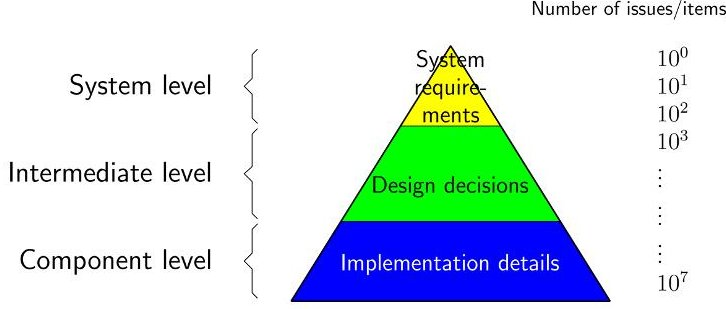

Figure 1. Pyramid showing the increase in number of issues from system to detail design (after Muller [2007]). [Color figure can be viewed in the online issue, which is available at wileyonlinelibrary.com.]

technical problems. It is an approach intended for creation and for solving concrete problems; not in particular for designing systems. The Appendix presents some background information on the TRIZ approach.

In this paper we will look at an approach that can be used to create the system design (top-down) and maintain the big picture when the detail design evolves (bottom-up). This involves the effect of design decisions on the customer's interests that are made explicit using key drivers. The system designer (or system architect) has to monitor these decisions and judge them against all the stakeholders' interests. In fact the approach, FunKey architecting [Bonnema, 2008, 2006a, 2006b], acts as a high-level model between the stakeholders' interests and the engineers' tasks. The TRIZ philosophy is visible in the way FunKey architecting works.

The work presented here is a step in the evolution of the research of the Laboratory of Design, Production and Management at the University of Twente. The Laboratory has its roots in production technology research. However, over the past decades the focus has shifted from this technology oriented research (the 1970s and 1980s), via product modeling (1990s and 2000s) to research on application, usability, concept design and system design (2000s). Central in this shift has been that designing gets more multidisciplinary and needs more focus on the ability to solve problems: moving from a technology-oriented to an application-oriented research. In particular, the work of Van den Kroonenberg deserves to be mentioned here for its impact on the design practice and research in Europe. Currently the Laboratory consists of researchers with backgrounds in, among others, industrial design engineering, mechanical engineering, electronic engineering, and psychology.

Based on a literature review [Bonnema and van Houten, 2004; Bonnema, 2008] and interviews with experienced system designers [Bonnema and van Houten, 2006], we have concluded that in the early phases of design, that is, the top of the pyramid in Figure 1, three types of model are important:

- System budgets

- Analysis of physical behavior

- Block diagrams.

Here it should be noted that the analysis of physical behavior is mostly accompanied by a mathematical model. System budgets are used to divide functional, physical, and cost parameters over the parts constituting the system [Muller, 2005; Frericks et al., 2006]. Functional budgets involve things like timing, accuracy, and signal loss. Physical budgets involve things like size, weight, power, and tolerances. Cost budgets obviously deal with effort and investments in development, manufacturing, and so on. In the remainder of this paper, mostly functional budgets are treated. With some adaptations it also applies to the other types of budgets. Block diagrams are well known. They model the relations between functions of the system. Interestingly, these models maintain their relevancy in all levels of the pyramid in Figure 1.

FunKey architecting aims at helping the designers to acquire context information, and the system designer to track detail information. The goal is threefold: achieve insight create and maintain the big picture, and stimulate innovation,

<!-- PDF_PAGE: 3 -->

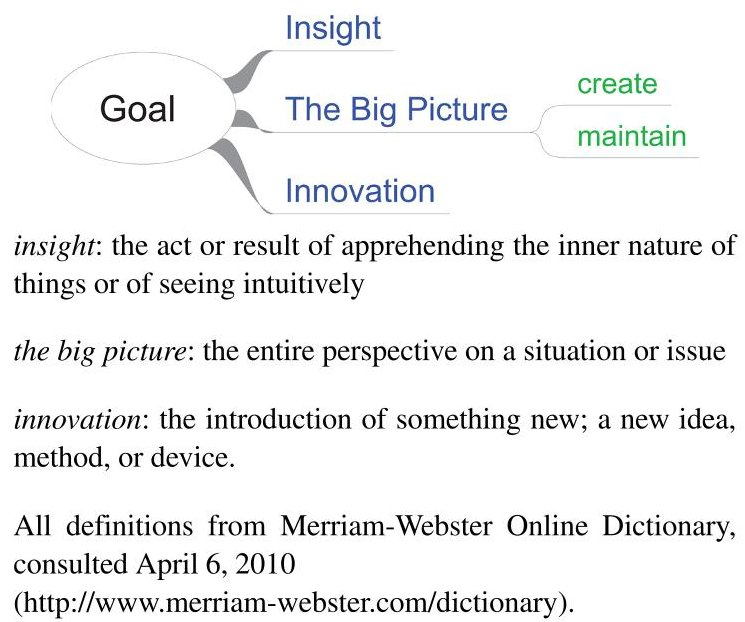

Figure 2. The goal of this research project. The figure also shows the rationale for the title of the paper. [Color figure can be viewed in the online issue, which is available at wileyonlinelibrary.com.]

as shown in Figure 2. Here also the definitions of the terms used are given.

The FunKey procedure visualizes architectural decisions that used to be made implicitly. Therefore, it is a valuable tool for a team of architects and for communicating and discussing architectural decisions between architect and specialist and/or detail designer. For more background information, and particularly the relation between the presented method and other methods like Axiomatic Design [Suh, 1990] and QFD [Chan and Wu, 2002; and references therein], the reader is referred to the earlier mentioned references [Bonnema, 2006a, 2008].

In this paper, we will show the practical application of the approach in two industrial cases. These are real design situations where the FunKey method has been applied to actual system design situations. The first case treats the design of a machine at the edge of the current state of the art. The second case is a mature field of technology, where the FunKey method is used to find new approaches to the problem at hand. Another application is where FunKey has been presented to students, to aid in a system design project. Results and observations thereof will be presented as well.

The next section is used to summarize the FunKey architecting approach. In Section 3, the set-up of the cases is discussed. The difficulty in finding representative cases for system design research is dealt with. Sections 4, 5, and 6 discuss the individual cases, respectively. The results and findings will be discussed in Section 7. The conclusions of the paper are given in Section 8.

## 2. FunKey ARCHITECTING

The FunKey Architecting approach bases its name on the fact that the system's functions are coupled to key drivers. Here a function is, as defined in Blanchard and Fabrycky [1998: 62] "a specific or discrete action that is necessary to achieve a given object." Note that this is more or less equivalent to behavior as defined in Tomiyama and Umeda [1993]. Key

drivers are based on the work presented in Muller [2004]. The way key drivers are used is that they can be seen as the interface between the system developer and the system stakeholders. The stakeholders know how they use the system because they know how the system's performance affects their profitability. The system supplier knows how the system design affects the system's performance. Therefore, both parties have an interest in knowing the system's performance. The key drivers are used to represent the system performance in a way that is understandable to both the system stakeholders and the system developer, while all parties involved are still able to see the big picture. Examples of key drivers are turnaround time and cost per passenger per mile for a passenger aircraft, and overlay and productivity for a wafer stepper. For a large system, five to ten key drivers should be the objective. They should be as quantifiable as possible.

In the early stage of the design, it can be investigated which function affects which key drivers. For this, we propose to use a coupling matrix C as the one shown in Table I. This initially is done by marking crosses whenever there is a contribution. Later on, the contributions can be investigated further, either by distinguishing useful versus harmful contributions or insufficient versus excessive contributions, as used in TRIZ function analysis. With this information, TRIZ can be applied directly, as described in Bonnema [2006b, 2008]. Even when there are only crosses in the coupling matrix, TRIZ can be applied using the priority matrices from Ivashkov and Souchkov [2004], elaborated in Bonnema [2006b] (also see the Appendix). The information in the populated coupling matrix will directly point to applicable TRIZ innovative principles (IPs). The Priority Matrices, namely, indicate which innovative principles are best suited to either improve a system's performance parameter (PM+, Appendix A.2), or to limit the negative impact (PM-, Appendix A.3). Using TRIZ in an early stage of the development process may lead to interesting system concepts and simplifications.

Another way of further investigating the relation between functions and key drivers is by entering quantified contributions. If the information has some uncertainty, this can be indicated by using Symmetrical Triangular Fuzzy Numbers (STFNs) [Chan and Wu, 2005; de Andres Sanchez and Terceno Gomez, 2003; Bonnema, 2008]. These numbers show an interval that represents the expected value. STFNs can be added, subtracted, and multiplied. In Bonnema [2008] even rules for root-mean-square addition are shown, thus enabling the required summation means for independent errors. With this quantified information, system budgets can be compiled for the key drivers. For this it might be useful to decompose the key drivers into more concrete properties like power consumption, cost of goods, weight, and accuracy. This de-

Table I. Coupling Matrix (C), or FunKey Matrix, Used To Investigate Contributions of Functions to Key Drivers $ \left( \mathrm{k d}_{i} \right) $

<table border="1"><tr><td></td><td>$kd_{1}$</td><td>$kd_{2}$</td><td>...</td><td>$kd_{m}$</td></tr><tr><td>function $f_{1}$</td><td></td><td></td><td>$\times$</td><td>$\times$</td></tr><tr><td>function $f_{2}$</td><td>$\times$</td><td>$\times$</td><td></td><td></td></tr><tr><td>...</td><td></td><td>$\times$</td><td></td><td></td></tr><tr><td>function $f_{n}$</td><td>$\times$</td><td>$\times$</td><td></td><td>$\times$</td></tr></table>

<!-- PDF_PAGE: 4 -->

composition can also be done later in the development process.

System budgets [Bonnema, 2006a; Frericks et al., 2006] that can be used for distributing key drivers and system requirements over the systems parts form, in combination with the distribution of the system's functions, the architecture. In our definition, in line with Gulatti and Eppinger [1996], an architecture defines the parts constituting a system and allocates the system's functions, performance, physical attributes and cost over its parts, its users, its super system, and the environment in order to meet system requirements [Bonnema, 2006a]. Here, the super system denotes the system of systems (in the literal sense) that the system under design is part of. It is a matter of perspective what is called the system under design: the subsystem, or the super system. Note that this definition of an architecture allows for hierarchical development of the architecture. It can even be used to describe the system within the problem context. This fits the view on architecting in Maier and Rechtin [2000].

## 3. INTRODUCTION TO THE CASES

This research is aimed at creating a practical method that supports system architects and informs the specialist designers. The method is documented in several papers and a thesis. The present paper will show its applicability to real situations of system development. Figure 3 shows four classes of application, organized along two perpendicular axes: the applications can be arranged on a scale from Simple to Complex. The other scale ranges from Real to a Laboratory-setting. It can be noted that it is nearly impossible to devise a complex laboratory problem.

To perform a comparative study, one should have a setup where the outcome with the method can be compared to an outcome without the method as is done in e.g. Ruder and Sobek [2007]. For such a comparison, in a laboratory setting, a (relatively) simple case will be used. However, see Figure 3, this is not where FunKey is applicable. Thus a comparative setup, though methodologically sound, does not fit the FunKey application area.

The area marked grey in Figure 3 is where FunKey is appropriate and where two real cases have been placed: the MAPPER case (Sec. 4) and the BOA case (Sec. 5). This, however, means that we cannot perform a comparative study but have to resort to case studies, with the researcher as part

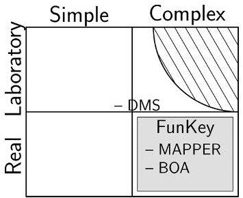

Figure 3. The cases of application mapped in a space of real versus laboratory and simple versus complex. The shaded area indicates the target of FunKey architecting. The hatching shows an unreachable part.

of the development team. Then, there is a large asymmetry in the information available to the researcher and to others [Dorée, 1996]. We try to reduce the consequences of that disadvantage by documenting observations and experiences by the researcher and others involved. This type of case study has been used earlier to collect practical data in design research [Finger and Dixon, 1989a, 1989b; Martin and Davidz, 2007].

In addition to the two industrial cases, five student teams were instructed in the FunKey method as part of an educational project: the Design of Mechatronics and Systems project (DMS). This project, relatively simple for experienced designers, can be considered a complex problem for the third-year students. Some teams did use FunKey; others did not. This way some comparison is possible (see Sec. 6).

Another issue relates to the stage of development. As the method is aimed at being implemented in a computer tool, a prototype of the tool would be useful. On the other hand, the calculations involved are not complicated or large in number. Absence of a dedicated computer tool only means that, in addition to general purpose software (a spreadsheet program, word processor, and a mind mapping program), some manual effort is involved in finding contradictions (to connect with TRIZ) and maintaining correspondence between different models. One can say that some functions that should be assigned to a tool are now assigned to the researcher.

We expect to find that the method provides the big picture and insight (Figure 2). In addition to that, using the connection with TRIZ, there might be several interesting new ideas to be investigated further. This relates to innovation in Figure 2.

## 4. CASE 1: MAPPER

MAPPER Lithography (http://www.mapperlithography.com) is a Dutch company working on a new approach to exposing semiconductor wafers. The main differences with conventional wafer scanners are the elimination of the pricey masks (reticles) and the use of a massive amount of modulating electron beams in parallel, instead of projecting light through a mask. Some of the characteristics are the use of Micro Electro Mechanical Systems (MEMS) for the projection optics and telecommunication technology for transferring large amounts of data from the mask design to the electron writing system. See Figure 4 and Kruit [2007] for more information about the electron-optical system. In this section, we will concentrate on the wafer positioning system that is needed for scanning the wafer sufficiently accurately under the projection lens.

At the time of this research, the company was designing the first prototype machine. This machine had to expose 300 mm diameter silicon wafers in a fablike environment to enable customers to develop their process. Additionally, the system design should accommodate future throughput and resolution upgrades. The design process at MAPPER has been based on systems engineering guidelines as described by the INCOSE SEH Working Group [2000, 2008] and Blanchard and Fabrycky [1998]. For instance, a clear treelike document structure is maintained to relate specifications on different hierarchical levels to each other.

<!-- PDF_PAGE: 5 -->

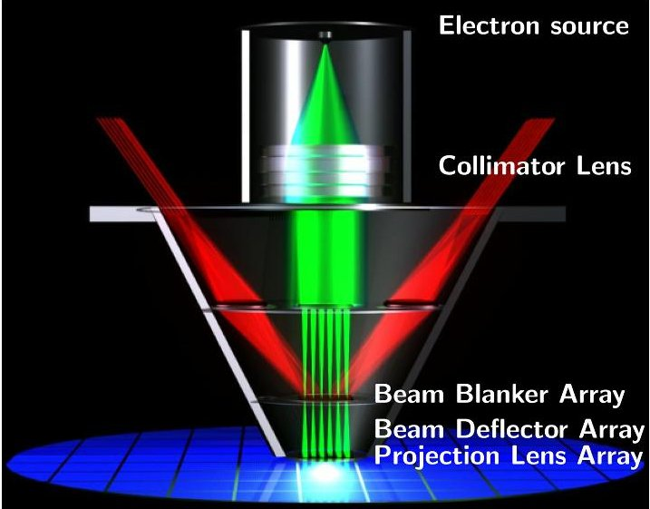

Figure 4. The electron optics of the MAPPER lithography system. Picture courtesy MAPPER Lithography. [Color figure can be viewed in the online issue, which is available at wileyonlinelibrary.com.]

The following is an accurate report. It may be incomplete at times where information is not yet released for publication by MAPPER.

## 4.1. The Problem

MAPPER originated in the Department of Applied Physics of the Delft University of Technology. The patented technology was developed by Professor Kruit and his team of physicists. This guaranteed a solid physical foundation for the machine. Translating these physical principles into a machine design requires other contributions. As nanometer precision is required in a vacuum environment, many disciplines are involved.

The author, a former system engineer at the other Dutch wafer stepper manufacturer ASML (http://www.asml.com), has been asked to assist (part time) in the creation of a design for the wafer positioning subsystem. This involved, among other things, modeling throughput and overlay. In parallel with a more traditional approach, the author has applied the FunKey method.

## 4.2. The Approach

First, the author became acquainted with the company and the system by investigating several concrete issues. Next, the FunKey method was applied as shown in Figure 5. The function inventory has been created using a mind map (see Fig. 6). In this mind map, the hierarchy shown is not a functional hierarchy but merely represents the author's mental model of the MAPPER exposure system. The key drivers have been analyzed by a mind map as well (see Fig. 7). The coupling matrix C is shown in Table II. The spreadsheet created to manage the coupling matrix allows for folding columns and/or rows. This simulates zooming in on key drivers and/or functions, respectively. The creation of the function tree, key driver tree, and populating the coupling matrix has taken approximately 2 man-days. The result of this has been increased insight in the machine structure for the author and colleagues at MAPPER.

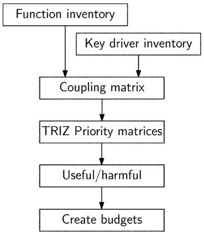

Figure 5. Application of FunKey to the MAPPER case.

## 4.3. Results

## 4.3.1. Priority Matrix

Based on an analysis that uses the populated coupling matrix and TRIZ, several ideas have been generated. Also TRIZ principles were identified by an analysis of the key drivers using the priority matrices. More information on the priority matrices can be found in the Appendix, Ivashkov and Souchkov [2004], and Bonnema [2006b, 2008].

As an example, CD (critical dimension, the smallest line width that can be imaged) relates to TRIZ parameter 29: Manufacturing precision. Using the positive priority matrix PM+, innovative principle (IP) 32 "Color change" is suggested. This is the reason why the wavelength used in wafer steppers has changed over the years (from 365 nm, to 248 nm, to 192 nm, to electron beams). The same was done for Overlay, relating to parameter 37: Difficulty of detecting and measuring. PM+ suggests IP 28: Mechanics substitution. Throughput relates to parameter 39: Productivity. PM+ suggests IP 10: Prior action.

For Cost per good die, there is no direct relation with any of the TRIZ parameters. However, the subkey drivers Footprint and Maintenance can be related to TRIZ parameters 6 (Area of stationary object) and 25 (Loss of time), respectively. Resolutions follow from PM+: IP 18 (Mechanical vibration)

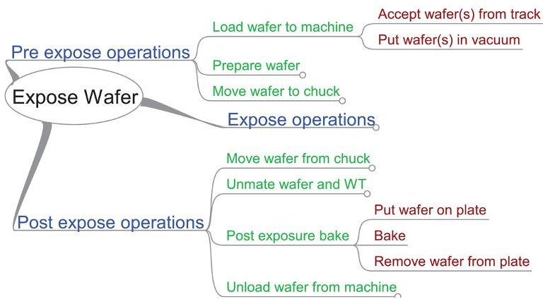

Figure 6. Part of the MAPPER function analysis. [Color figure can be viewed in the online issue, which is available at wileyonlinelibrary.com.]

<!-- PDF_PAGE: 6 -->

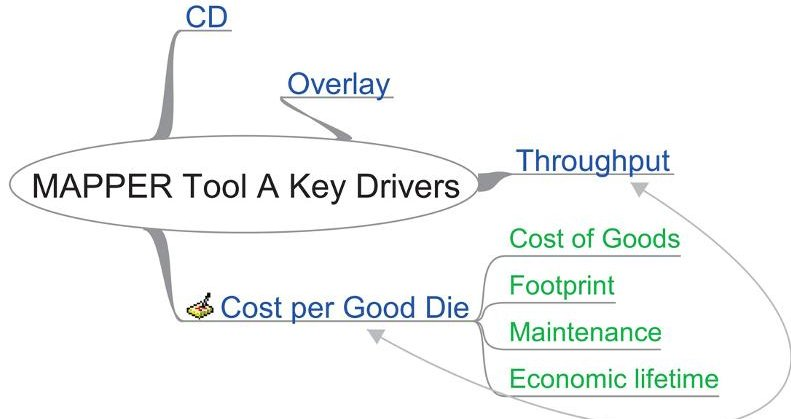

Figure 7. MAPPER key driver analysis. The arrow connects two related key drivers. CD = critical dimension. [Color figure can be viewed in the online issue, which is available at wileyonlinelibrary.com.]

and IP 10 (Prior action), respectively. The latter idea can be translated in reducing maintenance time by doing most adjustments and calibrations prior to mounting the parts in the machine. The use of mechanical vibration is not seen as a serious option to reduce footprint or maintenance. The second most promising principle for improving area of a stationary object is IP 2: Taking out. Take as much functionality out of the machine and put it in the service areas of the fab. This decision had already been taken.

## 4.3.2. Useful/Harmful Contributions

Let us now look at some of the contradictions found using the FunKey matrix. If we substitute the X-es in the matrix with a

Table II. Coupling, or FunKey, Matrix for the MAPPER Case

<table border="1"><tr><td rowspan="3">Functions</td><td colspan="5">Key Drivers</td></tr><tr><td rowspan="2">CD</td><td rowspan="2">OV</td><td rowspan="2">TPT</td><td colspan="2">Cost per Good Die</td></tr><tr><td>COG</td><td>FP</td></tr><tr><td>Pre expose operations</td><td></td><td></td><td></td><td></td><td></td></tr><tr><td>Load wafer to machine</td><td></td><td></td><td></td><td>X</td><td></td></tr><tr><td>Prepare wafer</td><td></td><td></td><td></td><td>X</td><td></td></tr><tr><td>Move wafer to chuck</td><td></td><td></td><td></td><td>X</td><td>X</td></tr><tr><td>Expose operations</td><td></td><td></td><td></td><td></td><td></td></tr><tr><td>Measure EO</td><td>X</td><td>X</td><td>X</td><td>X</td><td></td></tr><tr><td>Align wafer to EO</td><td></td><td>X</td><td>X</td><td>X</td><td></td></tr><tr><td>Maintain focus</td><td>X</td><td>x</td><td></td><td></td><td></td></tr><tr><td>Measure wafer height and tilt</td><td>X</td><td></td><td></td><td>X</td><td></td></tr><tr><td>Position wafer</td><td>X</td><td>X</td><td>X</td><td>X</td><td>X</td></tr><tr><td>Measure wafer position</td><td>X</td><td>X</td><td></td><td>X</td><td>x</td></tr><tr><td>Scan wafer</td><td></td><td></td><td>X</td><td></td><td>X</td></tr><tr><td>Create Electron beams</td><td>X</td><td></td><td>X</td><td>X</td><td>?</td></tr><tr><td>Write Pattern</td><td>X</td><td>X</td><td>X</td><td></td><td></td></tr><tr><td>Post expose operations</td><td></td><td></td><td></td><td></td><td></td></tr><tr><td>Move wafer from chuck</td><td></td><td></td><td>X</td><td>X</td><td>X</td></tr><tr><td>Unclamp wafer/WT</td><td></td><td></td><td></td><td>X</td><td></td></tr><tr><td>Make move</td><td></td><td></td><td></td><td>X</td><td></td></tr><tr><td>Unmate wafer and WT</td><td></td><td></td><td></td><td>X</td><td></td></tr><tr><td>Post exposure bake</td><td>X</td><td>X?</td><td></td><td>X</td><td>X</td></tr><tr><td>Unload wafer from machine</td><td></td><td></td><td></td><td>X</td><td>X</td></tr><tr><td>Release vacuum</td><td></td><td></td><td></td><td>X</td><td>X</td></tr><tr><td>Move wafer to track</td><td></td><td></td><td></td><td>X</td><td>X</td></tr></table>

CD: Critical Dimension, OV: Overlay, TPT: Throughput, COG: Cost of Goods, FP: Footprint, EO: Electron Optics, WT: Wafer Table. "X": Contribution, "X": contribution by all subfunctions, "x": possible or indirect contribution.

+ when there is a useful contribution and a - when there is a harmful contribution, we can find, among others, the following contradictions: The subfunction Measure EO (not visible in Fig. 7) has a positive contribution on CD and Overlay, but a negative one for Throughput. The improving TRIZ parameters are measurement accuracy (28) and manufacturing precision (29). Worsening parameters are speed (9) and productivity (39). Relevant principles are found using the TRIZ contradiction matrix [Altshuller, 1997]. Application of a few of these principles results in the following. IP 10: Prior action: Measure the electron beams before the wafer is loaded, or while wafer load and unload is in progress. IP 13: The other way round: Do not move the chuck, but only the electron beams. IP 18: Mechanical vibration: Instead of moving with the chuck along a defined scan profile, let it vibrate. When the measurement system is fast enough, this may work.

## 4.3.3. Other Results

An attempt has been made to translate the findings in an architecture, using the attribute manager in the mindmap program (Freemind, http://freemind.sourceforge.net). With filters one can easily see all functions assigned to a given subsystem. This enables detail designers to concentrate on their relevant information, while the system designer can hide detailed issues, as required. This results in bridging the contradiction identified in Frericks et al. [2006] that a detailed budget results in a deterioration of the big picture. By interactively hiding and exposing parts of the budget, both the big picture and detail can be provided, albeit not simultaneously.

In addition to the results above, an initial overlay budget has been created, largely based on the coupling matrix in Table II. A throughput budget had been created before. The budgets have been refined using additional calculations, modeling, and interviews with key specialists at MAPPER. The budgets are not included in this paper for competition reasons. Other budgets (for the key driver Critical Dimension and for subsidiary requirements like power consumption, footprint, etc.) can be derived as well.

With this approach the architect has to make conscious decisions on each function, performance, and physical allocation, and document them explicitly. Also, alternatives are presented clearly to the architect. Apart from organizing the architect's thoughts, it informs his colleagues (both system designers and detail designers) of his reasoning. One of the colleagues at MAPPER stated: "This provides a good big picture of the entire system."

## 5. CASE 2: BOA

BOA Recycling Equipment has a history dating back to 1956 (http://www.boarecycling.nl/) and has been producing industrial (waste) balers for over 50 years. With over 3000 waste-disposal installations sold worldwide, BOA is widely regarded as one of the world's top players in its market. The balers (Fig. 8) are used to compress various waste materials to reduce the volume. This way the cost of shipping the waste for further processing is reduced significantly.

Referring to Figure 8 a baler functions as follows: Waste is dropped in the filling funnel. The two flaps separate a

<!-- PDF_PAGE: 7 -->

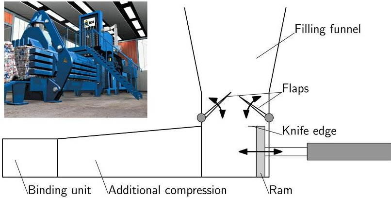

Figure 8. BOA waste baler system. The insert shows the BOA Impress $ ^{\circ} $ waste baler. Picture courtesy BOA Recycling Equipment. [Color figure can be viewed in the online issue, which is available at wileyonlinelibrary.com.]

Figure 9. Application of FunKey to the BOA case.

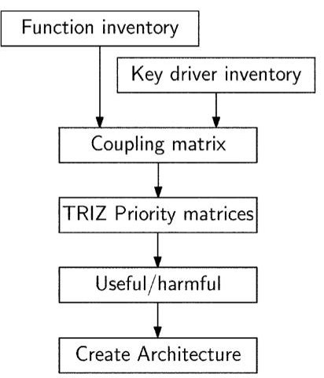

volume of waste from the supply in the funnel and precompress that volume. Then, the ram moves the waste to the left into the additional compression section (the knife cuts the waste from the supply in case no flaps are used). The ram moves back to compress another bale. The bales in the additional compression unit provide counterforce because of the taper. They are simultaneously compressed some more when the next bale is moved to the left. The binding unit binds the bale by applying straps that avoid decompression after the bale has left the baler. Finally, the bale is ejected.

Over the years the design changed from a vertical to a horizontal baler. Formerly, the binding was done by hand; this is automated now. The efficiency of material collection and compression was increased through the use of one or two precompression flaps as an alternative to a knife fitted on the ram.

## 5.1. The Problem

At this point in time, major modifications have been implemented. Yet the compression machines produced today are quite similar to those of 30 years ago. The balers have a capacity that depends on factors like weight, pressing power, installed power, and material size. A new design solution has to be found that surpasses current system architectures to improve the balers' capacity. If possible, the design should be modular. Furthermore, entirely different ways of compressing material are to be found and developed.

## 5.2. The Approach

In order to come to a conceptual design and to reach the desired design specifications and requirements, the FunKey method has been applied as shown in Figure 9. Also, other approaches have been used, as reported in Alink [2007].

After extensive talks and interviews with engineers, a thorough insight in the operation of the balers at BOA systems was gained. Using the acquired knowledge of the working principle, the most important functions were determined (see Fig. 10).

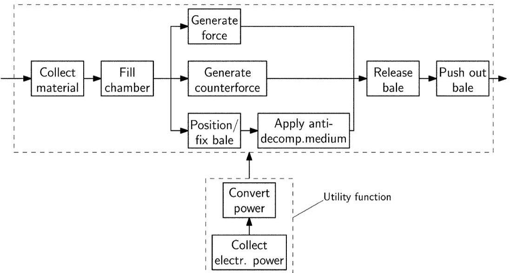

Figure 10. Functional block diagram of a baler.

<!-- PDF_PAGE: 8 -->

The next step is to derive the key drivers associated with the material compression machine:

- Material throughput (MT) (tons/h)

- Volume reduction (VR),representing a number of customer interests:

- compression ratio $ \left( \rho_{\mathrm{compressed}}=\rho_{\mathrm{uncompressed}} \right) $

- specific weight of bale ($\rho_{\mathrm{compressed}}$)

- minimal and maximal bale weight

- Bale handling (BH),representing the following requirements:

- easy ejection of bales

- bale shape

- bale shape consistency

- bale sizes (for transportation in sea-containers)

- type of binding (steel, plastic, foil)

- controllability of bale dimensions

- Cost per ton of material processed (Cost).

Part of the resulting FunKey matrix is shown in Table III, where the functions of Figure 10 are used. In this FunKey matrix, the crosses that were there initially (as in the one in Table II) have been further analyzed. This has resulted in useful versus harmful contributions (marked + versus -), or excessive versus insufficient contributions (marked with e versus i).

## 5.3. Results

## 5.3.1. Priority Matrix

The key driver Material throughput relates, among others, to TRIZ parameters weight of moving object (1) and quantity of substance/matter (26). In both cases, the suggested principle is IP 35: Transformations of properties. Several ideas have been generated. One is the use of a flexible compression chamber, where an external pressure is applied. This can provide for additional compression or fine-tuning of the bale size and shape. Another suggested principle is IP 1: Segmentation. The concretization of this idea results in a ram segmented in time and/or space. Segmentation in space would mean a series of rams that each have a very limited stroke, but a large force for compression.

Table III. Part of the FunKey Matrix for a Baler

<table border="1"><tr><td></td><td></td><td>MT</td><td>VR</td><td>BH</td><td>Cost</td></tr><tr><td rowspan="2">Fill baler</td><td>Collect material</td><td>i</td><td></td><td></td><td>-</td></tr><tr><td>Fill machine/chamber</td><td>i</td><td>i</td><td></td><td>-</td></tr><tr><td rowspan="2">Compress material</td><td>Generate force</td><td>+/i</td><td>+</td><td>+</td><td>-</td></tr><tr><td>Generate counter-force</td><td></td><td>+</td><td>+</td><td>-</td></tr><tr><td rowspan="2">Prevent decompression</td><td>Position/Fix bale</td><td>-</td><td></td><td></td><td>-</td></tr><tr><td>Apply anti-decompression</td><td>-</td><td>i</td><td>i</td><td>-</td></tr><tr><td rowspan="2">Remove bale</td><td>Release bale</td><td>+</td><td></td><td></td><td>-</td></tr><tr><td>Push bale out</td><td>+</td><td></td><td>+</td><td>-</td></tr><tr><td rowspan="2">Power conversion</td><td>Collect(electrical) power</td><td></td><td></td><td></td><td>-</td></tr><tr><td>Convert Power</td><td>+/i</td><td>+</td><td></td><td>-</td></tr></table>

i: insufficient, e: excessive, +: useful, -: harmful.

Table IV. Allocation of Functions to Subsystems in the BOA Baler $ ^{*} $

<table border="1"><tr><td>Function</td><td>Sub-system</td></tr><tr><td>Collect material</td><td>Material Entry System</td></tr><tr><td>Fill machine/chamber</td><td>Material Entry System</td></tr><tr><td>Generate force</td><td>Compression System</td></tr><tr><td>Generate counter-force</td><td>Compression System</td></tr><tr><td>Position/Fix bale</td><td>Structural Utility System</td></tr><tr><td>Apply anti-decompression</td><td>Binding System</td></tr><tr><td>Release bale</td><td>Hydraulics System</td></tr><tr><td>Push bale out</td><td>Compression System</td></tr><tr><td>Collect (electrical) power</td><td>Hydraulics System</td></tr><tr><td>Convert Power</td><td>Hydraulics System</td></tr></table>

* Also see Figures 8 and 10.

## 5.3.2. Useful/Harmful Contributions

Although only a few harmful contributions have been identified, several contradictions can be formulated and solved. One is the contradiction between volume reduction and cost per ton for the generate force function. Resulting inventive principles are spheroidality/curvature (IP 14), materializing into a rotating excenter ram; and thermal expansion (IP 37), materializing in compressing the waste or applying the binding strips at an elevated temperature. Cooling to room temperature will yield an additional volume reduction. The other cells in the matrix have also been investigated and many concepts have been identified [Alink, 2007].

## 5.3.3. Other Results

Using the FunKey approach, four subsystems and one utility are identified. Subsequently, all functions identified have been allocated to these subsystems (see Table IV). The next step is to use this for compilation of system budgets for the key drivers Material throughput, Volume reduction, Bale handling and Cost per ton, and, subsequently, for the requirements. Also, the interfaces have to be defined.

In this case the FunKey method effectively dissects the system at hand and sheds light on the context and the problem to be solved. This provides valuable leads for applying TRIZ and Systematic Inventive Thinking (SIT, see Goldenberg et al. [2003]), as well as increased insight in both the machine and the problem.

## 6. DMS PROJECT

The third year of the bachelor program of Industrial Design Engineering at the University of Twente [Eger, Lutters, and van Houten, 2004], contains a student project that deals with designing mechatronics and systems: the Design of Mechatronics and Systems project (DMS). This project is based on, and uses the same set-up as the project described in Bonnema, Lutters-Weustink, and van Houten [2005]. However, the sensors and actuators course has been replaced by a course on mechatronic design. The basic concept of the student project is to immerse the students in new technology, with a relatively large and multidisciplinary problem. By providing them with content and procedure information, the groups should be able to organize themselves. The content information is provided by the course on mechatronic design. The procedure informa-

<!-- PDF_PAGE: 9 -->

tion comes from a basic course on systems engineering. The result of the project has to be a system design and concept design of the main modules. No prototype is built, though. The groups are larger (12-15 persons) than for all other student projects of the curriculum (4-8 persons), and there is no tutor assigned to the groups. Instead, the students are encouraged to consult teachers whenever there is a need to. Note that the entire Bachelor curriculum for Industrial Design Engineering at the University of Twente is project-based.

The DMS project has run several times. Three times with the sensors and actuators course, and, since 2007, with the mechatronic design course. 2007 was also the first year FunKey was included. In that year, the students had to design a computer controlled table soccer game, where one or two people can play table soccer against a computer. For this, the system has to be able to control the rods of puppets on one side of the table, and detect the position, possibly also the speed and direction, of the ball. Other functions of the system can be tracking the score, providing game feedback, putting the ball into play, acting as a referee, etc. Also, the application environment of the soccer table has to be investigated: Will it be marketed as a gadget to consumers, or as a game to be operated in arcade halls? The five groups each had to deliver a system setup after 2 weeks, and subsystem requirements and concept designs plus an integration plan at the end of the project (7 weeks after its start). At the two milestones, the results are presented using posters to the teachers and peers. The teachers evaluate each poster with a written feedback and a mark on a 1-10 scale.

In the course on systems engineering, different SE tools are treated in a practical way [Bonnema, Lutters-Weustink, and van Houten, 2005]. The INCOSE handbook [INCOSE SEH Working Group, 2000] is treated as a tool kit for handling large projects. As an addition to the tools in the handbook, the FunKey method has been presented in an early phase of the students' project (but without the connection with TRIZ). As the tools are treated as part of a tool kit, there is no pressure put upon the groups to use a particular tool.

We will summarize the results for the system design (first milestone) of each of the five teams below. The second part of the project will be discussed only when needed. Because of privacy rules, the teams are numbered Team A to E, without correspondence to the original 1 to 5 numbering. The analysis below is based on the posters submitted and the feedback given to the groups.

## 6.1. Results

Team A mentioned the use of FunKey, but it appears they only used the first stage where the functions are connected to key drivers without allocating budgets. Whether they have used it for creating architectures is questionable. The $ \mathrm{N}^{2} $ diagram of the architecture can be found in Table V. The main concerns from the poster and the presentation relate to the large number of interfaces (see the $ \mathrm{N}^{2} $ diagram) and the lack of coherence between the various parts. This lack of coherence has not been eliminated in the second part of the project, where the subsystems had to be worked out and an integration sequence had to be devised.

Team B did not use FunKey. Yet, they did try to provide coherence within the project. Some crucial aspects were not treated in enough detail to make informed design decisions (data interfaces in general, and the interface between the processing and feedback subsystems in particular). The second part of the project provided poor results.

Team C did a very good job, the best system design we had seen until then. The SE tools provided were used, and FunKey was the center-point. By using FunKey to create several architectures, and comparing them using the coupling matrix and an $ \mathrm{N}^{2} $ matrix, a clear and well-defined architecture was created. Table VI shows the coupling matrix created by this team. The $ \mathrm{N}^{2} $ diagram can be found in Table VII. From the second part of the project it turned out, this clear architecture was very helpful.

Referring to Table VI, one can see that, although the game has to provide entertainment by nature, there is only 20% of the "entertainment" budget allocated to actually moving the

Table V. $ N^{2} $ Diagram of the Architecture of Team

<table border="1"><tr><td>Ball</td><td></td><td>-Ball pos.(x,y)</td><td></td><td>-Selfcheck rep.
-Update rep.</td></tr><tr><td></td><td>Puppets</td><td>-Puppets(x,Θ),
(system&amp;user)</td><td></td><td>-Selfcheck rep.
-Update rep.</td></tr><tr><td></td><td>-Stop puppets</td><td>Maintain rules</td><td>-Puppets(x,Θ),
(system&amp;user)
-Ball pos.(x,y)</td><td>-Selfcheck rep.
-Update rep.
-Puppets(x,Θ)
-Ball pos.(x,y)
-Game signals</td></tr><tr><td></td><td>-Puppets$\dot{\Theta}$;
;$\ddot{\Theta}$;
-Puppets$\ddot{x}$;$\ddot{x}$</td><td></td><td>Strategy</td><td>-Selfcheck rep.
-Update rep.</td></tr><tr><td>-Start selfcheck
-Update</td><td>-Start selfcheck
-Update</td><td>-Start selfcheck
-Update
-Input by user
-Game settings</td><td>-Start selfcheck
-Update
-Game settings</td><td>User Interface</td></tr></table>

"rep." is short for report

<!-- PDF_PAGE: 10 -->

Table VI. FunKey Matrix of Team C of the Design of Mechatronics and Systems Project $ ^{*} $

<table border="1"><tr><td rowspan="2">Functions</td><td colspan="5">Key Drivers</td></tr><tr><td>Costs/game</td><td>Entertainment</td><td>Comfort</td><td>Safety</td><td>Vandalism resistance</td></tr><tr><td>Turn on/off</td><td>1</td><td></td><td>5</td><td>2</td><td>10</td></tr><tr><td>Pay game</td><td>3</td><td></td><td>8</td><td>10</td><td>10</td></tr><tr><td>Set-up game</td><td></td><td></td><td></td><td></td><td></td></tr><tr><td>Choose preferences</td><td>3</td><td>6</td><td>4</td><td></td><td>4</td></tr><tr><td>Set preferences</td><td>3</td><td>6</td><td>4</td><td></td><td>4</td></tr><tr><td>Feedback of preferences</td><td>2</td><td></td><td>5</td><td></td><td>5</td></tr><tr><td>Play game</td><td></td><td></td><td></td><td></td><td></td></tr><tr><td>Insert ball</td><td>5</td><td>13</td><td>6</td><td>8</td><td>10</td></tr><tr><td>Detect ball</td><td>15</td><td></td><td></td><td></td><td>15</td></tr><tr><td>Detect puppets</td><td>15</td><td></td><td></td><td></td><td>15</td></tr><tr><td>Process data</td><td>10</td><td></td><td></td><td></td><td>3</td></tr><tr><td>Make decision</td><td>4</td><td>10</td><td></td><td></td><td>3</td></tr><tr><td>Actuate puppets</td><td>25</td><td>20</td><td>10</td><td>10</td><td>20</td></tr><tr><td>Auditive feedback</td><td>2</td><td>10</td><td>5</td><td>1</td><td>5</td></tr><tr><td>Visual feedback</td><td>4</td><td>15</td><td>7</td><td></td><td>5</td></tr><tr><td>Save data</td><td>2</td><td></td><td>5</td><td></td><td>2</td></tr><tr><td>Detect goal</td><td>3</td><td>3</td><td>5</td><td>5</td><td>5</td></tr><tr><td>Exchange data</td><td>3</td><td>10</td><td>2</td><td>1</td><td>5</td></tr><tr><td>Totals:</td><td>100</td><td>93</td><td>66</td><td>37</td><td>121</td></tr></table>

* Numbers indicate initial division of total available amount in percents.

puppets. It is clear that a large part of the fun has to come from the fact that the table has to be computer controlled, as 15% of the entertainment value comes from the visual feedback. The vandalism resistance poses a heavy burden on the design team, as can be seen from the larger than 100% budget allocated. Therefore, a careful review of the requirements and opportunities is needed in this area. The second part of the project has resulted in good and well-founded concept solutions, with the exception of one subteam. All subsystems appear to be well-integrated into the system. The system engineers have continuously monitored the overall performance of the system using budgets.

Team D did a proper stakeholder-analysis. Just as Team A, only the first stage of FunKey was used. As a result, there is a lack of coherence between the activities performed. The way functions are allocated to subsystems is not clear, even ambiguous. This lack of coherence continued during the second part of the project, even though the team was given feedback on this issue.

Team E applied the FunKey method after already having created an allocation of functions to subsystems. It appears as if they have not done anything with the coupling matrix they created. One of the comments by the teachers, at the first review, was that the connection between different parts and subsystems is lacking. Also, the goal of this team was to create

a system that meets every possible wish; a strategy to choose between conflicting interests was lacking. This led to poor results in the second part of the project. With a populated coupling matrix, like the one by Team C shown in Table VI, the conflicts emerging from this goal would have surfaced early in the process.

## 6.2. Observations

Of the five groups, four mentioned the FunKey procedure to acquire and organize information in the early phase of the project. Interestingly, of the four reported uses of FunKey, only one group stated they have used FunKey to create several architectures and to compare them. From the above, it is clear that the team that applied FunKey well (Team C) had the best overall results, both in the first and the second part of the project. This is even more relevant as their results exceeded those of all groups that took part in the DMS project and the previous version, the SAS project. 2007 was the first year FunKey was treated, and this has positively influenced the results. Although some other teams performed well, coherence was often lacking. In particular, the teams that did not use FunKey as an architecting aid (Team B, Team E) showed a lack of coherence in their results compared to the ones that did use FunKey.

Table VII. $ \mathrm{N}^{2} $ Diagram of the Architecture of Team C

<table border="1"><tr><td>Software</td><td>-Data: position
-Data: if goal</td><td>-Data: if new game</td><td></td></tr><tr><td>-Data: position</td><td>Puppets</td><td></td><td></td></tr><tr><td>-Data: position</td><td></td><td>Ball</td><td>-Data: if goal</td></tr><tr><td>-Data
-1 package before game</td><td></td><td></td><td>User Interface</td></tr></table>

<!-- PDF_PAGE: 11 -->

## 7. DISCUSSION

Table VIII shows a summary of the experiences and observations of the cases presented in this paper, in relation to the research goal shown in Figure 2. It is clear that in both the MAPPER and the BOA cases, several interesting system concepts were found that can be (and partly already have been) investigated further (see Sections 4.3 and 5.3, respectively). Although the concepts may have been found in other ways, the FunKey method has concentrated the effort using the TRIZ philosophy. This shows the innovation aspect of the tool. In addition to the new concepts found to simplify the machines, insight into how the machines work increased. The students that applied FunKey early in the DMS project and used the results showed improved insight in the problem and the stakeholders' interests, thus putting the problem in its context. It is expected that this will hold for any system the FunKey method is applied to.

In discussions with engineers the difference between function, behavior and implementation turned up (also see Shimomura et al. [1995] and Tomiyama and Umeda [1993]). In particular, mechanical engineers have an image of an implementation in mind while talking about the abstract function. This may look like a disadvantage. Yet, FunKey dissects the functions to be performed and is independent of the method used to identify the functions (a mind map in the MAPPER case, functional block diagrams in the BOA case, and various methods in the student project). It results in the right discussions between the system designers.

By creating the FunKey diagrams, the big picture has been created in the systems in the MAPPER and BOA cases. This has helped both in creating (parts of) the architectures, and in seeing the system in its context. In the DMS project, the system designs of Team C, which used FunKey, clearly showed it was designed with a better big picture of the problem than the other system designs.

Table VIII. Summary of the Experiences and Observations with FunKey in the Different Application Cases $ ^{*} $

As for maintaining the big picture, this could not be verified in the industrial cases because of the limited time the projects ran, and the fact that the designers applying the method were not appointed system engineers. In the DMS project, the infrastructure created with FunKey helped the students that took the role of system engineers in maintaining the big picture, as reported by the system engineers in Team C.

<table border="1"><tr><td rowspan="2">Case</td><td rowspan="2">Insight</td><td colspan="2">The Big Picture</td><td rowspan="2">Innovation</td></tr><tr><td>create</td><td>maintain</td></tr><tr><td>MAPPER</td><td>√</td><td>√</td><td>n.a.</td><td>√</td></tr><tr><td>BOA</td><td>√</td><td>√</td><td>n.a.</td><td>√</td></tr><tr><td>DMS with FunKey</td><td>√</td><td>√</td><td>√</td><td>n.a.</td></tr><tr><td>DMS no FunKey</td><td>~</td><td>~</td><td>~</td><td>n.a.</td></tr></table>

* DMS no FunKey refers to the DMS teams that did not use FunKey (n.a.: not applicable)

## 8. CONCLUSIONS AND RECOMMENDATIONS

The strength of the method is shown both in finding new concepts, and in better information on the system architectures. FunKey provided increased insight into the system, and its stakeholders. At the same time, it helps in maintaining the big picture for the system designer. Specialist designers are assisted by the method in that they are better informed on the context of their designs. New solution concepts are found for the design cases. Some of these are straightforward, and skilled engineers would have found them without using any tools. However, by using FunKey, it is no longer a matter of chance whether they are found, and it appears time can be saved. In addition to these straightforward concepts, several unexpected and promising concepts were found.

In addition to the well-known functional models like functional block diagrams, mind maps are very handy with the FunKey analysis and design procedure.

In the near future, we will apply the method in other cases. Additionally, we will create a computer-based prototype that supports an architect's playground to eliminate the bookkeeping now done by hand. In a second version, the link with the innovative principles of TRIZ can be integrated. With this prototype, additional tests will be undertaken.

Finally, more ways to improve communication between system designers, detail designers, and nontechnical stakeholders will be researched (also see Bonnema et al. [2010]).

## APPENDIX: TRIZ AND THE PRIORITY MATRICES

## A.1. Short Introduction to TRIZ

Altshuller [1997, 1999] with his team has investigated hundreds of thousands of patents looking for patterns in the inventions. This resulted in a method (or better: a set of tools) that can be used to solve various technical problems, hence the name Theory of Inventive Problem Solving (in Russian, this results in the acronym TRIZ). The common pattern in all of TRIZ is (see Fig. 11) that a specific problem is translated

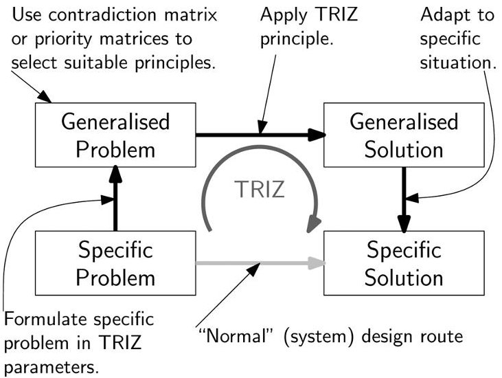

Figure 11. The TRIZ approach to design and problem solving. By taking a "detour" via a generalized problem and solution, solving problems is simplified.

<!-- PDF_PAGE: 12 -->

Table IX. Part of the Contradiction Matrix Used in TRIZ [Altshuller, 1997] $ ^{*} $

<table border="1"><tr><td colspan="2">Improving</td><td colspan="4">Deteriorating</td></tr><tr><td></td><td></td><td>9</td><td>10</td><td>11</td><td>12</td></tr><tr><td>9</td><td>Speed</td><td></td><td>13,28,15,19</td><td>6,18,38,40</td><td>35,15,18,34</td></tr><tr><td>10</td><td>Force</td><td>13,28,15,12</td><td></td><td>18,21,11</td><td>10,35,40,34</td></tr><tr><td>11</td><td>Tension/Pressure</td><td>6,35,36</td><td>36,35,21</td><td></td><td>35,4,15,10</td></tr><tr><td>12</td><td>Shape</td><td>35,15,34,18</td><td>35,10,37,40</td><td>34,15,10,14</td><td></td></tr></table>

*Only the segment for the technical parameters 9-12 is shown. In the cells, the corresponding Innovative Principles are shown. The numbers refer to the principles listed in Table X.

into a generalized problem. TRIZ then provides principles and patterns for finding a generalized solution. The final step is then to translate this generalized solution to the specific case at hand.

One of the mostly used tools of TRIZ is the list of innovative principles (IPs) combined with the contradiction matrix. Altshuller found that many patents resulted from solving a contradiction. This contradiction is of the form: When <property A> improves, <property B> deteriorates. The properties in the specific problem can be connected to 39 parameters of a technical system [Altshuller, 1997]. Examples of these parameters are "weight of moving object," "speed," and "reliability."

Based on the information in the patents researched, a limited set of ways to solve contradictions was found: the 40 innovative principles (IPs) see Table X. Thus there are, according to TRIZ, only a limited number of parameters (39) that constitute contradictions, and a limited number of solving principles (40). Therefore, the contradiction matrix was created (Table IX shows a part of this contradiction matrix; the

full contradiction matrix can be found in Altshuller [1997]). Any possible contradiction of the form when <technical parameter X> improves, <technical parameter Y> deteriorates can be found in the contradiction matrix. The numbers mentioned in the cell indexed by X and Y point to one to four promising innovative principles. For example, the speed (parameter 9) of a machine has to be increased. However, this leads to an unwanted increase of forces (parameter 10). Then Table IX suggests using Innovative Principles 13, 28, 15, and 19. These can be looked up in Table X.

Based on the work described in Ivashkov and Souchkov [2004], the priorities of TRIZ principles were determined. This was done both for determining the most appropriate principles to improve a technical parameter (Section A.2) as for reducing the negative impact on a technical parameter (Section A.3). The former is directly based on the work in the earlier mentioned reference [Ivashkov and Souchkov, 2004]; whereas the latter is analogously.

Please note that the body of knowledge in the TRIZ community is large and expanding rapidly. For more information,

Table X. The 40 Principles as Identified in Altshuller [1997]

<table border="1"><tr><td>#</td><td>Principle</td><td>#</td><td>Principle</td></tr><tr><td>1</td><td>Segmentation</td><td>21</td><td>Rushing through</td></tr><tr><td>2</td><td>Extraction</td><td>22</td><td>Convert harm into benefit</td></tr><tr><td>3</td><td>Local quality</td><td>23</td><td>Feedback</td></tr><tr><td>4</td><td>Asymmetry</td><td>24</td><td>Mediator</td></tr><tr><td>5</td><td>Consolidation</td><td>25</td><td>Self-service</td></tr><tr><td>6</td><td>Universality</td><td>26</td><td>Copying</td></tr><tr><td>7</td><td>Nesting (Matrioshka)</td><td>27</td><td>Dispose</td></tr><tr><td>8</td><td>Counterweight</td><td>28</td><td>Replacement of mechanical system</td></tr><tr><td>9</td><td>Prior counteraction</td><td>29</td><td>Pneumatic or hydraulic construction</td></tr><tr><td>10</td><td>Prior action</td><td>30</td><td>Flexible films or thin membranes</td></tr><tr><td>11</td><td>Cushion in advance</td><td>31</td><td>Porous materials</td></tr><tr><td>12</td><td>Equipotentiality</td><td>32</td><td>Changing the color</td></tr><tr><td>13</td><td>Do it in reverse</td><td>33</td><td>Homogeneity</td></tr><tr><td>14</td><td>Spheroidality</td><td>34</td><td>Rejecting and regenerating parts</td></tr><tr><td>15</td><td>Dynamicity</td><td>35</td><td>Transformation of properties</td></tr><tr><td>16</td><td>Partial or excessive action</td><td>36</td><td>Phase transition</td></tr><tr><td>17</td><td>Transition into a new dimension</td><td>37</td><td>Thermal expansion</td></tr><tr><td>18</td><td>Mechanical vibration</td><td>38</td><td>Accelerated oxidation</td></tr><tr><td>19</td><td>Periodic action</td><td>39</td><td>Inert environment</td></tr><tr><td>20</td><td>Continuity of useful action</td><td>40</td><td>Composite materials</td></tr></table>

<!-- PDF_PAGE: 13 -->

Table XI. The Positive Priority Matrix PM+*

<table border="1"><tr><td></td><td>Technical Parameter</td><td>1st</td><td>2nd</td><td>3d</td></tr><tr><td>1</td><td>Weight of moving object</td><td>35</td><td></td><td>28</td></tr><tr><td>2</td><td>Weight of stationary object</td><td>35</td><td>10,19,28</td><td>1</td></tr><tr><td>3</td><td>Length of moving object</td><td>1,29</td><td>15,35</td><td>4</td></tr><tr><td>4</td><td>Length of stationary object</td><td>35</td><td>28</td><td>1,10,14,26</td></tr><tr><td>5</td><td>Area of moving object</td><td>2,15</td><td>13,26,30</td><td>4</td></tr><tr><td>6</td><td>Area of stationary object</td><td>18</td><td>2</td><td>35</td></tr><tr><td>7</td><td>Volume of moving object</td><td>1,35</td><td>2,10,29</td><td>4,15,34</td></tr><tr><td>8</td><td>Volume of stationary object</td><td>35</td><td></td><td></td></tr><tr><td>9</td><td>Speed</td><td>28</td><td>35</td><td>13</td></tr><tr><td>10</td><td>Force(Intensity)</td><td>35</td><td>10,18,37</td><td>36</td></tr><tr><td>11</td><td>Stress or pressure</td><td>35</td><td>10</td><td></td></tr><tr><td>12</td><td>Shape</td><td>10</td><td>1,14,15</td><td>32,34</td></tr><tr><td>13</td><td>Stability of the object's composition</td><td>35</td><td></td><td></td></tr><tr><td>14</td><td>Strength</td><td>3,35</td><td>10</td><td>40</td></tr><tr><td>15</td><td>Duration of action of moving object</td><td>19</td><td>35</td><td>3,10</td></tr><tr><td>16</td><td>Duration of action of stationary object</td><td>35</td><td>1,10,16</td><td>40</td></tr><tr><td>17</td><td>Temperature</td><td>35</td><td>19</td><td></td></tr><tr><td>18</td><td>Illumination intensity</td><td>19</td><td>32</td><td></td></tr><tr><td>19</td><td>Use of energy by moving object</td><td>35</td><td>19</td><td></td></tr><tr><td>20</td><td>Use of energy by stationary object</td><td>19,35</td><td>18,27</td><td>many</td></tr><tr><td>21</td><td>Power</td><td>35</td><td>19</td><td>2,10</td></tr><tr><td>22</td><td>Loss of energy</td><td>7</td><td>35</td><td>2</td></tr><tr><td>23</td><td>Loss of substance</td><td>10</td><td>35</td><td></td></tr><tr><td>24</td><td>Loss of information</td><td>10</td><td>26,35</td><td></td></tr><tr><td>25</td><td>Loss of time</td><td>10</td><td>35</td><td>18</td></tr><tr><td>26</td><td>Quantity of substance/the matter</td><td>35</td><td></td><td></td></tr><tr><td>27</td><td>Reliability</td><td>35</td><td>11</td><td>10</td></tr><tr><td>28</td><td>Measurement accuracy</td><td>32</td><td>28</td><td></td></tr><tr><td>29</td><td>Manufacturing precision</td><td>32</td><td></td><td></td></tr><tr><td>30</td><td>Object-affected harmful factors</td><td>22</td><td>35</td><td></td></tr><tr><td>31</td><td>Object-generated harmful factors</td><td>22,35</td><td>2</td><td>1,39</td></tr><tr><td>32</td><td>Ease of manufacture</td><td>1</td><td></td><td></td></tr><tr><td>33</td><td>Ease of operation</td><td>1</td><td>13</td><td>2</td></tr><tr><td>34</td><td>Ease of repair</td><td>1</td><td>10</td><td></td></tr><tr><td>35</td><td>Adaptability or versatility</td><td>35</td><td></td><td></td></tr><tr><td>36</td><td>Device complexity</td><td>13,26</td><td>1,28</td><td>2,10</td></tr><tr><td>37</td><td>Difficulty of detecting and measuring</td><td>28</td><td>35</td><td>16,18,26,27</td></tr><tr><td>38</td><td>Extent of automation</td><td>35</td><td>13</td><td>28</td></tr><tr><td>39</td><td>Productivity</td><td>10</td><td>35</td><td></td></tr></table>

* Found from counting the times an innovative principle is mentioned in the row of a particular technical parameter. The numbers in the columns marked "1st," "2nd," and "3rd" are pointers to the relevant innovative principles (see Table X).

a further introduction and latest findings, please refer to http://www.triz-journal.com/

## A.2. Positive Priority Matrix, PM+

For the positive priority matrix PM+, the number of occurrences of an innovative principle, IP, on a row in the TRIZ contradiction matrix (Table IX and Altshuller [1997]) is counted. The principles with the highest occurrences are the favorite principles for improving the system's performance regarding that technical parameter. In addition to the results presented in Ivashkov and Souchkov [2004], we added two

columns for the second and third best principles for each parameter. The result is shown in Table XI.

For some technical parameters the second and/or third best principles are blank. This indicates that the difference between the occurrence of the favorite and second or the second and third best principles was so large that the fitness of that IP can be doubted.

## A.3. Negative Priority Matrix, PM-

The negative priority matrix PM- is determined identically. The only difference is that the columns are analyzed, in-

<!-- PDF_PAGE: 14 -->

Table XII. The Negative Priority Matrix PM- $ ^{*} $

<table border="1"><tr><td></td><td>Technical Parameter</td><td>1st</td><td>2nd</td><td>3d</td></tr><tr><td>1</td><td>Weight of moving object</td><td>35</td><td>8,15,28</td><td>2,26,40</td></tr><tr><td>2</td><td>Weight of stationary object</td><td>35</td><td>26,27</td><td></td></tr><tr><td>3</td><td>Length of moving object</td><td>1</td><td>15</td><td>14,17,28,29</td></tr><tr><td>4</td><td>Length of stationary object</td><td>14,26</td><td>1,10,35</td><td>7,15,28</td></tr><tr><td>5</td><td>Area of moving object</td><td>17</td><td>13,15,26</td><td>10,29</td></tr><tr><td>6</td><td>Area of stationary object</td><td>16,18,35,40</td><td>2,10,17,39</td><td>30,36</td></tr><tr><td>7</td><td>Volume of moving object</td><td>35</td><td>2,10</td><td>29</td></tr><tr><td>8</td><td>Volume of stationary object</td><td>35</td><td></td><td></td></tr><tr><td>9</td><td>Speed</td><td>35</td><td>28</td><td></td></tr><tr><td>10</td><td>Force(Intensity)</td><td>35</td><td>10</td><td></td></tr><tr><td>11</td><td>Stress or pressure</td><td>35</td><td>10</td><td></td></tr><tr><td>12</td><td>Shape</td><td>1,35</td><td>29</td><td>10,14,15</td></tr><tr><td>13</td><td>Stability of the object's composition</td><td>35</td><td></td><td></td></tr><tr><td>14</td><td>Strength</td><td>28</td><td>3</td><td>10</td></tr><tr><td>15</td><td>Duration of action of moving object</td><td>35</td><td>3</td><td>19</td></tr><tr><td>16</td><td>Duration of action of stationary object</td><td>16</td><td>10,35</td><td>1</td></tr><tr><td>17</td><td>Temperature</td><td>35</td><td>19</td><td></td></tr><tr><td>18</td><td>Illumination intensity</td><td>19</td><td>32</td><td>1,13</td></tr><tr><td>19</td><td>Use of energy by moving object</td><td>35</td><td>19</td><td></td></tr><tr><td>20</td><td>Use of energy by stationary object</td><td>1</td><td>35</td><td>18,19</td></tr><tr><td>21</td><td>Power</td><td>35</td><td>10,19</td><td>2,18</td></tr><tr><td>22</td><td>Loss of energy</td><td>35</td><td>2</td><td></td></tr><tr><td>23</td><td>Loss of substance</td><td>10</td><td>35</td><td></td></tr><tr><td>24</td><td>Loss of information</td><td>10</td><td>24</td><td></td></tr><tr><td>25</td><td>Loss of time</td><td>10</td><td>35</td><td>28</td></tr><tr><td>26</td><td>Quantity of substance/the matter</td><td>35</td><td>3</td><td></td></tr><tr><td>27</td><td>Reliability</td><td>10</td><td>11</td><td>40</td></tr><tr><td>28</td><td>Measurement accuracy</td><td>28</td><td>32</td><td></td></tr><tr><td>29</td><td>Manufacturing precision</td><td>32</td><td>10</td><td>28</td></tr><tr><td>30</td><td>Object-affected harmful factors</td><td>22</td><td>35</td><td>2</td></tr><tr><td>31</td><td>Object-generated harmful factors</td><td>35</td><td>2</td><td></td></tr><tr><td>32</td><td>Ease of manufacture</td><td>1</td><td>35</td><td></td></tr><tr><td>33</td><td>Ease of operation</td><td>1</td><td>32,35</td><td>2,28</td></tr><tr><td>34</td><td>Ease of repair</td><td>1</td><td>10</td><td></td></tr><tr><td>35</td><td>Adaptability or versatility</td><td>15</td><td></td><td></td></tr><tr><td>36</td><td>Device complexity</td><td>1</td><td>26</td><td>10</td></tr><tr><td>37</td><td>Difficulty of detecting and measuring</td><td>35</td><td></td><td></td></tr><tr><td>38</td><td>Extent of automation</td><td>35</td><td>2</td><td></td></tr><tr><td>39</td><td>Productivity</td><td>35</td><td></td><td></td></tr></table>

* Found from counting the times an innovative principle is mentioned in the column of a particular technical parameter. The numbers in the columns marked "1st," "2nd," and "3rd" are pointers to the relevant innovative principles (see Table X).

stead of the rows. The resulting negative priority matrix is shown in Table XII. This matrix can be used to reduce the negative consequences of the system on a given technical parameter.

## ACKNOWLEDGMENTS

The author thanks the Master student Willem Alink for his work on the BOA case and MAPPER Lithography for the opportunity and their cooperation. Also the students in project DMS of 2007 are kindly thanked for their work.

## REFERENCES

W. Alink, Systematic, conceptual re-design of a waste baler, Master thesis, University of Twente, Enschede, The Netherlands, 2007.

G.S. Altshuller, 40 principles—TRIZ keys to technical innovation, TRIZ Tools 1, Technical Innovation Center, Worcester, MA, 1997.

G.S. Altshuller, The innovation algorithm: TRIZ, systematic innovation and technical creativity, Technical Innovation Center, Worcester, MA, 1999.

B.S. Blanchard and W.J. Fabrycky, Systems, 3rd edition, Prentice Hall, Upper Saddle River, NJ, 1988.

<!-- PDF_PAGE: 15 -->

G.M. Bonnema, "Function and budget based system architecting," Tools and methods of competitive engineering, I. Horvath and J. Duhovnik (Editors), TMCE 2006, Delft University of Technology, Ljubljana, Slovenia, 2006, pp. 1306-1318.

G.M. Bonnema, "TRIZ for systems architecting," TRIZ future 2006, J.R. Duflou, J. D'hondt, T. Devoldere, S. Dewulf, and N. Dekeyser (Editors), Dejonghe, Belgium, 2006b, pp. 87-92.

G.M. Bonnema, FunKey architecting—an integrated approach to system architecting using functions, key drivers and system budgets, Ph.D. thesis, University of Twente, Enschede, The Netherlands, 2008.

G.M. Bonnema and F.J. van Houten, "Conceptual design in a hightech environment," Methods and tools for co-operative and integrated design, S. Tichkiewitch and D. Brissaud (Editors), Kluwer Academic, Dordrecht, 2004, pp. 171-182.

G.M. Bonnema and F.J. van Houten, Use of models in conceptual design, J Eng Des 17(6) (2006), 549-562.

G.M. Bonnema, I.F. Lutters-Weustink, and F.J. van Houten, Introducing systems engineering to industrial design engineering students with hands-on experience, 18th Int Conf Syst Eng (ICSEng05); IEEE Computer Society, Las Vegas, NV, 2005, 408-413.

G.M. Bonnema, P.D. Borches, R.G. Kauw-A-Tjoe, and F.J.v. Houten, Communication: Key factor in multidisciplinary system design, 8th Annu Conf Syst Eng Res (CSER), Stevens Institute of Technology, Hoboken, NJ, 2010, pp. 11-20.

T. Bustnay and J.Z. Ben-Asher, How many systems are there? Using the $ \mathrm{N}^{2} $ method for systems partitioning, Syst Eng 8(2) (2005), 109-118.

L.-K. Chan and M.-L. Wu, Quality function deployment: A literature review, Eur J Oper Res 143(3) (2002), 463-497.

L.-K. Chan and M.-L. Wu, A systematic approach to quality function deployment with a full illustrative example, Omega 33(2) (2005), 119-139.

J. Daniels and T. Bahill, The hybrid process that combines traditional requirements and use cases, Syst Eng 7(4) (2004), 303-319.

J. de Andres Sanchez and A. Terceno Gomez, Applications of fuzzy regression in actuarial analysis, J Risk Insurance 70(4) (2003), 665-699.

A.G. Dorée, Gemeentelijk Aanbesteden—Een Onderzoek naar de Samenwerking Tussen Diensten Gemeentewerken en Aannemers in de Grond-, Weg- En Waterbouwsector; Ph.D. thesis (in Dutch); University of Twente, Enschede, The Netherlands, 1996.

A.O. Eger, D. Lutters, and F.J. van Houten, Create the future, Int Eng Product Des Ed Conf; Delft, The Netherlands, 2004, pp. 43-50.

S. Finger and J.R. Dixon, A review of research in mechanical engineering design. Part I: Descriptive, prescriptive, and computer-based models of design processes, Res Eng Des 1(1) (1989a), 51-67.

S. Finger and J.R. Dixon, A review of research in mechanical engineering design. Part II: Representations, analysis, and design for the life cycle; Res Eng Des 1(2) (1989b), 121-137.

H. Frericks, W. Heemels, G.J. Muller, and J. Sandee, "Budget-based design," Boderc: Model-based design of high-tech systems, W. Heemels and G.J. Muller (Editors), Embedded Systems Institute, Eindhoven, The Netherlands, 2006, pp. 59-76.

J. Goldenberg, R. Horowitz, A. Levav and D. Mazursky, Finding your innovation sweet spot, Harvard Bus Rev 81(3) (March 2003), 120-129.

R.K. Gulatti and S.D. Eppinger, The coupling of product architecture and organizational structure decisions; Working Paper 3906; MIT Sloan School of Management, Cambridge, MA, 1996.

INCOSE SEH Working Group, Systems engineering handbook, 2nd edition, INCOSE, Seattle, WA, 2000.

INCOSE SEH Working Group, Systems engineering handbook, 3rd edition, INCOSE, Seattle, WA, 2008.

M. Ivashkov and V. Souchkov, Establishing priority of TRIZ inventive principles in early design, Design 2004, Dubrovnik, Croatia, 2004.

P. Kruit, The role of MEMS in maskless lithography, Microelectron Eng 84(5-8) (2007), 1027-1032.

D. Lutters, Manufacturing integration based on information management, Ph.D. thesis, University of Twente, Enschede, The Netherlands, 2001.

M.W. Maier and E. Rechtin, The art of systems architecting, 2nd edition, CRC Press, Boca Raton, FL, 2000.

J.N. Martin and H.L. Davidz, Systems engineering case study development, 5th Annu Conf Syst Eng Res 2007 (CSER2007); Stevens Institute of Technology, Hoboken, NJ, 2007.

G.J. Muller, CAFCR: A multi-view method for embedded systems architecting, Ph.D. thesis, Delft University of Technology, Delft, The Netherlands, 2004.

G.J. Muller, Do useful multi-domain methods exist? 3rd Conf Syst Eng Res (CSER2005), Hoboken, NJ, 2005.

G.J. Muller, Design objectives and design understandability http://www.gaudisite.nl/DesignUnderstandabilitySlides.pdf, accessed on June 7, 2007.

Object Management Group, The Official OMG SysML Site, Needham, MA, http://www.omg.org/, accessed on October 6, 2008.

J.A. Ruder and D.K. Sobek, Experiment on a system-level design tool, J Eng Des 18(4) (2007), 327-342.

Y. Shimomura, H. Takeda, M. Yoshioka, Y. Umeda, and T. Tomiyama, Representation of design object based on the functional evolution process model, Des Theory Methodol DTM'95, ASME, 1995, pp. 351-360.

C. Smith and D. Verma, Conceptual system design evaluation: Rating and ranking versus compliance analysis, Syst Eng 7(4) (2004), 338-351.

N.P. Suh, The principles of design, Oxford Series on Advanced Manufacturing; Oxford University Press, New York, Oxford, 1990.

T. Tomiyama and Y. Umeda, A CAD for functional design, Ann CIRP 42(1) (1993), 143-146.

<!-- PDF_PAGE: 16 -->

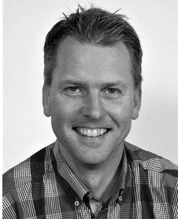

G. Maarten Bonnema is an assistant professor at the Laboratory of Design, Production and Management of the Faculty of Engineering Technology at the University of Twente. He graduated (Ir., equivalent to MSc.) in electronic engineering at the University of Twente in 1992, and did a 2-year designer course on technical systems at the University of Technology in Delft. He has worked as a Systems Engineer at ASML from 1995 to 1999, where he contributed to the TwinScan system architecture. Since 1999 he has been employed by the University of Twente. In 2006 and 2007 he was involved in the design of a wafer stepper at MAPPER lithography (part time). His research involves supporting system designers, conceptual design, and mechatronic design. He teaches design in general and systems engineering and is a tutor in various student projects. In parallel to teaching, he completed his Ph.D. research on system architecting in 2008.