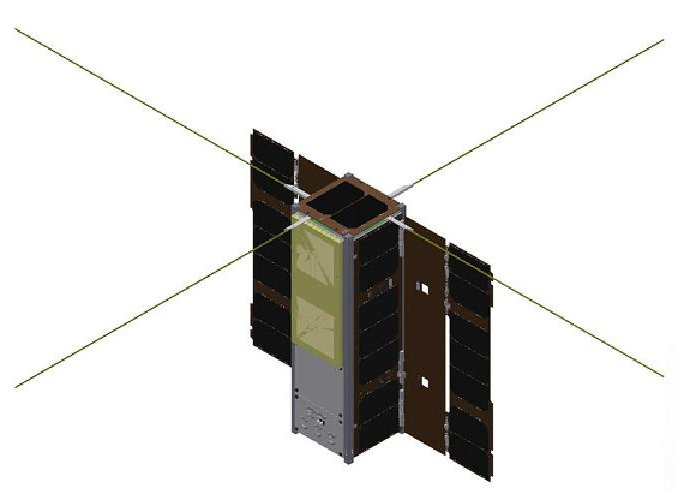
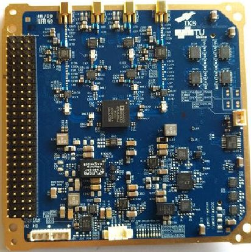
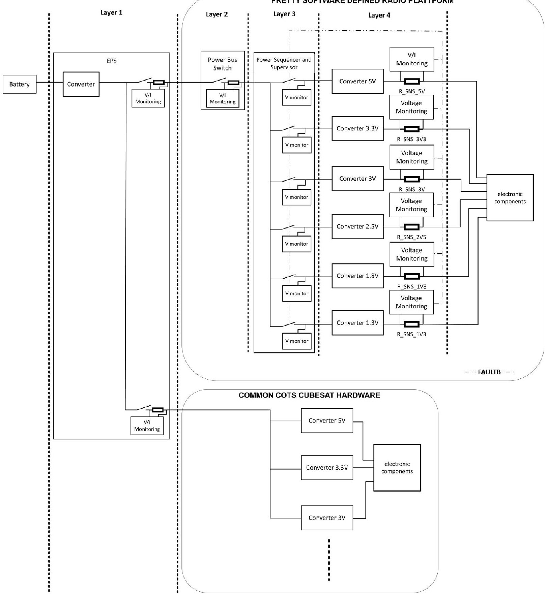
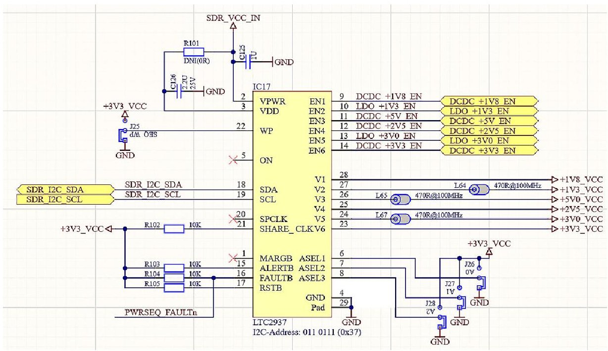
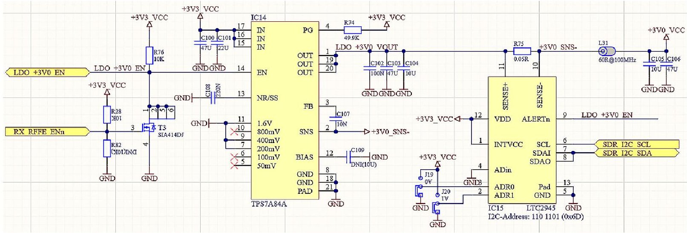
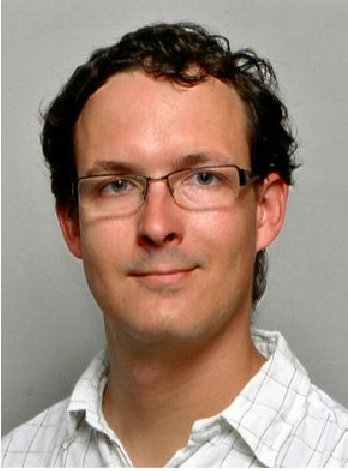
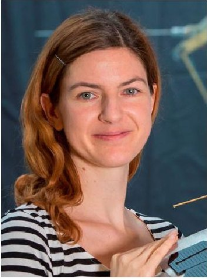
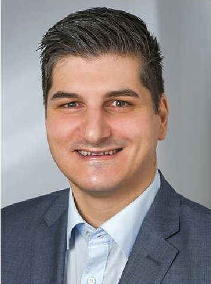

<!-- PDF_PAGE: 1 -->

# An innovative FDIR approach for the power supply of the PRETTY SDR satellite payload

Andreas Johann Hörmer ID · Manuela Wenger · Reinhard Zeif

Received: 26 September 2021 / Accepted: 12 October 2021 / Published online: 15 February 2022 $ \textcircled{c} $ The Author(s) 2022

Abstract CubeSat missions are characterized by short development times and challenging budget constraints. Due to the constraints in terms of mass, volume, and power, it is often not possible to increase reliability by adding redundant subsystems to the spacecraft. Therefore, it is necessary to implement important error-proofing mechanisms to still be able to derive a high scientific benefit from these missions. Once the satellite has been launched, physical access to the satellite's hardware is no longer possible. For this reason, systems are often implemented that allow automatic failure detection, isolation of the failure from other systems, as well as automatic recovery (FDIR). This paper describes the advantages and areas of application of software-defined radio platforms (SDRs) on board of small satellites and CubeSats. In addition, important aspects of the hardware FDIR concept of the PRETTY SDR payload system are presented. In order to prevent the hardware from being damaged with a fault-free power supply, different levels of fault monitoring are described as well.

Keywords FDIR·CubeSat·Power supply·SDR

Realisierung eines innovativen FDIR-Konzeptes für die Spannungsversorgung der PRETTY-SDR-Plattform

Zusammenfassung CubeSat-Missionen zeichnen sich durch kurze Entwicklungszeiten und herausfordernde Budgetbeschränkungen aus. Aufgrund der

Beschränkungen in Bezug auf Masse, Volumen und Leistung ist es oft nicht möglich, die Zuverlässigkeit durch Hinzufügen redundanter Subsysteme zum Raumfahrzeug zu erhöhen. Daher ist es notwendig, wichtige Mechanismen zur Fehlersicherung zu implementieren, um dennoch einen hohen wissenschaftlichen Nutzen aus diesen Missionen ziehen zu können. Sobald der Satellit gestartet ist, ist ein physischer Zugriff auf die Hardware des Satelliten nicht mehr möglich. Aus diesem Grund werden häufig Systeme eingesetzt, die eine automatische Fehlererkennung, eine Isolierung des Fehlers von anderen Systemen, aber auch eine automatische Wiederherstellung ermöglichen (FDIR). Dieser Beitrag beschreibt die Vorteile und Anwendungsgebiete von Software-definierten Funkplattformen (SDRs) an Bord von Kleinsatelliten und CubeSats. Darüber hinaus werden wichtige Aspekte des Hardware-FDIR-Konzepts des PRETTY-SDR-Nutzlastsystems vorgestellt. Um Schäden an der Hardware mithilfe einer fehlerfreien Stromversorgung zu verhindern, werden außerdem verschiedene Stufen der Fehlerüberwachung präsentiert.

Schlüsselwörter FDIR·CubeSat·Stromversorgung· SDR

Abbreviations

CMOS Complimentary Metal-Oxide Semiconductor

COTS Customer Off The Shelf

EEPROM Electrically Erasable Programmable Read-Only Memory

EPS Electrical Power Subsystem

ESA European Space Agency

ESTEC European Space research and TEChnology Center

FDIR Failure Detection, Isolation, and Recovery

<!-- PDF_PAGE: 2 -->

LDO Low Drop-Out converter

LSB Least Significant Bit

PCB Printed Circuit Board

PDU Power Distribution Unit

PRETTY Passive REflecTometry and dosimeTrY

SDR Software-Defined Radio

SEE Single-Event Effect

SEPP Satellite Experimenters Processing Platform

TRL Technology Readiness Level

## 1 Introduction

Software-defined radios (SDRs) have the characteristic that not the entire radio and signal processing chain is realised in hardware, but, as the name already suggests, parts of it are realised in software. The realisation in software makes it possible to subsequently adapt or change these software-implemented parts by changing the configuration. Due to the flexibility achieved in this way, an SDR can therefore be used for various applications with relatively little or, in some cases, no hardware redesign effort at all.

The use of an SDR is possible for a variety of applications. This ranges from the implementation of simple reconfigurable transceivers in different frequency bands with the flexibility to change coding schemes and data rates during flight [14] to different measurement setups like satellite ranging [15] or passive reflectometry [16] which is the primary purpose of the PRETTY mission [17]. In general, almost any setup can be realised based on the reception or transmission of different radio frequencies. For example, with relatively little change to the hardware, the system can be used to measure ice and sea heights and passively measure the temperature of the Earth's surface [18].

SDR platforms are also of high interest for small satellite and CubeSat missions, as their high reconfigurability allows the fulfilment of various mission goals. At the Institute of Communication Networks and Satellite Communications, a 3U CubeSat called PRETTY (Passive REflecTometry and DosimeTrY) [1] is currently designed, built and tested, together with

RUAG Space Austria and Seibersdorf Laboratories. After TUGSAT-1 [2] and OPS-SAT [3], it is the third small satellite to be built at Graz University of Technology. It will host two scientific payloads dedicated to passive reflectometry, as well as dosimetry.

The PRETTY satellite will host such an SDR module (Fig.1) in order to operate the passive reflectometry payload of the satellite. Its task will be to receive and sample the direct signals from the GPS satellites and the reflected signals from the Earth. Due to distortions in the reflection path, the correlation of both signals will provide information on the surface characteristics (e.g. measuring ice and sea heights).

## 2 The challenge of FDIR introduction on CubeSat missions

CubeSat missions might be characterised as small, light and cost-optimised. For large and much more expensive missions, Failure Detection Isolation and Recovery (FDIR) is often realised by installing several redundant modules and comparing the results between these identical modules or even by switching between them [4]. Due to the limitations of the CubeSats in terms of size and the limited budget, no (or only little) redundancy can be realised in these missions, which means that error prevention has to be done on a different level.

CubeSat missions generally have a very high failure rate. With a convergence interval of 95% , it can be assumed that within the first year in orbit, between 26.76% and 41.06% of the CubeSats are defective and no longer functional for a wide variety of reasons [5].

Of all failures within the first 30 days, 44% of all failures are due to the Electrical Power Supply (EPS) [5]. If these problems of the power supply system can be eliminated, it can be concluded that almost half of all mission failures can be prevented in the initial period of the missions, thereby significantly increasing mission success. This applies to the EPS of the entire satellite and the electrical power supply of each submodule.

Fig.1 A CAD model of the PRETTY spacecraft is shown on the left. The reflectometer antenna for the main payload is visible on the front. On the right hand, one can see the SDR platform of the PRETTY mission

<!-- PDF_PAGE: 3 -->

## 3 Innovative FDIR approach and its realisation

Although most of the failures of CubeSat missions were related to the power system, additional areas of improvement were detected and investigated thoroughly.

An FDIR concept based on four layers was elaborated and realised onboard the PRETTY spacecraft, which consists of

- Layer 1: Electronic Power Supply

- Layer 2: Power bus switches

- Layer 3: Power sequencer and supervisor

- Layer 4: Monitoring of voltage converter's power

A detailed description of the different layers is given in Sect. 3.1.

Fig. 2 shows a schematic architecture diagram of the four layers of our concept. In layers 1-3, it is al-

Fig. 2 FDIR concept of the PRETTY SDR power supply in comparison to the design of most common COTS CubeSat hardware

<!-- PDF_PAGE: 4 -->

ways possible to interrupt the power supply to the SDR. In layer 4, the interruption option of layer 3 is used. This concept enables a finer breakdown and measurement of the individual voltages and currents of the SDR, which means that overcurrent, overvoltage and undervoltage situations can be better resolved than in standard CubeSat hardware. Due to fluctuations in the current demand during operation, a more precise delimitation between desired operation and the error case is possible. In comparison, the concept of the power supply, which is standard on many COTS CubeSat components, is also shown in the lower section of the diagram. Here, layers 2-4 are usually omitted, and the measurement of the current or voltage is the sole responsibility of the EPS. However, since all operating cases must also be covered here, the current limits, for example, must be selected so large that all operational scenarios are covered. However, if a fault occurs in an electronic component, which leads to increased current consumption, this cannot be detected in this system. Using all four layers, the probability for detecting these failures is higher due to the finer breakdown.

## 3.1 FDIR Layer description

Layer 1: Electronic power supply The first layer of the FDIR concept involves the Electrical Power Supply (EPS). The EPS system of the PRETTY satellite is a P60 system, which is a COTS product from GomSpace [6]. This EPS offers two power distribution units (PDUs), which in turn offer 9 supply channels each [7]. The SDR board is connected to one of these supply channels. These power channels are monitored by the software of the P60 module and provide first basic protection against overcurrent situations and thus also basic latch-up protection.

Layer 2: Power bus switches The power bus switches are the second layer of the FDIR concept of the PRETTY SDR system. The application principle of the power bus switch on a Cubesat was first developed for the SEPP (Satellite Experimenters Processing Platform) [8], a module onboard the OPS-SAT spacecraft, which was built at our Institute and has been operational in orbit since late 2019. The principle is now adapted and used again for the PRETTY payload systems (SEPP, SDR and the dosimeter).

An Analog Devices LTC4281 is used as the power bus switch on the SDR board. It has the following essential properties [9]:

- current, voltage, and power monitoring

- overcurrent and latch-up protection

- overvoltage/undervoltage protection

- inrush current ramping

- storage of minimum/maximum values and fault logging

- Layer 3: Power sequencer and supervisor A power sequencer and supervisor provide the third layer of the SDR frontend FDIR system. For the PRETTY SDR system, an Analog Devices LTC2937 chip is used. All DCDC and LDO converters of the board are connected to this chip, which offers the following key features [10]:

- overvoltage and undervoltage detection

- sequenced switching on and off of the individual voltage regulators

- fault logging

The circuitry of the voltage supervisor is shown in Fig. 3.

Layer 4: Monitoring of voltage converter's power The fourth level of the PRETTY SDR hardware on-

Fig.3 Schematic of the LTC2937 voltage supervisor as implemented on the SDR PCB of the PRETTY satellite

<!-- PDF_PAGE: 5 -->

board FDIR system is given by monitoring each voltage converter's power. The chip used for this is the Analog Devices LTC2945. This offers the possibility of resolving the voltages and currents of the converters with an accuracy of 12 bits. The currents are resolved by measuring the voltage drop across a sense resistor R_SNS. The full-scale resolution is specified for a voltage drop of 102.4 mV [11].

When selecting the sense resistors, several factors must be taken into account here. On the one hand, the resistors must be selected large enough so that the resolution of the current per converter is as accurate as possible. On the other hand, the resistor must be selected small enough so that the full-scale range of the ADC is not exceeded even when the maximum current is drawn, and the voltage drop across the sense resistor is not too large.

In the PRETTY case, the R_SNS values were selected so that a resolution accuracy between 0.5 mA per LSB and 2.5 mA per LSB is achieved at the transducers. Considering the manufacturing tolerances of the measuring resistors and the temperature behaviour of the entire electronics, this current resolution of the measurement is sufficient, especially in connection with changing component values and the resulting different current consumption.

The sense resistors were chosen in such a way that the LSB measuring range is approximately the same for each converter for each expected current range.

The voltage value at the SENSE-pin of the power monitor, i.e. after the voltage drop through the sense resistor, was selected as the voltage feedback to the converter so that an increased output voltage can compensate the voltage drop through the sense resistor and the desired voltage value is present directly before the filter for the generated voltage.

One feature to be pointed out in the following is the automatic detection and isolation of a fault on a dedicated converter. The LTC2945 Power Monitor measures the power drawn from each converter. If the power is higher than the configuration allows, various actions can be taken. In the case of the PRETTY power supply system, the ALERTn pin is pulled to the ground. This pin is also directly connected to the enable pin (label LDO_+1V3_EN) so that if a fault occurs in the circuitry connected to the converter, the converter is deactivated by pulling the enable pin of the converter to the ground. As a result, no output voltage is generated by the converter. This has the following two effects: Firstly, the subsequent circuit is no longer supplied with voltage so that any damage caused by an unwanted current flow can be prevented. Secondly, the voltage supervisor detects that no voltage is generated at the converter, and an under-voltage situation is detected. Depending on the configuration of the voltage supervisor, several predefined actions can be executed. On the PRETTY SDR board, the supervisor is configured so that the entire voltage converter chain is now sequentially deactivated and the supplies are discharged. After discharging, an attempt is made to reactivate the converters sequentially. This is automatically carried out 5 times. If the error occurs several times or if an automatic start is therefore no longer possible, a manual action can be taken by the satellite operator at the next ground station pass. The Power Monitor circuitry is shown in Fig. 4.

In addition, the board's temperature near the power supply section is monitored with the help of an external temperature sensor of the type Texas Instruments TMP175 [12]. In case of a pre-configured too high temperature, the ALERT pin of the temperature sensor is pulled to the ground in the TMP175 chip, configured in comparator mode. In the PRETTY SDR, this pin is connected to the FAULTB pin of the power sequencer. If the FAULTB pin of the sequencer is now pulled to the ground by the temperature sensor, this triggers an action predefined in the FAULT_RESPONSE register of the sequencer, which we have also selected as discharged retry.

If an error occurs, the automatic fault detection induces an immediate switch-off of the affected converter and a sequenced switch-off of all other convert-

Fig.4 Schematic of the 3.3V converter. The 3.3V converter is shown on the left (IC14), the subsequent power monitor is on the right (IC15)

<!-- PDF_PAGE: 6 -->

ers. However, this also means that the corresponding error protection mechanisms are no longer supplied with power and can no longer be read out. In order to investigate the error afterwards and evaluate the telemetry in such a way that the ground operator also knows why the automatic shutdown was carried out, components were chosen that store the error status in persistent registers. On the PRETTY SDR board, the power bus switch LTC4281 and the voltage supervisor LTC2937 store the fault indicators in a so-called fault log register in an EEPROM.

With the successful completion of the environmental tests and the flight of the hardware on the PRETTY mission, the SDR platform receives the so-called flight heritage. This is an important quality indicator, especially for CubeSats, whose hardware primarily consists of relatively inexpensive industrial-class COTS electronic components and no space-qualified components, as it concludes the system's survivability in the harsh space environment and minimises the risk of failures both in the launch vehicle as well as during in-orbit operations [13].

## 4 Analysis and implementation

As ICs become smaller, the dimensions between transistors within an IC also change. The smaller the distances between transistors are, the easier the conditions are for a latch-up. A Latch-up is an effect where a low impedance path is created between the supply and ground. A trigger, such as ionisation, can cause this condition. However, once the path between the supply and ground is present, it usually persists even if the trigger condition is no longer present. This lowresistance path can lead to system malfunctions or catastrophic damage due to excessive current in an unwanted region of the electronic component and might result in a total mission loss. The latch-up condition usually requires a power cycle to restore the original state of the component and eliminate the lowresistance path [23].

Protons, usually trapped in the Earth's radiation belts or emitted from solar flares, can cause direct ionisation SEEs (Single-Event Effects) in susceptible devices (e.g. CMOS technology), or more typically, produce an indirect ionisation effect that can cause an SEE. The integrated circuits (ICs) that use this technology range from complex microprocessors to dense Static Random-Access Memory [22]. In addition, cumulative long-term ionisation damage by protons and electrons can lead to components attaining reduced functionality, as the long-term effects can change component parameters such as threshold values, time behaviour, or similar [21].

On PRETTY, the probability of a system failure of the whole SDR platform is based on the sum of the failure probabilities of all installed electrical components on the PCB. Unfortunately, the exact failure probability of the individual components is unknown

since CubeSats mainly use COTS components and often, no failure analysis is available for them. The probability of a system failure due to a single fault is therefore equal to the sum of the failure probabilities of all components.

This probability is contrasted with the quasi-known probability of a bus switch failure. The bus switches were tested following ESCC22900 [25] as part of the OPS-SAT project up to a total ionising dose (TID) of 222.6kGy [24]. In addition, the bus switches were already used on the SEPP of the OPS-SAT project. As part of the test campaign for this, it was also tested for SEEs at the Paul Scherrer Institute in Switzerland. In 2019, the OPS-SAT satellite was launched into space. Since then, the SEPP has been in operation, and no errors have occurred with the bus switches. For this reason, the error probability of these components can be classified as very low. It follows purely from the smaller number of bus switch components that the probability of failure due to defective bus switches is smaller than the probability of failure due to a defect in one of the other unknown electronic components in terms of failure probability.

So the current hypothesis is that

$ p \left( 1 bus switch failure \mid n bus switches \right) < $

$ p \left( 1 failure \mid m \gg n components on the PCB \right) $

where p is the probability of failure, n is the number of bus switches, m is the number of total electronic components on the SDR.

The concept presented here has already been implemented on the PRETTY SDR and is being tested in the course of the PRETTY unit-level tests. The launch of the PRETTY satellite is scheduled for the second half of 2022.

## 5 Conclusion

For the specific mission objective of PRETTY, the application of the FDIR concept, the fault-tolerant implementation of the SDR system in general and the power supply section of the SDR in particular means a significant increase in the in-orbit lifetime of the payload hardware. This increases the possibility of measuring changes in sea and ice levels [19] and ocean surface currents [20] over a longer time and detecting temporal differences in them. As a result, an essential input for climate research is generated, as it allows the scientific community to analyse climate change impacts more precisely and gain a better understanding of them.

The implemented FDIR system is based on four different layers for monitoring or interrupting the supply to the SDR in the event of a fault. Firstly, currents and voltages are measured over the entire module on the EPS. As a second layer, the possibility of an interruption by so-called power bus switches at the SDR is provided. This additionally protects the EPS against high

<!-- PDF_PAGE: 7 -->

power draw and a spreading of a fault from the SDR over the EPS to other modules is prevented. A power sequencer and supervisor as the third layer and additional monitoring of each voltage converter power as a fourth layer further improve the failure detection resolution. Compared to conventional hardware systems on CubeSats, this enables more accurate and faster detection of faults in the module's power supply, which means that the remaining electronic components of the SDR can be disconnected from the power supply more quickly in the event of a fault.

Acknowledgements The work described in this article is carried out as a subcontractor under ESA contract 4000129499/19/NL/AS. The authors would like to thank Mr Camille Pirat, Technical Officer at ESTEC, and all his colleagues at ESTEC for their continuous support. Further thanks go to the colleagues of the consortium of RUAG Space Austria and Seibersdorf Laboratories for their fruitful collaboration and helpful discussions.

Funding Open access funding provided by Graz University of Technology.

Open Access This article is licensed under a Creative Commons Attribution 4.0 International License, which permits use, sharing, adaptation, distribution and reproduction in any medium or format, as long as you give appropriate credit to the original author(s) and the source, provide a link to the Creative Commons licence, and indicate if changes were made. The images or other third party material in this article are included in the article's Creative Commons licence, unless indicated otherwise in a credit line to the material. If material is not included in the article's Creative Commons licence and your intended use is not permitted by statutory regulation or exceeds the permitted use, you will need to obtain permission directly from the copyright holder. To view a copy of this licence, visit http://creativecommons.org/licenses/by/4.0/.

## References

1. Hörmer AJ, Wenger M, Zeif R, Koudelka OFS, Dielacher A, Fragner H, Tscherne C, Wind M (2020) PRETTY—A CubeSat mission for passive reflectometry and dosimetry. In: Proceedings of the 71st International Astronautical Congress (virtual)

2. Koudelka O, Egger G, Josseck B, Deschamp N, Grant CC, FoisyD, ZeeR, WeissW, KuschnigR, ScholtzA, KeimW(2009) TUGSAT-1/Brite-Austria—the first Austrian nanosatellite. Acta Astronaut64:1144-1149

3. Koudelka O, Romano P, Zeif R, Unterberger M, Finsterbusch R, Teschl F, Wittig M, Evans D (2015) ESA's OPS-SAT nanosatellite mission—a laboratory in the sky. In: 10th IAA Symposium on Small Satellites for Earth Observation Berlin, Germany

4. Wander A, Förstner R (2012) Innovative fault detection, isolation and recovery strategies on-board spacecraft: state of the art and research challenges. In: Deutscher Luft- und Raumfahrtkongress 2012 Berlin, Germany

5. Langer M, Bouwmeester J (2016) Reliability of CubeSats—statistical data, developers' beliefs and the way forward. In: Conference Proceedings of the AIAA/USU Conference on Small Satellites 2016 Logan, Utah, USA

6. GomSpace A/S (2019) NanoPower P60 dock datasheet electric power systems for nano satellites. Datasheet.

https://gomspace.com/UserFiles/Subsystems/datasheet/gs-ds-nanopower-p60-dock-29.pdf. Accessed 13 July 2021

7. GomSpace A/S (2018) NanoPower P60 PDU datasheet power distribution unit daughter board for the P60 system. Datasheet. https://gomspace.com/UserFiles/ Subsystems/Datasheet/gs-ds-nanopower-p60-pdu200 26.pdf. Accessed13July2021

8. Zeif R, Henkel M, Hörmer A, Kubicka M, Wenger M, Koudelka OFS (2018) The redundancy and fail-safe concept of the OPS-SAT payload processing platform. In: Proceedings of the 69th International Astronautical Congress Bremen, Germany

9. Analog Devices Inc (2020) LTC4281—hot swap controller with I2C compatible monitoring data sheet (rev.B). Datasheet. https://analog.com/media/en/technical documentation/data-sheets/LTC4281.pdf. Accessed 21 Sept2021

10. Analog Devices Inc (2019) LTC2937—programmable six channel sequencer and voltage supervisor with EEPROM. Datasheet. https://www.analog.com/media/en technical-documentation/data-sheets/LTC2937.pdf. Accessed 13 July 2021

11. Analog Devices Inc (2012) LTC2945—wide range I2C power monitor (rev. B). Datasheet. https://www.analog com/media/en/technical-documentation/data-sheets/ 2945fb.pdf. Accessed 21 Sept 2021

12. Texas Instruments Inc (2020) TMPx75 temperature sensor with I2C and SMBus interface in industry standard LM75 form factor and pinout (rev. M). Datasheet. https://www.ti com/lit/ds/symlink/tmp175.pdf. Accessed 13 July 2021

13. NASA CubeSat Launch Initiative (2017) CubeSat 101: basic concepts and processes for first-time CubeSat developers. Resource document. https://www.nasa.gov/sites/default/files/atoms/files/nasa_csli_cubesat_101_508.pdf. Accessed21 Sept2021

14. Angeletti P, Lisi M, Tognolatti P (2014) Software defined radio: a key technology for flexibility and reconfigurability in space applications. In: 2014 IEEE Metrology for Aerospace (MetroAeroSpace)

15. Lucresi I, Di Carlofelice A, Tognolatti P (2016) SDR-based system for satellite ranging measurements. IEEE Aerosp Electron Syst Mag31:8-13

16. Munoz-Martin JF, Capon LF, Ruiz-de-Azua JA, Camps A (2020) The flexible microwave Payload2: a SDR-based GNSS-reflectometer and L-band radiometer for CubeSats. IEEE J Sel Top Appl Earth Obs Remote Sensing 13:1298-1311

17. Zeif R, Hörmer A, Kubicka M, Henkel M, Koudelka OFS (2020) From OPS-SAT to PRETTY mission: a second generation software defined radio transceiver for passive reflectometry. In: 2020 International Conference on Broadband Communications for Next Generation Networks and Multimedia Applications (CoBCom) Graz, Austria

18. Holmes TRH, De Jeu RAM, Owe M, Dolman AJ (2009) Land surface temperature from Ka band (37 GHz) passive microwave observations. J Geophys Res Atmos 114:D4. https://doi.org/10.1029/2008JD010257

19. Li W, Cardellach E, Fabra F, Rius A, Ribo S, Martin-Neira M (2017) First spaceborne phase altimetry over sea ice using TechDemoSat-1 GNSS-R signals. Geophys Res Lett 55:8369-8376

20. Wickert J, Cardellach E, Martin-Neira M, Bandeiras J, Bertino L, Andersen OB, Camps A, Catarino N, Chapron B, Fabra F, Floury N, Foti G, Gommenginger C, Hatton J, Hoeg P, Jaeggi A, Kern M, Lee T, Li Z, Park H, Pierdicca N, Ressler G, Rius A, Roselli J, Saynisch J, Soulat F, Shum CK, Semmling M, Sousa A, Xie J, Zuffada C (2016) GEROSS-ISS: GNSS reflectometry, radio occultation, and scatterometry onboard the

<!-- PDF_PAGE: 8 -->

International Space Station. IEEE J Sel Top Appl Earth Observations Remote Sensing9(10):4552-4581

21. O'Bryan M (2021) Total ionizing dose (TID) effects. Resource document. https://radhome.gsfc.nasa.gov/ radhome/tid.htm. Accessed 5 Oct 2021

22. O'Bryan M (2015) Single event effects. Resource document. https://radhome.gsfc.nasa.gov/radhome/see.htm. Accessed 5 Oct 2021

23. Johnson M, Cline R, Ward S, Schichl J (2015) SCAA124 latch-up whitepaper. Resource document. www.ti.com/ lit/wp/scaa124/scaa124.pdf. Accessed 4 Oct 2021

24. Costantino A (2015) Radiation test summary TEC-QEC/RP20375 version1. ESAESTEC test report

25. European Space Agency (2016) ESCC basic specification no. 22900—total dose steady-state irradiation test method. Resource document. Issue 5. http://escies.org/escc-specs published/22900.pdf. Accessed 2 Oct 2021

Andreas Johann Hörmer, studied Telematics at the Graz University of Technology with focus on Telecommunications and Audio Technology and graduated in 2017. Since then, he has been working as research engineer at the Institute of Communication Systems and Satellite Communications at Graz University of Technology. He was project member in the OPS-SAT project and is the systems engineer for the PRETTYsatellite.

Manuela Wenger, is working as senior scientist at the Institute of Communication Networks and Satellite Communications at Graz University of Technology. She studied Telecommunications Engineering at Salzburg University of Applied Sciences and attended the Master's programme in Telematics at Graz University of Technology. In her subsequent PhD thesis, she has been investigating the design and systems engineering aspect of advanced nanosatellite missions, which she defended in 2018. Mrs Wenger is the systems and operations engineer for the BRITE-Austria/TUGSAT-1 satellite, and is currently the project manager of the TUG part of the PRETTY satellite mission.

Reinhard Zeif, studied Telematics at the Graz University of Technology and graduated in 2011. Afterwards, he worked in the automotive chip industry. Since 2014, he has been employed as research engineer at the Institute of Communication Networks and Satellite Communications at the Graz University of Technology. Mr Zeif is the responsible systems engineer for the OPS-SAT mission.

