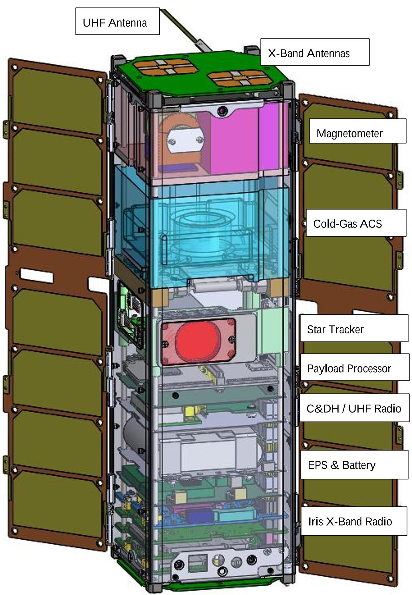
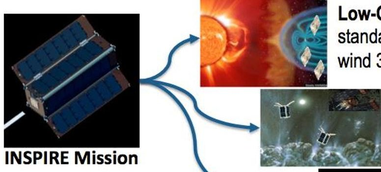
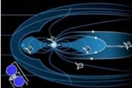

<!-- PDF_PAGE: 1 -->

INSPIRE: Interplanetary NanoSpacecraft Pathfinder In Relevant Environment

Andrew Klesh, John Baker, Julie Castillo-Rogez, Lauren Halatek, Neil Murphy, Carol Raymond Brent Sherwood Jet Propulsion Laboratory, California Institute of Technology M/S 301-165S, 4800 Oak Grove Ave, Pasadena, CA 91105; 818-354-4104 andrew.t.klesh@jpl.nasa.gov

John Bellardo Computer Science Department, California Polytechnic State University San Luis Obispo, CA 93407; 805-756-7256 belardo@calpoly.edu

James Cutler Aerospace Engineering, University of Michigan - Ann Arbor 1320 Beal Avenue, Ann Arbor, MI 48109-2140; 734-615-7238 jwcutler@umich.edu

Glenn Lightsey W. R. Woolrich Laboratories, University of Texas - Austin C0600, 210 East 24th Street, Austin, Texas 78712-1221; 512-471-5322 lightsey@mail.utexas.edu

## ABSTRACT

The INSPIRE project will demonstrate the revolutionary capability of deep space CubeSats by placing two nanospacecraft in Earth-escape orbit. Prior to any inclusion on larger planetary missions, CubeSats must demonstrate that they can operate, communicate, and be navigated far from Earth these are the primary objectives of INSPIRE. Spacecraft components, such as a JPL X-band radio and a robust watchdog system, will provide the basis for future high-capability lower-cost-risk missions beyond Earth. These components will enable future supplemental science and educational opportunities at many destinations.

The nominal INSPIRE mission will last for three months and will achieve an expected Earthprobe distance of $ 1. 5 \times1 0^{8} $ km (dependent upon escape velocity as neither spacecraft will have propulsion capability). The project will monitor onboard telemetry; operate, communicate, and navigate with both spacecraft; demonstrate cross-link communications; and demonstrate science utility with an onboard magnetometer and imager. Lessons learned from this pathfinder mission will help to inform future interplanetary NanoSpacecraft and larger missions that might use NanoSpacecraft components.

## INTRODUCTION

INSPIRE, deep-space-flight-ready in summer 2014, will become the world's first dedicated

interplanetary CubeSat mission, opening deepspace heliophysics and planetary science to the CubeSat revolution. The Interplanetary NanoSpacecraft Pathfinder In Relevant

<!-- PDF_PAGE: 2 -->

Environment project will accomplish a tiered set of technology-demonstration and education objectives: it will demonstrate that NASA CubeSats can (1) operate, communicate, and be navigated far from Earth; (2) host and support CubeSat components whose hardware has not yet had the opportunity to fly in deep space; and (3) deliver useful science that in turn opens future mission opportunities for investigators. These objectives intimately embody many NASA strategic objectives, and enable a new generation of low-cost solar system explorer.

The INSPIRE flight system comprises two identical, three-axis-stabilized 3U spacecraft that combine existing subsystems for C&DH watchdog, attitude determination, and power functions with next-step modifications of subsystems for cold-gas attitude control and deep-space navigation & communication. Demonstrating the integrated system performance of these core spacecraft components will establish a proven foundation for diverse future NASA missions to host special-purpose payloads in deep space.

The spacecraft will also host a science payload: a half-U JPL compact vector-helium magnetometer to measure the fine structure of the solar wind, and prove the science utility of such a small platform.

The project significantly leverages experience from prior CLI launch opportunities, including hardware, software, and personnel from the RAX2, M-Cubed/COVE, GRIFEX, CP-series BEVO-2, and ArmadilloSat CubeSat projects.

INSPIRE's demonstration of CubeSat functionality and utility in the deep-space environment is crucial as a stepping-stone for interplanetary CubeSats. By leveraging JPL's 50 plus years of deep space experience, INSPIRE will establish a flight heritage for future interplanetary CubeSat missions, as well as creating a cadre of partner universities

experienced with the challenges of interplanetary missions.

In this paper we will provide technical details of the INSPIRE project, discuss current status and lessons learned to date, and detail some of the future missions enabled by the INSPIRE project.

## PROJECT TECHNICAL DESIGN

The INSPIRE mission consists of two identical spacecraft, launched simultaneously as secondary payloads, and deployed to Earthescape. The nominal mission will last for three months and achieve an expected Earth-probe distance of $ 1. 5 \times1 0^{8} $ km (dependent upon escape velocity as neither spacecraft will have propulsion capability). Two spacecraft (Figure 1) provide redundancy to reduce the risk in meeting the project goals (with the exception of crosslink communications, which will be demonstrated early in the mission timeline).

## Command and Data Handling

The core of the INSPIRE spacecraft consists of two parts: the watchdog board and the Iris deep space transceiver/transponder. The watchdog board is based on the proven MSP430 microprocessor flown on many successful CubeSat missions, including RAX-2 and Delfi-C3, and has also demonstrated limited radiation tolerance in experimental testing (Ref 1). The board will be responsible for basic command and data-handling; interfacing with the radio, attitude control system, star tracker, electrical power system, and payloads via UART, i $ ^{2} $ c and SPI lines; and monitoring spacecraft health. It also provides a cascading watchdog architecture responsible for monitoring and resetting all subsystems, if necessary, in the event of SEUs or other fault conditions. The C&DH system contains two SD cards (one serves as a cold-spare), a realtime-clock, onboard UHF radio, MEMs gyro, watchdog circuitry, and even a hardwired

<!-- PDF_PAGE: 3 -->

identification circuit to uniquely identify the spacecraft. Heritage from the C&DH systems is derived directly from RAX and RAX-2 spacecraft, where this functionality was separated into three boards. AstroDev, Inc has developed a new generation system, with the same circuitry, that fits within a single board.

## Communication

Primary communication with the spacecraft will be over the DSN compatible Iris X-Band transceiver/transponder. The radio relies on dual receiver / transmitter antennas located on either end of the spacecraft, providing nearly omnidirectional communication coverage. With a 5W transmitter, the link budget shows that the radio can communicate at greater than 1 kbps at 1.5 M km, but the performance is flexible for data rates between 62.5 bps up to 256 kbps (depending on range). The radio provides coherent uplink and downlink allowing for accurate ranging and Doppler measurements to be made on the ground. Away from a gravitational body, the expected navigational accuracy is less than 500 km relatively close to Earth, and between 1000 and 2000 km further along the mission timeline.

The CCSDS compliant radios have a limited amount of onboard memory to buffer received and transmitted data, and also allow for a so-called "firecode" providing the ability to externally reset the spacecraft if needed. The radios themselves are quite robust, and build upon lessons learned from the from the M-Cubed/COVE processing experiment for digital board design. The Iris radio itself builds from the Electra radios at Mars and the Low-Mass Radio Science Transponder (LMRST) system slated to fly on the LMRST Sat CubeSat project.

In addition to the X-band radio, an AstroDev Lithium UHF radio is built onto the C&DH board to provide cross-link capability between

the spacecraft. This allows for direct-relay and store-and-forward-relay communications between the ground and either spacecraft. The UHF radios also allow for a fire-code command to provide additional reset capability.

## Attitude Determination and Control

A Blue Canyon Technologies commercial star tracker/imager will provide a majority of the attitude control information, including quaternions and rates, but chip-scale gyros and photodiodes will provide verification. Low-fidelity attitude estimation algorithms will verify sun-direction (the most critical angle to acquire) to assure correct panel orientation and keep-out angles for the exposed devices.

Attitude control will be provided by a fourthruster cold-gas system provided by U. Texas-Austin. Building from MEPSI heritage from STS-116, the tank is 3D-printed, and contains thrusters that can be fired together or independently depending on direction and impulse required. The C&DH system will run a limited attitude control algorithm for both detumbling and nominal flight operations, that will take into account relevant sensors and spin rates for instance, during initial detumble, only the photodiodes and gyros will be used to mitigate expected motion blur of the star tracker during the initial fast rotatations. The 3D-printed tank provides design flexibility and growth of system components until late in the design process.

## Electrical Power System

The power system is built from RAX/RAX-2 heritage, which has now cumulatively demonstrated over two years of successful operations in Earth-orbit. Fixed solar panels cover three sides of the INSPIRE spacecraft, and together with two deployable panels, provide greater than 20 W of onboard power when oriented toward the sun.

<!-- PDF_PAGE: 4 -->

Figure 1 - Transparent view of the identical INSPIRE spacecraft

<!-- PDF_PAGE: 5 -->

## Integration and Testing

JPL is designing and integrating the spacecraft while the university partners are providing many of the subsystems: U. Texas has provided the attitude control system, U. Michigan / AstroDev has provided the electrical power system and C&DH, as well as serving as a groundstation, CalPoly has provided a processing board, and GAVRT is providing receive-only operations at DSS-13.

Each of the university subsystems is being built with JPL oversight and consulting, thus providing the CubeSat community several experienced deep space developers for future interplanetary missions. These subsystems will be integrated at JPL in collaboration with the students who developed them through internship programs. Each spacecraft will be subject to extended bench-top operations to verify functionality. The spacecraft will then be tested as a unit prior to launch delivery, undergoing thermal/vac, vibe and shock testing.

## PAYLOADS

INSPIRE will carry two payloads: a compact vector-helium magnetometer, and a COTS payload processor with imager. Each of these boards extends the functionality of the spacecraft toward future endeavors.

## Compact Vector-Helium Magnetometer

The JPL/UCLA compact vector-helium magnetometer (CVHM) builds from extensive magnetometer development, from Mariner, through Cassini, while simultaneously significantly reducing overall size: the entire instrument takes up approximately 5x10x10 cm and 0.5 kg, including deployable boom.

With a stability of less than 10 pT, the CVHM provides a significant improvement on previously flown CubeSat magnetometers. As the spacecraft separate from eachother after deployment from the P-POD, the magnetometer measurements will provide fine-grain, high fidelity measurements of the solar wind, providing a new look into turbulence effects. Depending upon trajectory (expected Earth-leading or Earth-trailing), the magnetometers may also provide a real-time gradient look across the bow-shock of Earth's magnetosphere during the mission.

The small size of the magnetometer makes it ideal for use on both large and small missions in the future, while remaining "science-grade". Extensive work is being carried out to enable accurate measurements within this small formfactor.

## High Powered Payload Processor

The CalPoly / Tyvak processing board will also fly on the INSPIRE spacecraft, with software derived from the IPEX CubeSat mission. This agile-science software will allow for advanced processing of images and magnetometer data to streamline downlink and increase science return. The processing system (otherwise known as the Intrepid system board), will also support a small imager, with a goal of taking images of the other spacecraft, the Earth and the Moon. This processor will be monitored by the primary INSPIRE systems and reset as needed to mitigate latch-up conditions. The high powered processor provides capabilities for onboard science data processing, backup C&DH functionality (though not implemented on INSPIRE), and additional telemetry sensors to monitor the spacecraft

<!-- PDF_PAGE: 6 -->

Low-Cost Heliophysics: Constellation of 50 standalone 10 kg spacecraft to monitor the solar wind 3D structure at Sun-Earth L1.

Supplemental Science: Sacrificial probes used to scout plume passage or descend into high magnetic fields.

Enabling Novel Science: Use multiple nano s/c to allow for distributed flybys capturing multiple vantage points simultaneously.

Figure 2 - NASA and JPL have identified high value science applications using interplanetary NanoSpacecraft.

## CONCLUSIONS

Once proven, interplanetary CubeSats can provide multiple adjunct roles in support of deep-space human missions, e.g., external inspection of flight systems, "third viewpoint" observation of operations, advance reconnoitering of exploration sites, and continuous monitoring observations after humans depart a site (Figure 2). CubeSats are widely recognized as a disruptive technology. Yet programmatic missions on which their deep space development could piggyback are increasingly rare; and competitively selected PI-led missions are unlikely to incorporate CubeSat-platform based operations concepts until such platforms are demonstrated, yielding quantified heritage performance.

Non-validated technology continues to be a major hurdle for mission development, and the limited payload availability on interplanetary missions means that few, if any, CubeSats will be able to support a Decadal Science interplanetary mission before technology embodied in INSPIRE is validated. An Earthescape launch opportunity will impose environmental design restrictions, while providing performance characterization of the entire communication and navigation system, which cannot be completely replicated through ground-based testing.

A launch of the INSPIRE spacecraft will enable supplemental science and education opportunities for CubeSats in the next round of interplanetary proposals, including Discovery, New Frontiers and Explorer, all expected in the 2015/2016 timeframe. A 2014 launch would provide enough opportunity that lessons learned from the several month mission could be incorporated into the larger mission proposals the following year, while providing reviewers confidence that CubeSats can survive and thrive in the interplanetary regime. Characterization of the spacecraft's systems through demonstration objectives and telemetry downlinking will complete the validation process, and demonstrate the readiness of the CubeSat component for inclusion in deep-space applications, enabling new science and educational opportunities.

INSPIRE provides the first spacecraft in a new generation of explorers, and takes advantage of extensive collaborations between the CubeSat community and experienced solar system explorers. This exciting mission will enable novel science, demonstrate capable components, and kick-start the journey of CubeSats beyond low-Earth orbit.

<!-- PDF_PAGE: 7 -->

## Acknowledgments

This work has been carried out at the Jet Propulsion Laboratory, California Institute of Technology, under contract to NASA. Government sponsorship acknowledged.

The authors of this work are only a small part of the INSPIRE project team, and the project would not be accomplished without them. The authors would like to acknowledge their dedication and innovation in carrying out this project.

## References

1. Vladimirova, T., et al. "Characterising Wireless Sensor Motes for Space Applications", Second NASA/ESA Conference on Adaptive Hardware and Systems, 2007.