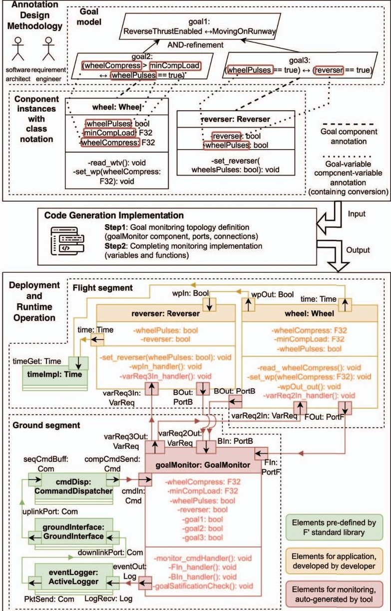
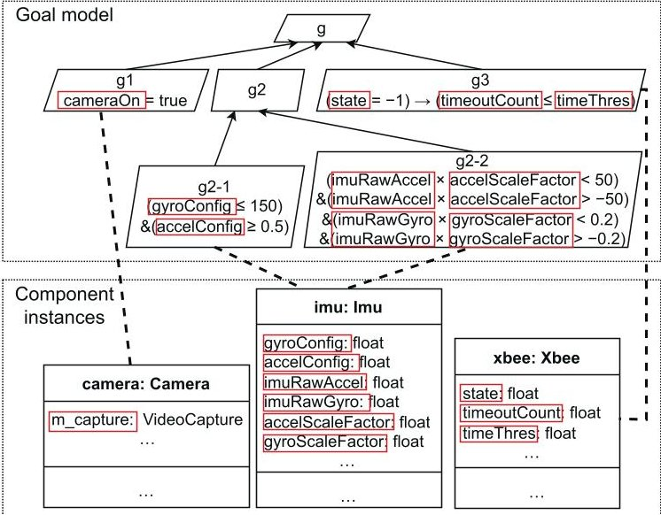
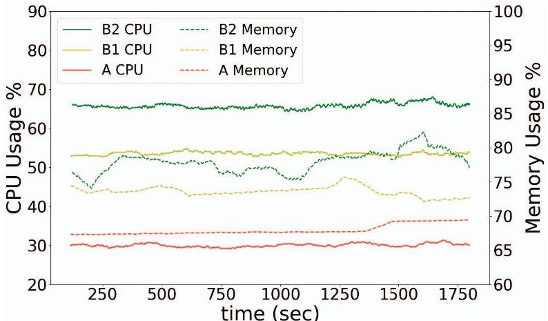

<!-- PDF_PAGE: 1 -->

# Instrumenting Runtime Goal Monitoring for F' Flight Software

Jialong Li

Waseda University

Tokyo, Japan

lijialong@fuji.waseda.jp

Christos Tsigkanos University of Athens & University of Bern Athens, Greece & Bern, Switzerland christos.tsigkanos@unibe.ch

Nianyu Li ZGC Laboratory Beijing, China li_nianyu@pku.edu.cn

Kenji Tei

Tokyo Institute of Technology

Tokyo, Japan

tei@c.titech.ac.jp

Abstract-Correct behavior of flight software against its requirements is a prime concern spanning its design, implementation, and operation. The emergence of "New Space" presents new challenges associated with small-scale missions which often involve open software frameworks, are developed by diverse teams, and employ rapid development methodologies which may not enjoy the rigorous quality assurance that institutional missions do. Hence, there is an overarching need to incorporate contemporary engineering techniques and methods for checking requirement satisfaction for such flight software. To this end, this paper proposes GOPRIME, designed to integrate goal monitoring within F', a renowned software development framework developed by the Jet Propulsion Laboratory for embedded and spaceflight systems. GOPRIME consists of three phases: (i) a design phase, where annotations are used to align system-level objectives with architectural components; (ii) an implementation phase, where code generation tailored for the DSL of F' is used to seamlessly automate the integration of goal monitoring functionality, and (iii) the operational phase, where the runtime state of annotated components is monitored, enabling evaluation of satisfaction of the overall goal model. We assess the development and operation overheads of instrumenting runtime goal monitoring over a characteristic case of a miniaturized satellite application.

Index Terms—Goal Monitoring, F prime, Component-based Architectures, Goal Modeling, Flight Software

## I. INTRODUCTION

Flight software has long been characterized as inherently mission-critical and its correct behavior against its requirements when in operation is a prime concern. This underlying need for rigorous quality assurance has manifested in established methods across its software lifecycle, spanning requirements, specification and implementation of spacecraft and their payloads [1]. Such engineering know-how has long been a core component of specialized teams within institutional space organizations. However, the emergence of low-cost, powerful on-board computers on contemporary small-scale flight- and space- craft [2], has led to wide availability of platforms and lowered the barrier to entry, often referred to as New Space [3]. Open software frameworks have emerged; while especially promising, new potential sources of failures exist in such small-scale missions, which may not enjoy rigorous quality assurance. It is thus imperative to incorporate contemporary software engineering techniques and methods to small-scale

missions, towards checking requirements when in operation thus laying the foundations for dependable operation.

Corresponding Author: Nianyu Li

Goal modeling [4] in requirements engineering is a widely applicable set of techniques for reasoning on the objectives a system needs to achieve in tandem with its environment. Goal models can also be brought at runtime [5] and be used for monitoring system execution against its objectives, facilitating the development of runtime adaptation [6]. Within the software engineering community, runtime goal monitoring has been a topic of extensive research, and advantages of its integration have become increasingly evident across diverse domains [7] [14]. A common technique is implementing a domain-specific probe which is responsible for monitoring goal satisfaction in a system [15], used in e.g., web or microservice architectures.

However, goal monitoring considering the particularities of contemporary flight software has remained under-explored. In such a domain, waterfall-like software processes are traditionally employed by specialized teams, including rigorous requirements engineering practices which result in extensive specifications. Such (often institutional) missions also enjoy extensive testing and verification activities before launch and deployment, checking carefully for compliance to software requirements. The emergence of New Space challenges such practices; software is developed with open frameworks, by diverse teams and often with rapid development methodologies, while software becomes increasingly complex. Such a paradigm introduces potential risks to the assurance of software quality and, by extension, to the success of space missions. It underscores the growing necessity to integrate techniques and methods for ongoing requirement verification during the operational life of flight software systems. This integration is crucial for empowering ground stations with the capability to make well-informed decisions and issue commands, particularly when confronting anomalies during mission operations.

In this paper, we introduce GOPRIME (GOal monitoring for F PRIME), a goal monitoring framework for small-scale flight software. During the design phase, system-level objectives are aligned with architectural components with specified annotations. Annotations establish links between goals, components, and specific variables within these components, elaborating on leaf goals and their interplay within the broader software architecture. At the implementation phase, automated genera-

<!-- PDF_PAGE: 2 -->

tion of goal monitoring code takes place, which is responsible for checking satisfaction or violation of goals. At the system operation phase, runtime state of the annotated components is monitored, and thus respective state of the overarching goal model is deduced.

GOPRIME is implemented on top of F' [16], a cutting-edge open-source flight software framework developed by the Jet Propulsion Laboratory (JPL). Our choice is motivated by its notable real-world applications [17], [18], and rigorous application of software engineering practices (e.g., component architecture with typed port connections, and object-oriented design). In typical F' (and generally, spaceflight) systems, monitoring satisfaction of requirements during operation involves ground staff manually or semi-automatically inspecting the produced logs. In contrast, GOPRIME, introduces automated checking of runtime state against a goal model, leveraging the component-based F' architectural style and thus incorporating goal reasoning capabilities into F' software. In our framework, goal modeling primitives and relationships are annotated to F' components using its own Domain Specific Language (DSL). To instrument the target system for goal modeling, code generation facilities are then leveraged for template code generation yielding appropriate goal monitoring artifacts, which can be used by developers within component implementation. Specifically, our contributions span design, implementation and operation of F' software systems, and they are as follows:

- We advocate a design methodology emphasizing the incorporation of goal monitoring through annotations based on goal specifications which align system objectives with the software architecture (Design level);

- Utilizing the F' DSL, we formalize the instrumentation of goal monitoring functionalities, employing code generation to automate the embedding of goal-monitoring functionality (Implementation level). The accompanying tool along with an experiment reproduction kit are made publicly accessible as open-source assets $ ^{1} $;

- We demonstrate feasibility and assess the development and runtime overheads of instrumenting runtime goal monitoring over the case study of a miniaturized satellite application (Operation level).

The rest of this paper is organized as follows. Section II covers the necessary background. Section III introduces a motivating example and presents an overview of our framework. Sections IV and V delve into technical support. Section VI evaluates our framework focusing on three research questions. Section VII delves into the related work. Finally, Section VIII concludes with a vision on future work.

## II. BACKGROUND

In this section, we recall necessary background on goal modeling and F', which are the foundations of our approach.

## A. Goals and Goal Modeling

Goals are objectives that a software system should achieve against its environment; in this paper, goals are expressed using propositional logic and arithmetic operators. We formally define a goal as follows:

Definition 1 (Goal): A goal g is denoted as $ \rho $ , where $ \rho ::= p \mid n \bowtie c \mid \neg \rho \mid \rho \vee \xi \mid \rho \wedge \xi \mid \rho \rightarrow \xi \mid \rho \leftrightarrow \xi $ . Here, p is a propositional/boolean variable, n is a numeric variable, c represents a numeric constant, $ \bowtie $ is an arithmetic comparison operators like $ <, \leq, =, \geq, > $ , and logical operators NOT ( $ \neg $ ) AND ( $ \vee $ ), OR( $ \wedge $ ), implication( $ \rightarrow $ ), and equivalence( $ \leftrightarrow $ ).

Goal-oriented requirements modeling is a methodology to systematically derive a system's requirements by refining high-level objectives into lower-level requirements [19]. A goal model is represented as a refinement graph that illustrates the decomposition of higher-level goals into lower-level subgoals via AND-/OR-refinement. An AND-refined goal can be satisfied if and only if all its subgoals are fulfilled, while an OR-refined goal can be satisfied when at least one of its subgoals is fulfilled.

Although goal modeling was originally proposed as a method for requirements capture and elaboration at early stages of a project, its use in runtime goal or requirement monitoring has been widely discussed among both requirement engineering and self-adaptive systems communities. The primary advantage of goal modeling lies in its hierarchical tree structure, which provides explicit attributability for understanding and reasoning on satisfaction of high-level objectives through monitoring low-level sub-goals.

## B. JPL's F'

F' (F prime) is an open-source software framework developed by the JPL specifically for embedded (space-)flight systems [16], [20]. It provides a complete ecosystem including modeling, implementation, testing, and ground support [21], [22]. F' has been successfully used in several NASA missions, notably e.g., the Mars Ingenuity Helicopter [17] and Near Earth Asteroid Scout CubeSats [23].

The software architecture employed by F' is componentbased, enjoying well-defined interfaces which foster reusability, analyzability, and maintainability [24]. This architectural topology is defined explicitly in XML, detailing component instances and their typed port connections. Ports in F' are defined as generalizations of SysML flow ports, with types specifying data that can be transmitted through them. Ports are primarily categorized into input or output ports, and input ports are further divided into synchronous, asynchronous, and guarded. Connections are established from an output port to an input port with matching port types.

In terms of implementation, C++ is employed to facilitate encapsulation and inheritance inherent in Object Oriented Design (abbr. OOD), thereby enhancing both reusability and modularity. In adherence to OOD principles, components in F' are defined as C++ classes comprised of a set of data, and associated operations on this data, termed methods.

<!-- PDF_PAGE: 3 -->

Benefitting from its open-source nature, multiple flightproven components are officially provided in the F' standard component library [17]. The library mainly provides two kinds of components: (i) OS features abstraction such as threads, files, and clocks, and (ii) a collection of reusable components that perform standard flight software functions such as command dispatch, event logging, and ground system support. Note that the above components are strictly designed per F' architectural principles with well-defined ports and connections, providing a solid foundation for rapid development allowing engineers to focus on application-specific components (hereafter application components).

The F' standard component library also provides some components that are reminiscent of goal monitoring [17]. One such component is Health, which monitors the system to ensure no threads are stuck by sending an invocation to every component and verifying that a response is within a timeout interval [16]. Another is Activelogger, which enables monitoring by recording critical system parameters through logging. However, (i) such monitoring focus is limited to essential system parameters or thread stuck detection, neglecting fine-grained monitoring of individual components' internal behaviors and requirements reasoning at a system-wide level; (ii) the implementation logic of application and monitoring is intertwined at the code level (i.e., cross-contamination), resulting in increased project complexity and reduced component reusability.

In this section, we begin with a well-known case from the requirements literature [19] to serve as a running example, and then provide an overview of the advocated framework GOPRIME. This choice serves to illustrate our approach over a well-understood exemplar within goal modeling.

## III. FRAMEWORK OVERVIEW

## A. Motivating Example

The Lufthansa A320 Airbus flight to Warsaw is a well-documented incident from September 14, 1993. On this day, an aircraft ran off the end of a waterlogged runway at Okecie Airport, leading to multiple injuries and fatalities [25]. The pilots attempted to activate the thrust reversers, but the autopilot software, hindered by an incorrect requirement, prevented such braking action. The software's flaw lay in a requirement stipulating that thrust reversal could only be activated if the plane was on the runway with at least 6.3 tons sensed on each main landing gear strut [19]. This requirement did not account for waterlogged runways or hydroplaning scenarios.

The incident highlights the significance of effective requirements engineering in such software, and sparked interest of the community towards investigation of relevant supportive methods. Figure 1 illustrates a goal model in the upper part, offering a template solution from goal modeling literature [19]. In such a case, monitoring the states and requirements outlined in this goal model would have allowed reasoning at runtime that thrust reversal cannot be activated due to the minimum compression load. Such goal-monitoring functionality could empower pilots or ground control staff to quickly identify the

reason why the thrust reversers are not able to be activated, leading to a timely or preemptive deactivation of the autopilot function.

More generally, ground stations handle numerous responsibilities in space- and flight- missions, including but not limited to launch support (e.g., final system checks before launch), mission control (e.g., assessing unexpected events, and coordinating mission plans), and command & control (e.g., transmitting telecommands). We believe goal monitoring can play a crucial role in such a setting, particularly in reasoning about satisfaction of high-level system objectives, for both ground staff and/or autonomous spacecraft to make informed and correct decisions.

## B. Overview

Fig. 1: Overview of the GOPRIME framework over the A320 exemplar case goal model [19].

The upper part of Fig.1 thus highlights the challenge tackled in this paper: How can goal modeling be integrated into a software architecture and implementation for runtime reasoning? Firstly, there certainly exists a conceptual mapping

<!-- PDF_PAGE: 4 -->

between the goal model (capturing system requirements) and the software implementing it - often referred to as traceability. The challenge for the software architect in this case is to decompose goals and integrate them into the system implementation. Although the former involves a classical requirements engineering problem, the latter pertains to issues of software architecture.

To address this, our methodology at design phase advocates annotations at the system architecture level, establishing the vital connection between goal specification and code artifacts. The architectural level driver adheres to information-hiding principles, wherein different components are responsible for conveying information about their respective sub-goals, and relationships between sub-goals are captured through suitable interfaces between components. At runtime, the overall goal model's state is updated as components achieve (or violate) their respective sub-goals, thereby monitoring system requirements satisfaction.

During the development phase, we refine the development process by automating the generation of goal-monitoring code, leveraging the provided annotation that bridges the gap between the goal specification from requirement engineering and the architectural topology creation from software architecture. This allows developers to concentrate on the component-specific business logic within the architecture, without being burdened by the intricacies of goal-related mechanisms. Additionally, goal monitoring code should be non-intrusive, allowing integration without disrupting legacy systems' normal operations.

Annotations: As demonstrated in the upper part of Fig. 1, given the two design models: a goal model and component instances with class notations, our methodology advocates requirement engineers and software architects work together to provide two types of annotations: (i) annotations between leaf goals and components, and (ii) annotations between variables in a leaf goal and those in the respective component. Such annotation enables the explicit representation of goals, and their relationships with the components and inner variables within the architecture.

Code Generation:The middle part of Fig.1 illustrates automated code generation functionality tailored F' DSL based on the specified goal model and annotations, ensuring that generated code adheres to F prime's abstractions by construction.

Operation:The bottom part of Fig.1 illustrates the system structure at implementation and operation levels, instrumented with goal monitoring in place $ ^{2} $ . The elements colored in green, as depicted, are integral parts of the F' standard component library, including (i) component instances represented as class notations, (ii) ports depicted as boxes with arrows and marked with their instance and class names, and (iii) connections linking ports. The yellow elements (component instances with

variables and functions, ports, and connections) correspond to application components for the thrust reverser system. Observe the elements in red; they represent auto-generated component instances with appropriate variables, functions, ports and connections, serving to realize the desired goalmonitoring functionality. As such, within the resulting generic architecture, once goalMonitor receives a telecommand from cmdDisp $ ^{3} $ , a component instance of commandDispatcher, it captures variable values from application components, assesses goal satisfaction, and then sends the evaluation result to the eventLogger. Therefore, operators can transmit monitoring telecommands and inspect monitoring outcomes via the user interface of the F' ground system.

## IV. BRIDGING GOAL AND ARCHITECTURAL MODELS THROUGH ANNOTATIONS

This section delves into the core of our design methodology: leveraging annotations on an F' architecture to instill goalmonitoring functionality, as depicted in the upper part of Fig. 1. In essence, here we assume the joint view and roles of the software architect and requirement engineer.

Recall that the architecture of F' software is not "implied" as is often the case in other systems - it is modeled explicitly and reflected in the system's F' topology, which consists of a network of components connected via ports. As such, we are targeting this architectural model for annotations of goal modeling - annotations are "inscribed" at the architectural model level.

As a prerequisite for our methodology, we assume that both the system requirements, embodied as a goal model, and the software architecture, expressed as component instances along with their class notation, are already established. We advocate two granularity levels. Firstly (i), component-level or classlevel goal annotations provide coarse-grained connections of components through ports, adhering to information-hiding principles. This way, components as first-class citizens are responsible for conveying information to others about (sub)goals they have been specified as responsible for. Secondly (ii) supporting intra-component variable-level goal annotations allows for finer-grained monitoring of the internal behavior of each component.

Goal-component Annotations: In GOPRIME, each leaf goal is associated with a singular component, while a component can be annotated with multiple goals. Observe Fig. 1 goal2 is solely associated with the wheel component; this not only (i) goes towards the fundamental module decomposition architectural style [26], but also (ii) adheres to KAOS design practices [19], while it (iii) ensures clear and unambiguous responsibility assignment, simplifying goal satisfaction tracking and enhancing maintainability. Furthermore, we advocate goal annotations on application components rather than standard components. The reasons are twofold; (i) standard components

<!-- PDF_PAGE: 5 -->

are flight-proven by JPL and deemed reliable, and (ii) mission logic is mainly realized through application components, with standard ones primarily providing infrastructure features like OS abstraction.

Variable-level Annotations: On the basis of goalcomponents, annotations are further defined between their variables. For variables with the same semantic and syntactical meaning (e.g., the variable minCompLoad in wheel is equivalent to the variable minCompLoad in goal2), it is possible to directly annotate them without conversion. On the other hand, if the variables in the goal and component are not identical, it becomes necessary to define additional conversion logic. For instance, assume another version of goal2: " (compressOverThreshold = true) $ \leftrightarrow $ (wheelPulses = true)” while there is no such variable as compressOverThreshold in the wheel component. In this case, additional conversion is required to define that compressOverThreshold is true if wheelCompress is greater than minCompLoad, and false otherwise.

Here, the conversion is limited to from a component variable to a goal variable. We exclude the exploration of converting multiple component variables into a single goal variable, as the decomposition of goal variables can proceed within the goal model.

## V. IMPLEMENTING GOAL MONITORING

## A. Definition of Architectural Topology

This section addresses technicalities of goal monitoring instrumentation (bottom segment in Fig.1) through the steps of its code generation (middle segment). Specifically, Sec. V-A introduces the appropriate architecture-level topology definitions (i.e., components, ports, and connections), and subsequently Sec. V-B discusses class-level component implementation (i.e., variables and functions within components). Observe that in contrast to the previous section, here we assume the developer's perspective since this is the role responsible for implementation.

Component creation: Bootstrapping the process, tooling first creates an overseeing goalMonitor component that is responsible for core monitoring logic (marked red in Fig. 1).

Ports creation in application components: To enable goal monitoring for F' components, two kinds of ports are created. The first type consists of the input port (e.g., varReq2In in wheel in Fig. 1), which enables receiving invocations from goalMonitor. This type only requires goal-component annotation to identify which goal should each component receive an invocation. The second type is the output port (e.g., FOut in wheel), allowing the component to submit values to goalMonitor. This type additionally requires variable-level annotations to identify the datatype of the created port(s).

Regarding the aforementioned port construction, certain considerations have to be taken. Firstly, given the strict constraints on port datatypes in F', the tool is tasked with defining data-typed ports that align with the datatypes of the component variables. For example, in the wheel component,

ports FOut and BOut output float and boolean values respectively. Secondly, to ensure data timeliness, ports related to goal monitoring are defined as synchronous ports. This enables immediate processing of invocations through these ports with the highest priority. Thirdly, adhering to the informationhiding principle, we suggest' each component only outputs its raw component variables, while conversion from component variables to goal variables occurs within goalMonitor.

Ports creation in goalMonitor component: For the goalMonitor component, the tool creates four kinds of ports: (i) a command input port, cmdIn, which receives user commands from cmdDisp; (ii) an output port, eventOut, to send goal monitoring outcomes to the eventLogger, complying with F' design principles; (iii) output port(s), such as varReq2Out and varReq3Out, for sending invocations to request component-variable values from their corresponding components; and (iv) input port(s), such as FIn and BIn, for receiving component-variable values from application components.

Connection creation: Besides the appropriate ports, certain connections must be established in order to complete the goal-monitoring functionality across component instances: (i) connections between cmdDisp and eventLogger to facilitate communication with the existing ground system, and (ii) connections between goalMonitor and other application components to enable component-variable capture.

## B. Components Implementation Particulars

Having discussed topology-level definitions, in the following, we take a class-level component implementation view.

Implementation within application components: For each application component associated with goal(s), the tool declares a handler function, such as varReq3In_handler() in reverser (Fig. 1), to enable receiving requests from goalMonitor and returning back component-variable values. This declaration also includes the handler's precise processing, which refers to the respective variable-level annotations. For instance, varReq3In_handler() is implemented to deliver two component variables: reverser and wheelPulses.

Implementation in goalMonitor: Tooling subsequently completes the goalMonitor implementation through the following steps:

(i) Declare variables including goal variables that appeared in the goal model (e.g., wheelPulses in Fig. 1) and the boolean variables that record the satisfaction of all goals (e.g., goal1).

(ii) Declare component-variable input handler(s) such as FIn_handler() and BIn_handler(), which receive componentvariable values from application components, and then convert and store them as goal variables. In this step, the port datatype is based on the class notation, and the conversion is derived from the annotations.

(iii) Declare a goalSatisCheck() function which identifies the satisfaction of all goals within the given goal model. Leaf goal satisfaction is determined using the goal's logic representation and corresponding variables, while non-leaf goal satisfaction is determined by referencing their sub-goals and refinement

<!-- PDF_PAGE: 6 -->

relations. For example, if goal2 is satisfied and goal3 is not, then the AND-composed goal1 is also identified as violated. The satisfaction outcome will be reflected in the boolean variables such as goal1.

(iv) Declare a monitor_cmdHandler(). When activated by a command from cmdDisp, the handler first invokes specific ports to request component-variable values from application components. It is assumed that invocations are issued in a sequential manner, not in parallel. Next, the component-variable input handlers are triggered to receive component-variable values and update the internal goal variables. Following this, monitor_cmdHandler() invokes the goalSatisCheck() and forwards the outcomes to the eventLogger. Here, the outcomes consist of the boolean results indicating the satisfaction status of all goals.

## VI. PRELIMINARY EVALUATION

Our evaluation aims to address three research questions:

- RQ1 (Feasibility): Can GOPRIME be integrated into typical development processes in the domain? Specifically, we seek to investigate the incorporation of goal monitoring into an existing codebase.

- RQ2 (Development Overhead): What is the level of complexity involved in implementing goal monitoring at both architectural and code levels with GOPRIME?

- RQ3 (Operation Overhead): Given the tight constraints on resources in spaceflight systems, how significant is the runtime computational overhead that GOPRIME goal monitoring imposes?

## A. Target Case

We adopt an open-source application - F' system reference application (FSR) [27] - and treat its existing source code as legacy code; thereupon, we showcase the process of incorporating new goal-monitoring functionality into the system. FSR is a miniaturized satellite application, with three core functionalities:

1) Camera. Many satellites are equipped with cameras as a typical payload, used e.g., for weather or land monitoring or near-Earth planetary observations.

2) Guidance Navigation and Control (GNC). Realized by the Inertial Measurement Unit (IMU), GNC ensures the spacecraft stays on its intended path and remains stable without undesirable rotation. Satellites typically use a combination of sensors, star trackers, magnetometers, and gyroscopes to determine their orientation and position in space. In FSR, an IMU achieves similar functionality measuring linear acceleration and angular rate.

3) Communication. A fundamental functionality for both sending captured data back to Earth and receiving commands from ground stations; instead of space-grade technologies and protocols, FSR as a reference application employs Xbee communication.

We particularly note that FSR represents a miniaturized and conceptual version of flight software. Additionally, there is a general unavailability of open-source F' codebases, as

Fig. 2: Goal modeling and annotations over FSR. Variablelevel annotations are omitted for visual simplicity.

such software frequently falls under intellectual property constraints.

## B. Feasibility - RQ1

In addressing RQ1, we begin by briefly introducing the existing codebase, followed by the details of goal modeling and annotation.

Onboarding. The Camera Payload is implemented using OpenCV [28], providing initialization, camera acquisition, buffer allocation, and image capture functionalities. IMU handles operations like initialization, configuration, and data retrieval, using I2C for communication and updates accelerometer and gyroscope readings based on power state. Xbee includes methods for initialization, data handling, and command processing. It operates in different modes, such as PASSTHROUGH and AWAIT_COMMAND_MODE, to manage data flow [27].

Goal modeling and annotation. As shown in Fig. 2, the top goal g is AND-refined into sub-goals g1, g2, and g3 for three components, respectively. For the camera, goal g1 is that the camera must be activated and accessible, formalized as cameraOn = true. Here, the goal variable cameraOn is related to the component variable m_capture in the code an instance of the VideoCapture class within OpenCV. Specifically, the value of cameraOn is obtained by the boolean value returned by the m_capture.isOpen() method. The goal g2 for the IMU is defined using an AND operation as follows: (g2-1) ensuring the configurable measurement range of the gyroscope and accelerometer is set appropriately; and (g2-2) ensuring the satellite's orbital motion proceeds as anticipated. In these goals, the goal variables—raw data and scale factors—can be sourced directly from the component variables without the need for conversion, and the upper and lower limits are constant values tailored for the specific mission. For Xbee, goal g3 ensures that the system should not exceed a specified time duration (to avoid resetting) if a processing error occurs,

<!-- PDF_PAGE: 7 -->

and the goal variables can be directly obtained from the corresponding component variables as well.

Code generation and operation. We employed the tool for code generation; the generated code was manually inspected by two of the authors. Furthermore, we conducted practical tests on the monitoring functionality. The code outcome and the system operation aligned fully with the expected behavior.

Embedding goal-monitoring functionality within our methodology uses the abstractions of F', which developers are assumed to be familiar with. No conceptual issues have arisen regarding introducing goal-component annotations, variable-level annotations, and associated code generation facilities over the FSR exemplar.

## C. Development Overhead - RQ2

Our assessment of development overhead targets again FSR and encompasses metrics from architectural and implementation perspectives.

1) Experiment Setting: From an architectural standpoint, we count the number of ports and connections required for goal monitoring (note that we only add one component instance of goalMonitor), as well as the number of lines of code (LoC) for topology definition. Per development practices within the F' community, the LoC count is based not on the XML representation, but on F Prime Prime (FPP), a syntax language for F' topology definition [21] and allows generation of XML code through compiling FPP descriptions. From the implementation perspective, we measure the number of functions and the LoC specifically associated with goal monitoring, within C++ code.

When counting LoC, we exclude the following: (i) empty lines and lines that contain only comments, and (ii) code autogenerated by F' tools fprime-util and fprime-fpp. This excludes template code for port declarations that connect application components to standard components (within .fpp files) and construction functions when creating components (within .cpp files).

2) Experiment Results and Discussion: Table I summarizes the development-time overhead of existing application logic and goal monitoring. We observe that, in both topology and implementation, the LoC responsible for goal monitoring equate to approximately one-third of ones of the application logic, i.e., the complexity of the goal monitor component is on par with that of the other, bespoke application components. While the aforementioned metrics may not comprehensively evaluate the entirety of development cost, we believe they do show a trend: the development cost associated with manually implementing goal monitoring is not negligible within the system.

We do acknowledge a limitation in evaluating RQ2. First, our assessment is confined to the development phase and does not include the design phase. In future work, we plan to empirically assess and evaluate the annotation step implied by the design methodology as well. Second, the generated code

may not be minimized in terms of both architectural topology and lines of code. Firstly, our code generation adheres to the fundamental principle of 'Separation of Concerns', i.e., clear distinction between the monitoring system and the monitored system. Such modular design might result in an increased code volume due to additional interfaces for communication between components. Furthermore, compared to code that is automatically generated, manually written code can often be optimized based on characteristics of a given system. This could potentially impact the measurement accuracy of our results regarding development-time overhead evaluation.

Automated code generation facilities of GOPRIME automate goal monitoring integration, thus saving development effort. In the FSR scenario, this automation resulted in a reduction of approximately 25% with respect to bespoke code. Moreover, separation between application and goal monitoring logic also minimizes the risk of inadvertent cross-contamination that could potentially lead to bugs.

## D. Operation Overhead - RQ3

RQ3 addresses the runtime operation overhead that goal monitoring adds, given the tight constraints on computational resources in hardware used in the domain, which are typically embedded or system-on-chip systems.

1) Hardware deployment: Our evaluation hardware entails a Raspberry Pi 4 Model B (ARM-Cortex-A72 CPU and 4GB RAM) with 64-bit OS, Raspberry Pi Camera Board v1.3, Digi XBee S1 (XB24-API-001), and InvenSense MPU 6050. Choice of this hardware platform was driven by its well-established F' compile toolchain for ARM CPU and embedded GPIO interface enabling straightforward connection to hardware peripherals.

2) Experiment Setting: We assess the runtime overhead, focusing on CPU, RAM usage, and response time, over the FSR case.

Our experimental design follows an A/B testing format. Control group A is composed of an FSR system where the functionalities of IMU, Camera, and Xbee are inactive. This setup is designed to measure the basic overhead linked with the F' standard components, for instance, health which verifies the accessibility to application components at a frequency of 1Hz. In contrast, the experimental group B1 encompasses a complete FSR system, where the IMU and camera operate at a sampling frequency of 10Hz, and the camera records images at a 640x480 pixel resolution. Additionally, the second experimental group B2 extends the B1 setup by incorporating goal monitoring functionality, which operates at the same sampling frequency of 10Hz. This choice of high sampling frequency of 10Hz aims to amplify the overhead associated with goal monitoring, thereby enabling more precise measurement of the goal-monitoring overhead per run. A much lower frequency would be used in practice, such as reporting to the ground station when housekeeping telemetry a specific telemetry provided for the purposes of monitoring the health and functioning of the space segment is submitted.

<!-- PDF_PAGE: 8 -->

TABLE I: Comparison of Development-time Overhead Between Application Logic and Goal Monitoring in FSR.

<table border="1"><tr><td rowspan="2"></td><td colspan="3">Architectural Metrics</td><td colspan="2">Implementation Metrics</td></tr><tr><td>Ports #</td><td>Connection #</td><td>Topology LoC</td><td>Function #</td><td>Implementation LoC</td></tr><tr><td>Application Logic in FSR</td><td>12</td><td>21</td><td>223</td><td>28</td><td>548</td></tr><tr><td>Goal Monitoring for FSR</td><td>16</td><td>9</td><td>79</td><td>11</td><td>192</td></tr></table>

Fig. 3: Raw experiment results of CPU and Memory Usage.

3) Experiment Results and Discussion: As depicted in Fig. 3, measurements show average usage for A stands at 30.0% CPU and 68.0% memory, for B1 it is 53.5% CPU and 73.6% memory, and for B2 it is to 65.8% CPU and 77.9% memory. Assuming a more realistic scenario where goal monitoring operates at a frequency of 1Hz (i.e., B1 combined with 1Hz goal monitoring), it contributes to 2.25% of the total system CPU usage. In terms of memory usage, goal monitoring constitutes 0.63% of the overall system.

The response time, measured from the trigger of goal monitoring to the return of the goal satisfaction checking result, has an average of 34.97ms with a standard deviation of 17.47ms. The first quartile (25th percentile) is 23.0ms, and the third quartile (75th percentile) stands at 48.0ms.

Diving into the overhead and delay associated with goal monitoring, a significant contributing factor is the costly cross-component data transmission inherent in F'. This cost primarily results from the realization of F' ports and connections, where ports and connections defined by FPP are executed as respective C++ component instances at low-level code execution; their C++ implementation is automatically generated during building. Specifically, all cross-component data transmissions initiate from the departure component, proceeding to the output port, and then to the input port via connection before reaching the destination component.

In the FSR scenario where both the camera (640x480 pixel) and the IMU operate at a frequency of 10Hz and goal monitoring is set at a frequency of 1Hz, goal monitoring accounts for 2.25% of CPU usage and 0.63% of memory usage in total. Additionally, the average response time for goal monitoring is measured at 34.97ms.

## E. Discussion and Limitations

We believe to have demonstrated that goal monitoring can be embedded in F' software. Our investigation made certain assumptions, discussed in the following.

Considering the purpose of monitoring (i.e., supporting ground station staff's decision-making) and communication bandwidth constraints, we have assumed that goal monitoring is triggered at a relatively low frequency and that data transmission employs a pull mode but not "push" mode. However, one could envision different implementations and deployments of goal-monitoring functionality. For example, to mitigate the costly cross-component data transmission, decentralized evaluation can be adopted. Unlike the centralized way where one goalMonitor collects all data and evaluates all goals, decentralized evaluation would allocate the responsibility of evaluating leaf goals to individual components, reserving goalMonitor exclusively for parent goals. While our framework is technically capable of supporting this with some modifications, certain tradeoffs need to be carefully assessed in the design phase. Those include (i) communication and computation resources, (ii) repercussions on runtime behavior of adding extra functionality to the flight segment, (iii) particularities of different flight missions (for instance, centralized evaluation might not suit distributed exploration missions [29]), (iv) the characteristic of goals in the goal model (e.g., change frequency of variables or goals); and (v) the monitoring frequency required, as high-frequency monitoring may lead to significant runtime overhead. Therefore, we believe the exploration of strategies or patterns of deployment and implementation, which encompass the design methodology and code generation tool, are essential and comprise major directions for future work.

Regarding implementation, our proof-of-concept focused on tracking member or global variables within C++ classes; treatment of local variables inside functions remains unaddressed. Incorporating access to local variables could enable monitoring at a more granular level - a worthwhile avenue for future investigation. Nonetheless, distinct characteristics of local variables such as their storage location (typically on the stack rather than the static data segment), scope, and lifetime need to be especially considered. Given that on-board hardware features limited resources, stack usage is carefully assessed.

## F. Threats to Validity

1) Internal Validity: As for runtime overhead, firstly, the cost of monitoring a goal model directly is directly influenced by its size or complexity. Consequently, variations in the design of the goal model can lead to differences in runtime

<!-- PDF_PAGE: 9 -->

overheads. Secondly, our evaluation assumes an environment without communication losses. It is worth noting that spaceflight systems are frequently designed with mechanisms involving retransmission or communication adaptation measures to address packet loss due to environment challenges. As such, overhead calculation in a realistic setting should take into account communication and the corresponding dimensioning.

2) External Validity: While the foundational concepts of our framework are broadly applicable, it is essential to acknowledge certain threats to external validity. The algorithms and artifacts presented are tailored for F' and as such may not be directly transferrable to other frameworks in the domain (e.g., NASA cFS) or other component-based architectures. A typical example can be the Robot Operating System (ROS), a common framework for embedded robotics - ROS also adopts a modular component architecture, but requires special treatment due to its specialized middleware-based communication mechanisms and extra extensions to manage ROS primitives such as topics, services, and actions.

## VII. RELATED WORK

Moreover, concerning annotations (as associations between goal and component variables) - this paper doesn't provide a concrete methodology to guarantee their correctness and completeness. It could be beneficial to propose a structured process for annotating by drawing on established methodology, like object-oriented requirements analysis [30]. This methodology focuses on identifying the system's objects, their internal data, and their interactions to fulfill the system requirements.

We classify related work into three major categories. First, we discuss monitoring mechanisms and probing in particular, positioning our work. Subsequently, we consider runtime usage of goal models, since it is a key feature of our proposal.

## A. Probing and Monitoring Mechanisms

Several mechanisms for monitoring have been explored, mainly including: (i) agent-based instrumentation, which embeds a special software component (termed agent) into the target application to monitor its behavior, as in e.g., security tools to detect and block threats [15]; (ii) the sidecar pattern, referring to a design pattern where a secondary component termed "sidecar" is deployed alongside a primary application component. Such a pattern is especially utilized in microservice architectures [31]; (iii) middleware-based probing to leverage an intermediary layer to collect data especially in web applications [32]; (iv) external probing such as ping test to observe systems externally without integrating any software directly into the target system, where a typical example is to check website performance using the ping service [33]; (v) system-level probing such as CPU usage as captured by an operating system; and (vi) the fundamental approach of logging-based probing to log to, where information is inferred from logs outputted by the system.

The goal monitoring mechanism we utilize can be classified under agent-based instrumentation. This design choice is primarily for three reasons: (i) it affords increased flexibility,

enabling adaptive monitoring configurations resulting from alterations in the goal model and annotations; (ii) it allows lowlevel access to extensive, context-rich data (such as variables), offering insights into the target system's behavior; and (iii) it promotes modularity and extendability, laying a robust foundation for future expansions, notably in the realms of adaptive systems and decentralized goal monitoring. We underscore the point that while our paper offers a concrete realization rooted in F', our methodology is not confined to this context. Our framework is universally applicable in both design and implementation stages from a broad SE perspective.

## B. Runtime Usage of Goal Modeling

Goal modeling, with its base principle of hierarchical decomposition of high-level objectives to low-level goals, has been widely applied in runtime settings. A classical case is the "Goal, Question, Metric" strategy that enables objective measurement of goal success and failure using defined strategies. Such monitoring helps communication and (manual) decisionmaking within an organization [7].

To handle the uncertainty of requirements at runtime, many approaches, grounded in goal modeling, have been pursued [8] -[11]. Firstly, design methodologies that adhere to goal-orientation principle, such as Tropos4AS [10], are proposed to engineer requirements for adaptive systmes. Secondly, from the modeling language angle, RELAX [8] introduced a requirements language employing modal, temporal, and ordinal operators facilitating capturing degradation or relaxation of non-functional requirements. Similarly, FLAGS [9] integrates fuzzy goals into the KAOS model, where goals are portrayed using fuzzy constraints, thus allowing flexible monitoring of soft goals.

Furthermore, the applicability of goal modeling extends beyond just system monitoring; it also provides insights for analysis and planning [12] -[14]. In the context of control theory, CobRA [12] harnesses the goal model to pinpoint optimal configurations for performance indicators defined within the goal model. Furthermore, MutRoSe [13] explores the integration of goal modeling with hierarchical task networks, crafting a dedicated planning formalism suited for multi-robot missions. The study particularly considers the challenges of real-world variability and the intricacies of task constraints in the robot domain.

## VIII. CONCLUSION AND FUTURE WORK

This paper proposes GOPRIME, a framework to instrument runtime goal monitoring in F' software. At the design level, we advocated a design methodology to incorporate goal model specifications to the software architecture using annotations. At the implementation level, we formalized the procedure of instrumenting goal monitoring functionality using F"s DSL, while our code generation facilities automate non-intrusive procedures for goal monitoring. A case study of a miniaturized satellite application was used to assess the development and operation overhead involved in runtime goal monitoring.

<!-- PDF_PAGE: 10 -->

As for future work, we plan to investigate the following directions. First, this paper has concentrated on goals as the primary monitoring targets, thus excluding other elements of a goal model, such as environmental assumptions or domain properties. For supporting decision-making, these elements are highly pertinent to monitoring, as changes in the environment could potentially prompt adaptation of requirements and control actions. We will extend GOPRIME to support such monitoring by referencing external variables e.g., corresponding to environmental sensors. Second, treatment of goals in our approach was formalized using propositional logic and arithmetic operators, making goal model evaluation at instants but not temporal. However, to enhance applicability of GOPRIME, we plan to support more complex requirement expressions. For example, KAOS supports temporal logicbased reasoning [34], and further advanced expressions such as awareness requirements and fuzzy logic have been suggested in literature [9], as well as partially considering models for evaluation [35]. Finally, we intend to pursue GOPRIME use on real-world missions of satellite software. This will involve exploring optimal deployment and implementation strategies on hardware under constraints inherent in the space software domain, through an in-depth evaluation of the runtime overheads associated with various strategies.

## ACKNOWLEDGMENTS

Funded in part by the Hellenic Foundation for Research and Innovation - Project 15706 RV4THINGS, and by JSPS KAKENHI (Grant Number 23H03374).

## REFERENCES

[1] E. C. for Space Standardization, "Software engineering handbook. ecss-e-hb-40a," 2011, https://ecss.nl/hbstms/ ecss-q-hb-80-01a-reuse-of-existing-software/.

[2] B. Yost, S. Weston, G. Benavides, F. Krage, J. Hines, S. Mauro, S. Etchey, K. O'Neill, and B. Braun, "State-of-the-art small spacecraft technology," NASA Ames Reserach Center, 2021.

[3] G. Martin, "Newspace: The emerging commercial space industry," 2017, nASA Ames Research Center.

[4] P. Giorgini, J. Mylopoulos, E. Nicchiarelli, and R. Sebastiani, "Reasoning with goal models," in Conceptual Modeling—ER 2002: 21st International Conference on Conceptual Modeling Tampere. Springer, 2003, pp. 167-181.

[5] M. Szvetits and U. Zdun, "Systematic literature review of the objectives, techniques, kinds, and architectures of models at runtime," Software & Systems Modeling, vol. 15, pp. 31-69, 2016.

[6] B. H. Cheng, K. I. Eder, M. Gogolla, L. Grunske, M. Litoiu, H. A. Müller, P. Pelliccione, A. Perini, N. A. Qureshi, B. Rumpe et al., "Using models at runtime to address assurance for self-adaptive systems," Models@ run. time: foundations, applications, and roadmaps, pp. 101- 136, 2014.

[7] V. R. Basili, M. Lindvall, M. Regardie, C. Seaman, J. Heidrich, J. Münch, D. Rombach, and A. Trendowicz, "Linking software development and business strategy through measurement," Computer, vol. 43, no. 4, pp. 57-65, 2010.

[8] J. Whittle, P. Sawyer, N. Bencomo, B. H. Cheng, and J.-M. Bruel, "Relax: Incorporating uncertainty into the specification of self-adaptive systems," in 2009 17th IEEE International Requirements Engineering Conference, 2009, pp. 79-88.

[9] L. Baresi, L. Pasquale, and P. Spoletini, "Fuzzy goals for requirements-driven adaptation," in 18th IEEE International Requirements Engineering Conference, 2010, pp. 125-134.

[10] M. Morandini, L. Penserini, A. Perini, and A. Marchetto, "Engineering requirements for adaptive systems," Requir. Eng., vol. 22, no. 1, p. 77-103, mar 2017.

[11] J. Li and K. Tei, "Done is better than perfect: Iterative adaptation via multi-grained requirement relaxation," in 2022 IEEE 30th International Requirements Engineering Conference (RE), 2022, pp. 288-294.

[12] K. Angelopoulos, A. V. Papadopoulos, V. E. Silva Souza, and J. Mylopoulos, "Model predictive control for software systems with cobra," in 2016 IEEE/ACM 11th International Symposium on Software Engineering for Adaptive and Self-Managing Systems (SEAMS), 2016, pp. 35-46.

[13] E. B. Gil, G. N. Rodrigues, P. Pelliccione, and R. Calinescu, "Mission specification and decomposition for multi-robot systems," Robotics and Autonomous Systems, vol. 163, p. 104386, 2023.

[14] J. Li, M. Zhang, Z. Mao, H. Zhao, Z. Jin, S. Honiden, and K. Tei, "Goaloriented knowledge reuse via curriculum evolution for reinforcement learning-based adaptation," in 2022 29th Asia-Pacific Software Engineering Conference (APSEC), 2022, pp. 189-198.

[15] S. Mukkamala, A. H. Sung, and A. Abraham, "Distributed multiintelligent agent framework for detection of stealthy probes," in Design and Application of Hybrid Intelligent Systems, HIS03 Melbourne, Australia, December 14-17, 2003, vol. 105, 2003, pp. 779-788.

[16] G. W. L. R. J. L. Robert Bocchino, Timothy Canham, "F prime: An open-source framework for small-scale flight software systems," 31st AIAA Space Conference, 2017.

[17] T. Canham, "The mars ingenuity helicopter - a victory for open-source software," in 2022 IEEE Aerospace Conference (AERO), 2022, pp. 01-11.

[18] M. Kolhof, W. Rawson, R. Yanakieva, A. Loomis, E. G. Lightsey, and S. Peet, "Lessons learned from the gt-1 1u cubesat mission," in 35nd AIAA/USU Conference on Small Satellites, 2021.

[19] A. van Lamsweerde, Requirements Engineering - From System Goals to UML Models to Software Specifications. Wiley, 2009.

[20] T. Rich, "The development and application of the f prime magicdraw plug-in user handbook," in 34th AIAA/USU Conference on Small Satellites, 2020.

[21] R. L. Bocchino, J. W. Levison, and M. D. Starch, "Fpp: A modeling language for f prime," in 2022 IEEE Aerospace Conference (AERO), 2022, pp. 1-15.

[22] J. Li, C. Tsigkanos, T. Uubukata, E. Y. Nakagawa, Z. Mao, N. Li, and K. Tei, "Slicing and visualizing f' topologies with f'prism," in 17th European Conference on Software Architecture (ECSA), 2023.

[23] C. M. Pong, "On-orbit performance & operation of the attitude & pointing control subsystems on asteria," in 32nd AIAA/USU Conference on Small Satellites, 2018.

[24] M. Shaw and D. Garlan, Software architecture - perspectives on an emerging discipline. Prentice Hall, 1996.

[25] A. S. Network, "Asn aircraft accident airbus a320-211 d-aipn warsawokecie airport," 1993, https://aviation-safety.net/database/record.php?id= 19930914-2.

[26] R. C. Martin, Clean Architecture: A Craftsman's Guide to Software Structure and Design, 1st ed. USA: Prentice Hall Press, 2017.

[27] "fprime-system-reference," https://github.com/fprime-community/ fprime-system-reference/tree/main, accessed: 2024-01-27.

[28] G. Bradski, A. Kaehler et al., "Opencv," Dr. Dobb's journal of software tools, vol. 3, no. 2, 2000.

[29] N. J. P. Laboratory, "Cooperative autonomous distributed robotic explorers (cadre)," https://www.jpl.nasa.gov/missions/cadre, accessed: 2024- 01-27.

[30] S. Liao, J. Ma, and L. Lasoudris, Object-oriented Framework for Requirement Specification. Boston, MA: Springer US, 1995, pp. 123- 126.

[31] C. Meadows, S. Hounsinou, T. Wood, and G. Bloom, "Sidecar-based path-aware security for microservices," in Proceedings of the 28th ACM Symposium on Access Control Models and Technologies, 2023, p. 157-162.

[32] "Middleware monitoring tools," https://www.manageengine.com/ products/applications_manager/middleware-portal-monitoring.html, accessed: 2024-01-27.

[33] "Website monitoring," https://en.wikipedia.org/wiki/Website_monitoring accessed: 2024-01-27.

[34] M. Huth and M. Ryan, Logic in computer science : modelling and reasoning about systems. Cambridge [U.K.]; New York: Cambridge University Press, 2004.

[35] C. Tsigkanos, L. Nianyu, Z. Jin, H. Zhenjiang, and C. Ghezzi, "Scalable multiple-view analysis of reactive systems via bidirectional model transformations," in Proc. 35th Intl. Conf. on Automated Software Engineering. IEEE, 2020.